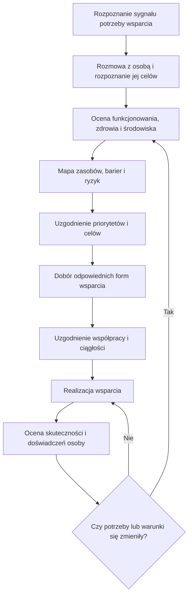
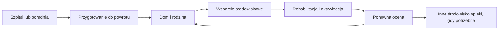

# 10.1. Pojęcie opieki społecznej i opieki nad osobą przewlekle chorą

**Kurs:** Kurs uwolnienia  
**Moduł:** 10. Opieka społeczna, rodzinna i środowiskowa  
**Rozdział:** 10.1. Pojęcie opieki społecznej i opieki nad osobą przewlekle chorą  
**Stan odniesienia prawnego i merytorycznego:** 26 listopada 2026 r.  
**Charakter materiału:** opracowanie dydaktyczne, społeczno-opiekuńcze, zdrowotne i organizacyjne

> **Myśl przewodnia:** opieka nie jest przejęciem życia drugiego człowieka, lecz odpowiedzialnym towarzyszeniem mu w zachowaniu godności, bezpieczeństwa, możliwie największej samodzielności i więzi ze wspólnotą. Jej miarą nie jest liczba wykonanych czynności, lecz to, czy człowiek otrzymuje właściwą pomoc, we właściwym czasie i miejscu, z poszanowaniem jego woli, potrzeb, relacji oraz prawa do uczestniczenia w życiu społecznym.

---

## Wprowadzenie

Długotrwała choroba, niesamodzielność, niepełnosprawność, podeszły wiek lub nagłe pogorszenie sprawności mogą zmienić codzienne funkcjonowanie człowieka i całej jego rodziny. Zmiana ta nie ogranicza się do sfery medycznej. Dotyka sposobu poruszania się, odżywiania, higieny, komunikowania, pracy, nauki, prowadzenia gospodarstwa domowego, uczestnictwa w życiu religijnym i społecznym, relacji rodzinnych, bezpieczeństwa ekonomicznego oraz poczucia własnej wartości.

Właśnie dlatego opieki nie należy utożsamiać wyłącznie z pielęgnacją, pomocą przy myciu, podawaniem posiłków ani wykonywaniem czynności za osobę chorą. Rzetelna opieka obejmuje również rozpoznanie potrzeb, wzmacnianie zachowanych zdolności, rehabilitację i profilaktykę, edukację, wspieranie samodzielności, ochronę przed izolacją, ułatwianie kontaktów z otoczeniem, odciążanie opiekunów oraz koordynację pomocy.

W polskim porządku prawnym ważnym punktem odniesienia jest ustawa z 11 czerwca 2026 r. o osobach starszych i koordynacji opieki długoterminowej (Dz. U. z 2026 r. poz. 986), obowiązująca zasadniczo od 7 sierpnia 2026 r. Ustawa określa opiekę długoterminową jako system usług i świadczeń dla osób wymagających wsparcia w codziennym funkcjonowaniu lub w realizacji zaleceń terapeutycznych. Jej celem jest ograniczanie utraty sprawności, utrzymywanie lub poprawa samodzielności i niezależności, z poszanowaniem godności osoby oraz z uwzględnieniem wsparcia opiekunów nieformalnych i osób bliskich. Ustawa łączy w jednym ujęciu świadczenia ochrony zdrowia, pomocy społecznej i zabezpieczenia społecznego, nie znosząc odrębnych zasad kwalifikowania do poszczególnych świadczeń.[1]

Rozdział przedstawia pojęcia i zasady, które pozwalają zrozumieć, dlaczego opieka nad osobą przewlekle chorą powinna być indywidualna, wielowymiarowa, ciągła i osadzona w środowisku życia. Nie zastępuje szczegółowego omówienia form prawnych i organizacyjnych opieki, które znajduje się w rozdziale 10.2, ani rozdziału poświęconego odpowiedzialności i obowiązkom podmiotów opiekuńczych. Koncentruje się na znaczeniu opieki, potrzebach osób i rodzin oraz na podstawach budowania systemu wsparcia.

## 1. Cel, zakres i efekty kształcenia

### 1.1. Cel rozdziału

Celem rozdziału jest przygotowanie uczestnika do rozumienia opieki społecznej i opieki nad osobą przewlekle chorą jako złożonego procesu wspierania człowieka w codziennym życiu. Proces ten powinien uwzględniać jednocześnie:

- stan zdrowia i przebieg choroby;
- sprawność fizyczną, psychiczną i poznawczą;
- możliwości wykonywania czynności dnia codziennego;
- potrzeby emocjonalne, społeczne, rodzinne i duchowe;
- warunki mieszkaniowe i dostępność otoczenia;
- zasoby, możliwości i ograniczenia rodziny;
- sieć wsparcia nieformalnego i formalnego;
- sytuację materialną i zawodową;
- preferencje, cele i decyzje samej osoby;
- ryzyko izolacji, zaniedbania, przemocy i wykluczenia.

Celem praktycznym jest nauczenie się odróżniania pomocy, która wzmacnia samodzielność, od pomocy, która niepotrzebnie odbiera człowiekowi sprawczość. Wsparcie powinno być wystarczające, lecz nie nadmiernie zastępujące; bezpieczne, lecz nie ograniczające wolności ponad konieczność; profesjonalne, lecz nie pozbawione ludzkiej bliskości.

### 1.2. Zakres opracowania

Rozdział rozwija dwanaście pozycji wskazanych w spisie treści:

1. opieka nad osobami długotrwale chorymi;
2. opieka nad osobami niesamodzielnymi;
3. opieka nad osobami z niepełnosprawnościami;
4. opieka nad seniorami;
5. pomoc osobom wymagającym stałego wsparcia;
6. opieka domowa;
7. opieka środowiskowa;
8. opieka rodzinna;
9. opieka organizowana przez fundację;
10. wsparcie opiekunów nieformalnych;
11. wsparcie rodzin osób przewlekle chorych;
12. działania na rzecz przeciwdziałania wykluczeniu społecznemu.

### 1.3. Efekty uczenia się

Po ukończeniu rozdziału uczestnik powinien umieć:

1. wyjaśnić różnicę między opieką społeczną, pomocą społeczną, opieką zdrowotną i opieką długoterminową;
2. opisać, dlaczego przewlekła choroba nie jest równoznaczna z niesamodzielnością;
3. odróżnić rozpoznanie choroby od oceny funkcjonowania człowieka;
4. wskazać podstawowe wymiary potrzeb osoby wymagającej długotrwałego wsparcia;
5. wyjaśnić znaczenie modelu biopsychospołecznego i klasyfikacji ICF;
6. rozpoznać różnicę między niepełnosprawnością, ograniczeniem aktywności, zależnością od pomocy i brakiem autonomii;
7. scharakteryzować potrzeby osób starszych bez posługiwania się stereotypami wieku;
8. opisać rolę środowiska domowego, lokalnego i rodzinnego w procesie opieki;
9. wskazać zasady organizowania opieki przez fundację w granicach jej kompetencji;
10. rozpoznać potrzeby i obciążenia opiekunów nieformalnych;
11. wyjaśnić, w jaki sposób opieka może przeciwdziałać wykluczeniu społecznemu;
12. przygotować wstępną, wielowymiarową mapę potrzeb osoby i jej rodziny.

### 1.4. Granice rozdziału

Rozdział nie jest instrukcją wykonywania procedur medycznych ani pielęgniarskich. Nie nadaje uprawnień zawodowych i nie zastępuje kwalifikacji do świadczeń finansowanych ze środków publicznych. Nie należy na jego podstawie samodzielnie diagnozować chorób, zmieniać leczenia, oceniać zdolności do czynności prawnych ani rozstrzygać o umieszczeniu osoby w placówce całodobowej.

W dalszych częściach kursu należy osobno analizować:
- formy wykonywania obowiązków opiekuńczych – rozdział 10.2;
- odpowiedzialność prawną, organizacyjną i zawodową podmiotów – zgodnie z kolejnymi pozycjami modułu;
- ochronę danych i dokumentację – w powiązaniu z rozdziałem 9.3;
- bezpieczeństwo finansowe i organizacyjne – w powiązaniu z rozdziałami 8.3 i 9.2.

---

## 2. Podstawowe pojęcia i rozróżnienia

### 2.1. Opieka społeczna a pomoc społeczna

W języku potocznym określenie „opieka społeczna” bywa używane szeroko na oznaczenie pomocy osobom, które z powodu choroby, wieku, niepełnosprawności, ubóstwa lub innych trudności potrzebują wsparcia. W prawie polskim podstawową nazwą instytucji polityki społecznej regulowanej ustawą z 12 marca 2004 r. jest jednak „pomoc społeczna”.

Pomoc społeczna służy umożliwianiu osobom i rodzinom przezwyciężania trudnych sytuacji życiowych, których nie są w stanie pokonać przy wykorzystaniu własnych uprawnień, zasobów i możliwości. Ustawa wymienia między innymi niepełnosprawność oraz długotrwałą lub ciężką chorobę jako okoliczności mogące uzasadniać udzielenie pomocy. Nie oznacza to, że samo rozpoznanie choroby automatycznie daje prawo do każdej usługi lub świadczenia. Każda forma wsparcia ma własne przesłanki, tryb, kryteria i zakres.[2]

W niniejszym kursie określenie „opieka społeczna” jest używane jako pojęcie szerokie, obejmujące działania wspierające człowieka w środowisku życia. Gdy mowa o konkretnym uprawnieniu ustawowym, należy stosować właściwą nazwę prawną: pomoc społeczna, usługi opiekuńcze, świadczenia opieki zdrowotnej, świadczenia z zabezpieczenia społecznego, usługi społeczne albo opieka długoterminowa.

### 2.2. Opieka zdrowotna

Opieka zdrowotna obejmuje działania służące zachowaniu, przywracaniu lub poprawie zdrowia, w tym rozpoznawanie chorób, leczenie, pielęgnowanie, rehabilitację, profilaktykę i edukację zdrowotną. Świadczenia zdrowotne są udzielane przez osoby i podmioty działające na podstawie przepisów regulujących wykonywanie zawodów medycznych oraz działalność leczniczą.

Nie każda pomoc osobie chorej jest świadczeniem zdrowotnym. Przygotowanie posiłku, pomoc w zakupach, towarzyszenie podczas spaceru czy wsparcie w utrzymaniu kontaktów społecznych mogą mieć charakter społeczny lub opiekuńczy. Z kolei wykonywanie określonych procedur medycznych, diagnozowanie, ordynowanie leczenia i świadczenia pielęgniarskie podlegają odrębnym regulacjom.

Granica ta ma znaczenie dla fundacji i organizacji społecznych. Organizacja może prowadzić działania wspierające, edukacyjne, integracyjne i pomocowe w zakresie zgodnym z prawem, statutem, warunkami finansowania i posiadanymi zasobami. Jeżeli zamierza wykonywać działalność leczniczą, musi spełnić wymagania właściwe dla podmiotu wykonującego działalność leczniczą. Samo użycie w statucie określenia „opieka medyczna” lub „rehabilitacja” nie tworzy uprawnień do udzielania wszystkich świadczeń zdrowotnych.

### 2.3. Opieka długoterminowa

Ustawa z 11 czerwca 2026 r. o osobach starszych i koordynacji opieki długoterminowej wprowadziła wspólne ujęcie opieki długoterminowej jako systemu usług i świadczeń dla osób wymagających wsparcia w codziennym funkcjonowaniu lub w realizacji zaleceń terapeutycznych. Wsparcie ustala się indywidualnie, według kryteriów właściwych dla danej usługi lub świadczenia. Celem jest ograniczanie utraty sprawności, utrzymanie albo poprawa samodzielności i niezależności oraz wsparcie opiekunów nieformalnych i osób bliskich.[1]

Opieka długoterminowa nie jest synonimem pobytu w placówce całodobowej. Może być realizowana w różnych środowiskach, a ustawa nakazuje dążyć do zapewniania usług w miejscu zamieszkania osoby wymagającej wsparcia, jeżeli jest to możliwe i odpowiednie do jej potrzeb. System obejmuje świadczenia wynikające z odrębnych przepisów, w tym z zakresu ochrony zdrowia, pomocy społecznej i zabezpieczenia społecznego.

### 2.4. Opieka, pielęgnacja, rehabilitacja i wsparcie

Pojęcia te są powiązane, ale nie są zamienne.

| Pojęcie | Główny sens | Przykładowy cel |
|:--|:--|:--|
| Opieka | Towarzyszenie i pomoc w zaspokajaniu potrzeb oraz zachowaniu bezpieczeństwa | Umożliwienie bezpiecznego funkcjonowania w domu |
| Pielęgnacja | Czynności służące utrzymaniu higieny, komfortu, zdrowia i zapobieganiu powikłaniom | Ochrona skóry, higiena, obserwacja stanu |
| Leczenie | Postępowanie ukierunkowane na chorobę lub jej objawy | Kontrola choroby i ograniczanie jej następstw |
| Rehabilitacja | Przywracanie, rozwijanie lub utrzymywanie możliwie najlepszego funkcjonowania | Poprawa mobilności i sprawności |
| Wsparcie społeczne | Wzmacnianie relacji, uczestnictwa, samodzielności i dostępu do zasobów | Ograniczenie izolacji i wykluczenia |
| Asystowanie | Pomoc w wykonaniu czynności zgodnie z wolą i sposobem działania osoby | Umożliwienie wyjścia z domu i załatwienia spraw |
| Koordynacja | Łączenie działań różnych podmiotów i osób w spójny proces | Ograniczenie luk i dublowania pomocy |

W praktyce jedna osoba może jednocześnie korzystać z leczenia, rehabilitacji, pomocy rodziny, usług społecznych i wsparcia sąsiedzkiego. Właściwa organizacja polega na takim połączeniu tych elementów, aby się uzupełniały, a nie wzajemnie wykluczały.

### 2.5. Choroba przewlekła – znaczenie kliniczne i społeczne

Choroba przewlekła to stan zdrowia o długotrwałym przebiegu, często wymagający systematycznego leczenia, monitorowania, samoopieki lub okresowej rehabilitacji. Może mieć charakter stabilny, postępujący, nawrotowy albo przebiegać z okresami zaostrzeń i remisji. Nie istnieje jeden uniwersalny próg czasowy, który we wszystkich dziedzinach prawa i medycyny rozstrzygałby, czy dana choroba jest przewlekła. W określonym kontekście prawnym należy posługiwać się definicją przyjętą w przepisie szczególnym.

W pomocy społecznej ustawa posługuje się pojęciem „długotrwałej lub ciężkiej choroby” jako jedną z okoliczności uzasadniających pomoc. Nie tworzy to automatycznego, jednolitego prawa do wszystkich świadczeń opiekuńczych. O konkretnym uprawnieniu decydują właściwe przepisy i indywidualna sytuacja osoby.[2]

Przewlekłość choroby nie przesądza o poziomie niesamodzielności. Osoba z dobrze kontrolowaną chorobą przewlekłą może samodzielnie pracować, prowadzić gospodarstwo domowe i uczestniczyć w życiu społecznym. Inna osoba z tym samym rozpoznaniem może potrzebować znacznego wsparcia z powodu powikłań, ograniczeń ruchowych, zaburzeń poznawczych, barier architektonicznych lub braku dostępnej pomocy.

### 2.6. Niesamodzielność, zależność i autonomia

Niesamodzielność należy rozumieć funkcjonalnie: jako trudność lub niemożność samodzielnego wykonywania określonych czynności, podejmowania działań lub organizowania codziennego życia bez pomocy innych osób, urządzeń wspomagających albo dostosowania środowiska.

Niesamodzielność nie jest cechą całej osoby. Człowiek może potrzebować pomocy przy kąpieli, ale samodzielnie podejmować decyzje, zarządzać pieniędzmi, utrzymywać relacje i wybierać sposób spędzania czasu. Może także wymagać pomocy w przemieszczaniu się, lecz zachowywać pełną zdolność do wyrażania preferencji i kierowania swoim życiem.

Autonomia oznacza prawo do dokonywania wyborów i wpływania na własne życie. Nie należy utożsamiać jej z całkowitą fizyczną niezależnością. Człowiek może korzystać z intensywnego wsparcia i nadal zachowywać podmiotowość oraz prawo do decydowania.

### 2.7. Niepełnosprawność

Niepełnosprawność nie jest wyłącznie cechą organizmu ani prostym następstwem rozpoznania medycznego. W ujęciu praw człowieka i modelu biopsychospołecznego ograniczenia funkcjonowania powstają w interakcji stanu zdrowia człowieka z barierami i czynnikami wspierającymi w środowisku.

Osoba poruszająca się na wózku może napotykać ograniczenia przede wszystkim dlatego, że budynek nie ma windy, chodnik jest niedostępny, a transport nie jest dostosowany. Usunięcie bariery może zwiększyć jej samodzielność bez zmiany stanu zdrowia.

Konwencja ONZ o prawach osób niepełnosprawnych podkreśla prawo do życia w społeczności, wyboru miejsca zamieszkania i korzystania z usług wsparcia w domu oraz w środowisku lokalnym. Celem nie jest izolowanie osoby, lecz zapewnienie jej rzeczywistego uczestnictwa i równych możliwości.[6]

### 2.8. Senior i osoba starsza

W ustawie z 11 czerwca 2026 r. o osobach starszych i koordynacji opieki długoterminowej osoba starsza to osoba, która ukończyła 60 lat.[1] Jest to definicja ustawowa dla celów tej regulacji. Nie oznacza ona, że każda osoba po 60. roku życia wymaga opieki.

Należy odróżnić:
- wiek metrykalny;
- wiek biologiczny i stan zdrowia;
- sprawność funkcjonalną;
- sytuację społeczną i rodzinną;
- poziom samodzielności;
- indywidualne potrzeby i preferencje.

Osoby starsze są grupą zróżnicowaną. Część pozostaje aktywna zawodowo, społecznie i rodzinnie; inne potrzebują okresowego wsparcia, a część – intensywnej opieki. Planowanie opieki na podstawie samego wieku prowadzi do stereotypów i błędów.

---

## 3. Opieka nad osobami długotrwale chorymi

### 3.1. Zróżnicowanie potrzeb

Osoby długotrwale chore nie tworzą jednolitej grupy. Różnią się rodzajem choroby, wiekiem, rokowaniem, poziomem sprawności, sytuacją rodzinną, zasobami finansowymi, dostępnością usług oraz zdolnością do samoopieki.

W praktyce można wyróżnić kilka ogólnych przebiegów:

1. **Stan przewlekły stabilny** – choroba pozostaje pod kontrolą, a głównym zadaniem jest monitorowanie, profilaktyka i utrzymywanie aktywności.
2. **Stan z okresowymi zaostrzeniami** – występują okresy względnej stabilizacji i pogorszenia, wymagające elastycznego dostosowania wsparcia.
3. **Stan postępujący** – z czasem mogą narastać ograniczenia funkcjonalne i potrzeba pomocy.
4. **Wielochorobowość** – jednoczesne występowanie kilku schorzeń, które wzajemnie wpływają na leczenie, mobilność, odżywianie, nastrój i samodzielność.
5. **Stan po ostrym zdarzeniu** – na przykład po udarze, urazie lub ciężkiej infekcji, kiedy konieczne jest przejście od leczenia ostrego do rehabilitacji i wsparcia w środowisku życia.
6. **Stan zaawansowany lub terminalny** – priorytetem stają się komfort, łagodzenie objawów, wsparcie psychiczne, rodzinne i – zgodnie z potrzebą – opieka paliatywna lub hospicyjna.

Powyższe kategorie mają charakter dydaktyczny. Nie zastępują rozpoznania klinicznego ani prognozy lekarskiej.

### 3.2. Skutki choroby dla codziennego życia

Choroba może wpływać na różne obszary funkcjonowania:

- **ruchowy:** osłabienie, ból, ograniczenie zakresu ruchu, zaburzenia równowagi, ryzyko upadków;
- **oddechowy i krążeniowy:** duszność, męczliwość, ograniczenie tolerancji wysiłku;
- **neurologiczny:** niedowłady, zaburzenia czucia, koordynacji, mowy lub połykania;
- **poznawczy:** trudności z pamięcią, uwagą, planowaniem i orientacją;
- **emocjonalny:** lęk, obniżenie nastroju, frustracja, poczucie utraty kontroli;
- **społeczny:** ograniczenie kontaktów, wycofanie z pracy, nauki, życia religijnego lub lokalnego;
- **ekonomiczny:** dodatkowe koszty leczenia, sprzętu, transportu, utrata dochodu;
- **rodzinny:** zmiana podziału obowiązków, przeciążenie bliskich, konflikty lub konieczność reorganizacji życia.

Nie należy zakładać, że wszystkie te skutki występują u każdej osoby. Rozpoznanie choroby jest punktem wyjścia do rozmowy, a nie gotowym opisem potrzeb.

### 3.3. Wielochorobowość i ciągłość wsparcia

Wielochorobowość może powodować sprzeczne wymagania dotyczące aktywności, żywienia, farmakoterapii i rehabilitacji. Osoba z chorobą układu krążenia, cukrzycą, przewlekłym bólem i zaburzeniami równowagi może potrzebować skoordynowanego postępowania kilku specjalistów.

W takim przypadku istotne jest:
- ustalenie priorytetów zgodnych z celami pacjenta;
- unikanie dublowania zaleceń;
- przekazywanie istotnych informacji między podmiotami za zgodą i na podstawie właściwej podstawy prawnej;
- uwzględnienie obciążenia leczeniem;
- dostosowanie zaleceń do możliwości domowych;
- edukacja pacjenta i opiekunów;
- ponowna ocena po zmianie stanu zdrowia.

Ciągłość opieki oznacza, że człowiek nie zostaje bez wsparcia przy przejściu ze szpitala do domu, z rehabilitacji do codziennego życia albo z opieki domowej do placówki. Każda zmiana środowiska może wiązać się z ryzykiem utraty informacji, leków, sprzętu, kontaktu z personelem lub ciągłości rehabilitacji.

### 3.4. Nie wyręczać tam, gdzie można wspierać

Wykonywanie wszystkich czynności za osobę chorą może pozornie przyspieszać opiekę, lecz z czasem prowadzić do ograniczenia aktywności i utraty zachowanych umiejętności. Jeżeli osoba potrafi samodzielnie umyć twarz, przygotować prosty posiłek albo wykonać część transferu, należy umożliwić jej udział w tych czynnościach w bezpiecznym zakresie.

Pomoc powinna być stopniowana:
1. przygotowanie otoczenia i usunięcie przeszkód;
2. udostępnienie potrzebnego sprzętu;
3. instrukcja słowna lub przypomnienie;
4. asekuracja;
5. częściowa pomoc fizyczna;
6. pełne wykonanie czynności przez opiekuna, jeżeli jest to konieczne.

Zasada ta nie może prowadzić do narażania człowieka na upadek, uraz, aspirację, przeciążenie lub inne niebezpieczeństwo. Zakres udziału osoby powinien wynikać z jej aktualnych możliwości i oceny ryzyka.

---

## 4. Opieka nad osobami niesamodzielnymi

### 4.1. Samodzielność jako zespół zdolności

Samodzielność nie jest jedną, niepodzielną cechą. Obejmuje różne zdolności, które mogą być zachowane lub ograniczone w odmiennym stopniu.

W ocenie funkcjonalnej często rozróżnia się:
- podstawowe czynności dnia codziennego (ADL);
- złożone, instrumentalne czynności dnia codziennego (IADL);
- aktywność społeczną i uczestnictwo;
- zdolność do komunikowania potrzeb;
- zdolność do organizowania leczenia i samoopieki;
- bezpieczeństwo podejmowania określonych czynności w danym środowisku.

Przykładowe podstawowe czynności dnia codziennego:
- spożywanie posiłków;
- przemieszczanie się i zmiana pozycji;
- korzystanie z toalety;
- ubieranie i rozbieranie;
- kąpiel i higiena osobista;
- kontrolowanie czynności fizjologicznych.

Przykładowe czynności instrumentalne:
- zakupy;
- przygotowywanie posiłków;
- prowadzenie gospodarstwa domowego;
- korzystanie z telefonu i komunikacji;
- gospodarowanie pieniędzmi;
- przyjmowanie leków zgodnie z zaleceniami;
- organizowanie transportu i wizyt;
- załatwianie spraw urzędowych.

Osoba może być samodzielna w ADL, a jednocześnie wymagać wsparcia w IADL. Może też wykonywać czynności fizyczne, lecz potrzebować pomocy w organizowaniu dnia z powodu zaburzeń pamięci lub funkcji wykonawczych.

### 4.2. Ocena funkcjonalna

Ocena funkcjonalna powinna odpowiadać na pytanie: co dana osoba potrafi zrobić samodzielnie, co wykonuje z pomocą, co jest dla niej niemożliwe lub niebezpieczne i jakie warunki umożliwią jej większą samodzielność?

Warto uwzględnić:
- sposób wykonania czynności;
- czas i wysiłek potrzebny do jej wykonania;
- jakość i bezpieczeństwo wykonania;
- potrzebny rodzaj pomocy;
- zmienność możliwości w ciągu dnia;
- wpływ bólu, zmęczenia, duszności lub lęku;
- dostępność sprzętu i dostosowania otoczenia;
- preferencje osoby.

Ocena powinna być powtarzana, ponieważ funkcjonowanie może się zmieniać. Jednorazowy wynik nie zawsze odzwierciedla typowy dzień.

### 4.3. Narzędzia oceny

W praktyce klinicznej i opiekuńczej stosuje się różne narzędzia, między innymi:
- skalę Barthel – do oceny wybranych podstawowych czynności i stopnia samodzielności;
- indeks ADL Katza – do oceny podstawowych czynności dnia codziennego;
- skalę Lawtona – do oceny wybranych czynności instrumentalnych;
- narzędzia oceny ryzyka upadków;
- skale oceny bólu;
- narzędzia oceny stanu odżywienia i ryzyka odleżyn;
- narzędzia oceny funkcji poznawczych;
- listy kontrolne ICF i profile funkcjonowania.

Narzędzia należy dobierać do celu oceny i kompetencji osoby badającej. Wynik skali nie zastępuje rozmowy, obserwacji, badania klinicznego ani oceny środowiska.

**Ważne rozróżnienie prawne:** w rozporządzeniu dotyczącym świadczeń gwarantowanych w ramach opieki długoterminowej skala Barthel i próg 40 punktów lub mniej są elementem kryteriów określonych dla konkretnych świadczeń, w tym opieki pielęgniarskiej długoterminowej domowej i świadczeń stacjonarnych. Nie jest to uniwersalna granica niesamodzielności ani ogólny warunek korzystania ze wszystkich usług społecznych.[5]

### 4.4. Niesamodzielność a autonomia

Osoba wymagająca pomocy w czynnościach fizycznych nadal ma prawo:
- decydować o sposobie spędzania czasu;
- wybierać ubranie i posiłki w granicach bezpieczeństwa;
- określać, kto i kiedy ma jej pomagać;
- uczestniczyć w ustalaniu celów wsparcia;
- utrzymywać relacje rodzinne i społeczne;
- wyrażać zgodę lub sprzeciw w granicach właściwych przepisów;
- zachować prywatność, intymność i dostęp do rzeczy osobistych.

Pomoc nie powinna prowadzić do infantylizacji, lekceważenia wypowiedzi ani podejmowania wszystkich decyzji za osobę. Nawet gdy komunikowanie jest utrudnione, należy poszukiwać sposobów rozpoznania jej preferencji: prostego języka, obrazów, gestów, urządzeń wspomagających komunikację, odpowiedniego czasu i udziału zaufanej osoby – o ile jest to zgodne z wolą osoby i prawem.

---

## 5. Opieka nad osobami z niepełnosprawnościami

### 5.1. Model medyczny, społeczny i biopsychospołeczny

Model medyczny koncentruje się na chorobie, uszkodzeniu lub zaburzeniu funkcji organizmu. Jest niezbędny w diagnostyce i leczeniu, lecz sam nie wyjaśnia wszystkich trudności w codziennym życiu.

Model społeczny zwraca uwagę na bariery środowiskowe, architektoniczne, komunikacyjne, organizacyjne i postawy społeczne. Ograniczenia uczestnictwa mogą wynikać nie tylko z cech organizmu, lecz także z niedostępnych budynków, transportu, informacji, usług i stereotypów.

Model biopsychospołeczny łączy te perspektywy. Uwzględnia stan zdrowia, funkcje i struktury ciała, aktywność, uczestnictwo oraz czynniki środowiskowe i osobiste. Takie podejście rozwija Międzynarodowa Klasyfikacja Funkcjonowania, Niepełnosprawności i Zdrowia WHO (ICF).[7]

### 5.2. ICF jako rama rozumienia potrzeb

ICF nie jest wyłącznie listą kodów ani testem kwalifikującym do świadczeń. To system opisu funkcjonowania człowieka w kontekście życia.

Podstawowe obszary:
1. funkcje organizmu;
2. struktury organizmu;
3. aktywność;
4. uczestnictwo;
5. czynniki środowiskowe;
6. czynniki osobiste – rozważane w ocenie funkcjonowania, choć nie klasyfikowane kodami ICF.

Przykład: osoba po udarze może mieć niedowład kończyny górnej, ograniczoną zdolność ubierania się i trudność w powrocie do pracy. Barierą może być brak poręczy, niedostępny transport lub nieprzystosowane stanowisko. Czynnikiem wspierającym mogą być rehabilitacja, sprzęt, pomoc rodziny, asystencja, elastyczna organizacja pracy i dostępna komunikacja.

Ocena nie powinna kończyć się na stwierdzeniu „pacjent ma niedowład”. Należy ustalić, jakie czynności są ograniczone, jakie cele są ważne dla osoby i które bariery można usunąć.

### 5.3. Różnorodność potrzeb

Osoby z niepełnosprawnościami mogą potrzebować różnego rodzaju wsparcia, na przykład:
- pomocy w mobilności;
- asystowania w czynnościach dnia codziennego;
- dostępu do komunikacji alternatywnej i wspomagającej;
- dostosowania informacji;
- wsparcia sensorycznego;
- rehabilitacji;
- pomocy w edukacji i pracy;
- wsparcia psychologicznego;
- dostosowania mieszkania i transportu;
- pomocy w budowaniu relacji i uczestnictwie w życiu społecznym.

Nie należy zakładać, że rodzaj niepełnosprawności przesądza o wszystkich potrzebach. Dwie osoby z tym samym rozpoznaniem mogą mieć zupełnie inne cele, zasoby, ograniczenia i preferencje.

### 5.4. Niezależne życie i uczestnictwo w społeczności

Konwencja ONZ o prawach osób niepełnosprawnych podkreśla prawo do życia w społeczności z możliwościami wyboru równymi innym osobom. Obejmuje to możliwość wyboru miejsca zamieszkania, dostępu do usług wsparcia w domu i w środowisku lokalnym oraz korzystania z usług powszechnych na równych zasadach.[6]

Niezależne życie nie oznacza życia bez pomocy. Oznacza możliwość decydowania o swoim życiu przy takim wsparciu, które umożliwia wybór i uczestnictwo. Wysoki poziom potrzeb opiekuńczych nie powinien automatycznie prowadzić do uznania, że jedynym rozwiązaniem jest izolacja instytucjonalna.

### 5.5. Dostępność jako element opieki

Dostępność należy rozpatrywać w kilku wymiarach:
- architektonicznym;
- cyfrowym;
- informacyjno-komunikacyjnym;
- organizacyjnym;
- transportowym;
- społecznym.

Dostosowanie otoczenia może obejmować usunięcie progów, poręcze, odpowiednie oświetlenie, czytelne oznaczenia, dostępne toalety, możliwość odpoczynku, prosty język, tłumaczenie na język migowy, napisy, komunikację alternatywną oraz dostęp do usług bez zbędnych barier.

Dostępność nie jest dodatkiem estetycznym. Może decydować o tym, czy osoba będzie mogła samodzielnie dotrzeć do lekarza, uczestniczyć w spotkaniu, skorzystać z pomocy lub utrzymywać relacje.

---

## 6. Opieka nad seniorami

### 6.1. Starzenie się jako proces zróżnicowany

Starzenie się jest naturalnym procesem biologicznym, psychologicznym i społecznym. Nie przebiega jednakowo u wszystkich. Wiek metrykalny nie jest wystarczającym wskaźnikiem sprawności, potrzeb ani jakości życia.

W ocenie sytuacji seniora należy uwzględnić:
- stan zdrowia i wielochorobowość;
- mobilność, równowagę i ryzyko upadków;
- odżywienie i nawodnienie;
- funkcje poznawcze i zmysły;
- nastrój i dobrostan psychiczny;
- relacje rodzinne i społeczne;
- warunki mieszkaniowe;
- sytuację finansową;
- dostęp do transportu i usług;
- poczucie bezpieczeństwa;
- cele, zainteresowania i preferencje.

### 6.2. Zdolność funkcjonalna i podejście ICOPE

WHO rozwija podejście ICOPE (Integrated Care for Older People), którego celem jest wspieranie zdolności funkcjonalnej osób starszych poprzez wczesne rozpoznawanie potrzeb, zintegrowaną ocenę, planowanie działań w podstawowej opiece zdrowotnej i środowisku oraz udział samej osoby. Drugie wydanie wytycznych WHO z 2025 r. rozwija ocenę skoncentrowaną na człowieku i ścieżki opieki w podstawowej opiece zdrowotnej.[8]

W praktyce należy zwracać uwagę na:
- zdolność poruszania się;
- odżywienie i utrzymanie masy mięśniowej;
- wzrok i słuch;
- pamięć i funkcje poznawcze;
- nastrój;
- choroby przewlekłe;
- zdolność do wykonywania codziennych czynności;
- relacje i uczestnictwo;
- warunki środowiskowe.

Celem nie jest wyłącznie wykrywanie deficytów, ale wzmacnianie zasobów i utrzymywanie sprawności. Wspieranie aktywności fizycznej, społecznej i poznawczej powinno być dostosowane do stanu zdrowia i preferencji osoby.

### 6.3. Przeciwdziałanie ageizmowi

Ageizm to stereotypowe, uprzedzone lub dyskryminujące traktowanie człowieka ze względu na wiek. W opiece może przejawiać się:
- automatycznym zakładaniem, że senior nie rozumie informacji;
- pomijaniem go w rozmowie i zwracaniem się wyłącznie do rodziny;
- uznawaniem bólu, smutku lub ograniczeń za „normalne w tym wieku” bez oceny;
- odbieraniem prawa do wyboru;
- infantylizowaniem wypowiedzi;
- ograniczaniem aktywności bez rzeczywistej potrzeby.

Właściwa opieka wymaga indywidualnej oceny, szacunku i uwzględniania doświadczenia życiowego osoby. Senior nie jest wyłącznie odbiorcą pomocy; może być także opiekunem, wolontariuszem, nauczycielem, członkiem wspólnoty i aktywnym uczestnikiem życia lokalnego.

### 6.4. Definicja osoby starszej a Bon Senioralny

Należy odróżnić ustawową definicję osoby starszej od kryterium wieku w konkretnym programie. Ustawa z 2026 r. określa osobę starszą jako osobę, która ukończyła 60 lat. Natomiast Bon Senioralny jest formą wsparcia przewidzianą dla seniora, który ukończył 65 lat, spełnia kryteria ustawowe i ma niezaspokojone potrzeby w podstawowych czynnościach życia codziennego.[1]

Program Bonu Senioralnego na lata 2026–2028 został określony rozporządzeniem Rady Ministrów z 29 września 2026 r. Bon nie jest wypłatą gotówki do swobodnego dysponowania przez seniora, lecz formą usług wsparcia organizowanych przez gminę. Według stanu na 26 listopada 2026 r. ustawa wskazuje kryterium średniego miesięcznego dochodu seniora z trzech miesięcy poprzedzających złożenie wniosku nieprzekraczające 3410 zł, z mechanizmem waloryzacji. Szczegółowe warunki i dostępność należy każdorazowo sprawdzać w aktualnym programie oraz w gminie właściwej dla miejsca zamieszkania.[1][12]

Nie wolno utożsamiać Bonu Senioralnego z powszechnym prawem każdej osoby po 65. roku życia do określonej liczby godzin pomocy. Przyznanie wsparcia zależy od warunków programu, oceny potrzeb i dostępności realizacji.

---

## 7. Pomoc osobom wymagającym stałego wsparcia

### 7.1. Stałość potrzeby nie oznacza niezmienności potrzeb

Osoba może wymagać pomocy codziennie, przez wiele miesięcy lub lat. Nie oznacza to, że zakres pomocy pozostaje taki sam. Stan zdrowia, sprawność, warunki rodzinne, możliwości opiekunów i potrzeby społeczne zmieniają się w czasie.

Dlatego należy odróżniać:
- stałą potrzebę obecności lub nadzoru;
- regularną pomoc w wybranych czynnościach;
- okresową pomoc podczas zaostrzeń choroby;
- pomoc doraźną po zdarzeniu;
- intensywną opiekę w określonych porach dnia;
- potrzebę całodobowego zabezpieczenia.

Nie można ustalać intensywności wsparcia wyłącznie na podstawie nazwy choroby. Znaczenie ma rzeczywiste funkcjonowanie, ryzyko i dostępność bezpiecznej pomocy.

### 7.2. Intensywność, częstotliwość i czas trwania

Wstępny opis potrzeb powinien uwzględniać trzy odrębne parametry:

| Parametr | Pytanie | Przykład |
|:--|:--|:--|
| Intensywność | Jak dużo pomocy potrzeba przy jednej czynności? | Asekuracja, częściowa pomoc, pełna pomoc |
| Częstotliwość | Jak często pomoc jest potrzebna? | Raz dziennie, kilka razy dziennie, nieregularnie |
| Czas trwania | Jak długo potrzeba będzie występować? | Kilka tygodni, okres rehabilitacji, potrzeba długotrwała |

Dodatkowo należy ocenić, czy potrzeba pomocy występuje w przewidywalnych godzinach, czy może pojawiać się nagle. Ważne jest także, czy osoba może bezpiecznie pozostawać sama przez określony czas.

### 7.3. Bezpieczeństwo a nadmierna kontrola

Stałe wsparcie nie powinno oznaczać nieustannego nadzoru bez uzasadnienia. Należy dobrać poziom zabezpieczenia do rzeczywistego ryzyka. Wspierające rozwiązania mogą obejmować:
- odpowiednie oświetlenie i usunięcie przeszkód;
- poręcze i sprzęt pomocniczy;
- system przywoławczy;
- telefon lub urządzenie alarmowe;
- plan kontaktu w razie pogorszenia;
- dostosowanie harmonogramu pomocy;
- szkolenie opiekunów;
- konsultację z personelem medycznym.

Rozwiązania ograniczające wolność, takie jak przymus, izolacja czy unieruchomienie, nie mogą być stosowane jako wygodny sposób organizowania opieki. Wymagają szczególnej oceny prawnej, klinicznej i etycznej, a ich dopuszczalność jest ściśle ograniczona przepisami.

### 7.4. Ciągłość w sytuacjach przejściowych

Szczególnie podatne na przerwanie opieki są momenty:
- wypisu ze szpitala;
- zmiany miejsca zamieszkania;
- zakończenia rehabilitacji;
- śmierci lub choroby głównego opiekuna;
- nagłego pogorszenia stanu zdrowia;
- utraty dostępu do dotychczasowej usługi;
- zmiany sytuacji finansowej rodziny.

W planowaniu należy przewidywać rozwiązania zastępcze i osoby kontaktowe. Brak opiekuna w weekend, święto lub podczas choroby osoby bliskiej może stworzyć realne zagrożenie dla zdrowia i życia.

---

## 8. Opieka domowa

### 8.1. Dom jako środowisko życia

Opieka domowa polega na wspieraniu osoby w jej własnym środowisku, z uwzględnieniem przyzwyczajeń, relacji, przedmiotów osobistych i poczucia przynależności. Dla wielu osób pozostanie w domu sprzyja zachowaniu autonomii, kontaktów rodzinnych i ciągłości codziennych aktywności.

Dom nie zawsze jest jednak środowiskiem bezpiecznym. Bariery architektoniczne, brak ogrzewania, przeludnienie, samotność, przemoc, ubóstwo, brak łazienki lub niedostępny transport mogą utrudniać opiekę. Sam fakt, że osoba mieszka w domu, nie przesądza o możliwości zapewnienia jej właściwego wsparcia.

### 8.2. Dopasowanie środowiska

Ocena środowiska domowego powinna uwzględniać:
- wejście do budynku i dostęp do mieszkania;
- schody, progi i szerokość przejść;
- łazienkę i toaletę;
- miejsce odpoczynku i snu;
- możliwość bezpiecznego przygotowania posiłków;
- oświetlenie i kontrasty;
- ogrzewanie, wentylację i temperaturę;
- dostęp do telefonu i wezwania pomocy;
- miejsce na sprzęt rehabilitacyjny;
- możliwość przemieszczania się opiekuna i osoby wspieranej;
- warunki higieniczne i możliwość przechowywania środków pomocniczych.

Zmiana otoczenia może przynieść większą poprawę funkcjonowania niż zwiększenie liczby czynności wykonywanych przez opiekuna. Przykładowo poręcz, krzesło prysznicowe, odpowiednie obuwie i usunięcie luźnych dywaników mogą zmniejszyć ryzyko upadku i zwiększyć samodzielność.

### 8.3. Wspieranie codziennego rytmu

Opieka domowa powinna uwzględniać rytm dnia, przyzwyczajenia i preferencje osoby. Należy rozmawiać o porach wstawania, posiłkach, odpoczynku, higienie, kontaktach z rodziną, praktykach religijnych, spacerach i zajęciach, które nadają życiu znaczenie.

Nie należy narzucać wszystkim osobom identycznego harmonogramu. Plan powinien być na tyle uporządkowany, aby zapewniał bezpieczeństwo, ale na tyle elastyczny, aby szanował indywidualny styl życia.

### 8.4. Kiedy dom wymaga dodatkowego zabezpieczenia

Sygnałami potrzeby ponownej oceny środowiska mogą być:
- częste upadki lub omdlenia;
- trudności z przyjmowaniem płynów i posiłków;
- powtarzające się pomyłki w przyjmowaniu leków;
- pogarszająca się orientacja;
- brak możliwości wezwania pomocy;
- niebezpieczne pozostawanie bez wsparcia;
- przeciążenie opiekuna;
- zaniedbanie higieny lub warunków mieszkaniowych;
- przemoc lub wykorzystanie ekonomiczne.

W takich sytuacjach należy poszukiwać odpowiedniego wsparcia, konsultacji i oceny bezpieczeństwa. Nie należy automatycznie obwiniać rodziny ani zakładać, że jedynym rozwiązaniem jest natychmiastowe przeniesienie osoby do placówki.

---

## 9. Opieka środowiskowa

### 9.1. Znaczenie środowiska lokalnego

Opieka środowiskowa obejmuje wsparcie dostępne w miejscu zamieszkania i w społeczności lokalnej. Jej istotą jest utrzymywanie osoby w relacjach i aktywnościach, a nie wyłącznie wykonywanie czynności pielęgnacyjnych.

Środowisko lokalne może obejmować:
- rodzinę i osoby bliskie;
- sąsiadów;
- organizacje pozarządowe;
- wspólnoty religijne;
- placówki ochrony zdrowia;
- jednostki pomocy społecznej;
- centra usług społecznych;
- instytucje kultury i edukacji;
- grupy samopomocowe;
- podmioty ekonomii społecznej;
- lokalne usługi transportowe i komunalne.

### 9.2. Sieć wsparcia

Sieć wsparcia jest układem osób i instytucji, które mogą pomóc w różnych obszarach życia. Nie każda osoba ma rozbudowaną rodzinę lub sąsiedztwo, dlatego należy rozpoznawać rzeczywiste, a nie domniemane zasoby.

Wstępna mapa sieci może zawierać:
- osobę wskazaną przez podopiecznego jako kontakt zaufany;
- osobę pomagającą w codziennych czynnościach;
- podmiot medyczny;
- instytucję pomocy społecznej;
- osobę lub organizację wspierającą w sprawach urzędowych;
- miejsce aktywności społecznej;
- podmiot, do którego można zwrócić się w sytuacji kryzysowej.

Ważne jest, aby nie przekazywać informacji o stanie zdrowia i sytuacji osobistej wszystkim członkom sieci bez podstawy prawnej i poszanowania prywatności. Szczegółowe zasady ochrony danych opisuje rozdział 9.3.

### 9.3. Koordynacja między sektorami

System opieki długoterminowej wymaga współpracy ochrony zdrowia i pomocy społecznej. Ustawa z 2026 r. przewiduje koordynację na poziomie powiatu, realizowaną przez koordynatora do spraw opieki długoterminowej. Do zadań koordynatora należy między innymi indywidualne wsparcie doradcze, informowanie o dostępnych usługach i świadczeniach, współpraca z podmiotami oraz identyfikowanie potrzeb i ograniczeń dostępności.[1]

Dla osoby i rodziny istotne jest, aby nie musiały samodzielnie odtwarzać całej struktury instytucji. Informacja powinna być zrozumiała i praktyczna: gdzie się zgłosić, jakie wsparcie może być dostępne, jakie dokumenty mogą być potrzebne i kto może pomóc w dalszym przejściu przez system.

### 9.4. Relacje i uczestnictwo

Opieka środowiskowa powinna umożliwiać:
- utrzymywanie kontaktów rodzinnych i przyjacielskich;
- udział w wydarzeniach lokalnych;
- korzystanie z kultury i rekreacji;
- rozwijanie zainteresowań;
- praktykowanie religii zgodnie z własną wolą;
- udział w edukacji i aktywności obywatelskiej;
- kontakt z naturą;
- podejmowanie ról społecznych.

Ograniczenie mobilności nie powinno automatycznie oznaczać wykluczenia z życia wspólnoty. W niektórych przypadkach konieczne jest zapewnienie transportu, asysty, dostępnej komunikacji lub alternatywnej formy uczestnictwa.

---

## 10. Opieka rodzinna

### 10.1. Rodzina jako ważne, lecz nie nieograniczone źródło wsparcia

Rodzina często jest pierwszym środowiskiem, w którym osoba otrzymuje pomoc. Bliscy znają jej historię, zwyczaje, preferencje i sposób komunikowania potrzeb. Mogą zapewniać poczucie bezpieczeństwa i ciągłość relacji.

Nie oznacza to jednak, że rodzina zawsze ma możliwość zapewnienia całodobowej opieki. Członkowie rodziny mogą pracować, wychowywać dzieci, sami chorować, mieszkać daleko lub nie posiadać odpowiednich umiejętności. Nie należy automatycznie zakładać, że opieka ma być wykonywana wyłącznie przez rodzinę, ani obarczać jednej osoby wszystkimi obowiązkami.

### 10.2. Opiekun nieformalny

Ustawa z 11 czerwca 2026 r. wprowadziła pojęcie opieki nieformalnej i opiekuna nieformalnego. Opieka nieformalna oznacza systematyczne wsparcie w codziennym funkcjonowaniu lub realizacji zaleceń terapeutycznych. Opiekunem nieformalnym jest osoba sprawująca takie wsparcie bez wynagrodzenia z tytułu sprawowanej opieki, z ustawowo określonymi wyjątkami i doprecyzowaniem kręgu osób objętych definicją.[1]

W praktyce opiekunem nieformalnym może być:
- małżonek lub partner;
- dorosłe dziecko;
- rodzic;
- rodzeństwo;
- inna osoba bliska;
- przyjaciel;
- sąsiad;
- osoba, która dobrowolnie i systematycznie wspiera chorego.

Nie należy utożsamiać opiekuna nieformalnego z opiekunem prawnym, przedstawicielem ustawowym, pracownikiem opieki ani osobą wykonującą zawód medyczny. Są to odrębne role, które mogą, ale nie muszą, należeć do tej samej osoby.

### 10.3. Podział zadań w rodzinie

W miarę możliwości warto rozdzielać zadania według umiejętności, dostępności, odległości i zgody osób zaangażowanych. Przykładowo:
- jedna osoba może pomagać w kontaktach z instytucjami;
- druga może organizować zakupy;
- trzecia może towarzyszyć podczas wizyt;
- osoba mieszkająca najbliżej może pomagać w sytuacjach doraźnych;
- profesjonalny personel może wykonywać czynności wymagające kwalifikacji.

Podział powinien być uzgodniony i możliwy do utrzymania. Nie należy opierać całego systemu na jednej osobie bez planu zastępstwa.

### 10.4. Granice opieki rodzinnej

Rodzina nie powinna być zmuszana do wykonywania czynności, do których nie ma przygotowania, sprzętu lub bezpiecznych warunków. Nie należy także oczekiwać od opiekuna rezygnacji z własnego zdrowia, odpoczynku, życia rodzinnego i pracy.

Właściwe wsparcie rodziny obejmuje edukację, możliwość konsultacji, odpoczynek, pomoc w organizacji usług, wsparcie psychologiczne i dostęp do informacji o prawach oraz świadczeniach.

---

## 11. Opieka organizowana przez fundację

### 11.1. Rola fundacji w systemie wsparcia

Fundacja może odgrywać istotną rolę w budowaniu lokalnej sieci pomocy. Może wspierać osoby przewlekle chore, niesamodzielne, z niepełnosprawnościami, seniorów i ich rodziny poprzez działania społeczne, edukacyjne, integracyjne, charytatywne, informacyjne i organizacyjne – w granicach prawa, statutu, zawartych umów i posiadanych zasobów.

Fundacja nie zastępuje automatycznie:
- zadań gminy i powiatu;
- świadczeń finansowanych przez Narodowy Fundusz Zdrowia;
- obowiązków podmiotów leczniczych;
- ustawowych uprawnień osób i rodzin;
- kwalifikacji zawodowych personelu medycznego;
- decyzji podejmowanych przez uprawnione organy.

Jej wartość może polegać na uzupełnianiu luk, docieraniu do osób izolowanych, budowaniu relacji, edukowaniu rodzin i ułatwianiu kontaktu z właściwymi instytucjami.

### 11.2. Możliwe obszary działalności

Fundacja może rozważać rozwijanie następujących obszarów, jeżeli są zgodne z jej statutem i właściwymi przepisami:

1. **Informacja i poradnictwo organizacyjne** – pomoc w odnalezieniu właściwych instytucji i zrozumieniu dostępnych form wsparcia.
2. **Edukacja opiekunów** – szkolenia dotyczące komunikacji, organizacji dnia, profilaktyki zagrożeń i współpracy z personelem.
3. **Wsparcie emocjonalne i społeczne** – grupy wsparcia, spotkania, rozmowy i działania integracyjne.
4. **Aktywizacja** – zajęcia dostosowane do możliwości osób, rozwijanie zainteresowań i uczestnictwa.
5. **Pomoc rzeczowa** – organizowanie sprzętu, żywności lub innych potrzebnych zasobów na przejrzystych zasadach.
6. **Wolontariat** – towarzyszenie, pomoc w kontaktach społecznych i wsparcie w czynnościach niewymagających uprawnień zawodowych.
7. **Współpraca lokalna** – łączenie organizacji, samorządu, podmiotów leczniczych i wspólnot.
8. **Wsparcie opiekunów** – działania odciążające, edukacyjne i integracyjne.
9. **Dostępność** – wspieranie dostosowania wydarzeń, informacji i przestrzeni.
10. **Rozpoznawanie potrzeb społeczności** – diagnozy lokalne, konsultacje i inicjowanie projektów.

### 11.3. Granica między wsparciem społecznym a działalnością leczniczą

Fundacja powinna jasno określić, jakie czynności wykonuje jej personel, wolontariusze i współpracownicy. Wsparcie w codziennym funkcjonowaniu nie daje automatycznie prawa do wykonywania czynności zastrzeżonych dla zawodów medycznych.

Jeżeli fundacja zamierza prowadzić działalność leczniczą, musi spełnić wymogi ustawowe dotyczące podmiotu wykonującego działalność leczniczą, odpowiednich warunków organizacyjnych, personelu i rejestracji. Nie wystarczy nazwać usługi „terapią”, „pielęgnacją” lub „rehabilitacją”. O charakterze czynności decyduje jej rzeczywisty zakres, cel, sposób wykonywania i właściwe przepisy.

### 11.4. Zasady projektowania programu fundacji

Przed rozpoczęciem programu warto ustalić:
- jaką konkretną potrzebę ma rozwiązać;
- do kogo jest skierowany;
- jak będzie rozpoznawana potrzeba wsparcia;
- jakie działania są w zakresie fundacji;
- jakie czynności wymagają współpracy z profesjonalistą;
- jak będzie zapewniana dostępność;
- jak będzie chroniona godność i prywatność;
- jak zostanie zapewniona ciągłość;
- kto i w jaki sposób będzie reagował na sytuacje nagłe;
- jak będzie oceniana jakość i skuteczność.

Nie należy rozpoczynać programu wyłącznie dlatego, że dostępne jest finansowanie. Najpierw należy określić rzeczywistą potrzebę, zasoby, ryzyko i granice odpowiedzialności.

---

## 12. Wsparcie opiekunów nieformalnych

### 12.1. Opiekun także potrzebuje opieki

Opiekun nieformalny może doświadczać przeciążenia fizycznego, psychicznego, emocjonalnego, społecznego i ekonomicznego. Długotrwałe wsparcie osoby niesamodzielnej może ograniczać sen, odpoczynek, zatrudnienie, relacje, aktywność społeczną i możliwość dbania o własne zdrowie.

Nie należy traktować zmęczenia opiekuna jako braku miłości, odpowiedzialności lub zaangażowania. Przeciążenie jest realnym ryzykiem, które wymaga rozpoznania i przeciwdziałania.

OECD wskazuje, że opieka nieformalna jest ważnym źródłem wsparcia w państwach członkowskich, lecz jej skutki są nierówno rozłożone. Opiekunami częściej są kobiety, a intensywna opieka może wiązać się z pogorszeniem zdrowia psychicznego, ograniczeniem czasu pracy i wcześniejszym wycofaniem z rynku pracy.[10][11]

### 12.2. Główne potrzeby opiekuna

W ocenie sytuacji opiekuna należy uwzględnić:
- stan zdrowia i poziom zmęczenia;
- jakość snu i możliwość odpoczynku;
- wiedzę i umiejętności opiekuńcze;
- obciążenie finansowe;
- możliwość łączenia opieki z pracą;
- dostępność zastępstwa;
- relacje rodzinne;
- poczucie osamotnienia;
- możliwość uzyskania pomocy psychologicznej;
- bezpieczeństwo wykonywania czynności;
- gotowość do dalszego sprawowania opieki.

### 12.3. Formy wspierania opiekunów

Ustawa z 2026 r. przewiduje działania informacyjne i edukacyjne jednostek samorządu terytorialnego, a także możliwość organizowania szkoleń, spotkań, grup wsparcia, konsultacji psychologicznych, spotkań ze specjalistami oraz czasowego zastępstwa opiekuna nieformalnego.[1]

W praktyce pomoc może obejmować:
- szkolenie w zakresie bezpiecznego przemieszczania i pielęgnacji;
- naukę rozpoznawania sygnałów pogorszenia stanu;
- instruktaż dotyczący sprzętu pomocniczego;
- poradnictwo psychologiczne;
- grupy wsparcia;
- konsultacje z personelem medycznym;
- czasowe zastępstwo;
- organizację usług domowych;
- wsparcie w kontaktach z instytucjami;
- pomoc w dostępie do świadczeń i ulg;
- wsparcie w powrocie do pracy lub utrzymaniu aktywności zawodowej.

### 12.4. Odpoczynek i opieka wytchnieniowa

Odpoczynek opiekuna nie jest luksusem. Jest elementem bezpieczeństwa całego systemu opieki. Osoba przemęczona może mieć trudności z koncentracją, pamięcią, kontrolą emocji i bezpiecznym wykonywaniem czynności.

W planie wsparcia należy zatem uwzględnić:
- regularne przerwy;
- możliwość zastępstwa;
- czas wolny bez obowiązku pozostawania w gotowości;
- plan na wypadek choroby opiekuna;
- dostęp do wsparcia w weekendy i święta;
- możliwość rozmowy z innymi opiekunami.

Nie należy zakładać, że krótkie zastępstwo rozwiąże wszystkie problemy. Czasami potrzebna jest szersza zmiana organizacji opieki, zwiększenie udziału usług formalnych lub ponowna ocena sytuacji osoby wymagającej wsparcia.

---

## 13. Wsparcie rodzin osób przewlekle chorych

### 13.1. Choroba jako doświadczenie całej rodziny

Długotrwała choroba jednego członka rodziny wpływa na pozostałych. Może zmieniać podział obowiązków, sposób komunikacji, sytuację finansową, relacje partnerskie, role rodzicielskie i plany życiowe.

Wsparcia nie należy ograniczać do osoby chorej. W zależności od sytuacji potrzebują go także:
- małżonek lub partner;
- dzieci i młodzież;
- rodzice;
- rodzeństwo;
- inni członkowie gospodarstwa domowego;
- osoby mieszkające oddzielnie, ale zaangażowane w pomoc.

### 13.2. Dzieci w rodzinie z osobą przewlekle chorą

Dzieci mogą przeżywać lęk, niepewność, złość, smutek lub poczucie winy. Mogą także przejmować obowiązki nieadekwatne do wieku. Należy zwracać uwagę, czy dziecko:
- rozumie, co dzieje się z chorym;
- ma możliwość zadawania pytań;
- otrzymuje zrozumiałe informacje;
- ma czas na naukę, odpoczynek i relacje rówieśnicze;
- nie przejmuje odpowiedzialności dorosłych;
- ma dostęp do wsparcia psychologicznego, jeżeli jest potrzebne.

Dziecko nie powinno być traktowane jako podstawowy zastępca dorosłego opiekuna. Pomoc dziecka w prostych czynnościach może być dobrowolnym elementem życia rodzinnego, ale nie może prowadzić do zaniedbania jego potrzeb rozwojowych, edukacyjnych i emocjonalnych.

### 13.3. Komunikacja w rodzinie

Ważne jest, aby:
- przekazywać informacje odpowiednie do wieku i możliwości odbiorcy;
- unikać obwiniania i zawstydzania;
- rozmawiać o zmęczeniu i granicach;
- uzgadniać podział obowiązków;
- uwzględniać zdanie osoby chorej;
- rozpoznawać konflikty i szukać mediacji lub wsparcia;
- chronić prywatność osoby i rodziny.

Nie należy ukrywać wszystkich trudności przed dziećmi, ale też nie należy obciążać ich szczegółami, których nie są w stanie bezpiecznie udźwignąć.

### 13.4. Rodzina jako partner w opiece

Rodzina może posiadać ważną wiedzę o codziennym funkcjonowaniu chorego. Jej udział powinien być jednak uzgodniony z osobą wspieraną i dostosowany do jej praw. Bliscy mogą wspierać proces opieki, ale nie powinni automatycznie zastępować osoby chorej w podejmowaniu decyzji.

Współpraca z rodziną jest szczególnie ważna przy:
- przygotowaniu do wypisu ze szpitala;
- edukacji dotyczącej samoopieki;
- zmianie warunków mieszkaniowych;
- organizowaniu sprzętu;
- planowaniu rehabilitacji;
- rozpoznawaniu zmian stanu zdrowia;
- organizowaniu wsparcia zastępczego.

---

## 14. Przeciwdziałanie wykluczeniu społecznemu

### 14.1. Wykluczenie społeczne – pojęcie wielowymiarowe

Wykluczenie społeczne oznacza ograniczenie możliwości uczestnictwa w życiu społecznym, ekonomicznym, kulturalnym, edukacyjnym lub obywatelskim. Może być związane z ubóstwem, chorobą, niepełnosprawnością, wiekiem, miejscem zamieszkania, brakiem transportu, niską dostępnością usług, dyskryminacją, samotnością lub brakiem wsparcia.

Nie jest to wyłącznie brak pieniędzy. Osoba może mieć dochód, ale nie mieć dostępu do transportu, usług, relacji i informacji. Może mieszkać z rodziną, a mimo to doświadczać izolacji. Może korzystać z pomocy materialnej, ale nie mieć możliwości uczestniczenia w życiu wspólnoty.

### 14.2. Główne wymiary wykluczenia

| Wymiar | Przykładowa bariera | Możliwy kierunek wsparcia |
|:--|:--|:--|
| Materialny | Brak środków na żywność, ogrzewanie lub sprzęt | Pomoc materialna, poradnictwo, dostęp do świadczeń |
| Zdrowotny | Trudność w dotarciu do leczenia i rehabilitacji | Koordynacja, transport, informacja |
| Architektoniczny | Schody, brak windy, niedostępna toaleta | Dostosowanie przestrzeni i sprzęt |
| Komunikacyjny | Brak zrozumiałej informacji lub możliwości komunikowania | Prosty język, komunikacja wspomagająca |
| Cyfrowy | Brak umiejętności lub dostępu do urządzeń | Edukacja i alternatywne kanały kontaktu |
| Relacyjny | Samotność, zerwanie kontaktów | Towarzyszenie, grupy wsparcia, aktywizacja |
| Zawodowy | Utrata pracy lub brak możliwości łączenia pracy z opieką | Poradnictwo, elastyczne rozwiązania |
| Terytorialny | Brak usług na wsi lub w małej miejscowości | Rozwój usług lokalnych i mobilnych |
| Kulturowy i religijny | Brak poszanowania przekonań lub praktyk | Indywidualne dostosowanie i równe traktowanie |
| Obywatelski | Brak możliwości udziału w decyzjach i życiu publicznym | Dostępność, konsultacje, wsparcie uczestnictwa |

### 14.3. Samotność i izolacja

Samotność jest subiektywnym doświadczeniem braku lub niedostatecznej jakości relacji. Izolacja społeczna oznacza ograniczenie kontaktów i sieci społecznej. Zjawiska te mogą występować razem, ale nie są tożsame.

Osoba może mieć niewielu znajomych, lecz nie odczuwać samotności. Może też mieszkać z rodziną, a jednocześnie czuć się samotna. Dlatego nie należy oceniać sytuacji wyłącznie na podstawie liczby osób w gospodarstwie domowym.

W rozmowie warto pytać:
- z kim osoba chce utrzymywać kontakt;
- jakie relacje są dla niej ważne;
- czy ma możliwość rozmowy i spotkań;
- czy może uczestniczyć w wydarzeniach;
- czy czuje się bezpiecznie w swoim otoczeniu;
- czy ma dostęp do aktywności, które nadają życiu sens.

### 14.4. Przeciwdziałanie wykluczeniu przez uczestnictwo

Działania mogą obejmować:
- zapewnienie dostępnej informacji;
- organizowanie spotkań w dostępnych miejscach;
- transport lub asystę;
- dostosowanie wydarzeń;
- umożliwienie udziału zdalnego, jeśli odpowiada to preferencjom;
- wspieranie kontaktów rodzinnych i sąsiedzkich;
- działania międzypokoleniowe;
- aktywność kulturalną i edukacyjną;
- wolontariat i samopomoc;
- wspieranie udziału osób w konsultacjach i decyzjach dotyczących ich życia.

Opieka powinna przeciwdziałać izolacji, a nie tworzyć zamkniętego świata, w którym osoba jest wyłącznie odbiorcą usług.

---

## 15. Zasady opieki skoncentrowanej na osobie

### 15.1. Podmiotowość

Osoba wymagająca wsparcia pozostaje podmiotem praw, decyzji i relacji. Nie jest „przypadkiem”, „łóżkiem”, „problemem” ani wyłącznie odbiorcą świadczenia. Należy zwracać się bezpośrednio do niej, informować ją w sposób zrozumiały i umożliwiać wyrażanie preferencji.

### 15.2. Godność i intymność

Czynności higieniczne, pielęgnacyjne i pomocowe wymagają szczególnego poszanowania intymności. Należy:
- wyjaśnić, co będzie wykonywane;
- uzyskać zgodę w zakresie wymaganym prawem;
- zasłonić ciało w możliwie największym stopniu;
- ograniczyć obecność osób postronnych;
- nie komentować wyglądu i stanu ciała w sposób poniżający;
- zapewnić możliwość wyboru pory i sposobu czynności, jeśli jest to możliwe.

### 15.3. Współdecydowanie

Cele opieki powinny być uzgadniane z osobą wspieraną. Cele ważne dla profesjonalisty mogą nie być najważniejsze dla pacjenta. Dla jednej osoby priorytetem będzie samodzielne przejście do toalety, dla innej – możliwość uczestniczenia w spotkaniu rodzinnym, a dla kolejnej – ograniczenie bólu i zachowanie spokojnego rytmu dnia.

### 15.4. Proporcjonalność

Zakres pomocy powinien odpowiadać rzeczywistym potrzebom. Zbyt mała pomoc może narażać na uraz lub zaniedbanie. Zbyt duża może ograniczać aktywność i samodzielność. Właściwy poziom należy okresowo oceniać.

### 15.5. Ciągłość i koordynacja

Osoba nie powinna być zmuszana do wielokrotnego opowiadania całej historii choroby każdemu nowemu podmiotowi, jeśli istnieją zgodne z prawem sposoby bezpiecznego przekazywania niezbędnych informacji. Koordynacja powinna zmniejszać luki, dublowanie i sprzeczność działań.

### 15.6. Równość i niedyskryminacja

Pomoc powinna być udzielana bez dyskryminacji ze względu na wiek, płeć, niepełnosprawność, pochodzenie, język, wyznanie, przekonania, status materialny czy miejsce zamieszkania. Równość nie zawsze oznacza identyczny sposób postępowania – czasem wymaga dostosowania wsparcia do szczególnych potrzeb.

### 15.7. Udział i sprawczość

Dobra opieka wzmacnia zachowane umiejętności i umożliwia osobie wykonywanie czynności, które są dla niej ważne. Nawet niewielki zakres samodzielnego działania może mieć duże znaczenie dla poczucia sprawczości.

---

## 16. Wielowymiarowe rozpoznanie potrzeb

### 16.1. Dlaczego jedna skala nie wystarcza

Skala funkcjonalna może opisać wybrane czynności, lecz nie pokaże całej sytuacji życiowej. Nie odpowie sama na pytanie, czy osoba ma wsparcie rodziny, czy mieszkanie jest dostępne, czy może opłacić ogrzewanie, czy ma z kim porozmawiać ani czy chce uczestniczyć w życiu lokalnym.

Rozpoznanie potrzeb powinno łączyć:
- rozmowę z osobą;
- obserwację funkcjonowania;
- ocenę stanu zdrowia przez uprawniony personel;
- ocenę środowiska;
- informacje o relacjach i zasobach;
- rozpoznanie preferencji;
- ocenę ryzyka;
- ustalenie celów.

### 16.2. Proponowany układ oceny

| Obszar | Pytania pomocnicze | Przykładowy wynik oceny |
|:--|:--|:--|
| Zdrowie | Jakie są główne problemy zdrowotne i zalecenia? | Potrzeba konsultacji, monitorowania, edukacji |
| Mobilność | Czy osoba zmienia pozycję i przemieszcza się bezpiecznie? | Asekuracja, sprzęt, rehabilitacja |
| Samoobsługa | W których czynnościach potrzebuje pomocy? | Pomoc częściowa lub pełna |
| Poznanie | Czy rozumie informacje, pamięta ustalenia, orientuje się? | Dostosowanie komunikacji, wsparcie organizacyjne |
| Emocje | Czy występuje lęk, obniżony nastrój lub przeciążenie? | Rozmowa, konsultacja, wsparcie |
| Relacje | Z kim osoba chce utrzymywać kontakt? | Działania integracyjne, towarzyszenie |
| Mieszkanie | Czy przestrzeń jest bezpieczna i dostępna? | Dostosowanie otoczenia |
| Finanse | Czy koszty opieki zagrażają podstawowym potrzebom? | Informacja o świadczeniach i pomocy |
| Rodzina | Kto pomaga i jakie ma możliwości? | Podział zadań, odciążenie |
| Preferencje | Co jest dla osoby najważniejsze? | Cele opieki ustalone wspólnie |

### 16.3. Rozmowa skoncentrowana na osobie

Przykładowe pytania:
1. Co w codziennym życiu jest obecnie najtrudniejsze?
2. W czym chce Pan/Pani zachować samodzielność?
3. Jakiego rodzaju pomoc jest najbardziej potrzebna?
4. Jakie czynności można wykonywać samodzielnie, a przy których potrzebna jest asekuracja?
5. Co daje poczucie bezpieczeństwa?
6. Z kim osoba chce utrzymywać kontakt?
7. Jakie aktywności są dla niej ważne?
8. Co w obecnym wsparciu działa dobrze?
9. Co należałoby zmienić?
10. Jakie są obawy dotyczące przyszłości?

Nie należy zadawać wszystkich pytań mechanicznie. Rozmowa powinna być dostosowana do stanu, tempa, sposobu komunikacji i gotowości osoby.

---

## 17. Przykładowy proces budowania wsparcia

Poniższy schemat ma charakter dydaktyczny. Nie zastępuje procedur ustawowych, kwalifikacji do świadczeń ani indywidualnych kompetencji zawodowych.



### 17.1. Etap pierwszy – rozpoznanie

Sygnałem potrzeby wsparcia może być:
- pogorszenie sprawności;
- częste upadki;
- trudności w samoobsłudze;
- brak możliwości dotarcia do usług;
- przeciążenie opiekuna;
- izolacja społeczna;
- brak dostępu do żywności lub leków;
- trudności po wypisie ze szpitala.

### 17.2. Etap drugi – zrozumienie sytuacji

Należy ustalić, czego potrzebuje sama osoba, a czego potrzebują jej bliscy. Potrzeby mogą być różne. Nie wolno utożsamiać oczekiwań rodziny z wolą osoby wspieranej.

### 17.3. Etap trzeci – określenie celów

Cele powinny być konkretne, możliwe do oceny i istotne dla osoby. Przykłady:
- bezpieczne przejście z łóżka na krzesło;
- przygotowanie prostego posiłku;
- samodzielne wykonanie wybranej czynności higienicznej;
- utrzymanie kontaktu z rodziną;
- udział w spotkaniu lokalnym;
- zmniejszenie przeciążenia opiekuna;
- poprawa dostępności mieszkania.

### 17.4. Etap czwarty – dobór wsparcia

Dobór powinien uwzględniać rodzaj potrzeby, dostępne zasoby, kryteria kwalifikacji, preferencje osoby i bezpieczeństwo. Nie należy wybierać formy pomocy wyłącznie na podstawie jej dostępności w danej organizacji.

### 17.5. Etap piąty – ponowna ocena

Plan powinien być aktualizowany, gdy:
- zmienia się stan zdrowia;
- osoba odzyskuje lub traci określone umiejętności;
- zmienia się sytuacja rodzinna;
- opiekun nieformalny nie może kontynuować pomocy;
- pojawiają się nowe zagrożenia;
- osoba zmienia swoje cele i preferencje.

---

## 18. Przykładowe modele potrzeb i zasobów

### 18.1. Model funkcjonalny

```text
Stan zdrowia
    |
    v
Funkcje i struktury organizmu
    |
    v
Możliwość wykonywania czynności
    |
    v
Uczestnictwo w życiu codziennym
    |
    v
Jakość życia i samodzielność

Na każdym poziomie wpływają:
- czynniki środowiskowe;
- relacje i wsparcie;
- dostępność usług;
- warunki mieszkaniowe;
- zasoby osobiste i preferencje.
```

### 18.2. Model zasobów i barier

| Zasoby osoby | Bariery osoby i środowiska |
|:--|:--|
| Zachowana siła i mobilność | Ból, męczliwość, zaburzenia równowagi |
| Umiejętności i doświadczenie | Trudności poznawcze lub komunikacyjne |
| Motywacja i zainteresowania | Lęk, brak dostępu, brak informacji |
| Rodzina i bliscy | Konflikt, odległość, przeciążenie |
| Sprzęt wspomagający | Brak środków lub niedostosowane mieszkanie |
| Sieć lokalna | Izolacja, transport, bariery architektoniczne |

Działania opiekuńcze powinny wzmacniać zasoby i zmniejszać bariery. Nie wszystkie trudności można usunąć, ale wiele można ograniczyć.

### 18.3. Model ciągłości opieki



Ciągłość nie oznacza, że jedna instytucja ma wykonywać wszystkie zadania. Oznacza, że przejścia między usługami są przemyślane, a osoba nie zostaje bez informacji i wsparcia.

---

## 19. Sygnały ostrzegawcze i sytuacje wymagające pilnej reakcji

W codziennej opiece należy odróżniać potrzeby planowe od stanów nagłych. Opiekun społeczny, wolontariusz lub członek rodziny nie powinien samodzielnie rozstrzygać o przyczynie pogorszenia zdrowia.

Do sygnałów wymagających pilnej oceny medycznej mogą należeć między innymi:
- nagła duszność lub ciężkie zaburzenia oddychania;
- ból w klatce piersiowej z objawami alarmowymi;
- nagłe zaburzenia mowy, asymetria twarzy lub niedowład;
- utrata przytomności;
- nagłe splątanie lub gwałtowna zmiana zachowania;
- poważny uraz lub podejrzenie złamania;
- krwawienie, którego nie można opanować;
- gwałtowne pogorszenie stanu ogólnego;
- zagrożenie samobójcze lub bezpośrednie zagrożenie życia.

W sytuacji bezpośredniego zagrożenia życia lub zdrowia należy wezwać pomoc ratunkową pod numerem 112 lub 999. Nie wolno opóźniać wezwania pomocy przez oczekiwanie na konsultację organizacyjną.

Sygnały wymagające pilnej oceny społecznej lub organizacyjnej mogą obejmować:
- brak jedzenia, wody lub ogrzewania;
- brak możliwości bezpiecznego pozostania w domu;
- podejrzenie przemocy, zaniedbania lub wykorzystania;
- nagłą utratę opiekuna;
- pozostawienie osoby bez niezbędnej pomocy;
- skrajne przeciążenie opiekuna;
- brak możliwości wezwania pomocy.

---

## 20. Studia przypadków

### Studium 1. Osoba z chorobą przewlekłą zachowująca samodzielność

**Sytuacja:** osoba z przewlekłą chorobą układu krążenia pozostaje pod kontrolą lekarza, samodzielnie mieszka i prowadzi gospodarstwo domowe. Ograniczeniem jest męczliwość podczas zakupów i dłuższych spacerów.

**Błędne podejście:** uznanie, że sama diagnoza oznacza konieczność stałej opieki.

**Prawidłowa analiza:**
- rozpoznać rzeczywiste ograniczenia wysiłkowe;
- zapytać o cele i preferencje;
- rozważyć dostosowanie aktywności i transportu;
- nie odbierać samodzielności w czynnościach, które osoba wykonuje bezpiecznie;
- ustalić, czy potrzebne jest wsparcie okresowe.

**Wniosek:** przewlekła choroba nie jest równoznaczna z niesamodzielnością.

### Studium 2. Osoba po udarze

**Sytuacja:** osoba po udarze ma ograniczoną sprawność kończyny górnej i trudności w chodzeniu. Mieszka z małżonkiem, który pomaga w wielu czynnościach, ale nie zna bezpiecznych technik przemieszczania.

**Błędne podejście:** wykonywanie wszystkich czynności za chorego bez oceny jego możliwości.

**Prawidłowa analiza:**
- ocena funkcjonalna i rehabilitacyjna;
- rozpoznanie ryzyka upadku;
- dostosowanie mieszkania;
- edukacja rodziny;
- określenie czynności, które osoba może wykonywać samodzielnie lub z asekuracją;
- zaplanowanie ciągłości rehabilitacji.

**Wniosek:** pomoc powinna wzmacniać zachowane funkcje i bezpieczeństwo.

### Studium 3. Senior mieszkający samotnie

**Sytuacja:** osoba w wieku 82 lat mieszka sama, ma ograniczoną mobilność i trudności w zakupach. Zachowuje sprawność poznawczą i chce pozostać w swoim mieszkaniu.

**Błędne podejście:** automatyczne uznanie, że samotne zamieszkiwanie jest niedopuszczalne.

**Prawidłowa analiza:**
- ocena warunków mieszkaniowych;
- rozpoznanie potrzeb w codziennych czynnościach;
- rozmowa o preferencjach i poczuciu bezpieczeństwa;
- ustalenie sieci kontaktów;
- sprawdzenie dostępnych usług i świadczeń;
- zaplanowanie rozwiązania na wypadek pogorszenia stanu.

**Wniosek:** samotne zamieszkiwanie nie przesądza o konieczności opieki całodobowej.

### Studium 4. Rodzina przeciążona opieką

**Sytuacja:** córka opiekuje się rodzicem z zaawansowaną chorobą neurologiczną. Łączy opiekę z pracą zawodową, ma trudności ze snem i nie ma zastępstwa.

**Błędne podejście:** uznanie, że rodzina powinna poradzić sobie sama.

**Prawidłowa analiza:**
- rozpoznać obciążenie opiekuna;
- ustalić, które czynności wymagają pomocy profesjonalnej;
- poszukać możliwości wsparcia domowego i czasowego zastępstwa;
- zapewnić informację i edukację;
- omówić wsparcie psychologiczne;
- przygotować plan na czas choroby opiekuna.

**Wniosek:** bezpieczeństwo osoby chorej zależy także od zdrowia i możliwości opiekuna.

### Studium 5. Osoba z niepełnosprawnością i barierami środowiskowymi

**Sytuacja:** osoba poruszająca się na wózku ma trudności z opuszczeniem mieszkania z powodu schodów i braku dostępnego transportu. W domu jest samodzielna w wielu czynnościach.

**Błędne podejście:** opisanie problemu wyłącznie jako „niesamodzielności osoby”.

**Prawidłowa analiza:**
- rozpoznać bariery architektoniczne i transportowe;
- ustalić możliwości dostosowania budynku;
- zbadać dostępność transportu;
- umożliwić udział w życiu społecznym;
- nie ograniczać aktywności do opieki w mieszkaniu.

**Wniosek:** źródłem ograniczenia może być środowisko, a nie brak umiejętności osoby.

### Studium 6. Fundacja organizująca wsparcie

**Sytuacja:** fundacja chce uruchomić program dla osób przewlekle chorych, obejmujący towarzyszenie, edukację opiekunów i pomoc w organizowaniu kontaktów z instytucjami.

**Błędne podejście:** opisanie programu jako świadczenia medycznego bez weryfikacji wymogów prawnych.

**Prawidłowa analiza:**
- sprawdzić zgodność programu ze statutem;
- oddzielić wsparcie społeczne od świadczeń zdrowotnych;
- ustalić kompetencje pracowników i wolontariuszy;
- opracować zasady bezpieczeństwa i ochrony danych;
- uzgodnić współpracę z podmiotami leczniczymi i instytucjami;
- określić zasady reagowania na sytuacje nagłe;
- przygotować ocenę jakości programu.

**Wniosek:** fundacja może uzupełniać system wsparcia, ale nie może przekraczać granic prawnych i kompetencyjnych.

### Studium 7. Osoba z zaburzeniami poznawczymi

**Sytuacja:** osoba z zaburzeniami pamięci zapomina o posiłkach i terminach, lecz potrafi samodzielnie wykonywać część czynności i wyrażać swoje preferencje.

**Błędne podejście:** uznanie, że trudności pamięciowe oznaczają brak prawa do decydowania.

**Prawidłowa analiza:**
- dostosować sposób komunikacji;
- stosować czytelne przypomnienia i rutyny;
- ocenić bezpieczeństwo wybranych czynności;
- rozpoznać, w jakich obszarach potrzebne jest wsparcie;
- uwzględniać wolę i preferencje osoby;
- zaangażować bliskich w zakresie zgodnym z prawem i wolą osoby.

**Wniosek:** trudności poznawcze wymagają dostosowania wsparcia, a nie automatycznego odebrania podmiotowości.

### Studium 8. Wykluczenie społeczne mimo dostępności pomocy

**Sytuacja:** osoba korzysta z pomocy w higienie i posiłkach, lecz nie uczestniczy w życiu lokalnym, nie ma kontaktu z przyjaciółmi i nie wychodzi z domu.

**Błędne podejście:** uznanie, że potrzeby zostały zaspokojone, ponieważ wykonywane są czynności opiekuńcze.

**Prawidłowa analiza:**
- zapytać o relacje i aktywności ważne dla osoby;
- rozpoznać bariery transportowe i komunikacyjne;
- umożliwić kontakt z bliskimi;
- zaproponować dostępne formy uczestnictwa;
- sprawdzić, czy osoba doświadcza samotności lub obniżonego nastroju.

**Wniosek:** opieka powinna obejmować także uczestnictwo, więzi i jakość życia.

---

## 21. Narzędzia praktyczne

### 21.1. Karta wstępnego rozpoznania potrzeb

| Obszar | Co należy ustalić | Notatka |
|:--|:--|:--|
| Dane podstawowe | Wiek, miejsce zamieszkania, preferowany kontakt |  |
| Główne trudności | Jakie problemy utrudniają codzienne funkcjonowanie? |  |
| Cele osoby | Co jest dla niej najważniejsze? |  |
| ADL | Które czynności wykonuje samodzielnie? |  |
| IADL | W jakich sprawach potrzebuje pomocy? |  |
| Mobilność | Czy przemieszcza się bezpiecznie? |  |
| Komunikacja | Jak najlepiej przekazywać informacje? |  |
| Zdrowie | Czy istnieją zalecenia wymagające koordynacji? |  |
| Mieszkanie | Jakie bariery występują w otoczeniu? |  |
| Rodzina | Kto pomaga i w jakim zakresie? |  |
| Sieć lokalna | Jakie podmioty i osoby mogą wspierać? |  |
| Ryzyka | Co może zagrażać zdrowiu lub bezpieczeństwu? |  |
| Priorytety | Jakie trzy potrzeby wymagają pierwszej uwagi? |  |

### 21.2. Karta zasobów opiekuna

| Obszar | Pytanie | Ocena / uwagi |
|:--|:--|:--|
| Zdrowie | Czy opiekun ma własne problemy zdrowotne? |  |
| Odpoczynek | Czy ma możliwość regularnego odpoczynku? |  |
| Wiedza | Czy wie, jak bezpiecznie wykonywać czynności? |  |
| Wsparcie | Czy ma kogoś, kto może go zastąpić? |  |
| Finanse | Czy opieka powoduje trudności ekonomiczne? |  |
| Praca | Czy może łączyć opiekę z pracą? |  |
| Emocje | Czy doświadcza przeciążenia, lęku lub osamotnienia? |  |
| Potrzeby | Jakiej pomocy oczekuje? |  |

### 21.3. Mapa sieci wsparcia

```text
                         OSOBA WSPIERANA
                                |
       +------------------------+-------------------------+
       |                        |                         |
     RODZINA                 ZDROWIE                  ŚRODOWISKO
       |                        |                         |
  bliscy/opiekun          POZ/specjaliści          sąsiedzi/wspólnota
       |                        |                         |
       +------------------------+-------------------------+
                                |
                       ORGANIZACJE I USŁUGI
                                |
                     fundacja / NGO / CUS / OPS
```

Mapa powinna wskazywać nie tylko nazwy podmiotów, lecz także realny zakres wsparcia, dostępność, osobę kontaktową i plan zastępstwa.

### 21.4. Karta celów osoby

| Cel osoby | Dlaczego jest ważny? | Co może pomóc? | Jak poznamy postęp? |
|:--|:--|:--|:--|
|  |  |  |  |
|  |  |  |  |
|  |  |  |  |

Cele powinny być formułowane językiem osoby, a nie wyłącznie językiem instytucji.

### 21.5. Lista kontrolna jakości wsparcia

- [ ] Osoba zna cel i zakres wsparcia.
- [ ] Jej preferencje zostały rozpoznane.
- [ ] Pomoc nie wyręcza jej bez potrzeby.
- [ ] Uwzględniono zachowane umiejętności.
- [ ] Mieszkanie i otoczenie oceniono pod kątem bezpieczeństwa.
- [ ] Rozpoznano potrzeby rodziny i opiekuna.
- [ ] Ustalono, kto może pomóc w razie nieobecności opiekuna.
- [ ] Wskazano sytuacje wymagające pilnej reakcji.
- [ ] Ustalono sposób kontaktu z właściwymi instytucjami.
- [ ] Zaplanowano ponowną ocenę potrzeb.
- [ ] Osoba ma możliwość zgłaszania uwag i niezadowolenia.
- [ ] Wsparcie nie prowadzi do izolacji społecznej.

---

## 22. Ćwiczenia dydaktyczne

### Ćwiczenie 1. Choroba a niesamodzielność

Osoba z przewlekłą chorobą metaboliczną samodzielnie pracuje i prowadzi gospodarstwo domowe. Czy sam fakt rozpoznania choroby oznacza, że wymaga stałej opieki?

**Odpowiedź:** Nie. Należy ocenić rzeczywiste funkcjonowanie i potrzeby. Choroba przewlekła może wymagać leczenia i monitorowania, ale nie musi powodować niesamodzielności.

### Ćwiczenie 2. Ocena ADL i IADL

Osoba samodzielnie się ubiera i spożywa posiłki, ale nie jest w stanie zrobić zakupów ani zarządzać terminami wizyt.

**Odpowiedź:** Należy rozróżnić zachowaną samodzielność w podstawowych czynnościach od ograniczeń w czynnościach instrumentalnych. Wsparcie powinno dotyczyć konkretnych trudności.

### Ćwiczenie 3. ICF

Osoba z ograniczeniem chodu nie może uczestniczyć w spotkaniach lokalnych z powodu braku transportu.

**Odpowiedź:** Ograniczenie uczestnictwa wynika z interakcji stanu zdrowia i bariery środowiskowej. Należy rozważyć transport, asystę, dostępność miejsca i alternatywne formy uczestnictwa.

### Ćwiczenie 4. Opiekun przeciążony

Członek rodziny sprawuje opiekę przez większość dnia, nie ma czasu na sen i leczenie własnych problemów zdrowotnych.

**Odpowiedź:** Należy rozpoznać ryzyko przeciążenia, zaplanować zastępstwo, edukację, wsparcie psychologiczne i ponownie ocenić zakres potrzeb osoby chorej.

### Ćwiczenie 5. Opieka fundacji

Fundacja planuje organizować wizyty wolontariuszy, którzy będą towarzyszyć osobom samotnym i pomagać im w zakupach.

**Odpowiedź:** Jest to możliwy obszar wsparcia społecznego, jeśli program jest zgodny ze statutem, prawem, zasadami bezpieczeństwa i ochrony danych. Wolontariusze nie mogą wykonywać czynności zastrzeżonych dla zawodów medycznych bez wymaganych kwalifikacji i uprawnień.

### Ćwiczenie 6. Osoba starsza

Osoba ma 68 lat, jest aktywna i nie potrzebuje pomocy w czynnościach dnia codziennego. Czy wiek sam w sobie oznacza niesamodzielność?

**Odpowiedź:** Nie. Wiek nie jest równoznaczny z zależnością od pomocy. Należy oceniać indywidualne funkcjonowanie i potrzeby.

### Ćwiczenie 7. Samotność

Osoba mieszka z rodziną, lecz nie ma wpływu na plan dnia i nie uczestniczy w spotkaniach z bliskimi.

**Odpowiedź:** Sama obecność rodziny nie gwarantuje uczestnictwa i dobrych relacji. Należy rozpoznać doświadczenie osoby, jej preferencje i bariery w kontaktach.

### Ćwiczenie 8. Próg Barthel

Uczestnik twierdzi, że każda osoba uzyskująca wynik powyżej 40 punktów nie ma prawa do żadnej pomocy.

**Odpowiedź:** To nieprawidłowe. Próg 40 punktów jest kryterium określonych świadczeń zdrowotnych w opiece długoterminowej. Nie jest uniwersalną granicą potrzeb społecznych ani warunkiem wszystkich usług.

### Ćwiczenie 9. Bon Senioralny

Osoba ukończyła 62 lata i wymaga wsparcia w codziennych czynnościach. Czy spełnia kryterium wieku Bonu Senioralnego?

**Odpowiedź:** Nie. Ustawowa definicja osoby starszej obejmuje osobę po ukończeniu 60 lat, ale Bon Senioralny jest przeznaczony dla osób, które ukończyły 65 lat i spełniają pozostałe kryteria programu.

### Ćwiczenie 10. Plan wsparcia

Zespół ma przygotować wsparcie dla osoby po ciężkim urazie, która chce wrócić do samodzielnego mieszkania.

**Odpowiedź:** Należy ocenić funkcjonowanie, środowisko, ryzyko, zasoby i cele osoby; uzgodnić plan rehabilitacji i wsparcia; sprawdzić dostępność mieszkania i usług; ustalić plan awaryjny oraz termin ponownej oceny.

---

## 23. Pytania sprawdzające

1. Czym różni się potoczne pojęcie opieki społecznej od ustawowej pomocy społecznej?
2. Dlaczego choroba przewlekła nie przesądza o niesamodzielności?
3. Jakie elementy należy uwzględnić w ocenie funkcjonalnej?
4. Czym różnią się ADL i IADL?
5. Jakie znaczenie ma klasyfikacja ICF?
6. Dlaczego niepełnosprawność należy rozpatrywać także w kontekście barier środowiskowych?
7. Czym różni się autonomia od niezależności fizycznej?
8. Jak rozumieć opiekę długoterminową według ustawy z 2026 r.?
9. Dlaczego wiek 60 lat i wiek 65 lat mają różne znaczenie w ustawie i w Bonie Senioralnym?
10. Jakie potrzeby może mieć opiekun nieformalny?
11. Dlaczego rodzina nie powinna być automatycznie traktowana jako jedyne źródło opieki?
12. Jak fundacja może uzupełniać system wsparcia bez zastępowania świadczeń medycznych?
13. Czym różni się samotność od izolacji społecznej?
14. Dlaczego próg skali Barthel nie jest uniwersalnym kryterium pomocy społecznej?
15. Jakie zasady powinny kierować opieką skoncentrowaną na osobie?

### Klucz odpowiedzi – skrót

1. Opieka społeczna jest pojęciem szerokim, a pomoc społeczna jest instytucją określoną ustawą.
2. Przebieg choroby i jej wpływ na funkcjonowanie są indywidualne.
3. Należy ocenić czynności, środowisko, zasoby, bariery i preferencje.
4. ADL obejmują podstawowe czynności samoobsługowe, IADL – złożone czynności życia codziennego.
5. ICF opisuje funkcjonowanie w interakcji ze środowiskiem.
6. Bariery mogą ograniczać uczestnictwo niezależnie od poziomu zachowanych umiejętności.
7. Autonomia oznacza prawo do wyboru, a niezależność fizyczna – możliwość wykonywania czynności bez pomocy.
8. Jest systemem usług i świadczeń wspierających codzienne funkcjonowanie i realizację zaleceń terapeutycznych.
9. Ustawa definiuje osobę starszą jako osobę po 60. roku życia, a Bon Senioralny wymaga ukończenia 65 lat.
10. Informacji, edukacji, odpoczynku, zastępstwa, wsparcia psychologicznego i organizacyjnego.
11. Rodzina może nie mieć zasobów, kompetencji, zdrowia lub możliwości czasowych.
12. Przez działania społeczne, edukacyjne, integracyjne i organizacyjne, z poszanowaniem granic działalności leczniczej.
13. Samotność jest doświadczeniem subiektywnym, a izolacja opisuje ograniczenie sieci kontaktów.
14. Dotyczy konkretnych świadczeń zdrowotnych i nie stanowi ogólnego kryterium wszystkich usług.
15. Godność, autonomia, współdecydowanie, proporcjonalność, dostępność, równość i ciągłość.

---

## 24. Najważniejsze wnioski

1. Opieka społeczna i opieka nad osobą przewlekle chorą obejmują więcej niż wykonywanie czynności pielęgnacyjnych.
2. Rozpoznanie choroby nie jest równoznaczne z rozpoznaniem niesamodzielności.
3. Potrzeby należy oceniać na poziomie funkcjonowania, środowiska, relacji, zasobów i preferencji.
4. Niepełnosprawność i ograniczenia uczestnictwa mogą wynikać również z barier otoczenia.
5. Osoba starsza nie musi być osobą niesamodzielną.
6. Stała potrzeba wsparcia nie oznacza niezmiennego zakresu opieki.
7. Dom i środowisko lokalne mogą sprzyjać samodzielności, jeżeli są odpowiednio dostosowane.
8. Rodzina jest ważnym zasobem, ale nie powinna być pozostawiona sama sobie.
9. Opiekun nieformalny potrzebuje informacji, edukacji, odpoczynku i możliwości zastępstwa.
10. Fundacja może uzupełniać system wsparcia, lecz musi respektować granice prawa i kompetencji zawodowych.
11. Przeciwdziałanie wykluczeniu wymaga zapewniania relacji, dostępności i uczestnictwa.
12. Dobra opieka wzmacnia sprawczość, a nie uzależnia człowieka od pomocy.

---

## 25. Bibliografia i źródła

### 25.1. Akty prawne – Polska

1. **Ustawa z dnia 11 czerwca 2026 r. o osobach starszych i koordynacji opieki długoterminowej**, Dz. U. z 2026 r. poz. 986. Akt obowiązuje zasadniczo od 7 sierpnia 2026 r.; art. 34 pkt 3 wchodzi w życie 8 lutego 2027 r. Szczególnie istotne: art. 1–18, definicje z art. 2, art. 5–10 dotyczące zakresu i koordynacji opieki długoterminowej, art. 24–29 dotyczące Bonu Senioralnego.  
   ELI: https://eli.gov.pl/eli/DU/2026/986/ogl

2. **Ustawa z dnia 12 marca 2004 r. o pomocy społecznej**, tekst jednolity ogłoszony w Dz. U. z 2026 r. poz. 639, z późniejszymi zmianami, w tym Dz. U. z 2026 r. poz. 974 i 986. Szczególnie istotne: art. 2–3, art. 7, art. 50 i art. 51 oraz przepisy dotyczące domów pomocy społecznej.  
   ELI: https://eli.gov.pl/eli/DU/2026/639/ogl  
   Ustawa zmieniająca z 11 czerwca 2026 r.: https://eli.gov.pl/eli/DU/2026/974/ogl

3. **Ustawa z dnia 27 sierpnia 2004 r. o świadczeniach opieki zdrowotnej finansowanych ze środków publicznych** – w zakresie świadczeń gwarantowanych i organizacji finansowania opieki zdrowotnej.  
   ELI: https://eli.gov.pl/

4. **Rozporządzenie Ministra Zdrowia z dnia 12 lutego 2026 r. w sprawie świadczeń gwarantowanych z zakresu świadczeń pielęgnacyjnych i opiekuńczych w ramach opieki długoterminowej**, tekst jednolity, Dz. U. z 2026 r. poz. 250.  
   ELI: https://eli.gov.pl/eli/DU/2026/250/ogl

5. **Rozporządzenie Ministra Zdrowia z dnia 2 kwietnia 2026 r. w sprawie standardu organizacyjnego opieki zdrowotnej w podmiotach wykonujących działalność leczniczą udzielających świadczeń pielęgnacyjnych i opiekuńczych w ramach opieki długoterminowej**, Dz. U. z 2026 r. poz. 497.  
   ELI: https://eli.gov.pl/eli/DU/2026/497/ogl

6. **Rozporządzenie Ministra Rodziny, Pracy i Polityki Społecznej z dnia 4 sierpnia 2026 r. w sprawie usług opiekuńczych w miejscu zamieszkania**, Dz. U. z 2026 r. poz. 1067, obowiązujące od 7 sierpnia 2026 r.  
   ELI: https://eli.gov.pl/eli/DU/2026/1067/ogl

7. **Rozporządzenie Rady Ministrów z dnia 29 września 2026 r. w sprawie Programu Bonu Senioralnego na lata 2026–2028**, Dz. U. z 2026 r. poz. 1277.  
   ELI: https://eli.gov.pl/eli/DU/2026/1277/ogl

8. **Konstytucja Rzeczypospolitej Polskiej z dnia 2 kwietnia 1997 r.** – w szczególności zasada godności człowieka, równości, ochrony zdrowia i zabezpieczenia społecznego.  
   ELI: https://eli.gov.pl/

9. **Ustawa z dnia 6 listopada 2008 r. o prawach pacjenta i Rzeczniku Praw Pacjenta** – w zakresie podmiotowości pacjenta, informacji, zgody, intymności i poszanowania godności.  
   ELI: https://eli.gov.pl/

10. **Ustawa z dnia 15 kwietnia 2011 r. o działalności leczniczej** – w zakresie zasad wykonywania działalności leczniczej i statusu podmiotów wykonujących działalność leczniczą.  
    ELI: https://eli.gov.pl/

### 25.2. Dokumenty międzynarodowe i standardy

11. United Nations. **Convention on the Rights of Persons with Disabilities**. New York: United Nations; 2006. Szczególnie art. 19 – niezależne życie i włączenie w społeczność, art. 20 – mobilność osobista, art. 25–26 – zdrowie i rehabilitacja.  
    https://www.un.org/development/desa/disabilities/convention-on-the-rights-of-persons-with-disabilities.html

12. World Health Organization. **International Classification of Functioning, Disability and Health (ICF)**. Geneva: WHO; 2001.  
    https://www.who.int/standards/classifications/international-classification-of-functioning-disability-and-health

13. World Health Organization. **Integrated care for older people (ICOPE): guidance for person-centred assessment and pathways in primary care. 2nd ed.** Geneva: WHO; 2025.  
    https://www.who.int/publications/i/item/9789240103726

14. World Health Organization. **Integrated people-centred health services**. Geneva: WHO.  
    https://www.who.int/health-topics/integrated-people-centered-care

15. Council of the European Union. **Council Recommendation of 8 December 2022 on access to affordable high-quality long-term care**, 2022/C 476/01. Official Journal of the European Union, C 476, 15.12.2022.  
    https://eur-lex.europa.eu/eli/C/2022/476/01/oj

### 25.3. Opracowania i raporty

16. OECD. **Health at a Glance 2025: OECD Indicators**. Paris: OECD Publishing; 2025. Rozdziały dotyczące dostępu do opieki długoterminowej i opiekunów nieformalnych.  
    https://doi.org/10.1787/8f9e3f98-en

17. Rocard E, Llena-Nozal A. **Supporting informal carers of older people: Policies to leave no carer behind**. OECD Health Working Papers. Paris: OECD Publishing; 2022.  
    https://doi.org/10.1787/0f0c0d52-en

18. Mahoney FI, Barthel DW. Functional evaluation: the Barthel Index. Maryland State Medical Journal. 1965;14:56–61.

19. World Health Organization. **Framework on integrated people-centred health services**. Geneva: WHO; 2016.

20. World Health Organization. **Decade of Healthy Ageing: baseline report**. Geneva: WHO; 2020.

### 25.4. Zasady korzystania ze źródeł

- Przed zastosowaniem konkretnego przepisu należy sprawdzić jego aktualne brzmienie, datę wejścia w życie i przepisy przejściowe.
- Tekst jednolity ustawy nie zawsze uwzględnia późniejsze nowelizacje. Należy sprawdzać metrykę ELI oraz akty zmieniające.
- Kryteria kwalifikacji do konkretnej usługi lub świadczenia nie mogą być przenoszone automatycznie na inne formy wsparcia.
- Wytyczne WHO, OECD i UE stanowią ważne źródła wiedzy i standardów, ale nie zastępują polskich przepisów ani indywidualnej oceny klinicznej.
- Materiał ma charakter edukacyjny. W sprawach indywidualnych należy korzystać z właściwych instytucji, specjalistów i aktualnych aktów prawnych.

---

## 26. Słownik pojęć

**ADL** – podstawowe czynności dnia codziennego, takie jak jedzenie, higiena, ubieranie, przemieszczanie i korzystanie z toalety.

**IADL** – instrumentalne czynności dnia codziennego, obejmujące między innymi zakupy, przygotowywanie posiłków, prowadzenie gospodarstwa domowego i organizowanie spraw.

**Autonomia** – możliwość i prawo do wpływania na własne życie oraz podejmowania decyzji.

**Choroba przewlekła** – stan zdrowia o długotrwałym przebiegu, często wymagający stałego lub okresowego postępowania.

**Ciągłość opieki** – zapewnienie spójności wsparcia podczas zmian miejsca, podmiotów i etapów opieki.

**ICF** – Międzynarodowa Klasyfikacja Funkcjonowania, Niepełnosprawności i Zdrowia WHO.

**Integracja społeczna** – umożliwianie pełnego uczestnictwa w życiu społecznym i korzystania z dostępnych zasobów.

**Niesamodzielność** – ograniczenie możliwości wykonywania określonych czynności bez pomocy lub dostosowania środowiska.

**Opieka długoterminowa** – system usług i świadczeń wspierających osoby wymagające pomocy w codziennym funkcjonowaniu lub realizacji zaleceń terapeutycznych.

**Opiekun nieformalny** – osoba sprawująca systematyczne wsparcie bez wynagrodzenia z tytułu sprawowanej opieki, zgodnie z definicją właściwej ustawy.

**Opieka środowiskowa** – wsparcie realizowane w miejscu życia osoby i w jej społeczności lokalnej.

**Uczestnictwo** – angażowanie się w sytuacje życiowe, społeczne, rodzinne, zawodowe, edukacyjne i obywatelskie.

**Wykluczenie społeczne** – ograniczenie możliwości korzystania z praw, usług, relacji i uczestnictwa w życiu społecznym.

---

## Zakończenie

Opieka nad osobą przewlekle chorą i niesamodzielną wymaga wiedzy, cierpliwości, organizacji i współpracy. Nie może jednak sprowadzać się do technicznego wykonywania zadań. Człowiek pozostaje osobą z własną historią, relacjami, przekonaniami, potrzebami i prawem do decydowania o swoim życiu.

Dobrze zorganizowany system opieki nie odbiera człowiekowi sprawczości, lecz pomaga mu zachować ją na możliwie najwyższym poziomie. Nie przerzuca całego ciężaru na rodzinę, lecz rozpoznaje i wspiera opiekunów. Nie ogranicza się do reagowania na chorobę, lecz przeciwdziała izolacji, ubóstwu, barierom i wykluczeniu. Nie zastępuje bez potrzeby środowiska życia, lecz wzmacnia warunki, dzięki którym osoba może w nim bezpiecznie i godnie funkcjonować.

Prawdziwa jakość opieki ujawnia się wtedy, gdy osoba wspierana nie jest traktowana jako bierny przedmiot pomocy, ale jako współuczestnik decyzji, relacji i życia społecznego. W takim ujęciu opieka służy nie tylko przetrwaniu, lecz także godności, wolności, pokojowi, wzajemnej odpowiedzialności i dobru wspólnemu.
