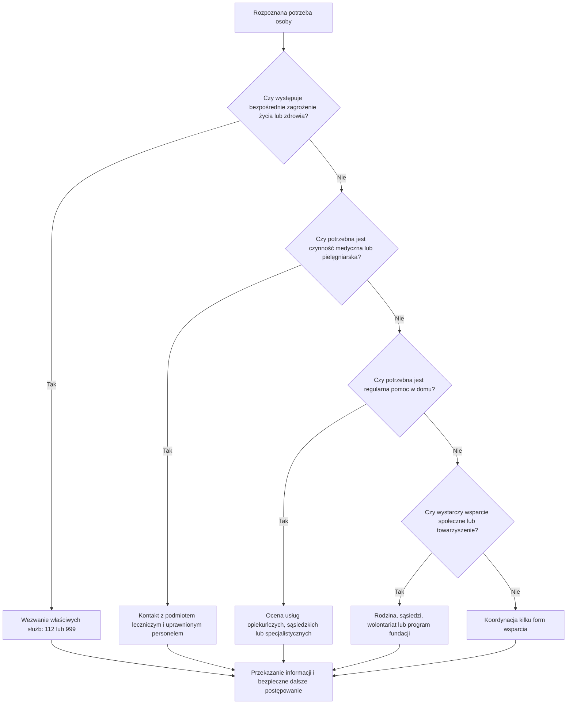
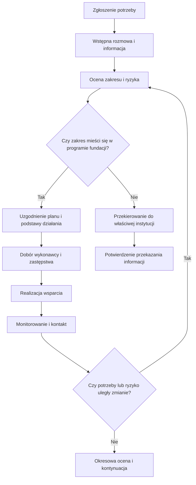

# 10.2. Formy wykonywania obowiązków opiekuńczych

**Kurs:** Kurs uwolnienia – organizacja i prowadzenie działalności religijnej, społecznej, opiekuńczej oraz społeczno-gospodarczej fundacji  
**Część:** IV – Rekompensowanie kosztów i utraconego dochodu osób wykonujących obowiązki społeczne i opiekuńcze  
**Moduł:** 10 – Podstawy prawne działalności opiekuńczej  
**Rozdział:** 10.2. Formy wykonywania obowiązków opiekuńczych  
**Stan odniesienia prawnego i organizacyjnego:** 26 listopada 2026 r.  
**Charakter opracowania:** materiał dydaktyczny, prawno-organizacyjny, społeczny i praktyczny

> **Myśl przewodnia:** pomoc jest wartościowa wtedy, gdy odpowiada na rzeczywistą potrzebę człowieka, jest udzielana w granicach kompetencji osoby pomagającej, respektuje wolę i godność osoby wspieranej oraz nie pozostawia jej ani opiekuna bez bezpiecznego planu na czas, w którym zwykła pomoc nie może być wykonana.

> **Granica zakresu:** rozdział 10.1 wyjaśnia pojęcia opieki, przewlekłej choroby, niesamodzielności, funkcjonowania i potrzeb osoby oraz rodziny. Niniejszy rozdział koncentruje się na formach organizowania i wykonywania pomocy: rodzinnej, społecznej, wolontariackiej, sąsiedzkiej, charytatywnej, fundacyjnej, usługowej, pielęgnacyjnej, asystenckiej, wytchnieniowej i doraźnej. Szczegółowe obowiązki, prawa, granice odpowiedzialności i konsekwencje naruszeń będą rozwijane w rozdziale 10.3. Opracowanie nie nadaje uprawnień zawodowych ani nie zastępuje indywidualnej porady prawnej, medycznej lub decyzji właściwego organu.

---

## 1. Cel, zakres i efekty kształcenia

### 1.1. Cel rozdziału

Celem rozdziału jest przygotowanie uczestnika do rozpoznawania, wybierania, łączenia i organizowania różnych form pomocy osobie wymagającej wsparcia oraz jej rodzinie. Uczestnik ma umieć ustalić, kto może być wykonawcą określonej czynności, na jakiej podstawie działa, jakie ma kwalifikacje, kto odpowiada za organizację usługi i co należy zrobić, gdy wsparcie nie może zostać udzielone zgodnie z planem.

Opieka nie jest jedną, jednolitą czynnością ani jednym rodzajem świadczenia. Może być wykonywana przez członka rodziny, sąsiada, wolontariusza, pracownika organizacji społecznej, opiekuna świadczącego usługi opiekuńcze, asystenta osobistego, pielęgniarkę, fizjoterapeutę lub zespół wielu osób. Każda z tych osób działa w innym porządku organizacyjnym i prawnym. Nie można zatem zakładać, że podobnie wyglądająca czynność ma zawsze ten sam status prawny.

### 1.2. Zakres opracowania

Rozdział rozwija dwanaście pozycji aktualnego spisu treści:

1. opieka rodzinna;
2. opieka społeczna;
3. wolontariat opiekuńczy;
4. pomoc sąsiedzka;
5. działalność charytatywna;
6. działalność fundacji;
7. organizowanie pomocy przez jednostkę organizacyjną;
8. usługi opiekuńcze;
9. usługi pielęgnacyjne;
10. wsparcie w codziennym funkcjonowaniu;
11. organizowanie zastępstwa opiekuna;
12. organizowanie pomocy doraźnej.

### 1.3. Efekty kształcenia

Po ukończeniu rozdziału uczestnik potrafi:

1. odróżnić opiekę rodzinną, sąsiedzką, wolontariacką, społeczną, fundacyjną, zawodową i zdrowotną;
2. rozpoznać, czy dana osoba działa jako członek rodziny, wolontariusz, pracownik, zleceniobiorca, usługodawca czy przedstawiciel instytucji;
3. wyjaśnić, dlaczego wolontariat nie może być wykorzystywany do zastępowania zatrudnienia ani do prowadzenia działalności gospodarczej organizacji;
4. wskazać podstawowe warunki wykonywania wolontariatu na podstawie ustawy o działalności pożytku publicznego i o wolontariacie;
5. opisać ustawowe warunki wykonywania usług sąsiedzkich i zwykłych usług opiekuńczych;
6. odróżnić zwykłe usługi opiekuńcze od specjalistycznych usług opiekuńczych;
7. odróżnić wsparcie społeczne od świadczenia zdrowotnego i czynności zastrzeżonej dla osoby posiadającej określone kwalifikacje;
8. zaprojektować bezpieczny zakres działalności opiekuńczej fundacji;
9. określić zadania jednostki organizacyjnej, koordynatora, wykonawcy i osoby wspieranej;
10. przygotować plan wsparcia w codziennym funkcjonowaniu;
11. zaplanować zastępstwo opiekuna i pomoc doraźną;
12. dobrać sposób dokumentowania, nadzoru, komunikacji i reagowania na przerwanie usługi.

### 1.4. Zasady interpretacji

W całym rozdziale należy stosować cztery rozróżnienia:

- **forma pomocy** – sposób, w jaki wsparcie jest organizowane, na przykład opieka rodzinna, wolontariat lub usługa opiekuńcza;
- **podstawa działania** – stosunek rodzinny, porozumienie wolontariackie, decyzja administracyjna, umowa cywilnoprawna, umowa o pracę albo umowa z podmiotem leczniczym;
- **zakres czynności** – konkretne działania wykonywane na rzecz osoby;
- **odpowiedzialność i nadzór** – podmiot, który organizuje usługę, kontroluje jej jakość i reaguje na nieprawidłowości.

Samo nazwanie działania „opieką”, „pomocą”, „wolontariatem”, „asystencją” lub „pielęgnacją” nie rozstrzyga o jego statusie. Ocenia się rzeczywistą treść czynności, sposób organizacji, odpłatność, podporządkowanie, kwalifikacje wykonawcy i przepisy właściwe dla danej usługi.

---

## 2. Mapa form wykonywania obowiązków opiekuńczych

### 2.1. Podstawowy podział

| Forma | Typowy wykonawca | Podstawa organizacyjna | Główny cel |
|:--|:--|:--|:--|
| Opieka rodzinna | Osoba bliska | Relacja rodzinna i uzgodnienia rodzinne; niekiedy odrębne uprawnienie lub umowa | Codzienne wsparcie bliskiej osoby |
| Opieka sąsiedzka | Sąsiad lub osoba z najbliższej okolicy | Nieformalna pomoc albo ustawowe usługi sąsiedzkie organizowane w systemie pomocy społecznej | Szybka, lokalna pomoc |
| Wolontariat | Osoba fizyczna działająca ochotniczo i bez wynagrodzenia | Porozumienie z uprawnionym korzystającym | Dobrowolna praca na rzecz celu społecznego |
| Pomoc charytatywna | Fundacja, stowarzyszenie, wspólnota, darczyńcy i wolontariusze | Statut, regulamin programu, umowa, porozumienie lub inna właściwa podstawa | Pomoc osobom w potrzebie |
| Usługi opiekuńcze | Osoba spełniająca wymagania właściwe dla danej usługi | Decyzja i organizacja gminy albo umowa z wykonawcą | Wsparcie codziennych potrzeb i higieny |
| Specjalistyczne usługi opiekuńcze | Osoba ze specjalistycznym przygotowaniem zawodowym | Decyzja i organizacja pomocy społecznej | Wsparcie dostosowane do schorzenia lub niepełnosprawności |
| Asystencja osobista | Asystent osobisty | Program, umowa lub inna podstawa właściwa dla realizatora | Wspieranie niezależności i uczestnictwa |
| Usługi pielęgniarskie | Pielęgniarka lub inny uprawniony profesjonalista | System ochrony zdrowia, umowa z podmiotem leczniczym lub pacjentem | Świadczenia zdrowotne i pielęgnacyjne |
| Opieka wytchnieniowa | Osoba lub podmiot zapewniający czasowe zastępstwo | Program, decyzja, umowa lub inna właściwa podstawa | Czasowe odciążenie opiekuna |
| Pomoc doraźna | Rodzina, służby, instytucja, organizacja lub podmiot medyczny | Procedura interwencyjna odpowiednia do rodzaju zagrożenia | Szybkie zabezpieczenie nagłej potrzeby |

### 2.2. Kto jest kim w systemie pomocy?

W jednym przedsięwzięciu mogą występować różne role:

- **osoba wspierana** – człowiek, którego potrzeby są przedmiotem pomocy;
- **opiekun nieformalny** – członek rodziny lub inna bliska osoba sprawująca regularną pomoc poza zawodowym stosunkiem świadczenia usług;
- **wykonawca** – osoba bezpośrednio realizująca czynności;
- **organizator** – podmiot ustalający zakres, harmonogram, standard, zasady bezpieczeństwa i sposób kontroli;
- **koordynator** – osoba łącząca działania, pilnująca ciągłości wsparcia i kontaktu;
- **finansujący** – podmiot pokrywający koszty, na przykład gmina, fundusz publiczny, fundacja, grantodawca lub darczyńca;
- **podmiot odpowiedzialny za świadczenie zdrowotne** – podmiot leczniczy lub profesjonalista działający w granicach właściwych przepisów.

Jedna osoba może pełnić kilka ról, lecz ich łączenie powinno być jawne i zgodne z prawem. Przykładowo fundacja może być organizatorem programu, zatrudniać koordynatora, angażować wolontariuszy i zawierać umowę z podmiotem leczniczym. Nie oznacza to, że każdy wolontariusz staje się pracownikiem medycznym ani że fundacja automatycznie uzyskuje status podmiotu wykonującego działalność leczniczą.

### 2.3. Schemat wyboru formy pomocy

Schemat jest narzędziem organizacyjnym, a nie algorytmem diagnostycznym. Wątpliwości co do stanu zdrowia powinny być rozstrzygane przez właściwego profesjonalistę.

---

## 3. Opieka rodzinna

### 3.1. Charakter opieki rodzinnej

Opieka rodzinna jest jedną z najczęściej występujących form wsparcia. Może obejmować pomoc w samoobsłudze, przygotowaniu posiłków, przemieszczaniu się, organizowaniu wizyt, utrzymywaniu kontaktów społecznych, prowadzeniu gospodarstwa domowego i zapewnianiu poczucia bezpieczeństwa.

Jej szczególną wartością jest znajomość historii, przyzwyczajeń, komunikacji, potrzeb i preferencji osoby. Bliscy często potrafią zauważyć subtelne zmiany zachowania, apetytu, nastroju, sprawności lub orientacji. Ta wiedza nie zastępuje jednak oceny medycznej ani profesjonalnej diagnozy.

### 3.2. Opieka rodzinna nie jest jednolitym statusem prawnym

Nie należy utożsamiać:

- faktycznego sprawowania opieki przez członka rodziny;
- obowiązku alimentacyjnego wynikającego z prawa rodzinnego;
- wykonywania usług na podstawie umowy;
- zatrudnienia opiekuna;
- wolontariatu w organizacji;
- sprawowania opieki prawnej lub kurateli;
- uprawnienia do określonego świadczenia pieniężnego.

Są to różne instytucje, z odmiennymi przesłankami i skutkami. Sam fakt pokrewieństwa nie daje automatycznie prawa do reprezentowania dorosłej osoby, dysponowania jej pieniędzmi ani podejmowania za nią decyzji zdrowotnych. Zdolność do podejmowania decyzji i ewentualne umocowanie przedstawiciela należy oceniać zgodnie z właściwymi przepisami.

### 3.3. Podział obowiązków w rodzinie

Rodzina powinna uzgodnić podział zadań w sposób możliwie przejrzysty. Nie należy opierać całego systemu na jednej osobie bez oceny jej możliwości, zdrowia, pracy zawodowej i czasu na odpoczynek.

Praktyczny podział może obejmować:

| Obszar | Przykładowe zadanie | Osoba odpowiedzialna | Zastępstwo |
|:--|:--|:--|:--|
| Codzienna pomoc | Posiłek, zakupy, kontakt |  |  |
| Higiena i samoobsługa | Pomoc w czynnościach osobistych |  |  |
| Organizacja leczenia | Umawianie wizyt, transport |  |  |
| Sprawy urzędowe | Wnioski, dokumenty, opłaty |  |  |
| Kontakty społeczne | Odwiedziny, rozmowy, wydarzenia |  |  |
| Sytuacje nagłe | Kontakt z rodziną i służbami |  |  |
| Odpoczynek opiekuna | Zorganizowanie zastępstwa |  |  |

Podział należy konsultować z osobą wspieraną. Nie może on naruszać jej autonomii ani prowadzić do nieuzasadnionego ograniczania kontaktów z wybranymi bliskimi.

### 3.4. Edukacja i wsparcie rodziny

Rodzina powinna otrzymać instruktaż adekwatny do czynności, które faktycznie wykonuje. Może to obejmować:

- zasady bezpiecznej komunikacji;
- zapobieganie upadkom i urazom;
- bezpieczne przemieszczanie i zmianę pozycji ciała;
- ergonomię pracy opiekuna;
- organizację posiłków i nawodnienia zgodnie z zaleceniami;
- rozpoznawanie sygnałów pogorszenia stanu;
- zasady higieny i ochrony przed zakażeniami;
- korzystanie ze sprzętu pomocniczego;
- postępowanie w sytuacji nagłej;
- dostępne formy pomocy i zastępstwa.

Instruktaż nie może być przedstawiany jako uzyskanie kwalifikacji zawodowych. Rodzinny opiekun nie staje się pielęgniarką, fizjoterapeutą ani ratownikiem medycznym przez samo uczestnictwo w szkoleniu.

### 3.5. Kiedy opieka rodzinna wymaga uzupełnienia?

Sygnałami, że rodzina potrzebuje dodatkowego wsparcia, są w szczególności:

- brak możliwości zapewnienia pomocy przez całą dobę;
- przeciążenie fizyczne lub psychiczne opiekuna;
- powtarzające się upadki, pominięcia posiłków lub trudności z higieną;
- brak bezpiecznego transportu;
- trudności w wykonywaniu zaleceń terapeutycznych;
- pogorszenie stanu osoby wspieranej;
- konflikty rodzinne wpływające na jakość pomocy;
- brak zastępstwa w razie choroby lub nieobecności opiekuna.

W takiej sytuacji nie należy obwiniać rodziny. Właściwą reakcją jest ponowne rozpoznanie potrzeb, uruchomienie usług społecznych lub zdrowotnych, asystencji, pomocy sąsiedzkiej albo opieki wytchnieniowej.

---

## 4. Opieka społeczna i system usług publicznych

### 4.1. Rola pomocy społecznej

Pomoc społeczna jest instytucją polityki społecznej państwa. Jej zadaniem jest wspieranie osób i rodzin w przezwyciężaniu trudnych sytuacji życiowych, których nie są w stanie pokonać przy wykorzystaniu własnych uprawnień, zasobów i możliwości.

Działania z zakresu pomocy społecznej wykonują organy administracji rządowej i samorządowej, współpracując z organizacjami społecznymi i pozarządowymi, kościołami, związkami wyznaniowymi, fundacjami, stowarzyszeniami oraz innymi podmiotami. Współpraca nie oznacza jednak przeniesienia wszystkich ustawowych obowiązków gminy na fundację ani automatycznego przyznania organizacji uprawnień organu administracji.

### 4.2. Rola gminy

Gmina jest podstawowym szczeblem organizowania wielu usług opiekuńczych w miejscu zamieszkania. W zależności od struktury lokalnej zadania realizuje ośrodek pomocy społecznej albo centrum usług społecznych. Gmina określa lokalne warunki przyznawania i odpłatności za usługi w granicach ustawowego upoważnienia, organizuje świadczenie usług, monitoruje ich realizację i reaguje na nieprawidłowości.

Osoba potrzebująca wsparcia powinna uzyskać informację o:

1. miejscu złożenia wniosku;
2. dokumentach potrzebnych do rozpoznania sprawy;
3. sposobie oceny sytuacji;
4. zakresie, okresie i miejscu świadczenia usług;
5. zasadach odpłatności i ewentualnego zwolnienia;
6. trybie zgłaszania zmiany potrzeb lub skargi;
7. możliwości uzyskania pomocy w sytuacji nagłej.

W przypadku świadczeń przyznawanych w drodze decyzji administracyjnej zakres, okres i miejsce świadczenia powinny wynikać z właściwej decyzji. Organizacja społeczna nie powinna samodzielnie zmieniać decyzji gminy ani przedstawiać własnego programu jako świadczenia przyznanego przez organ.

### 4.3. Centrum usług społecznych

Centrum usług społecznych (CUS) może integrować różne usługi na poziomie lokalnym. Ustawa o realizowaniu usług społecznych przez centrum usług społecznych przewiduje organizowanie usług, rozpoznawanie potrzeb i potencjału społeczności, koordynowanie lokalnego systemu oraz współpracę z organizacjami pozarządowymi, podmiotami leczniczymi i innymi wykonawcami.

CUS nie jest placówką całodobową i nie zastępuje automatycznie wszystkich jednostek systemu ochrony zdrowia lub pomocy społecznej. Jego wartość polega na koordynowaniu dostępnych form wsparcia i ułatwianiu mieszkańcom uzyskania pomocy.

### 4.4. Współpraca organizacji z samorządem

Fundacja może:

- realizować zadanie publiczne na podstawie umowy lub dotacji;
- świadczyć usługi jako wykonawca wybrany przez samorząd;
- prowadzić program uzupełniający lokalny system wsparcia;
- udostępniać wolontariuszy w ramach prawidłowo zorganizowanego wolontariatu;
- współpracować z CUS, OPS, PCPR, placówkami zdrowotnymi i organizacjami społecznymi;
- organizować działania edukacyjne i samopomocowe;
- prowadzić programy pomocy rzeczowej, transportowej lub towarzyszącej.

Przed rozpoczęciem współpracy należy określić, kto kwalifikuje osobę do świadczenia, kto ustala zakres, kto prowadzi dokumentację, kto finansuje usługę, kto kontroluje jakość i kto odpowiada za przerwanie pomocy.

---

## 5. Wolontariat opiekuńczy

### 5.1. Istota wolontariatu

Wolontariuszem jest osoba fizyczna, która ochotniczo i bez wynagrodzenia wykonuje świadczenia na zasadach określonych w ustawie o działalności pożytku publicznego i o wolontariacie. Wolontariat może wzmacniać system pomocy poprzez towarzyszenie, rozmowę, wsparcie w kontaktach społecznych, pomoc w organizacji wydarzeń, transportu, zakupów lub innych czynności, jeżeli mieszczą się w prawidłowo określonym zakresie.

Wolontariat nie jest bezpłatnym odpowiednikiem dowolnego zawodu. Nie można używać go do obchodzenia przepisów o zatrudnieniu, kwalifikacjach, działalności leczniczej, bezpieczeństwie pracy ani odpowiedzialności za jakość usług.

### 5.2. Kto może korzystać ze świadczeń wolontariusza?

Ustawa przewiduje korzystanie ze świadczeń wolontariuszy między innymi przez:

- organizacje pozarządowe i podmioty wskazane w ustawie, w zakresie działalności statutowej, z wyłączeniem prowadzonej przez nie działalności gospodarczej;
- organy administracji publicznej, z wyłączeniem ich działalności gospodarczej;
- jednostki organizacyjne podległe administracji publicznej lub przez nią nadzorowane, z wyłączeniem ich działalności gospodarczej;
- podmioty lecznicze – w zakresie wykonywanej przez nie działalności leczniczej.

Przepisy stosuje się odpowiednio do wolontariuszy wykonujących w Polsce świadczenia na rzecz organizacji międzynarodowych, jeżeli umowy międzynarodowe nie stanowią inaczej. Członek stowarzyszenia może wykonywać świadczenia jako wolontariusz na rzecz stowarzyszenia, którego jest członkiem.

Osoba prywatna korzystająca z pomocy fundacji jest beneficjentem programu, ale nie staje się przez to automatycznie ustawowym „korzystającym” w rozumieniu przepisów o wolontariacie. W praktyce porozumienie wolontariackie zawiera się z uprawnioną organizacją lub innym podmiotem, a wsparcie dla osoby fizycznej jest realizowane w ramach jej programu. Nieformalna pomoc sąsiedzka może funkcjonować niezależnie od tego reżimu.

### 5.3. Porozumienie z wolontariuszem

Porozumienie powinno określać:

- strony i osobę uprawnioną do reprezentacji korzystającego;
- zakres świadczeń;
- sposób wykonywania świadczeń;
- czas i miejsce ich wykonywania;
- zasady kontaktu z koordynatorem;
- zasady ochrony danych i poufności;
- zasady bezpieczeństwa i zgłaszania incydentów;
- sposób rozwiązania porozumienia;
- zasady zwrotu kosztów i ubezpieczenia;
- potwierdzanie wykonanych świadczeń.

Jeżeli świadczenie jest wykonywane przez okres dłuższy niż 30 dni, porozumienie powinno być sporządzone na piśmie. Na żądanie wolontariusza korzystający ma obowiązek potwierdzić na piśmie treść porozumienia i wydać zaświadczenie o wykonaniu świadczeń oraz ich zakresie.

### 5.4. Bezpieczeństwo i kwalifikacje wolontariusza

Wolontariusz powinien posiadać kwalifikacje i spełniać wymagania odpowiednie do rodzaju i zakresu wykonywanych świadczeń, jeżeli obowiązek taki wynika z odrębnych przepisów.

Organizacja powinna przed dopuszczeniem do działań:

1. rozpoznać motywację i doświadczenie kandydata;
2. wyjaśnić granice roli wolontariusza;
3. ocenić ryzyka związane z kontaktem z osobą zależną;
4. zapewnić szkolenie wstępne;
5. przekazać instrukcję postępowania w sytuacji nagłej;
6. ustalić osobę nadzorującą;
7. sprawdzić, czy zakres czynności nie wymaga kwalifikacji zawodowych;
8. zapewnić warunki bezpiecznej pracy;
9. ustalić sposób zgłaszania nieprawidłowości;
10. zapewnić dostęp do informacji o prawach i obowiązkach.

Wolontariusz nie powinien samodzielnie podejmować decyzji o zmianie leczenia, dawkowaniu leków, wykonywaniu procedur zastrzeżonych ani ocenie klinicznej stanu zdrowia.

### 5.5. Koszty, ubezpieczenie i szkolenie

Wolontariusz nie otrzymuje wynagrodzenia za świadczenie, ale nie oznacza to, że ma finansować organizację z własnych środków. Ustawa przewiduje obowiązek informowania o ryzyku, zapewnienia bezpiecznych i higienicznych warunków oraz pokrywania kosztów podróży służbowych i diet na zasadach właściwych dla pracowników. Możliwe jest pokrywanie innych niezbędnych kosztów i kosztów szkoleń. Ustawa określa również zasady świadczeń zdrowotnych, zaopatrzenia z tytułu wypadku, ubezpieczenia NNW w określonych sytuacjach oraz możliwość zapewnienia OC.

Wartość świadczenia wolontariusza nie stanowi darowizny na rzecz korzystającego w rozumieniu przepisów Kodeksu cywilnego i przepisów podatkowych. Nie należy więc automatycznie wyceniać pracy wolontariusza jako darowizny pieniężnej ani ujmować jej w księgach w sposób sprzeczny z właściwymi zasadami rachunkowości i warunkami projektu.

### 5.6. Przykładowe bezpieczne zadania wolontariusza

- rozmowa i towarzyszenie;
- wspólne czytanie i aktywności kulturalne;
- pomoc w organizacji spotkania;
- wsparcie w korzystaniu z komunikacji elektronicznej;
- towarzyszenie podczas spaceru, jeżeli jest to bezpieczne i uzgodnione;
- pomoc w zakupach zgodnie z ustalonym zakresem;
- dostarczanie materiałów i pomocy rzeczowej;
- wsparcie w utrzymywaniu kontaktów społecznych;
- przekazywanie koordynatorowi informacji o zaobserwowanych problemach.

Zakres ten nie jest katalogiem ustawowym ani zgodą na wykonywanie czynności medycznych. Każde zadanie musi być ocenione pod kątem ryzyka, kwalifikacji, zgody osoby wspieranej i warunków organizacyjnych.

---

## 6. Pomoc sąsiedzka

### 6.1. Pomoc nieformalna i usługi sąsiedzkie

Pomoc sąsiedzka może mieć dwa odmienne znaczenia:

1. **pomoc nieformalna** – dobrowolne wsparcie sąsiada, znajomego lub członka lokalnej wspólnoty, bez wchodzenia w formalny program;
2. **usługi sąsiedzkie w systemie pomocy społecznej** – forma usług opiekuńczych w miejscu zamieszkania, przyznawana i organizowana według przepisów ustawy o pomocy społecznej.

Nie należy utożsamiać tych form. Nieformalna pomoc może być spontaniczna i elastyczna. Ustawowe usługi sąsiedzkie mają określonego organizatora, warunki wykonywania, zakres, sposób rozliczania i nadzór.

### 6.2. Zakres pomocy sąsiedzkiej

Pomoc sąsiedzka może obejmować:

- przyniesienie zakupów;
- dostarczenie posiłku;
- pomoc w kontakcie z rodziną;
- przypomnienie o zaplanowanym spotkaniu;
- towarzyszenie podczas krótkiego spaceru;
- pomoc w dotarciu do lokalnej instytucji;
- przekazanie informacji o potrzebie wsparcia;
- okresowe sprawdzenie, czy osoba nie wymaga pilnej pomocy.

Nieformalna pomoc nie powinna obejmować czynności, których wykonanie wymaga kwalifikacji, szczególnego umocowania lub odpowiedzialności właściwej dla profesjonalnej usługi. Sąsiad nie powinien bez podstawy prawnej przejmować dokumentów, pieniędzy, leków, decyzji ani reprezentacji osoby.

### 6.3. Ustawowe warunki wykonywania usług sąsiedzkich

W aktualnym brzmieniu art. 50 ustawy o pomocy społecznej usługi sąsiedzkie są formą usług opiekuńczych w miejscu zamieszkania. Obejmują pomoc w zaspokajaniu podstawowych potrzeb życiowych, podstawową opiekę higieniczno-pielęgnacyjną niewymagającą specjalistycznej wiedzy i kompetencji oraz – w miarę potrzeb i możliwości – zapewnienie kontaktów z otoczeniem.

Po zmianie ustawy z 11 czerwca 2026 r. osoba wykonująca usługi sąsiedzkie powinna w szczególności:

- być pełnoletnia;
- nie być członkiem rodziny osoby wspieranej;
- nie być oddzielnie zamieszkującym małżonkiem, wstępnym ani zstępnym osoby wspieranej;
- złożyć organizatorowi oświadczenie o zdolności psychofizycznej do świadczenia usług;
- zamieszkiwać w najbliższej okolicy osoby wspieranej;
- zostać zaakceptowana przez osobę korzystającą z usług;
- zostać zaakceptowana przez organizatora;
- posiadać szkolenie z zakresu pierwszej pomocy; jeżeli go nie ukończyła, organizator ma obowiązek je zorganizować.

Szczegółowe warunki, zakres, wymiar i sposób rozliczania usług należy sprawdzać w aktualnej uchwale gminy oraz w dokumentach programu. Nie wolno zakładać, że każda gmina prowadzi taki sam program.

### 6.4. Zalety i ograniczenia

| Zalety | Ograniczenia i ryzyka |
|:--|:--|
| Bliskość miejsca zamieszkania | Ograniczona dostępność czasowa sąsiada |
| Szybka reakcja na drobne potrzeby | Brak możliwości zapewnienia opieki całodobowej |
| Znajomość lokalnej społeczności | Ryzyko niejasnego zakresu obowiązków |
| Wzmacnianie więzi i przeciwdziałanie samotności | Ryzyko nadmiernego obciążenia jednej osoby |
| Niskie bariery organizacyjne | Konieczność ochrony prywatności i bezpieczeństwa |

### 6.5. Minimalne zasady bezpieczeństwa

Organizator powinien zapewnić:

- jasny zakres i harmonogram;
- zgodę osoby wspieranej;
- kontakt do koordynatora;
- szkolenie pierwszej pomocy;
- zasady postępowania przy nieobecności sąsiada;
- procedurę zgłaszania pogorszenia stanu;
- ochronę kluczy, dokumentów i pieniędzy;
- dokumentowanie wykonanych czynności w zakresie niezbędnym;
- możliwość zgłoszenia rezygnacji lub zmiany osoby wykonującej usługę.

---

## 7. Działalność charytatywna

### 7.1. Pojęcie i cele

Działalność charytatywna polega na udzielaniu pomocy osobom, rodzinom lub wspólnotom znajdującym się w potrzebie. Może przyjmować formę pomocy materialnej, rzeczowej, żywnościowej, transportowej, edukacyjnej, integracyjnej, opiekuńczej lub organizacyjnej.

Działalność charytatywna nie jest odrębnym zawodem ani automatycznym uprawnieniem do wykonywania świadczeń zdrowotnych. Jej legalność zależy od podmiotu, celu statutowego, rodzaju czynności, sposobu organizacji i przepisów właściwych dla konkretnej formy wsparcia.

### 7.2. Rodzaje pomocy charytatywnej

1. Pomoc rzeczowa – odzież, żywność, środki higieniczne, sprzęt.
2. Pomoc organizacyjna – załatwianie spraw, umawianie wizyt, koordynowanie kontaktu.
3. Pomoc transportowa – dowóz do instytucji lub placówki, jeśli organizator ma odpowiednie warunki.
4. Pomoc towarzysząca – rozmowa, spacer, udział w wydarzeniu.
5. Pomoc edukacyjna – nauka korzystania z usług i urządzeń.
6. Pomoc rodzinie – czasowe wsparcie organizacyjne i informacyjne.
7. Pomoc interwencyjna – szybkie zabezpieczenie podstawowych potrzeb do czasu uruchomienia właściwej usługi.
8. Pomoc integracyjna – przeciwdziałanie izolacji i wykluczeniu.

### 7.3. Jednorazowa pomoc a program systematyczny

Jednorazowe przekazanie paczki żywnościowej nie wymaga takiej samej organizacji jak regularne odwiedziny osoby leżącej. Im bardziej systematyczna, intensywna i zależna od wykonawcy jest pomoc, tym większe znaczenie mają:

- kwalifikacja uczestnika;
- rozpoznanie potrzeb;
- plan wsparcia;
- ustalenie wykonawcy i zastępstwa;
- dokumentacja;
- standard jakości;
- procedury bezpieczeństwa;
- sposób reagowania na skargi i incydenty.

Fundacja powinna unikać obiecywania stałej opieki, jeżeli dysponuje jedynie okazjonalnym zespołem wolontariuszy.

### 7.4. Godność i równe traktowanie

Pomoc charytatywna nie powinna uzależniać wsparcia od publicznego ujawniania historii choroby, sytuacji rodzinnej, przekonań religijnych lub trudności finansowych ponad to, co jest niezbędne do realizacji programu. Nie należy wykorzystywać wizerunku osoby wspieranej do promocji bez właściwej podstawy i świadomej zgody.

Darczyńca może określić cel darowizny, lecz organizacja powinna zachować niezależność w ocenie potrzeb i doborze sposobu udzielenia pomocy. Pomoc nie może naruszać godności, wolności sumienia ani prawa do odmowy udziału w praktykach religijnych lub wydarzeniach promocyjnych.

---

## 8. Działalność fundacji w obszarze opieki

### 8.1. Podstawy działania

Fundacja może prowadzić działania opiekuńcze i pomocowe w zakresie zgodnym z ustawą, statutem, wpisami rejestrowymi, warunkami finansowania i właściwymi przepisami. Przed rozpoczęciem programu należy sprawdzić:

- czy cel statutowy obejmuje planowane działania;
- czy sposób realizacji nie wymaga szczególnego zezwolenia, wpisu lub statusu;
- czy fundacja ma odpowiednie zasoby kadrowe i organizacyjne;
- czy wykonawcy mają wymagane kwalifikacje;
- czy sposób finansowania pozwala pokryć pełne koszty;
- czy zakres odpowiedzialności jest jasno określony;
- czy istnieje plan ciągłości i zastępstwa;
- czy dokumentacja i ochrona danych są właściwie przygotowane.

Samo wskazanie w statucie „pomocy osobom chorym” nie oznacza, że fundacja może wykonywać wszystkie świadczenia pielęgniarskie, lekarskie, fizjoterapeutyczne lub inne czynności regulowane.

### 8.2. Modele działalności fundacji

| Model | Rola fundacji | Przykładowa forma |
|:--|:--|:--|
| Informacyjny | Rozpoznaje dostępne usługi i kieruje do właściwych podmiotów | Punkt informacji i poradnictwa |
| Integracyjny | Ułatwia uczestnictwo i kontakty społeczne | Klub, spotkania, grupy wsparcia |
| Wolontariacki | Organizuje pomoc ochotniczą w granicach ustawy | Program odwiedzin i towarzyszenia |
| Rzeczowy | Zapewnia niezbędne przedmioty | Wypożyczalnia sprzętu, paczki |
| Usługowy | Organizuje lub świadczy usługi społeczne | Program pomocy w domu |
| Partnerski | Łączy zasoby wielu podmiotów | Współpraca z CUS, OPS i podmiotem leczniczym |
| Zdrowotny | Wykonuje działalność leczniczą tylko po spełnieniu właściwych wymagań | Podmiot leczniczy lub współpraca z takim podmiotem |

### 8.3. Fundacja jako organizator, a nie wykonawca każdej czynności

Fundacja może pełnić rolę organizatora programu, nawet jeśli poszczególne usługi wykonują inne podmioty. W takim modelu należy zawrzeć umowy i porozumienia określające:

- zakres odpowiedzialności każdej strony;
- standard usługi;
- kwalifikacje i doświadczenie personelu;
- zasady zastępstwa;
- dokumentowanie realizacji;
- zasady bezpieczeństwa;
- ochronę informacji;
- sposób rozliczeń;
- kontrolę jakości;
- procedurę zgłaszania incydentów;
- warunki zakończenia współpracy.

### 8.4. Granica działalności leczniczej

Jeżeli fundacja zamierza udzielać świadczeń zdrowotnych jako podmiot wykonujący działalność leczniczą, musi spełnić wymagania ustawy o działalności leczniczej, w tym dotyczące formy organizacyjnej, wpisu do właściwego rejestru, warunków lokalowych, personelu, dokumentacji, ubezpieczenia i odpowiedzialności.

Współpraca z pielęgniarką, fizjoterapeutą lub lekarzem nie oznacza automatycznie, że fundacja może działać bez wymagań przewidzianych dla podmiotu leczniczego. Należy rozstrzygnąć, kto jest rzeczywistym świadczeniodawcą, kto zawiera umowę z pacjentem, kto prowadzi dokumentację medyczną i kto odpowiada za udzielenie świadczenia.

### 8.5. Działalność odpłatna, nieodpłatna i gospodarcza

Nieodpłatna pomoc, odpłatna działalność pożytku publicznego i działalność gospodarcza są odrębnymi formami działalności. Odpłatność, sposób kalkulowania ceny, relacja do kosztów, status organizacji i faktyczny charakter świadczenia mogą wpływać na kwalifikację prawną i podatkową.

Nie wolno nazywać usługi „darowizną” lub „wolontariatem”, jeżeli w rzeczywistości jest to odpłatna usługa albo praca podporządkowana. Kwestie podatkowe i finansowe należy rozpatrywać w powiązaniu z modułami 8 i 9 kursu.

---

## 9. Organizowanie pomocy przez jednostkę organizacyjną

### 9.1. Po co wyodrębniać jednostkę?

Jednostka organizacyjna fundacji może służyć uporządkowaniu zadań, odpowiedzialności, zasobów i obiegu informacji. Może to być na przykład centrum wsparcia rodzin, zespół opieki środowiskowej, punkt pomocy doraźnej, wypożyczalnia sprzętu lub biuro koordynacji wolontariatu.

Samo wyodrębnienie jednostki w strukturze fundacji nie tworzy automatycznie odrębnej osoby prawnej, odrębnego majątku ani samodzielnego uprawnienia do wykonywania działalności leczniczej. Jednostka działa w ramach kompetencji i umocowania nadanego przez fundację.

### 9.2. Minimalna struktura organizacyjna

W zależności od skali programu można wyodrębnić:

- dyrektora lub kierownika jednostki;
- koordynatora usług;
- osobę odpowiedzialną za kwalifikację i kontakt z uczestnikiem;
- koordynatora wolontariatu;
- osobę odpowiedzialną za bezpieczeństwo;
- osobę odpowiedzialną za dokumentację;
- osobę odpowiedzialną za rozliczenia;
- wykonawców usług;
- zastępców i dyżurnych kontaktowych.

Nie każda fundacja musi tworzyć wszystkie stanowiska. W małej organizacji część funkcji może być łączona, o ile nie prowadzi to do konfliktu interesów, braku kontroli lub niebezpiecznego przeciążenia.

### 9.3. Podział odpowiedzialności

| Funkcja | Podstawowe zadania | Czego nie powinna robić bez umocowania |
|:--|:--|:--|
| Zarząd fundacji | Zatwierdza kierunki, zasoby, regulaminy i nadzór | Przekazywać jednostce kompetencji, których sam nie posiada |
| Kierownik jednostki | Organizuje realizację programu | Zmieniać statut lub reprezentować fundację poza umocowaniem |
| Koordynator | Łączy uczestnika, rodzinę i wykonawców | Podejmować decyzji medycznych |
| Wykonawca | Realizuje uzgodnione czynności | Rozszerzać zakresu usług samodzielnie |
| Koordynator wolontariatu | Dobiera, szkoli i wspiera wolontariuszy | Traktować wolontariusza jak pracownika bez właściwej podstawy |
| Osoba ds. bezpieczeństwa | Analizuje ryzyka i incydenty | Ukrywać zgłoszeń przed właściwym organem |
| Osoba ds. dokumentacji | Prowadzi dokumenty i rejestry | Gromadzić danych ponad niezbędny zakres |

### 9.4. Regulamin jednostki

Regulamin powinien określać co najmniej:

1. nazwę i cel jednostki;
2. zakres terytorialny działania;
3. grupę osób, którym udzielane jest wsparcie;
4. katalog form pomocy;
5. kryteria przyjęcia i zakończenia udziału;
6. zasady współpracy z rodziną;
7. zasady zgody i odmowy;
8. role personelu i wolontariuszy;
9. procedury bezpieczeństwa;
10. zasady zastępstwa;
11. dokumentowanie usług;
12. rozpatrywanie skarg;
13. zasady współpracy z instytucjami;
14. ochronę danych;
15. nadzór i ocenę jakości.

### 9.5. Przepływ organizacyjny

---

## 10. Usługi opiekuńcze

### 10.1. Charakter prawny

Usługi opiekuńcze w systemie pomocy społecznej są świadczeniem z zakresu pomocy społecznej. Ustawa przewiduje ich przyznanie osobie, która z powodu wieku, choroby lub innych przyczyn wymaga pomocy innych osób. W przypadku osoby samotnej, która jest pozbawiona wymaganej pomocy, ustawa przewiduje przyznanie usług; w przypadku osoby, której rodzina i wskazane w ustawie osoby bliskie nie mogą zapewnić potrzebnej pomocy, usługi mogą zostać przyznane po rozpoznaniu sytuacji.

Zakres, okres i miejsce świadczenia ustala się w decyzji administracyjnej. Szczegółowe warunki przyznawania i odpłatności zależą także od właściwych przepisów lokalnych.

### 10.2. Zakres zwykłych usług opiekuńczych

Zgodnie z aktualnym brzmieniem art. 50 ustawy o pomocy społecznej oraz rozporządzeniem z 4 sierpnia 2026 r. usługi opiekuńcze w miejscu zamieszkania obejmują w szczególności:

- pomoc w zaspokajaniu codziennych potrzeb życiowych;
- pomoc w samoobsłudze;
- przygotowanie prostych posiłków i pomoc w ich spożywaniu;
- pomoc w prowadzeniu gospodarstwa domowego;
- zakupy i załatwianie niezbędnych spraw;
- utrzymywanie czystości w zakresie niezbędnym do funkcjonowania;
- opiekę higieniczną;
- zaleconą przez lekarza pielęgnację niewymagającą specjalistycznej wiedzy i kompetencji;
- pomoc w zmianie pozycji ciała i korzystaniu ze sprzętu pomocniczego w zakresie niewymagającym specjalistycznej wiedzy;
- zapewnianie kontaktów z otoczeniem.

Rozporządzenie określa szczegółowy standard czynności, sposób ich świadczenia oraz monitorowania. Wskazuje między innymi zasady pomocy przy ubieraniu, przygotowaniu posiłku, zakupach, utrzymaniu sprzętu pomocniczego, higienie, zmianie środków higienicznych, obserwacji stanu i kontaktach społecznych.

### 10.3. Standard i kontrola jakości od 7 sierpnia 2026 r.

Rozporządzenie Ministra Rodziny, Pracy i Polityki Społecznej z 4 sierpnia 2026 r. określa standard usług opiekuńczych w miejscu zamieszkania. Wprowadza między innymi:

- konieczność uwzględniania indywidualnych potrzeb;
- poszanowanie godności, intymności i autonomii;
- zasady higieny i bezpieczeństwa;
- potwierdzanie wykonanych czynności;
- zastępstwo przez osobę spełniającą wymagania ustawowe;
- monitorowanie faktycznej realizacji usług;
- ocenę bezpieczeństwa, celowości i skuteczności.

Wizyty monitorujące w miejscu zamieszkania powinny odbywać się zgodnie z potrzebami, nie rzadziej niż raz na pół roku. Opinie osoby korzystającej z usług, jeżeli jej stan pozwala na ich wyrażenie, powinny być pozyskiwane nie rzadziej niż raz na pół roku. Analizuje się również niezrealizowane godziny, zmiany wykonawców i skargi.

### 10.4. Wymagania wobec osoby wykonującej zwykłe usługi opiekuńcze

Po zmianie art. 50 ustawy o pomocy społecznej, obowiązującej od 5 sierpnia 2026 r., osobą wykonującą usługi opiekuńcze może być osoba, która:

1. jest pełnoletnia;
2. nie jest członkiem rodziny osoby wspieranej;
3. nie jest oddzielnie zamieszkującym małżonkiem, wstępnym ani zstępnym osoby wspieranej;
4. złożyła podmiotowi świadczącemu usługi oświadczenie o zdolności psychofizycznej do ich świadczenia;
5. ukończyła szkolenie z zakresu udzielania pierwszej pomocy.

Przed rozpoczęciem realizacji programu należy sprawdzić aktualne przepisy i dokumenty lokalne, w tym wymagania wynikające z umowy z gminą lub warunków konkursu.

### 10.5. Odpłatność i lokalne zasady

Usługi opiekuńcze mogą być odpłatne w całości lub części, a warunki odpłatności i zwolnień określa właściwa rada gminy w granicach ustawowego upoważnienia. Nie należy przyjmować jednej stawki ani jednego kryterium dochodowego dla całej Polski.

Przed skierowaniem osoby do usługi należy ustalić:

- czy usługa jest przyznawana decyzją;
- jaki jest zakres godzinowy;
- jaka jest stawka i zasady odpłatności;
- czy możliwe jest częściowe lub całkowite zwolnienie;
- czy usługa jest dostępna w dni wolne;
- kto zapewnia zastępstwo;
- kto przyjmuje skargi i prowadzi monitoring.

---

## 11. Specjalistyczne usługi opiekuńcze

### 11.1. Charakter

Specjalistyczne usługi opiekuńcze są dostosowane do szczególnych potrzeb wynikających z rodzaju schorzenia lub niepełnosprawności. Wykonują je osoby posiadające specjalistyczne przygotowanie zawodowe odpowiednie do rodzaju świadczenia.

Nie są one po prostu „zwykłą opieką wykonywaną przez bardziej doświadczoną osobę”. Ich zakres, kwalifikacje i cel powinny wynikać z rozpoznanych potrzeb oraz właściwych przepisów.

### 11.2. Przykładowe obszary

W zależności od potrzeb i właściwych regulacji specjalistyczne usługi mogą obejmować:

- uczenie i rozwijanie umiejętności niezbędnych do samodzielnego życia;
- trening samoobsługi i umiejętności społecznych;
- wspieranie komunikacji;
- pracę nad funkcjonowaniem w rodzinie i społeczności;
- wsparcie psychologiczne w zakresie właściwym dla danej usługi;
- rehabilitację ruchową zgodnie z zaleceniami i kompetencjami wykonawcy;
- wsparcie w korzystaniu z instytucji i usług;
- pomoc w ograniczaniu barier w mieszkaniu;
- działania dostosowane do potrzeb osób z zaburzeniami psychicznymi.

Szczegółowy katalog i wymagania kwalifikacyjne wynikają z rozporządzenia w sprawie specjalistycznych usług opiekuńczych oraz z innych przepisów dotyczących określonych zawodów.

### 11.3. Dobór wykonawcy

Dobór powinien opierać się na:

1. rodzaju potrzeb osoby;
2. celu usługi;
3. kwalifikacjach i doświadczeniu wykonawcy;
4. wymaganiach szczególnych dla określonej grupy odbiorców;
5. dostępności konsultacji i nadzoru;
6. planie bezpieczeństwa;
7. sposobie oceny postępów.

Fundacja nie powinna zatrudniać osoby wyłącznie na podstawie ogólnego zaświadczenia o ukończeniu kursu, jeżeli przepisy wymagają określonego wykształcenia, zawodu, doświadczenia lub prawa wykonywania zawodu.

---

## 12. Usługi pielęgnacyjne i świadczenia zdrowotne

### 12.1. Rozróżnienie pielęgnacji społecznej i pielęgniarskiej

W języku potocznym słowo „pielęgnacja” obejmuje wiele czynności. W prawie i praktyce trzeba jednak odróżnić:

- pomoc higieniczną i opiekuńczą;
- czynności pielęgnacyjne wykonywane w ramach usług opiekuńczych, jeżeli nie wymagają specjalistycznej wiedzy i kompetencji oraz mieszczą się w standardzie;
- świadczenia pielęgniarskie;
- inne świadczenia zdrowotne wykonywane przez osoby uprawnione.

Nie każda czynność przy ciele osoby chorej jest świadczeniem pielęgniarskim, ale nie każda czynność określana jako „pielęgnacja” może być powierzona dowolnemu opiekunowi.

### 12.2. Przykładowe granice

| Czynność | Możliwy charakter | Zasada organizacyjna |
|:--|:--|:--|
| Pomoc w kąpieli i higienie | Usługa opiekuńcza | Poszanowanie intymności i bezpieczeństwa |
| Zmiana odzieży i pościeli | Usługa opiekuńcza | Zgodnie z potrzebami osoby |
| Pomoc przy przygotowaniu i przyjęciu leków | Czynność w granicach standardu usługi opiekuńczej | Bez zmiany dawki, ordynowania i samodzielnego modyfikowania terapii |
| Obserwacja samopoczucia | Wsparcie i monitorowanie | Przekazanie niepokojących informacji właściwej osobie |
| Pomiar podstawowych parametrów | Może być przewidziany w standardzie usługi opiekuńczej w określonych granicach | Wykonawca musi znać procedurę i wiedzieć, kiedy przekazać wynik |
| Wykonywanie iniekcji lub zaawansowanych procedur | Czynność wymagająca odpowiednich uprawnień i kompetencji | Nie powierzać osobie nieuprawnionej |
| Prowadzenie fizjoterapii | Świadczenie wykonywane przez osobę o właściwych kwalifikacjach | Ustalić cel, zakres i odpowiedzialność zawodową |
| Ocena kliniczna i modyfikacja leczenia | Zadanie właściwe dla uprawnionego profesjonalisty | Opiekun nie zastępuje lekarza ani pielęgniarki |

Tabela ma charakter orientacyjny. Ostateczna kwalifikacja zależy od konkretnej czynności, przepisów zawodowych, zaleceń i organizacji świadczenia.

### 12.3. Pielęgniarska opieka długoterminowa domowa

Pielęgniarska opieka długoterminowa domowa jest świadczeniem zdrowotnym realizowanym przez uprawniony personel w ramach systemu ochrony zdrowia. Jej celem jest zapewnienie profesjonalnej opieki pielęgniarskiej osobom, których stan zdrowia i poziom samodzielności uzasadniają taką formę wsparcia.

Fundacja może pomagać w uzyskaniu informacji, kontakcie z podmiotem leczniczym, organizacji transportu lub wsparciu rodziny. Nie może jednak przedstawiać własnych usług społecznych jako świadczeń pielęgniarskich finansowanych przez NFZ, jeżeli nie ma do tego właściwego statusu i umowy.

### 12.4. Współpraca z podmiotem leczniczym

Współpraca powinna określać:

- kto kwalifikuje pacjenta do świadczenia;
- kto ustala plan opieki zdrowotnej;
- kto wykonuje procedury;
- kto prowadzi dokumentację medyczną;
- kto odpowiada za sprzęt i materiały;
- kto informuje rodzinę;
- kto reaguje na pogorszenie stanu;
- kto ponosi odpowiedzialność za udzielone świadczenie.

Nie należy tworzyć nieformalnego „zespołu medycznego” bez określenia statusu podmiotów i kompetencji osób.

---

## 13. Wsparcie w codziennym funkcjonowaniu

### 13.1. Zakres praktyczny

Wsparcie w codziennym funkcjonowaniu może obejmować:

- samoobsługę i higienę;
- przygotowywanie i spożywanie posiłków;
- zakupy i prowadzenie gospodarstwa domowego;
- przemieszczanie się w mieszkaniu i poza nim;
- korzystanie z transportu;
- komunikację i kontakt z otoczeniem;
- załatwianie spraw urzędowych;
- organizację wizyt i rehabilitacji;
- korzystanie z technologii wspomagających;
- utrzymywanie aktywności społecznej, kulturalnej i rodzinnej;
- dostęp do praktyk religijnych zgodnie z wolą osoby;
- wspieranie podejmowania decyzji i samodzielności.

### 13.2. Pomoc a wyręczanie

Pomoc powinna być udzielana w takim zakresie, jaki jest potrzebny. Jeżeli osoba może wykonać część czynności samodzielnie, wykonawca powinien stworzyć warunki do jej udziału, zamiast automatycznie przejmować całe zadanie.

Przykład: osoba może samodzielnie przygotować kanapkę, ale potrzebuje pomocy przy otwarciu opakowania i przeniesieniu naczyń. Właściwe wsparcie polega na pomocy w tych etapach, które są rzeczywiście trudne, a nie na całkowitym wyręczeniu.

### 13.3. Transport i towarzyszenie

Transport może być istotnym elementem opieki, lecz wymaga osobnej oceny:

- czy osoba może bezpiecznie wejść i wyjść z pojazdu;
- czy potrzebny jest wózek lub inny sprzęt;
- czy kierowca ma odpowiednie umiejętności;
- czy pojazd jest dostosowany;
- czy transport jest objęty ubezpieczeniem;
- czy istnieje zgoda osoby na przewóz;
- kto odpowiada za przekazanie osoby w miejscu docelowym.

Nie należy przewozić osoby wymagającej specjalistycznego transportu medycznego zwykłym samochodem fundacji. W razie wskazań do transportu sanitarnego należy skorzystać z właściwego systemu.

### 13.4. Sprzęt wspomagający

W zależności od potrzeb można wykorzystywać:

- balkoniki i kule;
- wózki;
- łóżka rehabilitacyjne;
- podnośniki;
- krzesła prysznicowe;
- uchwyty i poręcze;
- systemy przywoławcze;
- urządzenia do teleopieki;
- sprzęt ułatwiający komunikację.

Fundacja prowadząca wypożyczalnię powinna opracować procedurę doboru, wydania, instruktażu, czyszczenia, konserwacji, zwrotu i kontroli stanu technicznego. Sprzęt nie może być przekazywany bez sprawdzenia, czy jest odpowiedni dla użytkownika i czy osoba potrafi z niego bezpiecznie korzystać.

---

## 14. Asystencja osobista jako forma wspierania niezależności

### 14.1. Różnica między asystencją a opieką

Asystencja osobista koncentruje się na wspieraniu osoby z niepełnosprawnością w realizowaniu jej własnych decyzji, aktywności i ról społecznych. Asystent pomaga w wykonywaniu czynności, które osoba chce podjąć, ale z powodu barier lub ograniczeń nie może ich wykonać samodzielnie.

Asystencja nie powinna być utożsamiana z przejęciem kontroli nad życiem uczestnika. Jej celem jest zwiększanie niezależności i uczestnictwa, a nie narzucanie sposobu funkcjonowania.

### 14.2. Przykładowe obszary

- czynności samoobsługowe w zakresie określonym programem i kompetencjami;
- prowadzenie gospodarstwa domowego;
- wsparcie w przemieszczaniu się;
- komunikowanie się z otoczeniem;
- uczestnictwo w edukacji, pracy i kulturze;
- korzystanie z usług publicznych;
- realizowanie aktywności społecznych;
- wykonywanie ról rodzinnych i obywatelskich.

### 14.3. Programy publiczne

Program „Asystent osobisty osoby z niepełnosprawnością” może być realizowany przez jednostki samorządu terytorialnego i organizacje pozarządowe w ramach określonych edycji. Warunki udziału, grupy uprawnionych, limity godzin, kwalifikacje osób wykonujących usługę, koszty i dokumentację należy sprawdzać w dokumentacji konkretnej edycji.

W dniu 19 listopada 2026 r. zaakceptowano zmiany w Programie dla Organizacji Pozarządowych – edycja 2026, obejmujące między innymi aktualizację wzoru sprawozdania, dodanie zestawienia kosztów i zmiany w częściach X i XI Programu. To pokazuje, że realizator powinien pracować na aktualnej wersji dokumentacji, a nie na wzorze pobranym na początku roku.

### 14.4. Plan asystencji

Plan powinien zawierać:

- cele określone przez uczestnika;
- rodzaje czynności;
- zakres wsparcia;
- harmonogram;
- zasady komunikacji;
- preferencje dotyczące asystenta;
- sposób zgłaszania zmian;
- plan awaryjny;
- sposób dokumentowania;
- zasady zakończenia lub zawieszenia usługi.

---

## 15. Organizowanie zastępstwa opiekuna

### 15.1. Dlaczego zastępstwo jest konieczne?

Każdy opiekun może zachorować, potrzebować odpoczynku, wyjechać, załatwić sprawę rodzinną lub zawodową. Jeżeli system opieki zależy wyłącznie od jednej osoby, nawet krótkotrwała nieobecność może spowodować poważne zagrożenie dla osoby wspieranej.

Zastępstwo powinno być zaplanowane przed wystąpieniem kryzysu, a nie dopiero wtedy, gdy opiekun nie może już wykonywać swoich obowiązków.

### 15.2. Rodzaje zastępstwa

1. **Rodzinne** – czasowe przejęcie zadań przez inną osobę z rodziny.
2. **Sąsiedzkie** – pomoc w prostych czynnościach przez zaakceptowaną osobę z okolicy.
3. **Wolontariackie** – wsparcie w granicach porozumienia i kwalifikacji.
4. **Usługowe** – czasowe zwiększenie lub uruchomienie usług opiekuńczych.
5. **Asystenckie** – wsparcie w czynnościach i uczestnictwie zgodnie z programem.
6. **Wytchnieniowe** – czasowe odciążenie opiekuna przez zapewnienie opieki osobie wspieranej.
7. **Zdrowotne** – zastępstwo w czynnościach wymagających profesjonalnego personelu medycznego.

### 15.3. Opieka wytchnieniowa

Opieka wytchnieniowa jest formą czasowego odciążenia osób, które na co dzień sprawują bezpośrednią opiekę nad osobą z niepełnosprawnością lub inną osobą wymagającą intensywnego wsparcia, jeżeli spełnione są warunki właściwego programu lub usługi.

Może umożliwić opiekunowi odpoczynek, regenerację, załatwienie spraw osobistych, skorzystanie z leczenia lub czasowe przerwanie ciągłej gotowości opiekuńczej. Nie jest to przywilej ani nagroda, lecz instrument wspierania trwałości opieki i zapobiegania przeciążeniu.

### 15.4. Program „Opieka wytchnieniowa” – edycja 2026

W 2026 r. funkcjonuje program dla jednostek samorządu terytorialnego oraz odrębny program dla organizacji pozarządowych. Warunki nie są automatycznie identyczne. Należy sprawdzić, kto może być uczestnikiem, jakie formy wsparcia przewidziano, jakie limity obowiązują, kto może wykonywać usługę, jakie dokumenty są wymagane i jak rozlicza się zadanie.

12 listopada 2026 r. zaakceptowano zmiany w Programie „Opieka wytchnieniowa” dla Organizacji Pozarządowych – edycja 2026, między innymi w zakresie sprawozdania i zestawienia kosztów. Realizator powinien stosować zaktualizowane załączniki.

### 15.5. Plan zastępstwa

| Element | Pytanie kontrolne |
|:--|:--|
| Zakres | Jakie czynności muszą być wykonane, a które mogą poczekać? |
| Osoba zastępująca | Kto jest przygotowany i zaakceptowany przez osobę wspieraną? |
| Kwalifikacje | Czy zastępca może wykonać wszystkie przewidziane czynności? |
| Dostępność | W jakich godzinach i dniach zastępca może pomóc? |
| Informacje | Jakie informacje są niezbędne do bezpiecznego przejęcia opieki? |
| Leki i zalecenia | Kto odpowiada za przekazanie aktualnych informacji i granice czynności? |
| Kontakt | Kto jest osobą kontaktową dla rodziny i koordynatora? |
| Sytuacja nagła | Jakie są progi wezwania służb? |
| Rozliczenie | Jak dokumentuje się wykonanie zastępstwa? |
| Zakończenie | Kto potwierdza powrót do zwykłego planu? |

---

## 16. Organizowanie pomocy doraźnej

### 16.1. Pojęcie pomocy doraźnej

Pomoc doraźna jest szybkim, ograniczonym w czasie działaniem służącym zabezpieczeniu nagłej potrzeby. Może dotyczyć braku posiłku, nagłej nieobecności opiekuna, utraty możliwości dojazdu, braku podstawowych środków higienicznych, awarii sprzętu lub konieczności pilnego kontaktu z właściwą instytucją.

Nie jest ona automatycznie świadczeniem ratownictwa medycznego. Organizacja społeczna nie powinna zastępować pogotowia ratunkowego, dyspozytora medycznego, policji, straży pożarnej ani interwencji kryzysowej.

### 16.2. Trzy poziomy reakcji

| Poziom | Przykładowa sytuacja | Właściwa reakcja |
|:--|:--|:--|
| Nagłe zagrożenie życia lub zdrowia | Utrata przytomności, ciężka duszność, podejrzenie udaru, poważny uraz | 112 lub 999; pierwsza pomoc w granicach umiejętności |
| Pilna potrzeba bez bezpośredniego zagrożenia życia | Brak osoby, która miała pomóc w podstawowych czynnościach; awaria sprzętu niezbędnego do bezpiecznego funkcjonowania | Kontakt z koordynatorem, rodziną, właściwą instytucją lub usługą dyżurną |
| Potrzeba planowa | Zakupy, transport na wizytę, towarzyszenie, wsparcie organizacyjne | Włączenie do harmonogramu i planu usług |

### 16.3. Procedura pomocy doraźnej

1. Przyjmij zgłoszenie i ustal, kto je składa.
2. Ustal dokładne miejsce i sposób kontaktu.
3. Rozpoznaj, czy istnieje bezpośrednie zagrożenie życia lub zdrowia.
4. Jeżeli tak – wezwij właściwe służby; nie opóźniaj wezwania przez procedury fundacji.
5. Jeżeli nie – ustal, jaka potrzeba wymaga pilnego zabezpieczenia.
6. Sprawdź, czy fundacja ma zasoby i podstawę do udzielenia pomocy.
7. Wyznacz osobę odpowiedzialną i termin reakcji.
8. Przekaż osobie wspieranej jasną informację o zakresie pomocy.
9. Zabezpiecz ciągłość do czasu przejęcia sprawy przez właściwy podmiot.
10. Udokumentuj zdarzenie i oceń, czy wymaga zmiany planu opieki.

### 16.4. Zasada alarmowa

W przypadku bezpośredniego zagrożenia życia lub zdrowia należy korzystać z numeru 112 albo 999. Nie należy czekać na przyjazd wolontariusza, koordynatora fundacji lub członka rodziny, jeżeli potrzebna jest natychmiastowa interwencja służb.

---

## 17. Łączenie form wsparcia

### 17.1. Zasada komplementarności

Jedna osoba może równocześnie korzystać z kilku form pomocy. Przykładowo:

- rodzina wspiera w organizacji dnia;
- gmina przyznaje usługi opiekuńcze;
- pielęgniarka realizuje świadczenia zdrowotne;
- asystent pomaga w uczestnictwie społecznym;
- wolontariusz towarzyszy podczas aktywności;
- fundacja wypożycza sprzęt;
- program wytchnieniowy zapewnia czasowe zastępstwo.

Celem nie jest maksymalizacja liczby wykonawców, lecz zapewnienie spójnego i bezpiecznego wsparcia bez dublowania czynności i przerzucania odpowiedzialności.

### 17.2. Macierz doboru formy pomocy

| Potrzeba | Pierwszy kierunek | Możliwe uzupełnienie |
|:--|:--|:--|
| Brak posiłku | Usługa opiekuńcza lub pomoc rzeczowa | Rodzina, organizacja charytatywna, dowóz posiłków |
| Trudność z higieną | Usługa opiekuńcza | Specjalistyczna usługa lub pielęgniarka, zależnie od czynności |
| Brak kontaktów | Wolontariat towarzyszący lub działania środowiskowe | Klub, CUS, wspólnota, grupa wsparcia |
| Ograniczona mobilność | Asystencja, sprzęt, transport | Fizjoterapia lub rehabilitacja, jeśli wskazana |
| Przeciążenie opiekuna | Opieka wytchnieniowa i zastępstwo | Rodzina, usługi opiekuńcze, program NGO |
| Potrzeba pielęgnacji medycznej | Podmiot leczniczy i uprawniony personel | Koordynacja z usługami społecznymi |
| Nagłe zagrożenie życia | 112 lub 999 | Późniejsza koordynacja dalszej opieki |

### 17.3. Przekazywanie informacji między wykonawcami

Informacje należy przekazywać w zakresie niezbędnym i na właściwej podstawie prawnej. Nie każdy wolontariusz powinien otrzymywać pełną dokumentację zdrowotną. Nie każdy członek rodziny ma automatycznie prawo do informacji medycznej. Nie każdy grantodawca może żądać danych identyfikujących wszystkich beneficjentów.

Wymiana informacji powinna obejmować przede wszystkim to, co jest konieczne do bezpiecznego wykonania zadania: zakres wsparcia, uzgodnione preferencje, istotne ryzyka, sposób kontaktu i procedurę reagowania.

---

## 18. Organizacja jakości, bezpieczeństwa i ciągłości usług

### 18.1. Minimalny standard programu

Każdy program opiekuńczy powinien mieć:

- jasno określony cel;
- grupę odbiorców;
- zasady kwalifikacji;
- opis usług i wyłączeń;
- kwalifikacje wykonawców;
- zasady zgody i odmowy;
- plan zastępstwa;
- procedurę bezpieczeństwa;
- procedurę reagowania na incydenty;
- sposób dokumentowania;
- zasady skarg i wniosków;
- system monitorowania jakości;
- sposób zakończenia wsparcia.

### 18.2. Ryzyka, które należy kontrolować

| Ryzyko | Przykład | Działanie zapobiegawcze |
|:--|:--|:--|
| Nieuprawniona czynność | Wolontariusz wykonuje procedurę medyczną | Opis granic roli i weryfikacja kwalifikacji |
| Brak zastępstwa | Opiekun nagle choruje | Lista zastępców i plan awaryjny |
| Naruszenie prywatności | Nieuprawnione udostępnienie danych | Minimalizacja danych i kontrola dostępu |
| Nadużycie finansowe | Nieudokumentowane zakupy | Rejestr wydatków i podwójna kontrola |
| Przemoc lub zaniedbanie | Osoba wspierana zgłasza krzywdzenie | Procedura ochrony i eskalacji |
| Upadek lub uraz | Niebezpieczny transfer | Ocena ryzyka, sprzęt i przeszkolenie |
| Przerwanie usługi | Brak personelu | Plan ciągłości i komunikacja |
| Konflikt interesów | Wykonawca wybiera własną odpłatną usługę | Jawność relacji i kontrola decyzji |

### 18.3. Dokumentacja

W zależności od rodzaju usługi należy prowadzić:

- kartę zgłoszenia;
- kartę oceny potrzeb;
- plan wsparcia;
- zgodę lub potwierdzenie uzgodnień;
- umowę, porozumienie lub decyzję;
- harmonogram;
- potwierdzenie wykonanych czynności;
- rejestr zmian i zastępstw;
- rejestr incydentów;
- rejestr skarg;
- dokumentację rozliczeniową;
- okresową ocenę jakości.

Dokumentacja powinna być proporcjonalna do rodzaju i ryzyka usługi. Nie należy tworzyć rozbudowanych formularzy tylko po to, aby gromadzić informacje, których nikt nie wykorzystuje. Z drugiej strony brak podstawowych zapisów może uniemożliwić wykazanie, kto i kiedy udzielił pomocy.

### 18.4. Skargi i informacja zwrotna

Osoba wspierana powinna wiedzieć, jak zgłosić:

- niewykonanie usługi;
- spóźnienie;
- nieodpowiednie zachowanie wykonawcy;
- naruszenie prywatności;
- niebezpieczną czynność;
- brak poszanowania jej woli;
- nieprawidłowość finansową;
- podejrzenie zaniedbania lub przemocy.

Skarga nie powinna prowadzić do odwetu ani automatycznego pozbawienia osoby wsparcia. Należy ją rozpatrzyć, zabezpieczyć osobę przed dalszą krzywdą i udokumentować działania naprawcze.

---

## 19. Współpraca z rodziną i osobą wspieraną

### 19.1. Osoba wspierana jako podmiot decyzji

Osoba wymagająca pomocy powinna być informowana o planowanych czynnościach, wykonawcach, godzinach i sposobie realizacji. Należy respektować jej prawo do odmowy, wyboru i zgłaszania zmian, z uwzględnieniem sytuacji nagłych i przepisów szczególnych.

Nie należy zakładać, że rodzina zawsze wie lepiej, czego osoba potrzebuje. Rodzina jest ważnym partnerem, ale nie zastępuje automatycznie osoby wspieranej w podejmowaniu decyzji.

### 19.2. Spotkanie organizacyjne

Przed rozpoczęciem regularnej pomocy warto przeprowadzić spotkanie z osobą wspieraną, a za jej zgodą także z rodziną i koordynatorem. Należy ustalić:

1. co jest najważniejszą potrzebą;
2. jakie czynności osoba chce wykonywać samodzielnie;
3. jaka pomoc jest akceptowana;
4. kto może otrzymywać informacje;
5. jakie są preferowane godziny;
6. jak zgłaszać nieobecność lub zmianę;
7. kto jest kontaktem awaryjnym;
8. jakie są granice zadań wykonawcy;
9. jak będzie oceniana jakość wsparcia.

### 19.3. Konflikt między oczekiwaniami rodziny i osoby

Jeżeli osoba wspierana i jej rodzina mają odmienne oczekiwania, koordynator powinien:

- wysłuchać każdej strony;
- ustalić, które decyzje należą do osoby wspieranej;
- wyjaśnić zakres i granice usługi;
- odróżnić realne ryzyko od samej różnicy preferencji;
- zaproponować bezpieczne rozwiązanie;
- udokumentować uzgodnienia w zakresie niezbędnym.

Nie należy automatycznie podporządkowywać planu wsparcia oczekiwaniom rodziny, jeśli osoba jest zdolna do samodzielnego wyrażania decyzji.

---

## 20. Plan wdrożenia programu opiekuńczego w fundacji

### 20.1. Etap przygotowawczy

- analiza statutu i zakresu działania;
- rozpoznanie potrzeb lokalnej społeczności;
- mapa dostępnych usług publicznych i prywatnych;
- określenie grupy odbiorców;
- wybór formy wsparcia;
- analiza ryzyk i kompetencji;
- ustalenie finansowania;
- przygotowanie regulaminu.

### 20.2. Etap organizacyjny

- wyznaczenie kierownika programu;
- wyznaczenie koordynatora;
- dobór wykonawców i wolontariuszy;
- weryfikacja kwalifikacji;
- przygotowanie porozumień i umów;
- szkolenie;
- ustalenie zastępstw;
- przygotowanie dokumentacji i kanałów kontaktu.

### 20.3. Etap realizacji

- przyjmowanie zgłoszeń;
- ocena możliwości udzielenia pomocy;
- uzgodnienie planu;
- realizacja usług;
- monitorowanie;
- reagowanie na zmiany;
- rozliczanie kosztów;
- zbieranie informacji zwrotnej.

### 20.4. Etap oceny

- analiza liczby osób objętych pomocą;
- ocena terminowości i ciągłości;
- analiza niezrealizowanych godzin;
- analiza skarg i incydentów;
- ocena satysfakcji;
- ocena adekwatności zakresu usług;
- aktualizacja regulaminów i procedur.

### 20.5. Wskaźniki jakości

| Wskaźnik | Sposób pomiaru | Interpretacja |
|:--|:--|:--|
| Terminowość | Odsetek usług wykonanych zgodnie z harmonogramem | Rzetelność organizacyjna |
| Ciągłość | Liczba przerw bez zapewnionego zastępstwa | Stabilność systemu |
| Adekwatność | Ocena zgodności wsparcia z potrzebą | Trafność usługi |
| Bezpieczeństwo | Liczba i rodzaj incydentów | Poziom ryzyka |
| Podmiotowość | Odsetek planów uzgodnionych z osobą wspieraną | Poszanowanie autonomii |
| Dostępność | Czas od zgłoszenia do rozpoczęcia pomocy | Dostęp do wsparcia |
| Współpraca | Liczba skutecznych przekazań do innych usług | Integracja systemu |
| Odciążenie opiekuna | Ocena możliwości odpoczynku i załatwienia spraw | Skutek opieki wytchnieniowej |

Wskaźniki nie powinny zachęcać do przyjmowania osób o mniejszych potrzebach tylko po to, aby poprawić wyniki. Należy analizować zarówno ilość, jak i jakość oraz trudność udzielanego wsparcia.

---

## 21. Studia przypadków

### Studium 1. Rodzina potrzebuje pomocy w opiece nad osobą po udarze

**Sytuacja:** córka codziennie pomaga ojcu w higienie, posiłkach i przemieszczaniu się. Pracuje zawodowo i nie może zapewnić pomocy przez cały dzień.

**Analiza:** opieka rodzinna jest ważnym zasobem, ale nie powinna być jedynym filarem systemu. Należy rozpoznać zakres czynności, które wymagają wsparcia społecznego, i te, które wymagają personelu medycznego.

**Możliwe rozwiązanie:**
- usługi opiekuńcze w miejscu zamieszkania;
- pielęgniarska opieka domowa, jeśli spełnione są kryteria;
- rehabilitacja zgodnie z zaleceniami;
- pomoc sąsiedzka w prostych czynnościach;
- plan zastępstwa dla córki.

**Wniosek:** jedna forma pomocy nie musi odpowiadać na wszystkie potrzeby.

### Studium 2. Wolontariusz chce pomagać w zmianie opatrunków

**Sytuacja:** wolontariusz fundacji ma doświadczenie w opiece nad członkiem rodziny i proponuje wykonywanie opatrunków osobom odwiedzanym przez fundację.

**Analiza:** doświadczenie rodzinne nie jest automatycznie kwalifikacją do wykonywania świadczeń zdrowotnych. Należy ocenić rodzaj opatrunku, zalecenia i przepisy dotyczące czynności.

**Możliwe rozwiązanie:** wolontariusz może wspierać w czynnościach towarzyszących, ale świadczenie wymagające profesjonalnych kwalifikacji powinno być przekazane uprawnionemu personelowi.

**Wniosek:** dobra wola nie zastępuje kompetencji i odpowiedzialności.

### Studium 3. Sąsiad pomaga samotnej osobie

**Sytuacja:** sąsiad codziennie przynosi posiłek starszej osobie i sprawdza, czy nie potrzebuje zakupów.

**Analiza:** może to być nieformalna pomoc sąsiedzka. Jeżeli wsparcie ma być zorganizowane jako ustawowe usługi sąsiedzkie, należy zastosować właściwe wymagania i procedurę gminy.

**Możliwe rozwiązanie:** sprawdzić lokalny program usług sąsiedzkich, zakres, szkolenie pierwszej pomocy, akceptację osoby wspieranej i organizatora.

**Wniosek:** nieformalna pomoc i ustawowa usługa sąsiedzka nie są tym samym.

### Studium 4. Fundacja chce prowadzić codzienną pielęgnację

**Sytuacja:** fundacja planuje regularnie zatrudniać opiekunów, którzy będą pomagać w higienie, posiłkach i zakupach.

**Analiza:** należy określić, czy fundacja organizuje usługi społeczne, wykonuje usługi opiekuńcze w ramach umowy z gminą, czy prowadzi działalność leczniczą. Nazwa programu nie rozstrzyga o jego statusie.

**Możliwe rozwiązanie:** przygotować analizę prawną, regulamin, wymagania kadrowe, standard usług, plan zastępstwa i umowy. Czynności medyczne powierzyć właściwemu podmiotowi.

**Wniosek:** przed rozpoczęciem działalności trzeba rozstrzygnąć jej rzeczywisty charakter.

### Studium 5. Opiekun rodzinny musi odpocząć

**Sytuacja:** żona osoby z niepełnosprawnością opiekuje się mężem przez większość dnia i nie ma możliwości wyjścia z domu.

**Analiza:** należy rozpoznać ryzyko przeciążenia oraz możliwości czasowego zastępstwa. Samo przekazanie informacji o usługach nie rozwiązuje problemu, jeśli rodzina nie ma realnej możliwości skorzystania z pomocy.

**Możliwe rozwiązanie:**
- sprawdzenie programu opieki wytchnieniowej;
- usługi opiekuńcze;
- wsparcie asystenta;
- ustalenie zastępstwa rodzinnego;
- plan kontaktu w razie nagłej nieobecności opiekuna.

**Wniosek:** odpoczynek opiekuna jest elementem bezpieczeństwa całego systemu.

### Studium 6. Jednostka fundacji nie ma zastępcy

**Sytuacja:** koordynator programu zachorował, a fundacja nie ma osoby, która zna harmonogram i potrzeby uczestników.

**Analiza:** wystąpiło ryzyko ciągłości. Nie należy improwizować przez przekazywanie pełnej dokumentacji dowolnemu wolontariuszowi.

**Możliwe rozwiązanie:** ustanowić zastępcę, minimalny pakiet informacji, zasady dostępu i listę kontaktową.

**Wniosek:** zastępstwo jest elementem projektu od początku, a nie dodatkiem.

### Studium 7. Pogorszenie stanu zdrowia podczas wizyty wolontariusza

**Sytuacja:** wolontariusz zauważa, że osoba ma nagłą duszność i zaburzenia świadomości.

**Analiza:** to nie jest zwykła potrzeba społeczna. Nie należy czekać na koordynatora fundacji.

**Możliwe rozwiązanie:** wezwanie 112 lub 999, zabezpieczenie miejsca, udzielenie pierwszej pomocy w granicach umiejętności i przekazanie służbom istotnych informacji.

**Wniosek:** procedura alarmowa musi być znana każdemu wykonawcy.

### Studium 8. Osoba odmawia pomocy, a rodzina nalega

**Sytuacja:** dorosła osoba nie chce, aby wolontariusz wchodził do mieszkania, natomiast rodzina uważa, że pomoc jest konieczna.

**Analiza:** należy odróżnić realne zagrożenie od konfliktu preferencji. Jeżeli osoba może samodzielnie wyrazić decyzję, jej odmowa wymaga poszanowania. Rodzina nie uzyskuje automatycznie prawa do wyrażenia zgody w jej imieniu.

**Możliwe rozwiązanie:** rozmowa, wyjaśnienie zakresu pomocy, zaproponowanie innej formy lub osoby, a w razie sygnałów poważnego zagrożenia – kontakt z właściwymi instytucjami.

**Wniosek:** pomoc nie może być narzucana wyłącznie dlatego, że organizator uznaje ją za korzystną.

---

## 22. Narzędzia praktyczne

### 22.1. Karta wyboru formy pomocy

| Pytanie | Odpowiedź |
|:--|:--|
| Jaka potrzeba ma zostać zaspokojona? |  |
| Czy istnieje bezpośrednie zagrożenie życia lub zdrowia? |  |
| Czy potrzebna jest czynność medyczna? |  |
| Czy osoba ma rodzinę lub inne osoby wspierające? |  |
| Czy potrzebne są usługi opiekuńcze? |  |
| Czy możliwa jest pomoc sąsiedzka? |  |
| Czy wolontariat jest właściwą formą? |  |
| Czy potrzebna jest asystencja lub opieka wytchnieniowa? |  |
| Kto będzie organizatorem? |  |
| Kto będzie wykonawcą? |  |
| Kto zapewni zastępstwo? |  |
| Kiedy nastąpi ponowna ocena? |  |

### 22.2. Karta zadania wolontariusza

| Pole | Treść |
|:--|:--|
| Nazwa programu |  |
| Imię i nazwisko wolontariusza |  |
| Koordynator |  |
| Zakres świadczeń |  |
| Czynności wyłączone |  |
| Miejsce i harmonogram |  |
| Wymagane szkolenie |  |
| Zasady kontaktu z osobą wspieraną |  |
| Zasady ochrony danych |  |
| Zasady zgłaszania incydentów |  |
| Zasady zastępstwa |  |
| Data przeglądu porozumienia |  |

### 22.3. Lista kontrolna usług sąsiedzkich

- [ ] Ustalono, czy chodzi o pomoc nieformalną, czy ustawowe usługi sąsiedzkie.
- [ ] Sprawdzono lokalne zasady gminy.
- [ ] Osoba wspierana zaakceptowała wykonawcę.
- [ ] Organizator zaakceptował wykonawcę.
- [ ] Wykonawca spełnia ustawowe wymagania.
- [ ] Ustalono szkolenie pierwszej pomocy.
- [ ] Określono zakres i harmonogram.
- [ ] Ustalono sposób rozliczania.
- [ ] Ustalono kontakt awaryjny.
- [ ] Zapewniono możliwość zgłoszenia zmiany lub rezygnacji.

### 22.4. Karta planu zastępstwa

| Obszar | Ustalenie |
|:--|:--|
| Osoba wymagająca wsparcia |  |
| Opiekun podstawowy |  |
| Zastępca pierwszy |  |
| Zastępca drugi |  |
| Czynności niezbędne |  |
| Czynności możliwe do odroczenia |  |
| Informacje o ryzyku |  |
| Kontakt do koordynatora |  |
| Kontakt do rodziny |  |
| Sposób wezwania pomocy |  |
| Termin aktualizacji planu |  |

### 22.5. Lista kontrolna programu fundacji

- [ ] Program jest zgodny ze statutem.
- [ ] Ustalono, czy usługa ma charakter społeczny, opiekuńczy czy zdrowotny.
- [ ] Zweryfikowano wymagane wpisy, zgody i umowy.
- [ ] Określono grupę odbiorców.
- [ ] Ustalono zasady przyjmowania i zakończenia udziału.
- [ ] Sprawdzono kwalifikacje wykonawców.
- [ ] Ustalono rolę wolontariuszy.
- [ ] Przygotowano regulamin.
- [ ] Przygotowano porozumienia i umowy.
- [ ] Zapewniono zastępstwo.
- [ ] Przygotowano procedurę alarmową.
- [ ] Ustalono sposób dokumentowania.
- [ ] Przygotowano zasady ochrony danych.
- [ ] Ustalono sposób monitorowania jakości.
- [ ] Zapewniono finansowanie pełnego kosztu usługi.

### 22.6. Rejestr incydentów i przerw

| Data | Rodzaj zdarzenia | Wpływ na osobę | Działanie natychmiastowe | Osoba odpowiedzialna | Działanie zapobiegawcze |
|:--|:--|:--|:--|:--|:--|
|  |  |  |  |  |  |
|  |  |  |  |  |  |
|  |  |  |  |  |  |

Rejestr powinien zawierać wyłącznie informacje niezbędne do obsługi zdarzenia i oceny jakości. Dostęp do niego powinny mieć wyłącznie osoby upoważnione.

---

## 23. Ćwiczenia dydaktyczne

### Ćwiczenie 1. Opieka rodzinna i usługa społeczna

Rodzina pomaga osobie starszej w posiłkach, ale nie jest w stanie zapewnić pomocy w higienie przez cały tydzień. Wskaż, jakie formy wsparcia należy rozważyć.

**Odpowiedź:** należy rozpoznać zakres potrzeb i możliwości rodziny, a następnie sprawdzić dostępność usług opiekuńczych, usług sąsiedzkich, pomocy organizacji społecznej lub innej właściwej usługi. Nie należy zakładać, że rodzina musi samodzielnie pokryć wszystkie potrzeby.

### Ćwiczenie 2. Wolontariusz a czynność medyczna

Wolontariusz proponuje samodzielne podawanie zastrzyków osobie wspieranej.

**Odpowiedź:** nie wolno powierzać takiej czynności wyłącznie na podstawie dobrej woli i doświadczenia prywatnego. Należy ustalić, czy czynność wymaga kwalifikacji zawodowych i zapewnić wykonanie przez osobę uprawnioną.

### Ćwiczenie 3. Pomoc sąsiedzka

Sąsiadka chce regularnie pomagać osobie samotnej w zakupach i przygotowaniu posiłków. Gmina proponuje włączenie jej do programu usług sąsiedzkich.

**Odpowiedź:** należy zastosować wymagania ustawowe i lokalne: pełnoletność, brak określonych powiązań rodzinnych, oświadczenie o zdolności psychofizycznej, szkolenie pierwszej pomocy, zamieszkiwanie w najbliższej okolicy oraz akceptację osoby i organizatora.

### Ćwiczenie 4. Fundacja organizuje opiekę

Fundacja chce świadczyć codzienną pomoc w higienie i jednocześnie wykonywać zabiegi pielęgniarskie.

**Odpowiedź:** należy oddzielić usługi społeczne i opiekuńcze od świadczeń zdrowotnych. Działalność lecznicza wymaga spełnienia odrębnych warunków. Możliwe jest zawarcie współpracy z podmiotem leczniczym.

### Ćwiczenie 5. Brak zastępstwa

Jedyny opiekun rodziny musi nagle wyjechać. Osoba wspierana nie może pozostać sama.

**Odpowiedź:** należy uruchomić wcześniej przygotowany plan zastępstwa, sprawdzić dostępność rodziny, usług opiekuńczych, opieki wytchnieniowej lub innej formy wsparcia. Jeżeli występuje bezpośrednie zagrożenie życia lub zdrowia, należy wezwać właściwe służby.

### Ćwiczenie 6. Osoba odmawia pomocy

Osoba wspierana nie chce przyjmować wolontariusza, mimo że rodzina uważa pomoc za konieczną.

**Odpowiedź:** należy uszanować wolę osoby, o ile jest zdolna do wyrażenia decyzji, i zaproponować alternatywę. Rodzina nie może automatycznie zastąpić jej zgody.

### Ćwiczenie 7. Pomoc doraźna

Wolontariusz zauważa u osoby nagłe zaburzenia świadomości i trudności w oddychaniu.

**Odpowiedź:** należy niezwłocznie wezwać 112 lub 999, zabezpieczyć miejsce i udzielić pierwszej pomocy w granicach umiejętności. Nie należy czekać na koordynatora.

### Ćwiczenie 8. Jednostka organizacyjna

Kierownik jednostki fundacji chce samodzielnie zawrzeć umowę z podmiotem leczniczym, ale nie ma pełnomocnictwa ani upoważnienia.

**Odpowiedź:** należy sprawdzić zasady reprezentacji fundacji i uzyskać właściwe umocowanie. Samo stanowisko kierownika jednostki nie daje automatycznie prawa do reprezentowania osoby prawnej.

### Ćwiczenie 9. Opieka wytchnieniowa

Opiekun chce skorzystać z programu, ale fundacja posługuje się wzorem sprawozdania sprzed zmian z listopada 2026 r.

**Odpowiedź:** należy sprawdzić aktualną dokumentację programu i stosować wersję po zmianach zaakceptowanych 12 listopada 2026 r. lub 19 listopada 2026 r., zależnie od programu.

### Ćwiczenie 10. Łączenie usług

Osoba potrzebuje pomocy w higienie, rehabilitacji, zakupach i kontaktach społecznych.

**Odpowiedź:** należy rozdzielić czynności społeczne, opiekuńcze i zdrowotne. Zakupy i pomoc w gospodarstwie domowym mogą być objęte usługą opiekuńczą, rehabilitacja wymaga właściwego profesjonalisty, a kontakty społeczne mogą być wspierane przez wolontariat, asystencję lub działania środowiskowe.

---

## 24. Pytania sprawdzające

1. Czym różni się opieka rodzinna od usług opiekuńczych przyznawanych w systemie pomocy społecznej?
2. Jakie podmioty mogą korzystać ze świadczeń wolontariuszy na podstawie ustawy o działalności pożytku publicznego i o wolontariacie?
3. Kiedy porozumienie z wolontariuszem powinno być sporządzone na piśmie?
4. Dlaczego zwrot kosztów wolontariusza nie jest tym samym co wynagrodzenie?
5. Jakie wymagania musi spełniać osoba wykonująca ustawowe usługi sąsiedzkie?
6. Czym różni się zwykła usługa opiekuńcza od specjalistycznej usługi opiekuńczej?
7. Jakie granice obowiązują fundację, która chce organizować opiekę?
8. Dlaczego wolontariat nie daje automatycznie prawa do wykonywania czynności medycznych?
9. Jakie znaczenie ma plan zastępstwa?
10. Czym różni się opieka wytchnieniowa od zwykłego wolontariatu?
11. Kiedy należy wezwać 112 lub 999?
12. Jakie elementy powinien zawierać regulamin jednostki organizacyjnej?
13. Dlaczego osoba wspierana powinna współdecydować o zakresie pomocy?
14. Jakie wskaźniki mogą służyć ocenie jakości usług opiekuńczych?
15. Dlaczego należy oddzielać organizatora, wykonawcę, finansującego i osobę wspieraną?

### Klucz odpowiedzi – skrót

1. Opieka rodzinna wynika z relacji i faktycznego wsparcia; usługi społeczne są organizowane według określonych przepisów i procedur.
2. Między innymi organizacje pozarządowe w zakresie działalności statutowej, organy administracji, wskazane jednostki organizacyjne i podmioty lecznicze w zakresie działalności leczniczej.
3. Gdy świadczenie wolontariusza jest wykonywane przez okres dłuższy niż 30 dni.
4. Zwrot kosztów pokrywa wydatki związane z wykonywaniem świadczeń i nie stanowi wynagrodzenia za pracę.
5. Musi spełniać warunki ustawowe, w tym pełnoletność, brak określonych powiązań rodzinnych, oświadczenie o zdolności psychofizycznej, szkolenie pierwszej pomocy, zamieszkiwanie w najbliższej okolicy i akceptację.
6. Specjalistyczna usługa wymaga przygotowania zawodowego i jest dostosowana do szczególnych potrzeb.
7. Fundacja działa w granicach statutu, właściwych przepisów, kwalifikacji, umów i wymagań dotyczących działalności leczniczej.
8. Kwalifikacje i uprawnienia wynikają z odrębnych przepisów i nie są zastępowane porozumieniem wolontariackim.
9. Zapewnia ciągłość wsparcia i ogranicza ryzyko pozostawienia osoby bez pomocy.
10. Opieka wytchnieniowa służy czasowemu odciążeniu opiekuna przez zorganizowanie zastępstwa.
11. Gdy występuje bezpośrednie zagrożenie życia lub zdrowia.
12. Cel, zakres, role, zasady przyjęcia, bezpieczeństwo, zastępstwo, dokumentację, skargi i nadzór.
13. Wspiera autonomię, godność i zgodność pomocy z rzeczywistymi potrzebami.
14. Terminowość, ciągłość, adekwatność, bezpieczeństwo, dostępność i satysfakcja.
15. Każda z tych ról wiąże się z innymi obowiązkami, uprawnieniami i odpowiedzialnością.

---

## 25. Najważniejsze wnioski

1. Opieka rodzinna jest ważnym zasobem, lecz nie może być traktowana jako nieograniczone i zawsze dostępne źródło pomocy.
2. Pomoc społeczna, usługi opiekuńcze, wolontariat, pomoc sąsiedzka i świadczenia zdrowotne mają odmienne podstawy prawne.
3. Wolontariat jest ochotniczy i nieodpłatny, ale wymaga organizacji, porozumienia, bezpieczeństwa i poszanowania kwalifikacji.
4. Pomoc sąsiedzka może być nieformalna albo stanowić ustawową usługę sąsiedzką.
5. Fundacja może uzupełniać system wsparcia, ale nie uzyskuje przez to automatycznie statusu podmiotu leczniczego.
6. Jednostka organizacyjna działa w granicach umocowania udzielonego przez fundację.
7. Zwykłe usługi opiekuńcze i specjalistyczne usługi opiekuńcze należy odróżniać według zakresu i kwalifikacji wykonawcy.
8. Usługi pielęgniarskie i inne świadczenia zdrowotne wymagają właściwego statusu i personelu.
9. Asystencja osobista ma wspierać niezależność i uczestnictwo, a nie przejmować decyzje osoby.
10. Opieka wytchnieniowa służy ochronie ciągłości wsparcia i zdrowia opiekuna.
11. Pomoc doraźna wymaga jasnej procedury i szybkiego rozróżnienia sytuacji społecznej od nagłego zagrożenia zdrowia lub życia.
12. Każdy program powinien mieć plan zastępstwa, dokumentację, nadzór i możliwość zgłoszenia nieprawidłowości.
13. Współpraca rodziny, organizacji, samorządu i podmiotów leczniczych powinna być komplementarna.
14. Dobra opieka nie wyręcza człowieka bez potrzeby, lecz wzmacnia jego sprawczość.
15. Pomoc powinna być rzetelna, dostępna, bezpieczna i udzielana z poszanowaniem godności.

---

## 26. Bibliografia i źródła

### 26.1. Akty prawne – pomoc społeczna i usługi opiekuńcze

1. **Ustawa z dnia 12 marca 2004 r. o pomocy społecznej**, tekst jednolity: Dz. U. z 2026 r. poz. 639, z późniejszymi zmianami. Szczególnie art. 2–3, art. 7, art. 50, art. 50a, art. 50b, art. 51–55a i art. 68.  
   ELI: https://eli.gov.pl/eli/DU/2026/639/ogl

2. **Ustawa z dnia 11 czerwca 2026 r. o zmianie ustawy o pomocy społecznej**, Dz. U. z 2026 r. poz. 974. Zmiany art. 50 dotyczące usług opiekuńczych, wymagań wobec wykonawców, usług sąsiedzkich i standardu usług. Ustawa weszła w życie 5 sierpnia 2026 r.  
   ELI: https://eli.gov.pl/eli/DU/2026/974/ogl

3. **Rozporządzenie Ministra Rodziny, Pracy i Polityki Społecznej z dnia 4 sierpnia 2026 r. w sprawie usług opiekuńczych w miejscu zamieszkania**, Dz. U. z 2026 r. poz. 1067, obowiązujące od 7 sierpnia 2026 r.  
   ELI: https://eli.gov.pl/eli/DU/2026/1067/ogl

4. **Obwieszczenie Ministra Rodziny, Pracy i Polityki Społecznej z dnia 24 maja 2024 r. w sprawie ogłoszenia jednolitego tekstu rozporządzenia w sprawie specjalistycznych usług opiekuńczych**, Dz. U. z 2024 r. poz. 816.  
   ELI: https://eli.gov.pl/eli/DU/2024/816/ogl

5. **Ustawa z dnia 11 czerwca 2026 r. o osobach starszych i koordynacji opieki długoterminowej**, Dz. U. z 2026 r. poz. 986, obowiązująca zasadniczo od 7 sierpnia 2026 r.  
   ELI: https://eli.gov.pl/eli/DU/2026/986/ogl

6. **Obwieszczenie Ministra Zdrowia z dnia 12 lutego 2026 r. w sprawie ogłoszenia jednolitego tekstu rozporządzenia w sprawie świadczeń gwarantowanych z zakresu świadczeń pielęgnacyjnych i opiekuńczych w ramach opieki długoterminowej**, Dz. U. z 2026 r. poz. 250.  
   ELI: https://eli.gov.pl/eli/DU/2026/250/ogl

### 26.2. Wolontariat i działalność organizacji pozarządowych

7. **Ustawa z dnia 24 kwietnia 2003 r. o działalności pożytku publicznego i o wolontariacie**, tekst jednolity: Dz. U. z 2025 r. poz. 1338, z późniejszymi zmianami. Szczególnie art. 2, art. 4, art. 42–50.  
   ELI: https://eli.gov.pl/eli/DU/2025/1338/ogl

8. **Ustawa z dnia 19 czerwca 2026 r. o zmianie ustawy o działalności pożytku publicznego i o wolontariacie oraz ustawy o grach hazardowych**, Dz. U. z 2026 r. poz. 1040. Zasadnicza część weszła w życie 1 września 2026 r.; wybrane przepisy wchodzą w życie 1 stycznia 2027 r.  
   ELI: https://eli.gov.pl/eli/DU/2026/1040/ogl

9. **Ustawa z dnia 19 lipca 2019 r. o realizowaniu usług społecznych przez centrum usług społecznych**, tekst jednolity: Dz. U. z 2026 r. poz. 165.  
   ELI: https://eli.gov.pl/eli/DU/2026/165/ogl

### 26.3. Działalność lecznicza i zawody medyczne

10. **Ustawa z dnia 15 kwietnia 2011 r. o działalności leczniczej**, tekst jednolity: Dz. U. z 2026 r. poz. 156, z późniejszymi zmianami.  
    ELI: https://eli.gov.pl/eli/DU/2026/156/ogl

11. **Ustawa z dnia 15 lipca 2011 r. o zawodach pielęgniarki i położnej**, tekst jednolity: Dz. U. z 2026 r. poz. 15, z późniejszymi zmianami.  
    ELI: https://eli.gov.pl/eli/DU/2026/15/ogl

12. **Ustawa z dnia 25 września 2015 r. o zawodzie fizjoterapeuty**, tekst jednolity: Dz. U. z 2026 r. poz. 584.  
    ELI: https://eli.gov.pl/eli/DU/2026/584/ogl

### 26.4. Programy i źródła urzędowe

13. Ministerstwo Rodziny, Pracy i Polityki Społecznej. **Usługi opiekuńcze i specjalistyczne usługi opiekuńcze oraz usługi sąsiedzkie**.  
    https://www.gov.pl/web/rodzina/uslugi-opiekuncze-i-specjalistyczne-uslugi-opiekuncze

14. Kancelaria Prezesa Rady Ministrów. **Informacja o usługach i świadczeniach opieki długoterminowej**.  
    https://www.gov.pl/web/premier/informacja-o-uslugach-i-swiadczeniach-opieki-dlugoterminowej

15. Biuro Pełnomocnika Rządu do Spraw Osób Niepełnosprawnych. **Program „Opieka wytchnieniowa” dla Organizacji Pozarządowych – edycja 2026 i zmiany z listopada 2026 r.**  
    https://niepelnosprawni.gov.pl/

16. Ministerstwo Rodziny, Pracy i Polityki Społecznej. **Program „Asystent osobisty osoby z niepełnosprawnością” dla Organizacji Pozarządowych – edycja 2026, zmiany zaakceptowane 19 listopada 2026 r.**  
    https://www.gov.pl/web/rodzina/zmiana-programu-ministra-rodziny-pracy-i-polityki-spolecznej-asystent-osobisty-osoby-z-niepelnosprawnoscia-dla-organizacji-pozarzadowych--edycja-2026

17. Ministerstwo Rodziny, Pracy i Polityki Społecznej. **Instytucje pomocy społecznej**.  
    https://www.gov.pl/web/rodzina/instytucje-pomocy-spolecznej

18. Narodowy Fundusz Zdrowia. **Informacje o świadczeniach opieki długoterminowej i wykaz świadczeniodawców**.  
    https://www.nfz.gov.pl/

19. Pacjent.gov.pl. **Wezwanie na ratunek – numery alarmowe 112 i 999**.  
    https://pacjent.gov.pl/aktualnosc/wezwanie-na-ratunek

### 26.5. Standardy międzynarodowe

20. United Nations. **Convention on the Rights of Persons with Disabilities**. New York: United Nations; 2006. W szczególności art. 19 dotyczący niezależnego życia i włączenia w społeczność.  
    https://www.un.org/development/desa/disabilities/convention-on-the-rights-of-persons-with-disabilities.html

21. World Health Organization. **International Classification of Functioning, Disability and Health (ICF)**. Geneva: WHO; 2001.  
    https://www.who.int/standards/classifications/international-classification-of-functioning-disability-and-health

22. World Health Organization. **Integrated care for older people (ICOPE): guidance for person-centred assessment and pathways in primary care. 2nd ed.** Geneva: WHO; 2025.  
    https://www.who.int/publications/i/item/9789240103726

23. Council of the European Union. **Council Recommendation of 8 December 2022 on access to affordable high-quality long-term care**, 2022/C 476/01.  
    https://eur-lex.europa.eu/eli/C/2022/476/01/oj

### 26.6. Zasady korzystania ze źródeł

- Przed zastosowaniem przepisu należy sprawdzić aktualny tekst, datę wejścia w życie, nowelizacje i przepisy przejściowe.
- Tekst jednolity nie zawsze uwzględnia zmiany ogłoszone po dacie stanu prawnego tekstu.
- Programy ministerialne mają edycje i zmieniające się załączniki. Należy stosować dokumentację właściwą dla konkretnej edycji.
- Kwalifikacje zawodowe trzeba weryfikować według przepisów regulujących konkretny zawód i czynność.
- Materiał ma charakter dydaktyczny. W przypadku wątpliwości należy skonsultować sprawę z właściwym organem, podmiotem leczniczym lub profesjonalnym doradcą.

---

## 27. Słownik pojęć

**Asystencja osobista** – wsparcie osoby z niepełnosprawnością w wykonywaniu czynności i realizowaniu aktywności zgodnie z jej wolą i celami.

**Beneficjent** – osoba lub grupa, do której kierowane jest wsparcie w ramach programu.

**CUS** – centrum usług społecznych, organizujące i koordynujące określone usługi społeczne na poziomie gminy.

**Korzystający z wolontariatu** – podmiot uprawniony ustawą do korzystania ze świadczeń wolontariusza.

**Opieka wytchnieniowa** – czasowe zastępstwo lub wsparcie mające odciążyć opiekuna.

**Opiekun rodzinny** – osoba bliska, która faktycznie wspiera członka rodziny.

**Opiekun nieformalny** – osoba sprawująca regularne wsparcie poza zawodowym stosunkiem świadczenia usług, zgodnie z właściwą definicją prawną.

**Pomoc doraźna** – szybkie, ograniczone w czasie działanie zabezpieczające nagłą potrzebę.

**Pomoc sąsiedzka** – nieformalna lub zorganizowana pomoc udzielana przez osobę z lokalnego środowiska.

**Porozumienie wolontariackie** – uzgodnienie między wolontariuszem a korzystającym określające zakres, sposób i czas świadczeń.

**Specjalistyczne usługi opiekuńcze** – usługi dostosowane do szczególnych potrzeb wynikających ze schorzenia lub niepełnosprawności, świadczone przez osoby ze specjalistycznym przygotowaniem.

**Usługi opiekuńcze** – usługi pomocy społecznej obejmujące pomoc w codziennych potrzebach, higienie, określonej pielęgnacji i kontaktach z otoczeniem.

**Wykonawca** – osoba lub podmiot bezpośrednio realizujący usługę.

**Zastępstwo opiekuna** – czasowe przejęcie określonych zadań przez inną osobę lub podmiot.

---

## Zakończenie

Formy wykonywania obowiązków opiekuńczych tworzą system, w którym rodzina, sąsiedzi, wolontariusze, organizacje społeczne, samorząd, podmioty lecznicze i profesjonalni wykonawcy mogą wzajemnie się uzupełniać. Żadna z tych form nie powinna być traktowana jako uniwersalne rozwiązanie dla wszystkich potrzeb.

Odpowiedzialna organizacja wsparcia wymaga rozpoznania rzeczywistej potrzeby, właściwego wyboru podstawy działania, doboru kompetentnego wykonawcy, zapewnienia zastępstwa, dokumentowania i kontroli jakości. Wymaga także gotowości do przekazania sprawy właściwym służbom, gdy sytuacja przekracza zakres działania rodziny, wolontariusza lub fundacji.

Najważniejszym miernikiem nie jest liczba wykonanych wizyt ani liczba godzin pomocy, lecz bezpieczeństwo, godność, autonomia i rzeczywista poprawa możliwości funkcjonowania osoby wspieranej. Dobrze zorganizowana opieka nie odbiera człowiekowi życia, lecz pomaga mu uczestniczyć w nim na miarę jego możliwości i decyzji. Nie pozostawia również opiekuna bez odpoczynku, zastępstwa i wsparcia.

Służba drugiemu człowiekowi wymaga serca, ale także wiedzy, granic, odpowiedzialności i porządku. Prawda o potrzebach, sprawiedliwy dostęp do pomocy, piękno relacji, pokój w rodzinie i wspólnocie oraz miłość wyrażona w rzetelnym działaniu powinny wyznaczać kierunek każdego programu opiekuńczego.
