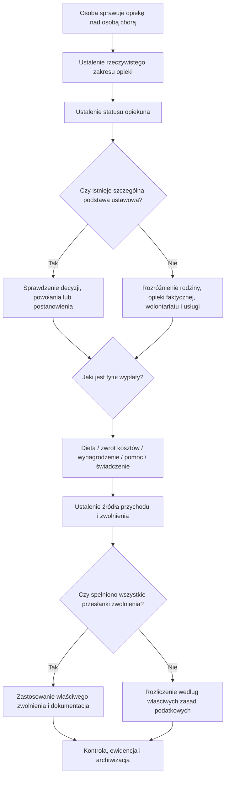

# 13.3. Dieta a opieka nad osobą długotrwale chorą

**Stan opracowania:** 26 listopada 2026 r.  
**Miejsce w kursie:** moduł 13 – diety i zwolnienia podatkowe  
**Charakter rozdziału:** prawno-organizacyjny, podatkowy, społeczny i praktyczny  
**Adresaci:** osoby zarządzające fundacjami i stowarzyszeniami, koordynatorzy opieki, pracownicy socjalni, organizatorzy wolontariatu, opiekunowie, księgowi i osoby przygotowujące programy pomocy.

---

## Mapa zgodności z aktualnym konspektem

| Punkt konspektu | Miejsce opracowania |
|---|---|
| 1. Ustalenie, czy wykonywana opieka stanowi obowiązek społeczny lub obywatelski | Rozdziały 4–6 |
| 2. Rozróżnienie opieki rodzinnej i działalności społecznej | Rozdział 5 |
| 3. Rozróżnienie wolontariatu i pełnienia funkcji publicznej | Rozdział 6 |
| 4. Możliwość ustanowienia funkcji społecznej | Rozdział 7 |
| 5. Dokumentowanie powierzenia funkcji | Rozdział 8 |
| 6. Określenie zakresu wykonywanych obowiązków | Rozdział 9 |
| 7. Analiza przepisów podatkowych | Rozdział 10 |
| 8. Ryzyko nieprawidłowego kwalifikowania wypłat | Rozdział 11 |
| 9. Wypłata rekompensaty na podstawie odrębnej podstawy prawnej | Rozdział 12 |
| 10. Legalne alternatywne modele finansowania opiekunów | Rozdział 13 |

## 1. Cel i główna teza rozdziału

Celem rozdziału jest ustalenie, czy osoba sprawująca opiekę nad członkiem rodziny, sąsiadem lub inną osobą długotrwale chorą może zostać uznana za osobę wykonującą obowiązki społeczne lub obywatelskie, a w konsekwencji otrzymywać dietę albo zwrot kosztów korzystający ze zwolnienia określonego w art. 21 ust. 1 pkt 17 ustawy o podatku dochodowym od osób fizycznych.

**Główna teza:** samo sprawowanie opieki nad osobą długotrwale chorą, nawet systematyczne, odpowiedzialne, nieodpłatne i społecznie użyteczne, nie tworzy automatycznie funkcji publicznej ani obowiązku społecznego lub obywatelskiego w rozumieniu przepisów podatkowych. Nie wystarcza również uchwała fundacji, regulamin programu, nazwanie opiekuna „opiekunem społecznym” ani ustalenie miesięcznej kwoty określonej jako dieta.

Prawidłowa kwalifikacja wymaga odrębnego ustalenia:

1. kim jest osoba wykonująca opiekę;
2. na jakiej podstawie prawnej działa;
3. kto powierzył jej zadania i w jakim zakresie;
4. czy wykonuje funkcję publiczną lub ustawowo uregulowaną funkcję społeczną;
5. czy jej działania są świadczeniem rodzinnym, wolontariatem, usługą, obowiązkiem opiekuna prawnego czy inną formą wsparcia;
6. jaki jest rzeczywisty tytuł prawny wypłaty;
7. czy istnieje konkretne zwolnienie podatkowe właściwe dla tego tytułu.

Rozdział nie ma na celu ograniczania wartości opieki rodzinnej i społecznej. Przeciwnie, jego zadaniem jest wskazanie takich form finansowania i organizacji pomocy, które szanują godność chorego, pracę opiekuna, prawo podatkowe oraz zasady przejrzystego zarządzania środkami fundacji.

## 2. Powiązanie z wcześniejszymi rozdziałami

Niniejszy rozdział rozwija zagadnienia, których nie należy ponownie utożsamiać:

- rozdział 10.1 – pojęcie opieki społecznej i opieki nad osobą przewlekle chorą;
- rozdział 11.1 – pojęcie obowiązków społecznych;
- rozdział 11.2 – osoby wykonujące obowiązki społeczne;
- rozdział 11.3 – granice kwalifikowania opieki jako obowiązku społecznego;
- rozdział 12.3 – rekompensowanie utraconych dochodów;
- rozdział 13.1 – pojęcie diety;
- rozdział 13.2 – zwolnienia podatkowe.

W szczególności:

- rozdział 13.1 wyjaśnia różne rodzaje diet i ich funkcje;
- rozdział 13.2 omawia przesłanki zwolnienia podatkowego i limit 3000 zł miesięcznie;
- rozdział 11.3 przedstawia granice uznawania opieki za obowiązek społeczny;
- rozdział 12.3 omawia podstawy i metody rekompensowania utraconego dochodu.

W tym rozdziale przedmiotem analizy jest przede wszystkim **konkretna sytuacja opiekuna osoby długotrwale chorej** oraz dobór zgodnego z prawem modelu organizacyjnego i finansowego.

## 3. Efekty kształcenia

Po ukończeniu rozdziału uczestnik powinien umieć:

1. odróżnić opiekę rodzinną, opiekę faktyczną, opiekę nieformalną, wolontariat, opiekę prawną i zawodowe świadczenie usług;
2. wyjaśnić, dlaczego społeczna użyteczność opieki nie jest równoznaczna z wykonywaniem obowiązków społecznych lub obywatelskich w rozumieniu art. 13 pkt 5 ustawy o PIT;
3. wskazać znaczenie ustawowej podstawy funkcji i jej rzeczywistego charakteru;
4. rozpoznać sytuację, w której wypłata dla członka zarządu osoby prawnej podlega art. 13 pkt 7 ustawy o PIT;
5. rozróżnić dietę, wynagrodzenie, zwrot rzeczywiście poniesionych kosztów, świadczenie z pomocy społecznej i rekompensatę;
6. przygotować dokumentację powierzenia zadań opiekuńczych;
7. określić granice czynności opiekuńczych i medycznych;
8. rozpoznać ryzyko pozornego ustanawiania funkcji społecznej w celu uzyskania zwolnienia podatkowego;
9. wskazać szczególną podstawę zwolnienia wynagrodzenia za opiekę przyznanego przez sąd na podstawie art. 162 Kodeksu rodzinnego i opiekuńczego;
10. zaprojektować legalny model finansowania opiekunów przez fundację, jednostkę samorządu terytorialnego albo podmiot świadczący usługi.

## 4. Pojęcia wymagające rozróżnienia

### 4.1. Osoba długotrwale chora

Osoba długotrwale chora to osoba, której stan zdrowia powoduje utrzymywanie się przez dłuższy czas ograniczeń, konieczność leczenia, rehabilitacji, pielęgnacji lub pomocy w codziennym funkcjonowaniu. Samo rozpoznanie choroby przewlekłej nie przesądza o niesamodzielności, potrzebie stałej opieki ani o ustanowieniu przedstawiciela ustawowego.

Należy odróżnić:

- chorobę przewlekłą;
- czasową lub trwałą niesamodzielność;
- niepełnosprawność;
- potrzebę opieki długoterminowej;
- potrzebę świadczeń zdrowotnych;
- potrzebę wsparcia w codziennych czynnościach.

Każda z tych kategorii może podlegać odrębnym przepisom i kryteriom kwalifikacji.

### 4.2. Opiekun faktyczny

Art. 3 ust. 1 pkt 1 ustawy o prawach pacjenta i Rzeczniku Praw Pacjenta określa opiekuna faktycznego jako osobę sprawującą, bez obowiązku ustawowego, stałą opiekę nad pacjentem, który ze względu na wiek, stan zdrowia albo stan psychiczny takiej opieki wymaga.[5]

Jest to pojęcie związane z prawami pacjenta. Nie należy wyprowadzać z niego automatycznie:

- statusu przedstawiciela ustawowego;
- prawa do zarządzania majątkiem chorego;
- prawa do zawierania w jego imieniu wszystkich umów;
- prawa do otrzymywania wynagrodzenia;
- statusu osoby pełniącej obowiązki społeczne lub obywatelskie.

Opiekun faktyczny może wykonywać realną i bardzo intensywną pracę opiekuńczą, ale jego status wynika z faktycznego sprawowania opieki, a nie z ustanowienia go organem władzy publicznej.

### 4.3. Opiekun nieformalny w ustawie z 11 czerwca 2026 r.

Ustawa o osobach starszych i koordynacji opieki długoterminowej wprowadziła własną definicję opiekuna nieformalnego. Jest nim osoba sprawująca opiekę nieformalną, która nie pobiera wynagrodzenia z tytułu sprawowanej opieki, z wyjątkiem rodziców zastępczych. Ustawa wymienia wśród możliwych opiekunów osoby bliskie, osoby sprawujące rodzinną pieczę zastępczą, inne osoby niezobowiązane do wsparcia z racji wykonywanego zawodu oraz opiekunów faktycznych.[6]

To rozróżnienie ma istotne znaczenie:

- pojęcie opiekuna faktycznego pochodzi z ustawy o prawach pacjenta;
- pojęcie opiekuna nieformalnego z ustawy z 2026 r. ma własne przesłanki, w tym brak wynagrodzenia za sprawowaną opiekę;
- definicje te nie są uniwersalnymi nazwami wszystkich możliwych stosunków prawnych.

Jeżeli osoba zaczyna pobierać wynagrodzenie za świadczenie usług opiekuńczych, trzeba ponownie ocenić, czy nadal spełnia definicję opiekuna nieformalnego z ustawy z 2026 r. Nie można rozstrzygać tego wyłącznie na podstawie nazwy przelewu. Istotny jest rzeczywisty tytuł wypłaty i jej związek ze sprawowaną opieką.

### 4.4. Opiekun prawny

Opiekun prawny jest ustanawiany przez właściwy sąd w przypadkach przewidzianych prawem. Nie jest nim automatycznie członek rodziny, osoba zamieszkująca z chorym, wolontariusz ani osoba posiadająca upoważnienie do kontaktu z placówką medyczną.

Opieka prawna wiąże się z określonym zakresem obowiązków i nadzorem sądu. W przypadku osoby dorosłej opiekę prawną należy odróżnić od kurateli. Opieka nad osobą ubezwłasnowolnioną całkowicie podlega odpowiedniemu stosowaniu przepisów o opiece nad małoletnim (art. 175 KRO). Natomiast art. 183 KRO przewiduje ustanowienie kuratora dla pełnoletniej osoby z niepełnosprawnością, która potrzebuje wsparcia w prowadzeniu wszystkich spraw, spraw określonego rodzaju albo załatwieniu konkretnej sprawy. Sąd określa zakres obowiązków i uprawnień kuratora; kurator reprezentuje tę osobę tylko wtedy, gdy sąd tak postanowi. Kurator nie jest zatem automatycznie opiekunem prawnym ani przedstawicielem ustawowym. Sama diagnoza choroby przewlekłej lub niepełnosprawność nie ustanawia opieki prawnej ani kurateli.

### 4.5. Wolontariusz

Wolontariusz wykonuje świadczenia dobrowolnie i nieodpłatnie na zasadach określonych w ustawie o działalności pożytku publicznego i o wolontariacie. Nieodpłatność nie oznacza, że korzystający nie może być zobowiązany do pokrywania kosztów przewidzianych ustawą. Zwrot kosztów i dieta podróżna wolontariusza nie są jednak wynagrodzeniem za wykonywanie opieki.

### 4.6. Osoba świadcząca usługi opiekuńcze

Osoba świadcząca usługi opiekuńcze wykonuje zadania na podstawie właściwego stosunku prawnego, np. umowy o pracę, umowy zlecenia, umowy zawartej z podmiotem realizującym zadanie publiczne albo innej dopuszczalnej podstawy.

Jeżeli otrzymuje zapłatę za wykonane czynności, należy analizować rzeczywisty rodzaj stosunku prawnego, obowiązki podatkowe, ubezpieczeniowe i wymagania dotyczące kwalifikacji.

### 4.7. Zestawienie pojęć

| Kategoria | Podstawowa cecha | Czy sama nazwa tworzy prawo do diety? |
|---|---|---|
| Członek rodziny sprawujący opiekę | Relacja rodzinna i faktyczna pomoc | Nie |
| Opiekun faktyczny | Stała opieka bez obowiązku ustawowego | Nie |
| Opiekun nieformalny według ustawy z 2026 r. | Opieka bez wynagrodzenia za jej sprawowanie | Nie |
| Wolontariusz | Dobrowolne i nieodpłatne świadczenie na podstawie ustawy | Nie; możliwe są ustawowe koszty i diety podróżne |
| Opiekun prawny | Ustanowienie przez sąd i obowiązki określone prawem | Nie; możliwe jest odrębne wynagrodzenie na podstawie art. 162 KRO |
| Pracownik lub zleceniobiorca | Odpłatne świadczenie usług | Nie; otrzymuje wynagrodzenie na właściwej podstawie |
| Osoba pełniąca ustawową funkcję publiczną | Zadania wynikające z właściwego reżimu prawnego | Tylko gdy spełnione są przesłanki właściwej regulacji |
| Wewnętrzny opiekun fundacji | Funkcja ustanowiona w organizacji | Nie |

## 5. Opieka rodzinna a działalność społeczna

### 5.1. Rodzinny charakter obowiązków

Kodeks rodzinny i opiekuńczy określa obowiązki małżonków oraz rodziców i dzieci, a także obowiązek alimentacyjny krewnych w zakresie wynikającym z ustawy. W szczególności:

- art. 23 KRO określa obowiązki małżonków, w tym wzajemną pomoc;
- art. 27 KRO dotyczy przyczyniania się do zaspokajania potrzeb rodziny;
- art. 87 KRO wskazuje obowiązek wzajemnego szacunku i wspierania się rodziców oraz dzieci;
- art. 128 i następne KRO regulują obowiązek alimentacyjny;
- art. 135 § 2 KRO przewiduje, że wykonanie obowiązku alimentacyjnego względem dziecka, które nie jest jeszcze w stanie utrzymać się samodzielnie, albo wobec osoby niepełnosprawnej może polegać w całości lub części na osobistych staraniach o utrzymanie lub wychowanie uprawnionego.[4]

Przepisy te dotyczą stosunków rodzinnych. Nie należy automatycznie przekształcać obowiązków rodzinnych w obowiązki publiczne lub obywatelskie.

### 5.2. Obowiązek rodzinny nie jest automatycznie funkcją społeczną

Osoba, która codziennie pomaga choremu rodzicowi, małżonkowi lub dziecku, może wykonywać bardzo rozległe i odpowiedzialne zadania. Może ponosić koszty, ograniczać zatrudnienie i rezygnować z części aktywności zawodowej.

Nie oznacza to jednak, że:

1. została powołana do organu władzy publicznej;
2. reprezentuje wspólnotę lokalną w instytucji publicznej;
3. wykonuje funkcję ustanowioną ustawą jako funkcja społeczna lub obywatelska;
4. nabyła prawo do diety z art. 21 ust. 1 pkt 17 ustawy o PIT.

Wartość społeczna opieki i jej kwalifikacja podatkowa są odrębnymi zagadnieniami.

### 5.3. Rodzina może równolegle pełnić inną funkcję publiczną

Możliwa jest sytuacja, w której osoba:

- opiekuje się rodzicem;
- jest radnym;
- pełni funkcję ławnika;
- zasiada w komisji wyborczej;
- wykonuje inną funkcję wynikającą z przepisów.

W takim przypadku należy rozdzielić tytuły prawne. Dieta związana z mandatem publicznym nie staje się wynagrodzeniem za opiekę nad rodzicem. Z kolei sprawowanie opieki rodzinnej nie rozszerza zakresu zwolnienia podatkowego przysługującego z innego tytułu.

### 5.4. Opieka nad chorym a reprezentacja chorego

Opiekun faktyczny nie staje się automatycznie przedstawicielem ustawowym. Jeżeli chory zachowuje zdolność do podejmowania decyzji, należy respektować jego autonomię i uzyskiwać właściwe zgody lub upoważnienia.

W szczególności trzeba odróżnić:

- zgodę pacjenta na przekazanie informacji osobie bliskiej;
- upoważnienie do uzyskiwania dokumentacji medycznej;
- pełnomocnictwo do określonych czynności;
- przedstawicielstwo ustawowe;
- opiekę prawną ustanowioną przez sąd.

Samo prowadzenie opieki domowej nie uprawnia do rozporządzania majątkiem chorego ani do podejmowania za niego wszystkich decyzji.

## 6. Wolontariat a pełnienie funkcji publicznej

### 6.1. Wolontariat jest odrębną konstrukcją prawną

Ustawa o działalności pożytku publicznego i o wolontariacie reguluje świadczenia wolontariuszy oraz podmioty korzystające z ich pracy.[8]

Wolontariat może obejmować m.in.:

- towarzyszenie osobie samotnej;
- pomoc w zakupach;
- wsparcie w kontaktach z otoczeniem;
- pomoc w organizacji czasu wolnego;
- pomoc w dotarciu do instytucji;
- wsparcie w czynnościach życia codziennego, jeżeli nie narusza to przepisów dotyczących zawodów i świadczeń zastrzeżonych.

Zakres świadczeń powinien być określony w porozumieniu z wolontariuszem.

### 6.2. Nieodpłatność i dopuszczalne pokrywanie kosztów

Nieodpłatność wolontariatu nie oznacza, że wolontariusz ma finansować z własnych środków wszystkie wydatki związane z wykonywaniem świadczeń.

Art. 45 ustawy przewiduje obowiązki korzystającego dotyczące bezpieczeństwa, higieny, kosztów podróży służbowych i diet, a także innych niezbędnych kosztów związanych z wykonywaniem świadczeń, na zasadach określonych w ustawie.[8]

Należy jednak zachować rozróżnienie:

| Wypłata | Charakter |
|---|---|
| Zwrot udokumentowanego kosztu przejazdu | Pokrycie wydatku |
| Dieta za podróż wolontariusza na zasadach ustawowych | Należność związana z podróżą |
| Zwrot uzasadnionych i niezbędnych kosztów | Pokrycie kosztu wykonywania świadczenia |
| Stała kwota za każdą godzinę opieki | Może wskazywać na odpłatność, a nie wolontariat |
| Miesięczna kwota za gotowość do świadczenia opieki | Wymaga szczególnie dokładnej oceny; nie można automatycznie nazywać jej zwrotem kosztów |

Ustawa o PIT przewiduje w art. 21 ust. 1 pkt 113 zwolnienie wartości świadczeń otrzymanych przez wolontariuszy na podstawie ustawy o działalności pożytku publicznego.[1] Zastosowanie tego przepisu wymaga jednak rzeczywistego spełnienia warunków ustawowych. Nie można wykorzystać go do zwolnienia wynagrodzenia wypłacanego za pracę, która w rzeczywistości nie jest wolontariatem.

### 6.3. Wolontariusz nie jest automatycznie osobą pełniącą obowiązki obywatelskie

Wolontariat i funkcja publiczna mogą służyć dobru wspólnemu, ale nie są pojęciami tożsamymi.

Wolontariusz wykonuje świadczenia w ramach dobrowolnego i nieodpłatnego stosunku określonego ustawą. Osoba pełniąca funkcję publiczną może natomiast wykonywać zadania związane z udziałem obywateli w sprawowaniu władzy lub reprezentowaniem określonej wspólnoty w instytucji.

Nie wolno wyprowadzać prawa do zwolnienia z art. 21 ust. 1 pkt 17 wyłącznie z faktu, że wolontariat ma cel społeczny.

### 6.4. Wolontariat w opiece nad osobą przewlekle chorą

Fundacja może organizować wolontariat opiekuńczy, ale powinna określić:

- podmiot korzystający ze świadczeń;
- zadania wolontariusza;
- miejsce i czas wykonywania świadczeń;
- sposób kontaktu z koordynatorem;
- zasady bezpieczeństwa;
- zasady ochrony danych;
- zakres dopuszczalnych czynności;
- zasady pokrywania kosztów;
- sposób dokumentowania świadczeń.

Wolontariusz nie powinien być wykorzystywany do zastępowania personelu, którego zatrudnienie jest wymagane do realizacji określonych usług lub czynności medycznych.

## 7. Możliwość ustanowienia funkcji społecznej

### 7.1. Funkcja wewnętrzna a funkcja ustawowa

Fundacja może wprowadzić w swoich dokumentach organizacyjnych funkcje takie jak:

- koordynator opieki środowiskowej;
- wolontariusz wspierający;
- opiekun środowiskowy;
- opiekun wizyt domowych;
- organizator pomocy sąsiedzkiej;
- koordynator wsparcia rodziny;
- osoba odpowiedzialna za kontakt z podopiecznym.

Może również określić zakres zadań, odpowiedzialność, wymagania, sposób nadzoru i zasady finansowania.

Nie oznacza to jednak, że fundacja może samą uchwałą utworzyć funkcję publiczną albo ustawową funkcję społeczną, której skutki prawne wynikają z ustawy.

### 7.2. Nazwa funkcji nie rozstrzyga o jej kwalifikacji

Następujące działania nie tworzą same w sobie prawa do zwolnienia podatkowego:

- nadanie osobie tytułu „opiekun społeczny”;
- wydanie legitymacji fundacyjnej;
- wpisanie osoby do wewnętrznego rejestru;
- podjęcie uchwały o ustanowieniu opiekuna;
- określenie miesięcznej kwoty jako diety;
- wskazanie w regulaminie, że opieka służy dobru wspólnemu;
- powołanie się na cele statutowe fundacji.

Dokumenty te mogą potwierdzać wewnętrzny status organizacyjny, ale nie zastępują podstawy ustawowej wymaganej dla konkretnego zwolnienia podatkowego.

### 7.3. Przykład ustawowej funkcji społecznego opiekuna zabytków

Ustawa o ochronie zabytków i opiece nad zabytkami reguluje funkcję społecznego opiekuna zabytków w art. 102–105. Określa zadania, wymagania, tryb ustanowienia przez starostę na wniosek wojewódzkiego konserwatora zabytków, listę opiekunów oraz legitymację.[9]

Jest to przykład funkcji nazwanej i uregulowanej bezpośrednio w ustawie.

Nie jest to jednak funkcja opiekuna osoby chorej. Nie można przenosić jej skutków na działalność opiekuńczą fundacji. Samo użycie podobnej nazwy nie powoduje powstania identycznego statusu prawnego.

### 7.4. Prawidłowe rozwiązanie organizacyjne dla fundacji

Jeżeli fundacja chce zorganizować system pomocy osobom długotrwale chorym, może ustanowić wewnętrzną funkcję koordynatora lub opiekuna środowiskowego, a następnie dobrać właściwą podstawę wykonywania zadań:

1. wolontariat – gdy świadczenia są rzeczywiście dobrowolne i nieodpłatne;
2. umowa o pracę – gdy występują cechy stosunku pracy;
3. umowa zlecenia lub inna umowa cywilnoprawna – gdy odpowiada rzeczywistemu sposobowi wykonywania usług;
4. realizacja zadania publicznego – gdy fundacja otrzymała zadanie na właściwej podstawie;
5. program pomocy finansowej – gdy fundacja przyznaje świadczenia beneficjentom zgodnie ze statutem i regulaminem;
6. refundacja kosztów – gdy istnieje podstawa do pokrycia rzeczywistych, uzasadnionych i właściwie udokumentowanych wydatków.

Nie należy tworzyć fikcyjnej funkcji publicznej po to, aby zastąpić wynagrodzenie dietą.

## 8. Dokumentowanie powierzenia funkcji i zadań

### 8.1. Zasada rozdzielenia dokumentów

W dokumentacji fundacji należy rozdzielić co najmniej cztery obszary:

1. **status osoby** – kim jest i na jakiej podstawie działa;
2. **zakres zadań** – co rzeczywiście ma wykonywać;
3. **podstawa finansowania** – za co i na jakiej podstawie następuje wypłata;
4. **dowody wykonania i rozliczenia** – jakie czynności wykonano oraz jakie koszty poniesiono.

Nie należy tworzyć jednego dokumentu, który jednocześnie ustanawia funkcję, przyznaje dietę, potwierdza wykonanie opieki i rozlicza koszty, jeżeli poszczególne czynności wymagają odrębnych podstaw i dowodów.

### 8.2. Dokumenty potwierdzające status

W zależności od modelu mogą to być:

- uchwała właściwego organu fundacji;
- umowa o pracę;
- umowa cywilnoprawna;
- porozumienie wolontariackie;
- decyzja sądu o ustanowieniu opiekuna prawnego;
- postanowienie sądu przyznające wynagrodzenie;
- decyzja administracyjna;
- umowa realizacji zadania publicznego;
- umowa z gminą w sprawie świadczenia usług;
- pełnomocnictwo albo upoważnienie pacjenta.

Dokument powinien wskazywać konkretną podstawę prawną, a nie tylko powoływać się na „dobro społeczne”.

### 8.3. Minimalny zakres uchwały o ustanowieniu funkcji wewnętrznej

Uchwała fundacji ustanawiająca funkcję organizacyjną powinna zawierać:

1. podstawę kompetencyjną organu;
2. cel ustanowienia funkcji;
3. nazwę funkcji;
4. okres pełnienia;
5. zakres zadań;
6. granice uprawnień;
7. osobę nadzorującą;
8. sposób raportowania;
9. zasady ochrony danych;
10. wskazanie odrębnej podstawy finansowania, jeżeli występuje.

Uchwała powinna wyraźnie wskazywać, że ustanowienie funkcji wewnętrznej nie nadaje osobie statusu przedstawiciela ustawowego, organu publicznego ani osoby pełniącej ustawową funkcję publiczną, jeżeli nie wynika to z odrębnych przepisów.

### 8.4. Dokumentowanie rzeczywistej opieki

Dla bezpieczeństwa chorego i organizacji można prowadzić kartę realizacji wsparcia zawierającą:

- datę i przedział czasu;
- rodzaj wykonanych czynności;
- informację o ewentualnej odmowie lub zmianie zakresu pomocy;
- stwierdzone zagrożenia i sposób przekazania informacji;
- potwierdzenie wykonania świadczenia;
- dane osoby odpowiedzialnej za nadzór.

Nie należy gromadzić pełnej dokumentacji medycznej, jeżeli do organizacji pomocy wystarczają informacje o ograniczeniach funkcjonalnych i potrzebach. Dane o zdrowiu są szczególną kategorią danych osobowych i wymagają właściwej podstawy, ograniczenia zakresu oraz zabezpieczeń.

### 8.5. Dokumentowanie wydatków

Jeżeli fundacja zwraca koszty, powinna ustalić:

- rodzaj kosztu;
- związek kosztu z realizowanym zadaniem;
- osobę, która koszt poniosła;
- datę i miejsce wydatku;
- dokument potwierdzający kwotę;
- zasady rozliczania wydatków nieudokumentowanych, jeżeli są prawnie dopuszczalne;
- zatwierdzenie przez osobę upoważnioną.

Ryczałt nie powinien być używany do ukrywania wynagrodzenia. Jeżeli wypłata nie zależy od kosztów ani od właściwej podstawy ryczałtowej, trzeba ponownie ocenić jej charakter.

## 9. Określenie zakresu wykonywanych obowiązków

### 9.1. Czynności wsparcia w codziennym funkcjonowaniu

W zależności od stanu osoby i kwalifikacji wykonawcy pomoc może obejmować:

- przygotowanie posiłków;
- pomoc w zakupach;
- organizację wizyt;
- towarzyszenie podczas spacerów;
- pomoc w poruszaniu się w granicach bezpiecznych i ustalonych;
- wsparcie w utrzymaniu porządku;
- pomoc w kontakcie z instytucjami;
- przypominanie o ustalonych czynnościach;
- wsparcie w utrzymaniu aktywności społecznej;
- organizowanie czasu wolnego.

Zakres czynności powinien wynikać z indywidualnych potrzeb, zgody osoby wspieranej i kompetencji wykonawcy.

### 9.2. Czynności pielęgnacyjne i czynności medyczne

Nie każda czynność wykonywana przy osobie chorej jest świadczeniem zdrowotnym. Jednocześnie nie wolno zakładać, że każdą czynność można powierzyć dowolnemu opiekunowi.

Należy odróżnić:

- pomoc w codziennym myciu i ubieraniu;
- wsparcie w zmianie pozycji i bezpiecznym przemieszczaniu;
- obserwację ogólnego samopoczucia;
- przekazywanie informacji rodzinie lub personelowi;
- czynności pielęgniarskie;
- podawanie leków w zakresie wymagającym odpowiednich uprawnień lub zleceń;
- opatrywanie ran i wykonywanie procedur medycznych;
- rehabilitację i zabiegi wymagające kwalifikacji.

Fundacja powinna opisać zakres czynności w sposób praktyczny, a nie posługiwać się nieprecyzyjnym sformułowaniem „pełna opieka medyczna”, jeżeli nie prowadzi działalności leczniczej i nie zapewnia personelu uprawnionego do takich świadczeń.

### 9.3. Autonomia i zgoda osoby wspieranej

Osoba wymagająca pomocy zachowuje podmiotowość i prawo do współdecydowania. Niesamodzielność w jednej dziedzinie nie oznacza automatycznej utraty zdolności do podejmowania wszystkich decyzji.

Plan wsparcia powinien uwzględniać:

- wolę i preferencje osoby;
- zakres jej samodzielności;
- potrzebę uzyskania zgody;
- poszanowanie intymności;
- prawo do odmowy;
- ochronę informacji;
- możliwość zmiany osoby wspierającej;
- procedurę reagowania na zagrożenie.

### 9.4. Ocena potrzeb i ryzyka

Przed rozpoczęciem regularnego wsparcia należy rozpoznać przynajmniej:

- podstawowe czynności dnia codziennego (ADL);
- złożone czynności dnia codziennego (IADL);
- mobilność i ryzyko upadku;
- stan odżywienia i nawodnienia;
- ryzyko odleżyn;
- możliwość bezpiecznego przyjmowania posiłków;
- orientację i zdolność komunikowania potrzeb;
- dostępność leków i planu leczenia;
- obciążenie opiekuna;
- dostępność wsparcia zastępczego.

Ocena funkcjonalna pomaga dobrać zakres usług. Nie tworzy jednak sama w sobie statusu publicznego ani prawa do diety.

### 9.5. Sytuacje wymagające pilnej reakcji

Koordynator powinien określić sposób postępowania w razie:

- nagłej duszności;
- bólu w klatce piersiowej;
- objawów udaru;
- utraty przytomności;
- gwałtownego pogorszenia świadomości;
- ciężkiego upadku;
- krwawienia;
- podejrzenia aspiracji;
- nagłego pogorszenia stanu psychicznego;
- zagrożenia przemocą lub zaniedbaniem.

W sytuacji zagrożenia życia lub zdrowia należy korzystać z właściwych służb ratunkowych. Wolontariusz ani opiekun bez odpowiednich kwalifikacji nie powinien zastępować personelu medycznego.

## 10. Analiza przepisów podatkowych

### 10.1. Zasada powszechności opodatkowania

Art. 9 ust. 1 ustawy o PIT ustanawia zasadę, zgodnie z którą opodatkowaniu podlegają wszelkiego rodzaju dochody, z wyjątkiem dochodów objętych ustawowymi zwolnieniami albo innymi szczególnymi regulacjami.[1]

W praktyce oznacza to, że:

- nazwa wypłaty nie rozstrzyga o jej opodatkowaniu;
- cel dobroczynny nie tworzy automatycznego zwolnienia;
- statut fundacji nie zastępuje ustawy podatkowej;
- uchwała o przyznaniu diety nie przesądza, że świadczenie jest dietą w rozumieniu właściwego przepisu;
- zwolnienie należy stosować wyłącznie po potwierdzeniu wszystkich przesłanek.

### 10.2. Art. 13 pkt 5 ustawy o PIT

Przepis obejmuje przychody osób wykonujących czynności związane z pełnieniem obowiązków społecznych lub obywatelskich, z zastrzeżeniem wyłączenia przychodów wymienionych w pkt 7.

Nie należy utożsamiać pojęcia „obowiązek społeczny” z każdym działaniem korzystnym dla społeczeństwa.

W wyroku z 25 listopada 1997 r., sygn. U 6/97, Trybunał Konstytucyjny wskazał, że obowiązek obywatelski wiąże się z udziałem obywatela w zawiadywaniu sprawami państwowymi, a obowiązek społeczny – z udziałem w pracy instytucji jako reprezentant określonej społeczności, w interesie tej społeczności.[2]

W praktyce interpretacyjnej Krajowej Informacji Skarbowej, odwołującej się do tego orzeczenia, podkreśla się także, że funkcja, z którą wiążą się obowiązki, powinna być uregulowana ustawowo.[3]

Dlatego przy ocenie opieki nad osobą długotrwale chorą nie wystarczy wykazać, że:

- opieka służy dobru wspólnemu;
- opiekun działa bez wynagrodzenia;
- fundacja realizuje cele statutowe;
- osoba jest znana lokalnej społeczności;
- opiekun został ustanowiony uchwałą fundacji.

Trzeba ustalić, czy istnieje właściwa podstawa ustawowa funkcji i czy jej charakter odpowiada kryteriom obowiązków społecznych lub obywatelskich.

### 10.3. Art. 13 pkt 7 – członkowie organów osób prawnych

Art. 13 pkt 7 odrębnie reguluje przychody osób należących do składu zarządów, rad nadzorczych, komisji lub innych organów stanowiących osób prawnych, niezależnie od sposobu ich powoływania.[1]

W interpretacji indywidualnej z 23 maja 2025 r., sygn. 0113-KDIPT2-3.4011.272.2025.1.SJ, Dyrektor Krajowej Informacji Skarbowej uznał, że diety wypłacane wybieralnym członkom zarządu lokalnej grupy działania będącej stowarzyszeniem stanowią przychody z art. 13 pkt 7, a nie z art. 13 pkt 5. Organ wskazał, że sam społeczny charakter funkcji i działalność organizacji na rzecz lokalnej społeczności nie znoszą wyłączenia dotyczącego członków organów osoby prawnej.[3]

Wniosek dla fundacji: członek zarządu nie uzyskuje automatycznie statusu osoby wykonującej obowiązki społeczne lub obywatelskie w rozumieniu art. 13 pkt 5 tylko dlatego, że zarządza organizacją non profit.

### 10.4. Art. 21 ust. 1 pkt 17 – zwolnienie diet i zwrotu kosztów

Art. 21 ust. 1 pkt 17 ustawy o PIT przewiduje zwolnienie diet oraz kwot stanowiących zwrot kosztów otrzymywanych przez osoby wykonujące czynności związane z pełnieniem obowiązków społecznych i obywatelskich, do wysokości 3000 zł miesięcznie.[1]

Zwolnienie:

- nie tworzy prawa do otrzymania świadczenia;
- nie ustanawia funkcji społecznej;
- nie zastępuje podstawy wypłaty;
- nie obejmuje automatycznie każdego wolontariusza;
- nie obejmuje automatycznie każdego opiekuna rodzinnego;
- nie może być stosowane wyłącznie na podstawie nazwy „dieta”.

Szczegółowy test przesłanek, limitu miesięcznego, agregacji wypłat i obowiązków płatnika znajduje się w rozdziale 13.2.

### 10.5. Odrębne zwolnienie z art. 21 ust. 1 pkt 79a

Należy zwrócić uwagę na odrębny przepis: art. 21 ust. 1 pkt 79a ustawy o PIT zwalnia z podatku wynagrodzenie za sprawowanie opieki przyznane przez sąd na podstawie art. 162 Kodeksu rodzinnego i opiekuńczego.[1]

To zwolnienie nie jest dietą z art. 21 ust. 1 pkt 17. Jego zastosowanie wynika z konkretnego tytułu prawnego i postanowienia sądu.

Art. 162 KRO przewiduje możliwość przyznania opiekunowi wynagrodzenia okresowego albo jednorazowego na jego żądanie. Kodeks określa także przesłanki odmowy i źródła pokrycia wynagrodzenia.[4]

W interpretacji z 28 stycznia 2025 r., sygn. 0115-KDIT2.4011.577.2024.1.MM, Dyrektor KIS potwierdził zastosowanie zwolnienia z art. 21 ust. 1 pkt 79a do wynagrodzenia kuratora osoby częściowo ubezwłasnowolnionej, jeżeli w konkretnym stanie faktycznym wynagrodzenie przyznane na podstawie art. 179 KRO było pokrywane ze środków publicznych z zastosowaniem art. 162 KRO w związku z art. 178 § 2 KRO.[12] Interpretacja dotyczy opisanego w niej stanu faktycznego i nie uzasadnia automatycznego rozszerzenia zwolnienia na każdą kuratelę, w szczególności na odmienny model kuratora ustanawianego na podstawie art. 183 KRO; w takim przypadku należy odrębnie zbadać postanowienie sądu, podstawę wynagrodzenia i aktualne przepisy.

To szczególny przykład ustawowego wynagrodzenia za opiekę, a nie podstawa do wypłacania diet wszystkim osobom opiekującym się chorymi.

### 10.6. Wolontariat i art. 21 ust. 1 pkt 113

Art. 21 ust. 1 pkt 113 ustawy o PIT zwalnia wartość świadczeń otrzymanych przez wolontariuszy na podstawie ustawy o działalności pożytku publicznego.[1]

Warunkiem jest jednak rzeczywisty status wolontariusza i otrzymanie świadczenia na podstawie właściwych przepisów. Przepis ten nie służy do zwalniania z podatku wynagrodzenia za odpłatne wykonywanie usług opiekuńczych.

### 10.7. Tabela podstawowych rozróżnień podatkowych

| Tytuł wypłaty | Możliwa podstawa kwalifikacji | Czy art. 21 ust. 1 pkt 17 stosuje się automatycznie? |
|---|---|---|
| Dieta za ustawową funkcję społeczną lub obywatelską | Art. 13 pkt 5 i art. 21 ust. 1 pkt 17, po spełnieniu przesłanek | Nie |
| Dieta członka zarządu fundacji | Co do zasady analiza art. 13 pkt 7 | Nie |
| Zwrot kosztów wolontariusza | Art. 45 ustawy o działalności pożytku publicznego; analiza art. 21 ust. 1 pkt 113 | Nie |
| Wynagrodzenie za usługi opiekuńcze | Właściwe źródło przychodu zależnie od umowy i okoliczności | Nie |
| Wynagrodzenie opiekuna przyznane przez sąd na podstawie art. 162 KRO | Art. 21 ust. 1 pkt 79a | Nie dotyczy; odrębne zwolnienie |
| Zapomoga lub grant dla opiekuna | Zależnie od podstawy i rodzaju świadczenia, w tym możliwa analiza art. 20 i art. 21 | Nie |
| Zwrot rzeczywistych kosztów w programie fundacji | Zależnie od podstawy prawnej, odbiorcy, dokumentów i charakteru wydatku | Nie |

## 11. Ryzyko nieprawidłowego kwalifikowania wypłat

### 11.1. Pozorne ustanowienie funkcji

Ryzyko występuje, gdy organizacja:

1. tworzy wewnętrzny tytuł „opiekuna społecznego”;
2. nie wskazuje ustawowej podstawy tej funkcji;
3. nie określa rzeczywistych zadań publicznych;
4. przyznaje stałą kwotę miesięczną;
5. nazywa ją dietą;
6. stosuje zwolnienie z art. 21 ust. 1 pkt 17 bez przeprowadzenia kwalifikacji.

Taki sposób postępowania może zostać zakwestionowany przez organ podatkowy.

### 11.2. Dieta jako ukryte wynagrodzenie

Stała kwota wypłacana za liczbę godzin, dyspozycyjność, wykonane wizyty lub określony zakres usług może w rzeczywistości stanowić wynagrodzenie.

Należy zbadać:

- czy wypłata zależy od wykonania pracy;
- czy kwota jest ustalona za godzinę, wizytę lub miesiąc;
- czy istnieje obowiązek pozostawania w dyspozycji;
- czy osoba wykonuje polecenia organizacji;
- czy ponosi ryzyko i odpowiedzialność za rezultat;
- czy kwota jest powiązana z kosztami;
- czy istnieje umowa lub stosunek organizacyjny odpowiadający rzeczywistym czynnościom.

Nie przesądza o charakterze świadczenia sam fakt, że strony nazwały je dietą.

### 11.3. Ryczałt bez rzeczywistej podstawy

Ryczałt może być dopuszczalny w określonych konstrukcjach prawnych. Nie oznacza to jednak, że każdą kwotę można uznać za zwrot kosztów.

Jeżeli fundacja wypłaca opiekunowi 1200 zł miesięcznie niezależnie od rzeczywiście poniesionych wydatków, nie powinna bez analizy przyjmować, że jest to refundacja kosztów.

### 11.4. Nieprawidłowe użycie zwolnienia podatkowego

Najczęstsze błędy:

- zastosowanie art. 21 ust. 1 pkt 17 bez ustalenia źródła przychodu;
- pominięcie art. 13 pkt 7;
- uznanie, że działalność statutowa automatycznie jest funkcją publiczną;
- uznanie, że każdy wolontariusz pełni obowiązki obywatelskie;
- pomylenie opiekuna faktycznego z opiekunem prawnym;
- pominięcie art. 21 ust. 1 pkt 79a przy wynagrodzeniu sądowym;
- uznanie, że każda zapomoga jest zwolniona z PIT;
- niewłaściwe dokumentowanie kosztów.

### 11.5. Skutki dla fundacji i odbiorcy

Nieprawidłowa kwalifikacja może prowadzić do:

- konieczności korekty informacji podatkowych;
- zaległości w poborze zaliczek;
- odsetek za zwłokę;
- odpowiedzialności płatnika na zasadach Ordynacji podatkowej;
- odpowiedzialności za nieprawidłowe wydatkowanie dotacji;
- obowiązku zwrotu środków;
- sporów z odbiorcą świadczenia;
- naruszenia zasad rachunkowości;
- ryzyka naruszenia praw pracowniczych lub zasad ubezpieczenia społecznego.

### 11.6. Zasada bezpieczeństwa

Jeżeli fundacja nie potrafi wskazać konkretnej podstawy prawnej wypłaty, nie powinna stosować zwolnienia podatkowego wyłącznie dlatego, że świadczenie jest przeznaczone dla osoby sprawującej opiekę.

W sytuacji wątpliwej należy:

1. opisać rzeczywisty stan faktyczny;
2. ustalić rodzaj stosunku prawnego;
3. przeanalizować przepisy;
4. uzyskać opinię doradcy podatkowego lub prawnika;
5. rozważyć wystąpienie o interpretację indywidualną.

## 12. Wypłata rekompensaty na podstawie odrębnej podstawy prawnej

### 12.1. Wynagrodzenie opiekuna prawnego – art. 162 KRO

Jeżeli osoba została ustanowiona opiekunem prawnym przez sąd, może wystąpić o wynagrodzenie na zasadach art. 162 KRO.

Przepis przewiduje:

- wynagrodzenie okresowe albo jednorazowe;
- przyznanie wynagrodzenia na żądanie opiekuna;
- możliwość odmowy, jeżeli nakład pracy jest nieznaczny;
- ograniczenie w sytuacjach wskazanych w ustawie;
- pokrycie wynagrodzenia z dochodów lub majątku osoby pozostającej pod opieką, a w określonych warunkach ze środków publicznych na podstawie przepisów o pomocy społecznej.[4]

Wynagrodzenie to korzysta ze szczególnego zwolnienia podatkowego określonego w art. 21 ust. 1 pkt 79a ustawy o PIT.[1]

### 12.2. Kurator osoby częściowo ubezwłasnowolnionej

Kurator nie jest tym samym co opiekun prawny. Jego zadania wynikają z postanowienia sądu i właściwych przepisów.

Art. 178 § 2 KRO przewiduje odpowiednie stosowanie przepisów o opiece do kurateli w zakresie nieuregulowanym odrębnie. KIS w interpretacji z 28 stycznia 2025 r. potwierdził możliwość zastosowania art. 21 ust. 1 pkt 79a w konkretnym przypadku kuratora osoby częściowo ubezwłasnowolnionej, gdy wynagrodzenie przyznane na podstawie art. 179 KRO było pokrywane ze środków publicznych z zastosowaniem art. 162 KRO.[12] Nie należy automatycznie przenosić tej interpretacji na inne rodzaje kurateli, w tym kuratelę ustanawianą na podstawie art. 183 KRO.

Nie należy rozszerzać tego zwolnienia na każdą osobę, która pomaga osobie częściowo lub całkowicie niesamodzielnej.

### 12.3. Usługi opiekuńcze z pomocy społecznej

Ustawa o pomocy społecznej przewiduje usługi opiekuńcze i specjalistyczne usługi opiekuńcze dla osób wymagających pomocy z powodu wieku, choroby lub innych przyczyn określonych w ustawie. Art. 50 reguluje podstawowe zasady przyznawania usług, a art. 50a odnosi się do usług sąsiedzkich.[7]

W tym modelu:

- adresatem pomocy jest osoba wymagająca wsparcia;
- świadczenie jest przyznawane na zasadach pomocy społecznej;
- wykonawca może otrzymywać wynagrodzenie na właściwej podstawie;
- nie jest to automatycznie dieta z tytułu obowiązków społecznych.

Jeżeli gmina organizuje usługi sąsiedzkie, trzeba sprawdzić lokalną uchwałę, warunki kwalifikacji, sposób ustalania odpłatności i zasady wynagradzania wykonawców.

### 12.4. Program Bonu Senioralnego

Ustawa z 11 czerwca 2026 r. o osobach starszych i koordynacji opieki długoterminowej ustanowiła ramy Bonu Senioralnego.[6] Program na lata 2026–2028 został określony rozporządzeniem Rady Ministrów z 29 września 2026 r., obowiązującym od 30 września 2026 r.[10]

Bon Senioralny:

- jest przeznaczony dla seniora, który ukończył 65 lat;
- służy finansowaniu usług wsparcia w codziennym funkcjonowaniu;
- nie jest wypłatą gotówki do swobodnej dyspozycji opiekuna;
- nie jest dietą rodzinną;
- jest realizowany przez gminę;
- może być realizowany z udziałem organizacji pozarządowych i innych podmiotów wybranych w odpowiednim trybie.

Ustawa określa kryterium dochodowe seniora, a program przewiduje wartość usług do 2500 zł miesięcznie. Koszt jednej godziny wynagrodzenia osoby świadczącej usługi wsparcia nie może przekraczać 48 zł. Kwota 2500 zł oznacza wartość usług, a nie automatyczną wypłatę pieniędzy seniorowi lub jego rodzinie.[6][10]

Rozporządzenie dopuszcza zlecanie usług wsparcia organizacjom pozarządowym, podmiotom ekonomii społecznej i innym wskazanym podmiotom w drodze otwartego, konkurencyjnego, przejrzystego i niedyskryminacyjnego naboru.[10]

Dla fundacji może to być legalna droga uczestnictwa w systemie opieki długoterminowej, jeżeli spełnia warunki i zostanie wybrana przez gminę. Osoby wykonujące usługi otrzymują wynagrodzenie na właściwej podstawie, a nie dietę z art. 21 ust. 1 pkt 17.

### 12.5. Program pomocy fundacji

Fundacja może ustanowić program wsparcia opiekunów, jeżeli:

- mieści się on w celach statutowych;
- organ przyznający środki ma właściwą kompetencję;
- regulamin określa kryteria i procedurę;
- środki są dostępne w budżecie;
- beneficjenci są traktowani według przejrzystych zasad;
- wypłata ma prawidłową podstawę prawną;
- sposób rozliczenia jest zgodny z warunkami źródła finansowania;
- skutki podatkowe zostały zbadane odrębnie.

Pomoc może przybrać postać:

- zapomogi;
- świadczenia celowego;
- refundacji uzasadnionych kosztów;
- zakupu usług opiekuńczych;
- dofinansowania transportu;
- sfinansowania opieki wytchnieniowej;
- zakupu sprzętu pomocniczego;
- wsparcia psychologicznego lub szkoleniowego.

Nie wolno jednak zakładać, że każda z tych form jest wolna od podatku. Podstawę zwolnienia trzeba ustalić dla konkretnego rodzaju świadczenia i odbiorcy.

## 13. Legalne alternatywne modele finansowania opiekunów

### 13.1. Model rodzinny z systemem wsparcia

Rodzina sprawuje opiekę nieformalną, a system publiczny lub fundacja wspiera ją poprzez:

- informację i poradnictwo;
- szkolenia;
- grupy wsparcia;
- konsultacje psychologiczne;
- czasowe zastępstwo;
- usługi opiekuńcze;
- pomoc w organizacji leczenia i rehabilitacji.

Art. 7 ustawy o osobach starszych i koordynacji opieki długoterminowej przewiduje możliwość organizowania przez jednostki samorządu terytorialnego szkoleń, spotkań edukacyjnych, grup wsparcia, konsultacji psychologicznych i czasowego zastępstwa opiekuna nieformalnego.[6]

### 13.2. Model wolontariacki

Fundacja zawiera porozumienie z wolontariuszem, określa zadania, zapewnia bezpieczeństwo i pokrywa koszty na zasadach ustawowych.

Model jest właściwy, gdy:

- świadczenie jest dobrowolne;
- nie jest wykonywane za wynagrodzeniem;
- zadania są zgodne z prawem;
- koszty są rzeczywiste lub rozliczane na dopuszczalnej podstawie;
- nie dochodzi do zastępowania etatowej pracy pozornym wolontariatem.

### 13.3. Model zatrudnienia lub odpłatnych usług

Jeżeli opieka ma charakter regularnej, zorganizowanej i odpłatnej usługi, należy rozważyć właściwą umowę.

Możliwe rozwiązania zależą od faktycznego sposobu wykonywania pracy:

- stosunek pracy;
- umowa zlecenia;
- działalność gospodarcza;
- świadczenie usług przez podmiot ekonomii społecznej;
- realizacja usług na podstawie umowy zawartej z gminą.

Należy zbadać przepisy podatkowe, ubezpieczeniowe, prawo pracy, kwalifikacje oraz ewentualne wymogi dotyczące działalności leczniczej.

### 13.4. Model usług sąsiedzkich

Usługi sąsiedzkie mogą być organizowane na podstawie ustawy o pomocy społecznej i lokalnych regulacji. Jeżeli wykonawca otrzymuje wynagrodzenie, nie należy określać tej wypłaty jako diety za obowiązek obywatelski, jeżeli rzeczywistą podstawą jest świadczenie usług.

### 13.5. Model realizacji Bonu Senioralnego

Fundacja może ubiegać się o udział w realizacji usług wsparcia zlecanych przez gminę w ramach programu. Wymaga to spełnienia kryteriów, właściwego trybu wyboru, umowy i standardów świadczenia usług.

Jest to model finansowania usługi na rzecz seniora, a nie bezpośredniej rekompensaty utraconych zarobków członka jego rodziny.

### 13.6. Model opiekuna prawnego

Jeżeli osoba została ustanowiona opiekunem prawnym przez sąd i spełnia przesłanki art. 162 KRO, może żądać wynagrodzenia na podstawie tego przepisu. Zwolnienie podatkowe wynika wówczas z art. 21 ust. 1 pkt 79a ustawy o PIT, a nie z art. 21 ust. 1 pkt 17.

### 13.7. Model pomocy celowej fundacji

Fundacja może finansować uzasadnione potrzeby opiekuna lub chorego, jeżeli wynika to ze statutu i prawidłowo ustanowionego programu. Należy jednak odrębnie ustalić:

- czy świadczenie jest pomocą dla osoby potrzebującej;
- czy jest refundacją wydatku;
- czy jest darowizną;
- czy jest przychodem z innego źródła;
- czy istnieje szczególne zwolnienie;
- czy wydatek jest zgodny z warunkami dotacji.

### 13.8. Porównanie modeli

| Model | Podstawa | Kto otrzymuje środki lub usługę | Główne ryzyko |
|---|---|---|---|
| Opieka rodzinna | Prawo rodzinne i przepisy wsparcia | Rodzina korzysta z dostępnych form pomocy | Uznanie opieki za automatycznie płatną funkcję |
| Wolontariat | Ustawa o działalności pożytku publicznego | Wolontariusz może otrzymać ustawowe świadczenia i zwrot kosztów | Ukryte wynagrodzenie |
| Usługi opiekuńcze | Ustawa o pomocy społecznej lub umowa | Osoba wymagająca wsparcia | Nieprawidłowa kwalifikacja wykonawcy |
| Bon Senioralny | Ustawa z 2026 r. i program 2026–2028 | Senior otrzymuje usługi | Utożsamienie wartości bonu z gotówką dla opiekuna |
| Opieka prawna | Art. 162 KRO | Opiekun ustanowiony przez sąd | Brak postanowienia o wynagrodzeniu |
| Pomoc fundacji | Statut, regulamin i właściwe przepisy | Beneficjent programu | Brak analizy podatkowej |
| Odpłatna usługa | Umowa o pracę lub umowa cywilnoprawna | Osoba świadcząca usługę | Pozorna umowa albo błędne rozliczenie |

## 14. Procedura kwalifikowania opieki i wypłaty

Poniższy schemat przedstawia kolejność analizy. Nie zastępuje indywidualnej oceny prawnej ani podatkowej.

### 14.1. Etap pierwszy – rozpoznanie osoby i potrzeb

Ustalić:

- kto wymaga opieki;
- jaki jest zakres ograniczeń funkcjonalnych;
- kto faktycznie wykonuje czynności;
- czy istnieje opiekun prawny lub pełnomocnik;
- czy osoba korzysta z usług publicznych;
- czy opiekun jest członkiem rodziny, wolontariuszem czy usługodawcą.

### 14.2. Etap drugi – ustalenie podstawy działania

Należy wskazać jeden lub kilka właściwych tytułów:

- stosunek rodzinny;
- opieka faktyczna;
- opieka nieformalna;
- porozumienie wolontariackie;
- umowa cywilnoprawna;
- stosunek pracy;
- ustanowienie opiekuna prawnego;
- decyzja lub umowa dotycząca usługi publicznej;
- wewnętrzna funkcja organizacyjna.

### 14.3. Etap trzeci – ustalenie charakteru wypłaty

Należy odpowiedzieć:

1. Czy wypłata jest związana z wykonaniem pracy?
2. Czy odpowiada rzeczywistym kosztom?
3. Czy wynika z ustawy?
4. Czy została przyznana przez właściwy organ?
5. Czy ma charakter świadczenia pomocowego?
6. Czy istnieje szczególne zwolnienie podatkowe?

### 14.4. Etap czwarty – decyzja i kontrola

Przed wypłatą należy przygotować kartę kwalifikacji, wskazać osobę zatwierdzającą, sprawdzić konflikt interesów, określić obowiązki płatnika i zapewnić dowody księgowe.

## 15. Narzędzia praktyczne

### 15.1. Karta kwalifikacji statusu opiekuna

| Pole | Dane do uzupełnienia |
|---|---|
| Osoba wymagająca wsparcia | |
| Osoba wykonująca opiekę | |
| Rodzaj relacji | |
| Czy istnieje obowiązek ustawowy? | |
| Czy ustanowiono opiekuna prawnego? | |
| Czy istnieje pełnomocnictwo lub upoważnienie? | |
| Czy zawarto porozumienie wolontariackie? | |
| Czy opiekun otrzymuje wynagrodzenie za opiekę? | |
| Czy opiekun jest usługodawcą? | |
| Podstawa prawna statusu | |
| Data weryfikacji | |
| Osoba weryfikująca | |

### 15.2. Karta kwalifikacji wypłaty

| Pytanie | Ustalenie |
|---|---|
| Nazwa wypłaty | |
| Rzeczywisty cel | |
| Podstawa ustawowa, umowna lub regulaminowa | |
| Organ uprawniony do przyznania | |
| Czy jest to wynagrodzenie? | |
| Czy jest to zwrot kosztów? | |
| Czy istnieją dowody kosztów? | |
| Źródło przychodu w PIT | |
| Czy występuje zwolnienie? | |
| Przepis zwalniający | |
| Obowiązki płatnika | |
| Wymagane formularze | |
| Data zatwierdzenia | |

### 15.3. Karta powierzenia zadań opiekuńczych

**Nazwa funkcji:** ....................................................................

**Charakter funkcji:** wewnętrzna / wolontariacka / usługowa / ustawowa – po wskazaniu konkretnej podstawy.

**Podstawa powierzenia:** ....................................................................

**Zakres zadań:**

1. ....................................................................
2. ....................................................................
3. ....................................................................

**Czynności wyłączone z zakresu:**

1. czynności wymagające uprawnień, których osoba nie posiada;
2. podejmowanie decyzji za pacjenta bez właściwego umocowania;
3. rozporządzanie majątkiem chorego bez podstawy prawnej;
4. czynności wykraczające poza zgodę i potrzeby osoby wspieranej.

**Nadzór:** ....................................................................

**Okres wykonywania:** ....................................................................

**Sposób dokumentowania:** ....................................................................

**Zasady ochrony danych:** ....................................................................

### 15.4. Karta planu wsparcia

| Obszar | Potrzeba | Uzgodnione działanie | Osoba odpowiedzialna | Termin przeglądu |
|---|---|---|---|---|
| Mobilność | | | | |
| Higiena | | | | |
| Żywienie i nawodnienie | | | | |
| Kontakty społeczne | | | | |
| Transport | | | | |
| Organizacja wizyt | | | | |
| Bezpieczeństwo w domu | | | | |
| Odpoczynek opiekuna | | | | |

### 15.5. Lista kontrolna przed wypłatą

- [ ] Ustalono rzeczywisty status odbiorcy.
- [ ] Wskazano konkretną podstawę prawną wypłaty.
- [ ] Sprawdzono kompetencję organu przyznającego środki.
- [ ] Ustalono, czy wypłata jest wynagrodzeniem, dietą, refundacją czy pomocą.
- [ ] Zweryfikowano przesłanki zwolnienia podatkowego.
- [ ] Sprawdzono, czy odbiorca należy do organu osoby prawnej.
- [ ] Zbadano obowiązki płatnika.
- [ ] Zabezpieczono dowody wykonania zadania lub poniesienia kosztu.
- [ ] Sprawdzono warunki finansowania projektu.
- [ ] Wyłączono osoby pozostające w konflikcie interesów z rozstrzygnięcia własnej sprawy.
- [ ] Ograniczono dane medyczne do niezbędnego zakresu.
- [ ] Zarchiwizowano dokumentację.

## 16. Studia przypadków

### Przypadek 1. Córka opiekuje się przewlekle chorą matką

Córka codziennie pomaga matce w higienie, zakupach, przygotowaniu posiłków i organizacji leczenia. Fundacja chce wypłacać jej 1000 zł miesięcznie jako „dietę opiekuna społecznego”.

**Rozwiązanie:** sam fakt sprawowania opieki rodzinnej nie tworzy funkcji społecznej lub obywatelskiej. Fundacja musi ustalić inną podstawę pomocy, np. program zapomogowy, refundację konkretnych kosztów, zakup usług lub inną dopuszczalną formę wsparcia. Skutki podatkowe należy zbadać odrębnie.

### Przypadek 2. Sąsiad pomaga choremu jako wolontariusz

Sąsiad zawarł z fundacją porozumienie wolontariackie. Odwiedza osobę chorą, pomaga w zakupach i towarzyszy jej podczas spacerów. Fundacja pokrywa udokumentowane koszty przejazdów.

**Rozwiązanie:** może to być wolontariat, jeżeli spełniono przesłanki ustawy i świadczenia są nieodpłatne. Pokrywanie kosztów należy rozliczyć na podstawie właściwych przepisów, w szczególności art. 45 ustawy o działalności pożytku publicznego. Nie jest to automatycznie dieta z art. 21 ust. 1 pkt 17 ustawy o PIT.

### Przypadek 3. Fundacja ustanawia „opiekunów społecznych”

Zarząd fundacji podejmuje uchwałę, na mocy której ustanawia dziesięciu opiekunów społecznych i przyznaje im po 1500 zł miesięcznie.

**Rozwiązanie:** uchwała może utworzyć wewnętrzne funkcje organizacyjne, ale nie tworzy automatycznie ustawowej funkcji publicznej. Trzeba określić rzeczywisty charakter czynności i właściwy tytuł wypłaty. Nie można stosować zwolnienia z art. 21 ust. 1 pkt 17 wyłącznie na podstawie uchwały.

### Przypadek 4. Wolontariusz otrzymuje stałą kwotę za każdą wizytę

Fundacja wypłaca wolontariuszowi 100 zł za każdą wizytę u chorego, niezależnie od poniesionych kosztów.

**Rozwiązanie:** trzeba zbadać, czy nie jest to w rzeczywistości odpłatne świadczenie usług. Stała zapłata za wykonanie wizyty może podważać nieodpłatny charakter wolontariatu. Nie należy ukrywać wynagrodzenia pod nazwą zwrotu kosztów.

### Przypadek 5. Opiekun prawny otrzymuje wynagrodzenie przyznane przez sąd

Sąd ustanowił opiekuna prawnego i przyznał mu okresowe wynagrodzenie na podstawie art. 162 KRO.

**Rozwiązanie:** jest to szczególna podstawa wynagrodzenia. Należy sprawdzić postanowienie sądu i zastosować art. 21 ust. 1 pkt 79a ustawy o PIT. Nie jest to dieta z art. 21 ust. 1 pkt 17.

### Przypadek 6. Kurator osoby częściowo ubezwłasnowolnionej

Sąd ustanowił kuratora, a następnie przyznał mu wynagrodzenie na podstawie art. 162 KRO stosowanego w związku z przepisami o kurateli.

**Rozwiązanie:** interpretacja KIS z 28 stycznia 2025 r., sygn. 0115-KDIT2.4011.577.2024.1.MM, potwierdza możliwość zastosowania zwolnienia z art. 21 ust. 1 pkt 79a w opisanym stanie faktycznym dotyczącym kuratora osoby częściowo ubezwłasnowolnionej. Należy jednak sprawdzić, czy rzeczywista sytuacja odpowiada przesłankom interpretacji, aktualnym przepisom i postanowieniu sądu; nie należy automatycznie rozszerzać jej na inne rodzaje kurateli.

### Przypadek 7. Fundacja realizuje usługi w ramach Bonu Senioralnego

Gmina wybiera fundację w otwartym, konkurencyjnym i przejrzystym naborze do realizacji usług wsparcia. Fundacja zatrudnia osoby wykonujące czynności opiekuńcze.

**Rozwiązanie:** fundacja świadczy usługę na podstawie umowy z gminą. Osoby wykonujące usługi otrzymują wynagrodzenie na właściwej podstawie. Wartość bonu nie jest dietą wypłacaną rodzinie seniora.

### Przypadek 8. Radny opiekuje się chorym rodzicem

Radny gminy otrzymuje dietę za wykonywanie mandatu. Po godzinach sprawuje opiekę nad rodzicem.

**Rozwiązanie:** należy oddzielić oba tytuły. Dieta wynika z przepisów o wykonywaniu mandatu. Opieka rodzinna nie staje się przez to obowiązkiem obywatelskim. Wypłata związana z mandatem nie może być przedstawiana jako wynagrodzenie za opiekę.

## 17. Ćwiczenia praktyczne

### Ćwiczenie 1. Opieka rodzinna

Syn codziennie opiekuje się ojcem po udarze. Fundacja chce wypłacać mu dietę zwolnioną z PIT.

**Pytanie:** Czy sam fakt opieki wystarcza?

**Odpowiedź:** Nie. Należy ustalić odrębną podstawę finansowania. Opieka rodzinna nie tworzy automatycznie funkcji z art. 13 pkt 5 ustawy o PIT.

### Ćwiczenie 2. Wolontariusz

Wolontariusz otrzymuje zwrot kosztów przejazdu na podstawie porozumienia.

**Pytanie:** Czy jest to dieta za pełnienie funkcji publicznej?

**Odpowiedź:** Nie. Jest to rozliczenie kosztów wolontariatu na właściwej podstawie.

### Ćwiczenie 3. Uchwała fundacji

Fundacja ustanowiła funkcję „społecznego opiekuna chorego”.

**Pytanie:** Czy uchwała tworzy ustawową funkcję społeczną?

**Odpowiedź:** Nie. Tworzy funkcję wewnętrzną, chyba że odrębny przepis stanowi inaczej.

### Ćwiczenie 4. Opiekun prawny

Sąd przyznał opiekunowi wynagrodzenie na podstawie art. 162 KRO.

**Pytanie:** Jaki przepis podatkowy należy zbadać?

**Odpowiedź:** Art. 21 ust. 1 pkt 79a ustawy o PIT.

### Ćwiczenie 5. Stała kwota dla wolontariusza

Wolontariusz otrzymuje 200 zł za każdą wizytę.

**Pytanie:** Czy można bez dalszej analizy uznać to za zwrot kosztów?

**Odpowiedź:** Nie. Trzeba zbadać rzeczywisty charakter świadczenia i zgodność z nieodpłatnością wolontariatu.

### Ćwiczenie 6. Członek zarządu

Członek zarządu fundacji otrzymuje stałą dietę za udział w posiedzeniach.

**Pytanie:** Czy może automatycznie zastosować art. 13 pkt 5?

**Odpowiedź:** Nie. Należy zbadać art. 13 pkt 7 i obowiązki płatnika.

### Ćwiczenie 7. Bon Senioralny

Senior otrzymuje usługi wsparcia o wartości 1800 zł miesięcznie.

**Pytanie:** Czy 1800 zł jest kwotą wypłacaną opiekunowi rodzinnemu?

**Odpowiedź:** Nie. Jest to wartość usług wsparcia realizowanych w programie.

### Ćwiczenie 8. Zwrot zakupów

Wolontariusz kupił środki higieniczne dla podopiecznego, a fundacja zwróciła koszt na podstawie rachunku.

**Pytanie:** Co należy sprawdzić?

**Odpowiedź:** Związek zakupu z zadaniem, podstawę pokrycia kosztu, dokument księgowy i zasady programu.

### Ćwiczenie 9. Opiekun faktyczny

Osoba stale pomaga choremu sąsiadowi, ale nie ma pełnomocnictwa.

**Pytanie:** Czy może automatycznie podpisywać dokumenty w imieniu chorego?

**Odpowiedź:** Nie. Status opiekuna faktycznego nie oznacza automatycznie przedstawicielstwa ustawowego.

### Ćwiczenie 10. Fundacja finansuje opiekę

Fundacja chce wypłacać opiekunom kwoty odpowiadające utraconym zarobkom.

**Pytanie:** Jak powinna postąpić?

**Odpowiedź:** Ustanowić zgodny ze statutem program pomocy, określić kryteria, dowody straty, źródło finansowania, sposób rozliczenia i skutki podatkowe. Nie należy nazywać wypłaty dietą bez właściwej podstawy.

## 18. Pytania sprawdzające

1. Czy opieka nad członkiem rodziny jest automatycznie obowiązkiem społecznym w rozumieniu art. 13 pkt 5 ustawy o PIT?
2. Czy nazwanie osoby „opiekunem społecznym” przez fundację tworzy funkcję ustawową?
3. Czym różni się opiekun faktyczny od opiekuna prawnego?
4. Czy wolontariat jest tym samym co pełnienie funkcji publicznej?
5. Czy zwrot kosztów wolontariusza jest wynagrodzeniem?
6. Jakie znaczenie ma art. 13 pkt 7 ustawy o PIT?
7. Czy art. 21 ust. 1 pkt 17 tworzy prawo do otrzymania diety?
8. Jakie wynagrodzenie może zostać przyznane na podstawie art. 162 KRO?
9. Jaki przepis ustawy o PIT przewiduje zwolnienie wynagrodzenia przyznanego przez sąd na podstawie art. 162 KRO?
10. Czy wartość Bonu Senioralnego jest wypłatą gotówki dla opiekuna?
11. Jakie dokumenty powinny potwierdzać podstawę wypłaty?
12. Dlaczego stała kwota za każdą wizytę może podważać nieodpłatny charakter wolontariatu?
13. Czy opiekun faktyczny jest automatycznie przedstawicielem ustawowym?
14. Jakie ryzyka wiążą się z pozornym ustanowieniem funkcji społecznej?
15. Jakie alternatywne modele finansowania opiekunów może zastosować fundacja?

### Klucz odpowiedzi – skrót

1. Nie.
2. Nie.
3. Opiekun faktyczny sprawuje stałą opiekę bez obowiązku ustawowego; opiekun prawny jest ustanawiany przez sąd.
4. Nie.
5. Nie, jeżeli jest to rzeczywisty zwrot kosztów na właściwej podstawie.
6. Wyłącza przychody członków organów osób prawnych z kategorii art. 13 pkt 5.
7. Nie.
8. Wynagrodzenie okresowe lub jednorazowe na warunkach art. 162 KRO.
9. Art. 21 ust. 1 pkt 79a ustawy o PIT.
10. Nie; jest to wartość usług wsparcia.
11. Uchwała, umowa, decyzja lub postanowienie, dokumenty wykonania i rozliczenia.
12. Może wskazywać na odpłatność za usługę.
13. Nie.
14. Zaległości podatkowe, odpowiedzialność płatnika, zwrot dotacji i spory.
15. Wolontariat, refundacja kosztów, zapomoga, usługi opiekuńcze, zatrudnienie, umowy cywilnoprawne, opieka prawna i programy publiczne.

## 19. Najczęstsze błędy

1. Utożsamianie działalności pożytecznej społecznie z obowiązkiem społecznym w rozumieniu ustawy o PIT.
2. Uznawanie każdej opieki rodzinnej za funkcję publiczną.
3. Traktowanie opiekuna faktycznego jako przedstawiciela ustawowego.
4. Ustanawianie funkcji „opiekuna społecznego” wyłącznie uchwałą fundacji i stosowanie zwolnienia podatkowego.
5. Mieszanie wolontariatu z odpłatnym świadczeniem usług.
6. Wypłacanie stałych kwot za czynności opiekuńcze pod nazwą zwrotu kosztów.
7. Pomijanie art. 13 pkt 7 w odniesieniu do członków zarządu osoby prawnej.
8. Stosowanie art. 21 ust. 1 pkt 17 bez ustalenia źródła przychodu.
9. Pomijanie szczególnego zwolnienia z art. 21 ust. 1 pkt 79a przy wynagrodzeniu sądowym.
10. Utożsamianie wartości Bonu Senioralnego z wypłatą dla opiekuna.
11. Brak dokumentacji wykonanych czynności.
12. Nadmierne gromadzenie danych medycznych.
13. Powierzanie wolontariuszom czynności wykraczających poza ich kwalifikacje.
14. Finansowanie tej samej potrzeby z kilku źródeł bez kontroli warunków programów.
15. Brak procedury konfliktu interesów.

## 20. Zasady sprawiedliwego i bezpiecznego finansowania opiekunów

Dobrze zaprojektowany program powinien opierać się na następujących zasadach:

### 20.1. Zasada prawdziwego tytułu

Każda wypłata powinna odpowiadać rzeczywistemu stosunkowi prawnemu. Nie należy tworzyć pozornych diet, refundacji ani wolontariatu.

### 20.2. Zasada godności

Osoba chora nie może być traktowana wyłącznie jako przedmiot opieki. Należy respektować jej wolę, intymność, autonomię i prawo do uczestnictwa w podejmowaniu decyzji.

### 20.3. Zasada ochrony opiekuna

Opiekun powinien mieć dostęp do informacji, szkoleń, wsparcia psychologicznego, odpoczynku i możliwości zastępstwa. Nieodpłatność opieki nie oznacza, że społeczeństwo może ignorować jej koszty.

### 20.4. Zasada przejrzystości finansowej

Regulamin programu powinien określać:

- cel;
- krąg beneficjentów;
- kryteria;
- rodzaje dopuszczalnych wydatków;
- sposób dokumentowania;
- tryb zatwierdzania;
- kontrolę;
- procedurę odwoławczą lub ponownego rozpatrzenia;
- zasady zwrotu środków;
- sposób rozliczania podatków.

### 20.5. Zasada równego traktowania

Kryteria pomocy powinny być obiektywne i związane z celem programu. Nie należy przyznawać świadczeń wyłącznie ze względu na znajomość, przynależność do organizacji albo pełnienie funkcji przez członka rodziny.

### 20.6. Zasada oddzielenia opieki od kontroli podatkowej

Dokumentacja opieki powinna służyć przede wszystkim bezpieczeństwu i jakości wsparcia. Dokumentacja podatkowa powinna wykazywać tytuł prawny, charakter wypłaty i spełnienie przesłanek zwolnienia. Nie należy zmieniać dokumentacji opieki po to, aby pozornie dopasować ją do oczekiwanego zwolnienia.

## 21. Słownik pojęć

**Dieta** – świadczenie pieniężne o charakterze określonym przez właściwy przepis, umowę lub regulację; sama nazwa nie przesądza o skutkach podatkowych.

**Opieka faktyczna** – stałe sprawowanie opieki nad pacjentem bez obowiązku ustawowego, w rozumieniu ustawy o prawach pacjenta.

**Opieka nieformalna** – systematyczne wsparcie w codziennym funkcjonowaniu lub realizacji zaleceń terapeutycznych, udzielane przez opiekuna nieformalnego w rozumieniu ustawy z 2026 r.

**Opiekun faktyczny** – osoba sprawująca stałą opiekę nad pacjentem bez obowiązku ustawowego, jeżeli pacjent ze względu na wiek, stan zdrowia lub stan psychiczny opieki wymaga.

**Opiekun nieformalny** – osoba zdefiniowana w ustawie o osobach starszych i koordynacji opieki długoterminowej, niepobierająca wynagrodzenia z tytułu sprawowanej opieki, z wyjątkiem rodziców zastępczych.

**Opiekun prawny** – osoba ustanowiona przez sąd w przypadkach określonych prawem.

**Wolontariusz** – osoba wykonująca świadczenia dobrowolnie i nieodpłatnie na zasadach ustawy o działalności pożytku publicznego i o wolontariacie.

**Obowiązek społeczny** – obowiązek związany z udziałem w pracy instytucji jako reprezentant określonej społeczności, w rozumieniu kryteriów wypracowanych w orzecznictwie i praktyce interpretacyjnej.

**Obowiązek obywatelski** – obowiązek związany z udziałem obywatela w sprawach państwowych i wykonywaniu funkcji publicznych.

**Wynagrodzenie** – świadczenie stanowiące zapłatę za pracę lub usługę na właściwej podstawie prawnej.

**Zwrot kosztów** – pokrycie wydatku rzeczywiście poniesionego albo rozliczanego na dopuszczalnej podstawie ryczałtowej.

**Bon Senioralny** – forma wsparcia realizowana w postaci usług dla seniora spełniającego warunki ustawowe i programowe, a nie automatyczna wypłata gotówki opiekunowi.

## 22. Bibliografia i źródła

### 22.1. Akty prawne

1. Ustawa z dnia 26 lipca 1991 r. o podatku dochodowym od osób fizycznych, tekst jednolity Dz. U. z 2026 r. poz. 592, w szczególności art. 9, 10, 11, 13 pkt 5–7, art. 20, art. 21 ust. 1 pkt 17, 79a i 113 oraz art. 41–42. [Elektroniczny Dziennik Ustaw – ELI](https://eli.gov.pl/eli/DU/2026/592/ogl).
2. Ustawa z dnia 25 lutego 1964 r. – Kodeks rodzinny i opiekuńczy, tekst jednolity Dz. U. z 2026 r. poz. 236, w szczególności art. 23, 27, 87, 128–135, 145–183. [ELI – tekst jednolity](https://eli.gov.pl/eli/DU/2026/236/ogl).
3. Ustawa z dnia 6 listopada 2008 r. o prawach pacjenta i Rzeczniku Praw Pacjenta, w szczególności art. 3 ust. 1 pkt 1; tekst jednolity Dz. U. z 2024 r. poz. 581 ze zmianami, w tym Dz. U. z 2026 r. poz. 26 i 791. [ELI](https://eli.gov.pl/eli/DU/2024/581/ogl).
4. Ustawa z dnia 11 czerwca 2026 r. o osobach starszych i koordynacji opieki długoterminowej, w szczególności art. 1–18 i 24–30; Dz. U. 2026 poz. 986. [ELI](https://eli.gov.pl/eli/DU/2026/986/ogl).
5. Ustawa z dnia 12 marca 2004 r. o pomocy społecznej, w szczególności art. 50, 50a i przepisy dotyczące usług opiekuńczych; tekst jednolity Dz. U. 2026 poz. 639 z późniejszymi zmianami. [ELI](https://eli.gov.pl/eli/DU/2026/639/ogl).
6. Ustawa z dnia 24 kwietnia 2003 r. o działalności pożytku publicznego i o wolontariacie, w szczególności art. 2, 42, 44–46; tekst jednolity Dz. U. 2025 poz. 1338. [ELI](https://eli.gov.pl/eli/DU/2025/1338/ogl).
7. Ustawa z dnia 19 czerwca 2026 r. o zmianie ustawy o działalności pożytku publicznego i o wolontariacie oraz ustawy o grach hazardowych; Dz. U. 2026 poz. 1040. [ELI](https://eli.gov.pl/eli/DU/2026/1040/ogl).
8. Ustawa z dnia 23 lipca 2003 r. o ochronie zabytków i opiece nad zabytkami, w szczególności art. 102–105; tekst jednolity Dz. U. 2024 poz. 1292. [ELI](https://eli.gov.pl/eli/DU/2024/1292/ogl).
9. Rozporządzenie Rady Ministrów z dnia 29 września 2026 r. w sprawie Programu Bonu Senioralnego na lata 2026–2028; Dz. U. 2026 poz. 1277. [ELI](https://eli.gov.pl/eli/DU/2026/1277/ogl).

### 22.2. Orzecznictwo i interpretacje

10. Trybunał Konstytucyjny, wyrok z 25 listopada 1997 r., sygn. U 6/97 – rozumienie obowiązków społecznych i obywatelskich. [System Analizy Orzeczeń Sądowych](https://www.saos.org.pl/judgments/205776).
11. Dyrektor Krajowej Informacji Skarbowej, interpretacja indywidualna z 23 maja 2025 r., sygn. 0113-KDIPT2-3.4011.272.2025.1.SJ – diety wybieralnych członków zarządu stowarzyszenia, relacja art. 13 pkt 5 i pkt 7 oraz art. 21 ust. 1 pkt 17. [EUREKA Ministerstwa Finansów](https://eureka.mf.gov.pl/informacje/podglad/641411).
12. Dyrektor Krajowej Informacji Skarbowej, interpretacja indywidualna z 28 stycznia 2025 r., sygn. 0115-KDIT2.4011.577.2024.1.MM – wynagrodzenie kuratora osoby częściowo ubezwłasnowolnionej i art. 21 ust. 1 pkt 79a. [EUREKA Ministerstwa Finansów](https://eureka.mf.gov.pl/informacje/podglad/623848).
13. Dyrektor Krajowej Informacji Skarbowej, interpretacja indywidualna z 2 października 2024 r., sygn. 0115-KDWT.4011.105.2024.2.MJ – obowiązki płatnika w związku z wynagrodzeniem kuratora. [EUREKA Ministerstwa Finansów](https://eureka.mf.gov.pl/informacje/podglad/606990).

### 22.3. Zasady korzystania ze źródeł

- Tekst ustawy i jej przepisy przejściowe mają pierwszeństwo przed omówieniem.
- Interpretacja indywidualna chroni w granicach wynikających z Ordynacji podatkowej i tylko przy zgodności opisanego stanu faktycznego z rzeczywistą sytuacją.
- Wyrok sądu należy odczytywać w kontekście rozstrzygniętego problemu.
- Regulamin fundacji nie może zmieniać znaczenia ustawowego zwolnienia podatkowego.
- Przy zmianie przepisów należy sprawdzić aktualny tekst w ELI i daty wejścia w życie.

## 23. Zasady aktualizacji wiedzy

Przed każdą zmianą regulaminu lub uruchomieniem programu wypłat należy sprawdzić:

1. aktualne brzmienie art. 13 i art. 21 ustawy o PIT;
2. zmiany w Kodeksie rodzinnym i opiekuńczym;
3. zmiany ustawy o pomocy społecznej;
4. aktualne zasady wolontariatu;
5. przepisy dotyczące opieki długoterminowej;
6. zasady programu Bonu Senioralnego;
7. aktualne interpretacje KIS i orzecznictwo;
8. warunki umów i dotacji finansujących program;
9. przepisy dotyczące ochrony danych i praw pacjenta;
10. obowiązki płatnika, rachunkowość i ubezpieczenia społeczne.

**Ważne:** niniejsze opracowanie ma charakter dydaktyczny i systematyzujący. Wypłata świadczenia konkretnej osobie wymaga oceny jej statusu, podstawy prawnej, dokumentów, źródła finansowania i aktualnego stanu prawnego. W razie wątpliwości podatkowych należy uzyskać indywidualną poradę albo interpretację.

## 24. Podsumowanie

1. Opieka nad osobą długotrwale chorą ma znaczenie rodzinne, społeczne i humanitarne, ale sama w sobie nie tworzy automatycznie obowiązku społecznego lub obywatelskiego w rozumieniu art. 13 pkt 5 ustawy o PIT.
2. Opiekun faktyczny, opiekun nieformalny, wolontariusz, opiekun prawny i odpłatny usługodawca to różne kategorie prawne.
3. Wewnętrzna uchwała fundacji może ustanowić funkcję organizacyjną, ale nie tworzy automatycznie ustawowej funkcji publicznej.
4. Członkowie zarządów i innych organów osób prawnych wymagają odrębnej kwalifikacji na podstawie art. 13 pkt 7.
5. Zwolnienie z art. 21 ust. 1 pkt 17 nie jest samodzielną podstawą wypłaty i nie obejmuje każdej osoby działającej społecznie.
6. Wynagrodzenie opiekuna przyznane przez sąd na podstawie art. 162 KRO ma odrębne zwolnienie z art. 21 ust. 1 pkt 79a.
7. Wolontariat może obejmować ustawowe pokrywanie kosztów, ale nie powinien być wykorzystywany do ukrywania wynagrodzenia.
8. Usługi opiekuńcze, usługi sąsiedzkie i Bon Senioralny są odrębnymi modelami organizowania wsparcia.
9. Fundacja może tworzyć programy pomocy opiekunom, lecz musi prawidłowo określić podstawę prawną, podatkową i dokumentacyjną.
10. Najbezpieczniejszy model to taki, w którym rzeczywisty charakter czynności, tytuł prawny wypłaty, dokumentacja i rozliczenie podatkowe pozostają ze sobą zgodne.

Sprawiedliwe finansowanie opieki wymaga równoczesnego szacunku dla osoby chorej, uczciwego uznania wysiłku opiekuna i poszanowania prawa. Nie należy odbierać opiece jej społecznej wartości przez błędną kwalifikację podatkową ani tworzyć pozornych funkcji, aby uzasadnić wypłatę. Prawdziwa pomoc powinna być przejrzysta, bezpieczna, proporcjonalna i zgodna z prawem.

---

## Kontrola kompletności rozdziału

- [x] Ustalenie, czy opieka stanowi obowiązek społeczny lub obywatelski.
- [x] Rozróżnienie opieki rodzinnej i działalności społecznej.
- [x] Rozróżnienie wolontariatu i funkcji publicznej.
- [x] Analiza możliwości ustanowienia funkcji społecznej.
- [x] Dokumentowanie powierzenia funkcji.
- [x] Określenie zakresu wykonywanych obowiązków.
- [x] Analiza przepisów podatkowych.
- [x] Omówienie ryzyka błędnej kwalifikacji wypłat.
- [x] Odrębne podstawy rekompensowania i wynagradzania opiekunów.
- [x] Legalne alternatywne modele finansowania.
- [x] Studia przypadków, ćwiczenia i pytania sprawdzające.
- [x] Bibliografia i źródła urzędowe.
