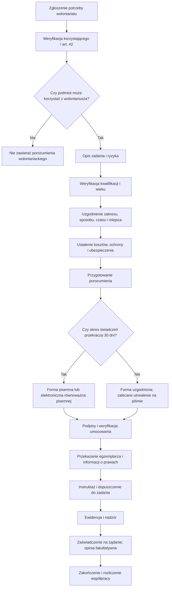

# 14.2. Porozumienie z wolontariuszem

> **Stan prawny opracowania: 26 listopada 2026 r.**  
> Rozdział ma charakter dydaktyczny i praktyczny. Wzory należy dostosować do rzeczywistego statusu korzystającego, rodzaju świadczeń, wieku i sytuacji wolontariusza, zasad finansowania oraz przepisów szczególnych. Nie zastępują one indywidualnej analizy prawnej.

## Mapa zgodności z aktualnym konspektem

| Pozycja konspektu | Miejsce opracowania |
|---|---|
| 1. Zawarcie porozumienia | Rozdziały 2–4 |
| 2. Określenie zakresu świadczeń | Rozdziały 4–5 |
| 3. Określenie czasu wykonywania świadczeń | Rozdział 6 |
| 4. Określenie miejsca wykonywania świadczeń | Rozdział 7 |
| 5. Zasady rozwiązania porozumienia | Rozdział 8 |
| 6. Obowiązek sporządzenia porozumienia na piśmie przy świadczeniach trwających dłużej niż 30 dni | Rozdział 3 |
| 7. Potwierdzanie wykonywanych czynności | Rozdział 9 |
| 8. Zaświadczenia o wolontariacie | Rozdział 10 |
| 9. Opinie o wykonywanych świadczeniach | Rozdział 11 |
| 10. Odpowiedzialność korzystającego z wolontariatu | Rozdział 12 |

## 1. Cel, zakres i główna teza rozdziału

### 1.1. Cel kształcenia

Celem rozdziału jest przygotowanie fundatora, członka zarządu, koordynatora wolontariatu, pracownika organizacji i samego wolontariusza do prawidłowego uzgodnienia, udokumentowania, wykonywania i zakończenia współpracy wolontariackiej.

Porozumienie nie jest wyłącznie formularzem do podpisania. Jest narzędziem ochrony dobrowolności, bezpieczeństwa, praw i obowiązków obu stron. Powinno jasno odpowiadać na pytania:

- kto jest korzystającym i kto jest wolontariuszem;
- jaki jest cel współpracy;
- jakie konkretnie świadczenia będą wykonywane;
- w jaki sposób, gdzie i w jakim czasie będą wykonywane;
- kto udziela instrukcji i sprawuje nadzór organizacyjny;
- jakie czynności są wyłączone z zakresu świadczeń;
- jak strony postępują w razie nieobecności, zagrożenia lub zdarzenia niepożądanego;
- jakie koszty i ubezpieczenia dotyczą współpracy;
- jak porozumienie może zostać rozwiązane;
- jak potwierdza się wykonane świadczenia.

### 1.2. Główna teza

Ustawowym punktem wyjścia jest art. 44 ustawy z 24 kwietnia 2003 r. o działalności pożytku publicznego i o wolontariacie. Przepis wymaga, aby świadczenia wolontariusza były wykonywane w zakresie, w sposób i w czasie określonych w porozumieniu z korzystającym, a samo porozumienie zawierało postanowienie o możliwości jego rozwiązania.

Jeżeli świadczenia mają być wykonywane przez okres dłuższy niż 30 dni, porozumienie powinno być sporządzone na piśmie. Na żądanie wolontariusza korzystający ma obowiązek pisemnie potwierdzić treść porozumienia oraz wydać pisemne zaświadczenie o wykonaniu świadczeń, w tym o ich zakresie. Pisemna opinia o wykonaniu świadczeń ma inny status: na prośbę wolontariusza korzystający **może** ją przedłożyć.

### 1.3. Efekty uczenia się

Po ukończeniu rozdziału uczestnik powinien umieć:

1. wskazać właściwe strony porozumienia i sprawdzić umocowanie osoby podpisującej je w imieniu organizacji;
2. odróżnić porozumienie wolontariackie od umowy o pracę, umowy zlecenia i umowy o świadczenie usług;
3. prawidłowo obliczyć, kiedy powstaje obowiązek formy pisemnej;
4. wyjaśnić różnicę pomiędzy formą pisemną, dokumentową i elektroniczną;
5. sporządzić opis zadań, sposobu, czasu i miejsca świadczeń;
6. zaprojektować zgodny z prawem tryb rozwiązania porozumienia;
7. przygotować ewidencję wykonanych świadczeń;
8. rozróżnić obowiązkowe zaświadczenie od fakultatywnej opinii;
9. rozpoznać podstawowe ryzyka odpowiedzialności cywilnej i organizacyjnej;
10. dobrać dodatkowe postanowienia do wolontariatu opiekuńczego, medycznego, rodzinnego, religijnego, edukacyjnego i międzynarodowego.

### 1.4. Granice tematu

Rozdział koncentruje się na porozumieniu i odpowiedzialności korzystającego. Nie zastępuje:

- rozdziału 14.1, który omawia definicję wolontariusza, katalog korzystających i przesłanki ustawowego wolontariatu;
- rozdziału 14.3, który szczegółowo omawia koszty wolontariatu, podróże, diety, szkolenia i ubezpieczenia;
- rozdziału 14.4, który dotyczy organizacji wolontariatu opiekuńczego.

W niniejszym rozdziale kwestie kosztów, ubezpieczenia, ochrony danych i bezpieczeństwa są omawiane w takim zakresie, w jakim wpływają na treść porozumienia i odpowiedzialność stron.

## 2. Podstawa prawna i charakter porozumienia

### 2.1. Najważniejsze przepisy

Podstawowe znaczenie mają:

1. art. 2 pkt 3 ustawy o działalności pożytku publicznego i o wolontariacie – definicja wolontariusza;
2. art. 42 – katalog podmiotów, na rzecz których wolontariusze mogą wykonywać świadczenia;
3. art. 43 – kwalifikacje i wymagania odpowiednie do rodzaju świadczeń;
4. art. 44 – porozumienie, jego treść, forma, potwierdzanie, zaświadczenie i opinia;
5. art. 45 – bezpieczeństwo, informowanie o ryzyku i określone koszty;
6. art. 46 – uprawnienia zdrowotne, wypadkowe i możliwość ubezpieczenia OC;
7. art. 47 – obowiązek informowania wolontariusza o prawach i obowiązkach;
8. art. 48 – szczególne zasady delegowania wolontariusza za granicę przez wskazane podmioty;
9. art. 49 – kwalifikacja określonych wydatków korzystającego;
10. art. 50 – wartość świadczenia wolontariusza nie stanowi darowizny na rzecz korzystającego.

W zakresie nieuregulowanym ustawą art. 44 ust. 5 odsyła do Kodeksu cywilnego. Znaczenie mogą mieć w szczególności przepisy o oświadczeniach woli, zawieraniu umów, formie czynności prawnych, wykonywaniu zobowiązań i odpowiedzialności za ich niewykonanie.

### 2.2. Porozumienie jako stosunek cywilnoprawny

Porozumienie wolontariackie jest uzgodnieniem pomiędzy wolontariuszem a korzystającym, które konkretyzuje ustawowe zasady wykonywania świadczeń. Nie jest umową o pracę i nie powinno służyć do ukrywania odpłatnego zatrudnienia.

Wolontariusz wykonuje świadczenia dobrowolnie i bez wynagrodzenia. Korzystający organizuje zadanie, zapewnia warunki jego bezpiecznej realizacji, informuje o prawach i obowiązkach oraz wykonuje inne obowiązki ustawowe. Strony mogą doprecyzować wzajemne ustalenia, ale nie mogą umownie uchylić bezwzględnie obowiązujących przepisów.

### 2.3. Porozumienie nie jest automatycznie umową zlecenia

Nie należy przyjmować, że każde porozumienie wolontariackie jest umową zlecenia albo umową o świadczenie usług z art. 750 Kodeksu cywilnego. Ustawa o wolontariacie ustanawia odrębny reżim. Odesłanie z art. 44 ust. 5 do Kodeksu cywilnego dotyczy spraw nieuregulowanych i wymaga uwzględnienia natury konkretnego stosunku.

Przepisy o zleceniu lub usługach mogą mieć znaczenie, jeżeli charakter relacji i dana kwestia uzasadniają ich odpowiednie zastosowanie. Nie wolno jednak automatycznie przenosić wszystkich reguł odpłatnego zlecenia na wolontariat ani pomijać szczególnych postanowień ustawy o wolontariacie.

### 2.4. Porozumienie a stosunek pracy

O nazwie dokumentu nie przesądza rzeczywisty charakter relacji. Jeżeli w praktyce osoba wykonuje pracę w warunkach określonych w art. 22 Kodeksu pracy – w szczególności pod kierownictwem pracodawcy, w miejscu i czasie przez niego wyznaczonym, za wynagrodzeniem – może powstać stosunek pracy niezależnie od nazwy zawartego dokumentu.

Wolontariat może obejmować harmonogram, koordynację, instrukcje organizacyjne i kontrolę bezpieczeństwa. Nie oznacza to samo w sobie stosunku pracy. Należy jednak zachować rzeczywistą dobrowolność, nieodpłatność i właściwy cel społeczny świadczeń. Nie wolno zastępować wolontariuszami pracowników tylko po to, aby ominąć przepisy prawa pracy.

### 2.5. Znaczenie nowelizacji z 2026 r.

Na dzień 26 listopada 2026 r. podstawą tekstową jest tekst jednolity ustawy ogłoszony w Dz. U. z 2025 r. poz. 1338, z uwzględnieniem późniejszych zmian. Ustawa z 19 czerwca 2026 r. o zmianie ustawy o działalności pożytku publicznego i o wolontariacie oraz ustawy o grach hazardowych (Dz. U. z 2026 r. poz. 1040) weszła zasadniczo w życie 1 września 2026 r. Zmiany opisane w oficjalnym komunikacie Komitetu do spraw Pożytku Publicznego dotyczyły przede wszystkim zlecania zadań publicznych, wkładów własnych, małych grantów, ofert i sprawozdań. Nie zmieniły zasadniczej treści art. 44 dotyczącego porozumienia z wolontariuszem.

**Wniosek praktyczny:** przy sporządzaniu porozumienia należy stosować aktualny art. 44, a nie opierać się na wzorach sprzed wielu lat bez kontroli ich zgodności z obecnym prawem.

## 3. Zawarcie porozumienia

### 3.1. Kto zawiera porozumienie?

Stronami są:

- **korzystający** – podmiot uprawniony do korzystania ze świadczeń wolontariuszy na podstawie art. 42 ustawy;
- **wolontariusz** – osoba fizyczna wykonująca świadczenia ochotniczo i bez wynagrodzenia na zasadach określonych w ustawie.

Porozumienie powinno być zawarte z podmiotem, który rzeczywiście korzysta ze świadczenia i jest uprawniony do występowania w tej roli. Nie należy wpisywać jako korzystającego przypadkowego pośrednika, jeżeli zadanie jest faktycznie wykonywane na rzecz innego podmiotu.

### 3.2. Weryfikacja korzystającego

Przed zawarciem porozumienia organizacja powinna sprawdzić:

1. formę prawną podmiotu;
2. podstawę uprawnienia do korzystania z wolontariatu;
3. statut i zakres działalności;
4. związek planowanych świadczeń z działalnością statutową lub właściwą działalnością podmiotu;
5. czy zadanie nie jest elementem działalności gospodarczej wyłączonej z wolontariatu;
6. kto jest uprawniony do reprezentacji;
7. czy osoba podpisująca dokument ma umocowanie;
8. czy istnieją szczególne wymogi dotyczące miejsca, rodzaju świadczeń lub odbiorców.

Sama nazwa „fundacja”, „stowarzyszenie”, „wspólnota” albo „centrum wolontariatu” nie wystarcza do ustalenia, kto jest korzystającym. Decyduje status prawny, rzeczywista rola i art. 42.

### 3.3. Reprezentacja organizacji

Osoba podpisująca porozumienie w imieniu fundacji lub stowarzyszenia powinna działać zgodnie z ustawą, statutem, wpisem w KRS i zasadami reprezentacji. Należy sprawdzić, czy wymagana jest reprezentacja jednoosobowa, łączna albo udział określonych członków organu.

Koordynator wolontariatu nie uzyskuje automatycznie prawa do zawierania umów w imieniu fundacji. Potrzebuje odpowiedniego umocowania, np. wynikającego ze statutu, uchwały lub pełnomocnictwa. Zakres pełnomocnictwa powinien obejmować zawieranie i rozwiązywanie porozumień, jeżeli koordynator ma wykonywać te czynności.

### 3.4. Etapy zawarcia

Zalecana procedura obejmuje:

1. rozpoznanie potrzeb organizacji;
2. określenie zadania i jego granic;
3. sprawdzenie, czy zadanie może być wykonywane przez wolontariusza;
4. rekrutację i rozmowę wstępną;
5. weryfikację kwalifikacji i wymagań szczególnych;
6. ocenę ryzyka i przygotowanie instruktażu;
7. uzgodnienie zakresu, sposobu, czasu i miejsca świadczeń;
8. omówienie praw, obowiązków, kosztów i ochrony;
9. przygotowanie porozumienia;
10. podpisanie dokumentu przez prawidłowo umocowane osoby;
11. przekazanie wolontariuszowi egzemplarza;
12. zarejestrowanie porozumienia i załączników;
13. dopuszczenie wolontariusza do świadczeń po spełnieniu warunków organizacyjnych i bezpieczeństwa.

### 3.5. Kiedy należy zawrzeć porozumienie?

Porozumienie powinno poprzedzać rozpoczęcie świadczeń. Ustawa nie ustanawia odrębnego, uniwersalnego terminu, np. siedmiu dni przed rozpoczęciem, ale dokumentowanie ustaleń przed pierwszą czynnością ogranicza spory co do zakresu, odpowiedzialności, czasu, ubezpieczenia i zasad bezpieczeństwa.

Nie należy sporządzać porozumienia wstecznie tylko po to, aby stworzyć pozór, że wcześniej istniała określona podstawa prawna. Jeżeli strony rozpoczęły współpracę ustnie, powinny rzetelnie potwierdzić rzeczywiste uzgodnienia i daty, a nie antydatować dokument.

### 3.6. Osoby małoletnie i przedstawiciele ustawowi

Wolontariuszem może być osoba małoletnia, jeżeli pozwalają na to rodzaj świadczeń, przepisy szczególne i zasady bezpieczeństwa. Przy zawieraniu porozumienia należy uwzględnić zdolność do czynności prawnych wynikającą z Kodeksu cywilnego.

W praktyce:

- osoba poniżej 13 lat nie ma zdolności do czynności prawnych; czynności w jej imieniu dokonuje przedstawiciel ustawowy;
- osoba, która ukończyła 13 lat, ale nie jest pełnoletnia, ma ograniczoną zdolność do czynności prawnych; jeżeli porozumienie powoduje zaciągnięcie zobowiązań lub rozporządzenie prawem, należy uzyskać wymaganą zgodę przedstawiciela ustawowego;
- dla ochrony małoletniego i pewności dokumentacji należy wskazać, kto reprezentuje małoletniego, kto wyraża zgodę i kto jest osobą kontaktową.

Nie należy poprzestawać na samym podpisie dziecka, jeżeli dla ważności lub skuteczności czynności wymagana jest zgoda przedstawiciela ustawowego. Należy również stosować przepisy o ochronie małoletnich i standardy ochrony małoletnich, jeżeli działalność organizacji i rodzaj kontaktu z dziećmi tego wymagają.

## 4. Forma porozumienia i próg 30 dni

### 4.1. Zasada ustawowa

Art. 44 ust. 4 stanowi, że jeżeli świadczenie wolontariusza wykonywane jest przez okres dłuższy niż 30 dni, porozumienie powinno być sporządzone na piśmie.

Oznacza to, że:

- przy świadczeniach trwających **dokładnie 30 dni** ust. 4 nie ustanawia jeszcze obowiązku formy pisemnej;
- przy świadczeniach trwających **31 dni lub dłużej** porozumienie powinno być sporządzone na piśmie;
- krótkotrwałość współpracy nie zwalnia stron z obowiązku rzeczywistego uzgodnienia zakresu, sposobu i czasu świadczeń;
- na żądanie wolontariusza korzystający ma obowiązek pisemnie potwierdzić treść porozumienia oraz wydać zaświadczenie o wykonaniu świadczeń.

### 4.2. Nie należy utożsamiać liczby dyżurów z okresem współpracy

Przepis posługuje się pojęciem okresu wykonywania świadczenia. Nie należy automatycznie przyjmować, że wolontariat trwa 30 dni tylko dlatego, że wolontariusz wykonał 30 dyżurów. Przykładowo, jeżeli wolontariusz wykonuje jeden dyżur tygodniowo przez trzy miesiące, współpraca jest rozłożona na okres dłuższy niż 30 dni.

Przy planowaniu harmonogramu należy ustalić rzeczywisty okres od rozpoczęcia do zakończenia współpracy. Nie wolno sztucznie dzielić jednego ciągłego programu na kolejne krótkie porozumienia tylko po to, aby omijać obowiązek formy pisemnej lub inne obowiązki ustawowe.

### 4.3. Co w przypadku przedłużenia krótkiego porozumienia?

Jeżeli współpraca miała trwać nie dłużej niż 30 dni, lecz strony uzgodnią jej kontynuowanie przez okres dłuższy niż 30 dni, należy sporządzić porozumienie na piśmie przed kontynuowaniem świadczeń w rozszerzonym okresie.

Przykład:

- 1–20 grudnia – planowany wolontariat krótkoterminowy;
- 15 grudnia strony uzgadniają kontynuację do końca lutego;
- przed rozpoczęciem dalszego okresu powinny sporządzić pisemne porozumienie obejmujące aktualny zakres i czas świadczeń.

Nie należy czekać do 31. dnia, jeżeli już wcześniej wiadomo, że współpraca będzie dłuższa.

### 4.4. Porozumienie krótkoterminowe a żądanie wolontariusza

Art. 44 ust. 2 nie stanowi, że każde porozumienie krótsze niż 30 dni musi być od początku zawarte w formie pisemnej. Stanowi natomiast, że **na żądanie wolontariusza** korzystający ma obowiązek:

1. potwierdzić na piśmie treść porozumienia;
2. wydać pisemne zaświadczenie o wykonaniu świadczeń, w tym o zakresie wykonywanych świadczeń.

Należy odróżnić ustawowe „potwierdzenie na piśmie treści porozumienia” od sformułowania „zawarcie nowego porozumienia w formie pisemnej”. Nie są to identyczne pojęcia. Jeżeli wolontariusz żąda potwierdzenia, korzystający nie może odmówić tylko dlatego, że współpraca trwała krócej niż 30 dni.

### 4.5. Forma pisemna, dokumentowa i elektroniczna

Kodeks cywilny rozróżnia kilka form czynności prawnych:

| Forma | Podstawowe cechy | Przykład | Czy sama w sobie spełnia ustawowy wymóg formy pisemnej? |
|---|---|---|---|
| Ustna | Zgodne oświadczenia woli bez dokumentu podpisanego przez strony | Uzgodnienie podczas spotkania | Nie |
| Dokumentowa | Dokument pozwala zapoznać się z treścią oświadczenia i ustalić osobę składającą oświadczenie | E-mail, wiadomość w systemie, SMS pozwalający ustalić nadawcę | Nie |
| Pisemna | Własnoręczny podpis na dokumencie; możliwa wymiana podpisanych dokumentów | Papierowe porozumienie podpisane przez strony | Tak |
| Elektroniczna w rozumieniu KC | Oświadczenie w postaci elektronicznej opatrzone kwalifikowanym podpisem elektronicznym | Plik PDF podpisany kwalifikowanymi podpisami elektronicznymi | Tak |

**Ważne:** zwykły e-mail, wiadomość SMS, podpis wpisany czcionką w pliku lub skan podpisanego dokumentu nie powinny być bez dodatkowej analizy traktowane jako równoważne formie pisemnej wymaganej przez art. 44 ust. 4. Mogą mieć znaczenie dowodowe i mogą spełniać przesłanki formy dokumentowej, ale forma dokumentowa nie jest tym samym co forma pisemna.

Najbezpieczniejsze rozwiązania dla porozumień trwających ponad 30 dni to:

- papierowy dokument z własnoręcznymi podpisami;
- dokument elektroniczny opatrzony kwalifikowanymi podpisami elektronicznymi;
- wymiana dokumentów podpisanych przez każdą ze stron w sposób odpowiadający art. 78 Kodeksu cywilnego.

### 4.6. Skutki niezachowania formy pisemnej

Art. 44 ust. 4 nakazuje sporządzenie porozumienia na piśmie, ale sam nie wskazuje wprost rygoru nieważności. Zgodnie z art. 73 § 1 Kodeksu cywilnego niezachowanie zastrzeżonej ustawą formy pisemnej powoduje nieważność tylko wtedy, gdy ustawa przewiduje taki rygor.

Nie należy zatem automatycznie twierdzić, że każde porozumienie zawarte ustnie na okres dłuższy niż 30 dni jest nieważne. Niezachowanie wymaganej formy jest jednak naruszeniem obowiązku ustawowego i stwarza poważne ryzyko dowodowe. Art. 74 Kodeksu cywilnego przewiduje ograniczenia dowodowe przy niezachowaniu formy pisemnej zastrzeżonej dla celów dowodowych, z wyjątkami wskazanymi w tym przepisie.

**Zasada organizacyjna:** nie planować współpracy dłuższej niż 30 dni bez podpisanego dokumentu.

### 4.7. Forma zmian porozumienia

Jeżeli porozumienie zostało zawarte w formie pisemnej, jego uzupełnienie lub zmiana powinny zachować formę przewidzianą przez ustawę lub strony. Wynika to z art. 77 § 1 Kodeksu cywilnego.

Dlatego zmiana:

- zakresu zadań;
- miejsca wykonywania świadczeń;
- okresu współpracy;
- sposobu nadzoru;
- istotnych zasad bezpieczeństwa;
- trybu rozwiązania;

powinna być udokumentowana aneksem albo innym dokumentem uzgodnionym przez strony, w formie właściwej dla porozumienia.

### 4.8. Rozwiązanie a forma dokumentu

Art. 77 § 2 Kodeksu cywilnego stanowi, że jeżeli umowa została zawarta w formie pisemnej, dokumentowej albo elektronicznej, rozwiązanie jej za zgodą obu stron, odstąpienie lub wypowiedzenie wymaga zachowania formy dokumentowej, chyba że ustawa lub umowa zastrzega inną formę.

W porozumieniu warto więc jasno wskazać:

- jak można złożyć oświadczenie o rozwiązaniu;
- na jaki adres lub do jakiej osoby należy je skierować;
- kiedy oświadczenie uważa się za doręczone;
- czy dopuszcza się komunikację elektroniczną;
- czy strony wymagają formy bardziej rygorystycznej niż dokumentowa.

## 5. Określenie zakresu świadczeń

### 5.1. Zakres świadczeń jest podstawowym elementem porozumienia

Zakres powinien odpowiadać rzeczywistemu zadaniu, potrzebom korzystającego i możliwościom wolontariusza. Nie powinien być ani nadmiernie ogólny, ani tak szczegółowy, aby uniemożliwiał rozsądne dostosowanie działań do sytuacji.

Niewłaściwy zapis:

> Wolontariusz będzie pomagał we wszystkich czynnościach związanych z działalnością fundacji według poleceń zarządu.

Taki zapis nie wyznacza granic świadczeń, nie pozwala ocenić ryzyka i może prowadzić do powierzania czynności, których wolontariusz nie powinien wykonywać.

Lepszy zapis:

> Wolontariusz będzie wspierał organizację spotkań edukacyjnych poprzez przygotowanie sali, rejestrację uczestników, przekazywanie materiałów informacyjnych i pomoc organizacyjną pod nadzorem koordynatora. Wolontariusz nie prowadzi diagnozy, terapii, porad prawnych ani innych czynności wymagających kwalifikacji zawodowych, których nie posiada.

### 5.2. Jak opisać zadanie?

Każde zadanie warto opisać przez:

1. nazwę czynności;
2. cel czynności;
3. odbiorcę lub grupę odbiorców;
4. sposób wykonania;
5. dopuszczalne narzędzia;
6. osobę nadzorującą;
7. wymagane kwalifikacje;
8. granice odpowiedzialności;
9. sposób zgłaszania problemów;
10. kryterium zakończenia zadania.

### 5.3. Zadania dozwolone i wyłączone

W porozumieniu należy wymienić czynności, których wolontariusz nie może wykonywać. Jest to szczególnie ważne w opiece nad osobą chorą, w podmiocie leczniczym, w pracy z dziećmi, w transporcie osób i w zadaniach wymagających dostępu do danych poufnych.

Przykładowe wyłączenia:

- samodzielne rozpoznawanie chorób;
- ordynowanie leków;
- wykonywanie procedur medycznych bez wymaganych uprawnień;
- podejmowanie decyzji za pacjenta;
- podpisywanie dokumentów w imieniu organizacji bez pełnomocnictwa;
- udzielanie porad prawnych bez odpowiedniej podstawy i kwalifikacji;
- samodzielne dysponowanie pieniędzmi podopiecznego;
- publikowanie danych lub wizerunku bez właściwej podstawy;
- podejmowanie czynności poza uzgodnionym zakresem.

### 5.4. Zadania zmienne

Jeżeli zakres może ulegać zmianie, należy określić granice dopuszczalnych modyfikacji i sposób ich zatwierdzania. Nie powinno się pozostawiać korzystającemu nieograniczonego prawa do jednostronnego rozszerzania obowiązków.

Można wprowadzić zapis:

> Zmiana rodzaju świadczeń, ich istotnego zakresu albo miejsca wykonywania wymaga uprzedniego uzgodnienia przez strony i udokumentowania w formie aneksu lub karty zadania zaakceptowanej przez obie strony. Wolontariusz nie ma obowiązku przyjęcia zadania wykraczającego poza uzgodniony zakres.

### 5.5. Karta zadania jako załącznik

Przy wielu zadaniach korzystne jest stosowanie karty zadania. Porozumienie zawiera wówczas zasady ogólne, a karta precyzuje konkretne świadczenia.

Karta zadania powinna zawierać:

- nazwę zadania;
- cel;
- opis czynności;
- miejsce;
- czas;
- koordynatora;
- wymagane kompetencje;
- ryzyka;
- środki ochronne;
- zasady zgłaszania zdarzeń;
- datę zatwierdzenia.

Karta nie może być używana do obchodzenia obowiązku formy pisemnej ani do jednostronnego zmieniania istotnych warunków porozumienia.

## 6. Określenie czasu wykonywania świadczeń

### 6.1. Okres obowiązywania porozumienia

Porozumienie powinno wskazywać:

- dzień rozpoczęcia świadczeń;
- dzień zakończenia albo informację, że zawierane jest na czas nieoznaczony;
- ewentualne okresy zawieszenia;
- zasady przedłużenia;
- sposób potwierdzania zmian terminu.

Okres obowiązywania porozumienia nie musi być identyczny z liczbą godzin faktycznie przepracowanych przez wolontariusza. Współpraca może trwać kilka miesięcy, choć świadczenia są wykonywane tylko w wybrane dni.

### 6.2. Harmonogram

Harmonogram powinien być realny i uwzględniać:

- dostępność wolontariusza;
- czas trwania dyżuru;
- przerwy;
- czas potrzebny na przygotowanie i zakończenie zadania;
- możliwość odwołania dyżuru;
- zasady zastępstw;
- ograniczenia wynikające z wieku, zdrowia i bezpieczeństwa;
- potrzebę odpoczynku.

Wolontariat nie powinien prowadzić do faktycznego wymuszania dyspozycyjności przez całą dobę. Jeżeli zadanie wymaga dyżuru interwencyjnego, trzeba szczególnie dokładnie określić jego charakter i granice.

### 6.3. Nieobecność i odwołanie dyżuru

W porozumieniu warto ustalić:

1. do kogo wolontariusz zgłasza nieobecność;
2. z jakim wyprzedzeniem, jeżeli jest to możliwe;
3. jak organizacja informuje o odwołaniu zadania;
4. kto odpowiada za zapewnienie zastępstwa;
5. jak postępuje się w sytuacji nagłej, np. choroby lub wypadku.

Nieobecność wolontariusza nie powinna być automatycznie traktowana jak naruszenie obowiązków pracowniczych. Ocena zależy od rzeczywistego uzgodnienia, przyczyny nieobecności i wpływu na bezpieczeństwo beneficjentów.

### 6.4. Czas nieoznaczony

Porozumienie na czas nieoznaczony jest możliwe, ale musi zawierać postanowienie o możliwości rozwiązania. Należy jednocześnie określić zasady ubezpieczenia i okresy współpracy w sposób umożliwiający ustalenie ochrony wolontariusza.

Nie należy mechanicznie przyjmować, że każda umowa bezterminowa jest nieprawidłowa. Ważne jest, aby organizacja rozumiała skutki okresu współpracy, w szczególności dla ubezpieczenia wypadkowego i dokumentowania relacji.

### 6.5. Przedłużenie współpracy

Przedłużenie powinno być uzgodnione przed upływem pierwotnego okresu. Jeżeli przedłużenie powoduje, że okres wykonywania świadczeń przekroczy 30 dni, należy zadbać o pisemną formę porozumienia zgodnie z art. 44 ust. 4.

## 7. Określenie miejsca wykonywania świadczeń

### 7.1. Miejsce jako element praktycznej precyzji

Art. 44 ust. 1 wymienia zakres, sposób i czas świadczeń. Nie wskazuje osobno miejsca jako obligatoryjnego elementu każdego porozumienia. Jednak określenie miejsca jest bardzo ważne dla bezpieczeństwa, organizacji i oceny odpowiedzialności.

W zależności od zadania można wskazać:

- siedzibę organizacji;
- konkretną placówkę;
- miejsce zamieszkania beneficjenta;
- teren wydarzenia;
- przestrzeń publiczną;
- obszar określonej gminy lub powiatu;
- miejsce wykonywania świadczeń zdalnych.

### 7.2. Zmiana miejsca

Jeżeli zmiana miejsca wpływa na ryzyko, sposób wykonywania zadań, dostęp do danych lub bezpieczeństwo beneficjentów, należy ją uzgodnić i udokumentować.

Przykładowy zapis:

> Świadczenia są wykonywane w siedzibie korzystającego oraz w miejscach wydarzeń wskazanych przez koordynatora. Zmiana miejsca wymagająca podróży, wejścia do mieszkania beneficjenta albo wykonywania świadczeń w warunkach podwyższonego ryzyka wymaga uprzedniego uzgodnienia z wolontariuszem oraz przekazania instrukcji bezpieczeństwa.

### 7.3. Wolontariat w domu beneficjenta

Jeżeli wolontariusz odwiedza osobę chorą lub starszą w domu, należy określić:

- kto zatwierdza wizytę;
- czy wolontariusz może wejść do mieszkania samodzielnie;
- jak potwierdza się rozpoczęcie i zakończenie wizyty;
- jakie czynności wolno wykonywać;
- jakie czynności są wyłączone;
- jak postępować w razie pogorszenia stanu zdrowia;
- jak zgłosić zagrożenie, przemoc lub zaniedbanie;
- czy wolontariusz może przewozić podopiecznego;
- kto odpowiada za kontakt z rodziną lub służbami.

Nie należy przekazywać wolontariuszowi nieograniczonego dostępu do mieszkania, dokumentacji medycznej, pieniędzy i rzeczy osobistych beneficjenta.

### 7.4. Wolontariat zdalny

W przypadku świadczeń zdalnych należy wskazać:

- dozwolone kanały komunikacji;
- zasady korzystania z kont i urządzeń;
- sposób przekazywania dokumentów;
- zasady ochrony danych;
- zakaz używania prywatnych kanałów do przesyłania danych szczególnych kategorii, jeżeli nie zapewniają odpowiedniej ochrony;
- sposób zgłaszania incydentów;
- zasady przechowywania i usuwania materiałów.

## 8. Zasady rozwiązania porozumienia

### 8.1. Obowiązkowe postanowienie

Art. 44 ust. 1 wymaga, aby porozumienie zawierało postanowienie o możliwości jego rozwiązania. Nie wystarczy pominąć tę kwestię z założeniem, że „wolontariat jest dobrowolny, więc każdy może odejść bez żadnych zasad”.

Dobrowolność powinna być realna, a jednocześnie strony powinny znać sposób zakończenia współpracy i przekazania zadań.

### 8.2. Zalecane sposoby rozwiązania

Porozumienie może przewidywać:

1. rozwiązanie za zgodą obu stron;
2. rozwiązanie przez każdą ze stron z zachowaniem uzgodnionego okresu wypowiedzenia;
3. rozwiązanie ze skutkiem natychmiastowym w uzasadnionych przypadkach;
4. zakończenie z upływem terminu, na jaki zostało zawarte;
5. zakończenie po wykonaniu określonego zadania, jeżeli taki sposób został jasno uzgodniony.

### 8.3. Przykładowe ważne przyczyny zakończenia

Do przyczyn uzasadniających natychmiastowe zakończenie mogą należeć:

- zagrożenie zdrowia lub życia wolontariusza albo beneficjenta;
- poważne naruszenie zasad bezpieczeństwa;
- naruszenie poufności lub bezprawne ujawnienie danych;
- utrata wymaganych kwalifikacji;
- wykonywanie czynności poza zakresem uprawnień;
- zachowanie zagrażające beneficjentom;
- utrata statusu podmiotu uprawnionego do korzystania z wolontariatu;
- niemożliwość dalszego realizowania zadania;
- istotne naruszenie porozumienia przez drugą stronę.

Lista powinna być dostosowana do rodzaju działalności. Nie należy używać nieprecyzyjnych klauzul pozwalających organizacji zakończyć współpracę z dowolnego, nieujawnionego powodu, jeżeli mogłoby to prowadzić do nadużycia.

### 8.4. Zakończenie przez wolontariusza

Wolontariusz powinien mieć rzeczywistą możliwość zakończenia współpracy. Porozumienie nie powinno zawierać postanowień, które faktycznie zmuszają go do świadczenia usług wbrew jego woli.

Jeżeli zadanie dotyczy osoby zależnej od regularnego wsparcia, należy zaplanować bezpieczne przekazanie informacji i zastępstwo. Nie oznacza to jednak, że wolontariusz ma obowiązek kontynuować świadczenia mimo zagrożenia zdrowia, przemocy, utraty bezpieczeństwa albo utraty dobrowolności.

### 8.5. Okres wypowiedzenia

Można określić np. 7 lub 14 dni, ale okres powinien być rozsądny i dostosowany do zadania. Nie powinien w praktyce uniemożliwiać rezygnacji z wolontariatu.

W przypadku nagłego zagrożenia lub poważnego naruszenia porozumienia warto przewidzieć możliwość rozwiązania ze skutkiem natychmiastowym.

### 8.6. Rozliczenie końcowe

Po zakończeniu współpracy należy:

- ustalić datę zakończenia;
- odebrać powierzone rzeczy i identyfikatory;
- odebrać lub unieważnić uprawnienia dostępu do systemów;
- zabezpieczyć dokumentację;
- rozliczyć koszty na zasadach określonych w porozumieniu i ustawie;
- wydać zaświadczenie, jeżeli wolontariusz o nie wystąpi;
- rozważyć sporządzenie opinii, jeżeli wolontariusz o nią poprosi;
- przypomnieć o obowiązku zachowania poufności, jeżeli wynika on z prawa lub prawidłowo uzgodnionych zasad.

## 9. Potwierdzanie wykonywanych czynności

### 9.1. Dlaczego warto prowadzić ewidencję?

Ustawa nie nakazuje prowadzenia jednego uniwersalnego formularza ewidencji wszystkich świadczeń wolontariusza. Dokumentowanie jest jednak ważne dla:

- potwierdzenia zakresu wykonanych świadczeń;
- przygotowania zaświadczenia;
- rozliczenia projektu;
- wykazania realizacji zadania publicznego;
- bezpieczeństwa beneficjentów;
- wyjaśniania zdarzeń niepożądanych;
- oceny obciążenia wolontariusza;
- planowania zastępstw i szkoleń.

### 9.2. Co powinna zawierać karta czynności?

Przykładowy rejestr może zawierać:

| Pole | Opis |
|---|---|
| Numer wpisu | Kolejny numer ewidencyjny |
| Data | Dzień wykonania świadczenia |
| Godzina rozpoczęcia i zakończenia | Faktyczny czas |
| Rodzaj czynności | Opis zgodny z porozumieniem |
| Miejsce | Placówka, wydarzenie lub inne uzgodnione miejsce |
| Osoba koordynująca | Osoba odpowiedzialna za zadanie |
| Wynik lub uwagi | Tylko informacje niezbędne |
| Potwierdzenie | Podpis, zatwierdzenie w systemie albo inny uzgodniony sposób |

### 9.3. Ochrona danych w ewidencji

Ewidencja nie powinna zawierać nadmiarowych informacji o zdrowiu, rodzinie, religii, sytuacji materialnej ani innych danych wrażliwych beneficjentów.

Jeżeli do udokumentowania zadania wystarczy informacja „wizyta wspierająca wykonana”, nie należy wpisywać szczegółowej diagnozy, historii leczenia lub opisu prywatnych rozmów.

W organizacji należy ustalić:

- cel przetwarzania;
- podstawę prawną;
- zakres danych;
- osoby uprawnione do dostępu;
- czas przechowywania;
- sposób zabezpieczenia;
- procedurę usunięcia lub archiwizacji.

### 9.4. Potwierdzenie przez koordynatora

Koordynator może potwierdzać wykonanie czynności w zakresie, w jakim został do tego upoważniony. Nie powinien potwierdzać czynności, których nie zna i których nie może zweryfikować.

Wpis w ewidencji nie powinien być fikcyjny ani automatycznie generowany tylko na podstawie planu dyżurów. Należy odróżniać planowany czas od rzeczywistego wykonania świadczeń.

## 10. Zaświadczenie o wykonaniu świadczeń

### 10.1. Obowiązek ustawowy

Art. 44 ust. 2 stanowi, że na żądanie wolontariusza korzystający ma obowiązek wydać pisemne zaświadczenie o wykonaniu świadczeń, w tym o zakresie wykonywanych świadczeń.

Zaświadczenie jest dokumentem potwierdzającym fakty. Nie powinno zawierać nieprawdziwych informacji, ocen bez podstawy ani danych, których ujawnienie nie jest potrzebne.

### 10.2. Zalecana treść zaświadczenia

Zaświadczenie powinno wskazywać:

1. nazwę i dane korzystającego;
2. dane wolontariusza w zakresie potrzebnym do identyfikacji;
3. numer i datę porozumienia, jeżeli zostało nadane;
4. okres wykonywania świadczeń;
5. rzeczywisty zakres świadczeń;
6. ewentualny wymiar godzin, jeżeli jest wiarygodnie udokumentowany;
7. datę wystawienia;
8. osobę uprawnioną do podpisu;
9. podpis albo prawidłową formę elektroniczną.

### 10.3. Czego zaświadczenie nie powinno zawierać?

Nie należy:

- potwierdzać godzin, których nie udokumentowano;
- wpisywać czynności, których wolontariusz nie wykonywał;
- sugerować zatrudnienia, jeżeli wolontariusz nie był pracownikiem;
- ujawniać danych beneficjentów bez podstawy;
- opisywać stanu zdrowia osób, którym udzielano wsparcia;
- przypisywać wolontariuszowi kwalifikacji, których nie posiada.

## 11. Opinia o wykonaniu świadczeń

### 11.1. Opinia a zaświadczenie

| Element | Zaświadczenie | Opinia |
|---|---|---|
| Podstawa | Art. 44 ust. 2 | Art. 44 ust. 3 |
| Charakter | Potwierdzenie faktów | Ocena jakości i przebiegu współpracy |
| Żądanie wolontariusza | Powoduje obowiązek wydania | Nie tworzy bezwzględnego obowiązku sporządzenia |
| Treść | Okres i zakres świadczeń | Konkretne, uzasadnione obserwacje |
| Styl | Rzeczowy i neutralny | Rzeczowy, wyważony i oparty na faktach |

### 11.2. Dobra praktyka sporządzania opinii

Opinia powinna być:

- prawdziwa;
- proporcjonalna;
- oparta na udokumentowanych obserwacjach;
- wolna od dyskryminacji;
- ograniczona do informacji istotnych;
- sformułowana z poszanowaniem godności wolontariusza.

Nie należy używać opinii jako narzędzia nacisku ani odwetu za zakończenie współpracy.

### 11.3. Zakres opinii

Można ocenić:

- rzetelność;
- terminowość;
- współpracę z zespołem;
- komunikację;
- przestrzeganie zasad bezpieczeństwa;
- samodzielność w granicach powierzonych zadań;
- udział w szkoleniach;
- jakość wykonania konkretnych czynności.

Nie należy oceniać cech osobistych, stanu zdrowia, przekonań religijnych ani innych aspektów niezwiązanych z wykonaniem świadczeń.

## 12. Odpowiedzialność korzystającego z wolontariatu

### 12.1. Odpowiedzialność za prawidłowe przygotowanie porozumienia

Korzystający powinien zadbać, aby porozumienie:

- było zawarte przez właściwe strony;
- zostało podpisane przez osoby umocowane;
- określało zakres, sposób i czas świadczeń;
- zawierało postanowienie o możliwości rozwiązania;
- spełniało wymóg formy pisemnej, jeżeli świadczenia mają trwać dłużej niż 30 dni;
- nie zawierało postanowień sprzecznych z ustawą;
- nie pozorowało wolontariatu, jeżeli rzeczywista relacja jest odpłatna;
- nie przekraczało kwalifikacji wolontariusza.

### 12.2. Obowiązki bezpieczeństwa z art. 45

Korzystający ma obowiązek:

1. poinformować wolontariusza o ryzyku dla zdrowia i bezpieczeństwa związanym z wykonywanymi świadczeniami;
2. poinformować o zasadach ochrony przed zagrożeniami;
3. zapewnić bezpieczne i higieniczne warunki wykonywania świadczeń;
4. zapewnić odpowiednie środki ochrony indywidualnej zależnie od rodzaju świadczeń i ryzyka;
5. pokrywać koszty podróży służbowych i diet na zasadach wskazanych w ustawie.

Wolontariusz może w formie pisemnej, pod rygorem nieważności, zwolnić korzystającego w całości lub w części z obowiązku pokrywania kosztów podróży służbowych i diet, o których mowa w art. 45 ust. 1 pkt 3. Nie jest to jednak zgoda na rezygnację z bezpiecznych warunków, informacji o ryzyku albo środków ochronnych.

### 12.3. Obowiązek informacyjny z art. 47

Korzystający ma obowiązek poinformować wolontariusza o przysługujących mu prawach i ciążących na nim obowiązkach oraz zapewnić dostępność tych informacji.

Informacja powinna być zrozumiała i dostępna. Nie wystarczy umieścić regulaminu w miejscu, do którego wolontariusz nie ma dostępu albo którego nie potrafi odczytać.

W praktyce warto przekazać:

- porozumienie;
- regulamin wolontariatu;
- instrukcję bezpieczeństwa;
- dane koordynatora;
- procedurę zgłaszania incydentów;
- zasady ochrony danych;
- zasady kontaktu z beneficjentami;
- informacje o kosztach i ubezpieczeniu.

### 12.4. Odpowiedzialność kontraktowa

W zakresie, w jakim stosuje się ogólne przepisy Kodeksu cywilnego, znaczenie może mieć art. 471 KC. Dłużnik jest obowiązany naprawić szkodę wynikłą z niewykonania lub nienależytego wykonania zobowiązania, chyba że niewykonanie lub nienależyte wykonanie jest następstwem okoliczności, za które nie ponosi odpowiedzialności.

W praktyce oznacza to, że korzystający może odpowiadać m.in. za:

- nieprzekazanie uzgodnionych informacji o ryzyku;
- brak wymaganych środków ochronnych;
- dopuszczenie wolontariusza do zadania bez niezbędnego przygotowania;
- brak organizacyjnego nadzoru, jeżeli był konieczny;
- nieprawidłowe powierzenie zadań;
- niewykonanie uzgodnionych obowiązków dokumentacyjnych.

Ocena odpowiedzialności wymaga ustalenia treści zobowiązania, naruszenia, szkody i związku przyczynowego. Nie każde niepowodzenie zadania automatycznie oznacza odpowiedzialność odszkodowawczą.

### 12.5. Odpowiedzialność za działania osób, którymi posługuje się korzystający

Art. 474 KC może mieć znaczenie przy wykonywaniu zobowiązań przez osoby, z których pomocą dłużnik wykonuje zobowiązanie, lub którym jego wykonanie powierza. Zakres zastosowania zależy od rodzaju zobowiązania i okoliczności.

Nie należy jednak utożsamiać art. 474 KC z automatycznym przejęciem przez fundację każdej odpowiedzialności za każde zachowanie wolontariusza. Trzeba ustalić, czy dane działanie pozostawało w związku z wykonywaniem zobowiązania korzystającego.

### 12.6. Odpowiedzialność deliktowa wobec osób trzecich

Jeżeli wolontariusz wyrządzi szkodę beneficjentowi lub osobie trzeciej, możliwe znaczenie mają przepisy o odpowiedzialności deliktowej, w szczególności:

- art. 415 KC – odpowiedzialność za własny zawiniony czyn;
- art. 429 KC – odpowiedzialność powierzającego za winę w wyborze, z uwzględnieniem przesłanek ustawowych;
- art. 430 KC – odpowiedzialność powierzającego za osobę, która przy wykonywaniu powierzonej czynności podlega jego kierownictwu i ma obowiązek stosować się do jego wskazówek;
- art. 416 KC – odpowiedzialność osoby prawnej za szkodę wyrządzoną z winy jej organu.

Nie każdy wolontariusz automatycznie podlega kierownictwu w rozumieniu art. 430 KC. O zastosowaniu przepisu decyduje rzeczywisty charakter relacji, a nie nazwa dokumentu.

### 12.7. Odpowiedzialność wolontariusza

Wolontariusz również powinien działać z należytą starannością, przestrzegać uzgodnionego zakresu, instrukcji bezpieczeństwa i zasad ochrony beneficjentów. Może ponosić własną odpowiedzialność za zawinione działanie lub zaniechanie.

Nie należy jednak przerzucać na wolontariusza całego ryzyka organizacyjnego, które należy do korzystającego. W szczególności nie wolno zakładać, że podpisanie ogólnego oświadczenia o „przejęciu wszelkiej odpowiedzialności” zwalnia organizację z ustawowych obowiązków.

### 12.8. Ubezpieczenie nie zastępuje odpowiedzialności

Art. 46 przewiduje określone uprawnienia wypadkowe oraz możliwość zapewnienia ubezpieczenia OC. Należy rozróżnić:

- NNW – ubezpieczenie następstw nieszczęśliwych wypadków;
- świadczenia z ustawy o zaopatrzeniu z tytułu wypadków lub chorób zawodowych powstałych w szczególnych okolicznościach;
- OC – ubezpieczenie odpowiedzialności cywilnej za szkody wyrządzone innym osobom;
- ubezpieczenie kosztów leczenia za granicą.

Każdy z tych instrumentów ma inny zakres. Ubezpieczenie NNW nie zastępuje OC, a OC nie zastępuje obowiązku zapewnienia bezpiecznych warunków.

### 12.9. Wypadek wolontariusza

W razie wypadku korzystający powinien:

1. zapewnić niezwłoczną pomoc;
2. zabezpieczyć miejsce zdarzenia;
3. powiadomić odpowiednie służby, jeżeli jest to konieczne;
4. sporządzić dokumentację zdarzenia;
5. zabezpieczyć dowody i dane świadków;
6. poinformować wolontariusza o dalszym postępowaniu;
7. sprawdzić zakres ochrony NNW i ewentualnych świadczeń ustawowych;
8. współpracować z ubezpieczycielem lub ZUS w zakresie właściwym dla danego trybu;
9. przeanalizować przyczynę zdarzenia i wprowadzić działania zapobiegawcze.

Nie należy obiecywać wolontariuszowi określonego świadczenia odszkodowawczego bez sprawdzenia przesłanek ustawowych i warunków polisy.

### 12.10. Szczególna ostrożność przy wolontariacie medycznym

Art. 21 ustawy o działalności leczniczej dopuszcza udzielanie świadczeń zdrowotnych w ramach wolontariatu na zasadach porozumienia, o którym mowa w art. 44 ustawy o działalności pożytku publicznego i o wolontariacie.

Porozumienie powinno w takim przypadku określać:

- rodzaj świadczeń;
- kwalifikacje wolontariusza;
- zakres czynności dopuszczonych przez przepisy;
- osobę nadzorującą;
- zasady dokumentowania;
- dostęp do dokumentacji medycznej;
- zasady tajemnicy i ochrony danych;
- postępowanie w razie pogorszenia stanu pacjenta;
- zasady zgłaszania zdarzeń niepożądanych;
- granice czynności, których wolontariusz nie może wykonywać.

Wolontariat nie znosi wymagań kwalifikacyjnych. Nie można powierzyć wolontariuszowi czynności zastrzeżonych dla określonego zawodu medycznego tylko dlatego, że wyraził na to zgodę.

### 12.11. Odpowiedzialność za dane osobowe i poufność

Korzystający powinien określić, czy wolontariusz będzie miał dostęp do danych osobowych, dokumentacji pacjentów, danych beneficjentów, informacji o darczyńcach lub dokumentów finansowych.

Należy zastosować zasadę minimalnego dostępu. Jeżeli wolontariusz przetwarza dane w imieniu administratora, powinien działać na udokumentowane polecenie i z zachowaniem wymagań RODO, w szczególności art. 5, 6, 9, 24, 25, 29 i 32 – stosownie do konkretnego procesu.

Samo podpisanie klauzuli poufności nie tworzy podstawy prawnej do udostępnienia danych. Dostęp musi wynikać z rzeczywistej potrzeby i właściwej podstawy prawnej.

## 13. Porozumienie w różnych rodzajach działalności

### 13.1. Fundacja

Porozumienie zawierane przez fundację powinno uwzględniać:

- statut i cele fundacji;
- sposób reprezentacji;
- zadanie, w którym uczestniczy wolontariusz;
- rozdzielenie działalności statutowej od gospodarczej;
- zasady zatwierdzania wydatków;
- nadzór koordynatora;
- odpowiedzialność za dokumentację.

Fundacja nie powinna podpisywać porozumienia w imieniu innego podmiotu bez właściwego umocowania.

### 13.2. Stowarzyszenie

Członek stowarzyszenia może wykonywać świadczenia jako wolontariusz na rzecz stowarzyszenia, którego jest członkiem, na podstawie art. 42 ust. 3. Samo członkostwo nie oznacza jednak automatycznie, że każda czynność członka jest wolontariatem.

Należy odróżnić obowiązki członkowskie i statutowe od odrębnych świadczeń wykonywanych w charakterze wolontariusza.

### 13.3. Podmiot leczniczy

Porozumienie powinno być zawarte z właściwym podmiotem leczniczym, jeżeli wolontariusz ma wykonywać świadczenia w ramach jego działalności leczniczej. Należy precyzyjnie rozgraniczyć:

- czynności pomocnicze;
- wsparcie organizacyjne;
- rozmowę i towarzyszenie pacjentowi;
- czynności opiekuńcze;
- świadczenia zdrowotne;
- czynności zastrzeżone dla osób posiadających określone kwalifikacje.

Jeżeli fundacja pośredniczy w rekrutacji, nie powinna tworzyć niejasnej sytuacji, w której wolontariusz nie wie, kto jest jego korzystającym i kto odpowiada za miejsce wykonywania świadczeń.

### 13.4. Organizacja religijna

Wolontariat w jednostce organizacyjnej kościoła lub związku wyznaniowego powinien respektować wolność sumienia, dobrowolność uczestnictwa i godność osób. Porozumienie nie może wykorzystywać zależności duchowej lub organizacyjnej do wymuszania świadczeń.

Należy oddzielić:

- dobrowolną posługę religijną;
- świadczenia wolontariackie w rozumieniu ustawy;
- obowiązki wynikające z członkostwa lub funkcji we wspólnocie;
- odpłatne usługi.

Jeżeli organizacja korzysta z ustawowego wolontariatu, powinna spełniać warunki ustawy i zawrzeć porozumienie zgodne z art. 44.

### 13.5. Organizacja międzynarodowa

Przy wolontariacie międzynarodowym należy ustalić:

- status organizacji;
- prawo właściwe;
- terytorium wykonywania świadczeń;
- język porozumienia;
- odpowiedzialność za koszty;
- ubezpieczenie NNW i leczenia;
- zasady podróży;
- lokalne wymagania kwalifikacyjne;
- procedury bezpieczeństwa;
- zasady rozwiązywania sporów.

Art. 48 ustawy zawiera szczególne zasady dla określonych przypadków delegowania wolontariusza za granicę przez organy administracji publicznej i jednostki im podległe lub nadzorowane na podstawie umowy międzynarodowej. Nie należy automatycznie stosować tego przepisu do każdego wyjazdu organizowanego przez prywatną fundację.

## 14. Procedura kwalifikacji i zawierania porozumienia

Poniższy schemat pokazuje zalecaną kolejność działań.

### 14.1. Lista pytań kontrolnych przed podpisaniem

1. Czy korzystający jest podmiotem uprawnionym?
2. Czy zadanie mieści się w zakresie, w którym wolontariat jest dopuszczalny?
3. Czy świadczenie jest rzeczywiście dobrowolne i nieodpłatne?
4. Czy wolontariusz posiada wymagane kwalifikacje?
5. Czy ustalono zakres, sposób i czas świadczeń?
6. Czy wskazano miejsce wykonywania świadczeń?
7. Czy porozumienie zawiera postanowienie o możliwości rozwiązania?
8. Czy okres współpracy przekracza 30 dni?
9. Czy dokument ma właściwą formę?
10. Czy osoba podpisująca ma umocowanie?
11. Czy ustalono zasady bezpieczeństwa?
12. Czy wolontariusz został poinformowany o prawach i obowiązkach?
13. Czy ustalono zasady dokumentowania?
14. Czy ustalono zasady ochrony danych?
15. Czy określono sposób potwierdzania świadczeń i wydawania zaświadczeń?

## 15. Wzory dokumentów i narzędzia praktyczne

Poniższe wzory są materiałami dydaktycznymi. Przed zastosowaniem należy uzupełnić je o właściwe dane, sprawdzić reprezentację, statut, przepisy szczególne, zasady ubezpieczenia i warunki finansowania.

### 15.1. Wzór podstawowego porozumienia wolontariackiego

**POROZUMIENIE O WYKONYWANIU ŚWIADCZEŃ WOLONTARIACKICH**

zawarte dnia .................................. w .................................. pomiędzy:

**1. Korzystającym:**  
Nazwa: ........................................................................  
Forma prawna: ................................................................  
Siedziba i adres: ..............................................................  
KRS / inny właściwy rejestr: ................................................  
NIP: ............................................................................  
Reprezentowanym przez: .....................................................  
Podstawa umocowania: .......................................................

a

**2. Wolontariuszem:**  
Imię i nazwisko: ..............................................................  
Adres do korespondencji: ...................................................  
Dane kontaktowe: ............................................................  
W przypadku osoby małoletniej – przedstawiciel ustawowy i podstawa reprezentacji: ............................................................

Strony zawierają porozumienie o następującej treści:

**§ 1. Cel i podstawa współpracy**

1. Korzystający oświadcza, że jest podmiotem uprawnionym do korzystania ze świadczeń wolontariuszy na podstawie art. 42 ustawy o działalności pożytku publicznego i o wolontariacie.
2. Wolontariusz oświadcza, że dobrowolnie podejmuje się wykonywania świadczeń określonych w niniejszym porozumieniu.
3. Świadczenia są wykonywane nieodpłatnie, z zastrzeżeniem ustawowych zasad pokrywania kosztów i innych uprawnień wolontariusza.

**§ 2. Zakres świadczeń**

1. Wolontariusz będzie wykonywać następujące świadczenia:
   a) ........................................................................  
   b) ........................................................................  
   c) ........................................................................
2. Szczegółowy opis zadań określa załącznik nr 1 – Karta zadania.
3. Wolontariusz nie jest uprawniony do wykonywania czynności wykraczających poza uzgodniony zakres, kwalifikacje i wymagania prawne.
4. Zmiana istotnego zakresu świadczeń wymaga uzgodnienia stron i udokumentowania.

**§ 3. Sposób wykonywania świadczeń**

1. Świadczenia będą wykonywane w sposób następujący: ............................................................
2. Osobą koordynującą jest: ............................................................
3. Wolontariusz zgłasza pytania, problemy i zdarzenia niepożądane do koordynatora.
4. Wolontariusz zobowiązuje się przestrzegać przekazanych instrukcji bezpieczeństwa, zasad ochrony danych i zasad ochrony beneficjentów.

**§ 4. Czas wykonywania świadczeń**

1. Porozumienie zostaje zawarte:
   - na czas określony od .................... do .................... / albo
   - na czas nieoznaczony od dnia ....................
2. Przewidywany harmonogram: ............................................................
3. Zmiany harmonogramu są uzgadniane z koordynatorem.
4. Wolontariusz informuje o nieobecności niezwłocznie, gdy jest to możliwe.

**§ 5. Miejsce wykonywania świadczeń**

1. Świadczenia będą wykonywane w: ............................................................
2. Zmiana miejsca wymagająca nowych warunków bezpieczeństwa lub istotnie zmieniająca charakter zadania wymaga uprzedniego uzgodnienia.
3. Wykonywanie świadczeń w miejscu zamieszkania beneficjenta wymaga zastosowania procedur bezpieczeństwa korzystającego.

**§ 6. Prawa i obowiązki korzystającego**

1. Korzystający przekazuje wolontariuszowi informacje o jego prawach i obowiązkach.
2. Korzystający informuje o ryzyku związanym z wykonywanymi świadczeniami.
3. Korzystający zapewnia bezpieczne i higieniczne warunki wykonywania świadczeń oraz środki ochrony wymagane przez przepisy i ocenę ryzyka.
4. Korzystający realizuje obowiązki dotyczące kosztów i ubezpieczenia zgodnie z ustawą.
5. Korzystający wyznacza osobę do kontaktu i nadzoru organizacyjnego.

**§ 7. Prawa i obowiązki wolontariusza**

1. Wolontariusz ma prawo do informacji, bezpiecznych warunków i poszanowania godności.
2. Wolontariusz wykonuje świadczenia zgodnie z porozumieniem i przekazanymi instrukcjami.
3. Wolontariusz nie podejmuje czynności wymagających kwalifikacji, których nie posiada.
4. Wolontariusz informuje o zagrożeniach, zdarzeniach i okolicznościach uniemożliwiających bezpieczne wykonanie zadania.

**§ 8. Koszty i ubezpieczenie**

1. Koszty podróży służbowych i diet są rozliczane zgodnie z art. 45 ustawy.
2. Inne niezbędne koszty mogą być pokrywane na zasadach określonych przez korzystającego i w granicach właściwych przepisów.
3. Zasady ubezpieczenia NNW, świadczeń wypadkowych i ewentualnego OC określa załącznik nr 2 lub odrębna informacja przekazana wolontariuszowi.
4. Postanowienia niniejszego paragrafu nie ograniczają ustawowych obowiązków korzystającego.

**§ 9. Bezpieczeństwo i poufność**

1. Wolontariusz zobowiązuje się przestrzegać zasad bezpieczeństwa i ochrony danych przekazanych przez korzystającego.
2. Dostęp do danych i dokumentów jest ograniczony do zakresu niezbędnego do wykonania zadania.
3. Wolontariusz nie publikuje danych ani wizerunku beneficjentów bez właściwej podstawy prawnej.
4. Szczegółowe zasady określają odrębne instrukcje i upoważnienia, jeżeli są wymagane.

**§ 10. Potwierdzanie świadczeń**

1. Wykonanie świadczeń może być dokumentowane w karcie czynności lub systemie ewidencyjnym.
2. Na żądanie wolontariusza korzystający potwierdza na piśmie treść porozumienia i wydaje pisemne zaświadczenie zgodnie z art. 44 ust. 2 ustawy.
3. Na prośbę wolontariusza korzystający może przedłożyć pisemną opinię zgodnie z art. 44 ust. 3 ustawy.

**§ 11. Rozwiązanie porozumienia**

1. Każda ze stron może rozwiązać porozumienie z zachowaniem .......... dni okresu wypowiedzenia.
2. Strony mogą rozwiązać porozumienie w każdym czasie na mocy zgodnego oświadczenia.
3. Każda ze stron może rozwiązać porozumienie ze skutkiem natychmiastowym w przypadku istotnego naruszenia zasad bezpieczeństwa, utraty możliwości wykonywania świadczeń albo innej ważnej przyczyny.
4. Wolontariusz może zaprzestać wykonywania świadczeń, jeżeli dalsze ich wykonywanie zagraża jego zdrowiu lub bezpieczeństwu albo bezpieczeństwu beneficjenta.
5. Po zakończeniu współpracy strony dokonują przekazania powierzonych rzeczy i zamykają dostęp do systemów.

**§ 12. Zmiany porozumienia**

Zmiany porozumienia wymagają formy .................................. i uzgodnienia obu stron, z uwzględnieniem art. 77 Kodeksu cywilnego.

**§ 13. Postanowienia końcowe**

1. W sprawach nieuregulowanych stosuje się ustawę o działalności pożytku publicznego i o wolontariacie oraz właściwe przepisy Kodeksu cywilnego.
2. Porozumienie sporządzono w dwóch jednobrzmiących egzemplarzach / w formie elektronicznej.
3. Każda ze stron otrzymuje egzemplarz porozumienia.

........................................  
**Korzystający**

........................................  
**Wolontariusz**

........................................  
**Przedstawiciel ustawowy – jeżeli wymagany**

### 15.2. Wzór karty zadania

**KARTA ZADANIA WOLONTARIACKIEGO**

| Pole | Uzupełnienie |
|---|---|
| Nazwa zadania | |
| Cel | |
| Beneficjent / grupa odbiorców | |
| Zakres czynności | |
| Czynności wyłączone | |
| Miejsce | |
| Czas / harmonogram | |
| Koordynator | |
| Wymagane kwalifikacje | |
| Wymagane szkolenie | |
| Ryzyka | |
| Środki ochronne | |
| Sposób zgłaszania incydentów | |
| Dokumentowanie wykonania | |
| Data zatwierdzenia | |

Karta powinna być zaakceptowana przez wolontariusza i osobę uprawnioną po stronie korzystającego, jeżeli stanowi część porozumienia.

### 15.3. Wzór potwierdzenia treści krótkoterminowego porozumienia

**POTWIERDZENIE TREŚCI POROZUMIENIA**

Korzystający ............................................................ potwierdza, że z wolontariuszem ............................................................ uzgodniono w dniu .................... wykonywanie następujących świadczeń:

................................................................................  
................................................................................

Sposób wykonywania: ............................................................  
Okres: od .................... do ....................  
Miejsce: ............................................................  
Zasady rozwiązania: ............................................................

Niniejszy dokument potwierdza treść uzgodnień dokonanych przez strony. Nie należy wpisywać daty wcześniejszej niż rzeczywista data sporządzenia potwierdzenia.

Data sporządzenia: ....................  
Podpis osoby uprawnionej: ....................

### 15.4. Wzór zaświadczenia o wykonaniu świadczeń

**ZAŚWIADCZENIE O WYKONANIU ŚWIADCZEŃ WOLONTARIACKICH**

Korzystający: ................................................................  
Adres: ........................................................................  
Rejestr / identyfikator: ......................................................

Zaświadcza się, że:

Pan/Pani ....................................................................

wykonywał(a) świadczenia wolontariackie w okresie od .................... do ....................

Zakres wykonywanych świadczeń:

1. ........................................................................
2. ........................................................................
3. ........................................................................

Łączny wymiar godzin: .................... – jeżeli jest wiarygodnie udokumentowany.

Zaświadczenie wydano na żądanie wolontariusza na podstawie art. 44 ust. 2 ustawy o działalności pożytku publicznego i o wolontariacie.

Miejscowość i data: ............................................................

........................................  
Podpis osoby uprawnionej

### 15.5. Wzór opinii o wykonaniu świadczeń

**OPINIA O WYKONANIU ŚWIADCZEŃ WOLONTARIACKICH**

Imię i nazwisko wolontariusza: ..............................................  
Okres współpracy: ............................................................  
Rodzaj świadczeń: ............................................................

Wolontariusz wykonywał następujące zadania:

................................................................................

Zaobserwowane mocne strony współpracy:

................................................................................

Zakres zadań wykonywanych samodzielnie:

................................................................................

Udział w szkoleniach i przestrzeganie zasad bezpieczeństwa:

................................................................................

Opinia opiera się na udokumentowanym przebiegu współpracy i została sporządzona na prośbę wolontariusza.

Miejscowość i data: ............................................................

........................................  
Podpis osoby uprawnionej

### 15.6. Wzór oświadczenia o zakończeniu współpracy

**OŚWIADCZENIE O ROZWIĄZANIU POROZUMIENIA**

Strona składająca oświadczenie: ..............................................  
Druga strona: ................................................................  
Porozumienie z dnia: ........................................................  
Data rozwiązania: ............................................................

Podstawa zakończenia:

- [ ] porozumienie stron;
- [ ] wypowiedzenie;
- [ ] rozwiązanie ze skutkiem natychmiastowym;
- [ ] upływ czasu, na jaki porozumienie zawarto;
- [ ] wykonanie zadania.

Uwagi dotyczące przekazania zadań, dokumentów i sprzętu:

................................................................................

Data i podpis: ................................................................

### 15.7. Wzór rejestru czynności

| Data | Godzina od–do | Czynność | Miejsce | Koordynator | Potwierdzenie |
|---|---|---|---|---|---|
| | | | | | |
| | | | | | |
| | | | | | |

Rejestr nie powinien zawierać zbędnych danych o beneficjentach.

### 15.8. Wzór załącznika dla wolontariatu w podmiocie leczniczym

**ZAŁĄCZNIK – ZASADY WYKONYWANIA ŚWIADCZEŃ W PODMIOCIE LECZNICZYM**

1. Wolontariusz wykonuje wyłącznie czynności określone w porozumieniu.
2. Zakres świadczeń zdrowotnych, jeżeli występują, musi odpowiadać art. 21 ustawy o działalności leczniczej i przepisom dotyczącym kwalifikacji.
3. Wolontariusz działa w granicach posiadanych kwalifikacji i zgodnie z organizacją udzielania świadczeń w podmiocie.
4. Osobą odpowiedzialną za nadzór jest ............................................................
5. Wolontariusz nie podejmuje samodzielnych decyzji diagnostycznych ani terapeutycznych, jeżeli nie ma do tego właściwych uprawnień.
6. Dostęp do dokumentacji pacjenta następuje wyłącznie w zakresie niezbędnym i na właściwej podstawie.
7. Wolontariusz zgłasza niezwłocznie zdarzenia niepożądane, zagrożenia i naruszenia poufności.
8. Wolontariusz przestrzega procedur higienicznych, epidemiologicznych i bezpieczeństwa.
9. Pacjent zachowuje prawo do odmowy kontaktu z wolontariuszem.
10. Szczegółowe instrukcje podmiotu leczniczego stanowią załącznik do porozumienia.

### 15.9. Lista kontrolna dla zarządu fundacji

- [ ] Sprawdzono status korzystającego.
- [ ] Sprawdzono statut i zakres działalności.
- [ ] Sprawdzono reprezentację.
- [ ] Ustalono rzeczywisty zakres świadczeń.
- [ ] Ustalono sposób, czas i miejsce.
- [ ] Określono zadania wyłączone.
- [ ] Zweryfikowano kwalifikacje.
- [ ] Oceniono ryzyko.
- [ ] Ustalono ubezpieczenie.
- [ ] Przekazano informacje o prawach i obowiązkach.
- [ ] Ustalono ewidencję.
- [ ] Określono tryb rozwiązania.
- [ ] Porozumienie podpisano we właściwej formie.
- [ ] Wolontariusz otrzymał egzemplarz.
- [ ] Dokumenty zabezpieczono i zarejestrowano.

## 16. Studia przypadków

### Przypadek 1. Wolontariat zaplanowany na 45 dni

Fundacja planuje zaangażować wolontariusza do prowadzenia rejestracji uczestników wydarzeń przez 45 dni.

**Prawidłowe postępowanie:** porozumienie powinno zostać sporządzone na piśmie. Należy wskazać zakres czynności, sposób wykonywania, czas, miejsce oraz postanowienie o możliwości rozwiązania. Warto dołączyć kartę zadania i instrukcję bezpieczeństwa.

### Przypadek 2. Wolontariat trwa dokładnie 30 dni

Stowarzyszenie zawiera porozumienie na okres od 1 do 30 kwietnia.

**Prawidłowe postępowanie:** art. 44 ust. 4 mówi o okresie dłuższym niż 30 dni, więc nie ustanawia obowiązku formy pisemnej dla dokładnie 30 dni. Porozumienie nadal musi jednak istnieć i określać zakres, sposób i czas świadczeń. Najbezpieczniej sporządzić je na piśmie od początku.

### Przypadek 3. Wolontariusz żąda potwierdzenia po dwudniowej akcji

Wolontariusz pomagał podczas dwudniowego wydarzenia i prosi o potwierdzenie uzgodnionego porozumienia oraz zaświadczenie.

**Prawidłowe postępowanie:** korzystający powinien pisemnie potwierdzić treść porozumienia i wydać zaświadczenie o wykonanych świadczeniach. Krótki okres współpracy nie uchyla obowiązku z art. 44 ust. 2.

### Przypadek 4. Wolontariusz prosi o opinię

Wolontariusz zakończył roczną współpracę i prosi o opinię.

**Prawidłowe postępowanie:** art. 44 ust. 3 stanowi, że korzystający może przedłożyć pisemną opinię. Należy odróżnić tę możliwość od obowiązkowego zaświadczenia z ust. 2. Jeżeli organizacja sporządza opinię, powinna być ona rzetelna i oparta na faktach.

### Przypadek 5. Zmiana zadań bez aneksu

Koordynator poleca wolontariuszowi wykonywanie nowych czynności, które wykraczają poza pierwotny zakres porozumienia.

**Prawidłowe postępowanie:** należy uzgodnić zmianę i udokumentować ją w odpowiedniej formie. Wolontariusz nie powinien być zobowiązywany do wykonywania czynności wykraczających poza kwalifikacje lub uzgodniony zakres.

### Przypadek 6. Porozumienie podpisuje koordynator bez pełnomocnictwa

Fundacja wskazuje koordynatora jako osobę podpisującą porozumienie, ale nie udzieliła mu umocowania.

**Prawidłowe postępowanie:** należy sprawdzić zasady reprezentacji i ewentualnie uzyskać potwierdzenie przez właściwy organ lub prawidłowo umocowaną osobę. Nie należy zakładać, że funkcja koordynatora automatycznie daje prawo do reprezentacji fundacji.

### Przypadek 7. Wolontariat w szpitalu

Fundacja rekrutuje wolontariusza do pomocy pacjentom w szpitalu, ale nie uzgadnia, kto jest korzystającym.

**Prawidłowe postępowanie:** trzeba rozdzielić rolę fundacji jako organizatora rekrutacji od roli podmiotu leczniczego jako korzystającego w zakresie działalności leczniczej. Porozumienie powinno jasno określać strony, zadania, nadzór, zasady dostępu do pacjentów i danych oraz granice czynności.

### Przypadek 8. Wolontariusz chce odejść natychmiast

Wolontariusz wykonuje zadania w domu beneficjenta i informuje, że nie może kontynuować współpracy z powodu zagrożenia bezpieczeństwa.

**Prawidłowe postępowanie:** należy potraktować zgłoszenie poważnie, zabezpieczyć beneficjenta i wolontariusza, ustalić możliwość zastępstwa oraz zastosować tryb zakończenia określony w porozumieniu. Nie wolno wymuszać dalszego świadczenia w warunkach zagrożenia.

### Przypadek 9. Porozumienie na 90 dni przesłane zwykłym e-mailem

Strony wymieniają zwykłe wiadomości e-mail z wpisanymi imionami i nazwiskami, bez kwalifikowanych podpisów.

**Prawidłowe postępowanie:** wiadomości mogą mieć znaczenie dowodowe i spełniać przesłanki formy dokumentowej, ale nie należy utożsamiać ich z formą pisemną wymaganą przez art. 44 ust. 4. Strony powinny podpisać dokument własnoręcznie albo użyć kwalifikowanych podpisów elektronicznych.

### Przypadek 10. Wolontariusz ulega wypadkowi

Wolontariusz podczas wykonywania uzgodnionego zadania doznaje urazu.

**Prawidłowe postępowanie:** korzystający zapewnia pomoc, dokumentuje zdarzenie, zabezpiecza dowody i sprawdza zakres ochrony ubezpieczeniowej. Porozumienie jest istotnym dowodem zakresu i czasu świadczeń. Należy odróżnić NNW, ustawowe świadczenia wypadkowe i OC.

## 17. Ćwiczenia praktyczne z odpowiedziami

### Ćwiczenie 1. Próg 30 dni

Fundacja zawiera porozumienie na 30 dni, ale w połowie okresu uzgadnia przedłużenie o kolejne 60 dni.

**Pytanie:** Co należy zrobić?

**Odpowiedź:** przed kontynuacją współpracy należy sporządzić porozumienie na piśmie, ponieważ okres wykonywania świadczeń przekroczy 30 dni.

### Ćwiczenie 2. Potwierdzenie porozumienia

Wolontariusz wykonuje świadczenia przez 5 dni i żąda pisemnego potwierdzenia porozumienia.

**Pytanie:** Czy korzystający może odmówić z powodu krótkiego okresu?

**Odpowiedź:** Nie. Art. 44 ust. 2 nakłada obowiązek pisemnego potwierdzenia treści porozumienia na żądanie wolontariusza, niezależnie od tego, czy współpraca trwała krócej niż 30 dni.

### Ćwiczenie 3. Opinia

Wolontariusz żąda pisemnej opinii, a korzystający ma jedynie niepełne dane o przebiegu współpracy.

**Pytanie:** Czy opinia jest obowiązkowa?

**Odpowiedź:** Nie. Art. 44 ust. 3 stanowi, że korzystający może przedłożyć opinię. Jeżeli ją sporządza, powinna być oparta na sprawdzonych faktach.

### Ćwiczenie 4. Zakres czynności

W porozumieniu wpisano „wszystkie prace zlecone przez zarząd”.

**Pytanie:** Dlaczego zapis jest niewłaściwy?

**Odpowiedź:** Nie określa rzeczywistego zakresu świadczeń, nie wskazuje granic i może prowadzić do powierzania zadań niezgodnych z kwalifikacjami. Należy opisać konkretne zadania i procedurę ich zmiany.

### Ćwiczenie 5. E-mail jako forma pisemna

Porozumienie na 60 dni zostało zaakceptowane zwykłym e-mailem.

**Pytanie:** Czy to wystarcza?

**Odpowiedź:** Nie należy utożsamiać zwykłego e-maila z formą pisemną. Dla spełnienia wymogu ustawowego należy zastosować podpis własnoręczny lub kwalifikowany podpis elektroniczny.

### Ćwiczenie 6. Brak klauzuli rozwiązania

Porozumienie zawiera zakres, czas i miejsce, ale nie przewiduje możliwości rozwiązania.

**Pytanie:** Czy spełnia art. 44 ust. 1?

**Odpowiedź:** Nie. Ustawa wymaga, aby porozumienie zawierało postanowienie o możliwości jego rozwiązania.

### Ćwiczenie 7. Zmiana miejsca

Wolontariusz miał wykonywać zadania w siedzibie fundacji, a koordynator kieruje go do domu beneficjenta.

**Pytanie:** Co należy sprawdzić?

**Odpowiedź:** Należy uzgodnić zmianę miejsca, ocenić ryzyko, określić zasady wizyty, kontaktu, bezpieczeństwa i ochrony danych. Jeżeli zmiana wpływa na istotne warunki porozumienia, należy ją udokumentować.

### Ćwiczenie 8. Odpowiedzialność za wypadek

Wolontariusz ulega wypadkowi z powodu nieprzekazania informacji o zagrożeniu.

**Pytanie:** Czy korzystający może powołać się na dobrowolność wolontariatu?

**Odpowiedź:** Nie. Dobrowolność nie zwalnia korzystającego z ustawowych obowiązków informowania o ryzyku i zapewnienia bezpiecznych warunków.

### Ćwiczenie 9. Zaświadczenie z nieprawdziwymi godzinami

Koordynator wpisuje do zaświadczenia godziny zaplanowane, choć wolontariusz wykonał mniej świadczeń.

**Pytanie:** Czy jest to dopuszczalne?

**Odpowiedź:** Nie. Zaświadczenie powinno odzwierciedlać faktycznie wykonane i możliwe do zweryfikowania świadczenia.

### Ćwiczenie 10. Wolontariat w podmiocie leczniczym

Fundacja chce zawrzeć porozumienie, na podstawie którego wolontariusz będzie wykonywał czynności medyczne w placówce.

**Pytanie:** Co należy ustalić?

**Odpowiedź:** Należy zweryfikować właściwego korzystającego, art. 21 ustawy o działalności leczniczej, kwalifikacje wolontariusza, zakres czynności, nadzór, bezpieczeństwo pacjenta, dokumentację i ochronę danych.

## 18. Pytania sprawdzające

1. Jaki przepis reguluje podstawową treść porozumienia z wolontariuszem?
2. Jakie trzy elementy wykonywania świadczeń muszą być określone w porozumieniu?
3. Jakie dodatkowe postanowienie musi zawierać porozumienie?
4. Kiedy powstaje obowiązek sporządzenia porozumienia na piśmie?
5. Czy dokładnie 30 dni oznacza okres dłuższy niż 30 dni?
6. Co musi zrobić korzystający na żądanie wolontariusza na podstawie art. 44 ust. 2?
7. Czym różni się zaświadczenie od opinii?
8. Czy zwykły e-mail jest równoważny formie pisemnej?
9. Jakie znaczenie ma kwalifikowany podpis elektroniczny?
10. Czy brak formy pisemnej automatycznie oznacza nieważność porozumienia?
11. Dlaczego zakres świadczeń powinien zawierać również czynności wyłączone?
12. Jakie znaczenie ma art. 45 ustawy?
13. Czy wolontariusz może zrezygnować z obowiązku zapewnienia mu bezpiecznych warunków?
14. Jakie przepisy mogą mieć znaczenie dla odpowiedzialności korzystającego?
15. Dlaczego porozumienie w podmiocie leczniczym wymaga szczególnej precyzji?

### Klucz odpowiedzi – skrót

1. Art. 44 ustawy o działalności pożytku publicznego i o wolontariacie.
2. Zakres, sposób i czas świadczeń.
3. Postanowienie o możliwości rozwiązania porozumienia.
4. Gdy świadczenia wykonywane są przez okres dłuższy niż 30 dni.
5. Nie.
6. Pisemnie potwierdzić treść porozumienia i wydać pisemne zaświadczenie o wykonaniu świadczeń.
7. Zaświadczenie potwierdza fakty; opinia zawiera ocenę i jest fakultatywna.
8. Nie.
9. Kwalifikowany podpis elektroniczny jest równoważny podpisowi własnoręcznemu w zakresie formy elektronicznej z art. 78¹ KC.
10. Nie; art. 73 § 1 KC uzależnia nieważność od wyraźnego rygoru ustawowego.
11. Aby ograniczyć ryzyko przekroczenia kwalifikacji i odpowiedzialności.
12. Reguluje m.in. informowanie o ryzyku, bezpieczeństwo, koszty i szkolenia.
13. Nie; nie można zrzec się ustawowych obowiązków bezpieczeństwa.
14. W szczególności art. 471, 474, 415, 429 i 430 KC, zależnie od okoliczności.
15. Ze względu na bezpieczeństwo pacjenta, kwalifikacje, tajemnicę i granice czynności medycznych.

## 19. Najczęstsze błędy prawne i organizacyjne

1. Zawieranie porozumienia przez osobę bez umocowania.
2. Wskazanie pośrednika jako korzystającego, mimo że faktycznie świadczenia są wykonywane na rzecz innego podmiotu.
3. Brak postanowienia o możliwości rozwiązania.
4. Nieprecyzyjny zakres świadczeń.
5. Używanie sformułowania „wszystkie inne zadania według polecenia”.
6. Pomijanie sposobu wykonywania świadczeń.
7. Brak ustalenia czasu i harmonogramu.
8. Brak określenia miejsca mimo podwyższonego ryzyka.
9. Uznawanie zwykłego e-maila za formę pisemną.
10. Antydatowanie porozumienia.
11. Dzielenie jednego ciągłego wolontariatu na krótkie okresy w celu uniknięcia wymogów.
12. Odmowa zaświadczenia z powodu krótkiego okresu współpracy.
13. Traktowanie opinii jako obowiązkowej albo używanie jej jako narzędzia nacisku.
14. Potwierdzanie godzin, których nie wykonano.
15. Brak procedury zmiany zakresu świadczeń.
16. Brak zasad rozwiązania i przekazania zadań.
17. Pomijanie kwalifikacji wolontariusza.
18. Przerzucanie całego ryzyka na wolontariusza.
19. Uznawanie polisy NNW za pełną ochronę OC.
20. Brak oceny ryzyka w miejscu wykonywania świadczeń.
21. Nadmierne gromadzenie danych beneficjentów.
22. Brak kontroli dostępu do dokumentacji medycznej.
23. Wykorzystywanie wolontariatu do zastępowania odpłatnego zatrudnienia.
24. Brak rozróżnienia pomiędzy obowiązkami członkowskimi, funkcją w zarządzie i odrębnym wolontariatem.

## 20. Słownik pojęć

**Korzystający** – podmiot uprawniony do korzystania ze świadczeń wolontariuszy na podstawie art. 42 ustawy.

**Wolontariusz** – osoba fizyczna, która ochotniczo i bez wynagrodzenia wykonuje świadczenia na zasadach określonych w ustawie.

**Porozumienie wolontariackie** – uzgodnienie pomiędzy korzystającym a wolontariuszem określające zakres, sposób i czas świadczeń oraz możliwość rozwiązania.

**Forma pisemna** – forma czynności prawnej wymagająca podpisu własnoręcznego albo spełnienia warunków elektronicznej formy czynności prawnej z kwalifikowanym podpisem elektronicznym.

**Forma dokumentowa** – forma, w której oświadczenie woli jest złożone w dokumencie umożliwiającym ustalenie osoby składającej oświadczenie.

**Zaświadczenie** – dokument potwierdzający wykonanie świadczeń i ich zakres, wydawany na żądanie wolontariusza na podstawie art. 44 ust. 2.

**Opinia** – dokument zawierający ocenę wykonania świadczeń, który korzystający może przedłożyć na prośbę wolontariusza na podstawie art. 44 ust. 3.

**Koordynator wolontariatu** – osoba odpowiedzialna organizacyjnie za rekrutację, komunikację, nadzór i wsparcie wolontariuszy; samo pełnienie tej funkcji nie oznacza automatycznie umocowania do reprezentacji korzystającego.

**Karta zadania** – dokument uszczegóławiający konkretne czynności, miejsce, czas, ryzyko, wymagane kwalifikacje i sposób nadzoru.

**NNW** – ubezpieczenie następstw nieszczęśliwych wypadków.

**OC** – ubezpieczenie odpowiedzialności cywilnej.

**Zdarzenie niepożądane** – zdarzenie związane z wykonywaniem świadczeń, które spowodowało lub mogło spowodować szkodę, naruszenie bezpieczeństwa albo zagrożenie dla beneficjenta lub wolontariusza.

## 21. Bibliografia i źródła prawne

### 21.1. Akty prawne

1. Ustawa z dnia 24 kwietnia 2003 r. o działalności pożytku publicznego i o wolontariacie, tekst jednolity: Dz. U. z 2025 r. poz. 1338, z późn. zm., w szczególności art. 2, 42–50.  
   [ELI – Dz. U. 2025 poz. 1338](https://eli.gov.pl/eli/DU/2025/1338/ogl)  
   [Oficjalny tekst PDF](https://eli.gov.pl/api/acts/DU/2025/1338/text/I/D20251338.pdf)

2. Ustawa z dnia 19 czerwca 2026 r. o zmianie ustawy o działalności pożytku publicznego i o wolontariacie oraz ustawy o grach hazardowych, Dz. U. z 2026 r. poz. 1040.  
   [ELI – Dz. U. 2026 poz. 1040](https://eli.gov.pl/eli/DU/2026/1040/ogl)

3. Ustawa z dnia 23 kwietnia 1964 r. – Kodeks cywilny, tekst jednolity: Dz. U. z 2026 r. poz. 795, w szczególności art. 8–22, 38–39, 58, 60–65, 73–78¹, 353¹, 354, 355, 415, 416, 429–430, 471–474 i – zależnie od kwalifikacji stosunku – art. 734–750.  
   [ELI – Dz. U. 2026 poz. 795](https://eli.gov.pl/eli/DU/2026/795/ogl)  
   [Oficjalny tekst PDF](https://eli.gov.pl/api/acts/DU/2026/795/text/O/D20260795.pdf)

4. Ustawa z dnia 26 czerwca 1974 r. – Kodeks pracy, w szczególności art. 22.  
   [ELI – Elektroniczny Dziennik Ustaw](https://eli.gov.pl/)

5. Ustawa z dnia 15 kwietnia 2011 r. o działalności leczniczej, tekst jednolity: Dz. U. z 2026 r. poz. 156, w szczególności art. 2 i art. 21.  
   [ELI – Dz. U. 2026 poz. 156](https://eli.gov.pl/eli/DU/2026/156/ogl)  
   [Oficjalny tekst PDF](https://eli.gov.pl/api/acts/DU/2026/156/text.pdf)

6. Ustawa z dnia 30 października 2002 r. o zaopatrzeniu z tytułu wypadków lub chorób zawodowych powstałych w szczególnych okolicznościach, tekst jednolity: Dz. U. z 2025 r. poz. 1565, w szczególności art. 2–4, 10–12.  
   [ELI – Dz. U. 2025 poz. 1565](https://eli.gov.pl/eli/DU/2025/1565/ogl)  
   [Oficjalny tekst PDF](https://eli.gov.pl/api/acts/DU/2025/1565/text/O/D20251565.pdf)

7. Rozporządzenie Parlamentu Europejskiego i Rady (UE) 2016/679 z dnia 27 kwietnia 2016 r. – RODO, w szczególności art. 5, 6, 9, 24, 25, 29 i 32.  
   [EUR-Lex – 32016R0679](https://eur-lex.europa.eu/eli/reg/2016/679/oj)

8. Ustawa z dnia 13 maja 2016 r. o przeciwdziałaniu zagrożeniom przestępczością na tle seksualnym i ochronie małoletnich, w aktualnym brzmieniu.  
   [ELI – Elektroniczny Dziennik Ustaw](https://eli.gov.pl/)

### 21.2. Źródła urzędowe i materiały praktyczne

9. Komitet do spraw Pożytku Publicznego, „Komunikat w związku z wejściem w życie 1 września 2026 r. nowelizacji ustawy o działalności pożytku publicznego i o wolontariacie”, 2 września 2026 r.  
   [Gov.pl – komunikat](https://www.gov.pl/web/pozytek/komunikat-w-zwiazku-z-wejsciem-w-zycie-1-wrzesnia-2026-r-nowelizacji-ustawy-o-dzialalnosci-pozytku-publicznego-i-o-wolontariacie)

10. Komitet do spraw Pożytku Publicznego, „Komunikat z posiedzenia Grupy roboczej ds. aktywizmu i wolontariatu 8 października 2025 roku” – omówienie problemów dokumentowania porozumień i zakresu ochrony wypadkowej.  
    [Gov.pl – komunikat z posiedzenia](https://www.gov.pl/web/pozytek/komunikat-z-posiedzenia-grupy-roboczej-ds-aktywizmu-i-wolontariatu-8-pazdziernika-2025-roku)

11. Korpus Solidarności, „Co powinniśmy wiedzieć o wolontariacie, a boimy się zapytać”, edycja 3, 2025 – praktyczny przewodnik dotyczący porozumień, zaświadczeń, opinii, ubezpieczenia i organizacji wolontariatu.  
    [Korpus Solidarności – broszura PDF](https://korpussolidarnosci.gov.pl/Content/pub/broszura_co-wiedziec-o-wolontariacie_2025.pdf)

12. Zakład Ubezpieczeń Społecznych – informacje i formularze dotyczące świadczeń z tytułu wypadków w szczególnych okolicznościach.  
    [ZUS](https://www.zus.pl/)

13. Elektroniczny Dziennik Ustaw – oficjalny publikator aktów prawnych.  
    [ELI](https://eli.gov.pl/)

### 21.3. Uwagi do źródeł i rozbieżności praktycznych

W materiałach informacyjnych można spotkać skrótowe stwierdzenie, że na żądanie wolontariusza „porozumienie musi być zawarte na piśmie”. Precyzyjne brzmienie art. 44 ust. 2 mówi o obowiązku **pisemnego potwierdzenia treści porozumienia** oraz wydania pisemnego zaświadczenia. Należy posługiwać się tekstem ustawy, a nie skrótem z poradnika.

W materiałach dotyczących ubezpieczenia wypadkowego pojawiają się rozbieżności co do praktycznego znaczenia progu 30 dni i dokumentowania porozumienia. Komunikat z posiedzenia grupy roboczej z 8 października 2025 r. odnotowuje dyskusję o tym, że dla postępowania dowodowego ZUS oczekuje trwałego potwierdzenia porozumienia, a sama forma ustna może być niewystarczająca do wykazania zakresu współpracy. Komunikat z posiedzenia nie jest ustawą ani indywidualną decyzją ZUS.

Dlatego bezpieczna praktyka organizacyjna polega na:

- zawieraniu porozumienia na piśmie lub w prawidłowej formie elektronicznej od początku współpracy;
- zapewnieniu dodatkowej polisy NNW, jeżeli zakres ustawowej ochrony może nie obejmować określonych następstw zdarzenia;
- sprawdzeniu aktualnych wytycznych ZUS i warunków ubezpieczenia;
- przechowywaniu porozumienia i dokumentacji zdarzenia w sposób umożliwiający wykazanie, że wolontariusz wykonywał świadczenia w określonym czasie i zakresie.

Nie należy wyciągać wniosków o zakresie świadczeń wypadkowych wyłącznie z nazwy polisy lub skróconego poradnika. Ustawa z 30 października 2002 r. określa konkretne przesłanki wypadku i rodzaje świadczeń. Ochrona ustawowa nie jest tym samym co pełna, komercyjna polisa NNW obejmująca każdy uraz.

## 22. Zasady aktualizacji wiedzy

Przed uruchomieniem nowego programu wolontariatu, a następnie okresowo, korzystający powinien:

1. sprawdzić aktualne brzmienie art. 42–50 ustawy o wolontariacie;
2. sprawdzić, czy nie ogłoszono nowelizacji art. 44;
3. zweryfikować aktualne zasady reprezentacji organizacji;
4. sprawdzić, czy wzór porozumienia odpowiada rzeczywistemu zakresowi świadczeń;
5. zweryfikować kwalifikacje i wymagania szczególne;
6. zaktualizować ocenę ryzyka i instrukcje bezpieczeństwa;
7. sprawdzić warunki ubezpieczenia;
8. sprawdzić aktualne formularze i praktykę ZUS w sprawach wypadkowych;
9. zaktualizować zasady ochrony danych i standardy ochrony małoletnich;
10. sprawdzić warunki umów dotacyjnych i grantowych;
11. przeszkolić koordynatorów;
12. zachować wersje dokumentów i daty ich obowiązywania.

## 23. Podsumowanie

1. Porozumienie wolontariackie jest podstawowym dokumentem konkretyzującym współpracę korzystającego z wolontariuszem.
2. Art. 44 ust. 1 wymaga określenia zakresu, sposobu i czasu świadczeń oraz postanowienia o możliwości rozwiązania.
3. Przy świadczeniach wykonywanych przez okres dłuższy niż 30 dni porozumienie powinno być sporządzone na piśmie.
4. Dokładnie 30 dni nie oznacza okresu dłuższego niż 30 dni, ale również krótką współpracę warto dokumentować na piśmie.
5. Na żądanie wolontariusza korzystający ma obowiązek pisemnie potwierdzić treść porozumienia i wydać zaświadczenie o wykonaniu świadczeń.
6. Pisemna opinia ma charakter fakultatywny.
7. Forma dokumentowa, np. zwykły e-mail, nie jest tym samym co forma pisemna.
8. Zakres świadczeń powinien być konkretny, możliwy do wykonania i zgodny z kwalifikacjami.
9. Miejsce wykonywania świadczeń warto określać, nawet jeśli nie jest osobno wymienione w art. 44 ust. 1.
10. Porozumienie powinno określać sposób zakończenia współpracy i nie może pozbawiać wolontariatu rzeczywistej dobrowolności.
11. Korzystający odpowiada za wykonanie ustawowych obowiązków informacyjnych, organizacyjnych i bezpieczeństwa.
12. Ubezpieczenie nie zastępuje odpowiedzialności za prawidłową organizację wolontariatu.
13. W podmiocie leczniczym konieczne jest szczególnie precyzyjne określenie kwalifikacji, zakresu świadczeń, nadzoru i bezpieczeństwa pacjenta.
14. Dobra dokumentacja chroni zarówno wolontariusza, jak i korzystającego oraz beneficjentów.

Porozumienie jest wyrazem wzajemnego zaufania, ale zaufanie nie zwalnia z jasnych zasad. Prawdziwa służba wymaga dobrowolności, bezpieczeństwa, odpowiedzialności i uczciwego dokumentowania. Dobrze przygotowany dokument nie ogranicza ducha wolontariatu – pomaga chronić jego sens, zapobiega nadużyciom i pozwala skupić się na pomocy drugiemu człowiekowi.

---

## Kontrola kompletności rozdziału

- [x] Zawarcie porozumienia.
- [x] Określenie zakresu świadczeń.
- [x] Określenie czasu wykonywania świadczeń.
- [x] Określenie miejsca wykonywania świadczeń.
- [x] Zasady rozwiązania porozumienia.
- [x] Obowiązek formy pisemnej przy okresie dłuższym niż 30 dni.
- [x] Potwierdzanie wykonywanych czynności.
- [x] Zaświadczenia o wolontariacie.
- [x] Opinie o wykonywanych świadczeniach.
- [x] Odpowiedzialność korzystającego z wolontariatu.
- [x] Rozróżnienie formy pisemnej, dokumentowej i elektronicznej.
- [x] Wzór porozumienia i załączników.
- [x] Studia przypadków, ćwiczenia i pytania sprawdzające.
- [x] Bibliografia i źródła urzędowe.
