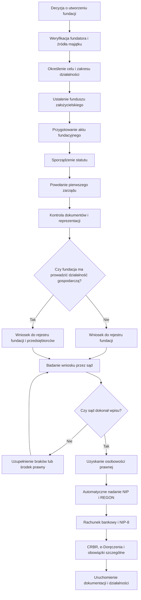

# 16.2. Ustanawianie i rejestracja fundacji

## Od decyzji fundatora do uzyskania osobowości prawnej, identyfikacji publicznoprawnej i rozpoczęcia bezpiecznej działalności

**Stan prawny opracowania: 26 listopada 2026 r.**

> Rozdział ma charakter dydaktyczny i organizacyjny. Opisuje standardową fundację ustanawianą na podstawie ustawy z 6 kwietnia 1984 r. o fundacjach. Nie należy utożsamiać jej z fundacją rodzinną, która jest odrębną osobą prawną regulowaną osobną ustawą i ma odmienny tryb powstawania. Przy konkretnej rejestracji trzeba sprawdzić aktualny formularz, komunikaty sądu rejestrowego, przepisy przejściowe i stan prawny w dniu złożenia wniosku.

---

## Mapa zgodności z konspektem

Rozdział rozwija wszystkie dwanaście pozycji wskazanych w aktualnym spisie treści:

| Lp. | Pozycja konspektu | Zakres opracowania |
|---:|---|---|
| 1 | Fundator | Zdolność, liczba fundatorów, osoby fizyczne i prawne, fundator zagraniczny, granice roli fundatora |
| 2 | Akt ustanowienia fundacji | Oświadczenie fundacyjne, forma, elementy konieczne, testament, odrębność od statutu |
| 3 | Fundusz założycielski | Składniki, wycena, brak powszechnego minimum, próg dla działalności gospodarczej, przekazanie majątku |
| 4 | Cele fundacji | Użyteczność społeczna lub gospodarcza, zgodność z prawem, konkretność i wykonalność |
| 5 | Statut fundacji | Funkcja, minimalna treść, relacja z aktem fundacyjnym, granice wobec rozdziału 16.3 |
| 6 | Określenie siedziby | Siedziba jako miejscowość, adres, tytuł do lokalu, obszar działania |
| 7 | Powołanie zarządu | Kompetencja do powołania, uchwały, zgody, adresy do doręczeń, pierwsze czynności |
| 8 | Rejestracja w KRS | Rejestr właściwy, wniosek papierowy lub elektroniczny, załączniki, opłaty, skutki wpisu |
| 9 | Numer REGON | Przekazanie danych z KRS, automatyczne nadanie, kontrola wpisu |
| 10 | Numer NIP | Automatyczne nadanie, dane uzupełniające, NIP-8, aktualizacja |
| 11 | Rachunek bankowy | Otwarcie po uzyskaniu osobowości prawnej, reprezentacja, bezpieczeństwo środków |
| 12 | Dokumentacja organizacyjna | Akta założycielskie, rejestry, księgowość, CRBR, procedury i harmonogram po rejestracji |

### Granice względem pozostałych rozdziałów

- Rozdział 16.1 wyjaśnia fundację jako osobę prawną, jej odrębność od fundatora, majątek, organy i odpowiedzialność. Tutaj zagadnienia te są wykorzystywane do opisania procesu powstawania podmiotu.
- Rozdział 16.3 będzie poświęcony szczegółowemu projektowaniu statutu, jego postanowieniom i wariantom organizacyjnym. W tym rozdziale przedstawiono tylko wymagania konieczne do bezpiecznego przejścia procedury założycielskiej.
- Rozdziały dotyczące działalności społecznej, odpłatnej i gospodarczej rozwiną sposób prowadzenia działalności po rejestracji. Tutaj wskazano jedynie warunki, które trzeba rozstrzygnąć przed złożeniem wniosku.

---

## 1. Cel, zakres i efekty kształcenia

### 1.1. Cel rozdziału

Celem jest nauczenie planowania, ustanawiania i rejestrowania fundacji w sposób zgodny z prawem, przejrzysty, ekonomicznie uzasadniony i możliwy do wykonania w praktyce.

Ustanowienie fundacji nie polega wyłącznie na sporządzeniu dokumentu z nazwą organizacji. Wymaga skoordynowania co najmniej pięciu płaszczyzn:

1. **woli fundatora** – rzeczywistej decyzji o trwałym przeznaczeniu określonych składników majątkowych na określony cel;
2. **konstrukcji prawnej** – prawidłowego aktu fundacyjnego i statutu;
3. **organizacji** – ustanowienia zarządu, określenia reprezentacji i przygotowania dokumentów;
4. **rejestracji** – prawidłowego wniosku do właściwego rejestru KRS;
5. **uruchomienia administracyjnego i finansowego** – uzyskania identyfikatorów, rachunku, dokumentacji księgowej i wykonania obowiązków po wpisie.

Błąd na wcześniejszym etapie może powodować konieczność ponownego sporządzenia aktu notarialnego, zmiany statutu, powtórzenia uchwał albo uzupełnienia wniosku. Dlatego najpierw należy zaprojektować całość, a dopiero później składać oświadczenia i ponosić koszty.

### 1.2. Efekty uczenia się

Po ukończeniu rozdziału uczestnik:

- wyjaśnia, kto może być fundatorem i jakie są ograniczenia wynikające z prawa cywilnego;
- odróżnia akt fundacyjny od statutu;
- wskazuje elementy konieczne aktu ustanowienia fundacji;
- rozróżnia fundusz założycielski od kapitału zakładowego spółki;
- ustala, czy planowana działalność wymaga wpisu do rejestru przedsiębiorców;
- wyjaśnia znaczenie ustawowego progu 1000 zł w fundacji zamierzającej prowadzić działalność gospodarczą;
- projektuje podstawową sekwencję powołania pierwszego zarządu;
- identyfikuje właściwy rejestr i sposób wniesienia wniosku;
- sporządza listę dokumentów do KRS;
- wyjaśnia mechanizm automatycznego nadawania NIP i REGON;
- prawidłowo planuje zgłoszenie danych uzupełniających na formularzu NIP-8;
- organizuje otwarcie rachunku bankowego i dokumentację po rejestracji;
- rozpoznaje obowiązki związane z CRBR, doręczeniami elektronicznymi, rachunkowością, VAT i ZUS.

### 1.3. Zasada nadrzędna

Fundacja powinna być ustanawiana dla rzeczywistego celu i z majątkiem pozwalającym przynajmniej rozpocząć jego realizację. Dokumenty nie mogą tworzyć pozoru działalności ani służyć obchodzeniu przepisów podatkowych, rejestrowych, rodzinnych, pracowniczych lub dotyczących finansowania publicznego.

Prawidłowe ustanowienie wymaga zgodności trzech elementów:

- celu deklarowanego;
- majątku rzeczywiście przeznaczonego na ten cel;
- sposobu działania, który można zgodnie z prawem i realnymi zasobami zorganizować.

---

## 2. Fundator

### 2.1. Pojęcie fundatora

Fundatorem jest osoba fizyczna albo osoba prawna, która składa oświadczenie woli o ustanowieniu fundacji i przeznacza na jej realizację określone składniki majątkowe.

Podstawowe zasady określa art. 2 ustawy o fundacjach. Fundację mogą ustanowić osoby fizyczne niezależnie od obywatelstwa i miejsca zamieszkania oraz osoby prawne mające siedzibę w Polsce albo za granicą. Fundacja ustanawiana na podstawie tej ustawy musi mieć siedzibę na terytorium Rzeczypospolitej Polskiej.

Fundator nie staje się przez samo ustanowienie fundacji jej właścicielem, udziałowcem ani wspólnikiem. Fundacja jest odrębną osobą prawną, a jej majątek nie jest majątkiem prywatnym fundatora.

### 2.2. Jeden fundator czy kilku fundatorów?

Fundację może ustanowić jedna osoba albo kilka osób działających wspólnie. Przy kilku fundatorach należy precyzyjnie określić:

- kto składa oświadczenie o ustanowieniu fundacji;
- jakie składniki majątkowe przeznacza każdy z fundatorów;
- jaka jest wartość i sposób identyfikacji poszczególnych składników;
- czy fundatorzy działają wspólnie przy ustanowieniu, czy też określone czynności wykonuje jeden z nich na podstawie umocowania;
- kto i w jaki sposób ustala statut;
- kto powołuje pierwszy zarząd;
- czy fundatorzy zastrzegają dla siebie jakiekolwiek uprawnienia przewidziane w statucie.

Nie należy pozostawiać niejasności, czy wkład jest wspólny, czy pochodzi z odrębnych majątków. Ma to znaczenie dla dowodów własności, rozliczeń, odpowiedzialności i późniejszej oceny prawidłowości przekazania majątku.

### 2.3. Fundator będący osobą fizyczną

Osoba fizyczna musi mieć zdolność do złożenia ważnego oświadczenia woli. Zastosowanie mają ogólne przepisy Kodeksu cywilnego dotyczące zdolności do czynności prawnych, wad oświadczeń woli i formy czynności prawnych.

Przed sporządzeniem aktu należy ustalić:

- tożsamość fundatora;
- pełną zdolność do czynności prawnych albo zakres dopuszczalnego działania przez przedstawiciela;
- tytuł prawny do składników majątkowych;
- ewentualne ograniczenia wynikające ze wspólności majątkowej małżeńskiej;
- wymagane zgody współmałżonka lub innych osób, jeżeli konkretna czynność tego wymaga;
- czy przekazanie majątku nie narusza praw wierzycieli, uprawnionych do zachowku ani innych praw osób trzecich.

Samo oświadczenie o przeznaczeniu majątku nie może zastąpić wymaganej zgody, jeżeli z odrębnych przepisów wynika obowiązek jej uzyskania.

### 2.4. Fundator będący osobą prawną

Fundatorem może być m.in. fundacja, stowarzyszenie, spółka, uczelnia lub inna osoba prawna, jeżeli jej przepisy ustrojowe i dokumenty wewnętrzne pozwalają na dokonanie takiej czynności.

Należy sprawdzić:

1. aktualny odpis właściwego rejestru fundatora;
2. sposób jego reprezentacji;
3. kompetencje organu podejmującego decyzję o ustanowieniu nowej fundacji;
4. wymagane uchwały lub zgody;
5. zgodność przedsięwzięcia z celem i zakresem działania fundatora;
6. źródło majątku przeznaczanego na fundację;
7. ewentualne ograniczenia dotyczące rozporządzania majątkiem.

Nie wolno zakładać, że sam podpis prezesa albo dyrektora wystarczy. Trzeba odczytać statut, umowę lub ustawę właściwą dla fundatora oraz sprawdzić sposób reprezentacji.

### 2.5. Fundator zagraniczny

Fundator zagraniczny może ustanowić fundację z siedzibą w Polsce. W praktyce trzeba przygotować:

- dokument potwierdzający istnienie zagranicznej osoby prawnej;
- dokument określający sposób reprezentacji;
- uchwałę lub inne rozstrzygnięcie właściwego organu;
- dokumenty tożsamości reprezentantów;
- tłumaczenia przysięgłe dokumentów, jeżeli są wymagane;
- apostille albo legalizację, jeżeli wymaga tego rodzaj dokumentu i właściwe przepisy;
- ocenę prawa właściwego dla zdolności i reprezentacji zagranicznego fundatora.

Nie należy automatycznie zakładać, że dokument sporządzony w języku obcym lub odpis z zagranicznego rejestru będzie wystarczający bez tłumaczenia i potwierdzenia jego autentyczności.

### 2.6. Fundator a przyszłe organy

Fundator może pełnić funkcję w organie fundacji, jeśli pozwala na to statut i nie zachodzi ustawowe ograniczenie. Nie oznacza to jednak, że fundator może traktować fundację jak własne przedsiębiorstwo albo prywatny rachunek.

Należy oddzielić:

- kompetencje fundatora wynikające z aktu i statutu;
- kompetencje zarządu;
- kompetencje organu kontroli lub nadzoru;
- prawa osób korzystających z działalności fundacji;
- prawa wierzycieli i kontrahentów.

Jeżeli fundator ma zachować uprawnienie do powoływania lub odwoływania członków zarządu, należy to jednoznacznie i zgodnie z prawem uregulować w statucie. Nie należy tworzyć pozastatutowego systemu poleceń, który podważa odpowiedzialność organu.

### 2.7. Test gotowości fundatora

Przed wizytą u notariusza fundator powinien móc odpowiedzieć na pytania:

1. Jaki konkretny cel ma realizować fundacja?
2. Dlaczego do realizacji celu potrzebna jest fundacja, a nie inna forma organizacyjna?
3. Jakie składniki majątkowe zostaną przeznaczone na fundusz założycielski?
4. Czy fundator jest ich właścicielem albo osobą uprawnioną do rozporządzenia nimi?
5. Czy fundacja ma prowadzić działalność gospodarczą od początku?
6. Kto przygotuje statut?
7. Kto powoła pierwszy zarząd?
8. Kto będzie odpowiedzialny za złożenie wniosku do KRS?
9. Czy istnieją realne środki na koszty rejestracji i pierwszego okresu działania?
10. Czy fundator rozumie, że po powstaniu fundacji jej majątek będzie odrębny od jego majątku?

---

## 3. Akt ustanowienia fundacji

### 3.1. Charakter aktu fundacyjnego

Akt fundacyjny jest oświadczeniem woli fundatora zmierzającym do ustanowienia fundacji. Jego podstawowe elementy wynikają z art. 3 ustawy o fundacjach:

- wskazanie celu fundacji;
- wskazanie składników majątkowych przeznaczonych na realizację tego celu.

Akt fundacyjny jest odrębny od statutu. Pierwszy wyraża wolę ustanowienia fundacji i przeznaczenia majątku, drugi określa ustrój oraz zasady działania powstającej osoby prawnej.

W praktyce oba dokumenty są przygotowywane w ramach jednego procesu założycielskiego, ale nie wolno utożsamiać ich funkcji.

### 3.2. Forma aktu

Oświadczenie o ustanowieniu fundacji za życia fundatora składa się w formie aktu notarialnego. Wyjątkiem jest ustanowienie fundacji w testamencie.

Forma notarialna ma znaczenie dla ważności czynności. Zwykły dokument prywatny, wiadomość elektroniczna albo uchwała organizacyjna nie zastępują aktu notarialnego, jeśli ustawa wymaga tej formy.

Notariusz powinien otrzymać wcześniej uzgodnione dane dotyczące:

- fundatora lub fundatorów;
- celu;
- składników majątkowych;
- nazwy i siedziby, jeżeli są już ustalone;
- planowanego sposobu ustalenia statutu;
- ewentualnego wskazania właściwego ministra;
- zamiaru prowadzenia działalności gospodarczej.

### 3.3. Elementy, które należy przygotować

Akt powinien być jednoznaczny i pozwalać ustalić, kto ustanawia fundację, dla jakiego celu oraz jaki majątek jest przeznaczony na realizację tego celu.

W szczególności warto przygotować:

| Element | Co należy ustalić | Typowy błąd |
|---|---|---|
| Dane fundatora | Imię, nazwisko albo pełna nazwa osoby prawnej, dane identyfikacyjne | Nieprawidłowa reprezentacja lub rozbieżne dane |
| Wola ustanowienia | Jednoznaczne oświadczenie o ustanowieniu fundacji | Niejasne oświadczenie o przyszłym zamiarze |
| Cel | Cel społecznie lub gospodarczo użyteczny | Cel pozorny, sprzeczny z prawem lub zbyt nieokreślony |
| Majątek | Rodzaj, wartość i identyfikacja składników | Ogólne stwierdzenie bez możliwości identyfikacji |
| Fundusz dla działalności gospodarczej | Wydzielona wartość, jeżeli fundacja ma prowadzić działalność gospodarczą | Brak wymaganego minimum 1000 zł |
| Siedziba | Miejscowość na terytorium Polski | Wskazanie wyłącznie adresu bez ustalenia miejscowości jako siedziby |
| Właściwy minister | Wskazanie ministra właściwego ze względu na cele fundacji, jeśli jest określane na tym etapie | Wskazanie organu przypadkowego lub nieaktualnej nazwy urzędu |

### 3.4. Akt fundacyjny a statut

Akt fundacyjny nie powinien być przeładowany postanowieniami organizacyjnymi, które należą do statutu. Nie oznacza to, że nie można w nim zamieścić dodatkowych danych, ale trzeba zachować rozdział funkcji.

**Akt fundacyjny odpowiada przede wszystkim na pytania:**

- kto ustanawia fundację;
- jaki cel ma realizować;
- jaki majątek zostaje przeznaczony na jej realizację.

**Statut odpowiada przede wszystkim na pytania:**

- jak fundacja będzie zorganizowana;
- kto będzie nią kierował;
- jak powołuje się i odwołuje organy;
- jakie są kompetencje i sposób reprezentacji;
- jak fundacja będzie prowadzić działalność;
- jak można zmienić statut i jak przeprowadzić likwidację.

Szczegółowe projektowanie statutu zostało przeznaczone do rozdziału 16.3.

### 3.5. Ustanowienie fundacji w testamencie

Ustawa dopuszcza ustanowienie fundacji w testamencie. Jest to rozwiązanie wymagające szczególnej staranności, ponieważ fundacja ma powstać w związku ze zdarzeniem przyszłym, a treść testamentu musi pozwalać na wykonanie woli testatora.

Należy rozważyć:

- ważność testamentu;
- jednoznaczność celu;
- wskazanie majątku;
- sposób ustalenia statutu;
- wskazanie osoby uprawnionej do jego ustalenia, jeżeli jest to potrzebne;
- sposób powołania organów;
- relację do postępowania spadkowego;
- ochronę praw spadkobierców i wierzycieli spadku.

Art. 6 ustawy o fundacjach przewiduje rozwiązania na wypadek, gdy statut nie został ustalony w testamencie ani nie wskazano osoby uprawnionej do jego ustalenia. Nie należy jednak traktować tych reguł jako zachęty do pozostawiania dokumentów niekompletnych.

Przy ustanawianiu fundacji w testamencie zalecane jest przygotowanie dokumentów z udziałem notariusza i prawnika zajmującego się prawem spadkowym oraz fundacyjnym.

### 3.6. Czynności przed wpisem do KRS

Zwykła fundacja ustanawiana na podstawie ustawy o fundacjach nie uzyskuje osobowości prawnej w chwili sporządzenia aktu fundacyjnego. Osobowość prawną uzyskuje z chwilą wpisu do KRS.

Nie należy przenosić na zwykłą fundację konstrukcji „fundacji w organizacji” znanej z ustawy o fundacji rodzinnej albo spółek handlowych. Są to odrębne konstrukcje ustawowe.

Przed wpisem do KRS nie należy:

- zawierać umów w taki sposób, jakby fundacja była już istniejącą osobą prawną;
- otwierać rachunku bankowego na fundację, która jeszcze nie uzyskała osobowości prawnej;
- wystawiać dokumentów z użyciem nieistniejącego jeszcze numeru KRS lub NIP;
- przyjmować zobowiązań w imieniu nieistniejącej osoby prawnej bez odpowiedniej podstawy.

Jeżeli trzeba zabezpieczyć lokal, usługę, domenę, sprzęt lub inne zasoby przed rejestracją, należy odpowiednio ukształtować umowę zawieraną przez istniejący podmiot lub osobę fizyczną, z uwzględnieniem późniejszego przeniesienia praw i obowiązków. Nie można zakładać, że umowa zawarta przez fundatora automatycznie stanie się umową fundacji po wpisie.

### 3.7. Wskazanie właściwego ministra

Ustawa przewiduje nadzór ministra właściwego ze względu na cele fundacji. W praktyce trzeba rozważyć, który dział administracji rządowej jest związany z dominującym celem fundacji.

Jeżeli cele obejmują wiele dziedzin, należy określić cel dominujący oraz sprawdzić właściwość organu według aktualnych przepisów o działach administracji rządowej i organizacji ministerstw.

Nie należy utożsamiać:

- ministra sprawującego nadzór;
- starosty właściwego ze względu na siedzibę fundacji;
- sądu rejestrowego;
- organu podatkowego;
- organu udzielającego dotacji.

Są to odrębne podmioty i kompetencje.

---

## 4. Fundusz założycielski

### 4.1. Pojęcie funduszu założycielskiego

Fundusz założycielski to majątek przeznaczony przez fundatora na realizację celu fundacji. Może obejmować składniki majątkowe wskazane w ustawie, w szczególności pieniądze, papiery wartościowe, rzeczy ruchome i nieruchomości.

Nie jest to kapitał zakładowy spółki. Fundacja nie emituje udziałów ani akcji, a fundator nie uzyskuje praw udziałowych w zamian za przekazany majątek.

Fundusz założycielski powinien być realny, możliwy do zidentyfikowania i adekwatny do planowanego zakresu działalności.

### 4.2. Czy istnieje minimalna wysokość funduszu?

Ustawa o fundacjach nie ustanawia ogólnego minimalnego funduszu założycielskiego dla każdej fundacji.

Szczególna reguła dotyczy fundacji, która zamierza prowadzić działalność gospodarczą. Zgodnie z art. 5 ust. 5 ustawy o fundacjach na działalność gospodarczą należy przeznaczyć co najmniej 1000 zł.

Należy prawidłowo odczytać tę regulację:

- 1000 zł jest minimalną wartością majątku przeznaczonego na działalność gospodarczą;
- nie jest to ogólne minimum dla każdej fundacji;
- nie jest to kapitał zakładowy;
- nie zwalnia to z obowiązku zapewnienia majątku potrzebnego do realizacji celów statutowych;
- kwota nie może być wyłącznie zapisem pozbawionym realnego pokrycia.

Przykład: fundacja planująca działalność statutową oraz gospodarczą może przeznaczyć 8000 zł na cele statutowe i 2000 zł na działalność gospodarczą. Spełnia to minimalny próg dla części gospodarczej, o ile wartości i przeznaczenie są prawidłowo udokumentowane.

### 4.3. Składniki majątkowe

Fundusz może obejmować:

1. środki pieniężne;
2. papiery wartościowe;
3. rzeczy ruchome;
4. nieruchomości;
5. inne prawa majątkowe, jeżeli mogą być skutecznie przeznaczone na realizację celu fundacji.

Każdy składnik powinien być opisany w sposób pozwalający ustalić jego tożsamość, wartość i tytuł prawny fundatora.

Przy rzeczach ruchomych warto sporządzić wykaz obejmujący:

- nazwę przedmiotu;
- producenta i model;
- numer seryjny, jeśli występuje;
- stan techniczny;
- wartość;
- dokument nabycia;
- miejsce przechowywania;
- sposób przekazania.

Przy papierach wartościowych należy wskazać rodzaj, emitenta, liczbę lub wartość nominalną oraz sposób przeniesienia praw.

### 4.4. Wycena składników

Wycena powinna być racjonalna i możliwa do obrony. W przypadku środków pieniężnych podstawą jest ich wartość nominalna. W przypadku rzeczy i praw majątkowych należy uwzględnić ich rzeczywistą wartość, stan, ograniczenia i możliwość wykorzystania.

W szczególności:

- nie należy zawyżać wartości sprzętu zużytego lub niekompletnego;
- nie należy wpisywać wartości nieruchomości bez analizy stanu prawnego i rynkowego;
- nie należy traktować przyszłej pracy wolontariuszy jako pieniężnego składnika funduszu, jeśli nie stanowi ona prawa majątkowego, które może być przedmiotem wniesienia;
- nie należy wykazywać składnika, którego fundator nie posiada lub którym nie może rozporządzać.

Przy składnikach o dużej wartości albo złożonym stanie prawnym wskazana jest niezależna wycena lub opinia specjalisty.

### 4.5. Przekazanie majątku a wpis do KRS

Należy odróżnić wskazanie składnika majątkowego w akcie fundacyjnym od technicznego i prawnego wykonania obowiązku jego przekazania.

Z chwilą wpisu do KRS fundacja uzyskuje osobowość prawną i może być podmiotem praw majątkowych. Sposób przeniesienia konkretnego składnika zależy od jego rodzaju oraz przepisów o formie czynności prawnej.

Szczególnej uwagi wymagają nieruchomości. Zgodnie z art. 157 Kodeksu cywilnego własność nieruchomości nie może być przeniesiona pod warunkiem ani z zastrzeżeniem terminu. Dlatego w praktyce trzeba odpowiednio zaplanować odrębną czynność rozporządzającą po powstaniu fundacji, w formie aktu notarialnego, albo inną konstrukcję zaakceptowaną przez notariusza, która nie narusza przepisów o przeniesieniu własności.

Nie należy zakładać, że samo wymienienie nieruchomości w akcie fundacyjnym automatycznie zastępuje wszystkie czynności wymagane do ujawnienia fundacji jako właściciela w księdze wieczystej.

W przypadku środków pieniężnych należy przygotować dowód ich przekazania na rachunek fundacji lub inny prawidłowy dowód wykonania zobowiązania fundatora. W przypadku ruchomości należy sporządzić protokół przekazania, a w przypadku praw – dokumenty wymagane dla ich skutecznego przeniesienia.

### 4.6. Majątek obciążony lub współwłasność

Przed przeznaczeniem składnika na fundusz trzeba zbadać:

- czy jest obciążony zastawem, hipoteką lub innym ograniczonym prawem rzeczowym;
- czy jest przedmiotem współwłasności;
- czy jest objęty wspólnością majątkową małżeńską;
- czy istnieją roszczenia osób trzecich;
- czy nie toczy się postępowanie egzekucyjne lub zabezpieczające;
- czy przeniesienie nie narusza praw wierzycieli;
- czy wymagana jest zgoda współwłaściciela, małżonka, wierzyciela albo innego podmiotu.

Przeznaczenie majątku do fundacji nie może służyć pokrzywdzeniu wierzycieli ani pozornemu wyprowadzeniu składników z majątku dłużnika.

### 4.7. Fundusz a bieżące finansowanie

Fundusz założycielski nie powinien być utożsamiany z pełnym budżetem pierwszego roku. Fundacja może potrzebować dodatkowych źródeł finansowania:

- darowizn;
- dotacji;
- grantów;
- przychodów z działalności odpłatnej;
- przychodów z działalności gospodarczej;
- odsetek i innych przychodów z majątku;
- wsparcia rzeczowego.

Już na etapie zakładania fundacji warto przygotować prognozę kosztów pierwszych 6–12 miesięcy. Należy uwzględnić koszty księgowości, banku, obsługi prawnej, ubezpieczeń, wynajmu, oprogramowania, wynagrodzeń i realizacji pierwszych działań.

---

## 5. Cele fundacji

### 5.1. Wymóg celu społecznie lub gospodarczo użytecznego

Zgodnie z art. 1 ustawy o fundacjach fundacja może być ustanowiona dla realizacji celów społecznie lub gospodarczo użytecznych, zgodnych z podstawowymi interesami Rzeczypospolitej Polskiej.

W ustawie wskazano przykładowo takie obszary jak:

- ochrona zdrowia;
- rozwój gospodarki i nauki;
- oświata i wychowanie;
- kultura i sztuka;
- opieka i pomoc społeczna;
- ochrona środowiska;
- opieka nad zabytkami.

Katalog ten nie jest zamknięty, ale cel musi być zgodny z prawem i rzeczywiście użyteczny.

### 5.2. Cel a przedmiot działalności

Cel określa, po co fundacja istnieje. Przedmiot działalności opisuje, jakie działania fundacja podejmuje, aby ten cel realizować.

Przykład:

- cel: poprawa dostępności rehabilitacji i edukacji zdrowotnej dla osób z ograniczoną sprawnością;
- działania: organizowanie warsztatów, finansowanie konsultacji, edukacja opiekunów, publikowanie materiałów, współpraca z podmiotami leczniczymi i placówkami edukacyjnymi.

Cel nie powinien być wyłącznie listą usług ani kodów PKD. Kody PKD służą klasyfikacji działalności gospodarczej, a nie zastępują celów statutowych.

### 5.3. Cel konkretny i wykonalny

Dobry cel powinien być:

- zgodny z ustawą;
- możliwy do zrozumienia;
- wystarczająco szeroki, aby fundacja mogła rozwijać działania;
- wystarczająco konkretny, aby można było ocenić zgodność wydatków;
- możliwy do realizacji przy przewidywanych zasobach;
- nieograniczony do prywatnego interesu fundatora.

Nie należy tworzyć celu obejmującego dowolną działalność bez wskazania społecznej lub gospodarczej użyteczności. Zbyt szeroki i nieczytelny cel utrudnia ocenę, czy konkretne działanie jest statutowe.

### 5.4. Cele religijne i działalność związana z kultem

Fundacja może podejmować działania związane z edukacją religijną, kulturą, działalnością charytatywną, ochroną dziedzictwa, wspieraniem wspólnot i innymi legalnymi celami o wymiarze religijnym, o ile mieszczą się w konstrukcji ustawy o fundacjach i są prawidłowo opisane w dokumentach.

Trzeba jednak odróżnić:

- fundację jako osobę prawną;
- kościelną osobę prawną;
- jednostkę organizacyjną związku wyznaniowego;
- działalność związaną z kultem religijnym;
- działalność społeczną lub edukacyjną fundacji.

Samo użycie określeń religijnych w nazwie lub statucie nie powoduje automatycznie uzyskania statusu kościelnej osoby prawnej. Jeżeli projekt ma być prowadzony jako jednostka związku wyznaniowego, trzeba zbadać właściwą ustawę szczególną i właściwy tryb rejestracji.

### 5.5. Cel a działalność gospodarcza

Fundacja może prowadzić działalność gospodarczą, jeżeli spełnia warunki ustawy, ma odpowiednie postanowienia statutowe i dokonuje wymaganego wpisu do rejestru przedsiębiorców.

Działalność gospodarcza nie może zastąpić celu fundacji ani prowadzić do traktowania majątku fundacji jak prywatnego majątku fundatora. Dochód z działalności powinien być rozliczany zgodnie z prawem i przeznaczany na cele fundacji.

### 5.6. Test zgodności celu

Przed złożeniem dokumentów należy przeprowadzić następujący test:

1. Czy cel jest społecznie lub gospodarczo użyteczny?
2. Czy jest zgodny z podstawowymi interesami Rzeczypospolitej Polskiej?
3. Czy nie narusza praw i wolności innych osób?
4. Czy nie służy wyłącznie prywatnej korzyści fundatora?
5. Czy można wskazać konkretne działania służące realizacji celu?
6. Czy majątek fundacji jest racjonalnie powiązany z celem?
7. Czy planowane działania nie wymagają zezwoleń, wpisów lub kwalifikacji, których fundacja nie posiada?
8. Czy cel można opisać w sposób zrozumiały dla sądu, organu nadzoru, darczyńców i beneficjentów?

---

## 6. Statut fundacji

### 6.1. Rola statutu

Statut jest podstawowym dokumentem ustrojowym fundacji. Określa jej nazwę, siedzibę, majątek, cele, zasady, formy i zakres działalności, a także organizację zarządu, sposób jego powoływania oraz obowiązki i uprawnienia.

Statut powinien być spójny z aktem fundacyjnym i nie może zmieniać jego istotnych elementów w sposób sprzeczny z wolą fundatora lub ustawą.

### 6.2. Kto ustala statut?

Statut ustala fundator, chyba że w akcie fundacyjnym przewidział przekazanie tej kompetencji innej osobie fizycznej albo prawnej. W przypadku ustanowienia fundacji w testamencie zastosowanie mają szczególne reguły art. 6 ustawy.

W dokumentacji należy wykazać, kto był uprawniony do ustalenia statutu i na jakiej podstawie.

### 6.3. Minimalny zakres postanowień

Przed złożeniem wniosku należy sprawdzić, czy statut obejmuje co najmniej:

- nazwę fundacji;
- siedzibę;
- majątek;
- cele;
- zasady, formy i zakres działalności;
- skład i organizację zarządu;
- sposób powoływania zarządu;
- obowiązki i uprawnienia zarządu.

Warto ponadto uregulować:

- kadencję;
- odwołanie i rezygnację członka zarządu;
- sposób reprezentacji;
- tryb podejmowania uchwał;
- konflikty interesów;
- możliwość tworzenia organów dodatkowych;
- zasady zmiany statutu;
- zasady prowadzenia działalności odpłatnej i gospodarczej;
- zasady łączenia i likwidacji fundacji.

### 6.4. Statut a działalność gospodarcza

Jeżeli fundacja ma prowadzić działalność gospodarczą, trzeba przewidzieć ją w statucie oraz prawidłowo określić przeznaczenie majątku. Wpis do rejestru przedsiębiorców jest dodatkowym elementem rejestracji.

Nie należy rozpoczynać działalności gospodarczej przed uzyskaniem wymaganego wpisu. Nie wystarczy samo wpisanie odpowiedniego kodu PKD do formularza, jeżeli statut nie daje podstaw do prowadzenia tej działalności.

### 6.5. Statut a właściwy minister

Treść statutu i akt fundacyjny powinny umożliwiać prawidłowe ustalenie organu nadzoru. Wskazanie ministra nie może być przypadkowe. Należy zbadać dominujący cel i właściwość organu według aktualnego podziału administracji rządowej.

### 6.6. Granica tego rozdziału

Szczegółowe projektowanie statutu, w tym zapisy o działalności społecznej, edukacyjnej, religijnej, zdrowotnej, opiekuńczej, odpłatnej i gospodarczej, zostanie rozwinięte w rozdziale 16.3. Na etapie rejestracji trzeba jednak zapewnić, że statut jest kompletny i zgodny z aktem fundacyjnym.

---

## 7. Określenie siedziby

### 7.1. Siedziba a adres

Siedziba osoby prawnej jest określana przez wskazanie miejscowości, w której znajduje się jej siedziba. Adres obejmuje bardziej szczegółowe dane lokalizacyjne, np. ulicę, numer budynku, numer lokalu, kod pocztowy i miejscowość.

Nie należy utożsamiać siedziby z:

- adresem korespondencyjnym;
- adresem księgowości;
- adresem miejsca prowadzenia zajęć;
- adresem oddziału;
- adresem prywatnym fundatora.

### 7.2. Wybór siedziby

Przy wyborze miejscowości należy uwzględnić:

- rzeczywiste centrum zarządzania;
- dostępność administracyjną;
- koszty lokalu;
- właściwość sądu rejestrowego;
- właściwość starosty i organu nadzoru;
- możliwość odbierania korespondencji;
- planowaną skalę działania.

Siedziba nie powinna być wybierana wyłącznie dla pozornego uzyskania korzyści lub utrudnienia nadzoru.

### 7.3. Adres do rejestru

Adres zgłaszany do KRS powinien być prawdziwy, aktualny i umożliwiać doręczanie korespondencji. Fundacja powinna posiadać podstawę do korzystania z lokalu, np. umowę najmu, użyczenia albo inny tytuł prawny, jeżeli jest to wymagane w danej sytuacji.

Nie należy zakładać, że sam adres wirtualny zawsze będzie wystarczający. Trzeba ocenić, czy zapewnia realną możliwość odbioru korespondencji, prowadzenia dokumentacji i wykonywania obowiązków.

### 7.4. Zmiana siedziby i adresu

Zmiana miejscowości siedziby może wymagać zmiany statutu, jeśli siedziba jest w nim określona. Zmiana samego adresu w tej samej miejscowości może wymagać zgłoszenia do KRS, lecz nie zawsze zmiany statutu. Rozstrzygające jest brzmienie statutu i aktualne przepisy.

Po zmianie adresu należy także sprawdzić dane:

- w KRS;
- w CRP KEP;
- w REGON;
- w banku;
- u kontrahentów;
- w dokumentacji księgowej;
- w systemach dotacyjnych i grantowych;
- w bazie adresów elektronicznych, jeżeli fundacja ma ADE.

### 7.5. Dokumenty lokalu

Wewnętrzna dokumentacja powinna obejmować:

- umowę najmu, użyczenia lub inny dokument;
- zgodę właściciela, jeżeli jest potrzebna;
- protokół przekazania lokalu;
- zasady korzystania z pomieszczeń;
- zasady przechowywania dokumentów;
- sposób odbioru korespondencji;
- zasady ochrony danych i zabezpieczenia dokumentacji.

---

## 8. Powołanie zarządu

### 8.1. Znaczenie pierwszego zarządu

Zarząd jest organem kierującym działalnością fundacji i reprezentującym ją na zewnątrz. Bez prawidłowo ustanowionego organu reprezentacji fundacja nie będzie mogła sprawnie uczestniczyć w obrocie po wpisie do KRS.

Pierwszy zarząd powinien zostać powołany zgodnie z aktem fundacyjnym i statutem. Należy ustalić, kto posiada kompetencję do powołania, na jakiej podstawie i w jakim trybie.

### 8.2. Kto powołuje zarząd?

Może to być fundator albo inny organ lub osoba wskazana w statucie. Nie wolno zakładać, że fundator zawsze zachowuje kompetencję do powoływania zarządu po rejestracji.

Jeżeli statut przewiduje, że zarząd powołuje rada fundacji, należy najpierw prawidłowo powołać radę, a następnie przeprowadzić procedurę powołania zarządu.

### 8.3. Dokument powołania

Powołanie powinno być udokumentowane uchwałą lub innym właściwym dokumentem, który wskazuje:

- organ lub osobę podejmującą decyzję;
- podstawę kompetencyjną;
- datę podjęcia decyzji;
- imię i nazwisko powołanej osoby;
- funkcję;
- początek i ewentualny koniec kadencji;
- wynik głosowania, jeżeli jest wymagany;
- podpisy osób uprawnionych.

Uchwała nie powinna być antydatowana ani sporządzana dopiero po złożeniu wniosku, jeżeli miała stanowić podstawę pierwotnego powołania.

### 8.4. Zgoda na powołanie i adres do doręczeń

Art. 19a ust. 5 ustawy o KRS przewiduje dołączenie do wniosku o wpis osób reprezentujących podmiot oświadczeń obejmujących zgodę na powołanie i adresy do doręczeń.

Ustawa przewiduje wyjątki od obowiązku odrębnego oświadczenia o zgodzie, m.in. gdy wniosek podpisuje osoba podlegająca wpisowi, osoba udzielająca pełnomocnictwa do złożenia wniosku albo gdy zgoda została wyrażona w protokole z posiedzenia organu powołującego. Nie zwalnia to z prawidłowego wskazania adresu do doręczeń.

Jeżeli adres do doręczeń osoby reprezentującej znajduje się poza obszarem Unii Europejskiej, art. 19a ust. 5a ustawy o KRS przewiduje wskazanie pełnomocnika do doręczeń w Rzeczypospolitej Polskiej.

### 8.5. Dane członków zarządu

Przed złożeniem wniosku należy zebrać:

- imię i nazwisko;
- numer PESEL, jeżeli został nadany;
- adres do doręczeń;
- funkcję;
- datę powołania;
- informację o sposobie reprezentacji;
- oświadczenie o zgodzie na powołanie, jeżeli jest wymagane;
- dane niezbędne do podpisania dokumentów elektronicznych.

Nie należy publikować w materiałach promocyjnych ani rozsyłać osobom nieuprawnionym danych prywatnych członków zarządu, jeżeli nie jest to potrzebne do realizacji celu.

### 8.6. Reprezentacja

Statut powinien określać, czy fundację reprezentuje:

- każdy członek zarządu samodzielnie;
- dwóch członków łącznie;
- prezes samodzielnie, a pozostali członkowie łącznie;
- inny układ zgodny z prawem.

Wniosek do KRS musi odzwierciedlać rzeczywisty sposób reprezentacji. Nie wolno wpisywać reprezentacji wygodniejszej niż ta, która wynika ze statutu.

### 8.7. Pierwsze obowiązki zarządu

Po wpisie do KRS zarząd powinien:

1. odebrać i zabezpieczyć dokumenty rejestracyjne;
2. sprawdzić zgodność wpisu z wnioskiem i statutem;
3. ustalić osoby uprawnione do rachunku bankowego;
4. wdrożyć obieg dokumentów;
5. uruchomić księgi rachunkowe;
6. przygotować zgłoszenie CRBR;
7. złożyć NIP-8 w terminie;
8. ustalić obowiązki ZUS i VAT;
9. wdrożyć zasady ochrony danych;
10. sporządzić plan działania na pierwszy kwartał.

### 8.8. Konflikt interesów

Jeżeli fundator jest jednocześnie członkiem zarządu, należy szczególnie dbać o rozdzielenie jego interesu osobistego od interesu fundacji. Umowy z fundatorem, członkiem zarządu lub podmiotem powiązanym powinny być oceniane z uwzględnieniem statutu, zasad reprezentacji, konfliktu interesów, rynkowości warunków i obowiązków podatkowych.

---

## 9. Rejestracja w Krajowym Rejestrze Sądowym

### 9.1. Właściwy rejestr

Fundacja podlega wpisowi do rejestru stowarzyszeń, innych organizacji społecznych i zawodowych, fundacji oraz samodzielnych publicznych zakładów opieki zdrowotnej, o którym mowa w art. 1 ust. 2 pkt 2 i art. 49 ustawy o Krajowym Rejestrze Sądowym.

Jeżeli fundacja podejmuje działalność gospodarczą, podlega także wpisowi do rejestru przedsiębiorców zgodnie z art. 50 ustawy o KRS.

Nie każda fundacja musi być wpisana do rejestru przedsiębiorców. Samo posiadanie NIP, REGON, rachunku bankowego lub zatrudnianie pracowników nie oznacza automatycznie prowadzenia działalności gospodarczej.

### 9.2. Sąd rejestrowy

Wniosek kieruje się do sądu rejestrowego właściwego ze względu na siedzibę fundacji. Właściwość sądu należy sprawdzić przed złożeniem dokumentów.

Nie należy wysyłać wniosku do sądu właściwego dla miejsca zamieszkania fundatora, jeśli siedziba fundacji znajduje się w innym okręgu.

### 9.3. Papier czy system teleinformatyczny – stan na 26 listopada 2026 r.

Sposób składania wniosku zależy od tego, do którego rejestru fundacja ma być wpisana.

**Fundacja bez działalności gospodarczej, zgłaszana wyłącznie do rejestru fundacji:**

- zgodnie z obecnym brzmieniem art. 19 ust. 3 ustawy o KRS wniosek może być składany na urzędowym formularzu albo za pośrednictwem systemu teleinformatycznego;
- praktycznie można korzystać z Portalu Rejestrów Sądowych, jeżeli dana czynność i formularz są dostępne;
- w razie wyboru drogi papierowej należy użyć aktualnego urzędowego formularza i spełnić wymogi dotyczące załączników.

**Fundacja wpisywana jednocześnie do rejestru przedsiębiorców:**

- wnioski dotyczące podmiotu podlegającego wpisowi do rejestru przedsiębiorców składa się za pośrednictwem systemu teleinformatycznego;
- należy korzystać z aktualnych usług i formularzy systemu PRS.

**Zmiana, która ma wejść w życie 1 kwietnia 2027 r.:**

Ustawa zmieniająca ustawę o KRS, ogłoszona w Dz. U. z 2025 r. poz. 1556, przewiduje rozszerzenie obowiązkowej drogi elektronicznej także na wnioski dotyczące rejestru fundacji i innych podmiotów z art. 1 ust. 2 pkt 2. Zmiana ta nie obowiązuje jeszcze 26 listopada 2026 r. Przy wniosku składanym po 31 marca 2027 r. należy ponownie sprawdzić obowiązujące brzmienie przepisów.

Nie należy bezrefleksyjnie stosować poradników sprzed kilku lat. Część z nich opisuje formularze i tryby, które uległy zmianie.

### 9.4. Portal Rejestrów Sądowych

Portal Rejestrów Sądowych umożliwia składanie wniosków i pism w sprawach rejestrowych w zakresie przewidzianym przez system.

Przed rozpoczęciem należy:

1. utworzyć lub wykorzystać właściwe konto;
2. wybrać właściwy rodzaj podmiotu;
3. wskazać właściwy rejestr;
4. wprowadzić dane fundacji;
5. wprowadzić dane organu reprezentacji;
6. dołączyć wymagane dokumenty;
7. podpisać wniosek właściwym podpisem elektronicznym;
8. uiścić opłatę;
9. pobrać urzędowe potwierdzenie złożenia;
10. monitorować korespondencję sądu.

Nie należy zakładać, że zapisanie formularza w systemie jest równoznaczne ze skutecznym złożeniem wniosku. Wniosek musi zostać podpisany i opłacony zgodnie z przepisami.

### 9.5. Dokumenty do wniosku

Zestaw załączników zależy od konkretnej sytuacji, sposobu składania wniosku, liczby fundatorów, sposobu powołania organów i planowanej działalności.

Podstawowa lista kontrolna obejmuje:

| Dokument | Cel |
|---|---|
| Akt fundacyjny | Potwierdzenie ustanowienia fundacji i przeznaczenia majątku |
| Statut | Określenie ustroju i zasad działania |
| Dokument ustalenia statutu, jeśli odrębny | Wykazanie, kto i na jakiej podstawie ustalił statut |
| Uchwała lub dokument powołania zarządu | Potwierdzenie ustanowienia pierwszego organu |
| Zgody na powołanie | W zakresie wymaganym przez art. 19a ustawy o KRS |
| Adresy do doręczeń członków organu | Dane wymagane do wpisu |
| Dokumenty dotyczące organu kontroli | Jeżeli został powołany i podlega ujawnieniu |
| Oświadczenie lub wskazanie ministra | Jeżeli jest wymagane w danej konfiguracji dokumentów |
| Dane dotyczące działalności gospodarczej | Jeżeli fundacja ma być wpisana także do rejestru przedsiębiorców |
| Dokumenty dotyczące fundatora zagranicznego | Wykazanie istnienia i reprezentacji zagranicznego fundatora |
| Potwierdzenie opłaty | Wykazanie uiszczenia opłaty sądowej |
| Inne wymagane załączniki | Zależnie od konkretnego stanu faktycznego i wymagań systemu |

Lista ma charakter praktyczny, a nie zamknięty. Przed wysłaniem należy porównać ją z aktualnym formularzem i instrukcją sądu.

### 9.6. Akty notarialne i Repozytorium

Jeżeli wypis lub wyciąg aktu notarialnego został umieszczony w Repozytorium, należy posłużyć się numerem dokumentu zgodnie z art. 19d ustawy o KRS. System może automatycznie pobrać dokument z Repozytorium i dołączyć go do wniosku.

Nie należy tworzyć niezgodnych kopii ani zastępować wypisu aktu notarialnego zwykłym skanem, jeżeli przepisy wymagają dokumentu urzędowego lub właściwej postaci elektronicznej.

### 9.7. Opłaty sądowe

Zgodnie z art. 53 ustawy o kosztach sądowych w sprawach cywilnych:

- 250 zł – opłata stała od wniosku o zarejestrowanie fundacji w rejestrze stowarzyszeń, innych organizacji społecznych i zawodowych, fundacji oraz publicznych zakładów opieki zdrowotnej;
- 500 zł – opłata stała, jeżeli wniosek dotyczy jednocześnie wpisu do rejestru przedsiębiorców.

Kwoty należy ponownie sprawdzić w dniu składania wniosku, ponieważ opłaty mogą ulec zmianie. Nie należy zakładać, że opłata za wpis do KRS obejmuje inne usługi bankowe, notarialne, tłumaczeniowe lub doradcze.

### 9.8. Badanie wniosku przez sąd

Sąd rejestrowy bada wniosek i załączniki w zakresie przewidzianym ustawą. W sprawie fundacji istotne jest m.in. ustalenie, czy:

- fundacja została prawidłowo ustanowiona;
- akt fundacyjny spełnia wymagania;
- statut jest zgodny z ustawą;
- cel jest zgodny z prawem;
- dokumenty wykazują prawidłowe powołanie organów;
- wniosek jest podpisany przez osoby uprawnione;
- wymagane załączniki zostały dołączone;
- opłata została uiszczona;
- dane w formularzu są spójne z dokumentami.

Sąd może wezwać do usunięcia braków albo wydać rozstrzygnięcie przewidziane w przepisach. Należy pilnować terminów i odpowiadać na wezwania w sposób kompletny.

### 9.9. Moment uzyskania osobowości prawnej

Zgodnie z art. 7 ustawy o fundacjach fundacja uzyskuje osobowość prawną z chwilą wpisania do Krajowego Rejestru Sądowego.

Wpis ma charakter konstytutywny. Sam akt notarialny, statut, uchwała o powołaniu zarządu ani złożenie wniosku nie zastępują wpisu.

Od chwili wpisu fundacja może działać jako odrębna osoba prawna, zaciągać zobowiązania, nabywać prawa, posiadać rachunek bankowy i występować w obrocie we własnym imieniu.

### 9.10. Weryfikacja wpisu

Po dokonaniu wpisu należy pobrać aktualny odpis KRS i sprawdzić:

- nazwę;
- siedzibę;
- adres;
- numer KRS;
- datę wpisu;
- skład zarządu;
- sposób reprezentacji;
- organ nadzoru;
- wpis do rejestru przedsiębiorców, jeżeli dotyczy;
- przedmiot działalności;
- ewentualne informacje o adresie do doręczeń elektronicznych.

W razie rozbieżności nie należy ich ignorować. Trzeba ustalić, czy błąd znajduje się we wniosku, dokumencie źródłowym, czy w samym wpisie i podjąć odpowiednią czynność sprostowania lub zmiany.

### 9.11. Znaczenie jawności KRS

Dane ujawnione w KRS mają znaczenie dla bezpieczeństwa obrotu. Ustawa przewiduje domniemanie prawdziwości danych wpisanych do Rejestru. Fundacja powinna niezwłocznie zgłaszać zmiany podlegające ujawnieniu.

Nieaktualny wpis może prowadzić do problemów z bankiem, kontrahentami, urzędami, grantodawcami i sądem.

---

## 10. Numer REGON

### 10.1. Pojęcie numeru REGON

REGON jest numerem identyfikacyjnym w krajowym rejestrze urzędowym podmiotów gospodarki narodowej. Służy identyfikacji podmiotu w systemach statystyki publicznej i w obrocie administracyjnym.

Fundacja jako osoba prawna jest ujmowana w rejestrze REGON na zasadach wynikających z ustawy o statystyce publicznej.

### 10.2. Automatyczne przekazanie danych z KRS

Dane podmiotów wpisanych do KRS są przekazywane za pośrednictwem systemu teleinformatycznego do rejestru REGON. Zgodnie z ustawą o KRS wpis numeru REGON jest dokonywany po przekazaniu danych z właściwego rejestru.

W standardowej procedurze fundacja nie musi składać odrębnego wniosku RG-OP wyłącznie po to, aby uzyskać pierwszy numer REGON, jeżeli dane zostały prawidłowo przekazane przez KRS.

### 10.3. Co zrobić po wpisie?

Po uzyskaniu wpisu należy:

1. sprawdzić, czy REGON został nadany;
2. zweryfikować nazwę i adres;
3. pobrać informację z właściwego systemu GUS;
4. sprawdzić zgodność z KRS;
5. zachować informację w dokumentacji organizacyjnej.

Jeżeli numer nie pojawia się mimo upływu czasu potrzebnego na przekazanie danych, należy sprawdzić, czy wniosek zawierał poprawne dane i czy nie wystąpiła przeszkoda techniczna lub formalna.

### 10.4. REGON a jednostki lokalne

Jeżeli fundacja tworzy jednostki lokalne, oddziały lub placówki, należy zbadać, czy dana jednostka podlega odrębnemu ujawnieniu statystycznemu i czy wymaga odrębnego numeru identyfikacyjnego.

Nie każda wewnętrzna komórka organizacyjna jest odrębną jednostką statystyczną. Rozstrzygające są przepisy i faktyczny sposób organizacji działalności.

---

## 11. Numer NIP

### 11.1. NIP jako identyfikator podatkowy

Fundacja jako osoba prawna jest podmiotem podlegającym obowiązkom ewidencyjnym i posługuje się numerem NIP.

NIP jest identyfikatorem podatkowym wykorzystywanym w dokumentach podatkowych, rachunkowych i w obrocie z kontrahentami.

### 11.2. Automatyczne nadanie NIP

Ustawa o zasadach ewidencji i identyfikacji podatników i płatników przewiduje automatyczne nadawanie NIP podmiotom wpisanym do KRS po przekazaniu danych z KRS do Centralnego Rejestru Podmiotów – Krajowej Ewidencji Podatników.

W konsekwencji standardowa fundacja wpisywana do KRS nie powinna składać odrębnego wniosku o nadanie pierwszego NIP w trybie właściwym dla podmiotów nieobjętych automatyczną integracją.

Numer powinien zostać ujawniony w KRS po jego nadaniu. Potwierdzeniem jest informacja o numerze w rejestrze.

### 11.3. NIP-8 – dane uzupełniające

Automatyczne nadanie NIP nie oznacza, że wszystkie dane fundacji zostały przekazane.

Zgodnie z art. 5 ust. 2b–2c ustawy o zasadach ewidencji i identyfikacji podatników i płatników podmioty wpisane do KRS zgłaszają dane uzupełniające w terminie 21 dni od dnia dokonania wpisu do KRS.

Dane uzupełniające obejmują w szczególności:

- skróconą nazwę;
- wykaz rachunków bankowych;
- adresy miejsc prowadzenia działalności;
- dane podmiotu prowadzącego dokumentację rachunkową, w tym jego NIP;
- adres miejsca przechowywania dokumentacji rachunkowej;
- dane kontaktowe;
- inne dane przewidziane w aktualnym formularzu.

W praktyce służy do tego formularz NIP-8.

Nie należy mylić:
- automatycznego nadania NIP;
- zgłoszenia danych uzupełniających;
- zgłoszenia rejestracyjnego VAT-R;
- aktualizacji danych w KRS.

Są to odrębne czynności.

### 11.4. Termin 21 dni

Termin 21 dni należy liczyć od dnia dokonania wpisu fundacji do KRS, z uwzględnieniem ogólnych zasad obliczania terminów oraz aktualnych przepisów.

Wewnętrznie należy przyjąć krótszy termin operacyjny, np. 10 dni, aby pozostawić czas na korektę danych i potwierdzenie złożenia zgłoszenia.

### 11.5. Aktualizacja danych

Podmioty wpisane do KRS dokonują aktualizacji danych podatkowych w zakresie danych uzupełniających, które nie są automatycznie przekazywane z KRS.

Jeżeli zmienia się adres, rachunek bankowy, podmiot prowadzący księgowość lub miejsce przechowywania dokumentacji, trzeba sprawdzić, czy zmiana wymaga aktualizacji NIP-8, KRS, REGON, banku albo innych rejestrów.

### 11.6. NIP a VAT

Samo posiadanie NIP nie oznacza, że fundacja jest czynnym podatnikiem VAT.

Jeżeli fundacja zamierza wykonywać czynności podlegające opodatkowaniu VAT, trzeba przeanalizować obowiązek lub możliwość rejestracji VAT, zwolnienia podmiotowe i przedmiotowe oraz moment złożenia VAT-R.

Nie należy utożsamiać:
- NIP;
- statusu podatnika VAT;
- statusu podatnika VAT czynnego;
- numeru VAT UE.

---

## 12. Rachunek bankowy fundacji

### 12.1. Czy każda fundacja musi mieć rachunek bankowy?

Ustawa o fundacjach nie ustanawia rachunku bankowego jako warunku konstytutywnego uzyskania osobowości prawnej. W praktyce rachunek jest jednak podstawowym narzędziem bezpiecznego zarządzania majątkiem.

Rachunek bankowy jest potrzebny lub bardzo użyteczny do:

- przyjmowania darowizn;
- otrzymywania dotacji i grantów;
- regulowania zobowiązań;
- wypłaty wynagrodzeń;
- prowadzenia rozliczeń z kontrahentami;
- dokumentowania przepływów;
- realizacji obowiązków podatkowych i składkowych.

Niektóre programy finansowania, umowy grantowe lub procedury bankowe mogą wymagać określonego rachunku lub dodatkowych dokumentów.

### 12.2. Kiedy otworzyć rachunek?

Rachunek powinien zostać otwarty po uzyskaniu osobowości prawnej i możliwości wykazania, że fundacja istnieje oraz kto jest uprawniony do jej reprezentowania.

Przed wpisem nie należy posługiwać się rachunkiem prywatnym fundatora tak, jakby był rachunkiem fundacji. Jeżeli środki są czasowo przechowywane przez fundatora, trzeba mieć jasny dokument określający ich charakter, przeznaczenie i sposób przekazania.

### 12.3. Dokumenty wymagane przez bank

Bank może wymagać w szczególności:

- aktualnego odpisu KRS;
- statutu;
- aktu fundacyjnego lub danych z Repozytorium;
- dokumentu powołania zarządu;
- danych i dokumentów tożsamości osób reprezentujących;
- NIP i REGON;
- informacji o beneficjentach rzeczywistych;
- informacji o źródłach środków i planowanej działalności;
- uchwały o otwarciu rachunku, jeżeli wynika to ze statutu lub procedury banku;
- wzorów podpisów i zasad autoryzacji.

Zakres wymagań zależy od banku i oceny ryzyka. Bank może żądać dodatkowych dokumentów w ramach przepisów AML i własnych procedur.

### 12.4. Zasady bezpieczeństwa rachunku

Zaleca się:

1. rachunek prowadzony na nazwę fundacji;
2. rozdzielenie rachunku fundacji od rachunków prywatnych;
3. indywidualne uprawnienia użytkowników;
4. zasadę dwóch osób przy operacjach o większej wartości, jeżeli jest to organizacyjnie uzasadnione;
5. limity przelewów;
6. okresowy przegląd uprawnień;
7. zakaz udostępniania loginów i haseł;
8. archiwizację wyciągów;
9. weryfikację rachunków kontrahentów;
10. procedurę zgłaszania podejrzanych operacji.

### 12.5. Rachunek a NIP-8

Po otwarciu rachunku należy zgłosić jego numer w danych uzupełniających na NIP-8, jeżeli nie został wcześniej zgłoszony.

Jeżeli rachunek otwierany jest po złożeniu pierwszego NIP-8, należy wykonać aktualizację w odpowiednim terminie.

### 12.6. Rachunek projektu i rachunek podstawowy

Fundacja może korzystać z kilku rachunków, np. rachunku podstawowego i rachunku projektu. Nie oznacza to powstania odrębnych osób prawnych ani odrębnego majątku.

Wewnętrzne rozdzielenie środków powinno być zgodne z umową dotacyjną, zasadami rachunkowości i dokumentacją projektu. Nie należy traktować rachunku projektu jako sposobu na wyłączenie odpowiedzialności fundacji za zobowiązania.

---

## 13. Dokumentacja organizacyjna

### 13.1. Akta założycielskie

Fundacja powinna utworzyć trwały zbiór dokumentów obejmujący:

1. akt fundacyjny;
2. statut i jego kolejne wersje;
3. uchwały i dokumenty powołania organów;
4. zgody członków organów;
5. dokumenty dotyczące adresów do doręczeń;
6. wniosek do KRS;
7. załączniki do wniosku;
8. potwierdzenie opłaty;
9. korespondencję z sądem;
10. postanowienie o wpisie;
11. aktualny odpis KRS;
12. potwierdzenie NIP i REGON;
13. dokumenty dotyczące rachunku bankowego;
14. dokumenty dotyczące przekazania majątku;
15. dokumenty dotyczące zgłoszeń podatkowych i rejestrowych.

### 13.2. Rejestr dokumentów

Warto prowadzić rejestr obejmujący:

| Pole | Znaczenie |
|---|---|
| Numer dokumentu | Jednoznaczna identyfikacja |
| Data | Data sporządzenia lub podjęcia |
| Rodzaj | Akt, uchwała, umowa, wniosek, potwierdzenie |
| Organ lub osoba | Kto sporządził albo podjął dokument |
| Podstawa | Przepis lub postanowienie statutu |
| Miejsce przechowywania | Papier, repozytorium, system |
| Dostęp | Osoby uprawnione |
| Termin aktualizacji | Jeżeli dokument wymaga odnowienia |
| Status | Aktualny, historyczny, uchylony, zastąpiony |

### 13.3. Dokumentacja księgowa

Fundacja jako osoba prawna podlega przepisom o rachunkowości, chyba że szczególne przepisy przewidują określone uproszczenia.

Po wpisie należy przygotować:

- politykę rachunkowości;
- zakładowy plan kont;
- zasady obiegu dokumentów;
- zasady zatwierdzania wydatków;
- sposób ewidencji darowizn i dotacji;
- zasady wyodrębnienia działalności;
- miejsce przechowywania dokumentacji;
- dostęp do systemu księgowego;
- harmonogram zamknięcia miesiąca i roku.

Należy odróżnić dzień uzyskania osobowości prawnej od dnia technicznego rozpoczęcia operacji księgowych. Księgi rachunkowe otwiera się zgodnie z ustawą o rachunkowości, a nie dopiero wtedy, gdy fundacja zaczyna otrzymywać duże przychody.

### 13.4. Dokumentacja majątku

Warto utworzyć:

- rejestr środków trwałych;
- ewidencję wyposażenia;
- rejestr umów;
- rejestr darowizn;
- rejestr dotacji;
- rejestr zobowiązań;
- rejestr rachunków bankowych;
- rejestr pełnomocnictw;
- rejestr dostępów do systemów.

Każdy składnik majątku powinien mieć przypisany dokument nabycia, przekazania, wyceny albo inny dowód księgowy.

### 13.5. Dokumentacja danych osobowych

Fundacja powinna ustalić, kto jest administratorem danych, jakie dane przetwarza, w jakich celach, na jakiej podstawie prawnej, komu je udostępnia i jak długo je przechowuje.

Na etapie rejestracji należy ograniczyć obieg danych osobowych fundatora, członków zarządu i osób współpracujących do zakresu koniecznego. Dokumenty z numerami PESEL, adresami prywatnymi i kopiami dokumentów tożsamości powinny być zabezpieczone.

### 13.6. Dokumentacja wewnętrzna po rejestracji

W pierwszym okresie działania należy przyjąć co najmniej:

- regulamin pracy zarządu;
- zasady reprezentacji i podpisywania umów;
- regulamin obiegu dokumentów;
- zasady zatwierdzania wydatków;
- politykę rachunkowości;
- zasady ochrony danych;
- rejestr konfliktów interesów;
- zasady przyjmowania darowizn;
- zasady przyznawania świadczeń;
- procedurę zgłaszania nieprawidłowości.

---

## 14. Obowiązki po wpisie – harmonogram uruchomienia fundacji

Wpis do KRS nie kończy procesu organizacyjnego. Rozpoczyna etap, w którym fundacja musi wykonać obowiązki rejestrowe, podatkowe, rachunkowe i organizacyjne.

### 14.1. Pierwsze 48 godzin

- pobranie aktualnego odpisu KRS;
- sprawdzenie danych;
- utworzenie centralnego repozytorium dokumentów;
- zabezpieczenie aktu fundacyjnego i statutu;
- potwierdzenie składu zarządu i reprezentacji;
- przygotowanie wniosku o rachunek bankowy;
- ustalenie osoby odpowiedzialnej za terminy rejestrowe i podatkowe.

### 14.2. Pierwsze 14 dni – CRBR

Fundacje wpisane do KRS należą do podmiotów zobowiązanych do zgłaszania informacji o beneficjentach rzeczywistych do Centralnego Rejestru Beneficjentów Rzeczywistych.

Zgodnie z art. 60 ustawy AML pierwsze zgłoszenie fundacji należy złożyć w terminie 14 dni od dnia wpisu do KRS. Do biegu terminu nie wlicza się sobót i dni ustawowo wolnych od pracy zgodnie z przepisami AML.

Zgłoszenie jest elektroniczne i bezpłatne. Dokonuje go osoba uprawniona do reprezentacji fundacji, zgodnie z zasadami ustawowymi.

Nie należy automatycznie wpisywać wyłącznie fundatora. Beneficjenta rzeczywistego ustala się na podstawie rzeczywistej kontroli, uprawnień i okoliczności prawnych lub faktycznych. W fundacji może nim być członek zarządu lub inna osoba mająca decydujący wpływ, ale wymaga to odrębnej analizy.

### 14.3. Pierwsze 21 dni – NIP-8

Należy zgłosić dane uzupełniające w terminie 21 dni od wpisu do KRS. Wewnętrznie warto przygotować formularz wcześniej, a po uzyskaniu rachunku bankowego uzupełnić dane.

### 14.4. Doręczenia elektroniczne

Obowiązek posiadania adresu do doręczeń elektronicznych zależy od statusu fundacji w KRS.

- Fundacja wpisana wyłącznie do rejestru fundacji, bez wpisu do rejestru przedsiębiorców, co do zasady nie należy do kategorii podmiotów niepublicznych objętych obowiązkiem z art. 9 ust. 1 pkt 8 ustawy o doręczeniach elektronicznych.
- Fundacja wpisana do rejestru przedsiębiorców podlega obowiązkowi posiadania adresu do doręczeń elektronicznych na zasadach ustawy o doręczeniach elektronicznych.
- Przy składaniu wniosku przez system teleinformatyczny należy uwzględnić art. 19f ustawy o KRS, który różnicuje obowiązek wskazania danych dla rejestru przedsiębiorców i możliwość wskazania ich dla rejestru fundacji.

Nie należy utożsamiać zwykłego adresu e-mail z adresem do doręczeń elektronicznych.

### 14.5. VAT

Jeżeli fundacja wykonuje czynności podlegające VAT, należy przeanalizować obowiązek rejestracji i złożyć VAT-R przed momentem, w którym wymagają tego przepisy.

Nie każda darowizna, dotacja ani działalność statutowa powoduje obowiązek rejestracji VAT. Decyduje charakter czynności i przepisy ustawy o VAT.

### 14.6. ZUS i zatrudnienie

Jeżeli fundacja zatrudnia pracowników lub zawiera umowy powodujące obowiązek ubezpieczeń, musi zrealizować obowiązki płatnika składek.

Przed pierwszą wypłatą należy ustalić:

- rodzaj umowy;
- tytuł do ubezpieczeń;
- obowiązek zgłoszenia płatnika;
- obowiązek zgłoszenia ubezpieczonego;
- termin i sposób rozliczenia składek;
- obowiązki informacyjne i dokumentacyjne.

Nie należy zakładać, że samo uzyskanie NIP i REGON automatycznie oznacza prawidłową rejestrację wszystkich obowiązków ZUS.

### 14.7. Rachunkowość i pierwsze sprawozdanie

Zarząd powinien zapewnić prowadzenie ksiąg rachunkowych od właściwego momentu, ustalić rok obrotowy, przyjąć politykę rachunkowości i zabezpieczyć dokumenty.

Należy pamiętać, że obowiązki sprawozdawcze fundacji wynikają z różnych ustaw i mogą obejmować:

- sprawozdanie finansowe;
- sprawozdanie z działalności fundacji;
- sprawozdanie z realizacji zadania publicznego;
- sprawozdanie podatkowe;
- sprawozdanie wymagane przez grantodawcę;
- obowiązki informacyjne wobec organu nadzoru.

Nie każde sprawozdanie składa się do tego samego organu i w tym samym terminie.

---

## 15. Schemat procesu ustanowienia i rejestracji

---

## 16. Przykłady praktyczne

### Przypadek A. Fundator chce ustanowić fundację bez działalności gospodarczej

Osoba fizyczna zamierza przeznaczyć 3000 zł na fundację wspierającą rodziny i osoby wymagające pomocy opiekuńczej.

**Ocena:**

- ustawa nie ustanawia ogólnego minimum funduszu dla fundacji bez działalności gospodarczej;
- kwota musi być rzeczywiście przeznaczona na cel;
- cel powinien być konkretny i użyteczny;
- fundator powinien przygotować akt fundacyjny i statut;
- fundacja uzyska osobowość prawną dopiero po wpisie do KRS.

**Wniosek:** sama kwota 3000 zł nie stanowi przeszkody ustawowej, ale trzeba ocenić, czy jest wystarczająca do rozpoczęcia planowanych działań i pokrycia kosztów administracyjnych.

### Przypadek B. Fundacja ma prowadzić działalność gospodarczą

Fundator planuje prowadzenie płatnych szkoleń i przeznacza 600 zł na działalność gospodarczą oraz 5000 zł na działalność statutową.

**Ocena:** przeznaczenie 600 zł na działalność gospodarczą nie spełnia wymogu art. 5 ust. 5 ustawy o fundacjach.

**Wniosek:** należy zwiększyć część funduszu przeznaczoną na działalność gospodarczą do co najmniej 1000 zł i odpowiednio przygotować statut oraz wniosek do rejestru przedsiębiorców.

### Przypadek C. Fundator przekazuje nieruchomość

Fundator wskazuje w akcie fundacyjnym nieruchomość jako składnik majątku fundacji.

**Ocena:** należy sprawdzić tytuł własności, księgę wieczystą, obciążenia, współwłasność i formę przeniesienia prawa. Nie wolno zakładać, że wpisanie nieruchomości do aktu fundacyjnego automatycznie zastępuje odrębną czynność wymaganą przez przepisy o przeniesieniu własności.

**Wniosek:** trzeba uzgodnić z notariuszem konstrukcję przekazania nieruchomości po uzyskaniu przez fundację osobowości prawnej i przygotować odrębny akt przenoszący własność, jeżeli jest wymagany.

### Przypadek D. Fundator jest spółką

Spółka chce utworzyć fundację wspierającą edukację i kulturę.

**Ocena:** należy sprawdzić umowę spółki, kompetencje zarządu, wymagane uchwały i źródło majątku. Trzeba też ocenić, czy przekazanie majątku jest zgodne z interesem spółki i obowiązkami osób zarządzających.

**Wniosek:** akt fundacyjny powinien zostać podpisany przez osoby uprawnione do reprezentacji spółki, po uzyskaniu wymaganych zgód i uchwał.

### Przypadek E. Fundator chce podpisać umowę najmu przed rejestracją

Fundator chce zabezpieczyć lokal, zanim sąd wpisze fundację do KRS.

**Ocena:** fundacja nie ma jeszcze osobowości prawnej. Nie należy podpisywać umowy tak, jakby była już istniejącym podmiotem.

**Wniosek:** umowę może zawrzeć fundator we własnym imieniu albo inny istniejący podmiot, z odpowiednimi postanowieniami dotyczącymi późniejszego przeniesienia praw i obowiązków. Konstrukcję należy uzgodnić z prawnikiem.

### Przypadek F. Fundacja została wpisana do KRS, ale nie ma rachunku bankowego

Fundacja uzyskała wpis, NIP i REGON, ale nie otworzyła rachunku.

**Ocena:** sam brak rachunku nie unieważnia wpisu, lecz utrudnia prawidłowe prowadzenie finansów i wykonywanie obowiązków.

**Wniosek:** zarząd powinien niezwłocznie otworzyć rachunek na nazwę fundacji, ustalić uprawnienia, a następnie uzupełnić dane na NIP-8.

### Przypadek G. Zarząd nie złożył CRBR

Fundacja została wpisana do KRS, ale zarząd uznał, że fundator nie musi zgłaszać beneficjenta rzeczywistego.

**Ocena:** fundacje wpisane do KRS należą do podmiotów objętych obowiązkiem CRBR. Beneficjent rzeczywisty nie jest ustalany wyłącznie na podstawie tytułu fundatora.

**Wniosek:** należy przeprowadzić analizę rzeczywistej kontroli i złożyć zgłoszenie w ustawowym terminie.

### Przypadek H. Fundacja prowadzi działalność gospodarczą, ale nie ma adresu do doręczeń elektronicznych

Fundacja jest wpisana do rejestru przedsiębiorców i nie utworzyła ADE.

**Ocena:** należy zbadać obowiązek z art. 9 ust. 1 pkt 8 ustawy o doręczeniach elektronicznych. Podmioty niepubliczne wpisane do rejestru przedsiębiorców są objęte tym obowiązkiem.

**Wniosek:** zarząd powinien zapewnić utworzenie i aktywację adresu do doręczeń elektronicznych oraz wyznaczyć administratora skrzynki.

### Przypadek I. Statut nie określa sposobu reprezentacji

Fundacja została przygotowana do rejestracji, ale statut nie określa jednoznacznie, kto może składać oświadczenia woli w jej imieniu.

**Ocena:** jest to poważny brak organizacyjny, który może uniemożliwić prawidłowe działanie organu i spowodować problemy w postępowaniu rejestrowym.

**Wniosek:** przed złożeniem wniosku należy poprawić statut i ustalić sposób reprezentacji.

### Przypadek J. Fundator chce, aby fundacja płaciła jego prywatne rachunki

Fundator planuje finansować z rachunku fundacji prywatne zobowiązania, twierdząc, że jest jej założycielem.

**Ocena:** majątek fundacji jest odrębny od majątku fundatora. Nie można wykorzystywać go do prywatnych celów bez legalnej i udokumentowanej podstawy.

**Wniosek:** fundacja powinna stosować kontrolę wydatków, dokumentować cel każdej płatności i przeciwdziałać konfliktom interesów.

---

## 17. Narzędzia praktyczne

### 17.1. Karta przygotowania fundacji

| Obszar | Dane do uzupełnienia |
|---|---|
| Planowana nazwa | ................................................ |
| Siedziba – miejscowość | ................................................ |
| Adres | ................................................ |
| Fundator / fundatorzy | ................................................ |
| Rodzaj fundatora | Osoba fizyczna / osoba prawna |
| Cel główny | ................................................ |
| Cele szczegółowe | ................................................ |
| Majątek początkowy | ................................................ |
| Składniki niepieniężne | ................................................ |
| Działalność gospodarcza | Tak / Nie |
| Kwota na działalność gospodarczą | ................................................ |
| Pierwszy zarząd | ................................................ |
| Sposób reprezentacji | ................................................ |
| Organ nadzoru wewnętrznego | ................................................ |
| Właściwy minister | ................................................ |
| Planowany termin rejestracji | ................................................ |
| Osoba odpowiedzialna za KRS | ................................................ |
| Osoba odpowiedzialna za księgowość | ................................................ |

### 17.2. Lista kontrolna przed aktem notarialnym

- [ ] Fundator został prawidłowo zidentyfikowany.
- [ ] Sprawdzono zdolność do czynności prawnych.
- [ ] Sprawdzono reprezentację fundatora będącego osobą prawną.
- [ ] Ustalono cel fundacji.
- [ ] Ustalono składniki majątkowe.
- [ ] Sprawdzono tytuł prawny do majątku.
- [ ] Ustalono wartość składników.
- [ ] Sprawdzono, czy fundacja ma prowadzić działalność gospodarczą.
- [ ] Jeżeli tak, wydzielono co najmniej 1000 zł na działalność gospodarczą.
- [ ] Przygotowano projekt statutu.
- [ ] Ustalono sposób powołania zarządu.
- [ ] Ustalono siedzibę w Polsce.
- [ ] Zbadano właściwość ministra.
- [ ] Sprawdzono, czy nie są wymagane dodatkowe zgody.

### 17.3. Lista kontrolna przed wnioskiem do KRS

- [ ] Akt fundacyjny został sporządzony w wymaganej formie.
- [ ] Statut jest kompletny i zgodny z aktem fundacyjnym.
- [ ] Zarząd został prawidłowo powołany.
- [ ] Zgody na powołanie są dołączone, jeżeli są wymagane.
- [ ] Adresy do doręczeń są prawidłowe.
- [ ] Sposób reprezentacji jest jednoznaczny.
- [ ] Właściwy rejestr został wybrany.
- [ ] Jeżeli jest działalność gospodarcza, przygotowano wpis do rejestru przedsiębiorców.
- [ ] Dane w formularzu są zgodne z dokumentami.
- [ ] Załączniki są kompletne i czytelne.
- [ ] Wniosek został podpisany przez osoby uprawnione.
- [ ] Opłata została uiszczona.
- [ ] Zachowano potwierdzenie złożenia.

### 17.4. Lista kontrolna po wpisie

- [ ] Pobrano aktualny odpis KRS.
- [ ] Zweryfikowano nazwę, siedzibę i adres.
- [ ] Zweryfikowano skład zarządu i reprezentację.
- [ ] Sprawdzono nadanie NIP.
- [ ] Sprawdzono nadanie REGON.
- [ ] Otwarto rachunek bankowy.
- [ ] Zgłoszono dane uzupełniające na NIP-8.
- [ ] Złożono zgłoszenie CRBR.
- [ ] Ustalono obowiązek ADE.
- [ ] Przyjęto politykę rachunkowości.
- [ ] Uruchomiono księgi rachunkowe.
- [ ] Ustalono obowiązki VAT.
- [ ] Ustalono obowiązki ZUS.
- [ ] Wdrożono zasady ochrony danych.
- [ ] Utworzono rejestr uchwał i umów.
- [ ] Przygotowano plan pierwszych działań.

### 17.5. Wzór uchwały o powołaniu pierwszego zarządu

Poniższy wzór jest przykładowy. Należy dostosować go do aktu fundacyjnego, statutu i osoby lub organu uprawnionego do powołania zarządu.

**UCHWAŁA NR [___]**

**[Fundator / organ uprawniony] z dnia [___] w sprawie powołania pierwszego zarządu Fundacji [nazwa]**

Na podstawie [wskazać postanowienie aktu fundacyjnego lub statutu] postanawia się, co następuje:

1. Powołuje się Panią/Pana [imię i nazwisko] do pełnienia funkcji [funkcja] w zarządzie Fundacji [nazwa].
2. Powołanie następuje na okres [___] / na zasadach określonych w statucie.
3. Osoba powołana składa zgodę na pełnienie funkcji, jeżeli wymaga tego właściwy tryb.
4. Uchwała wchodzi w życie z dniem [___].
5. Wykonanie uchwały powierza się [___].

Podpisy osób uprawnionych:

................................................
................................................

**Uwaga:** wzór nie zastępuje analizy kompetencji organu powołującego. Jeżeli statut przewiduje inny tryb, należy go zastosować.

### 17.6. Wzór protokołu przekazania składników majątkowych

**PROTOKÓŁ PRZEKAZANIA MAJĄTKU**

Sporządzony dnia [___] pomiędzy:

- Fundatorem: [___];
- Fundacją: [pełna nazwa, KRS, NIP, REGON, reprezentacja].

Przedmiot przekazania:

| Lp. | Składnik | Identyfikacja | Wartość | Dokument źródłowy |
|---:|---|---|---:|---|
| 1 | [___] | [___] | [___] | [___] |
| 2 | [___] | [___] | [___] | [___] |

Oświadczenia stron:

1. Fundator oświadcza, że posiada tytuł prawny do przekazywanych składników w zakresie wskazanym w dokumentach.
2. Fundacja potwierdza odbiór składników w zakresie, w jakim przekazanie jest prawnie skuteczne.
3. Strony wskazują dokumenty stanowiące podstawę przekazania.
4. W przypadku składników wymagających szczególnej formy czynności prawnej strony sporządzą odrębny dokument w wymaganej formie.

Podpisy:

................................................
................................................

### 17.7. Rejestr terminów po wpisie

| Obowiązek | Termin | Odpowiedzialny | Dowód wykonania |
|---|---|---|---|
| Kontrola wpisu KRS | Niezwłocznie po wpisie | Zarząd | Odpis KRS |
| CRBR | 14 dni od wpisu, z zasadami liczenia z ustawy AML | Osoba uprawniona do reprezentacji | UPO / potwierdzenie |
| NIP-8 | 21 dni od wpisu | Zarząd / księgowość | UPO |
| Rachunek bankowy | Według planu organizacyjnego | Zarząd | Umowa rachunku |
| Polityka rachunkowości | Przed prowadzeniem ksiąg zgodnie z ustawą | Zarząd | Uchwała / dokument |
| VAT-R | Przed czynnością, jeżeli wymagają tego przepisy | Zarząd / księgowość | Potwierdzenie |
| ZUS | W terminach wynikających z tytułu ubezpieczenia | Zarząd / kadry | Dokumenty ZUS |
| ADE | Jeżeli fundacja jest objęta obowiązkiem | Zarząd | Wpis do bazy adresów |

---

## 18. Najczęstsze błędy i sposoby zapobiegania

| Błąd | Skutek | Działanie zapobiegawcze |
|---|---|---|
| Akt fundacyjny bez jednoznacznego celu | Ryzyko odmowy wpisu lub sporów interpretacyjnych | Precyzyjny opis celu |
| Brak wskazania majątku | Niezgodność z ustawą | Dokładna identyfikacja składników |
| Mylenie aktu fundacyjnego ze statutem | Braki dokumentacyjne | Przygotowanie dwóch odrębnych dokumentów |
| Założenie, że każda fundacja musi mieć 1000 zł | Błędne rozumienie prawa | Wskazanie, że próg dotyczy części przeznaczonej na działalność gospodarczą |
| Przeznaczenie mniej niż 1000 zł na działalność gospodarczą | Niespełnienie art. 5 ust. 5 | Prawidłowe wydzielenie majątku |
| Brak tytułu prawnego do składnika | Ryzyko sporu i niewykonania zobowiązania | Weryfikacja dokumentów własności |
| Traktowanie nieruchomości jak zwykłego przelewu | Nieskuteczność przeniesienia prawa | Odrębna analiza notarialna |
| Nieprawidłowe powołanie zarządu | Problem z reprezentacją i wpisem | Sprawdzenie kompetencji w statucie |
| Brak adresów do doręczeń | Braki wniosku | Zebranie danych przed złożeniem |
| Wybór niewłaściwego rejestru | Konieczność korekty wniosku | Ocena, czy fundacja prowadzi działalność gospodarczą |
| Założenie, że papierowy wniosek jest zawsze dopuszczalny | Zwrot wniosku | Sprawdzenie art. 19 KRS w dniu składania |
| Nieopłacony wniosek | Brak skutków prawnych złożenia | Kontrola płatności |
| Brak kontroli wpisu | Utrwalenie nieprawidłowych danych | Weryfikacja odpisu KRS |
| Brak NIP-8 | Niekompletne dane podatnika | Wewnętrzny termin krótszy niż ustawowe 21 dni |
| Brak CRBR | Ryzyko sankcji | Rejestr terminów i analiza beneficjenta rzeczywistego |
| Używanie rachunku prywatnego fundatora | Pomieszanie majątków | Rachunek na fundację |
| Brak ksiąg i polityki rachunkowości | Naruszenie obowiązków rachunkowych | Przygotowanie obsługi księgowej przed rozpoczęciem operacji |
| Pominięcie ADE przy działalności gospodarczej | Naruszenie obowiązku doręczeń | Weryfikacja statusu w rejestrze przedsiębiorców |

---

## 19. Ćwiczenia praktyczne

### Ćwiczenie 1. Ustal, kto może być fundatorem

Osoba fizyczna mieszkająca za granicą chce ustanowić fundację z siedzibą w Polsce. Czy może to zrobić?

**Odpowiedź:** tak. Ustawa dopuszcza ustanowienie fundacji przez osoby fizyczne niezależnie od obywatelstwa i miejsca zamieszkania, ale fundacja musi mieć siedzibę na terytorium Polski.

### Ćwiczenie 2. Rozróżnij akt fundacyjny i statut

Wskaż, który dokument powinien zawierać oświadczenie o ustanowieniu fundacji, a który zasady powoływania zarządu.

**Odpowiedź:** oświadczenie o ustanowieniu i przeznaczeniu majątku zawiera akt fundacyjny; zasady powoływania zarządu określa statut.

### Ćwiczenie 3. Oceń fundusz założycielski

Fundacja nie będzie prowadzić działalności gospodarczej. Fundator przeznacza 500 zł. Czy ustawa o fundacjach ustanawia dla takiej fundacji ogólny próg 1000 zł?

**Odpowiedź:** nie. Ustawa nie ustanawia powszechnego minimum. Trzeba jednak ocenić, czy majątek jest realny i wystarczający do rozpoczęcia działalności.

### Ćwiczenie 4. Działalność gospodarcza

Fundacja chce prowadzić działalność gospodarczą i przeznacza na nią 800 zł. Czy spełnia art. 5 ust. 5 ustawy?

**Odpowiedź:** nie. Należy przeznaczyć na działalność gospodarczą co najmniej 1000 zł.

### Ćwiczenie 5. Nieruchomość

Fundator wskazuje nieruchomość w akcie fundacyjnym. Czy może zignorować wymagania dotyczące aktu notarialnego przenoszącego własność?

**Odpowiedź:** nie. Trzeba zbadać skutki aktu fundacyjnego i przepisy o przeniesieniu własności nieruchomości. W praktyce wymagane jest prawidłowe rozporządzenie prawem w formie aktu notarialnego, po uzyskaniu przez fundację osobowości prawnej, jeżeli tak wynika z przyjętej konstrukcji.

### Ćwiczenie 6. Rejestr przedsiębiorców

Fundacja chce prowadzić wyłącznie działalność nieodpłatną i nie planuje działalności gospodarczej. Czy musi być wpisana do rejestru przedsiębiorców?

**Odpowiedź:** nie. Podlega wpisowi do rejestru fundacji. Wpis do rejestru przedsiębiorców jest wymagany w związku z podjęciem działalności gospodarczej.

### Ćwiczenie 7. NIP-8

Fundacja została wpisana do KRS. Czy automatyczne nadanie NIP zwalnia ją z przekazania danych uzupełniających?

**Odpowiedź:** nie. NIP jest nadawany automatycznie, ale dane uzupełniające należy zgłosić w terminie 21 dni od wpisu.

### Ćwiczenie 8. CRBR

Czy można automatycznie wpisać wyłącznie fundatora jako beneficjenta rzeczywistego?

**Odpowiedź:** nie. Należy przeanalizować, kto faktycznie sprawuje bezpośrednią lub pośrednią kontrolę nad fundacją. Fundator może być beneficjentem rzeczywistym, ale nie jest to automatyczna reguła.

### Ćwiczenie 9. Adres do doręczeń elektronicznych

Fundacja nie prowadzi działalności gospodarczej i jest wpisana wyłącznie do rejestru fundacji. Czy automatycznie podlega obowiązkowi posiadania ADE?

**Odpowiedź:** nie na podstawie art. 9 ust. 1 pkt 8 ustawy o doręczeniach elektronicznych, który dotyczy podmiotów wpisanych do rejestru przedsiębiorców. Należy jednak sprawdzić, czy nie występuje inna podstawa obowiązku.

### Ćwiczenie 10. Wniosek papierowy

Fundacja bez działalności gospodarczej składa wniosek 26 listopada 2026 r. Czy droga papierowa jest jeszcze przewidziana w ustawie?

**Odpowiedź:** w aktualnym stanie prawnym art. 19 ust. 3 ustawy o KRS przewiduje formularz urzędowy albo system teleinformatyczny. Trzeba jednak uwzględnić zmianę zaplanowaną na 1 kwietnia 2027 r., która rozszerza obowiązkową drogę elektroniczną.

### Ćwiczenie 11. Fundator jako prezes

Czy fundator może zostać prezesem zarządu?

**Odpowiedź:** co do zasady tak, jeżeli statut i przepisy szczególne tego nie wykluczają. Należy jednak zachować odrębność majątku fundacji, prawidłową reprezentację i zasady przeciwdziałania konfliktom interesów.

### Ćwiczenie 12. Rachunek bankowy

Czy rachunek bankowy jest warunkiem powstania fundacji?

**Odpowiedź:** nie. Warunkiem uzyskania osobowości prawnej jest wpis do KRS. Rachunek jest jednak podstawowym narzędziem bezpiecznego zarządzania majątkiem i wykonywania obowiązków finansowych.

---

## 20. Pytania kontrolne

1. Kto może ustanowić fundację na podstawie ustawy o fundacjach?
2. Gdzie musi znajdować się siedziba fundacji?
3. Jakie są podstawowe elementy aktu fundacyjnego?
4. W jakiej formie składa się oświadczenie fundatora za życia?
5. Czym różni się akt fundacyjny od statutu?
6. Czy ustawa określa ogólne minimum funduszu założycielskiego?
7. Jakiego minimum wymaga się dla części majątku przeznaczonej na działalność gospodarczą?
8. Dlaczego nieruchomość wymaga szczególnej analizy formy przeniesienia?
9. Kto może ustalić statut?
10. Kiedy fundacja uzyskuje osobowość prawną?
11. Do którego rejestru wpisuje się fundację?
12. Kiedy konieczny jest wpis do rejestru przedsiębiorców?
13. Jakie dokumenty powinny znaleźć się w pakiecie rejestracyjnym?
14. Jakie zasady dotyczą zgody członków zarządu i adresów do doręczeń?
15. Jaki jest aktualny sposób składania wniosków dla fundacji bez działalności gospodarczej?
16. Jaka zmiana ma wejść w życie 1 kwietnia 2027 r.?
17. Jak nadawany jest REGON?
18. Jak nadawany jest NIP?
19. Czym jest NIP-8 i jaki jest termin zgłoszenia danych uzupełniających?
20. Czy każda fundacja musi mieć rachunek bankowy?
21. Kiedy fundacja ma obowiązek zgłoszenia do CRBR?
22. Jak ustala się beneficjenta rzeczywistego fundacji?
23. Kiedy fundacja musi posiadać adres do doręczeń elektronicznych?
24. Jakie dokumenty należy zabezpieczyć po rejestracji?
25. Dlaczego nie wolno traktować majątku fundacji jak majątku fundatora?

---

## 21. Słownik pojęć

**Fundator** – osoba fizyczna lub prawna ustanawiająca fundację i przeznaczająca majątek na realizację jej celu.

**Akt fundacyjny** – oświadczenie woli o ustanowieniu fundacji i przeznaczeniu majątku na jej cel.

**Fundusz założycielski** – majątek przeznaczony przez fundatora na realizację celu fundacji.

**Statut** – podstawowy dokument określający ustrój, cele, działalność i organizację fundacji.

**Siedziba** – miejscowość, w której znajduje się siedziba osoby prawnej.

**Adres** – szczegółowe dane lokalizacyjne służące identyfikacji miejsca i doręczeń.

**KRS** – Krajowy Rejestr Sądowy.

**Rejestr fundacji** – część KRS obejmująca fundacje oraz inne podmioty wskazane w ustawie o KRS.

**Rejestr przedsiębiorców** – część KRS, do której wpisuje się podmioty prowadzące działalność gospodarczą w zakresie określonym ustawą.

**REGON** – numer identyfikacyjny w krajowym rejestrze urzędowym podmiotów gospodarki narodowej.

**NIP** – numer identyfikacji podatkowej.

**NIP-8** – zgłoszenie danych uzupełniających podmiotu wpisanego do KRS.

**CRBR** – Centralny Rejestr Beneficjentów Rzeczywistych.

**Beneficjent rzeczywisty** – osoba fizyczna sprawująca bezpośrednio lub pośrednio kontrolę nad podmiotem w rozumieniu ustawy AML.

**ADE** – adres do doręczeń elektronicznych wpisany do bazy adresów elektronicznych.

**PRS** – Portal Rejestrów Sądowych.

**Organ reprezentacji** – organ uprawniony do składania oświadczeń woli w imieniu osoby prawnej.

**Osobowość prawna** – status prawny pozwalający fundacji występować jako odrębny podmiot praw i obowiązków.

---

## 22. Podsumowanie

Ustanowienie fundacji jest procesem prawnym, majątkowym i organizacyjnym. Wymaga zgodności aktu fundacyjnego, statutu, funduszu założycielskiego, powołania organów i wniosku rejestrowego.

Najważniejsze zasady:

1. Fundatorem może być osoba fizyczna lub prawna, także zagraniczna, przy zachowaniu wymogu polskiej siedziby fundacji.
2. Akt fundacyjny i statut są odrębnymi dokumentami o różnych funkcjach.
3. Ustawa nie ustanawia powszechnego minimum funduszu dla każdej fundacji.
4. Jeżeli fundacja ma prowadzić działalność gospodarczą, co najmniej 1000 zł musi być przeznaczone na tę działalność.
5. Fundacja uzyskuje osobowość prawną dopiero z chwilą wpisu do KRS.
6. Wpis do rejestru przedsiębiorców jest potrzebny, gdy fundacja podejmuje działalność gospodarczą.
7. REGON i NIP są standardowo nadawane automatycznie w integracji z KRS.
8. Dane uzupełniające należy zgłosić na NIP-8 w terminie 21 dni.
9. Fundacje wpisane do KRS podlegają obowiązkowi zgłoszenia do CRBR.
10. Rachunek bankowy powinien być prowadzony na fundację, a nie na fundatora.
11. Obowiązek posiadania ADE zależy od wpisu do rejestru przedsiębiorców i właściwych przepisów.
12. Dokumentacja organizacyjna musi być prowadzona od początku, a nie dopiero po rozpoczęciu dużych projektów.

Dobrze przygotowana fundacja nie powstaje przez przypadkowe złożenie kilku dokumentów. Powstaje przez świadome połączenie celu, majątku, odpowiedzialności, organów i prawidłowej rejestracji.

W wymiarze etycznym oznacza to, że majątek powierzony fundacji powinien być traktowany jako zasób przeznaczony do realizacji deklarowanego celu, a nie jako osobista własność osób pełniących funkcje. Rzetelność dokumentacji, przejrzystość decyzji i poszanowanie praw beneficjentów są warunkiem trwałego zaufania społecznego.

---

## 23. Bibliografia i źródła

### 23.1. Podstawowe akty prawne – źródła urzędowe

1. Ustawa z dnia 6 kwietnia 1984 r. o fundacjach, tekst jednolity: Dz. U. z 2023 r. poz. 166, z późniejszymi zmianami. [ELI – ustawa o fundacjach](https://eli.gov.pl/eli/DU/1984/97/ogl).
2. Ustawa z dnia 20 sierpnia 1997 r. o Krajowym Rejestrze Sądowym, tekst jednolity: Dz. U. z 2026 r. poz. 1505. [ELI – tekst jednolity KRS](https://eli.gov.pl/eli/DU/2026/1505/ogl).
3. Ustawa z dnia 28 lipca 2005 r. o kosztach sądowych w sprawach cywilnych, tekst jednolity: Dz. U. z 2025 r. poz. 1228, z późniejszymi zmianami. [ELI – tekst jednolity](https://eli.gov.pl/eli/DU/2025/1228/ogl).
4. Ustawa z dnia 13 października 1995 r. o zasadach ewidencji i identyfikacji podatników i płatników, tekst jednolity: Dz. U. z 2026 r. poz. 151. [ELI – tekst jednolity NIP](https://eli.gov.pl/eli/DU/2026/151/ogl).
5. Ustawa z dnia 29 czerwca 1995 r. o statystyce publicznej, z późniejszymi zmianami. [ELI – ustawa o statystyce publicznej](https://eli.gov.pl/eli/DU/1995/439/ogl).
6. Ustawa z dnia 1 marca 2018 r. o przeciwdziałaniu praniu pieniędzy oraz finansowaniu terroryzmu, tekst jednolity: Dz. U. z 2025 r. poz. 644, z późniejszymi zmianami. [ELI – tekst jednolity AML](https://eli.gov.pl/eli/DU/2025/644/ogl).
7. Ustawa z dnia 18 listopada 2020 r. o doręczeniach elektronicznych, tekst jednolity: Dz. U. z 2026 r. poz. 3, z późniejszymi zmianami. [ELI – tekst jednolity](https://eli.gov.pl/eli/DU/2026/3/ogl).
8. Ustawa z dnia 23 kwietnia 1964 r. – Kodeks cywilny, z późniejszymi zmianami. [ELI – Kodeks cywilny](https://eli.gov.pl/eli/DU/1964/93/ogl).
9. Ustawa z dnia 29 września 1994 r. o rachunkowości, z późniejszymi zmianami. [ELI – ustawa o rachunkowości](https://eli.gov.pl/eli/DU/1994/591/ogl).
10. Ustawa z dnia 24 kwietnia 2003 r. o działalności pożytku publicznego i o wolontariacie, z późniejszymi zmianami. [ELI – ustawa o działalności pożytku publicznego](https://eli.gov.pl/eli/DU/2003/873/ogl).

### 23.2. Nowelizacje i przepisy przejściowe istotne dla procedury

1. Ustawa z dnia 21 listopada 2025 r. o zmianie ustawy o Krajowym Rejestrze Sądowym oraz niektórych innych ustaw, Dz. U. z 2025 r. poz. 1556 – w szczególności zmiana dotycząca elektronicznego składania wniosków, której wejście w życie w odpowiednim zakresie przewidziano na 1 kwietnia 2027 r. [Dziennik Ustaw – wyszukiwanie aktu](https://eli.gov.pl/eli/DU/2025/1556/ogl).
2. Ustawa z dnia 23 stycznia 2026 r. zmieniająca ustawę o fundacjach, Dz. U. z 2026 r. poz. 316. [ELI – akt zmieniający](https://eli.gov.pl/eli/DU/2026/316/ogl).
3. Ustawa z dnia 21 listopada 2024 r. o zmianie ustawy o doręczeniach elektronicznych, Dz. U. z 2024 r. poz. 1841. [ELI – akt zmieniający](https://eli.gov.pl/eli/DU/2024/1841/ogl).

### 23.3. Źródła urzędowe i systemy

1. [Portal Rejestrów Sądowych – Ministerstwo Sprawiedliwości](https://prs.ms.gov.pl/).
2. [Wyszukiwarka KRS](https://wyszukiwarka-krs.ms.gov.pl/).
3. [Centralna Informacja KRS](https://ekrs.ms.gov.pl/).
4. [Centralny Rejestr Beneficjentów Rzeczywistych](https://crbr.podatki.gov.pl/).
5. [Portal podatkowy – formularze i informacje NIP](https://www.podatki.gov.pl/).
6. [Główny Urząd Statystyczny – REGON](https://stat.gov.pl/regon/).
7. [Baza adresów elektronicznych – e-Doręczenia](https://www.gov.pl/web/e-doreczenia).
8. [Elektroniczny Dziennik Ustaw – ELI](https://eli.gov.pl/).

### 23.4. Materiały pomocnicze

1. Ministerstwo Finansów, informacje i pytania dotyczące zgłaszania beneficjentów rzeczywistych fundacji do CRBR. [Portal MF – CRBR](https://www.gov.pl/web/finanse/centralny-rejestr-beneficjentow-rzeczywistych).
2. Główny Urząd Statystyczny, informacje o krajowym rejestrze urzędowym podmiotów gospodarki narodowej REGON. [GUS – REGON](https://stat.gov.pl/regon/).
3. Ministerstwo Sprawiedliwości, instrukcje korzystania z Portalu Rejestrów Sądowych. [PRS](https://prs.ms.gov.pl/).
4. Poradnik organizacji pozarządowych dotyczący funduszu założycielskiego i aktu fundacyjnego. [ngo.pl – fundusz założycielski](https://poradnik.ngo.pl/fundusz-zalozycielski-i-akt-fundacyjny-1538060721574).

### 23.5. Zasady korzystania z bibliografii

- Podstawą rozstrzygnięcia jest tekst aktu prawnego ogłoszony w Dzienniku Ustaw, z uwzględnieniem późniejszych nowelizacji i przepisów przejściowych.
- Tekst jednolity nie zawsze obejmuje zmiany ogłoszone po dacie jego stanu prawnego.
- Serwisy informacyjne i poradniki pomagają zrozumieć procedurę, ale nie zastępują ustawy.
- W przypadku rozbieżności należy sprawdzić datę wejścia w życie przepisu.
- Przed złożeniem wniosku należy zweryfikować aktualne wymagania Portalu Rejestrów Sądowych i sądu właściwego dla siedziby fundacji.

---

## 24. Nota aktualizacyjna

Stan prawny opracowania przyjęto na 26 listopada 2026 r. Szczególną uwagę zwrócono na:

- tekst jednolity ustawy o KRS ogłoszony w Dz. U. z 2026 r. poz. 1505;
- automatyczne przekazywanie danych z KRS do rejestru REGON i CRP KEP;
- termin 21 dni na zgłoszenie danych uzupełniających NIP;
- obowiązek zgłoszenia fundacji do CRBR;
- rozróżnienie fundacji wpisanej wyłącznie do rejestru fundacji od fundacji wpisanej również do rejestru przedsiębiorców;
- zmianę art. 19 ustawy o KRS, która ma wejść w życie 1 kwietnia 2027 r.;
- obowiązki dotyczące adresu do doręczeń elektronicznych w odniesieniu do podmiotów wpisanych do rejestru przedsiębiorców.

W przypadku rozpoczęcia rejestracji po 1 kwietnia 2027 r. należy ponownie sprawdzić sposób składania wniosków do KRS. W przypadku zmiany przepisów dotyczących NIP, REGON, CRBR lub e-Doręczeń należy zaktualizować harmonogram obowiązków.

**Zasada końcowa:** fundacja powinna rozpocząć działalność dopiero wtedy, gdy istnieje jako osoba prawna, ma prawidłowo powołane organy, dysponuje majątkiem przeznaczonym na cele statutowe i posiada dokumentację umożliwiającą przejrzyste, odpowiedzialne i zgodne z prawem działanie.
