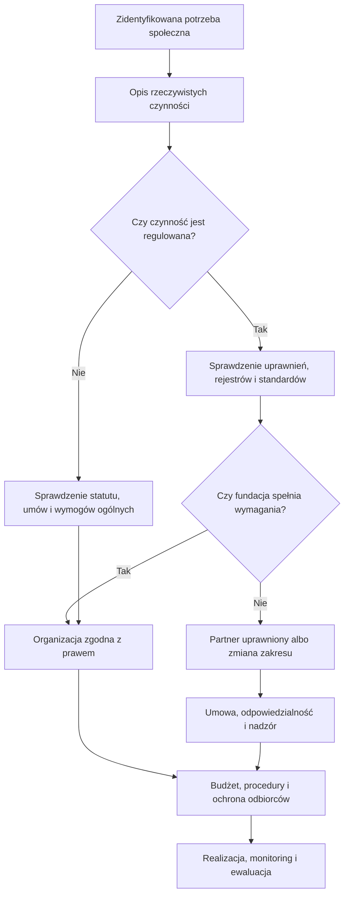

# 17.2. Obszary działalności społecznej

## Ochrona zdrowia, rehabilitacja, opieka, pomoc społeczna, rodzina, edukacja, kultura, działalność religijna, wolontariat i rozwój społeczeństwa obywatelskiego

**Stan prawny przyjęty do opracowania: 27 listopada 2026 r.**

**Charakter rozdziału:** prawno-organizacyjny, społeczny, zdrowotny, edukacyjny, kulturalny i praktyczny.  
**Adresaci:** fundatorzy, członkowie organów fundacji, dyrektorzy i koordynatorzy programów, pracownicy, wolontariusze, partnerzy społeczni, osoby przygotowujące projekty oraz osoby odpowiedzialne za jakość, bezpieczeństwo i rozliczanie działalności.  
**Zakres terytorialny:** Rzeczpospolita Polska, współpraca międzyregionalna i działania międzynarodowe.

> Działalność społeczna nie jest jedną usługą ani jednym rodzajem świadczenia. Jest zespołem różnych form aktywności, które mogą służyć człowiekowi, rodzinie i wspólnocie, lecz podlegają odmiennym przepisom, wymaganiom zawodowym, zasadom bezpieczeństwa i sposobom finansowania. Dobra intencja nie zastępuje kwalifikacji prawnej, kompetencji personelu ani odpowiedzialnej organizacji.

---

## Mapa zgodności z aktualnym konspektem

Rozdział realizuje wszystkie osiemnaście pozycji modułu 17.2.

| Nr | Zagadnienie konspektu | Główna treść opracowania |
|---:|---|---|
| 1 | Ochrona zdrowia | Modele ochrony zdrowia, granica między wsparciem społecznym a działalnością leczniczą |
| 2 | Promocja zdrowia | Profilaktyka, edukacja zdrowotna, komunikacja ryzyka i ocena efektów |
| 3 | Rehabilitacja | Rehabilitacja lecznicza, społeczna i zawodowa oraz ich rozdzielenie |
| 4 | Opieka nad osobami przewlekle chorymi | Ciągłość opieki, wsparcie opiekunów, koordynacja i bezpieczeństwo |
| 5 | Pomoc społeczna | Relacja fundacji z publicznym systemem pomocy społecznej i usług społecznych |
| 6 | Wspieranie rodziny | Profilaktyka kryzysów, poradnictwo, usługi rodzinne i granice kompetencji |
| 7 | Działalność charytatywna | Pomoc materialna, darowizny, zbiórki, kryteria i przejrzystość |
| 8 | Edukacja i nauczanie | Edukacja formalna, pozaformalna i nieformalna |
| 9 | Kształcenie zawodowe | Kursy, kwalifikacje, walidacja, certyfikowanie i uprawnienia zawodowe |
| 10 | Działalność kulturalna | Tworzenie, upowszechnianie i ochrona kultury |
| 11 | Działalność artystyczna | Twórczość, wydarzenia, prawa autorskie i prawa wykonawców |
| 12 | Wspieranie osób niepełnosprawnych | Niezależne życie, dostępność, racjonalne usprawnienia i aktywizacja |
| 13 | Pomoc seniorom | Aktywne starzenie się, opieka długoterminowa i Bon Senioralny |
| 14 | Wspieranie dzieci i młodzieży | Prawa dziecka, bezpieczeństwo, rozwój i standardy ochrony małoletnich |
| 15 | Wspieranie lokalnych społeczności | Diagnoza lokalna, partnerstwa, usługi i inicjatywy oddolne |
| 16 | Działalność religijna w granicach właściwych przepisów | Wolność religii, autonomia wspólnot, działalność społeczna i rozdzielenie celów |
| 17 | Wolontariat i aktywizacja społeczna | Bezpieczne włączanie wolontariuszy i rozwijanie sprawczości |
| 18 | Wspieranie rozwoju społeczeństwa obywatelskiego | Udział publiczny, rzecznictwo, samoorganizacja i kontrola społeczna |

### Granice względem pozostałych rozdziałów

Rozdział 17.1 wyjaśnia podstawy działalności społecznej, jej związek ze statutem, niezarobkowością, pożytkiem publicznym i dobrem wspólnym. Rozdziały 14.1–14.4 omawiają podstawy prawne, porozumienie, koszty i organizację wolontariatu. Rozdziały 15.1–15.3 dotyczą bezpośredniej pomocy, świadczeń i ich kwalifikacji. Rozdziały 16.1–16.3 opisują fundację, jej ustanowienie i statut.

W niniejszym rozdziale nie powtarza się pełnych wykładów o tych zagadnieniach. Punktem ciężkości jest **zakres rzeczowy programów**, wymagania dotyczące ich wykonawców, granice legalnego działania, współpraca z instytucjami i dobór właściwego modelu organizacyjnego.

---

# 1. Cel, zakres i efekty kształcenia

## 1.1. Cel rozdziału

Celem jest przygotowanie uczestnika do zaprojektowania i oceny konkretnego obszaru działalności społecznej fundacji. Uczestnik powinien umieć rozpoznać, czy planowane przedsięwzięcie jest:

- działaniem edukacyjnym lub informacyjnym;
- pomocą społeczną lub usługą społeczną;
- promocją zdrowia albo profilaktyką;
- świadczeniem zdrowotnym lub działalnością leczniczą;
- rehabilitacją leczniczą, społeczną lub zawodową;
- działalnością opiekuńczą;
- działalnością kulturalną lub artystyczną;
- wsparciem rodziny, dzieci, młodzieży, osób z niepełnosprawnościami albo seniorów;
- działalnością religijną;
- wolontariatem lub aktywizacją obywatelską.

Nazwanie programu nie rozstrzyga o jego kwalifikacji prawnej. O charakterze aktywności decydują jej rzeczywista treść, sposób wykonywania, adresaci, kompetencje osób realizujących, warunki organizacyjne i podstawa prawna.

## 1.2. Efekty uczenia się

Po ukończeniu rozdziału uczestnik:

1. rozróżnia główne obszary działalności społecznej;
2. wskazuje podstawowe akty prawne dotyczące poszczególnych obszarów;
3. odróżnia edukację zdrowotną od udzielania świadczeń zdrowotnych;
4. rozróżnia rehabilitację leczniczą, społeczną i zawodową;
5. potrafi określić, kiedy fundacja może działać samodzielnie, a kiedy powinna współpracować z podmiotem uprawnionym;
6. rozpoznaje wymagania dotyczące personelu, rejestracji, zezwoleń i standardów;
7. projektuje program wsparcia rodziny, seniora, dziecka lub osoby z niepełnosprawnością;
8. rozumie zasady organizowania działalności edukacyjnej, kulturalnej i artystycznej;
9. odróżnia zwykłe zaświadczenie o ukończeniu kursu od formalnej kwalifikacji;
10. organizuje działalność charytatywną i zbiórkę z zachowaniem przejrzystości;
11. stosuje zasady ochrony małoletnich i osób szczególnie narażonych;
12. dobiera partnerów publicznych, społecznych, religijnych i prywatnych;
13. określa mierzalne produkty, rezultaty i wskaźniki jakości;
14. identyfikuje ryzyka prawne, zawodowe, finansowe, organizacyjne i etyczne.

## 1.3. Zasady nadrzędne

Każdy program powinien spełniać co najmniej następujące warunki:

- **legalność** – działania mieszczą się w celach i sposobach działania fundacji, a także w przepisach właściwych dla danej usługi;
- **kompetencja** – zadania wykonują osoby przygotowane do ich zakresu;
- **bezpieczeństwo** – rozpoznano ryzyka i określono procedury reagowania;
- **podmiotowość** – odbiorca jest osobą współdecydującą, a nie wyłącznie przedmiotem pomocy;
- **dostępność** – program uwzględnia bariery architektoniczne, cyfrowe, komunikacyjne, finansowe i społeczne;
- **proporcjonalność** – zakres zbieranych danych, nadzoru i ingerencji odpowiada rzeczywistej potrzebie;
- **przejrzystość** – znane są kryteria, koszty, źródła finansowania i zasady rozliczenia;
- **ciągłość** – program nie tworzy obietnic, których organizacja nie jest w stanie utrzymać;
- **współpraca** – fundacja nie zastępuje bez podstawy prawnej instytucji odpowiedzialnych za świadczenia publiczne lub regulowane;
- **ewaluacja** – organizacja sprawdza, czy działania przynoszą oczekiwane rezultaty.

---

# 2. Model rozpoznawania obszaru działalności

## 2.1. Od potrzeby do legalnego modelu działania

Przed uruchomieniem programu należy przejść przez sześć pytań:

1. Jaki problem lub niezaspokojona potrzeba ma zostać rozwiązana?
2. Kto jest odbiorcą i jakie są jego prawa, możliwości oraz ograniczenia?
3. Jaki jest rzeczywisty charakter planowanej czynności?
4. Czy czynność jest regulowana i czy wymaga określonych kwalifikacji, wpisu lub zezwolenia?
5. Czy fundacja ma zasoby i kompetencje, czy powinna zlecić wykonanie zadania albo zawrzeć partnerstwo?
6. Jak zostanie oceniona jakość, bezpieczeństwo i rzeczywisty rezultat?

## 2.2. Schemat kwalifikowania programu

## 2.3. Cztery poziomy zaangażowania fundacji

Fundacja nie musi wykonywać każdej czynności własnymi siłami. Może wybrać jeden z modeli:

| Model | Charakter | Przykład |
|---|---|---|
| Bezpośredni | Fundacja samodzielnie organizuje i wykonuje dozwolone działania | warsztaty edukacyjne, klub seniora, wydarzenie artystyczne |
| Zlecający | Fundacja finansuje usługę wykonywaną przez uprawniony podmiot | zakup świadczeń rehabilitacyjnych w podmiocie leczniczym |
| Partnerski | Fundacja współrealizuje program z instytucją publiczną lub organizacją | lokalny program profilaktyki i aktywizacji |
| Koordynacyjny | Fundacja łączy uczestników i instytucje, nie przejmując cudzych kompetencji | punkt informacji i kierowania do właściwych usług |

Umowa partnerska powinna jasno określać: zakres czynności, odpowiedzialność, kwalifikacje personelu, zasady ochrony danych, ubezpieczenie, dokumentowanie, rozliczenie, kontrolę jakości i procedurę zakończenia współpracy.

---

# 3. Ochrona zdrowia

## 3.1. Pojęcie i zakres

Ochrona zdrowia obejmuje działania ukierunkowane na zachowanie, poprawę i przywracanie zdrowia oraz ograniczanie skutków chorób i urazów. W praktyce fundacji obszar ten może obejmować:

- edukację zdrowotną;
- promocję zdrowego stylu życia;
- działania profilaktyczne;
- wspieranie dostępu do badań i konsultacji;
- organizowanie transportu do świadczeniodawcy;
- zakup sprzętu pomocniczego;
- wsparcie pacjenta i rodziny;
- działania informacyjne dotyczące praw pacjenta;
- finansowanie usług wykonywanych przez uprawnione podmioty;
- prowadzenie działalności leczniczej, jeżeli fundacja spełnia ustawowe wymagania.

Nie wolno utożsamiać całej ochrony zdrowia z leczeniem. Równocześnie nie wolno nazywać zwykłej działalności edukacyjnej świadczeniem zdrowotnym tylko po to, aby nadać jej pozór medycznego autorytetu.

## 3.2. Fundacja jako podmiot wykonujący działalność leczniczą

Ustawa o działalności leczniczej przewiduje możliwość wykonywania działalności leczniczej przez fundacje i stowarzyszenia, jeżeli ich cele statutowe obejmują zadania w zakresie ochrony zdrowia, a statut dopuszcza prowadzenie działalności leczniczej. Nie oznacza to jednak automatycznego prawa do udzielania świadczeń zdrowotnych bez spełnienia pozostałych wymagań.

Przed rozpoczęciem działalności należy ustalić:

1. czy planowane czynności stanowią działalność leczniczą w rozumieniu ustawy;
2. czy statut zawiera odpowiednie postanowienia;
3. czy fundacja spełnia wymagania lokalowe, organizacyjne i sprzętowe;
4. czy personel posiada wymagane kwalifikacje i uprawnienia;
5. czy wymagany jest wpis do Rejestru Podmiotów Wykonujących Działalność Leczniczą (RPWDL);
6. czy zawarto wymagane ubezpieczenie odpowiedzialności cywilnej;
7. czy opracowano dokumentację, procedury i zasady praw pacjenta;
8. czy zapewniono ochronę danych dotyczących zdrowia.

Fundacja może być podmiotem leczniczym, ale nie może wykorzystywać swojej osobowości prawnej do obchodzenia wymagań dotyczących zawodów medycznych lub bezpieczeństwa pacjenta. Ministerstwo Zdrowia wskazuje fundacje i stowarzyszenia jako jedną z kategorii podmiotów, które mogą wykonywać działalność leczniczą po spełnieniu warunków ustawowych [1, 2].

## 3.3. Granica między edukacją zdrowotną a świadczeniem zdrowotnym

| Czynność | Typowa kwalifikacja | Warunek lub ograniczenie |
|---|---|---|
| Wykład o profilaktyce chorób | Edukacja zdrowotna | Rzetelne źródła, brak diagnozowania |
| Kampania zachęcająca do badań | Promocja zdrowia | Nie może wprowadzać w błąd |
| Pomoc w zapisaniu się do lekarza | Wsparcie organizacyjne | Poszanowanie prywatności i decyzji pacjenta |
| Zbieranie ankiet o potrzebach zdrowotnych | Diagnoza społeczna | Minimalizacja danych; dane o zdrowiu są szczególną kategorią danych |
| Badanie diagnostyczne | Co do zasady czynność medyczna | Wymagane kwalifikacje, właściwy podmiot i warunki |
| Udzielanie porady medycznej | Świadczenie zdrowotne, zależnie od treści | Uprawnienia zawodowe i odpowiedzialność |
| Fizjoterapia lecznicza | Świadczenie zdrowotne | Wymogi dotyczące zawodu i organizacji działalności |
| Wsparcie emocjonalne i grupa samopomocowa | Wsparcie społeczne | Nie przedstawiać jako psychoterapii, jeśli nie jest nią w sensie prawnym i zawodowym |

O kwalifikacji nie rozstrzyga nazwa wydarzenia, plakatu ani umowy. Liczy się to, co faktycznie robi wykonawca i jaki skutek obiecuje odbiorcy.

## 3.4. Organizacja programu zdrowotnego

Przykładowy program może składać się z następujących etapów:

1. rozpoznanie problemu zdrowotnego w populacji;
2. wskazanie grupy docelowej;
3. określenie celu profilaktycznego;
4. przygotowanie materiałów opartych na wiarygodnych źródłach;
5. dobór specjalistów;
6. ustalenie zasad kierowania do świadczeń;
7. zapewnienie dostępności i ochrony danych;
8. realizacja działań;
9. ocena wiedzy, zachowań lub dostępności usług;
10. sporządzenie raportu.

Fundacja nie powinna obiecywać, że pojedyncze szkolenie, suplement, zabieg lub kampania zapobiegnie każdej chorobie albo zastąpi diagnostykę. Komunikaty zdrowotne muszą odróżniać dowody naukowe, rekomendacje, hipotezy i osobiste doświadczenia.

## 3.5. Prawa pacjenta i bezpieczeństwo

Jeżeli program obejmuje pacjentów lub współpracę z podmiotem leczniczym, należy uwzględnić w szczególności:

- prawo do informacji;
- prawo do świadomej zgody;
- tajemnicę informacji związanych z pacjentem;
- poszanowanie intymności i godności;
- prawo do dokumentacji medycznej;
- zakaz dyskryminacji;
- procedurę reagowania na zdarzenia niepożądane;
- ochronę przed nieuprawnionym dostępem do danych;
- jasne określenie, kto jest administratorem danych i kto odpowiada za ich przetwarzanie.

Fundacja, która finansuje świadczenie, nie staje się przez to automatycznie podmiotem udzielającym świadczenia. Należy odróżnić finansowanie, organizowanie transportu, kierowanie do placówki i wykonywanie czynności medycznych.

---

# 4. Promocja zdrowia

## 4.1. Promocja zdrowia a profilaktyka

Promocja zdrowia jest szersza niż przekazywanie informacji o chorobach. Obejmuje tworzenie warunków, w których ludzie mogą zwiększać kontrolę nad czynnikami wpływającymi na zdrowie. Profilaktyka koncentruje się na ograniczaniu ryzyka, wczesnym wykrywaniu problemów lub zapobieganiu powikłaniom.

Przykładowe poziomy profilaktyki:

| Poziom | Cel | Przykładowe działanie |
|---|---|---|
| Pierwotna | Ograniczenie ryzyka przed wystąpieniem choroby | aktywność fizyczna, szczepienia, edukacja żywieniowa |
| Wtórna | Wczesne wykrywanie choroby | informowanie o badaniach przesiewowych |
| Trzeciorzędowa | Ograniczanie następstw rozpoznanej choroby | edukacja samopielęgnacji, wsparcie rehabilitacji |
| Populacyjna | Zmiana warunków i zachowań w grupie | programy środowiskowe i kampanie |

## 4.2. Przykładowe obszary promocji zdrowia

- aktywność fizyczna dostosowana do wieku i możliwości;
- zdrowe żywienie i bezpieczeństwo żywności;
- higiena snu;
- zdrowie psychiczne i przeciwdziałanie stygmatyzacji;
- ograniczanie używania tytoniu i alkoholu;
- profilaktyka chorób zakaźnych;
- profilaktyka chorób układu krążenia, cukrzycy i nowotworów;
- zdrowie dzieci i młodzieży;
- zdrowe starzenie się;
- bezpieczeństwo w miejscu pracy i zamieszkania;
- edukacja w zakresie korzystania z systemu ochrony zdrowia.

Główny Inspektorat Sanitarny prowadzi programy edukacyjne i kampanie społeczne, które mogą być punktem odniesienia dla organizacji planujących działania lokalne [3]. W 2026 r. Ministerstwo Zdrowia prowadzi również kampanię „Profilaktyka – podaj dalej”, podkreślając znaczenie zachęcania do badań i codziennych zachowań prozdrowotnych [4].

## 4.3. Projektowanie rzetelnego przekazu

Każdy materiał powinien odpowiadać na pytania:

1. Do kogo jest skierowany?
2. Jaką decyzję lub zachowanie ma wspierać?
3. Na jakich dowodach oparto treść?
4. Czy wskazano ograniczenia i sytuacje wymagające konsultacji?
5. Czy przekaz nie wywołuje nieuzasadnionego lęku?
6. Czy nie obiecuje gwarantowanego efektu?
7. Czy jest zrozumiały i dostępny dla osób o różnym poziomie wiedzy?
8. Czy zawiera datę aktualizacji i źródła?

Nie należy wykorzystywać autorytetu lekarza, fizjoterapeuty, pielęgniarki lub naukowca do promowania produktu albo metody, której skuteczność nie została odpowiednio wykazana.

## 4.4. Mierniki programu

Wskaźnikami mogą być:

- odsetek uczestników, którzy rozumieją przekazane informacje;
- liczba osób, które skorzystały z rekomendowanych badań;
- liczba placówek i partnerów;
- zmiana wiedzy przed i po zajęciach;
- dostępność działań dla osób z niepełnosprawnościami;
- liczba zgłoszeń wymagających skierowania do specjalisty;
- koszt dotarcia do jednego uczestnika;
- utrzymanie zmiany po określonym czasie.

Liczba rozdanych ulotek lub przeprowadzonych wykładów jest wskaźnikiem produktu, a nie dowodem poprawy zdrowia populacji.

---

# 5. Rehabilitacja

## 5.1. Trzy różne znaczenia rehabilitacji

W praktyce społecznej należy rozdzielać:

1. **rehabilitację leczniczą** – działania medyczne ukierunkowane na poprawę lub odzyskanie sprawności i funkcji;
2. **rehabilitację społeczną** – działania umożliwiające uczestnictwo w życiu społecznym, samodzielność, komunikację i dostęp do środowiska;
3. **rehabilitację zawodową** – działania służące uzyskaniu, utrzymaniu lub odzyskaniu zdolności do pracy i uczestnictwa w rynku pracy.

Kategorie te mogą się uzupełniać, lecz nie są zamienne. Osoba może potrzebować jednocześnie rehabilitacji leczniczej, dostosowania mieszkania, wsparcia psychologicznego, treningu samodzielności i pomocy w zatrudnieniu.

## 5.2. Rehabilitacja lecznicza

Rehabilitacja lecznicza obejmuje świadczenia realizowane w różnych warunkach:

- ambulatoryjnych;
- domowych;
- dziennych;
- stacjonarnych.

W systemie finansowanym ze środków publicznych zakres, warunki i zasady dostępu określają przepisy o świadczeniach opieki zdrowotnej oraz rozporządzenia dotyczące świadczeń gwarantowanych. Ministerstwo Zdrowia opisuje odrębne formy rehabilitacji i rolę wizyty fizjoterapeutycznej w planowaniu procesu usprawniania [5].

Fundacja może:
- informować o dostępnych świadczeniach;
- pomagać w dotarciu do placówki;
- finansować świadczenia udzielane przez uprawniony podmiot;
- zakupić sprzęt lub pomoce;
- wspierać rodzinę i opiekuna;
- prowadzić działania edukacyjne i aktywizacyjne.

Jeżeli sama udziela świadczeń zdrowotnych, musi spełnić wymagania dotyczące działalności leczniczej, zawodu, personelu, rejestracji i odpowiedzialności. Nie można zastąpić tych wymagań regulaminem fundacji ani certyfikatem wewnętrznego kursu.

## 5.3. Rehabilitacja społeczna

Rehabilitacja społeczna może obejmować:

- trening czynności życia codziennego;
- rozwijanie komunikacji i umiejętności społecznych;
- wsparcie w korzystaniu z transportu;
- asystencję w uczestnictwie w kulturze;
- likwidowanie barier;
- poradnictwo i wsparcie rodzin;
- rozwijanie samodzielności;
- organizowanie grup wsparcia;
- dostosowanie narzędzi cyfrowych;
- rozwijanie aktywności obywatelskiej.

Program powinien wzmacniać sprawczość, a nie utrwalać zależność od organizacji. Osoba uczestnicząca powinna współtworzyć cele i oceniać, czy proponowane rozwiązania odpowiadają jej potrzebom.

## 5.4. Rehabilitacja zawodowa

Fundacja może organizować:
- diagnozę potrzeb zawodowych w zakresie niewymagającym zastrzeżonych uprawnień;
- trening kompetencji miękkich i cyfrowych;
- warsztaty poszukiwania pracy;
- doradztwo i mentoring;
- staże lub praktyki w ramach właściwych przepisów;
- dostosowanie stanowiska pracy;
- współpracę z pracodawcami;
- wsparcie przedsiębiorczości i ekonomii społecznej.

Nie należy obiecywać zatrudnienia ani formalnych uprawnień zawodowych, jeżeli program nie daje takiego skutku prawnego.

## 5.5. Podstawa prawna i finansowanie

Podstawowym aktem jest ustawa o rehabilitacji zawodowej i społecznej oraz zatrudnianiu osób niepełnosprawnych. Tekst jednolity ogłoszono w Dz. U. z 2026 r. poz. 884 [6]. Fundacje i stowarzyszenia mogą realizować zadania na rzecz osób z niepełnosprawnościami, w tym projekty aktywizacji społecznej i zawodowej, przy wykorzystaniu instrumentów PFRON i konkursów publicznych [7].

Przed złożeniem wniosku należy sprawdzić:
- aktualny program lub konkurs;
- katalog podmiotów uprawnionych;
- kwalifikowalność kosztów;
- wymagany wkład własny;
- zasady pomocy publicznej, jeżeli występuje;
- trwałość rezultatów;
- wymogi dostępności;
- zasady rozliczenia i kontroli.

---

# 6. Opieka nad osobami przewlekle chorymi

## 6.1. Choroba przewlekła jako sytuacja wielowymiarowa

Choroba przewlekła może wpływać na:
- samodzielność w czynnościach dnia codziennego;
- możliwość pracy i uzyskiwania dochodu;
- relacje rodzinne;
- stan psychiczny i poczucie bezpieczeństwa;
- mobilność i uczestnictwo społeczne;
- potrzeby mieszkaniowe;
- organizację czasu opiekuna;
- koszty transportu, sprzętu i leczenia.

Dlatego program nie powinien ograniczać się do jednorazowego świadczenia pieniężnego. Właściwy model łączy wsparcie osoby chorej, rodziny, opiekuna i sieci instytucjonalnej.

## 6.2. Formy wsparcia

Fundacja może, w granicach prawa i statutu:
- finansować określone koszty opieki;
- pomagać w zakupie sprzętu pomocniczego;
- organizować transport;
- wspierać adaptację mieszkania;
- finansować usługi opiekuńcze wykonywane przez odpowiednie podmioty;
- organizować opiekę wytchnieniową w ramach właściwych programów i wymagań;
- prowadzić grupy wsparcia;
- organizować edukację opiekunów;
- wspierać kontakt z placówkami;
- pomagać w koordynacji informacji i dokumentów.

Fundacja nie powinna samodzielnie podejmować decyzji klinicznych, modyfikować terapii, interpretować wyników badań w roli lekarza ani zastępować pielęgniarskich świadczeń zdrowotnych.

## 6.3. Koordynacja opieki długoterminowej – ważna zmiana z 2026 r.

Od 7 sierpnia 2026 r. obowiązuje ustawa z dnia 11 czerwca 2026 r. o osobach starszych i koordynacji opieki długoterminowej, Dz. U. z 2026 r. poz. 986 [8]. Ustawa określa zasady koordynacji opieki długoterminowej, współpracy podmiotów wykonujących działalność leczniczą z jednostkami organizacyjnymi pomocy społecznej, monitorowania opieki oraz zadania samorządów dotyczące wsparcia opiekunów nieformalnych.

Ustawa ta zastąpiła wcześniejszą ustawę o osobach starszych z 2015 r. Nie należy zatem w dokumentach sporządzanych po 7 sierpnia 2026 r. przedstawiać uchylonej ustawy z 2015 r. jako aktualnej podstawy całego systemu polityki senioralnej.

W praktyce fundacja powinna:
1. rozpoznawać, czy osoba korzysta z usług zdrowotnych, społecznych czy obu;
2. ustalać, kto jest właściwym koordynatorem lub instytucją;
3. uzyskiwać zgodę na przekazanie informacji;
4. nie tworzyć równoległego, nieformalnego systemu dokumentacji medycznej;
5. współpracować z podmiotami odpowiedzialnymi za świadczenia;
6. określać, które zadania fundacja wykonuje samodzielnie, a które finansuje lub wspiera.

Nie każda fundacja staje się koordynatorem opieki długoterminowej tylko dlatego, że wspiera osoby przewlekle chore.

## 6.4. Opiekun nieformalny

Opiekun nieformalny również wymaga wsparcia. Program może obejmować:
- edukację w zakresie bezpiecznej opieki;
- informowanie o przysługujących formach wsparcia;
- grupy samopomocowe;
- pomoc psychologiczną świadczoną przez uprawnione osoby;
- organizację zastępstwa;
- wypoczynek i opiekę wytchnieniową;
- poradnictwo socjalne;
- wsparcie w organizacji dnia;
- pomoc w dostępie do usług publicznych.

Nie wolno zakładać, że rodzina ma nieograniczoną zdolność do opieki. Należy oceniać obciążenie, zdrowie, sytuację zawodową i potrzeby samego opiekuna.

## 6.5. Przykładowy plan wsparcia

| Potrzeba | Działanie fundacji | Partner lub wykonawca |
|---|---|---|
| Trudność w przemieszczaniu | Organizacja transportu | przewoźnik lub właściwy podmiot |
| Brak sprzętu pomocniczego | Zakup lub dofinansowanie | sklep, dostawca, specjalista |
| Potrzeba rehabilitacji leczniczej | Finansowanie lub skierowanie do właściwego systemu | podmiot leczniczy |
| Przeciążenie opiekuna | Grupa wsparcia i informacja o opiece wytchnieniowej | specjalista, gmina, realizator programu |
| Izolacja społeczna | Spotkania dostępne i kontakt środowiskowy | wolontariusze pod nadzorem |
| Brak wiedzy o świadczeniach | Poradnictwo informacyjne | pracownik socjalny lub właściwa instytucja |

---

# 7. Pomoc społeczna

## 7.1. Pomoc społeczna a działalność fundacji

Pomoc społeczna w rozumieniu ustawy jest częścią systemu publicznego. Jej celem jest wspieranie osób i rodzin w przezwyciężaniu trudnych sytuacji życiowych, których nie są w stanie pokonać przy wykorzystaniu własnych uprawnień, zasobów i możliwości.

Działalność fundacji może uzupełniać system publiczny, ale nie przejmuje automatycznie kompetencji gminy, powiatu, ośrodka pomocy społecznej, centrum usług społecznych ani innych jednostek.

Ustawa o pomocy społecznej ma tekst jednolity ogłoszony w Dz. U. z 2026 r. poz. 639 [9]. Należy uwzględniać także zmiany wynikające z ustawy o osobach starszych i koordynacji opieki długoterminowej, obowiązujące od 7 sierpnia 2026 r.

## 7.2. Możliwe działania fundacji

- pomoc rzeczowa i żywnościowa;
- wsparcie w nagłych sytuacjach;
- dofinansowanie niezbędnych wydatków;
- poradnictwo i informacja;
- działania integracyjne;
- wspieranie osób bezdomnych;
- pomoc rodzinom w kryzysie;
- aktywizacja społeczna;
- organizacja usług społecznych w granicach prawa;
- współpraca z jednostkami samorządu terytorialnego.

## 7.3. Usługi społeczne i centra usług społecznych

Ustawa o realizowaniu usług społecznych przez centrum usług społecznych, tekst jednolity Dz. U. z 2026 r. poz. 165, wskazuje szeroki zakres usług obejmujących między innymi politykę prorodzinną, wspieranie rodziny, pomoc społeczną, promocję i ochronę zdrowia, wspieranie osób z niepełnosprawnościami, edukację, kulturę i aktywność obywatelską [10].

Fundacja może być partnerem lub wykonawcą określonych działań, jeżeli spełnia wymagania wynikające z przepisów, umowy i standardów danego zadania. Nie może jednak samym regulaminem fundacji przejąć ustawowych kompetencji organu administracji.

## 7.4. Bezpieczny model współpracy

Przed rozpoczęciem zadania należy:
1. ustalić, kto jest organem właściwym;
2. określić, czy zadanie jest zlecane w konkursie, umowie, programie czy na innej podstawie;
3. sprawdzić warunki udziału i kwalifikowalność kosztów;
4. określić standard usługi;
5. ustalić wymagania personelu;
6. uregulować dokumentację i ochronę danych;
7. opisać odpowiedzialność za skargi i zdarzenia;
8. uzgodnić sposób raportowania i kontroli.

Jeżeli fundacja prowadzi placówkę, schronisko, miejsce całodobowej opieki lub inną formę działalności objętą zezwoleniem albo szczególnymi standardami, musi spełnić odrębne wymagania. Nie wystarcza samo wpisanie takiej działalności do statutu.

---

# 8. Wspieranie rodziny

## 8.1. Rodzina jako środowisko życia i rozwoju

Program rodzinny powinien uwzględniać potrzeby wszystkich osób, a nie tylko osoby wskazanej we wniosku. Trudności jednej osoby mogą wpływać na:
- bezpieczeństwo i rozwój dzieci;
- sytuację opiekuna;
- dochody gospodarstwa domowego;
- relacje małżeńskie i rodzinne;
- możliwości edukacyjne;
- zdrowie psychiczne;
- dostęp do usług;
- uczestnictwo w życiu społecznym.

Wspieranie rodziny nie oznacza przejmowania decyzji za rodzinę. Celem jest wzmacnianie jej zasobów, bezpieczeństwa, samodzielności i zdolności do korzystania z pomocy.

## 8.2. Obszary wsparcia

1. poradnictwo informacyjne i organizacyjne;
2. edukacja rodzicielska;
3. wsparcie rodzin wychowujących dzieci z niepełnosprawnościami;
4. wsparcie rodzin osób przewlekle chorych;
5. pomoc w dostępie do świadczeń i usług;
6. działania integracyjne i sąsiedzkie;
7. pomoc materialna;
8. rozwijanie kompetencji opiekuńczych;
9. grupy wsparcia;
10. działania przeciwdziałające izolacji i przemocy.

## 8.3. Granice kompetencji

Ustawa o wspieraniu rodziny i systemie pieczy zastępczej ma tekst jednolity ogłoszony w Dz. U. z 2026 r. poz. 980 [11]. Określa ona role i zadania systemu publicznego, w tym gminy, powiatu, asystenta rodziny i organizatorów pieczy zastępczej.

Fundacja może prowadzić poradnictwo, edukację, grupy wsparcia i działania pomocowe. Nie powinna jednak:
- przedstawiać pracownika fundacji jako asystenta rodziny w rozumieniu ustawy, jeżeli nie został w tym trybie zatrudniony;
- prowadzić pieczy zastępczej bez właściwego statusu i wymagań;
- zastępować sądu rodzinnego lub organu pomocy społecznej;
- prowadzić terapii klinicznej bez odpowiednich kwalifikacji;
- ukrywać przemocy lub zagrożenia dziecka pod pretekstem zachowania poufności.

W sytuacji bezpośredniego zagrożenia życia lub zdrowia należy uruchomić właściwe służby i procedury. Poufność programu nie może być traktowana jako zakaz zgłoszenia zagrożenia.

## 8.4. Przykładowy model programu rodzinnego

**Program: Rodzina – bezpieczeństwo, samodzielność, wspólnota**

| Etap | Działanie | Rezultat |
|---|---|---|
| Rozpoznanie | Rozmowa i identyfikacja potrzeb | Indywidualna mapa potrzeb |
| Plan | Uzgodnienie celów z rodziną | Plan wsparcia |
| Wsparcie | Edukacja, pomoc rzeczowa, poradnictwo | Zwiększenie dostępu do zasobów |
| Partnerstwo | Kontakt z właściwymi instytucjami | Lepsza koordynacja |
| Ewaluacja | Ocena zmian i opinii rodziny | Ustalenie skuteczności |

---

# 9. Działalność charytatywna

## 9.1. Charakter działalności charytatywnej

Działalność charytatywna jest ukierunkowana na niesienie pomocy osobom lub grupom znajdującym się w trudnej sytuacji. Może przyjmować postać:
- pomocy finansowej;
- pomocy rzeczowej;
- zakupu usług;
- wsparcia w dostępie do leczenia lub edukacji;
- pomocy interwencyjnej;
- organizacji zbiórek;
- finansowania programów pomocowych;
- wspierania organizacji lokalnych.

Nie jest to odrębna forma prawna fundacji ani automatyczne zwolnienie podatkowe. Każdą operację trzeba zakwalifikować według rzeczywistej treści i właściwych przepisów.

## 9.2. Zasady sprawiedliwego udzielania pomocy

Regulamin programu powinien określać:
- cel pomocy;
- grupę uprawnionych;
- kryteria pierwszeństwa;
- dokumenty wymagane do oceny;
- sposób podejmowania decyzji;
- procedurę konfliktu interesów;
- tryb ponownego rozpatrzenia;
- zasady wypłaty lub wydania rzeczy;
- sposób rozliczenia;
- zasady ochrony danych;
- sposób informowania o odmowie.

Pomoc nie może zależeć od osobistych sympatii, relacji rodzinnych, poglądów, wyznania lub innych kryteriów niezwiązanych z celem programu, chyba że szczególne kryterium jest prawnie uzasadnione charakterem zadania i pozostaje zgodne z zasadą równego traktowania.

## 9.3. Zbiórki i darowizny

Ustawa o zasadach prowadzenia zbiórek publicznych reguluje zbieranie ofiar w gotówce lub w naturze w przestrzeni publicznej. Zbiórka publiczna nie jest tym samym co każda darowizna przekazana przelewem na rachunek organizacji. W zależności od sposobu pozyskiwania środków należy sprawdzić właściwą kwalifikację, obowiązek zgłoszenia, sprawozdawczość i zasady informowania darczyńców [12].

Organizacja powinna:
1. jasno opisać cel zbiórki;
2. wskazać organizatora;
3. ustalić, kto przyjmuje i ewidencjonuje środki;
4. oddzielić środki celowe od ogólnych;
5. dokumentować wydatki;
6. informować o zmianie sposobu wykorzystania środków, jeśli wymaga tego prawo lub warunki darowizny;
7. chronić dane beneficjentów;
8. unikać niezweryfikowanych historii i zdjęć osób potrzebujących.

## 9.4. Przejrzystość i ochrona godności

Działalność charytatywna nie powinna wykorzystywać cierpienia odbiorców jako narzędzia marketingowego. Publikacja wizerunku, historii choroby lub sytuacji rodzinnej wymaga odrębnej analizy prawnej i etycznej. Zgoda nie może być wymuszana zależnością od pomocy.

Darczyńca ma prawo otrzymać rzetelną informację o wykorzystaniu środków, ale nie oznacza to automatycznego prawa do poznania pełnych danych osobowych osoby wspieranej.

---

# 10. Edukacja i nauczanie

## 10.1. Trzy formy uczenia się

| Forma | Charakter | Przykład |
|---|---|---|
| Formalna | Prowadzona w systemie oświaty lub szkolnictwa wyższego, według właściwych przepisów | szkoła, uczelnia, formalna placówka |
| Pozaformalna | Zorganizowane kursy, szkolenia i warsztaty poza typową ścieżką szkolną | kurs fundacji, warsztat, szkolenie |
| Nieformalna | Uczenie się w codziennych sytuacjach i aktywnościach | samokształcenie, mentoring, praktyka społeczna |

Fundacja może prowadzić wiele form edukacji, ale nie każda z nich daje formalną kwalifikację lub uprawnienie zawodowe.

## 10.2. Edukacja formalna i prowadzenie szkoły

Jeżeli fundacja zamierza prowadzić szkołę lub placówkę w systemie oświaty, musi spełnić wymagania ustawy – Prawo oświatowe. Obejmują one między innymi właściwy tryb założenia, wpis do ewidencji w przypadkach przewidzianych prawem, statut, warunki lokalowe, kadrę i realizację wymagań programowych.

Tekst jednolity Prawa oświatowego ogłoszono w Dz. U. z 2026 r. poz. 820 [13]. Ustawa była następnie nowelizowana, w tym ustawą z Dz. U. z 2026 r. poz. 1036, której zasadnicze przepisy weszły w życie 1 września 2026 r. [14]. Przy projektowaniu szkoły należy zatem analizować tekst jednolity wraz z późniejszymi zmianami i przepisami przejściowymi.

Nie wolno utożsamiać:
- prowadzenia kursu;
- prowadzenia placówki kształcenia ustawicznego;
- prowadzenia szkoły niepublicznej;
- prowadzenia uczelni;
- wydawania certyfikatu ukończenia szkolenia;
- nadawania kwalifikacji lub uprawnień regulowanych.

Każda z tych czynności może podlegać innym wymaganiom.

## 10.3. Edukacja pozaformalna

Fundacja może organizować:
- wykłady;
- warsztaty;
- kursy;
- seminaria;
- szkolenia praktyczne;
- programy edukacji rodzinnej;
- kursy kompetencji cyfrowych;
- edukację zdrowotną;
- zajęcia artystyczne;
- edukację obywatelską;
- programy dla seniorów.

W każdym przypadku należy jasno wskazać:
- organizatora;
- cel i zakres szkolenia;
- wymagania wstępne;
- liczbę godzin;
- sposób oceny;
- kwalifikacje prowadzących;
- rodzaj dokumentu końcowego;
- ograniczenia certyfikatu;
- zasady reklamacji i zwrotów.

## 10.4. Jakość edukacji

Minimalny system jakości powinien obejmować:
1. analizę potrzeb odbiorców;
2. efekty uczenia się;
3. program i harmonogram;
4. dobór kadry;
5. materiały dydaktyczne;
6. dostępność;
7. ocenę postępów;
8. ankietę uczestnika;
9. ocenę prowadzącego;
10. okresowy przegląd programu.

Zaświadczenie o uczestnictwie nie jest równoznaczne z potwierdzeniem kompetencji. Certyfikat powinien precyzyjnie opisywać, co zostało sprawdzone i na jakiej podstawie.

---

# 11. Kształcenie zawodowe

## 11.1. Pojęcie i cele

Kształcenie zawodowe służy uzyskaniu, aktualizacji lub rozwijaniu wiedzy, umiejętności i kompetencji potrzebnych do wykonywania pracy lub działalności zawodowej. Może być prowadzone w systemie oświaty, szkolnictwa wyższego, Zintegrowanego Systemu Kwalifikacji, systemie rzemiosła, w ramach szkoleń branżowych lub w innych formach dopuszczonych prawem.

Fundacja powinna określić, czy jej celem jest:
- przygotowanie do wykonywania określonych czynności;
- rozwijanie kompetencji;
- potwierdzenie efektów uczenia się;
- przygotowanie do egzaminu zewnętrznego;
- uzyskanie kwalifikacji włączonej do ZSK;
- doskonalenie zawodowe;
- edukacja wstępna do zawodu regulowanego.

## 11.2. Kwalifikacja a certyfikat kursu

| Dokument | Co potwierdza | Czego sam z siebie nie potwierdza |
|---|---|---|
| Zaświadczenie uczestnictwa | Udział w zajęciach | Opanowania wszystkich kompetencji |
| Certyfikat ukończenia kursu | Spełnienie warunków określonych przez organizatora | Państwowego uprawnienia zawodowego |
| Zaświadczenie o zdaniu egzaminu wewnętrznego | Wynik sprawdzenia według programu organizatora | Uznania przez organ regulacyjny |
| Certyfikat kwalifikacji zawodowej | Formalną kwalifikację po spełnieniu wymagań systemu | Dowolnych dodatkowych uprawnień poza zakresem kwalifikacji |
| Certyfikat kwalifikacji sektorowej lub rynkowej | Kwalifikację w ramach ZSK, jeśli nadano ją w tym trybie | Automatycznego prawa do wykonywania każdego zawodu regulowanego |
| Prawo wykonywania zawodu lub wpis do rejestru | Uprawnienie wynikające z właściwej ustawy | Kompetencji wykraczających poza zakres uprawnienia |

## 11.3. Formy pozaszkolne w systemie oświaty

Ministerstwo Edukacji Narodowej opisuje sześć rodzajów form pozaszkolnych, w tym kwalifikacyjne kursy zawodowe, kursy umiejętności zawodowych, kursy kompetencji ogólnych, branżowe szkolenia zawodowe i inne kursy prowadzone przez właściwe jednostki systemu oświaty [15].

Kwalifikacyjny kurs zawodowy umożliwia przystąpienie do egzaminu zawodowego; formalny certyfikat kwalifikacji zawodowej uzyskuje się po spełnieniu warunków egzaminacyjnych. Samo uczestnictwo w kursie nie daje automatycznie tego certyfikatu.

Akredytację określonych form pozaszkolnych przyznaje kurator oświaty w drodze decyzji administracyjnej, jeżeli spełniono wymagania ustawowe [16].

## 11.4. Zintegrowany System Kwalifikacji

Ustawa o Zintegrowanym Systemie Kwalifikacji określa między innymi zasady włączania kwalifikacji, opisywania efektów uczenia się, przypisywania poziomów Polskiej Ramy Kwalifikacji, walidacji i certyfikowania [17].

Fundacja zainteresowana nadawaniem kwalifikacji w tym systemie powinna sprawdzić:
- czy kwalifikacja jest włączona do ZSK;
- kto jest uprawniony do walidacji;
- kto może certyfikować;
- jakie są wymagania jakościowe;
- jakie dowody kompetencji są wymagane;
- czy zachowana jest bezstronność walidacji;
- czy procedura jest zgodna z opisem kwalifikacji.

Nie należy umieszczać na certyfikacie oznaczenia PRK, ZSK ani informacji o kwalifikacji sektorowej, jeżeli organizator nie ma odpowiedniej podstawy.

## 11.5. Zawody regulowane i bezpieczeństwo odbiorcy

Jeżeli szkolenie dotyczy czynności zastrzeżonych dla określonego zawodu, należy przeanalizować właściwą ustawę zawodową. Przykładowo ukończenie kursu masażu, opieki, pierwszej pomocy, terapii lub obsługi sprzętu nie oznacza automatycznie uzyskania prawa wykonywania zawodu medycznego.

Organizator powinien:
1. określić, czy zawód jest regulowany;
2. sprawdzić wymagania kwalifikacyjne;
3. rozdzielić kompetencje pomocnicze od czynności zastrzeżonych;
4. wskazać granice odpowiedzialności absolwenta;
5. opisać, czego certyfikat nie uprawnia wykonywać;
6. zapewnić zgodność reklam i materiałów promocyjnych z rzeczywistym skutkiem kursu.

---

# 12. Działalność kulturalna

## 12.1. Pojęcie działalności kulturalnej

Ustawa o organizowaniu i prowadzeniu działalności kulturalnej definiuje ją jako tworzenie, upowszechnianie i ochronę kultury. Działalność mogą prowadzić osoby prawne, osoby fizyczne i jednostki organizacyjne nieposiadające osobowości prawnej. Ustawa wskazuje, że działalność kulturalna określona w jej art. 1 ust. 1 nie stanowi działalności gospodarczej w rozumieniu odrębnych przepisów [18].

Tekst jednolity ogłoszono w Dz. U. z 2026 r. poz. 457.

## 12.2. Obszary działań fundacji

- organizacja koncertów i wydarzeń;
- warsztaty muzyczne, plastyczne, teatralne i literackie;
- edukacja kulturalna;
- upowszechnianie dziedzictwa lokalnego;
- dokumentowanie historii społeczności;
- działalność wydawnicza;
- wystawy i ekspozycje;
- spotkania międzypokoleniowe;
- wspieranie twórców;
- działania na rzecz dostępności kultury;
- współpraca z bibliotekami, domami kultury i muzeami.

## 12.3. Kultura a działalność gospodarcza

Nie należy wyciągać wniosku, że każda sprzedaż, wynajem, reklama lub usługa powiązana z wydarzeniem kulturalnym jest automatycznie działalnością kulturalną w rozumieniu ustawy. Trzeba oddzielić:
- samo tworzenie, upowszechnianie i ochronę kultury;
- sprzedaż towarów;
- usługi komercyjne;
- wynajem powierzchni;
- sponsoring;
- działalność odpłatną pożytku publicznego;
- działalność gospodarczą.

Kwalifikacja podatkowa wymaga odrębnej analizy przepisów podatkowych. Określenie aktywności jako kulturalnej nie rozstrzyga samo w sobie wszystkich obowiązków VAT, CIT ani rachunkowych.

## 12.4. Dostępność kultury

Program kulturalny powinien uwzględniać:
- dostępność architektoniczną;
- dostępność cyfrową;
- dostępność informacyjno-komunikacyjną;
- możliwość udziału osób z niepełnosprawnościami;
- rozwiązania dla osób starszych;
- alternatywne formy odbioru treści;
- bariery finansowe i transportowe.

Współpraca z instytucją kultury powinna określać, kto odpowiada za obiekt, bezpieczeństwo, prawa autorskie, ubezpieczenie, ochronę małoletnich i dostępność.

---

# 13. Działalność artystyczna

## 13.1. Twórczość i wykonawstwo

Działalność artystyczna obejmuje między innymi tworzenie i wykonywanie utworów, przygotowanie przedstawień, koncertów, wystaw, filmów, nagrań, publikacji i działań interdyscyplinarnych.

Fundacja może:
- wspierać twórców;
- organizować warsztaty;
- zamawiać utwory;
- finansować produkcję artystyczną;
- organizować wydarzenia;
- udostępniać przestrzeń;
- prowadzić programy rezydencyjne;
- wspierać amatorską i profesjonalną twórczość.

## 13.2. Prawa autorskie i prawa pokrewne

Podstawowym aktem jest ustawa o prawie autorskim i prawach pokrewnych, której tekst jednolity ogłoszono w Dz. U. z 2025 r. poz. 24 [19].

Przed wykorzystaniem utworu należy ustalić:
- kto jest autorem;
- czy utwór jest chroniony;
- kto posiada prawa majątkowe;
- czy fundacja otrzymała licencję;
- jaki jest zakres pól eksploatacji;
- czy można dokonać adaptacji, nagrania lub transmisji;
- czy wymagane są zgody wykonawców;
- czy konieczne jest rozliczenie z organizacją zbiorowego zarządzania prawami.

Nie należy zakładać, że publiczne wykonanie muzyki jest wolne od opłat tylko dlatego, że wydarzenie ma charakter charytatywny, religijny lub niezarobkowy. Trzeba zbadać konkretne przepisy, repertuar, miejsce, sposób wykorzystania i ewentualne wyjątki.

## 13.3. Umowy artystyczne

Umowa z twórcą lub wykonawcą powinna określać:
1. przedmiot i zakres świadczenia;
2. termin i miejsce;
3. wynagrodzenie lub zasady nieodpłatności;
4. prawa do utworu lub nagrania;
5. zakres licencji;
6. zasady publikacji wizerunku;
7. odpowiedzialność za sprzęt i bezpieczeństwo;
8. warunki odwołania wydarzenia;
9. zasady rozliczenia;
10. sposób oznaczenia autorstwa.

## 13.4. Działalność artystyczna z udziałem dzieci

Jeżeli program obejmuje małoletnich, należy dodatkowo uwzględnić:
- standardy ochrony małoletnich;
- zasady dopuszczania osób do pracy z dziećmi;
- bezpieczne zasady prób i występów;
- zgodę opiekunów w zakresie wymaganym prawem;
- wysłuchanie dziecka i jego dobro;
- ochronę wizerunku;
- zakaz upokarzania, przemocy i nieuzasadnionej presji;
- warunki podróży i opieki podczas wydarzeń.

---

# 14. Wspieranie osób z niepełnosprawnościami

## 14.1. Podejście oparte na prawach człowieka

Wspieranie osób z niepełnosprawnościami powinno opierać się na podmiotowości, niezależnym życiu, dostępności, uczestnictwie i równym traktowaniu. Niepełnosprawność nie może być utożsamiana z brakiem zdolności do podejmowania decyzji.

Konwencja ONZ o prawach osób niepełnosprawnych, ratyfikowana przez Polskę i ogłoszona w Dz. U. z 2012 r. poz. 1169, stanowi ważny punkt odniesienia dla projektowania programów [20].

## 14.2. Obszary wsparcia

- dostępność architektoniczna;
- dostępność informacji;
- technologie wspomagające;
- asystencja osobista;
- wsparcie komunikacji;
- rehabilitacja społeczna;
- aktywizacja zawodowa;
- uczestnictwo w kulturze;
- edukacja włączająca;
- wsparcie rodzin;
- mieszkalnictwo wspomagane;
- rozwijanie samodzielności;
- sport i rekreacja adaptowana;
- przeciwdziałanie przemocy i dyskryminacji.

## 14.3. Dostępność i racjonalne usprawnienia

Ustawa o zapewnianiu dostępności osobom ze szczególnymi potrzebami określa między innymi środki dostępności architektonicznej, cyfrowej i informacyjno-komunikacyjnej oraz obowiązki podmiotów publicznych [21]. Zakres bezpośredniego obowiązku zależy od statusu podmiotu i rodzaju relacji z sektorem publicznym. Fundacja realizująca zadanie publiczne powinna dokładnie sprawdzić warunki ustawowe, konkursowe i umowne.

Dobre praktyki obejmują:
- możliwość kontaktu telefonicznego i osobistego;
- materiały w prostym języku;
- napisy i alternatywne formy przekazu;
- dostępne dokumenty cyfrowe;
- możliwość udziału z asystentem;
- dostępne toalety i ciągi komunikacyjne;
- indywidualne dostosowanie formy zajęć;
- uwzględnienie potrzeb sensorycznych i poznawczych.

## 14.4. Projektowanie programu z udziałem odbiorców

Osoby z niepełnosprawnościami powinny uczestniczyć w:
1. diagnozie barier;
2. projektowaniu usługi;
3. testowaniu rozwiązań;
4. ocenie jakości;
5. ustalaniu wskaźników;
6. przeglądzie procedur.

Zasada „nic o nas bez nas” powinna mieć przełożenie na rzeczywisty udział w decyzjach, a nie być wyłącznie hasłem promocyjnym.

## 14.5. Granice pomocy i ochrona autonomii

Wsparcie nie może prowadzić do nieuzasadnionego ograniczania samodzielności. Pracownik lub wolontariusz nie powinien podejmować decyzji za osobę tylko dlatego, że komunikuje się ona w sposób nietypowy albo potrzebuje więcej czasu.

Należy zapewnić:
- zrozumiałą informację;
- odpowiedni czas na decyzję;
- alternatywne sposoby komunikacji;
- wsparcie w podejmowaniu decyzji;
- poszanowanie prywatności;
- możliwość odmowy;
- procedurę zgłoszenia nadużycia.

---

# 15. Pomoc seniorom

## 15.1. Aktywne starzenie się

Pomoc seniorom nie powinna ograniczać się do opieki nad osobami niesamodzielnymi. Obejmuje także:
- profilaktykę zdrowotną;
- aktywność fizyczną;
- edukację;
- rozwój zainteresowań;
- kulturę;
- bezpieczeństwo cyfrowe;
- przeciwdziałanie samotności;
- aktywność obywatelską;
- wsparcie w korzystaniu z usług publicznych;
- rozwijanie relacji międzypokoleniowych.

Należy unikać ageizmu, czyli stereotypowego oceniania człowieka wyłącznie przez pryzmat wieku. Osoby starsze różnią się stanem zdrowia, doświadczeniem, sytuacją materialną i potrzebami.

## 15.2. Nowa podstawa prawna od 7 sierpnia 2026 r.

Ustawa z dnia 11 czerwca 2026 r. o osobach starszych i koordynacji opieki długoterminowej, Dz. U. z 2026 r. poz. 986, weszła w życie 7 sierpnia 2026 r. [8]. Reguluje koordynację opieki długoterminowej, współpracę ochrony zdrowia z pomocą społeczną, monitorowanie systemu oraz zadania samorządów w zakresie wsparcia opiekunów nieformalnych.

Przy stosowaniu ustawy trzeba zwrócić uwagę na przepisy, które wchodzą w życie w późniejszym terminie. W szczególności art. 34 pkt 3 ma odrębną datę wejścia w życie – 8 lutego 2027 r. Nie należy traktować tej części jako obowiązującej już 27 listopada 2026 r.

## 15.3. Bon Senioralny na lata 2026–2028

Od 30 września 2026 r. obowiązuje rozporządzenie Rady Ministrów w sprawie Programu Bonu Senioralnego na lata 2026–2028, Dz. U. z 2026 r. poz. 1277 [22].

Według oficjalnej informacji Kancelarii Prezesa Rady Ministrów program:
- jest skierowany do osób, które ukończyły 65 lat;
- dotyczy osób potrzebujących wsparcia w codziennym funkcjonowaniu;
- przewiduje kryterium dochodowe, którego średnia miesięczna wartość za trzy miesiące przed wnioskiem wynosi 3410 zł;
- zapewnia nieodpłatne usługi wsparcia w miejscu zamieszkania;
- jest organizowany przez gminę;
- może obejmować pomoc w zakupach, przygotowaniu posiłków, higienie i ubieraniu;
- przewiduje wartość usługi do 2500 zł miesięcznie;
- wymaga indywidualnej oceny potrzeb przez gminę [23].

**Bon Senioralny nie jest wypłatą gotówki dla seniora.** Jest mechanizmem organizowania i finansowania usług. Fundacja nie powinna reklamować go jako świadczenia pieniężnego wypłacanego na konto.

Wskazane wartości są stanem programu na dzień opracowania. Przed złożeniem wniosku należy sprawdzić aktualne kryteria, warunki programu, lokalny nabór i zakres usług w konkretnej gminie. Informacja ogólna nie zastępuje pełnej treści rozporządzenia ani indywidualnej decyzji.

## 15.4. Programy fundacji dla seniorów

Fundacja może rozwijać:
- kluby aktywności;
- zajęcia ruchowe dostosowane do możliwości;
- edukację cyfrową;
- poradnictwo dotyczące bezpieczeństwa;
- zajęcia artystyczne i muzyczne;
- spotkania międzypokoleniowe;
- grupy samopomocowe;
- wolontariat sąsiedzki;
- wsparcie opiekunów;
- pomoc w dotarciu do usług;
- działania przeciwdziałające samotności.

Nie należy automatycznie przyjmować, że osoba po 60. roku życia jest niesamodzielna albo że każda osoba po 65. roku życia kwalifikuje się do Bonu Senioralnego. Kryterium wieku jest tylko jednym z elementów właściwego programu.

---

# 16. Wspieranie dzieci i młodzieży

## 16.1. Rozwój i prawa dziecka

Działania skierowane do dzieci i młodzieży powinny wspierać:
- bezpieczeństwo;
- zdrowie;
- rozwój poznawczy i emocjonalny;
- edukację;
- kulturę;
- aktywność fizyczną;
- kompetencje społeczne;
- uczestnictwo w życiu wspólnoty;
- rozwijanie talentów;
- ochronę przed przemocą, zaniedbaniem i wykorzystywaniem.

Dziecko jest podmiotem praw. Należy uwzględniać jego dobro, zdanie, wiek, dojrzałość i możliwości komunikowania potrzeb.

## 16.2. Standardy ochrony małoletnich

Ustawa z dnia 13 maja 2016 r. o przeciwdziałaniu zagrożeniom przestępczością na tle seksualnym i ochronie małoletnich ma tekst jednolity ogłoszony w Dz. U. z 2026 r. poz. 110 [24].

Podmioty prowadzące działalność związaną między innymi z wychowaniem, edukacją, opieką, leczeniem, rozwojem zainteresowań, sportem lub działalnością religijną, do których uczęszczają albo w których przebywają lub mogą przebywać małoletni, muszą przeanalizować obowiązek wprowadzenia standardów ochrony małoletnich.

Standardy powinny obejmować w szczególności:
- zasady bezpiecznych relacji dorosły–dziecko;
- zachowania niedozwolone;
- procedury interwencji;
- sposób zgłaszania podejrzenia krzywdzenia;
- plan wsparcia dziecka;
- zasady ochrony przed zagrożeniami w Internecie;
- sposób dokumentowania;
- zasady przeglądu i aktualizacji standardów;
- udostępnienie wersji zrozumiałej dla dzieci.

Przed dopuszczeniem osoby do działalności objętej ustawą należy wykonać wymagane prawem sprawdzenia, w tym sprawdzenie odpowiednich rejestrów i dokumentów. Zakres obowiązku zależy od charakteru czynności i statusu osoby.

## 16.3. Procedura bezpieczeństwa

Każda fundacja pracująca z dziećmi powinna wyznaczyć:
1. osobę odpowiedzialną za standardy;
2. kanał zgłoszeń;
3. osobę przyjmującą zgłoszenia;
4. sposób natychmiastowego zabezpieczenia dziecka;
5. zasady kontaktu z opiekunami, o ile nie zwiększa to ryzyka;
6. sposób dokumentowania;
7. zasady współpracy ze służbami;
8. zasady ochrony danych;
9. tryb analizy zdarzeń;
10. harmonogram szkoleń.

W przypadku podejrzenia krzywdzenia dziecka nie należy prowadzić nieformalnego „śledztwa” przez wolontariuszy ani konfrontować domniemanego sprawcy bez oceny ryzyka. Trzeba uruchomić właściwą procedurę i przekazać sprawę kompetentnym instytucjom.

## 16.4. Wizerunek i dane dzieci

Publikacja zdjęć, nagrań, historii zdrowotnych i danych dzieci wymaga szczególnej ostrożności. Zgoda opiekuna nie powinna być traktowana jako automatyczne uzasadnienie każdej publikacji. Należy uwzględnić:
- cel publikacji;
- zakres danych;
- ryzyko identyfikacji;
- możliwość późniejszego usunięcia;
- zdanie dziecka;
- interes dziecka;
- zasady retencji i dostępu.

## 16.5. Współpraca ze szkołami i placówkami

Fundacja może prowadzić zajęcia, warsztaty, działania artystyczne, sportowe i edukacyjne. Umowa ze szkołą lub placówką powinna określać:
- zakres odpowiedzialności;
- opiekę nad dziećmi;
- weryfikację personelu;
- standardy ochrony małoletnich;
- ubezpieczenie;
- dostęp do pomieszczeń;
- zasady dokumentowania;
- zgodę na wykorzystanie wizerunku;
- procedurę reagowania na zdarzenia.

---

# 17. Wspieranie lokalnych społeczności

## 17.1. Społeczność lokalna jako partner

Społeczność lokalna nie jest wyłącznie grupą odbiorców usług. Może być współtwórcą programu, partnerem, organizatorem i podmiotem odpowiedzialnym za trwałość rezultatów.

Przykładowe obszary:
- integracja sąsiedzka;
- wsparcie rodzin;
- rozwój kultury;
- aktywizacja seniorów;
- działania prozdrowotne;
- dostępność przestrzeni;
- edukacja obywatelska;
- inicjatywy ekologiczne;
- przeciwdziałanie wykluczeniu;
- wspieranie lokalnych organizacji.

## 17.2. Diagnoza lokalna

Diagnoza powinna łączyć:
- dane statystyczne;
- informacje instytucji publicznych;
- konsultacje społeczne;
- rozmowy z mieszkańcami;
- obserwację przestrzeni;
- mapowanie zasobów;
- analizę barier;
- rozpoznanie istniejących usług.

Nie należy utożsamiać pojedynczej opinii z potrzebą całej społeczności. Warto porównać różne źródła informacji i uwzględnić głosy grup, które rzadziej uczestniczą w konsultacjach.

## 17.3. Partnerzy lokalni

Możliwymi partnerami są:
- gmina i powiat;
- ośrodki pomocy społecznej;
- centra usług społecznych;
- szkoły i placówki;
- biblioteki i domy kultury;
- podmioty lecznicze;
- parafie i inne wspólnoty religijne;
- stowarzyszenia;
- przedsiębiorcy;
- grupy nieformalne;
- rady seniorów;
- rady młodzieżowe;
- lokalne media.

Partnerstwo wymaga określenia ról, a nie tylko umieszczenia logo na plakacie.

## 17.4. Inicjatywa lokalna i współpraca z samorządem

Współpraca fundacji z samorządem może obejmować zlecanie zadań publicznych, partnerstwa, konsultacje, inicjatywy lokalne, udostępnianie zasobów i wspólne projekty. Należy stosować aktualne przepisy o działalności pożytku publicznego i wolontariacie, samorządzie terytorialnym oraz właściwe uchwały i procedury lokalne.

Po nowelizacji ustawy o działalności pożytku publicznego i o wolontariacie, Dz. U. z 2026 r. poz. 1040, część zmian obowiązuje od 1 września 2026 r., a wskazane przepisy wchodzą w życie dopiero 1 stycznia 2027 r. [25]. Przy konkretnym konkursie trzeba sprawdzić datę ogłoszenia, datę złożenia oferty, przepisy przejściowe i obowiązujące wzory dokumentów.

## 17.5. Trwałość programu lokalnego

Trwałość można zwiększać poprzez:
- szkolenie lokalnych liderów;
- przekazywanie kompetencji;
- rozwijanie wolontariatu;
- współpracę instytucji;
- udostępnianie narzędzi;
- dokumentowanie dobrych praktyk;
- budowanie lokalnych źródeł finansowania;
- ocenę rezultatów;
- plan kontynuacji po zakończeniu dotacji.

---

# 18. Działalność religijna w granicach właściwych przepisów

## 18.1. Wolność sumienia i religii

Konstytucja Rzeczypospolitej Polskiej gwarantuje wolność sumienia i religii. Obejmuje ona między innymi wolność wyznawania lub przyjmowania religii, uzewnętrzniania przekonań, indywidualnego i wspólnotowego praktykowania oraz organizowania działalności religijnej w granicach prawa.

Ustawa o gwarancjach wolności sumienia i wyznania stanowi podstawowy akt ustawowy w tym obszarze [26]. Należy również uwzględnić przepisy szczególne dotyczące poszczególnych kościołów i związków wyznaniowych.

## 18.2. Możliwe formy działalności

Fundacja może, w granicach statutu i właściwych przepisów, prowadzić lub wspierać:
- edukację religijną;
- działalność wydawniczą;
- wydarzenia i spotkania religijne;
- działania charytatywne inspirowane religijnie;
- pomoc osobom i rodzinom;
- ochronę dziedzictwa religijnego;
- działalność kulturalną i artystyczną;
- dialog międzyreligijny;
- wolontariat;
- wsparcie osób pełniących posługę lub służbę, jeśli istnieje właściwa podstawa prawna i organizacyjna.

## 18.3. Rozdzielenie działalności religijnej i społecznej

Działalność religijna może być powiązana z działalnością społeczną, ale nie należy automatycznie utożsamiać wszystkich działań religijnych z działalnością pożytku publicznego w rozumieniu ustawy. Każdy program wymaga odrębnej kwalifikacji.

Przykładowo:
- nabożeństwo jest działaniem religijnym;
- bezpłatny posiłek dla osób w kryzysie może być działaniem pomocowym;
- warsztat muzyki sakralnej może mieć charakter edukacyjny lub kulturalny;
- poradnictwo rodzinne może być wsparciem społecznym albo usługą specjalistyczną, zależnie od treści;
- świadczenie zdrowotne nie staje się działalnością religijną tylko dlatego, że odbywa się w budynku wspólnoty.

## 18.4. Równość, dobrowolność i środki publiczne

W programach finansowanych ze środków publicznych należy sprawdzić:
- czy zadanie ma podstawę w katalogu zadań publicznych;
- czy warunki konkursu dopuszczają danego wykonawcę;
- czy środki są wydatkowane zgodnie z przeznaczeniem;
- czy dostęp do świadczenia nie jest uzależniany od udziału w praktykach religijnych, jeżeli zadanie ma charakter publiczny i wymaga neutralnego dostępu;
- czy uczestnik może odmówić udziału w praktykach religijnych bez utraty świadczenia, gdy świadczenie ma charakter publiczny;
- czy dane o przekonaniach religijnych są przetwarzane zgodnie z RODO.

Wolność religii obejmuje także wolność od przymusu. Fundacja powinna szanować zarówno osoby wierzące, jak i osoby o innych przekonaniach lub bez przekonań.

---

# 19. Wolontariat i aktywizacja społeczna

## 19.1. Wolontariat jako narzędzie, nie substytut systemu

Wolontariat może wspierać:
- działania edukacyjne;
- kulturę;
- opiekę społeczną;
- pomoc sąsiedzką;
- aktywizację seniorów;
- integrację osób z niepełnosprawnościami;
- wydarzenia;
- rozwój wspólnot;
- wsparcie rodzin.

Nie może jednak być wykorzystywany do obchodzenia wymogów zatrudnienia, kwalifikacji zawodowych, bezpieczeństwa lub rejestracji działalności regulowanej.

Podstawy prawne wolontariatu, porozumienie, koszty i organizację omówiono w rozdziałach 14.1–14.4. W tym miejscu należy skoncentrować się na doborze wolontariuszy do konkretnego obszaru działalności.

## 19.2. Dobór zadań

Przed przydzieleniem zadania należy ustalić:
- czy zadanie jest odpowiednie dla wolontariusza;
- czy wymaga kwalifikacji zawodowych;
- czy wolontariusz będzie miał kontakt z dziećmi lub osobami zależnymi;
- czy konieczne jest sprawdzenie rejestrów;
- jakie szkolenie jest wymagane;
- kto nadzoruje zadanie;
- jak wolontariusz zgłasza problem;
- jakie ubezpieczenie i środki ochrony są potrzebne;
- jakie dane może przetwarzać.

## 19.3. Aktywizacja społeczna

Aktywizacja oznacza tworzenie warunków do uczestnictwa, samodzielności i współodpowiedzialności. Może obejmować:
- grupy samopomocowe;
- rady uczestników;
- wolontariat kompetencyjny;
- mentoring;
- inicjatywy sąsiedzkie;
- kluby zainteresowań;
- działania międzypokoleniowe;
- udział w konsultacjach;
- współtworzenie usług;
- rozwijanie lokalnych liderów.

Aktywizacja nie powinna być wymuszona. Osoba ma prawo nie uczestniczyć w programie, a intensywność wsparcia powinna odpowiadać jej możliwościom i preferencjom.

---

# 20. Wspieranie rozwoju społeczeństwa obywatelskiego

## 20.1. Pojęcie i znaczenie

Społeczeństwo obywatelskie tworzą osoby, wspólnoty i organizacje, które podejmują dobrowolną aktywność na rzecz spraw wspólnych, uczestniczą w życiu publicznym, organizują pomoc, rozwijają kulturę, kontrolują działania instytucji i przedstawiają interesy grup społecznych.

Fundacja może wzmacniać społeczeństwo obywatelskie poprzez:
- edukację obywatelską;
- rozwój wolontariatu;
- wspieranie samoorganizacji;
- budowanie kompetencji organizacji;
- konsultacje i dialog;
- rzecznictwo;
- monitorowanie jakości usług publicznych;
- działania strażnicze;
- rozwój lokalnych inicjatyw;
- wsparcie młodzieżowych i senioralnych form uczestnictwa.

## 20.2. Rzecznictwo i udział w życiu publicznym

Rzecznictwo polega na przedstawianiu problemów, interesów i postulatów określonych grup lub społeczności. Może obejmować:
- przygotowywanie analiz;
- udział w konsultacjach;
- składanie petycji;
- udział w debatach;
- publikowanie raportów;
- przedstawianie rekomendacji;
- współpracę z radami i zespołami społecznymi;
- edukację obywatelską.

Rzecznictwo powinno opierać się na danych, przejrzystości i ujawnianiu istotnych konfliktów interesów. Fundacja powinna odróżniać działalność rzeczniczą od kampanii politycznej, działalności partyjnej i promocji prywatnych interesów członków organów.

## 20.3. Współpraca z innymi organizacjami

Rozwój społeczeństwa obywatelskiego wymaga:
- zaufania;
- pluralizmu;
- jawności;
- niezależności;
- odpowiedzialności;
- poszanowania różnic;
- zdolności do współpracy;
- uczciwego rozliczania środków.

Fundacja może wspierać inne organizacje poprzez szkolenia, mentoring, udostępnianie zasobów, granty, partnerstwa i sieci współpracy. Przy przekazywaniu środków należy sprawdzić status odbiorcy, cel, umowę, sposób wykorzystania i dokumentację.

## 20.4. Rozwój instytucjonalny

Silna organizacja obywatelska powinna posiadać:
- jasną misję;
- odpowiedzialne organy;
- kompetentny personel;
- stabilny system finansowy;
- procedury etyczne;
- politykę ochrony danych;
- system bezpieczeństwa;
- standardy współpracy;
- mechanizm skarg;
- sprawozdawczość;
- zdolność do uczenia się i poprawy.

---

# 21. Przekrojowe wymagania prawne i organizacyjne

## 21.1. Kwalifikacja działalności

Przed rozpoczęciem programu należy sporządzić kartę kwalifikacji:

| Pytanie | Co należy sprawdzić |
|---|---|
| Czy działanie mieści się w statucie? | Cele i sposoby realizacji |
| Czy jest działalnością pożytku publicznego? | Podmiot, charakter i sfera zadań publicznych |
| Czy jest regulowane? | Ustawy zawodowe, rejestry, zezwolenia |
| Czy wymaga kwalifikacji? | Wymagania personelu |
| Czy wymaga rejestracji? | KRS, RPWDL, ewidencja oświatowa lub inny rejestr |
| Czy uczestniczą małoletni? | Standardy ochrony małoletnich i weryfikacja osób |
| Czy przetwarzane są dane szczególne? | RODO, podstawa prawna i zabezpieczenia |
| Czy zadanie finansuje podmiot publiczny? | Umowa, konkurs, warunki dostępności i rozliczenia |
| Czy jest odpłatne? | Kwalifikacja działalności i przepisy podatkowe |
| Czy potrzebne jest ubezpieczenie? | OC, NNW, ubezpieczenie organizatora i wykonawcy |

## 21.2. Dane osobowe i dane szczególnej kategorii

W wielu obszarach działalności fundacja może przetwarzać:
- dane o zdrowiu;
- dane o niepełnosprawności;
- dane o sytuacji rodzinnej;
- dane o dochodach;
- dane dzieci;
- dane o przekonaniach religijnych.

Są to dane wymagające szczególnej ostrożności. Należy ustalić:
1. administratora danych;
2. cel i podstawę przetwarzania;
3. zakres danych niezbędnych;
4. okres przechowywania;
5. uprawnienia dostępu;
6. sposób zabezpieczenia;
7. zasady przekazywania partnerom;
8. procedurę naruszeń;
9. prawa osób;
10. potrzebę oceny skutków dla ochrony danych.

Nie należy zbierać pełnej dokumentacji medycznej lub rodzinnej, jeżeli do rozstrzygnięcia sprawy wystarcza ograniczona informacja.

## 21.3. Ubezpieczenie i odpowiedzialność

W zależności od programu należy rozważyć:
- OC organizatora;
- OC zawodowe wykonawcy;
- NNW uczestników;
- NNW wolontariuszy;
- ubezpieczenie mienia;
- ubezpieczenie transportu;
- odpowiedzialność za sprzęt;
- odpowiedzialność za bezpieczeństwo wydarzenia.

Umowa z wykonawcą nie zwalnia fundacji z obowiązku starannego wyboru partnera i monitorowania realizacji zadania.

## 21.4. Umowy i dokumentacja

Dokumentacja programu powinna obejmować:
- opis celu;
- regulamin;
- harmonogram;
- budżet;
- listę partnerów;
- umowy;
- zakresy obowiązków;
- kwalifikacje personelu;
- procedury bezpieczeństwa;
- dokumenty dotyczące ochrony danych;
- rejestr zdarzeń i skarg;
- raporty;
- rozliczenie.

## 21.5. Dostępność

Dostępność należy planować od początku, a nie dopiero po zgłoszeniu problemu. Warto stosować zasadę projektowania uniwersalnego i racjonalnych usprawnień. Wymogi ustawowe, konkursowe i umowne trzeba oceniać odrębnie.

---

# 22. Projektowanie programu – wspólna metodyka dla osiemnastu obszarów

## 22.1. Karta programu

Każdy program powinien mieć następującą strukturę:

1. nazwa;
2. diagnoza potrzeby;
3. grupa docelowa;
4. cel główny;
5. cele szczegółowe;
6. podstawa statutowa;
7. kwalifikacja prawna;
8. forma realizacji;
9. partnerzy;
10. wymagane kwalifikacje;
11. standard bezpieczeństwa;
12. budżet;
13. harmonogram;
14. wskaźniki;
15. sposób monitoringu;
16. sposób ewaluacji;
17. ryzyka;
18. plan kontynuacji lub zakończenia.

## 22.2. Teoria zmiany

Przykład: samo zorganizowanie 20 spotkań dla seniorów jest produktem. Wzrost regularnego uczestnictwa, poprawa umiejętności cyfrowych lub zmniejszenie izolacji mogą być rezultatami. Długoterminowy wpływ wymaga szerszych danych i ostrożnej interpretacji.

## 22.3. Wskaźniki

| Poziom | Przykład | Źródło danych |
|---|---|---|
| Nakład | Liczba godzin personelu | Ewidencja pracy |
| Produkt | Liczba zrealizowanych zajęć | Dziennik programu |
| Rezultat | Wzrost kompetencji uczestników | Test przed i po |
| Rezultat społeczny | Większe uczestnictwo w społeczności | Badanie uczestników |
| Jakość | Terminowość i dostępność usługi | Rejestr i ankiety |
| Bezpieczeństwo | Liczba zdarzeń i sposób ich rozwiązania | Rejestr zdarzeń |
| Trwałość | Utrzymanie rezultatów po zakończeniu | Badanie kontrolne |

## 22.4. Zasada niewyrządzania szkody

Program powinien być oceniany nie tylko pod kątem korzyści, lecz także możliwych szkód:
- stygmatyzacji;
- naruszenia prywatności;
- uzależnienia od pomocy;
- konfliktu interesów;
- wykluczenia osób z większymi potrzebami;
- przeciążenia wolontariuszy;
- niebezpiecznego przekroczenia kompetencji;
- fałszywych obietnic;
- niewłaściwego wykorzystania środków;
- braku ciągłości wsparcia.

---

# 23. Studia przypadków

## Przypadek 1. Fundacja organizuje kampanię profilaktyki zdrowotnej

Fundacja chce przeprowadzić spotkania o profilaktyce chorób układu krążenia, żywieniu i aktywności fizycznej.

**Prawidłowe działanie:**
1. określić cel edukacyjny;
2. dobrać rzetelne źródła;
3. zatrudnić lub zaprosić osoby o właściwych kompetencjach;
4. oddzielić edukację od diagnozowania;
5. nie obiecywać leczenia;
6. przekazać informacje o dostępnych świadczeniach;
7. zapewnić dostępność i ochronę danych;
8. ocenić zmianę wiedzy.

**Błąd:** wykonywanie badań i przekazywanie diagnoz przez osoby bez wymaganych uprawnień.

## Przypadek 2. Fundacja chce prowadzić rehabilitację

Fundacja planuje zajęcia ruchowe dla osób po udarach.

**Prawidłowe działanie:**
- rozdzielić rehabilitację leczniczą od zajęć rekreacyjnych i aktywizacji społecznej;
- jeśli wykonywane są świadczenia zdrowotne, zapewnić wymagany status, personel i warunki;
- w pozostałym zakresie prowadzić działania społeczne w granicach kompetencji;
- współpracować z podmiotem leczniczym;
- uzgodnić zasady kierowania uczestników i reagowania na pogorszenie stanu zdrowia.

**Błąd:** przedstawianie zajęć rekreacyjnych jako równoważnych rehabilitacji leczniczej.

## Przypadek 3. Fundacja wspiera opiekunów osób przewlekle chorych

Program obejmuje szkolenia, grupę wsparcia i organizację zastępstwa opiekuna.

**Prawidłowe działanie:**
- przeprowadzić ocenę potrzeb;
- ustalić zakres zadań wolontariuszy;
- zapewnić szkolenie i nadzór;
- współpracować z właściwymi usługodawcami;
- poinformować o systemie publicznym i koordynacji opieki długoterminowej;
- ocenić obciążenie opiekuna.

**Błąd:** traktowanie wolontariusza jako samodzielnego wykonawcy świadczeń pielęgniarskich lub medycznych.

## Przypadek 4. Fundacja tworzy szkołę i prowadzi kursy

Fundacja chce prowadzić szkołę artystyczną oraz kursy zawodowe.

**Prawidłowe działanie:**
- oddzielić szkołę od pozaszkolnych kursów;
- ustalić właściwy tryb rejestracji;
- sprawdzić wymagania kadrowe i lokalowe;
- określić, które dokumenty mają status formalny;
- zweryfikować możliwość prowadzenia kursów w systemie oświaty;
- nie przypisywać certyfikatom skutków, których nie mają.

**Błąd:** reklamowanie wewnętrznego certyfikatu jako państwowego uprawnienia zawodowego.

## Przypadek 5. Fundacja organizuje koncert charytatywny

Fundacja organizuje koncert i zbiera środki na pomoc rodzinom.

**Prawidłowe działanie:**
- uzyskać licencje i zgody dotyczące utworów;
- uregulować umowy z wykonawcami;
- sprawdzić zasady bezpieczeństwa wydarzenia;
- określić, czy i w jakim zakresie prowadzona jest zbiórka publiczna;
- rozdzielić wpływy, koszty i środki celowe;
- opublikować rzetelne rozliczenie.

**Błąd:** założenie, że nieodpłatny charakter wydarzenia zwalnia z praw autorskich lub obowiązków organizatora.

## Przypadek 6. Fundacja wspiera seniorów w małej gminie

Fundacja prowadzi klub seniora i chce współpracować z gminą przy Bonie Senioralnym.

**Prawidłowe działanie:**
- odróżnić klub aktywności od usług opiekuńczych;
- sprawdzić warunki programu rządowego;
- ustalić, jakie zadania organizuje gmina;
- nie reklamować bonu jako gotówki;
- zawrzeć odpowiednią umowę, jeżeli fundacja ma być wykonawcą;
- zapewnić kwalifikacje, bezpieczeństwo i dokumentację usług.

**Błąd:** przyjmowanie środków od seniora w imieniu programu bez upoważnienia lub przedstawianie klubu jako realizatora programu bez umowy.

## Przypadek 7. Fundacja organizuje zajęcia dla dzieci

Fundacja prowadzi warsztaty muzyczne i artystyczne dla dzieci i młodzieży.

**Prawidłowe działanie:**
- wdrożyć standardy ochrony małoletnich;
- sprawdzić osoby dopuszczane do pracy z dziećmi;
- ustalić zasady opieki;
- chronić wizerunek;
- zapewnić bezpieczne pomieszczenia;
- określić sposób reagowania na zgłoszenia.

**Błąd:** uznanie, że krótki czas zajęć lub ich artystyczny charakter zwalnia z wymagań ochrony małoletnich.

## Przypadek 8. Fundacja rozwija działalność religijną i społeczną

Fundacja organizuje spotkania religijne, warsztaty muzyczne i pomoc rodzinom.

**Prawidłowe działanie:**
- rozdzielić zakres religijny, edukacyjny, kulturalny i pomocowy;
- określić podstawy statutowe;
- prowadzić odrębną dokumentację, gdy wymagają tego źródła finansowania lub przepisy;
- nie uzależniać publicznej pomocy od udziału w praktykach religijnych;
- respektować wolność sumienia uczestników.

**Błąd:** automatyczne uznanie każdej aktywności religijnej za zadanie publiczne lub działalność pożytku publicznego.

---

# 24. Narzędzia praktyczne

## 24.1. Karta kwalifikacji obszaru działalności

| Pole | Wpis |
|---|---|
| Nazwa programu | |
| Obszar działalności | |
| Cel statutowy | |
| Opis rzeczywistych czynności | |
| Grupa odbiorców | |
| Podstawa prawna | |
| Czy czynność jest regulowana? | |
| Wymagane kwalifikacje | |
| Wymagany wpis lub zezwolenie | |
| Partnerzy | |
| Źródło finansowania | |
| Dane przetwarzane | |
| Ryzyka | |
| Osoba odpowiedzialna | |
| Data przeglądu prawnego | |

## 24.2. Lista kontrolna przed rozpoczęciem programu

- [ ] Rozpoznano rzeczywistą potrzebę.
- [ ] Zdefiniowano grupę odbiorców.
- [ ] Sprawdzono zgodność ze statutem.
- [ ] Określono właściwy obszar działalności.
- [ ] Sprawdzono, czy czynności są regulowane.
- [ ] Zweryfikowano kwalifikacje personelu.
- [ ] Sprawdzono wymagane rejestry, zezwolenia i akredytacje.
- [ ] Ustalono partnerów i odpowiedzialność.
- [ ] Opracowano budżet i zasady finansowania.
- [ ] Zapewniono ochronę danych.
- [ ] Oceniono dostępność.
- [ ] Wdrożono procedury bezpieczeństwa.
- [ ] Sprawdzono obowiązek stosowania standardów ochrony małoletnich.
- [ ] Ustalono zasady skarg i interwencji.
- [ ] Przygotowano wskaźniki i sposób ewaluacji.

## 24.3. Lista kontrolna dla programu zdrowotnego lub opiekuńczego

- [ ] Rozdzielono edukację od świadczeń zdrowotnych.
- [ ] Określono, czy fundacja wykonuje działalność leczniczą.
- [ ] Sprawdzono RPWDL, jeśli jest wymagany.
- [ ] Zweryfikowano kwalifikacje osób wykonujących czynności.
- [ ] Ustalono procedurę nagłego pogorszenia stanu zdrowia.
- [ ] Określono zakres odpowiedzialności wykonawcy.
- [ ] Zabezpieczono dane o zdrowiu.
- [ ] Ustalono zasady przekazywania informacji do podmiotów leczniczych.
- [ ] Zapewniono ciągłość i możliwość zakończenia usługi.
- [ ] Poinformowano uczestnika o granicach programu.

## 24.4. Lista kontrolna dla programu edukacyjnego

- [ ] Określono formalny lub pozaformalny charakter kształcenia.
- [ ] Ustalono efekty uczenia się.
- [ ] Zweryfikowano uprawnienia organizatora.
- [ ] Sprawdzono, czy wymagana jest akredytacja.
- [ ] Rozróżniono zaświadczenie, certyfikat i kwalifikację.
- [ ] Zweryfikowano wymagania zawodów regulowanych.
- [ ] Określono metodę oceny.
- [ ] Zapewniono dostępność.
- [ ] Ustalono prawa do materiałów.
- [ ] Rzetelnie opisano skutki dokumentu końcowego.

## 24.5. Karta oceny ryzyka

| Ryzyko | Prawdopodobieństwo | Skutek | Zabezpieczenie | Odpowiedzialny |
|---|---|---|---|---|
| Przekroczenie kompetencji | | | | |
| Uraz lub pogorszenie zdrowia | | | | |
| Krzywdzenie małoletniego | | | | |
| Naruszenie danych | | | | |
| Brak dostępności | | | | |
| Konflikt interesów | | | | |
| Nieprawidłowe rozliczenie | | | | |
| Brak ciągłości usługi | | | | |
| Nieuprawnione użycie utworu | | | | |
| Nieprawidłowa kwalifikacja podatkowa | | | | |

## 24.6. Karta ewaluacji programu

| Pytanie | Odpowiedź |
|---|---|
| Czy program osiągnął cel? | |
| Kto skorzystał z programu? | |
| Kto nie uzyskał dostępu i dlaczego? | |
| Jakie bariery wystąpiły? | |
| Czy uczestnicy czuli się bezpiecznie? | |
| Czy wydatki były celowe? | |
| Czy partnerzy wykonali zadania? | |
| Jakie wystąpiły skargi i zdarzenia? | |
| Jakie rezultaty utrzymały się po zakończeniu? | |
| Co należy zmienić? | |

## 24.7. Minimalny pakiet dokumentów programu

1. opis programu;
2. karta kwalifikacji prawnej;
3. regulamin;
4. budżet;
5. harmonogram;
6. umowy z partnerami;
7. zakresy obowiązków;
8. dokumenty kwalifikacji personelu;
9. procedury bezpieczeństwa;
10. dokumenty ochrony danych;
11. ewidencja działań;
12. rejestr skarg i zdarzeń;
13. raport okresowy;
14. raport końcowy;
15. rozliczenie finansowe.

---

# 25. Warsztat praktyczny

## Zadanie 1. Rozdzielenie działań

Wybierz przykładowy program fundacji obejmujący zdrowie, edukację i pomoc rodzinom. Rozdziel działania na trzy grupy:
- działania edukacyjne;
- działania pomocowe;
- działania wymagające uprawnionego wykonawcy.

Uzasadnij każdą kwalifikację.

## Zadanie 2. Projekt programu rehabilitacji społecznej

Opracuj program dla osób z ograniczoną mobilnością. Uwzględnij:
- cel;
- diagnozę barier;
- grupę odbiorców;
- zakres asystencji;
- dostępność;
- kompetencje personelu;
- partnerów;
- wskaźniki;
- ryzyka;
- ewaluację.

Nie włączaj świadczeń leczniczych bez właściwego modelu prawnego.

## Zadanie 3. Program wsparcia opiekunów

Przygotuj plan wsparcia rodzin opiekujących się osobami przewlekle chorymi. Rozdziel:
- informację;
- edukację;
- pomoc materialną;
- wsparcie psychologiczne;
- opiekę wytchnieniową;
- usługi zdrowotne;
- zadania wolontariuszy.

Wskaż, które działania fundacja może wykonywać samodzielnie, a które powinny być realizowane przez partnerów.

## Zadanie 4. Program edukacji zawodowej

Zaprojektuj kurs, który ma potwierdzać kompetencje praktyczne. Ustal:
- czy jest to zwykłe szkolenie;
- czy ma być realizowany w systemie oświaty;
- czy istnieje kwalifikacja w ZSK;
- kto przeprowadzi walidację;
- kto może certyfikować;
- czy zawód jest regulowany;
- jaki dokument otrzyma uczestnik;
- jak należy opisać ograniczenia certyfikatu.

## Zadanie 5. Program artystyczny

Przygotuj koncert lub warsztat artystyczny. Określ:
- prawa do utworów;
- umowy z wykonawcami;
- zgody dotyczące wizerunku;
- zasady bezpieczeństwa;
- dostępność;
- zasady udziału dzieci;
- koszty;
- sposób rozliczenia.

## Zadanie 6. Program senioralny

Opracuj model współpracy fundacji z gminą przy usługach dla seniorów. Rozróżnij:
- klub aktywności;
- usługę opiekuńczą;
- usługę zdrowotną;
- Bon Senioralny;
- wolontariat;
- wsparcie opiekuna.

Wskaż, które elementy wymagają umowy z gminą lub uprawnionym wykonawcą.

## Zadanie 7. Program dla dzieci i młodzieży

Opracuj standard bezpieczeństwa warsztatów. Uwzględnij:
- rekrutację personelu;
- weryfikację osób;
- zasady kontaktu;
- odbiór dzieci;
- publikację wizerunku;
- zgłaszanie zdarzeń;
- wsparcie dziecka;
- nadzór nad wolontariuszami.

## Zadanie 8. Program obywatelski

Przygotuj projekt konsultacji lokalnych. Określ:
- problem;
- interesariuszy;
- dostępne dane;
- metody konsultacji;
- sposób udziału osób wykluczonych cyfrowo;
- zasady jawności;
- raport z wyników;
- sposób przekazania rekomendacji władzom lokalnym.

---

# 26. Sprawdzenie wiedzy

## 26.1. Pytania kontrolne

1. Dlaczego nazwa programu nie rozstrzyga o jego kwalifikacji prawnej?
2. Kiedy fundacja może wykonywać działalność leczniczą?
3. Czym różni się promocja zdrowia od świadczenia zdrowotnego?
4. Jakie są trzy podstawowe rodzaje rehabilitacji?
5. Czy fundacja może finansować rehabilitację leczniczą bez samodzielnego udzielania świadczeń?
6. Dlaczego opiekun nieformalny powinien być objęty wsparciem?
7. Co reguluje ustawa o osobach starszych i koordynacji opieki długoterminowej z 2026 r.?
8. Czym różni się pomoc społeczna od działalności pomocowej fundacji?
9. Jakie znaczenie mają centra usług społecznych?
10. Jakie działania mogą stanowić wsparcie rodziny?
11. Dlaczego fundacja nie może zastępować asystenta rodziny bez właściwej podstawy?
12. Czym różni się zbiórka publiczna od darowizny przelewem?
13. Jakie są trzy formy uczenia się?
14. Czy certyfikat kursu zawsze daje uprawnienia zawodowe?
15. Kiedy akredytacja kursu jest przyznawana przez kuratora oświaty?
16. Jak ustawa o działalności kulturalnej definiuje działalność kulturalną?
17. Dlaczego wydarzenie charytatywne nie zwalnia automatycznie z praw autorskich?
18. Jakie trzy wymiary dostępności należy uwzględnić?
19. Dlaczego standardy ochrony małoletnich są istotne dla fundacji?
20. Czy Bon Senioralny jest wypłatą gotówki?
21. Jak odróżnić działalność religijną od działalności społecznej?
22. Dlaczego wolontariat nie może zastępować czynności zastrzeżonych dla zawodów regulowanych?
23. Czym jest aktywizacja społeczna?
24. Jakie są podstawowe funkcje rzecznictwa obywatelskiego?
25. Dlaczego należy oceniać zarówno korzyści, jak i ryzyka programu?

## 26.2. Klucz odpowiedzi – wskazówki

1. O kwalifikacji decydują rzeczywiste czynności, wykonawca, odbiorca, warunki i podstawa prawna.
2. Po spełnieniu wymagań ustawy o działalności leczniczej, w tym dotyczących statutu, personelu, organizacji i wpisu do właściwego rejestru.
3. Promocja zdrowia wspiera zdrowe warunki i zachowania; świadczenie zdrowotne jest czynnością wykonywaną w ramach systemu i wymagań prawa medycznego.
4. Rehabilitacja lecznicza, społeczna i zawodowa.
5. Tak, może finansować świadczenie wykonywane przez uprawniony podmiot, z zachowaniem zasad umowy i rozliczenia.
6. Ponieważ opieka może powodować obciążenie zdrowotne, psychiczne, zawodowe i finansowe.
7. Koordynację opieki długoterminowej, współpracę ochrony zdrowia i pomocy społecznej, monitorowanie oraz zadania samorządu dotyczące opiekunów.
8. Pomoc społeczna jest częścią systemu publicznego; fundacja może uzupełniać działania i realizować zadania na właściwej podstawie.
9. Umożliwiają gminom organizowanie i koordynowanie usług społecznych w ustawowym zakresie.
10. Poradnictwo, edukacja, pomoc materialna, wsparcie rodzin i działania integracyjne.
11. Ponieważ asystent rodziny jest funkcją określoną ustawą i wykonywaną w ramach właściwego systemu.
12. Zbiórka publiczna dotyczy zbierania ofiar w gotówce lub naturze w przestrzeni publicznej; przelew bankowy podlega odrębnej kwalifikacji.
13. Formalne, pozaformalne i nieformalne.
14. Nie. Skutek zależy od podstawy prawnej i systemu kwalifikacji.
15. W przypadkach i na zasadach określonych w Prawie oświatowym.
16. Jako tworzenie, upowszechnianie i ochronę kultury.
17. Ponieważ prawa twórców i wykonawców są odrębne od celu społecznego wydarzenia.
18. Architektoniczną, cyfrową oraz informacyjno-komunikacyjną.
19. Chronią dziecko przed przemocą, nadużyciem, zaniedbaniem i niewłaściwym kontaktem.
20. Nie. Jest programem usług wsparcia organizowanych przez gminę.
21. Należy ocenić rzeczywisty cel i charakter czynności, a nie wyłącznie inspirację religijną.
22. Ze względu na bezpieczeństwo, odpowiedzialność i wymagania ustawowe.
23. Tworzenie warunków do samodzielności, uczestnictwa i współodpowiedzialności.
24. Przedstawianie potrzeb, udział w konsultacjach, analizach, debacie i monitorowaniu działań publicznych.
25. Ponieważ działanie może przynosić korzyści, ale jednocześnie naruszać prawa, bezpieczeństwo lub prywatność.

## 26.3. Kryteria oceny projektu

| Kryterium | Maksymalna liczba punktów |
|---|---:|
| Prawidłowa diagnoza potrzeby | 10 |
| Prawidłowa kwalifikacja prawna | 15 |
| Dobór obszaru i modelu realizacji | 10 |
| Kompetencje personelu i partnerów | 10 |
| Bezpieczeństwo i ochrona praw | 15 |
| Dostępność i równe traktowanie | 10 |
| Budżet i rozliczenie | 10 |
| Wskaźniki i ewaluacja | 10 |
| Trwałość i współpraca | 10 |
| **Łącznie** | **100** |

Rekomendowany próg zaliczenia: 70 punktów. Projekt wymagający czynności regulowanych, lecz nieuwzględniający kwalifikacji, rejestracji lub odpowiedzialności, wymaga poprawy niezależnie od sumy punktów.

---

# 27. Słownik pojęć

| Pojęcie | Znaczenie |
|---|---|
| Ochrona zdrowia | Zespół działań służących zachowaniu, poprawie i przywracaniu zdrowia |
| Promocja zdrowia | Wzmacnianie możliwości ludzi i społeczności do poprawy zdrowia |
| Profilaktyka | Działania ograniczające ryzyko, wykrywające chorobę lub ograniczające jej skutki |
| Działalność lecznicza | Działalność wykonywana na zasadach ustawy o działalności leczniczej |
| Podmiot leczniczy | Podmiot wykonujący działalność leczniczą w rozumieniu ustawy |
| RPWDL | Rejestr Podmiotów Wykonujących Działalność Leczniczą |
| Rehabilitacja lecznicza | Działania medyczne służące odzyskaniu lub poprawie funkcji |
| Rehabilitacja społeczna | Działania zwiększające samodzielność i uczestnictwo społeczne |
| Rehabilitacja zawodowa | Działania wspierające uzyskanie lub utrzymanie zdolności do pracy |
| Opieka długoterminowa | Długotrwałe wsparcie osoby wymagającej pomocy w codziennym funkcjonowaniu |
| Opiekun nieformalny | Osoba wspierająca bliskiego poza formalnym stosunkiem zawodowym, w rozumieniu właściwych przepisów |
| Pomoc społeczna | Ustawowo określony system wsparcia osób i rodzin |
| Usługa społeczna | Działanie należące do obszarów wskazanych w odpowiednich przepisach |
| Działalność charytatywna | Pomoc osobom lub grupom znajdującym się w trudnej sytuacji |
| Edukacja formalna | Uczenie się w systemie oświaty lub szkolnictwa wyższego |
| Edukacja pozaformalna | Zorganizowane uczenie się poza formalną ścieżką szkolną |
| Edukacja nieformalna | Uczenie się w codziennych sytuacjach i doświadczeniach |
| Kwalifikacja | Zestaw efektów uczenia się potwierdzony zgodnie z właściwym systemem |
| Walidacja | Sprawdzenie, czy osoba osiągnęła wymagane efekty uczenia się |
| Certyfikowanie | Formalne potwierdzenie kwalifikacji przez uprawniony podmiot |
| Działalność kulturalna | Tworzenie, upowszechnianie i ochrona kultury |
| Działalność artystyczna | Twórczość i wykonawstwo w obszarze sztuki |
| Dostępność | Usuwanie barier architektonicznych, cyfrowych i komunikacyjnych |
| Racjonalne usprawnienie | Dostosowanie potrzebne konkretnej osobie, o ile nie stanowi nieproporcjonalnego obciążenia |
| Standardy ochrony małoletnich | Procedury i zasady chroniące dzieci przed krzywdzeniem |
| Bon Senioralny | Program niepieniężnych usług wsparcia organizowanych przez gminę |
| Aktywizacja społeczna | Rozwijanie samodzielności, uczestnictwa i sprawczości |
| Rzecznictwo | Przedstawianie potrzeb, interesów i postulatów w życiu publicznym |
| Społeczeństwo obywatelskie | Sieć aktywnych osób, wspólnot i organizacji uczestniczących w sprawach wspólnych |

---

# 28. Podsumowanie

Osiemnaście obszarów działalności społecznej tworzy szeroką przestrzeń dla misji fundacji, ale każdy z nich ma własne granice prawne i organizacyjne.

Najważniejsze wnioski:

1. Ochrona zdrowia nie jest tożsama z działalnością leczniczą, ale świadczenia zdrowotne wymagają spełnienia szczególnych warunków.
2. Promocja zdrowia powinna być oparta na rzetelnej wiedzy i nie może zastępować diagnozy ani leczenia.
3. Rehabilitacja lecznicza, społeczna i zawodowa wymagają rozdzielenia celów i wykonawców.
4. Wsparcie osób przewlekle chorych powinno obejmować także opiekunów i koordynację usług.
5. Fundacja może uzupełniać pomoc społeczną, ale nie przejmuje automatycznie kompetencji instytucji publicznych.
6. Wspieranie rodziny powinno wzmacniać jej bezpieczeństwo, zasoby i samodzielność.
7. Działalność charytatywna wymaga przejrzystości, sprawiedliwych kryteriów i ochrony godności.
8. Edukacja i kształcenie zawodowe muszą być prawidłowo opisane pod względem skutków dokumentów końcowych.
9. Działalność kulturalna i artystyczna wymaga poszanowania praw twórców i wykonawców.
10. Wspieranie osób z niepełnosprawnościami powinno opierać się na prawach, dostępności i niezależnym życiu.
11. Programy senioralne muszą uwzględniać nową ustawę o koordynacji opieki długoterminowej i Bon Senioralny.
12. Działania dla dzieci i młodzieży wymagają standardów ochrony małoletnich.
13. Programy lokalne powinny być współtworzone z mieszkańcami.
14. Działalność religijna i społeczna mogą współistnieć, lecz wymagają odrębnej kwalifikacji.
15. Wolontariat nie może zastępować czynności zastrzeżonych dla zawodów regulowanych.
16. Społeczeństwo obywatelskie rozwija się przez uczestnictwo, zaufanie, pluralizm i odpowiedzialność.

Dobrze prowadzona fundacja nie mierzy swojej wartości wyłącznie liczbą wydarzeń, wysokością zebranych środków ani zasięgiem komunikacji. Jej miarą jest również to, czy człowiek otrzymuje rzeczywistą i bezpieczną pomoc, czy rodzina zachowuje podmiotowość, czy osoby z niepełnosprawnościami mają dostęp do uczestnictwa, czy seniorzy mogą żyć z godnością, czy dzieci są chronione, a wspólnoty stają się bardziej samodzielne.

**Prawda** wymaga nazywania działań zgodnie z ich rzeczywistym charakterem.  
**Piękno** wyraża się w tworzeniu kultury, edukacji i relacji, które rozwijają człowieka.  
**Sprawiedliwość** wymaga uczciwego dostępu, kryteriów i rozliczania zasobów.  
**Pokój** wymaga dialogu, współpracy i rozwiązywania konfliktów bez przemocy.  
**Miłość** wymaga troski o godność, wolność, bezpieczeństwo i dobro drugiego człowieka.

Służba społeczna nie jest przyzwoleniem na dowolność. Jest zobowiązaniem do działania roztropnego, kompetentnego, przejrzystego i zgodnego z prawem.

---

# 29. Bibliografia i źródła

## 29.1. Podstawowe akty prawne

1. **Konstytucja Rzeczypospolitej Polskiej** z dnia 2 kwietnia 1997 r., w szczególności art. 1, 2, 12, 25, 30, 32, 53, 58 i 69. ELI: https://eli.gov.pl/eli/DU/1997/483/ogl
2. **Ustawa z dnia 6 kwietnia 1984 r. o fundacjach**, z późniejszymi zmianami. ELI: https://eli.gov.pl/eli/DU/2023/166/ogl
3. **Ustawa z dnia 24 kwietnia 2003 r. o działalności pożytku publicznego i o wolontariacie**, tekst jednolity Dz. U. z 2025 r. poz. 1338, z uwzględnieniem nowelizacji Dz. U. z 2026 r. poz. 1040. ELI: https://eli.gov.pl/eli/DU/2025/1338/ogl oraz https://eli.gov.pl/eli/DU/2026/1040/ogl
4. **Ustawa z dnia 15 kwietnia 2011 r. o działalności leczniczej**, tekst jednolity Dz. U. z 2026 r. poz. 156. ELI: https://eli.gov.pl/eli/DU/2026/156/ogl
5. **Ustawa z dnia 11 września 2015 r. o zdrowiu publicznym**, tekst jednolity Dz. U. z 2026 r. poz. 149. ELI: https://eli.gov.pl/eli/DU/2026/149/ogl
6. **Ustawa z dnia 27 sierpnia 2004 r. o świadczeniach opieki zdrowotnej finansowanych ze środków publicznych**, tekst jednolity Dz. U. z 2025 r. poz. 1461, z uwzględnieniem późniejszych zmian, w tym zmian związanych z ustawą Dz. U. z 2026 r. poz. 986. ELI: https://eli.gov.pl/eli/DU/2025/1461/ogl
7. **Ustawa z dnia 27 sierpnia 1997 r. o rehabilitacji zawodowej i społecznej oraz zatrudnianiu osób niepełnosprawnych**, tekst jednolity Dz. U. z 2026 r. poz. 884. ELI: https://eli.gov.pl/eli/DU/2026/884/ogl
8. **Ustawa z dnia 12 marca 2004 r. o pomocy społecznej**, tekst jednolity Dz. U. z 2026 r. poz. 639, z uwzględnieniem późniejszych zmian. ELI: https://eli.gov.pl/eli/DU/2026/639/ogl
9. **Ustawa z dnia 11 czerwca 2026 r. o osobach starszych i koordynacji opieki długoterminowej**, Dz. U. z 2026 r. poz. 986. ELI: https://eli.gov.pl/eli/DU/2026/986/ogl
10. **Rozporządzenie Rady Ministrów z dnia 29 września 2026 r. w sprawie Programu Bonu Senioralnego na lata 2026–2028**, Dz. U. z 2026 r. poz. 1277. ELI: https://eli.gov.pl/eli/DU/2026/1277/ogl
11. **Ustawa z dnia 9 czerwca 2011 r. o wspieraniu rodziny i systemie pieczy zastępczej**, tekst jednolity Dz. U. z 2026 r. poz. 980. ELI: https://eli.gov.pl/eli/DU/2026/980/ogl
12. **Ustawa z dnia 19 lipca 2019 r. o realizowaniu usług społecznych przez centrum usług społecznych**, tekst jednolity Dz. U. z 2026 r. poz. 165. ELI: https://eli.gov.pl/eli/DU/2026/165/ogl
13. **Ustawa z dnia 14 grudnia 2016 r. – Prawo oświatowe**, tekst jednolity Dz. U. z 2026 r. poz. 820, z uwzględnieniem późniejszych zmian, w tym Dz. U. z 2026 r. poz. 1036. ELI: https://eli.gov.pl/eli/DU/2026/820/ogl oraz https://eli.gov.pl/eli/DU/2026/1036/ogl
14. **Ustawa z dnia 22 grudnia 2015 r. o Zintegrowanym Systemie Kwalifikacji**, z późniejszymi zmianami. ELI: https://eli.gov.pl/eli/DU/2016/64/ogl
15. **Ustawa z dnia 25 października 1991 r. o organizowaniu i prowadzeniu działalności kulturalnej**, tekst jednolity Dz. U. z 2026 r. poz. 457. ELI: https://eli.gov.pl/eli/DU/2026/457/ogl
16. **Ustawa z dnia 4 lutego 1994 r. o prawie autorskim i prawach pokrewnych**, tekst jednolity Dz. U. z 2025 r. poz. 24, z uwzględnieniem późniejszych zmian. ELI: https://eli.gov.pl/eli/DU/2025/24/ogl
17. **Ustawa z dnia 13 maja 2016 r. o przeciwdziałaniu zagrożeniom przestępczością na tle seksualnym i ochronie małoletnich**, tekst jednolity Dz. U. z 2026 r. poz. 110. ELI: https://eli.gov.pl/eli/DU/2026/110/ogl
18. **Ustawa z dnia 19 lipca 2019 r. o zapewnianiu dostępności osobom ze szczególnymi potrzebami**, tekst jednolity Dz. U. z 2024 r. poz. 1411, z uwzględnieniem późniejszych zmian. ELI: https://eli.gov.pl/eli/DU/2024/1411/ogl
19. **Konwencja o prawach osób niepełnosprawnych**, sporządzona w Nowym Jorku dnia 13 grudnia 2006 r. ELI: https://eli.gov.pl/eli/DU/2012/1169/ogl
20. **Ustawa z dnia 14 marca 2014 r. o zasadach prowadzenia zbiórek publicznych**. ELI: https://eli.gov.pl/eli/DU/2014/498/ogl
21. **Ustawa z dnia 17 maja 1989 r. o gwarancjach wolności sumienia i wyznania**, tekst jednolity Dz. U. z 2023 r. poz. 265, z uwzględnieniem późniejszych zmian. ELI: https://eli.gov.pl/eli/DU/2023/265/ogl
22. **Rozporządzenie Parlamentu Europejskiego i Rady (UE) 2016/679** z dnia 27 kwietnia 2016 r. (RODO). EUR-Lex: https://eur-lex.europa.eu/eli/reg/2016/679/oj?locale=pl

## 29.2. Źródła urzędowe i instytucjonalne

- Ministerstwo Zdrowia – podmioty wykonujące działalność leczniczą: https://www.gov.pl/web/zdrowie/podmioty-wykonujace-dzialalnosc-lecznicza
- Ministerstwo Zdrowia – Rejestr Podmiotów Wykonujących Działalność Leczniczą: https://www.gov.pl/web/zdrowie/rejestr-podmiotow-wykonujacych-dzialalnosc-lecznicza
- Ministerstwo Zdrowia – rehabilitacja lecznicza: https://www.gov.pl/web/zdrowie/rehabilitacja-lecznicza
- Główny Inspektorat Sanitarny – promocja zdrowia: https://www.gov.pl/web/gis/promocja-zdrowia
- Kancelaria Prezesa Rady Ministrów – polityka senioralna i Bon Senioralny: https://www.gov.pl/web/senior
- Państwowy Fundusz Rehabilitacji Osób Niepełnosprawnych: https://www.pfron.gov.pl/
- Ministerstwo Edukacji Narodowej – kształcenie w formach pozaszkolnych: https://www.gov.pl/web/edukacja/ksztalcenie-w-formach-pozaszkolnych
- Ministerstwo Edukacji Narodowej – akredytacja form pozaszkolnych: https://www.gov.pl/web/edukacja/akredytacja-form-pozaszkolnych
- Zintegrowany System Kwalifikacji: https://kwalifikacje.gov.pl/
- Narodowy Instytut Wolności – Centrum Rozwoju Społeczeństwa Obywatelskiego: https://niw.gov.pl/
- Elektroniczny Dziennik Ustaw / ELI: https://eli.gov.pl/
- Dziennik Ustaw: https://dziennikustaw.gov.pl/
- Urząd Ochrony Danych Osobowych: https://uodo.gov.pl/

## 29.3. Źródła międzynarodowe i ramy metodyczne

1. World Health Organization, **Ottawa Charter for Health Promotion**, 1986. https://www.who.int/teams/health-promotion/enhanced-wellbeing/first-global-conference
2. World Health Organization, **International Classification of Functioning, Disability and Health (ICF)**. https://www.who.int/standards/classifications/international-classification-of-functioning-disability-and-health
3. World Health Organization, materiały dotyczące rehabilitacji i zdrowego starzenia się. https://www.who.int/health-topics/rehabilitation
4. United Nations, **Convention on the Rights of Persons with Disabilities**. https://www.ohchr.org/en/instruments-mechanisms/instruments/convention-rights-persons-disabilities
5. United Nations Convention on the Rights of the Child. https://www.ohchr.org/en/instruments-mechanisms/instruments/convention-rights-child
6. OECD, materiały dotyczące edukacji dorosłych, kompetencji i uczenia się przez całe życie. https://www.oecd.org/education/
7. European Commission, materiały dotyczące European Qualifications Framework i uczenia się przez całe życie. https://europa.eu/europass/en/european-qualifications-framework-eqf

## 29.4. Zasady aktualizacji bibliografii

Przed uruchomieniem konkretnego programu należy sprawdzić:
- aktualne brzmienie aktu prawnego;
- datę wejścia w życie poszczególnych przepisów;
- przepisy przejściowe;
- akty wykonawcze;
- warunki konkursu lub programu;
- aktualne wymagania rejestracyjne;
- lokalne uchwały i regulaminy;
- orzecznictwo i interpretacje, jeśli mają znaczenie dla konkretnej sprawy.

Tekst jednolity nie zawsze obejmuje zmiany ogłoszone po dacie stanu prawnego. Szczególnej uwagi wymagają nowelizacje z 2026 r. dotyczące opieki długoterminowej, pomocy społecznej, oświaty i działalności pożytku publicznego.

**Zastrzeżenie:** rozdział ma charakter edukacyjny. Nie stanowi indywidualnej porady prawnej, podatkowej, medycznej, zawodowej ani administracyjnej. Konkretne programy, usługi, umowy i czynności regulowane wymagają analizy właściwych przepisów oraz okoliczności danego podmiotu.

---

❦ ━━━━━━━━━━━━━━━━━━━━━━━━━━━━━━━━━━━━━━━━━━━━━━━━━━━━━━━━━ ❦

## ZASADA KOŃCOWA

**Najpierw rozpoznaj rzeczywistą potrzebę człowieka.  
Następnie określ prawny i zawodowy charakter planowanego działania.  
Potem dobierz kompetentnych wykonawców, bezpieczny model i przejrzyste finansowanie.  
Na końcu sprawdź, czy wsparcie przyniosło rzeczywistą korzyść i nie naruszyło niczyich praw.**

*Niech działalność społeczna służy człowiekowi z prawdą, pięknem, sprawiedliwością, pokojem i miłością.*

❦ ━━━━━━━━━━━━━━━━━━━━━━━━━━━━━━━━━━━━━━━━━━━━━━━━━━━━━━━━━ ❦

**KURS UWOLNIENIA • MODUŁ 17 • ROZDZIAŁ 17.2 • KONIEC**

