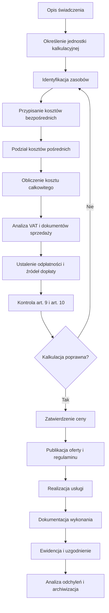

# 18.2. Zasady ustalania odpłatności

## Kalkulacja kosztów, koszty bezpośrednie i pośrednie, wynagrodzenia, materiały, wyposażenie, administracja, cena świadczenia, ewidencja przychodów, przeznaczenie środków i dokumentowanie usługi

**Stan prawny opracowania: 27 listopada 2026 r.**

Rozdział przedstawia metodyczne i prawne zasady ustalania odpłatności za świadczenia realizowane przez fundację w ramach odpłatnej działalności pożytku publicznego. Łączy rachunek kosztów z wymogami ustawy o działalności pożytku publicznego i o wolontariacie, zasadami rachunkowości, rzetelnym dokumentowaniem usług oraz ochroną osób korzystających ze świadczeń.

Najważniejsza zasada brzmi: **odpłatność należy ustalać na podstawie rozpoznanych i udokumentowanych kosztów działalności, a nie przez arbitralne przyjęcie kwoty, która wydaje się atrakcyjna rynkowo**. Organizacja powinna umieć wykazać, jakie świadczenie wykonuje, jakie zasoby są do tego potrzebne, które koszty są bezpośrednie, jak przypisano koszty wspólne, skąd pochodzi cena, kto ją zatwierdził, jak rozliczono wpływy oraz czy przychody zostały przeznaczone na działalność pożytku publicznego.

Kalkulacja nie może służyć ukrywaniu zysku, pozornemu przenoszeniu kosztów ani obchodzeniu granicy między działalnością odpłatną a gospodarczą. Powinna natomiast pozwalać fundacji prowadzić usługi w sposób trwały, dostępny, bezpieczny i przejrzysty. Rzetelne obliczenie kosztów chroni jednocześnie beneficjenta, darczyńcę, pracownika, wolontariusza, fundację i jej organy.

> **Uwaga prawna i księgowa.** Materiał ma charakter dydaktyczny. Nie zastępuje indywidualnej opinii prawnej, podatkowej ani badania ksiąg. Szczegółowy sposób ewidencji zależy od przyjętej polityki rachunkowości, rodzaju świadczenia, statusu podatkowego fundacji, umów z finansującymi i aktualnych przepisów. Przed rozpoczęciem nowej usługi należy sprawdzić stan prawny i warunki właściwego programu finansowania.

---

## Mapa zgodności z aktualnym konspektem

| Pozycja konspektu | Miejsce opracowania |
|---|---|
| 1. Kalkulacja kosztów | Rozdziały 2, 8 i 9 |
| 2. Koszty bezpośrednie | Rozdział 3 |
| 3. Koszty pośrednie | Rozdział 4 |
| 4. Wynagrodzenia osób wykonujących świadczenia | Rozdział 5 |
| 5. Materiały i wyposażenie | Rozdział 6 |
| 6. Koszty administracyjne | Rozdział 7 |
| 7. Ustalanie ceny świadczenia | Rozdziały 8–11 |
| 8. Ewidencjonowanie przychodów | Rozdziały 12–14 |
| 9. Przeznaczanie przychodów na działalność pożytku publicznego | Rozdział 15 |
| 10. Dokumentowanie wykonania usługi | Rozdziały 16–18 |

### Granice względem pozostałych rozdziałów

Niniejszy rozdział rozwija praktykę kalkulowania kosztów i odpłatności. Nie zastępuje:

- rozdziału 17.3 – dotyczącego działalności nieodpłatnej, darowizn, wsparcia rzeczowego, wolontariatu i kosztów zadań nieodpłatnych;
- rozdziału 18.1 – dotyczącego istoty działalności odpłatnej, jej podstaw prawnych, rodzajów świadczeń i wstępnej kwalifikacji;
- rozdziału 18.3 – dotyczącego granicy między działalnością odpłatną a gospodarczą, ustawowych przesłanek przekwalifikowania i rozdzielania zakresów działalności;
- rozdziału 19.1 – dotyczącego działalności gospodarczej fundacji.

W tym rozdziale przesłanki z art. 9 ustawy są przywoływane w zakresie koniecznym do bezpiecznej kalkulacji. Szczegółowa analiza ich zastosowania należy do rozdziału 18.3.

# 1. Cel, zakres i efekty kształcenia

## 1.1. Cel rozdziału

Celem jest przygotowanie członka zarządu, dyrektora, księgowego, koordynatora projektu, osoby odpowiedzialnej za ofertę oraz wykonawcy świadczeń do samodzielnego opracowania, sprawdzenia i udokumentowania kalkulacji odpłatności.

Po ukończeniu rozdziału uczestnik powinien rozumieć nie tylko sposób dodawania wydatków, lecz także relację między kosztem księgowym, wydatkiem pieniężnym, ceną, przychodem, dotacją, wkładem własnym i przychodem z działalności odpłatnej.

## 1.2. Efekty uczenia się

Uczestnik:

1. wyjaśnia różnicę między kosztem bezpośrednim i pośrednim;
2. odróżnia koszty stałe, zmienne, mieszane i jednorazowe;
3. potrafi określić jednostkę kalkulacyjną usługi;
4. sporządza zestawienie pełnych kosztów danego rodzaju działalności;
5. wybiera i uzasadnia klucz podziału kosztów wspólnych;
6. oblicza koszt pracy osoby wykonującej świadczenie;
7. rozróżnia wynagrodzenie brutto, koszt pracodawcy i kwotę netto wypłaty;
8. uwzględnia materiały, sprzęt, amortyzację, najem i koszty eksploatacyjne;
9. odróżnia koszt działalności od kosztu kwalifikowalnego w konkretnym konkursie;
10. ustala cenę jednostkową na podstawie kalkulacji;
11. analizuje skutki rabatu, stypendium, dopłaty sponsora i niepełnego obłożenia;
12. prowadzi analityczną ewidencję przychodów i kosztów;
13. rozpoznaje znaczenie art. 8–10 ustawy o działalności pożytku publicznego;
14. dokumentuje wykonanie świadczenia i rozliczenie z odbiorcą;
15. przygotowuje dokumentację do kontroli wewnętrznej, zewnętrznej i audytu.

## 1.3. Zasady nadrzędne

Kalkulacja powinna spełniać siedem warunków:

- **rzeczywistość** – uwzględnia zasoby faktycznie potrzebne do wykonania usługi;
- **kompletność** – obejmuje koszty bezpośrednie oraz uzasadnioną część kosztów wspólnych;
- **przypisywalność** – pozwala wskazać, dlaczego dany koszt obciąża konkretną działalność;
- **powtarzalność** – podobne zdarzenia rozlicza się według tych samych reguł;
- **sprawdzalność** – obliczenia można odtworzyć z dokumentów i danych źródłowych;
- **zgodność prawna** – cena, umowa, podatki i ewidencja odpowiadają właściwym przepisom;
- **uczciwość społeczna** – odpłatność nie wyklucza bez uzasadnienia osób, którym świadczenie ma służyć.

Nie należy utożsamiać sprawiedliwej ceny z ceną najwyższą ani z ceną najniższą. Cena powinna być racjonalna, możliwa do wyjaśnienia i zgodna z charakterem działalności. Zaniżanie ceny bez wskazania źródła pokrycia różnicy może zagrozić trwałości programu; zawyżanie jej ponad koszt działalności może z kolei spowodować konsekwencje określone w art. 9 ustawy.

# 2. Podstawy prawne i rachunkowe kalkulacji

## 2.1. Ustawa o działalności pożytku publicznego i o wolontariacie

Podstawowym aktem jest ustawa z 24 kwietnia 2003 r. o działalności pożytku publicznego i o wolontariacie, której tekst jednolity ogłoszono w Dz. U. z 2025 r. poz. 1338. Należy ją czytać łącznie z późniejszą nowelizacją z 19 czerwca 2026 r., Dz. U. z 2026 r. poz. 1040.

W kalkulacji szczególne znaczenie mają:

- art. 4 – sfera zadań publicznych;
- art. 6 – rozdzielenie działalności odpłatnej i nieodpłatnej od działalności gospodarczej;
- art. 7 – działalność nieodpłatna;
- art. 8 – działalność odpłatna i jej zakres;
- art. 9 – przesłanki uznania działalności odpłatnej za gospodarczą;
- art. 10 – rachunkowe wyodrębnienie form działalności.

Z art. 8 wynika, że działalność odpłatna obejmuje w szczególności działalność w sferze zadań publicznych, a także sprzedaż przedmiotów darowizny. Przychód z tej działalności służy wyłącznie prowadzeniu działalności pożytku publicznego.

Art. 9 ustanawia dwie odrębne przesłanki, które mogą spowodować uznanie działalności odpłatnej za działalność gospodarczą:

1. wynagrodzenie za działalność danego rodzaju jest wyższe od tego, jakie wynika z kosztów tej działalności;
2. przeciętne miesięczne wynagrodzenie osoby fizycznej z tytułu zatrudnienia przy wykonywaniu statutowej działalności odpłatnej przekracza ustawowy próg.

Są to dwa niezależne testy. Spełnienie jednego z nich może uruchomić konsekwencje ustawowe, nawet jeżeli drugi test nie został przekroczony.

## 2.2. Koszt działalności a cena świadczenia

W rozumieniu ekonomicznym koszt oznacza wartość zasobów zużytych w celu wykonania świadczenia. Cena jest kwotą należną za świadczenie, ustaloną w relacji z odbiorcą lub płatnikiem. Przychód jest kategorią ujmowaną zgodnie z właściwymi zasadami rachunkowości i przepisami podatkowymi.

Nie wolno bezrefleksyjnie utożsamiać:

- kwoty otrzymanej na rachunek bankowy z przychodem w tym samym momencie;
- całej kwoty faktury z przychodem netto;
- wydatku pieniężnego z kosztem okresu;
- kosztu kwalifikowalnego z pełnym kosztem działalności;
- kwoty brutto wynagrodzenia z całkowitym kosztem zatrudnienia;
- wkładu rzeczowego z automatycznie rozpoznanym kosztem księgowym.

## 2.3. Ustawa o rachunkowości

Fundacja jako osoba prawna co do zasady prowadzi księgi rachunkowe zgodnie z ustawą o rachunkowości. Ustawa z 29 września 1994 r. ma tekst jednolity ogłoszony w Dz. U. z 2026 r. poz. 522. Przy opracowywaniu kalkulacji należy zwrócić uwagę zwłaszcza na:

- art. 4 – rzetelny i jasny obraz sytuacji majątkowej i finansowej;
- art. 10 – dokumentację zasad rachunkowości;
- art. 20–22 – podstawy zapisów, dowody księgowe i ich poprawność;
- art. 24 – rzetelność, bezbłędność, sprawdzalność i bieżące prowadzenie ksiąg;
- art. 28 – zasady wyceny aktywów i pasywów.

Fundacja powinna przyjąć politykę rachunkowości, w której określi sposób identyfikowania działalności nieodpłatnej, odpłatnej i gospodarczej, zasady przypisywania kosztów wspólnych, stosowane konta lub wymiary analityczne oraz procedurę zatwierdzania kalkulacji.

## 2.4. Wyodrębnienie rachunkowe

Art. 10 ustawy o działalności pożytku publicznego wymaga rachunkowego wyodrębnienia działalności nieodpłatnej, odpłatnej i gospodarczej w sposób umożliwiający określenie przychodów, kosztów i wyników każdej z nich, z uwzględnieniem właściwych zasad rachunkowości.

Nie wystarczy oznaczyć przelewów w tytule ani prowadzić jednej ogólnej tabeli wpływów. System powinien umożliwiać przypisanie przychodu i kosztu do konkretnej formy działalności oraz – w miarę potrzeb – do konkretnego rodzaju usługi, programu, zadania, źródła finansowania i okresu.

## 2.5. Nowelizacja z 2026 r.

Ustawa z 19 czerwca 2026 r., Dz. U. z 2026 r. poz. 1040, weszła zasadniczo w życie 1 września 2026 r. Część jej przepisów wskazanych w przepisach końcowych wchodzi w życie 1 stycznia 2027 r. Nowelizacja obejmuje między innymi zasady zlecania zadań publicznych, ofert, sprawozdań i wkładów własnych.

Przy sporządzaniu budżetu zadania publicznego należy zatem sprawdzić:

1. datę rozpoczęcia i zakończenia zadania;
2. brzmienie przepisów właściwe dla danego okresu;
3. aktualny wzór oferty i sprawozdania;
4. ogłoszenie konkursowe;
5. umowę dotacyjną i jej załączniki;
6. zasady wkładu własnego i kosztów administracyjnych;
7. ograniczenia dotyczące przesunięć między pozycjami budżetu.

Nie wolno przenosić mechanicznie zasad z poprzedniego konkursu na nowy konkurs. Ustawa określa ramy prawne, ale konkretna umowa może ustanawiać dodatkowe warunki rozliczenia środków publicznych.

## 2.6. Działalność odpłatna a koszt kwalifikowalny

Koszt kwalifikowalny jest pojęciem wynikającym z konkretnego programu, konkursu, regulaminu lub umowy. Koszt działalności dla potrzeb art. 9 ustawy o pożytku publicznym jest pojęciem szerszym, odnoszącym się do kosztów rzeczywiście związanych z działalnością danego rodzaju.

Może wystąpić sytuacja, w której wydatek:

- jest kosztem działalności, lecz nie jest kwalifikowalny w danym konkursie;
- jest kwalifikowalny tylko do określonego limitu;
- może być pokryty z dotacji, ale wymaga odrębnego ujęcia w ewidencji;
- jest kosztem inwestycyjnym lub nakładem na składnik aktywów, a nie jednorazowym kosztem usługi;
- jest finansowany z innego źródła i nie może być ponownie rozliczony.

Dlatego należy prowadzić dwie perspektywy analizy: pełny koszt działalności oraz koszt kwalifikowalny według konkretnej umowy.

# 3. Koszty bezpośrednie

## 3.1. Definicja

Koszt bezpośredni można przypisać do konkretnej usługi, kursu, szkolenia, wydarzenia lub zadania bez stosowania ogólnego klucza podziału. Jest ponoszony dlatego, że dana usługa jest wykonywana.

Przykłady:

- wynagrodzenie prowadzącego przypisane do konkretnego szkolenia;
- materiały przekazane uczestnikom konkretnego kursu;
- wynajem sali na określone warsztaty;
- transport uczestników danego wydarzenia;
- jednorazowa licencja potrzebna do przeprowadzenia danego kursu;
- tłumaczenie materiałów na potrzeby konkretnej grupy;
- opłata za egzamin, jeżeli jest elementem świadczenia;
- ubezpieczenie uczestników konkretnego wydarzenia, jeżeli jest wymagane lub uzasadnione.

## 3.2. Kryterium bezpośredniego przypisania

Koszt należy uznać za bezpośredni, jeżeli można odpowiedzieć twierdząco na trzy pytania:

1. Czy wydatek powstał w związku z konkretnym świadczeniem?
2. Czy można wskazać dokument lub wiarygodny zapis potwierdzający ten związek?
3. Czy koszt można przypisać do tego świadczenia bez arbitralnego dzielenia kosztu wspólnego?

Jeżeli sala jest wynajęta wyłącznie na jeden kurs, czynsz za ten termin jest kosztem bezpośrednim. Jeżeli fundacja korzysta z własnego lokalu przez wiele dni i prowadzi w nim kilka rodzajów działalności, koszty utrzymania lokalu mogą wymagać podziału według racjonalnego klucza.

## 3.3. Rejestr kosztów bezpośrednich

| Kategoria | Przykład dokumentu | Sposób przypisania |
|---|---|---|
| Prowadzący | Umowa, rachunek, lista godzin | Numer kursu i liczba godzin |
| Materiały | Faktura, dokument wydania | Liczba sztuk dla uczestników |
| Sala | Faktura lub umowa najmu | Data i godziny wydarzenia |
| Transport | Faktura, bilet, rozliczenie | Trasa i uczestnicy zadania |
| Tłumaczenie | Umowa, faktura, protokół | Materiał lub wydarzenie |
| Egzamin | Faktura, potwierdzenie opłaty | Liczba osób przystępujących |
| Ubezpieczenie | Polisa, nota, faktura | Okres i liczba uczestników |

## 3.4. Koszt jednorazowy i koszt powtarzalny

Koszt jednorazowy powstaje w związku z konkretnym wydarzeniem, np. wynajem sprzętu na jeden warsztat. Koszt powtarzalny występuje przy kolejnych edycjach, np. materiały zużywane w każdym kursie.

Nie należy automatycznie dzielić kosztu jednorazowego przez liczbę planowanych edycji, jeżeli nie ma pewności, że wszystkie edycje zostaną zrealizowane. Jeżeli zakupiony zasób będzie wykorzystywany przez kilka lat, należy ocenić, czy stanowi składnik aktywów, czy może zostać jednorazowo odniesiony w koszty zgodnie z polityką rachunkowości i przepisami.

## 3.5. Koszt bezpośredni nie zawsze jest kosztem zmiennym

Koszt bezpośredni i koszt zmienny opisują różne cechy:

- bezpośredniość odpowiada na pytanie, czy można przypisać koszt do usługi;
- zmienność odpowiada na pytanie, jak koszt reaguje na zmianę liczby świadczeń lub uczestników.

Wynagrodzenie prowadzącego za cały dzień może być kosztem bezpośrednim, ale stałym w granicach jednej edycji kursu. Materiały dla uczestników są zwykle bezpośrednie i zmienne.

# 4. Koszty pośrednie i zasady ich podziału

## 4.1. Definicja

Koszty pośrednie służą kilku usługom, projektom lub rodzajom działalności i nie można ich przypisać do jednego świadczenia bez zastosowania uzasadnionej metody podziału.

Przykłady:

- czynsz za biuro fundacji;
- energia elektryczna i ogrzewanie;
- wynagrodzenie pracownika administracyjnego obsługującego kilka programów;
- księgowość;
- obsługa informatyczna;
- telefon i internet;
- ubezpieczenie lokalu;
- koszty utrzymania wspólnej strony internetowej;
- amortyzacja sprzętu używanego w kilku rodzajach działalności;
- koszty zarządzania i nadzoru.

Koszt pośredni nie jest kosztem mniej rzeczywistym. Jest kosztem wymagającym dodatkowego uzasadnienia sposobu przypisania.

## 4.2. Zasada pierwszeństwa kosztów bezpośrednich

Najpierw należy przypisać koszty, które można bezpośrednio powiązać z konkretną usługą. Dopiero pozostałą część kosztów wspólnych dzieli się według odpowiedniego klucza.

Nie należy rozpoczynać od arbitralnego procentu kosztów administracyjnych, a następnie dopasowywać do niego dokumentów. Prawidłowa kolejność jest odwrotna: identyfikacja zasobu, ustalenie sposobu jego wykorzystania, wybór miernika, obliczenie udziału i zapisanie uzasadnienia.

## 4.3. Klucze podziału kosztów

| Rodzaj kosztu | Przykładowy klucz | Warunek wiarygodności |
|---|---|---|
| Lokal | Powierzchnia i czas wykorzystania | Harmonogram, metraż, rejestr pomieszczeń |
| Energia | Podlicznik, powierzchnia lub czas pracy | Dane pomiarowe albo stała metoda |
| Pracownik administracyjny | Czas pracy | Ewidencja czasu lub opis zadań |
| Księgowość | Liczba dokumentów lub operacji | Rejestr dokumentów |
| Telefon i internet | Liczba użytkowników lub rzeczywiste użycie | Umowa i uzasadnienie |
| System informatyczny | Liczba licencji lub użytkowników | Rejestr kont |
| Sprzęt wspólny | Czas używania lub liczba cykli | Rejestr wykorzystania |
| Zarządzanie projektem | Czas pracy lub zakres czynności | Karta pracy, zakres obowiązków |

Klucz powinien odzwierciedlać rzeczywiste zużycie zasobu. Nie każdy koszt należy dzielić według przychodów, liczby uczestników lub powierzchni. Wybór metody zależy od natury kosztu.

## 4.4. Przykład podziału kosztu lokalu

Fundacja ponosi miesięczny koszt utrzymania lokalu w wysokości 4 000 zł. Na potrzeby uproszczonego przykładu ustalono, że:

- 40% powierzchni jest wykorzystywane przez działalność programową;
- z tej powierzchni 50% czasu przypada na odpłatne kursy;
- pozostałe wykorzystanie dotyczy innych zadań.

Udział odpłatnych kursów wynosi:

40% × 50% = 20%

Koszt lokalu przypisany do odpłatnych kursów:

4 000 zł × 20% = 800 zł.

W praktyce należy sprawdzić, czy taki sposób podziału rzeczywiście odzwierciedla wykorzystanie lokalu. Jeżeli fundacja posiada harmonogram rezerwacji pomieszczeń, dokładniejszy może być klucz oparty na godzinach używania konkretnych sal.

## 4.5. Przykład podziału kosztu księgowości

Biuro rachunkowe pobiera 1 200 zł miesięcznie za obsługę całej fundacji. W danym miesiącu zarejestrowano 100 dokumentów księgowych, z czego 15 dotyczy odpłatnych kursów.

Jeżeli dokumenty mają zbliżony nakład pracy, można przyjąć udział 15%:

1 200 zł × 15% = 180 zł.

Jeżeli jednak faktury z odpłatnej działalności są znacznie bardziej pracochłonne, sam licznik dokumentów może być niewystarczający. Wtedy należy rozważyć klucz oparty na czasie obsługi, liczbie pozycji lub innym mierniku.

## 4.6. Zakaz arbitralnego przenoszenia kosztów

Nie wolno:

- przypisywać całego czynszu do odpłatnej działalności tylko dlatego, że posiada ona przychody;
- przenosić kosztów działalności gospodarczej do działalności odpłatnej bez związku z usługą;
- przenosić kosztów projektu dotacyjnego na inną działalność, aby poprawić jej wynik;
- rozliczać jednego wydatku w dwóch źródłach finansowania;
- zmieniać klucza podziału wyłącznie po to, aby uzyskać oczekiwany wynik;
- pomijać kosztów wspólnych, gdy faktycznie służą one wykonywaniu działalności odpłatnej.

Zmiana klucza jest dopuszczalna, gdy zmienia się sposób wykorzystania zasobów lub pojawiają się dokładniejsze dane. Należy ją opisać, zatwierdzić i stosować od wskazanego okresu, z zachowaniem porównywalności danych.

## 4.7. Koszty mieszane i wielofunkcyjne

Niektóre koszty są częściowo bezpośrednie, a częściowo pośrednie. Przykładem może być wynagrodzenie pracownika, który przez część miesiąca koordynuje odpłatne szkolenia, a przez pozostały czas prowadzi administrację fundacji.

Należy wówczas:

1. wyodrębnić zadania;
2. określić czas lub inny miernik;
3. przypisać część bezpośrednią do konkretnych kursów;
4. pozostałą część rozliczyć według właściwego klucza;
5. zachować dokumentację pozwalającą odtworzyć obliczenie.

# 5. Wynagrodzenia osób wykonujących świadczenia

## 5.1. Wynagrodzenie jako element kosztu

Wynagrodzenie wykonawcy często stanowi najważniejszy składnik kosztu szkolenia, kursu, usługi rehabilitacyjnej, edukacyjnej lub społecznej.

Do kalkulacji należy przyjmować koszt zgodny z formą współpracy i rzeczywistymi obciążeniami organizacji. Nie należy posługiwać się wyłącznie kwotą netto otrzymywaną przez osobę wykonującą świadczenie.

## 5.2. Umowa o pracę

Koszt pracodawcy może obejmować:

- wynagrodzenie brutto;
- składki finansowane przez pracodawcę;
- wpłaty do PPK, jeżeli występują;
- inne obowiązkowe świadczenia wynikające z przepisów;
- uzasadnione koszty badań, szkoleń BHP i wyposażenia stanowiska, jeżeli są związane z wykonywaniem pracy i prawidłowo ujmowane.

Składki finansowane przez pracownika są częścią wynagrodzenia brutto, a nie dodatkowym kosztem doliczanym drugi raz do kwoty brutto. Należy korzystać z aktualnych kalkulatorów płacowych lub danych kadrowo-płacowych.

## 5.3. Umowy cywilnoprawne

Przy umowie zlecenia lub umowie o dzieło koszt zależy od rodzaju umowy, statusu wykonawcy, zbiegu tytułów ubezpieczenia, obowiązków składkowych i podatkowych oraz treści umowy.

W kalkulacji należy uwzględnić:

1. kwotę wynagrodzenia brutto;
2. składki obciążające zleceniodawcę, jeżeli występują;
3. ewentualne koszty podróży i innych uzgodnionych świadczeń;
4. koszty przygotowania materiałów lub licencji;
5. zakres odpowiedzialności wykonawcy;
6. liczbę godzin lub jednostek usługi.

Przy umowie o dzieło trzeba odrębnie sprawdzić, czy jej przedmiot rzeczywiście spełnia przesłanki tej umowy. Sama nazwa dokumentu nie przesądza o kwalifikacji prawnej.

## 5.4. Faktura od przedsiębiorcy

Jeżeli usługę wykonuje zewnętrzny przedsiębiorca, podstawą kalkulacji jest koszt wynikający z faktury lub innego prawidłowego dokumentu. Jeżeli fundacja może odliczyć VAT naliczony, VAT podlegający odliczeniu co do zasady nie stanowi kosztu ekonomicznego. Jeżeli odliczenie nie przysługuje, nieodliczona część VAT może zwiększać koszt.

Należy uwzględnić także warunki umowy, termin płatności, zakres świadczenia, odpowiedzialność za rezultat i ewentualne koszty dodatkowe.

## 5.5. Limit wynagrodzeń z art. 9 ust. 1 pkt 2

Przy działalności odpłatnej trzeba odrębnie monitorować ustawowy limit przeciętnego miesięcznego wynagrodzenia osoby fizycznej zatrudnionej przy wykonywaniu statutowej działalności odpłatnej pożytku publicznego.

Art. 9 ust. 2 nakazuje rozumieć wynagrodzenie jako wynagrodzenie z tytułu świadczenia pracy lub usług, niezależnie od sposobu nawiązania stosunku pracy lub rodzaju i treści umowy cywilnoprawnej z osobą fizyczną. Nie wolno więc ograniczać kontroli wyłącznie do umów o pracę.

Dla 2026 r. punktem odniesienia jest trzykrotność przeciętnego miesięcznego wynagrodzenia w sektorze przedsiębiorstw za 2025 r. GUS podał wartość 8 934,98 zł, co daje:

8 934,98 zł × 3 = 26 804,94 zł brutto.

Kwota 26 804,94 zł jest wartością referencyjną dla 2026 r. Nie należy traktować jej jako automatycznego limitu każdej pojedynczej wypłaty bez analizy ustawowego sposobu obliczenia przeciętnego wynagrodzenia. Ustawa odwołuje się do okresu ostatniego roku obrotowego, a przy zatrudnieniu krótszym – do okresu zatrudnienia. Trzeba zatem ustalić okres pracy danej osoby przy działalności odpłatnej, zsumować właściwe wynagrodzenia i obliczyć przeciętną zgodnie z przepisem. W praktyce należy uwzględnić także aktualne wyjaśnienia i interpretacje oraz skonsultować przypadki nietypowe z prawnikiem lub księgowym.

Przykład dydaktyczny: osoba świadczyła usługi przy działalności odpłatnej przez pięć miesięcy, a suma jej wynagrodzeń brutto za ten okres wyniosła 45 000 zł. Średnia wynosi:

45 000 zł ÷ 5 = 9 000 zł.

Wartość należy porównać z właściwym progiem dla danego roku. Nie wolno dzielić sumy przez dwanaście miesięcy, jeżeli osoba nie była zatrudniona przez cały rok, ani pomijać kolejnych umów tylko dlatego, że zawarto je oddzielnie.

**Ważne rozróżnienie:** ustawowy test wynagrodzenia osoby fizycznej jest odrębny od kosztu pracodawcy. Do kalkulacji usługi należy przyjmować rzeczywisty koszt zatrudnienia, natomiast do testu z art. 9 stosować ustawową definicję wynagrodzenia. Nie należy automatycznie utożsamiać obu wartości.

## 5.6. Ewidencja czasu pracy

Przy usługach realizowanych przez osoby wykonujące kilka zadań fundacja powinna prowadzić ewidencję czasu lub inny wiarygodny dokument przypisania pracy.

Przykładowa karta czasu pracy zawiera:

- imię i nazwisko;
- okres rozliczeniowy;
- nazwę zadania lub usługi;
- datę;
- rodzaj czynności;
- liczbę godzin;
- osobę zatwierdzającą;
- numer projektu lub kod działalności.

Nie należy tworzyć fikcyjnych kart czasu pracy po zakończeniu zadania. Dokument powinien odzwierciedlać rzeczywiste czynności.

## 5.7. Wolontariat

Wolontariat jest odrębną formą wykonywania świadczeń i nie może być pozornie zamieniany w zatrudnienie ani traktowany jako bezpłatna praca przymusowa.

W kalkulacji należy rozdzielić:

- brak wynagrodzenia za świadczenie wolontariusza;
- zwrot uzasadnionych kosztów poniesionych przez wolontariusza;
- koszty ubezpieczenia, szkoleń i organizacji wolontariatu;
- ewentualny wkład osobowy wykazywany w budżecie, jeżeli dopuszczają to zasady konkretnego programu.

Wartość pracy wolontariusza nie staje się automatycznie kosztem księgowym tylko dlatego, że organizacja przypisała jej hipotetyczną stawkę. Wycena wkładu osobowego w projekcie musi wynikać z regulaminu lub umowy i być dokumentowana zgodnie z jej zasadami.

# 6. Materiały, wyposażenie i korzystanie z zasobów

## 6.1. Materiały zużywalne

Materiały zużywalne obejmują zasoby wykorzystywane w trakcie świadczenia, np.:

- papier, tusz, teczki i materiały biurowe;
- podręczniki, skrypty i karty pracy;
- środki higieniczne i ochronne;
- materiały terapeutyczne;
- materiały plastyczne i artystyczne;
- materiały dydaktyczne;
- drobne elementy techniczne;
- materiały jednorazowe wymagane ze względów sanitarnych.

Należy ustalić normę zużycia na jedną osobę lub jedną jednostkę usługi, a następnie pomnożyć ją przez liczbę planowanych świadczeń.

Przykład: zestaw materiałów kosztuje 24 zł na uczestnika. Przy 16 uczestnikach koszt wynosi 384 zł. Jeżeli materiały są wydawane tylko części uczestników, koszt należy przypisać zgodnie z rzeczywistym wydaniem.

## 6.2. Wyposażenie

Wyposażenie może być:

- zakupione na potrzeby jednego zadania;
- wykorzystywane w wielu usługach;
- wynajmowane;
- użyczone;
- otrzymane w darowiźnie;
- stanowić składnik majątku fundacji.

Nie każdy zakup sprzętu jest kosztem jednego kursu. Jeżeli sprzęt spełnia kryteria środka trwałego, należy stosować zasady jego ujęcia i amortyzacji. Do kalkulacji konkretnej usługi przypisuje się uzasadnioną część kosztu wykorzystania, np. odpis amortyzacyjny albo koszt najmu.

Nie wolno jednocześnie zaliczyć całej wartości zakupu do kosztu jednej usługi i ponownie doliczać amortyzacji tego samego składnika w kolejnych okresach.

## 6.3. Amortyzacja i wykorzystanie sprzętu

W przypadku sprzętu używanego w kilku usługach należy określić:

1. wartość początkową;
2. przyjętą metodę i okres amortyzacji;
3. okres użytkowania;
4. liczbę godzin lub cykli wykorzystania;
5. udział danej usługi w wykorzystaniu;
6. sposób dokumentowania użycia.

Przykład: sprzęt jest używany łącznie przez 100 godzin w miesiącu, a 20 godzin służy odpłatnym warsztatom. Jeżeli amortyzacja miesięczna wynosi 500 zł, udział warsztatów wynosi 20%, czyli 100 zł. Taki podział jest uzasadniony, jeśli czas używania jest właściwym miernikiem zużycia.

## 6.4. Darowizny rzeczowe i użyczenie

Jeżeli fundacja otrzymała materiały lub sprzęt w darowiźnie, należy sprawdzić dokument przyjęcia, warunki darczyńcy, sposób wyceny i zasady ewidencji. Nie wolno automatycznie przyjmować, że wartość rynkowa rzeczy jest kosztem pieniężnym poniesionym przez fundację.

Wkład rzeczowy może być wykazywany w budżecie lub sprawozdaniu, jeśli pozwalają na to przepisy, regulamin i umowa. Wartość wkładu powinna być ustalona na podstawie wiarygodnej metody, a nie dowolnej deklaracji.

Użyczenie oznacza korzystanie z cudzej rzeczy na zasadach określonych w umowie. Kosztem mogą być rzeczywiście ponoszone wydatki związane z użytkowaniem, transportem, konserwacją lub ubezpieczeniem, jeżeli są uzasadnione i dopuszczalne. Nie należy wykazywać fikcyjnego czynszu, którego fundacja nie ponosi.

## 6.5. Materiały specjalistyczne i bezpieczeństwo

W usługach zdrowotnych, rehabilitacyjnych, opiekuńczych i edukacyjnych należy uwzględnić nie tylko cenę zakupu, lecz także:

- jakość i dopuszczenie produktu do obrotu;
- warunki przechowywania;
- terminy ważności;
- higienę i dezynfekcję;
- wymagania BHP;
- ochronę danych;
- dostępność dla osób z niepełnosprawnościami;
- koszt utylizacji, jeżeli jest wymagany.

Oszczędność nie może prowadzić do obniżenia bezpieczeństwa uczestnika ani jakości świadczenia.

# 7. Koszty administracyjne

## 7.1. Zakres kosztów administracyjnych

Koszty administracyjne obejmują zasoby potrzebne do organizowania, obsługi, nadzorowania i rozliczania działalności, np.:

- księgowość i kadry;
- obsługę prawną;
- obsługę biura;
- korespondencję i archiwizację;
- systemy informatyczne;
- opłaty bankowe;
- ubezpieczenia organizacji;
- obsługę zarządu w zakresie dopuszczalnym przez prawo i umowy;
- przygotowanie sprawozdań;
- utrzymanie infrastruktury.

Nie każdy koszt administracyjny można przypisać do działalności odpłatnej. Należy wykazać, w jakim zakresie służy on danemu rodzajowi działalności.

## 7.2. Koszt administracyjny a limit konkursowy

Niektóre konkursy wprowadzają limity kosztów administracyjnych, ryczałty lub katalog wydatków dopuszczalnych. Są to warunki konkretnego finansowania, a nie uniwersalna definicja kosztów działalności odpłatnej.

Jeżeli konkurs ogranicza koszty administracyjne do określonego poziomu, fundacja powinna:

1. sporządzić pełną kalkulację kosztów;
2. oznaczyć koszty kwalifikowalne;
3. oddzielić część niekwalifikowalną;
4. wskazać źródło pokrycia części niekwalifikowalnej;
5. nie przenosić jej automatycznie do innego projektu.

## 7.3. Administracja wspólna dla kilku rodzajów działalności

Koszty wspólnej administracji należy rozdzielać według mierników, które odzwierciedlają rzeczywisty nakład pracy lub zużycie zasobów. Przykładowo:

- obsługa zapisów na kurs – według liczby zapisów i czasu obsługi;
- księgowość – według dokumentów, operacji lub czasu pracy;
- zarządzanie salą – według godzin rezerwacji;
- obsługa informatyczna – według liczby kont lub rzeczywistego zakresu wsparcia.

Jeżeli koszt służy całej fundacji, nie należy obciążać nim w całości jednego kursu tylko dlatego, że kurs jest jedyną działalnością przynoszącą wpływy.

# 8. Metodyka kalkulacji kosztów

## 8.1. Etapy kalkulacji

Prawidłowa kalkulacja powinna przebiegać w ustalonej kolejności:

1. określenie rodzaju świadczenia;
2. określenie jednostki kalkulacyjnej;
3. ustalenie liczby planowanych jednostek;
4. opisanie zasobów potrzebnych do wykonania świadczenia;
5. przypisanie kosztów bezpośrednich;
6. określenie kosztów pośrednich i kluczy podziału;
7. ustalenie kosztu personelu;
8. uwzględnienie materiałów, sprzętu i administracji;
9. ustalenie podatkowego ujęcia VAT;
10. obliczenie kosztu całkowitego i jednostkowego;
11. porównanie z planowaną odpłatnością;
12. wskazanie ewentualnej dopłaty lub innego źródła finansowania;
13. sprawdzenie art. 9 i art. 10 ustawy;
14. zatwierdzenie kalkulacji;
15. zachowanie dokumentów źródłowych.

## 8.2. Jednostka kalkulacyjna

Jednostką kalkulacyjną może być:

- jeden uczestnik kursu;
- jedna godzina zajęć;
- jedno spotkanie terapeutyczne;
- jedna usługa;
- jeden dzień szkoleniowy;
- jeden pakiet świadczeń;
- jeden uczestnik objęty programem przez miesiąc;
- jedno wydarzenie;
- jeden egzemplarz publikacji.

Jednostkę należy dobrać do sposobu świadczenia usługi i rozliczania odpłatności. Jeżeli uczestnik płaci za pakiet, a nie za pojedyncze spotkanie, kalkulacja powinna obejmować cały pakiet.

## 8.3. Koszty stałe i zmienne

Koszty stałe w określonym przedziale działalności nie zmieniają się proporcjonalnie do liczby uczestników, np. wynajem sali na cały dzień lub wynagrodzenie prowadzącego za wydarzenie.

Koszty zmienne rosną wraz z liczbą uczestników lub jednostek, np. materiały, poczęstunek, materiały ochronne lub opłaty liczone od uczestnika.

Koszty mieszane zawierają część stałą i zmienną, np. abonament platformy z opłatą za dodatkowe konta.

Rozróżnienie jest ważne, ponieważ liczba uczestników wpływa na koszt jednostkowy. Przy małym obłożeniu koszt przypadający na jednego uczestnika może istotnie wzrosnąć.

## 8.4. Wzory podstawowe

Koszt całkowity:

**Kc = Kb + Kp**

gdzie:

- Kc – koszt całkowity działalności danego rodzaju;
- Kb – koszty bezpośrednie;
- Kp – uzasadniona część kosztów pośrednich.

Koszt jednostkowy:

**Ku = Kc / N**

gdzie N oznacza liczbę jednostek kalkulacyjnych.

Koszt jednostkowy uczestnictwa w kursie:

**Ku = (koszty stałe + koszty zmienne całkowite + koszty pośrednie przypisane) / liczba uczestników**

W praktyce należy unikać dzielenia kosztów przez maksymalną pojemność sali, jeżeli realnie planowane obłożenie jest niższe. Kalkulacja powinna uwzględniać realistyczną liczbę uczestników, a nie wyłącznie wariant optymistyczny.

## 8.5. Koszt planowany a koszt rzeczywisty

Koszt planowany jest szacunkiem sporządzonym przed rozpoczęciem usługi. Koszt rzeczywisty wynika z faktycznie wykonanych operacji i prawidłowych dowodów.

Po zakończeniu usługi należy porównać oba poziomy:

- różnice cen zakupu;
- zmianę liczby uczestników;
- niewykorzystane materiały;
- dodatkowe godziny pracy;
- odwołane spotkania;
- zwroty i reklamacje;
- zmianę kosztów najmu;
- nieplanowane koszty bezpieczeństwa.

Odchylenia należy wyjaśnić. Nie wolno poprawiać dokumentacji planowanej po fakcie w taki sposób, aby ukryć różnicę między budżetem a rzeczywistością.

## 8.6. Rezerwa planistyczna a koszt księgowy

W budżecie można analizować ryzyko wzrostu cen lub nieprzewidzianych zdarzeń. Nie oznacza to jednak, że każda planowana rezerwa staje się kosztem księgowym albo kosztem działalności w rozumieniu art. 9.

Rezerwa budżetowa jest narzędziem planowania. Koszt księgowy wymaga podstawy wynikającej z rzeczywistego zdarzenia gospodarczego i właściwych zasad rachunkowości. Jeżeli występują przesłanki utworzenia rezerwy bilansowej, należy zastosować odpowiednie przepisy ustawy o rachunkowości, a nie utożsamiać jej z dowolną pozycją zapasu w budżecie.

# 9. Przykładowa kalkulacja kursu

## 9.1. Założenia

Fundacja organizuje jednodniowe szkolenie dla 16 uczestników. Program obejmuje osiem godzin zajęć. Uczestnicy wnoszą odpłatność, a fundacja zapewnia salę, materiały, prowadzącego, obsługę organizacyjną i dokumentację ukończenia.

Przykładowe kwoty przyjęto jako koszty ekonomiczne na potrzeby ćwiczenia. Nie są one cennikiem rynkowym ani rekomendacją wynagrodzenia. Założono, że wartości w tabeli są porównywalne i obejmują nieodliczalne podatki tam, gdzie występują. Jeżeli fundacja jest podatnikiem VAT i ma prawo do odliczenia, kalkulację należy odpowiednio przeliczyć.

## 9.2. Koszty bezpośrednie

| Pozycja | Kwota |
|---|---:|
| Wynagrodzenie prowadzącego – koszt organizacji | 1 600 zł |
| Podróż prowadzącego | 250 zł |
| Materiały dla 16 uczestników po 25 zł | 400 zł |
| Wynajem sali | 500 zł |
| Poczęstunek dla 16 uczestników po 35 zł | 560 zł |
| Obsługa techniczna i platforma | 120 zł |
| Promocja konkretnego szkolenia | 180 zł |
| Ubezpieczenie wydarzenia | 80 zł |
| **Razem koszty bezpośrednie** | **3 690 zł** |

## 9.3. Koszty pośrednie przypisane

| Pozycja | Kwota |
|---|---:|
| Administracja i obsługa zapisów | 180 zł |
| Księgowość i obsługa płatności | 110 zł |
| Wykorzystanie sprzętu i wyposażenia | 150 zł |
| **Razem koszty pośrednie** | **440 zł** |

## 9.4. Koszt całkowity

3 690 zł + 440 zł = **4 130 zł**.

Dla potrzeb tego przykładu przyjmijmy koszt całkowity 4 130 zł. Przy 16 opłaconych miejscach koszt jednostkowy wynosi:

4 130 zł ÷ 16 = **258,125 zł**.

Po zaokrągleniu koszt jednostkowy wynosi 258,13 zł.

## 9.5. Ustalenie odpłatności

Fundacja ustala odpłatność w wysokości 250 zł za uczestnika.

Przychód z 16 opłaconych miejsc:

16 × 250 zł = 4 000 zł.

Różnica między kosztem a przychodem:

4 130 zł − 4 000 zł = **130 zł**.

W tym przykładzie odpłatność nie przekracza pełnego kosztu. Różnica 130 zł wymaga wskazania źródła pokrycia, np. nieograniczonych środków fundacji lub prawidłowo przyznanej dopłaty, o ile warunki finansowania na to pozwalają.

Jeżeli zarejestrowano 16 osób, ale tylko 14 osób zapłaciło i nie ma podstaw do uznania pozostałych należności za przychód, wpływ wynosi 3 500 zł. Różnica do kosztu wzrasta do 630 zł. Dlatego kalkulacja powinna obejmować warianty obłożenia, płatności i rezygnacji.

## 9.6. Warianty obłożenia

| Liczba opłaconych miejsc | Przychód przy 250 zł | Koszt całkowity | Różnica |
|---:|---:|---:|---:|
| 16 | 4 000 zł | 4 130 zł | −130 zł |
| 15 | 3 750 zł | 4 130 zł | −380 zł |
| 14 | 3 500 zł | 4 130 zł | −630 zł |
| 12 | 3 000 zł | 4 130 zł | −1 130 zł |

Tabela pokazuje, dlaczego nie wystarczy ustalić ceny na podstawie maksymalnej liczby miejsc. Fundacja powinna przyjąć minimalną liczbę uczestników, przy której może bezpiecznie zrealizować wydarzenie, oraz zasady odwołania lub zmiany terminu.

## 9.7. Znaczenie przykładu dla art. 9

Przykład pokazuje metodę kalkulacji jednej edycji. Nie przesądza samodzielnie o kwalifikacji całego rodzaju działalności. Dla zastosowania art. 9 trzeba prawidłowo zdefiniować działalność danego rodzaju, ustalić zakres kosztów i wynagrodzenia oraz zbadać rzeczywiste przychody i koszty w odpowiednim ujęciu.

Nie wolno wybierać wyłącznie tych kosztów, które obniżają wynik, ani pomijać kosztów wspólnych, które rzeczywiście służą tej działalności. Nie wolno także kompensować wyniku jednego rodzaju działalności wynikiem innego rodzaju tylko po to, aby ukryć przekroczenie ustawowej granicy.

# 10. Ustalanie ceny świadczenia

## 10.1. Cena jako wynik kalkulacji

Cena powinna wynikać z:

- rodzaju i zakresu świadczenia;
- pełnego kosztu działalności;
- liczby jednostek kalkulacyjnych;
- planowanego obłożenia;
- źródeł finansowania;
- statusu podatkowego;
- warunków umowy z odbiorcą;
- dostępności świadczenia dla grupy docelowej;
- ograniczeń wynikających z art. 9 ustawy.

Cena nie może być ustalana wyłącznie według tego, ile uczestnik jest gotów zapłacić. Badanie rynku może pomóc ocenić dostępność i adekwatność oferty, ale nie zastępuje kalkulacji kosztów.

## 10.2. Odpłatność pełna, częściowa i z dopłatą

W praktyce mogą wystąpić trzy modele:

1. **Odpłatność pokrywająca pełny koszt** – opłata uczestnika lub płatnika odpowiada kosztowi jednostkowemu.
2. **Odpłatność częściowa** – część kosztu pokrywa uczestnik, a część inne legalne źródło finansowania.
3. **Odpłatność z indywidualną ulgą** – uczestnik płaci mniej na podstawie jawnych i sprawiedliwych kryteriów, a różnica jest finansowana z określonego źródła.

Każdy model wymaga przejrzystej dokumentacji. Jeżeli fundacja stosuje ulgi, powinna określić kryteria ich przyznawania, sposób zatwierdzania i źródło pokrycia różnicy.

## 10.3. Rabaty

Rabaty mogą być uzasadnione np. wcześniejszym zapisem, udziałem w kilku modułach, sytuacją społeczną lub finansowaniem grupowym. Należy jednak ustalić:

- kto jest uprawniony do rabatu;
- kto go zatwierdza;
- czy rabat dotyczy ceny brutto czy netto;
- jak jest dokumentowany;
- czy nie powoduje naruszenia warunków finansowania;
- jak wpływa na przychód i koszt danego rodzaju działalności.

Rabat nie może być ukrytym sposobem przekazywania korzyści osobom powiązanym z organami fundacji. Powinien być stosowany według jawnych zasad i z zachowaniem równego traktowania.

## 10.4. Dopłata sponsora lub innego płatnika

Jeżeli koszt świadczenia pokrywa częściowo uczestnik, a częściowo sponsor, pracodawca, samorząd lub inny podmiot, należy odrębnie udokumentować:

- cenę świadczenia;
- kwotę należną od uczestnika;
- kwotę należną od płatnika zewnętrznego;
- podstawę prawną i umowną dopłaty;
- sposób rozliczenia;
- ewentualne ograniczenia dotyczące podwójnego finansowania.

Samo rozdzielenie płatności między dwie osoby nie zmienia automatycznie charakteru usługi. Należy zbadać, kto jest nabywcą świadczenia, kto płatnikiem i jakie obowiązki podatkowe wynikają z transakcji.

## 10.5. Stypendia i zwolnienia z opłat

Jeżeli fundacja chce umożliwić udział osobom w trudniejszej sytuacji, może ustanowić program ulg lub stypendiów, o ile pozwalają na to jej cele, źródła finansowania i warunki prawne.

Procedura powinna określać:

1. grupę uprawnionych;
2. kryteria przyznania;
3. dokumenty wymagane od wnioskodawcy;
4. osobę lub organ podejmujący decyzję;
5. zasady ochrony danych;
6. źródło finansowania;
7. sposób ujęcia w ewidencji;
8. procedurę odwoławczą lub ponownego rozpatrzenia.

Dostępność nie może być finansowana przez ukrywanie kosztów ani przez fikcyjne faktury. Uczciwe rozwiązanie polega na jawnym wskazaniu, kto pokrywa część kosztu.

## 10.6. Cena brutto, netto i VAT

Kalkulacja musi rozróżniać:

- wartość netto;
- podatek VAT;
- cenę brutto;
- VAT naliczony podlegający odliczeniu;
- VAT naliczony niepodlegający odliczeniu.

Jeżeli fundacja nie ma prawa do odliczenia VAT, nieodliczona kwota może zwiększać koszt. Jeżeli ma prawo do odliczenia, VAT odliczalny co do zasady nie jest kosztem ekonomicznym działalności.

Zwolnienie z VAT nie wynika automatycznie z faktu, że fundacja nie prowadzi działalności gospodarczej w rozumieniu ustawy o pożytku publicznym. Podatek VAT ma własne przesłanki podmiotowe i przedmiotowe. Należy osobno ocenić charakter świadczenia, status podatnika, obrót, zwolnienia i obowiązki dokumentacyjne.

## 10.7. Cena a dostępność społeczna

Cena może być niższa od pełnego kosztu, jeżeli różnica jest rzeczywiście i legalnie finansowana z innego źródła. Nie należy jednak zakładać, że każda dopłata jest neutralna dla oceny art. 9. Konieczne jest prawidłowe ustalenie, co stanowi wynagrodzenie za świadczenie, jakie są koszty działalności danego rodzaju i jak rozliczono pozostałe źródła.

Przy ustalaniu odpłatności należy uwzględnić również:

- dostępność architektoniczną;
- dostępność cyfrową;
- potrzeby osób z niepełnosprawnościami;
- koszty asysty i tłumaczenia;
- możliwość płatności ratalnej;
- politykę rezygnacji;
- ochronę osób w sytuacji kryzysowej.

# 11. Analiza opłacalności i warianty planowania

## 11.1. Próg pokrycia kosztów

W działalności odpłatnej nie należy planować zysku z odpłatności. Analiza progu pokrycia kosztów służy natomiast ustaleniu, ile świadczeń trzeba wykonać, aby przychody z opłat pokryły przypisane koszty.

Dla modelu uproszczonego:

**Liczba jednostek potrzebna do pokrycia kosztów = koszty stałe / (cena jednostkowa − koszt zmienny jednostkowy)**

Wzór ma sens tylko wtedy, gdy cena jednostkowa jest większa od kosztu zmiennego jednostkowego. Nie zastępuje analizy prawnej z art. 9.

## 11.2. Przykład

Koszty stałe wydarzenia wynoszą 1 500 zł. Koszt zmienny na uczestnika wynosi 45 zł. Cena jednostkowa wynosi 120 zł.

Marża pokrycia kosztów stałych na jednego uczestnika:

120 zł − 45 zł = 75 zł.

Liczba uczestników potrzebna do pokrycia kosztów stałych:

1 500 zł ÷ 75 zł = 20 osób.

Jeżeli planowana liczba miejsc wynosi 16, wydarzenie nie pokryje kosztów w tym modelu. Fundacja powinna zmienić zakres, pozyskać dopłatę, obniżyć uzasadnione koszty albo zrezygnować z realizacji. Nie powinna automatycznie podnosić ceny ponad poziom dopuszczalny dla działalności odpłatnej.

## 11.3. Analiza wrażliwości

Przed zatwierdzeniem ceny należy przeanalizować co najmniej trzy scenariusze:

- ostrożny – niższa liczba uczestników, wyższe koszty;
- bazowy – najbardziej prawdopodobny poziom obłożenia;
- korzystny – pełna grupa i brak nadzwyczajnych kosztów.

Scenariusz korzystny nie może być jedyną podstawą kalkulacji. Jeżeli realizacja zależy od minimalnej liczby osób, warunek ten powinien być określony w regulaminie, ofercie lub umowie.

## 11.4. Odwołanie wydarzenia

Regulamin powinien określać, co dzieje się, gdy:

- nie zbierze się minimalna liczba uczestników;
- prowadzący zachoruje;
- wystąpi awaria;
- miejsce nie będzie dostępne;
- uczestnik zrezygnuje;
- usługa zostanie wykonana częściowo;
- fundacja nie będzie mogła zapewnić uzgodnionego świadczenia.

Zasady zwrotu opłat muszą odpowiadać umowie i przepisom chroniącym konsumenta. Nie wolno zatrzymywać wpłat bez podstawy prawnej tylko dlatego, że fundacja poniosła już część kosztów.

# 12. Ewidencjonowanie przychodów

## 12.1. Zasada wyodrębnienia

Przychody z działalności odpłatnej należy ujmować w sposób umożliwiający ich oddzielenie od przychodów z działalności nieodpłatnej, gospodarczej, darowizn, dotacji i innych źródeł.

Ewidencja powinna umożliwiać odpowiedź na pytania:

- z jakiej usługi pochodzi wpływ;
- kto jest nabywcą lub płatnikiem;
- jakiego okresu dotyczy;
- czy opłata została uiszczona;
- czy wystąpiła zaliczka;
- czy dokonano zwrotu;
- czy wystawiono fakturę lub inny wymagany dokument;
- do jakiej formy działalności przypisano przychód.

## 12.2. Kod analityczny

Przykładowy kod usługi:

OP-2026-SZK-001

Może oznaczać:

- OP – działalność odpłatna;
- 2026 – rok;
- SZK – szkolenie;
- 001 – numer usługi.

Kod powinien być spójny z polityką rachunkowości i systemem finansowo-księgowym. Nie jest to ustawowo wymagany format, lecz przykład praktycznego rozwiązania.

## 12.3. Zaliczki i przedpłaty

Zaliczka otrzymana przed wykonaniem usługi nie powinna być automatycznie traktowana jako przychód ze sprzedaży w tym samym momencie, w którym wpływa na rachunek. Jej ujęcie zależy od zasad rachunkowości, charakteru świadczenia i przepisów podatkowych.

Należy rozdzielić:

- datę otrzymania pieniędzy;
- datę powstania obowiązku podatkowego, jeżeli występuje;
- datę wykonania usługi;
- datę powstania przychodu według zasad rachunkowości;
- datę wystawienia dokumentu sprzedaży.

## 12.4. Zwroty i korekty

Zwrot opłaty powinien być powiązany z pierwotną transakcją. Dokumentacja powinna wskazywać:

- przyczynę zwrotu;
- kwotę;
- datę;
- osobę zatwierdzającą;
- sposób płatności;
- dokument pierwotny;
- sposób ujęcia korekty w ewidencji.

Nie wolno usuwać pierwotnego wpisu bez zachowania śladu korekty. System księgowy powinien pozwalać odtworzyć historię zdarzenia.

## 12.5. Przychód z płatności gotówkowych i bezgotówkowych

Fundacja powinna stosować zasady ewidencji właściwe dla formy płatności i rodzaju sprzedaży. Wpłaty na rachunek bankowy, płatności kartą, płatności przez operatora internetowego i gotówka powinny być uzgadniane z rejestrem uczestników oraz dokumentami sprzedaży.

Nie każda wpłata jest automatycznie przychodem z działalności odpłatnej. Darowizna, dotacja, zwrot kosztów, zaliczka i zapłata za usługę mają odrębne podstawy prawne i wymagają prawidłowej kwalifikacji.

# 13. Rachunkowe wyodrębnienie przychodów i kosztów

## 13.1. Model ewidencji

Praktyczny model powinien pozwalać na przypisanie każdego zdarzenia do:

1. formy działalności;
2. rodzaju działalności;
3. konkretnej usługi lub programu;
4. źródła finansowania;
5. kategorii kosztu lub przychodu;
6. okresu sprawozdawczego;
7. dokumentu źródłowego.

Można to realizować przez konta księgowe, konta analityczne, centra kosztów, wymiary projektowe lub połączenie tych narzędzi.

## 13.2. Przykładowa macierz analityczna

| Wymiar | Przykładowa wartość |
|---|---|
| Forma działalności | Odpłatna |
| Rodzaj | Szkolenia |
| Usługa | OP-2026-SZK-001 |
| Źródło finansowania | Opłaty uczestników |
| Kategoria | Wynagrodzenie prowadzącego |
| Okres | Listopad 2026 |
| Dokument | FV/11/2026/15 |

## 13.3. Uzgodnienie wpływów

Co najmniej raz w miesiącu należy uzgodnić:

- rejestr zapisów;
- listę uczestników;
- należne opłaty;
- wyciąg bankowy;
- raport operatora płatności;
- raport kasowy;
- faktury i rachunki;
- zwroty i korekty;
- saldo należności.

Uzgodnienie powinno zostać zatwierdzone przez osobę odpowiedzialną, a rozbieżności wyjaśnione.

## 13.4. Uproszczona ewidencja przychodów i kosztów

Niektóre organizacje pozarządowe mogą korzystać z uproszczonej ewidencji przychodów i kosztów, jeżeli spełniają warunki ustawowe i dokonają wyboru w sposób zgodny z przepisami. Nie jest to rozwiązanie dostępne automatycznie dla każdej fundacji i każdej sytuacji.

Należy sprawdzić aktualne warunki ustawowe, wyłączenia, limity, wymagane oświadczenia oraz rozporządzenie Ministra Finansów i Gospodarki z 22 grudnia 2025 r., Dz. U. z 2025 r. poz. 1880. Uproszczona ewidencja nie zwalnia z obowiązku rzetelnego dokumentowania zdarzeń ani z prawidłowego rozdzielenia działalności w zakresie wymaganym przez ustawę o pożytku publicznym.

## 13.5. Odpowiedzialność za ewidencję

Za prawidłową organizację rachunkowości odpowiada kierownik jednostki w rozumieniu ustawy o rachunkowości, z uwzględnieniem ustawowego podziału obowiązków. Powierzenie prowadzenia ksiąg biuru rachunkowemu nie zwalnia automatycznie zarządu z obowiązków wynikających z przepisów.

Zarząd powinien zatwierdzić politykę rachunkowości, zakres uprawnień, procedury akceptacji wydatków i sposób kontroli wewnętrznej.

# 14. Przychód, dotacja, darowizna i dopłata – rozróżnienie

## 14.1. Odrębne źródła finansowania

W jednym programie mogą wystąpić różne źródła finansowania:

- opłaty uczestników;
- wynagrodzenie płacone przez pracodawcę lub inny podmiot;
- dotacja na realizację zadania publicznego;
- darowizna celowa;
- darowizna nieograniczona;
- sponsoring;
- środki własne fundacji;
- wkład rzeczowy lub osobowy, jeżeli jest dopuszczalny.

Nie wolno ujmować wszystkich wpływów jako jednego rodzaju przychodu. Każde źródło ma własne warunki, obowiązki i ograniczenia.

## 14.2. Finansowanie tego samego kosztu z kilku źródeł

Jeżeli koszt jest częściowo finansowany z dotacji, a częściowo z opłat uczestników, należy wskazać:

- całkowity koszt;
- część pokrytą dotacją;
- część pokrytą odpłatnością;
- część pokrytą innym źródłem;
- zasady podziału;
- sposób udokumentowania.

Nie można rozliczyć tej samej faktury w całości w dwóch projektach ani wykazać tego samego wydatku jako wkładu własnego w kilku zadaniach, jeżeli naruszałoby to warunki finansowania.

## 14.3. Darowizna a opłata

Jeżeli wpłata jest warunkiem uczestnictwa w usłudze, a jej wysokość jest powiązana z zakresem świadczenia, nie należy nazywać jej darowizną wyłącznie po to, aby uniknąć rozpoznania odpłatności.

Rzeczywiście dobrowolna darowizna nie może być ukrytą ceną. Jej dobrowolność powinna być realna, a brak wpłaty nie może automatycznie pozbawiać osoby świadczenia, jeżeli organizacja deklaruje, że wpłata jest dobrowolna.

## 14.4. Płatnik zewnętrzny

Jeżeli opłatę uiszcza pracodawca, samorząd lub sponsor, należy ustalić, czy:

- kupuje usługę dla wskazanych osób;
- finansuje udział beneficjentów;
- przekazuje darowiznę;
- zleca zadanie publiczne;
- zawiera umowę sponsoringu lub partnerstwa.

Od kwalifikacji zależą sposób dokumentowania, podatki, obowiązki stron i możliwość rozliczenia.

# 15. Przeznaczanie przychodów na działalność pożytku publicznego

## 15.1. Zasada ustawowa

Zgodnie z art. 8 ust. 2 ustawy o działalności pożytku publicznego przychód z działalności odpłatnej pożytku publicznego służy wyłącznie prowadzeniu działalności pożytku publicznego.

Oznacza to, że środki uzyskane z odpłatności nie mogą być traktowane jak dowolny prywatny dochód członków organów, pracowników lub osób związanych z fundacją. Powinny być wykorzystywane na cele i działania mieszczące się w ustawowej sferze pożytku publicznego oraz w granicach dokumentów fundacji.

## 15.2. Przeznaczenie przychodu a koszt usługi

Przychód może finansować:

- koszty kolejnych świadczeń pożytku publicznego;
- rozwój programów edukacyjnych;
- dostępność dla osób o mniejszych możliwościach finansowych;
- materiały i wyposażenie potrzebne do realizacji celów;
- uzasadnione koszty administracyjne działalności pożytku publicznego;
- rozwój infrastruktury służącej zadaniom statutowym.

Każde przeznaczenie powinno mieć podstawę w celach fundacji, uchwałach, budżecie lub właściwych decyzjach organów.

## 15.3. Wynagrodzenia

Wynagrodzenie za rzeczywiście wykonaną pracę lub usługę może być kosztem działalności, jeżeli jest uzasadnione, prawidłowo ustalone, udokumentowane i zgodne z przepisami. Nie oznacza to jednak prawa do dowolnego wypłacania środków osobom związanym z fundacją.

Należy rozróżnić:

- wynagrodzenie za realną pracę;
- zwrot wydatków;
- świadczenie na rzecz beneficjenta;
- wypłatę zysku lub podział majątku;
- świadczenie na rzecz osoby powiązanej bez podstawy.

Wynagrodzenie nie może być pozorną formą wyprowadzenia środków z fundacji.

## 15.4. Dokumentowanie przeznaczenia środków

Fundacja powinna zachować:

- uchwałę lub decyzję zatwierdzającą budżet;
- opis celu;
- plan wykorzystania środków;
- dowody księgowe;
- dokumenty wykonania zadania;
- rozliczenie;
- informację o saldzie środków.

Jeżeli darczyńca lub grantodawca ustanowił dodatkowe ograniczenia, trzeba je respektować niezależnie od ogólnej zasady przeznaczania przychodu z działalności odpłatnej.

# 16. Dokumentowanie wykonania usługi

## 16.1. Cel dokumentacji

Dokumentacja wykonania usługi powinna potwierdzać, że fundacja rzeczywiście zrealizowała świadczenie zgodnie z ofertą, umową, regulaminem i obowiązującymi przepisami.

Powinna umożliwiać ustalenie:

- kto wykonał usługę;
- dla kogo ją wykonano;
- kiedy i w jakim miejscu;
- jaki był zakres świadczenia;
- czy odbiorca otrzymał uzgodniony rezultat;
- czy wystąpiły zmiany;
- czy należność została rozliczona;
- czy zgłoszono reklamację lub zastrzeżenie.

## 16.2. Dokumenty przed wykonaniem

Przed rozpoczęciem usługi należy przygotować, stosownie do jej rodzaju:

1. opis świadczenia;
2. regulamin;
3. cennik lub informację o odpłatności;
4. formularz zgłoszenia;
5. umowę lub potwierdzenie zamówienia;
6. informację o terminie i miejscu;
7. zasady rezygnacji i zwrotów;
8. informację o ochronie danych;
9. wymagane zgody;
10. dokumentację bezpieczeństwa.

## 16.3. Dokumenty w trakcie realizacji

W zależności od charakteru świadczenia mogą to być:

- lista obecności;
- karta wykonania usługi;
- harmonogram;
- karta pracy wykonawcy;
- protokół wykorzystania sprzętu;
- rejestr materiałów;
- raport z zajęć;
- potwierdzenie wykonania etapu;
- dokumentacja medyczna, jeżeli świadczenie jest działalnością leczniczą i wymaga jej prowadzenia;
- dokumentacja opiekuńcza, jeżeli wynika z przepisów lub umowy.

Zakres dokumentacji powinien być adekwatny. Nie należy gromadzić nadmiarowych danych osobowych, zwłaszcza danych o zdrowiu, przekonaniach religijnych lub sytuacji rodzinnej.

## 16.4. Dokumenty po wykonaniu

Po zakończeniu usługi należy sporządzić lub zgromadzić:

- protokół wykonania, jeżeli jest przewidziany;
- potwierdzenie odbioru;
- raport z realizacji;
- listę uczestników lub inne potwierdzenie udziału;
- dokument sprzedaży;
- potwierdzenie płatności;
- dokument zwrotu lub korekty, jeżeli wystąpiła;
- ankietę lub ocenę jakości, jeżeli jest stosowana;
- rozliczenie kosztów.

Nie istnieje jeden uniwersalny protokół wymagany dla każdej usługi. Dokument należy dobrać do charakteru świadczenia i wymagań umownych.

## 16.5. Usługi edukacyjne

W przypadku kursu lub szkolenia dokumentacja może obejmować:

- program;
- liczbę godzin;
- kwalifikacje prowadzącego;
- listę obecności;
- materiały;
- zadania i wyniki sprawdzenia wiedzy;
- potwierdzenie ukończenia;
- ewentualny certyfikat;
- protokół zakończenia.

Certyfikat powinien zgodnie z prawdą określać, co uczestnik ukończył i jakie efekty kształcenia osiągnął. Nie wolno sugerować uzyskania formalnej kwalifikacji zawodowej, jeżeli kurs nie prowadzi do takiej kwalifikacji w rozumieniu właściwych przepisów.

## 16.6. Usługi rehabilitacyjne i zdrowotne

Jeżeli usługa jest świadczeniem zdrowotnym lub działalnością leczniczą, dokumentacja musi odpowiadać właściwym przepisom branżowym. Sama karta wykonania usługi nie zastępuje dokumentacji medycznej, jeżeli przepisy nakazują jej prowadzenie.

Należy odróżnić:

- edukację zdrowotną;
- trening ogólnousprawniający;
- rehabilitację społeczną;
- rehabilitację zawodową;
- świadczenie zdrowotne;
- fizjoterapię wykonywaną w ramach właściwego reżimu prawnego.

Odpłatność nie zmienia wymagań dotyczących kwalifikacji personelu, bezpieczeństwa pacjenta, zgody, dokumentacji i odpowiedzialności zawodowej.

## 16.7. Usługi społeczne i opiekuńcze

Dokumentacja powinna potwierdzać zakres, czas, miejsce i sposób realizacji usługi, a także upoważnienie osób wykonujących czynności. Jeżeli świadczenie obejmuje dane wrażliwe lub sytuację rodzinną, należy ograniczyć dostęp do informacji do osób, które rzeczywiście potrzebują ich do wykonania obowiązków.

## 16.8. Usługi kulturalne i artystyczne

Dokumentacja może obejmować:

- program wydarzenia;
- listę wykonawców;
- umowy licencyjne;
- zgody na utrwalanie i rozpowszechnianie wizerunku;
- licencje na utwory;
- protokół realizacji;
- rozliczenie biletów;
- raport frekwencji.

Nie należy zakładać, że opłata za udział w wydarzeniu automatycznie daje fundacji prawo do dowolnego nagrywania, publikowania lub komercyjnego wykorzystywania wizerunku uczestników i wykonawców.

# 17. Faktury, rachunki, kasa fiskalna i KSeF

## 17.1. Dokument sprzedaży

Rodzaj dokumentu sprzedaży zależy od statusu fundacji, rodzaju świadczenia, nabywcy, obowiązków podatkowych i przepisów dotyczących fakturowania. Nie każda opłata wymaga takiego samego dokumentu, ale każda operacja powinna być prawidłowo udokumentowana.

Należy sprawdzić:

- czy fundacja działa jako podatnik VAT w danej czynności;
- czy przysługuje zwolnienie;
- czy nabywca żąda faktury;
- czy występuje obowiązek ewidencji na kasie fiskalnej;
- czy dokument podlega obowiązkowi KSeF;
- czy występują szczególne zasady dla usług edukacyjnych, zdrowotnych lub kulturalnych.

## 17.2. Krajowy System e-Faktur w 2026 r.

Według oficjalnych informacji Ministerstwa Finansów organizacje pozarządowe objęto obowiązkiem odbierania faktur przez KSeF od 1 lutego 2026 r., nawet jeżeli same nie wystawiają faktur.

Obowiązek wystawiania faktur w KSeF został wprowadzony etapowo. Dla większości organizacji objętych standardowym terminem wskazano 1 kwietnia 2026 r. Przewidziano również przejściowe rozwiązanie dla najmniejszych podatników, których miesięczna wartość sprzedaży dokumentowanej fakturami nie przekracza 10 000 zł – do końca 2026 r. mogą oni korzystać z odroczenia obowiązku wystawiania w KSeF, a obowiązek wchodzi od 1 stycznia 2027 r., jeżeli spełniają warunki ustawowe.

Nie należy mylić obowiązku odbierania faktur z obowiązkiem ich wystawiania. Należy też sprawdzić wyjątki, w szczególności dotyczące faktur konsumenckich i dokumentów wyłączonych z obowiązkowego KSeF.

Fundacja powinna zapewnić:

- dostęp do KSeF;
- nadanie uprawnień właściwym osobom;
- procedurę odbioru faktur;
- kontrolę poprawności danych;
- archiwizację dokumentacji uzupełniającej;
- uzgodnienie faktur z rejestrem kosztów i usług.

## 17.3. Kasa rejestrująca

Obowiązek stosowania kasy rejestrującej należy ocenić odrębnie na podstawie ustawy o VAT i aktualnych rozporządzeń dotyczących zwolnień. Sam status fundacji lub prowadzenie działalności odpłatnej nie przesądza automatycznie o zwolnieniu.

Przed rozpoczęciem sprzedaży osobom fizycznym nieprowadzącym działalności gospodarczej należy ustalić:

- czy dana czynność podlega ewidencji;
- czy przysługuje zwolnienie podmiotowe lub przedmiotowe;
- czy forma płatności ma znaczenie dla zwolnienia;
- czy występują szczególne wyłączenia;
- jakie dokumenty należy przekazać nabywcy.

## 17.4. KSeF a dowód wykonania usługi

Faktura dokumentuje transakcję, ale nie zawsze dowodzi, że usługa została faktycznie wykonana. W przypadku szkolenia, rehabilitacji, opieki lub wydarzenia kulturalnego należy zachować również dokumentację wykonania świadczenia.

# 18. Kontrola jakości kalkulacji i dokumentacji

## 18.1. Kontrola przed zatwierdzeniem ceny

Osoba zatwierdzająca kalkulację powinna sprawdzić:

- czy opis usługi jest zgodny z ofertą;
- czy określono jednostkę kalkulacyjną;
- czy ujęto koszty bezpośrednie;
- czy koszty pośrednie przypisano według uzasadnionego klucza;
- czy prawidłowo policzono koszt personelu;
- czy nie zdublowano kosztów;
- czy VAT został ujęty właściwie;
- czy określono liczbę uczestników;
- czy wskazano źródło pokrycia różnicy;
- czy sprawdzono art. 9 i art. 10;
- czy cena została zatwierdzona przez uprawniony organ lub osobę;
- czy oferta i regulamin są zgodne z kalkulacją.

## 18.2. Kontrola po wykonaniu

Po zakończeniu usługi należy sprawdzić:

1. liczbę rzeczywistych uczestników;
2. liczbę wykonanych godzin lub świadczeń;
3. faktycznie poniesione koszty;
4. przychody i należności;
5. zwroty;
6. odchylenia od budżetu;
7. prawidłowość podziału kosztów wspólnych;
8. zgodność z umową i regulaminem;
9. kompletność dokumentów;
10. prawidłowość ujęcia w ewidencji.

## 18.3. Zatwierdzanie zmian

Jeżeli w trakcie realizacji zmienia się liczba uczestników, zakres usługi, wynagrodzenie wykonawcy lub koszt materiałów, należy sprawdzić, czy wymaga to:

- aktualizacji kalkulacji;
- aneksu do umowy;
- zgody grantodawcy;
- zmiany cennika;
- poinformowania uczestników;
- ponownej analizy art. 9;
- korekty dokumentów sprzedaży.

Zmiany nie mogą być wprowadzane wstecznie w sposób naruszający prawa odbiorcy lub warunki finansowania.

## 18.4. Rozdzielenie obowiązków

W miarę możliwości należy rozdzielić:

- przygotowanie kalkulacji;
- zatwierdzenie ceny;
- zawarcie umowy;
- wykonanie usługi;
- przyjęcie płatności;
- księgowanie;
- kontrolę i rozliczenie.

W małej fundacji pełne rozdzielenie funkcji może być niemożliwe. Wtedy należy zastosować kontrolę kompensującą, np. zatwierdzanie wydatków przez drugą osobę, okresowy przegląd wyciągów i kontrolę dokumentów przez członka zarządu nieuczestniczącego w danej transakcji.

# 19. Najczęstsze błędy

| Błąd | Skutek | Działanie naprawcze |
|---|---|---|
| Cena ustalona bez kalkulacji | Brak możliwości wykazania relacji ceny do kosztu | Sporządzić kalkulację przed ofertą |
| Pominięcie kosztów pośrednich | Zaniżenie kosztu działalności | Ustalić klucze podziału |
| Ujęcie całej faktury w dwóch projektach | Podwójne finansowanie | Wprowadzić rejestr przypisania kosztów |
| Netto zamiast kosztu pracodawcy | Niedoszacowanie personelu | Korzystać z danych kadrowych |
| Brak ewidencji czasu pracy | Niewiarygodny podział wynagrodzeń | Wprowadzić karty czasu |
| Dowolna wycena wolontariatu | Fałszywe wykazanie kosztu | Stosować zasady programu i rachunkowości |
| Brak analizy VAT | Nieprawidłowa cena lub dokument sprzedaży | Przeprowadzić odrębną analizę podatkową |
| Pominięcie kosztów sprzętu | Niepełna kalkulacja | Uwzględnić amortyzację lub koszt użycia |
| Cena poniżej kosztu bez źródła dopłaty | Ryzyko utraty płynności | Wskazać źródło pokrycia różnicy |
| Automatyczne uznanie każdej nadwyżki za zysk | Błędna kwalifikacja prawna | Zbadać działalność danego rodzaju i art. 9 |
| Utożsamienie dotacji z opłatą | Błędna ewidencja | Rozdzielić źródła finansowania |
| Brak protokołu wykonania | Trudność wykazania usługi | Ustalić adekwatny dokument odbioru |
| Nieuzasadniona zmiana klucza | Niewiarygodne dane | Udokumentować przyczynę i datę zmiany |
| Brak procedury zwrotów | Spory z uczestnikami | Przyjąć jasny regulamin |
| Niewłaściwy dostęp do danych | Ryzyko naruszenia prywatności | Ograniczyć uprawnienia i zakres danych |

# 20. Schemat postępowania

## 20.1. Proces przygotowania odpłatnej usługi

## 20.2. Komentarz

Schemat pokazuje, że ustalenie ceny nie jest pojedynczą decyzją marketingową. Jest elementem procesu prawnego, finansowego i organizacyjnego. Jeżeli na etapie kontroli okaże się, że usługa nie mieści się w celach fundacji, wymaga dodatkowego wpisu lub podlega szczególnemu reżimowi, nie należy przechodzić do publikacji oferty bez usunięcia problemu.

# 21. Studia przypadków

## 21.1. Przypadek A – kurs edukacyjny dla opiekunów rodzinnych

Fundacja planuje kurs dla 20 osób. Koszty obejmują prowadzącego, materiały, salę, obsługę administracyjną i certyfikaty.

Zadanie:

1. ustal jednostkę kalkulacyjną;
2. rozdziel koszty bezpośrednie i pośrednie;
3. określ realistyczną liczbę uczestników;
4. oblicz koszt jednostkowy;
5. wskaż, czy opłata będzie pełna czy częściowa;
6. opisz źródło finansowania ewentualnych ulg.

Wniosek: cena powinna wynikać z pełnej kalkulacji, a nie tylko z kosztu materiałów i wynagrodzenia wykładowcy.

## 21.2. Przypadek B – wynajem sali na kilka rodzajów działalności

Fundacja prowadzi w jednym lokalu nieodpłatne spotkania, odpłatne kursy i działalność gospodarczą. Czynsz wynosi 5 000 zł miesięcznie.

Zadanie:

- zaproponuj klucz podziału;
- określ, jakie dane należy gromadzić;
- wskaż, jak uniknąć podwójnego przypisania;
- opisz sposób zatwierdzania zmian w kluczu.

Wniosek: koszty lokalu muszą być rozdzielane zgodnie z rzeczywistym wykorzystaniem, a nie według tego, która działalność ma największe przychody.

## 21.3. Przypadek C – wynagrodzenie specjalisty

Specjalista prowadzi odpłatne zajęcia i wykonuje również zadania nieodpłatne. Fundacja zawarła z nim kilka umów cywilnoprawnych.

Zadanie:

- zbierz wszystkie wynagrodzenia za pracę i usługi związane z działalnością odpłatną;
- ustal okres zatrudnienia;
- oblicz przeciętne miesięczne wynagrodzenie według art. 9;
- oddziel test ustawowy od kosztu pracodawcy;
- sprawdź, czy ewidencja czasu pozwala przypisać pracę.

Wniosek: rozdrobnienie umów nie wyłącza stosowania ustawowej definicji wynagrodzenia.

## 21.4. Przypadek D – sprzęt używany w trzech programach

Fundacja posiada urządzenie używane w kursach odpłatnych, zajęciach nieodpłatnych i działalności gospodarczej.

Zadanie:

- sprawdź sposób ujęcia urządzenia w ewidencji;
- ustal okres amortyzacji;
- prowadź rejestr użycia;
- wybierz klucz podziału;
- oblicz część kosztu przypadającą na każdą działalność.

Wniosek: koszt sprzętu należy przypisywać zgodnie z rzeczywistym użyciem i zasadami rachunkowości.

## 21.5. Przypadek E – opłata uczestnika i dopłata sponsora

Uczestnik płaci 100 zł, a sponsor dopłaca 150 zł za jego udział.

Zadanie:

- ustal, kto jest stroną umowy;
- określ charakter dopłaty;
- sprawdź, czy sponsor kupuje usługę, czy przekazuje środki;
- określ dokumentację;
- rozdziel wpływy w ewidencji.

Wniosek: płatność osoby trzeciej nie zwalnia z prawidłowego określenia charakteru transakcji.

## 21.6. Przypadek F – odwołane szkolenie

Fundacja pobrała opłaty, wynajęła salę i opłaciła prowadzącego. Szkolenie zostało odwołane z przyczyn organizacyjnych.

Zadanie:

- sprawdź regulamin i umowy;
- ustal obowiązek zwrotu opłat;
- udokumentuj koszty, których nie można odzyskać;
- skoryguj przychody i dokumenty sprzedaży;
- poinformuj uczestników.

Wniosek: koszty poniesione przez fundację nie uzasadniają automatycznie zatrzymania wszystkich wpłat.

## 21.7. Przypadek G – materiały otrzymane w darowiźnie

Darczyńca przekazał fundacji materiały szkoleniowe, które zostaną wykorzystane w odpłatnym kursie.

Zadanie:

- udokumentuj przyjęcie;
- ustal warunki darowizny;
- określ zasady wyceny i ewidencji;
- sprawdź, czy regulamin finansowania dopuszcza wykazanie wkładu rzeczowego;
- nie ujmuj fikcyjnego wydatku pieniężnego.

Wniosek: wartość darowizny rzeczowej i koszt pieniężny poniesiony przez fundację są różnymi kategoriami.

## 21.8. Przypadek H – cena wyższa od kosztu

Fundacja ustaliła opłatę 400 zł za usługę, której pełny koszt jednostkowy wynosi 320 zł.

Zadanie:

- sprawdź, czy prawidłowo określono działalność danego rodzaju;
- zweryfikuj koszty bezpośrednie i pośrednie;
- sprawdź, czy nie pominięto kosztów;
- oceń zastosowanie art. 9 ust. 1 pkt 1;
- wstrzymaj publikację cennika do czasu wyjaśnienia.

Wniosek: nie można zakładać, że społeczny cel fundacji sam w sobie wyłącza skutki przekroczenia ustawowej granicy.

# 22. Narzędzia praktyczne

## 22.1. Karta kalkulacji usługi

| Pole | Dane do uzupełnienia |
|---|---|
| Nazwa usługi |  |
| Kod analityczny |  |
| Cel statutowy |  |
| Forma działalności |  |
| Jednostka kalkulacyjna |  |
| Liczba planowanych jednostek |  |
| Minimalna liczba uczestników |  |
| Koszty bezpośrednie |  |
| Koszty pośrednie |  |
| Koszt całkowity |  |
| Koszt jednostkowy |  |
| Planowana odpłatność |  |
| Źródło dopłaty |  |
| Status VAT |  |
| Wynik testu art. 9 |  |
| Osoba sporządzająca |  |
| Osoba zatwierdzająca |  |
| Data zatwierdzenia |  |

## 22.2. Rejestr kosztów

| Data | Dokument | Kategoria | Kwota | Rodzaj działalności | Usługa | Klucz podziału | Osoba zatwierdzająca |
|---|---|---|---:|---|---|---|---|
|  |  |  |  |  |  |  |  |

## 22.3. Rejestr przychodów

| Data | Dokument | Płatnik | Nabywca | Usługa | Kwota | Forma płatności | Zwrot/korekta |
|---|---|---|---|---|---:|---|---|
|  |  |  |  |  |  |  |  |

## 22.4. Karta podziału kosztu pośredniego

Powinna zawierać:

1. nazwę kosztu;
2. okres;
3. całkowitą kwotę;
4. listę działalności korzystających z zasobu;
5. wybrany klucz;
6. dane źródłowe;
7. sposób obliczenia udziału;
8. kwotę przypisaną do każdej działalności;
9. uzasadnienie wyboru klucza;
10. podpis osoby sporządzającej i zatwierdzającej.

## 22.5. Karta wykonania usługi

| Pole | Dane |
|---|---|
| Nazwa usługi |  |
| Kod usługi |  |
| Data i miejsce |  |
| Odbiorca lub grupa |  |
| Zakres wykonania |  |
| Osoba wykonująca |  |
| Liczba jednostek |  |
| Materiały wykorzystane |  |
| Odchylenia od planu |  |
| Potwierdzenie wykonania |  |
| Uwagi odbiorcy |  |
| Data zamknięcia |  |

## 22.6. Lista kontrolna przed ustaleniem ceny

- [ ] Określono rodzaj i zakres usługi.
- [ ] Ustalono jednostkę kalkulacyjną.
- [ ] Oszacowano realistyczną liczbę uczestników.
- [ ] Zidentyfikowano koszty bezpośrednie.
- [ ] Zidentyfikowano koszty pośrednie.
- [ ] Wybrano i uzasadniono klucze podziału.
- [ ] Obliczono koszt personelu.
- [ ] Ujęto materiały i sprzęt.
- [ ] Ujęto koszty administracyjne.
- [ ] Sprawdzono VAT.
- [ ] Sprawdzono zasady fakturowania i kasy fiskalnej.
- [ ] Sprawdzono art. 9.
- [ ] Wskazano źródło dopłaty lub ulgi.
- [ ] Zatwierdzono kalkulację.
- [ ] Przygotowano regulamin i informację o odpłatności.

## 22.7. Lista kontrolna po zakończeniu usługi

- [ ] Potwierdzono wykonanie świadczenia.
- [ ] Uzgodniono listę uczestników.
- [ ] Uzgodniono należności i wpływy.
- [ ] Zarejestrowano faktury i inne dokumenty.
- [ ] Rozliczono zwroty i korekty.
- [ ] Przypisano koszty bezpośrednie.
- [ ] Rozliczono koszty pośrednie.
- [ ] Sprawdzono podwójne finansowanie.
- [ ] Porównano plan i wykonanie.
- [ ] Wyjaśniono odchylenia.
- [ ] Sprawdzono przeznaczenie przychodów.
- [ ] Zamknięto dokumentację usługi.

# 23. Ćwiczenia warsztatowe

## Ćwiczenie 1. Klasyfikacja kosztów

Przyporządkuj do kosztów bezpośrednich lub pośrednich:

1. sala wynajęta na jeden kurs;
2. czynsz za biuro fundacji;
3. materiały wydane uczestnikom;
4. księgowość obsługująca całą fundację;
5. wynagrodzenie wykładowcy za konkretny kurs;
6. abonament systemu używanego w trzech programach.

Następnie uzasadnij wybór.

## Ćwiczenie 2. Klucz podziału

Fundacja ponosi koszt internetu 300 zł miesięcznie. Z internetu korzystają trzy rodzaje działalności. Zaproponuj klucz podziału i wskaż, jakie dane należy gromadzić.

## Ćwiczenie 3. Koszt pracownika

Pracownik wykonuje zadania w działalności odpłatnej i nieodpłatnej. Przygotuj przykładową kartę czasu pracy i opisz sposób przypisania wynagrodzenia.

## Ćwiczenie 4. Cena kursu

Koszt całkowity kursu wynosi 6 000 zł. Planowana liczba uczestników wynosi 20. Oblicz koszt jednostkowy. Następnie oblicz przychód przy cenie 280 zł i określ różnicę.

## Ćwiczenie 5. VAT

Fundacja kupuje materiały za 1 230 zł brutto. Ustal, jakie dodatkowe informacje są potrzebne, aby określić koszt ekonomiczny dla fundacji.

## Ćwiczenie 6. Sprzęt

Urządzenie jest wykorzystywane w trzech programach. Zaproponuj rejestr wykorzystania i sposób przypisania amortyzacji.

## Ćwiczenie 7. Dopłata

Uczestnik płaci 100 zł, a sponsor pokrywa pozostałą część kosztu. Przygotuj listę dokumentów i wskaż, jakie pytania prawne należy rozstrzygnąć.

## Ćwiczenie 8. Kontrola po zakończeniu

Kurs miał 16 uczestników, ale ostatecznie uczestniczyło 12. Wskaż, jakie elementy kalkulacji należy zweryfikować i jakie dokumenty zamknąć.

# 24. Pytania sprawdzające

1. Czym różni się koszt bezpośredni od pośredniego?
2. Czy każdy koszt bezpośredni jest kosztem zmiennym?
3. Dlaczego koszt wspólny wymaga klucza podziału?
4. Jakie cechy powinien mieć wiarygodny klucz podziału?
5. Dlaczego nie wolno rozliczyć jednej faktury w dwóch projektach?
6. Czym różni się wynagrodzenie brutto od kosztu pracodawcy?
7. Czy rozdrobnienie umów cywilnoprawnych wyłącza kontrolę wynagrodzeń z art. 9?
8. Czy wartość pracy wolontariusza jest automatycznie kosztem księgowym?
9. Jak uwzględnić sprzęt wykorzystywany w kilku programach?
10. Czym różni się koszt kwalifikowalny od pełnego kosztu działalności?
11. Jak obliczyć koszt jednostkowy?
12. Dlaczego należy analizować różne warianty liczby uczestników?
13. Czy cena rynkowa może zastąpić kalkulację kosztów?
14. Jak należy traktować dopłatę sponsora?
15. Czym różni się darowizna od opłaty za świadczenie?
16. Dlaczego zaliczka nie zawsze jest przychodem w momencie wpływu?
17. Jakie informacje powinien zawierać rejestr przychodów?
18. Jakie jest znaczenie art. 8 ust. 2 ustawy?
19. Jakie znaczenie ma art. 10 ustawy?
20. Czy faktura zawsze dowodzi wykonania usługi?
21. Jakie dokumenty potwierdzają wykonanie kursu?
22. Dlaczego należy odrębnie oceniać VAT?
23. Jakie obowiązki KSeF dotyczą NGO w 2026 r.?
24. Co należy zrobić, gdy rzeczywisty koszt różni się od planowanego?
25. Dlaczego kalkulacja musi być zatwierdzona i archiwizowana?

## 24.1. Klucz odpowiedzi

1. Koszt bezpośredni można przypisać bezpośrednio do usługi; pośredni wymaga racjonalnego podziału.
2. Nie. Koszt bezpośredni może być stały, np. wynagrodzenie za cały dzień szkolenia.
3. Ponieważ służy kilku usługom i nie można przypisać go w całości do jednej z nich.
4. Powinien być racjonalny, sprawdzalny, powtarzalny i związany z rzeczywistym zużyciem zasobu.
5. Powoduje podwójne finansowanie i zniekształca wynik.
6. Koszt pracodawcy obejmuje wynagrodzenie brutto i odpowiednie obciążenia po stronie pracodawcy.
7. Nie. Liczy się rzeczywiste świadczenie pracy lub usług i ustawowa definicja wynagrodzenia.
8. Nie. Wycena wkładu osobowego wymaga odrębnej podstawy i nie staje się automatycznie kosztem księgowym.
9. Należy określić sposób ujęcia składnika i przypisać koszt użycia lub amortyzacji według uzasadnionego klucza.
10. Koszt kwalifikowalny wynika z regulaminu lub umowy, a pełny koszt obejmuje wszystkie uzasadnione koszty działalności.
11. Dzieląc koszt całkowity przez liczbę jednostek kalkulacyjnych.
12. Ponieważ koszt jednostkowy zależy od rzeczywistego obłożenia i struktury kosztów.
13. Nie. Cena rynkowa może być informacją pomocniczą, ale nie zastępuje kosztów.
14. Należy ustalić charakter prawny dopłaty, płatnika, nabywcę i dokumentację.
15. Opłata jest wynagrodzeniem za świadczenie; darowizna jest przysporzeniem nieodpłatnym.
16. Ponieważ moment wpływu środków, wykonania usługi, przychodu księgowego i obowiązku podatkowego mogą się różnić.
17. Datę, dokument, płatnika, usługę, kwotę, formę płatności, zwrot i przypisanie do działalności.
18. Przychód z działalności odpłatnej służy wyłącznie prowadzeniu działalności pożytku publicznego.
19. Wymaga rachunkowego wyodrębnienia form działalności.
20. Nie. W wielu usługach potrzebny jest również dowód wykonania lub odbioru.
21. Program, listy obecności, materiały, raport, potwierdzenie ukończenia i dokument rozliczenia.
22. VAT ma odrębne przesłanki i nie zależy automatycznie od kwalifikacji działalności na gruncie ustawy o pożytku.
23. NGO odbierają faktury przez KSeF od 1 lutego 2026 r.; obowiązek wystawiania jest etapowy i wymaga sprawdzenia warunków.
24. Wyjaśnić odchylenie, skorygować kalkulację i dokumentację, a w razie potrzeby uzyskać zgodę finansującego.
25. Aby można było wykazać podstawę ceny, prawidłowość rozliczenia i zgodność z prawem.

# 25. Słownik pojęć

| Pojęcie | Znaczenie |
|---|---|
| Koszt bezpośredni | Koszt przypisywany bezpośrednio do konkretnej usługi |
| Koszt pośredni | Koszt wspólny wymagający klucza podziału |
| Koszt stały | Koszt, który w określonym zakresie nie zmienia się wraz z liczbą świadczeń |
| Koszt zmienny | Koszt zmieniający się wraz z liczbą jednostek |
| Koszt mieszany | Koszt zawierający część stałą i zmienną |
| Koszt całkowity | Suma kosztów przypisanych do działalności |
| Koszt jednostkowy | Koszt całkowity podzielony przez liczbę jednostek |
| Klucz podziału | Miernik służący przypisaniu kosztu wspólnego |
| Cena | Kwota należna za świadczenie |
| Przychód | Kategoria ujmowana według właściwych zasad rachunkowości i prawa |
| Dopłata | Finansowanie części kosztu przez inny podmiot |
| Koszt kwalifikowalny | Koszt dopuszczony w konkretnym programie lub umowie |
| Amortyzacja | Systematyczne rozliczanie wartości środka trwałego w czasie |
| Jednostka kalkulacyjna | Miernik, dla którego oblicza się koszt i odpłatność |
| Koszt pracodawcy | Wynagrodzenie brutto wraz z odpowiednimi obciążeniami pracodawcy |
| Wkład rzeczowy | Wartość zasobu rzeczowego wniesionego do zadania |
| Wkład osobowy | Praca osób, w tym wolontariuszy, wykazywana zgodnie z zasadami programu |
| Analityka | Szczegółowy wymiar ewidencji umożliwiający przypisanie operacji |
| Odchylenie | Różnica między wartością planowaną i rzeczywistą |
| Rozliczenie usługi | Zestawienie wykonania, kosztów, przychodów i dokumentów |

# 26. Bibliografia i źródła

## 26.1. Podstawowe akty prawne

1. Ustawa z dnia 24 kwietnia 2003 r. o działalności pożytku publicznego i o wolontariacie, tekst jednolity: Dz. U. z 2025 r. poz. 1338, z późniejszymi zmianami. ELI: https://eli.gov.pl/eli/DU/2025/1338/ogl
2. Ustawa z dnia 19 czerwca 2026 r. o zmianie ustawy o działalności pożytku publicznego i o wolontariacie oraz ustawy o grach hazardowych, Dz. U. z 2026 r. poz. 1040. ELI: https://eli.gov.pl/eli/DU/2026/1040/ogl
3. Ustawa z dnia 29 września 1994 r. o rachunkowości, tekst jednolity: Dz. U. z 2026 r. poz. 522. ELI: https://eli.gov.pl/eli/DU/2026/522/ogl
4. Rozporządzenie Ministra Finansów i Gospodarki z dnia 22 grudnia 2025 r. w sprawie prowadzenia uproszczonej ewidencji przychodów i kosztów przez niektóre organizacje pozarządowe oraz stowarzyszenia jednostek samorządu terytorialnego, Dz. U. z 2025 r. poz. 1880.
5. Ustawa z dnia 11 marca 2004 r. o podatku od towarów i usług, z późniejszymi zmianami.
6. Ustawa z dnia 6 marca 2018 r. – Prawo przedsiębiorców, z późniejszymi zmianami.
7. Ustawa z dnia 30 maja 2014 r. o prawach konsumenta, z późniejszymi zmianami.
8. Ustawa z dnia 15 kwietnia 2011 r. o działalności leczniczej, z późniejszymi zmianami.
9. Ustawa z dnia 25 września 2015 r. o zawodzie fizjoterapeuty, z późniejszymi zmianami.

## 26.2. Źródła urzędowe i instytucjonalne

1. ELI – Dziennik Ustaw, tekst ustawy o działalności pożytku publicznego: https://eli.gov.pl/eli/DU/2025/1338/ogl
2. ELI – nowelizacja z 19 czerwca 2026 r.: https://eli.gov.pl/eli/DU/2026/1040/ogl
3. ELI – ustawa o rachunkowości, tekst jednolity 2026: https://eli.gov.pl/eli/DU/2026/522/ogl
4. Komitet do spraw Pożytku Publicznego – komunikat o nowelizacji obowiązującej od 1 września 2026 r.: https://www.gov.pl/web/pozytek/komunikat-w-zwiazku-z-wejsciem-w-zycie-1-wrzesnia-2026-r-nowelizacji-ustawy-o-dzialalnosci-pozytku-publicznego-i-o-wolontariacie
5. Komitet do spraw Pożytku Publicznego – wykaz aktów prawnych dotyczących NGO: https://www.gov.pl/web/pozytek/1-akty-prawne
6. Główny Urząd Statystyczny – dane o wynagrodzeniach za 2025 r.: https://ssgk.stat.gov.pl/01.2026/Wynagrodzenia_i_swiadczenia_spoleczne.html
7. Ministerstwo Finansów – KSeF dla organizacji pozarządowych: https://ksef.podatki.gov.pl/ngo-organizacje-pozarzadowe/
8. Ministerstwo Finansów – podręcznik KSeF dla organizacji pozarządowych: https://ksef.podatki.gov.pl/media/gkrbuqbs/podrecznik-ksef-w-organizacjach-pozarzadowych.pdf
9. Główny Urząd Statystyczny – komunikaty i obwieszczenia: https://stat.gov.pl/sygnalne/komunikaty-i-obwieszczenia/

## 26.3. Materiały praktyczne

1. Anna Kuć, „Limit wynagrodzenia przy działalności odpłatnej”, ngo.pl, 11 lutego 2026 r.: https://publicystyka.ngo.pl/limit-wynagrodzenia-przy-dzialalnosci-odplatnej-tau
2. Portal organizacji pozarządowych ngo.pl – poradniki dotyczące odpłatnej działalności pożytku publicznego: https://poradnik.ngo.pl/
3. Narodowy Instytut Wolności – Centrum Rozwoju Społeczeństwa Obywatelskiego: https://niw.gov.pl/
4. Ministerstwo Finansów – informacje o Krajowym Systemie e-Faktur: https://ksef.podatki.gov.pl/

## 26.4. Zasady korzystania ze źródeł

Przy każdej kalkulacji należy korzystać z wersji przepisów obowiązującej w okresie, którego dotyczy usługa. Tekst jednolity nie zawsze uwzględnia późniejsze nowelizacje. Należy sprawdzić datę wejścia w życie zmian i przepisy przejściowe.

Dane statystyczne wykorzystywane do limitu wynagrodzeń należy pobierać z komunikatów GUS właściwych dla danego roku. Wartość z 2026 r. nie może być bez sprawdzenia przenoszona na 2027 r.

Poradniki branżowe są przydatne do rozumienia praktyki, ale w razie rozbieżności pierwszeństwo mają przepisy ogłoszone w Dzienniku Ustaw i wiążące rozstrzygnięcia właściwych organów.

# 27. Podsumowanie

Prawidłowe ustalenie odpłatności wymaga połączenia wiedzy prawnej, rachunkowej, organizacyjnej i społecznej. Fundacja powinna znać pełny koszt działalności danego rodzaju, odróżniać koszty bezpośrednie od pośrednich, stosować sprawdzalne klucze podziału, prawidłowo obliczać koszt personelu, uwzględniać materiały i wyposażenie oraz dokumentować wykonanie świadczeń.

Najważniejsze wnioski:

1. Odpłatność należy poprzedzić kalkulacją, a nie ustalać wyłącznie intuicyjnie.
2. Koszt działalności obejmuje uzasadnione koszty bezpośrednie i przypisaną część kosztów wspólnych.
3. Klucze podziału muszą odzwierciedlać rzeczywiste wykorzystanie zasobów.
4. Koszt pracodawcy i wynagrodzenie dla potrzeb art. 9 to różne kategorie.
5. Przychód, dotacja, darowizna, zaliczka i dopłata wymagają odrębnej kwalifikacji.
6. VAT i KSeF należy analizować niezależnie od kwalifikacji działalności na gruncie ustawy o pożytku publicznym.
7. Przychód z działalności odpłatnej służy wyłącznie działalności pożytku publicznego.
8. Rachunkowe wyodrębnienie działalności jest warunkiem przejrzystości i kontroli.
9. Dokumentacja usługi powinna potwierdzać zarówno transakcję, jak i rzeczywiste wykonanie świadczenia.
10. Jeżeli kalkulacja wskazuje ryzyko przekroczenia granic działalności odpłatnej, należy wstrzymać uruchomienie usługi do czasu wyjaśnienia sytuacji.

Dobrze sporządzona kalkulacja nie jest przeszkodą w pomaganiu. Jest narzędziem odpowiedzialności. Pozwala świadczyć usługi w sposób trwały, uczciwy i dostępny, bez przerzucania nieuzasadnionych kosztów na beneficjentów, darczyńców ani pracowników. Przejrzystość finansowa chroni zaufanie społeczne, a rzetelność w gospodarowaniu środkami stanowi praktyczny wymiar sprawiedliwości i służby drugiemu człowiekowi.
