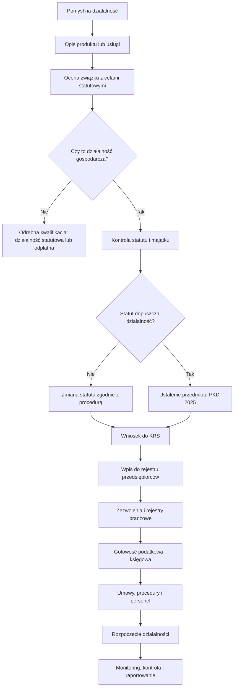

# 19.1. Działalność gospodarcza fundacji

## Istota, cele, warunki prawne, statut, majątek, wpis do KRS, PKD 2025, organizacja przedsiębiorczej części fundacji i odpowiedzialność zarządu

**Moduł:** 19 – Gospodarczo użyteczna działalność fundacji  
**Stan prawny opracowania:** 27 listopada 2026 r.  
**Zakres terytorialny:** Rzeczpospolita Polska  
**Adresaci:** fundatorzy, członkowie zarządów i organów nadzoru, dyrektorzy jednostek organizacyjnych, księgowi, prawnicy, koordynatorzy projektów oraz osoby odpowiedzialne za rozwój działalności fundacji.

> **Myśl przewodnia**
>
> Działalność gospodarcza fundacji jest dopuszczalnym narzędziem pozyskiwania środków i rozwijania zdolności organizacyjnej, ale nie zmienia fundacji w podmiot, którego celem jest prywatne bogacenie się fundatora lub osób zarządzających. Przedsiębiorczość fundacji powinna pozostawać w granicach prawa, statutu, zasad rzetelnego gospodarowania i społecznie lub gospodarczo użytecznego celu, dla którego fundacja została ustanowiona.

---

## Mapa zgodności z aktualnym konspektem

| Pozycja konspektu | Miejsce opracowania |
|---|---|
| 1. Istota działalności gospodarczej | Rozdziały 2–3 |
| 2. Działalność gospodarcza jako źródło finansowania celów statutowych | Rozdziały 3–4 i 14–15 |
| 3. Warunki prowadzenia działalności gospodarczej | Rozdziały 4, 6 i 7 |
| 4. Zapisy statutowe | Rozdział 5 |
| 5. Wpis do rejestru przedsiębiorców KRS | Rozdział 6 |
| 6. Przedmiot działalności według PKD | Rozdział 7 |
| 7. Organizacja działalności gospodarczej | Rozdziały 8–12 |
| 8. Rozdzielenie działalności gospodarczej i statutowej | Rozdział 9 |
| 9. Zarządzanie przedsiębiorczą częścią fundacji | Rozdziały 10, 11 i 19 |
| 10. Odpowiedzialność zarządu | Rozdział 20 |

### Granice względem innych rozdziałów

Niniejszy rozdział rozwija temat prowadzenia działalności gospodarczej przez fundację jako osobę prawną. Nie powtarza w całości:

- rozdziału 16.2 dotyczącego ustanowienia fundacji, funduszu założycielskiego, pierwszej rejestracji, NIP i REGON;
- rozdziału 16.3 dotyczącego budowy statutu, celów, organów, reprezentacji i przykładowych klauzul;
- rozdziałów 18.1–18.3 dotyczących odpłatnej działalności pożytku publicznego, kalkulacji odpłatności i granic między działalnością odpłatną a gospodarczą;
- modułu 21 dotyczącego całościowego zarządzania finansami i rachunkowości;
- modułu 22 dotyczącego szczegółowych rozliczeń CIT, VAT, PIT i ubezpieczeń;
- modułu 23 dotyczącego kontroli, nadzoru i odpowiedzialności w ujęciu przekrojowym.

W tym rozdziale zagadnienia te są przywoływane w takim zakresie, w jakim są niezbędne do zaprojektowania i bezpiecznego uruchomienia przedsiębiorczej części fundacji.

---

# 1. Cel, zakres i efekty kształcenia

## 1.1. Cel rozdziału

Celem rozdziału jest przygotowanie uczestnika do oceny, czy fundacja może prowadzić określoną działalność gospodarczą, jakie warunki musi spełnić przed rozpoczęciem sprzedaży towarów lub usług, jak prawidłowo ująć działalność w statucie i Krajowym Rejestrze Sądowym oraz jak zorganizować ją bez naruszania misji, majątku i wiarygodności fundacji.

Działalność gospodarcza fundacji wymaga połączenia czterech perspektyw:

1. **Prawnej** – czy podmiot, statut, zakres czynności i sposób ich wykonywania pozwalają na legalne prowadzenie działalności.
2. **Ekonomicznej** – czy przedsięwzięcie ma uzasadnienie rynkowe, wystarczające zasoby, płynność i racjonalny model finansowania.
3. **Organizacyjnej** – kto podejmuje decyzje, zawiera umowy, odpowiada za sprzedaż, jakość, personel, bezpieczeństwo i kontrolę.
4. **Społecznej i etycznej** – czy przedsięwzięcie służy celom fundacji, nie wykorzystuje beneficjentów ani darczyńców i nie prowadzi do nieuzasadnionego uprzywilejowania osób powiązanych.

## 1.2. Efekty uczenia się

Po ukończeniu rozdziału uczestnik:

- wyjaśnia, czym jest działalność gospodarcza w rozumieniu Prawa przedsiębiorców;
- odróżnia działalność gospodarczą od działalności statutowej nieodpłatnej i odpłatnej;
- zna ograniczenie wynikające z art. 5 ust. 5 ustawy o fundacjach;
- potrafi ocenić, czy statut dopuszcza planowaną działalność gospodarczą;
- rozumie, kiedy konieczna jest uprzednia zmiana statutu;
- wskazuje różnicę między rejestrem fundacji a rejestrem przedsiębiorców KRS;
- potrafi przygotować listę danych i dokumentów potrzebnych do zgłoszenia działalności;
- dobiera przedmiot działalności według PKD 2025 na podstawie rzeczywistych czynności;
- rozumie, dlaczego fundacja nie rejestruje własnej działalności w CEIDG;
- projektuje wewnętrzne rozdzielenie działalności gospodarczej i statutowej;
- rozpoznaje sytuacje wymagające zezwolenia, koncesji, wpisu do rejestru branżowego lub spełnienia szczególnych wymagań;
- wskazuje podstawowe obowiązki podatkowe, rachunkowe, pracownicze i konsumenckie;
- rozumie zakres odpowiedzialności zarządu, w tym szczególną odpowiedzialność za zaległości podatkowe;
- przygotowuje plan uruchomienia działalności gospodarczej z kontrolą ryzyk.

## 1.3. Zasada nadrzędna

Nie należy rozpoczynać od wyboru kodu PKD, zakupu sprzętu ani przygotowania cennika. Prawidłowa kolejność jest następująca:

1. określenie rzeczywistego świadczenia;
2. ustalenie jego związku z celami fundacji;
3. kwalifikacja prawna modelu działalności;
4. sprawdzenie statutu i majątku;
5. przygotowanie uchwał i dokumentacji;
6. dokonanie wymaganego wpisu do rejestru przedsiębiorców;
7. uzyskanie zezwoleń lub wpisów branżowych;
8. przygotowanie księgowości, podatków, umów i procedur;
9. dopiero potem rozpoczęcie sprzedaży.

---

# 2. Pojęcie działalności gospodarczej

## 2.1. Definicja ustawowa

Zgodnie z art. 3 ustawy – Prawo przedsiębiorców działalnością gospodarczą jest zorganizowana działalność zarobkowa, wykonywana we własnym imieniu i w sposób ciągły.

Definicja zawiera cztery elementy, które należy analizować łącznie:

| Element | Znaczenie praktyczne | Pytanie kontrolne |
|---|---|---|
| Zorganizowanie | Istnieje plan, zasoby, sposób działania, podział zadań i obsługa transakcji | Czy fundacja stworzyła powtarzalny sposób oferowania towarów lub usług? |
| Zarobkowość | Działalność jest ukierunkowana na uzyskiwanie przychodów i ekonomiczny rezultat | Czy fundacja oferuje świadczenia w celu uzyskiwania przychodów, a nie tylko zwrotu rzeczywiście poniesionych kosztów w reżimie odpłatnej działalności pożytku publicznego? |
| Wykonywanie we własnym imieniu | Fundacja jest stroną relacji gospodarczej i działa na własny rachunek oraz ryzyko | Kto zawiera umowę, wystawia dokument sprzedaży i ponosi odpowiedzialność wobec klienta? |
| Ciągłość | Działania mają powtarzalny lub zaplanowany charakter, nawet jeżeli są sezonowe | Czy oferta jest dostępna regularnie, w kolejnych edycjach lub według stałego modelu? |

Nie jest konieczne, aby przedsięwzięcie przynosiło zysk w każdym miesiącu. Działalność może być gospodarcza także wtedy, gdy początkowo przynosi stratę, jeżeli jest zorganizowana i zarobkowa w rozumieniu ustawy.

## 2.2. Zarobkowość nie oznacza gwarancji zysku

Należy odróżnić:

- zamiar uzyskiwania przychodów;
- rzeczywiste uzyskanie przychodu;
- wynik finansowy po odjęciu kosztów;
- dochód podatkowy;
- środki pieniężne dostępne na rachunku bankowym.

Przedsięwzięcie może być działalnością gospodarczą mimo braku dodatniego wyniku. Z kolei samo otrzymanie pieniędzy nie przesądza o prowadzeniu działalności gospodarczej. Darowizna, dotacja, grant, składka lub zwrot kosztów wymagają odrębnej kwalifikacji.

## 2.3. Zorganizowanie działalności

Zorganizowanie może przejawiać się w szczególności przez:

- przygotowanie oferty;
- ustalenie zasad przyjmowania zamówień;
- utworzenie kanału sprzedaży;
- prowadzenie ewidencji klientów i transakcji;
- zapewnienie personelu lub współpracowników;
- zakup materiałów i sprzętu;
- zawieranie umów z dostawcami;
- ustalenie warunków reklamacji;
- planowanie przychodów i wydatków;
- prowadzenie promocji i obsługi posprzedażowej.

Nie jest wymagane posiadanie rozbudowanego lokalu, sklepu ani dużego zespołu. Działalność internetowa lub niewielka pracownia również mogą mieć charakter zorganizowany.

## 2.4. Ciągłość i działalność sezonowa

Ciągłość nie oznacza konieczności codziennego wykonywania czynności. Działalność może być prowadzona:

- w cyklach szkoleniowych;
- w sezonie turystycznym;
- w okresach świątecznych;
- w terminach wydarzeń kulturalnych;
- w ramach regularnych kampanii sprzedażowych;
- w formie kolejnych projektów, jeżeli tworzą powtarzalny model świadczenia usług.

Jednorazowe rozporządzenie składnikiem majątku nie musi być działalnością gospodarczą. Nie wolno jednak automatycznie uznawać powtarzalnej sprzedaży za czynność niegospodarczą tylko dlatego, że każda sprzedaż jest odrębną umową.

## 2.5. Działalność gospodarcza a brak celu prywatnego

Fundacja może prowadzić działalność zarobkową, mimo że nie ma właścicieli uprawnionych do dywidendy. Zarobkowy charakter działalności oznacza ukierunkowanie na przychód, a nie obowiązek wypłacania zysku osobom fizycznym.

Fundacja pozostaje osobą prawną realizującą cele określone w statucie. Jej majątek nie jest majątkiem fundatora, członków zarządu ani pracowników.

## 2.6. Przykłady kwalifikacji

| Sytuacja | Wstępna ocena | Co trzeba zbadać |
|---|---|---|
| Fundacja sprzedaje regularnie publikacje własnego wydawnictwa | Może stanowić działalność gospodarczą | Organizacja sprzedaży, cel zarobkowy, statut, PKD, VAT i prawa autorskie |
| Fundacja otrzymuje darowiznę na konkretny program | Sama darowizna nie jest sprzedażą | Umowa, cel, warunki wykorzystania i dokumentacja |
| Fundacja organizuje odpłatny kurs w ramach działalności odpłatnej pożytku publicznego | Może pozostawać działalnością odpłatną, jeżeli spełnia ustawowe warunki | Art. 8–10 ustawy o pożytku publicznym i wyniki testów z art. 9 |
| Fundacja prowadzi stale sklep internetowy | Co do zasady wymaga analizy jako działalność gospodarcza | Faktyczny model sprzedaży, rejestracja, PKD, VAT, prawa konsumenta |
| Fundacja raz sprzedaje zużyty składnik majątku | Nie przesądza samo przez się o działalności gospodarczej | Cel sprzedaży, częstotliwość, sposób organizacji i przepisy szczególne |

---

# 3. Działalność gospodarcza jako źródło finansowania celów statutowych

## 3.1. Relacja między misją a przedsiębiorczością

Ustawa o fundacjach dopuszcza prowadzenie działalności gospodarczej w rozmiarach służących realizacji celów fundacji. Oznacza to, że przedsięwzięcie gospodarcze powinno pozostawać w racjonalnym związku z misją i majątkiem fundacji.

Związek ten może mieć różne postacie:

1. **Bezpośrednie wsparcie celu** – sprzedaż materiałów edukacyjnych finansuje rozwój edukacji.
2. **Finansowanie krzyżowe** – dochód z usług komercyjnych umożliwia finansowanie bezpłatnych programów społecznych.
3. **Wykorzystanie zasobów** – wynajem pomieszczeń lub sprzętu pozwala lepiej wykorzystywać majątek fundacji.
4. **Rozwój kompetencji** – działalność szkoleniowa umożliwia rozwijanie kadry i metod pracy.
5. **Tworzenie miejsc pracy** – przedsięwzięcie gospodarcze zapewnia zatrudnienie osobom, którym fundacja pomaga.
6. **Trwałość finansowa** – powtarzalne przychody zmniejszają zależność od jednorazowych darowizn i konkursów grantowych.

## 3.2. Ograniczenie rozmiarów działalności

Sformułowanie „w rozmiarach służących realizacji jej celów” należy traktować jako ustawowe ograniczenie i wskazówkę ustrojową. Nie jest to jednak prosty wskaźnik procentowy, który nakazuje, aby przychody gospodarcze zawsze były niższe od przychodów statutowych.

Ocenie podlegają w szczególności:

- związek działalności z celami fundacji;
- treść statutu;
- rzeczywisty sposób wykorzystania zasobów;
- wpływ przedsięwzięcia na zdolność realizacji celów;
- ryzyko gospodarcze;
- skala zatrudnienia i inwestycji;
- sposób wykorzystania wypracowanego wyniku;
- ewentualne szczególne ograniczenia dotyczące statusu OPP lub konkretnego rodzaju działalności.

Fundacja nie powinna budować przedsięwzięcia, które w praktyce wypiera cele statutowe i służy wyłącznie działalności komercyjnej oderwanej od misji.

## 3.3. Dochód jako narzędzie, nie prywatna korzyść

Dochód uzyskany przez fundację zwiększa jej zasoby. Nie tworzy prawa fundatora do wypłaty udziału w zysku, ponieważ fundacja nie jest spółką z udziałami ani akcjami.

Właściwe kierunki wykorzystania wyniku mogą obejmować:

- finansowanie programów statutowych;
- zakup wyposażenia;
- rozwój infrastruktury;
- tworzenie rezerw na zobowiązania;
- utrzymanie płynności;
- szkolenie personelu;
- rozwój nowych usług;
- pokrywanie uzasadnionych kosztów działalności;
- inwestycje służące realizacji celów fundacji.

Nie oznacza to zakazu wypłacania wynagrodzeń za rzeczywiście wykonaną pracę lub usługę. Wynagrodzenie musi jednak mieć rzeczywistą podstawę, odpowiadać zakresowi czynności, być prawidłowo zatwierdzone i udokumentowane oraz nie może stanowić ukrytej dystrybucji majątku.

## 3.4. Przedsiębiorczość a działalność statutowa

Działalność gospodarcza nie powinna zastępować całej działalności statutowej. Fundacja powinna zachować zdolność do realizowania celów również wtedy, gdy przedsięwzięcie gospodarcze czasowo przynosi stratę.

Przykład: fundacja prowadzi kursy komercyjne dla osób prywatnych, a równocześnie organizuje bezpłatne warsztaty dla osób w trudnej sytuacji. Właściwie zaprojektowany model może wykorzystywać dochód z kursów do finansowania warsztatów, ale musi mieć odrębne zasady kwalifikowania przychodów, kosztów, umów i świadczeń.

## 3.5. Przedsiębiorczość społeczna

Przedsiębiorczość społeczna polega na wykorzystaniu mechanizmów rynkowych do realizowania celów społecznych. Nie każda fundacja prowadząca działalność gospodarczą automatycznie uzyskuje status przedsiębiorstwa społecznego.

Status przedsiębiorstwa społecznego wymaga spełnienia przesłanek odrębnych przepisów, w szczególności ustawy o ekonomii społecznej. Należy odróżniać:

- fundację prowadzącą działalność gospodarczą;
- fundację prowadzącą odpłatną działalność pożytku publicznego;
- podmiot ekonomii społecznej;
- przedsiębiorstwo społeczne posiadające formalny status.

---

# 4. Warunki prowadzenia działalności gospodarczej przez fundację

## 4.1. Warunki podstawowe

Przed uruchomieniem działalności gospodarczej należy potwierdzić co najmniej:

1. fundacja istnieje jako osoba prawna i jest wpisana do KRS;
2. statut dopuszcza prowadzenie planowanej działalności gospodarczej;
3. zakres działalności jest zgodny z celami fundacji;
4. zostały przeznaczone środki majątkowe w wysokości co najmniej 1000 zł;
5. fundacja została wpisana do rejestru przedsiębiorców KRS;
6. wybrano właściwe przedmioty działalności według aktualnej PKD;
7. uzyskano wymagane zezwolenia, koncesje lub wpisy branżowe;
8. przygotowano księgowość, podatki, umowy i procedury;
9. zarząd ocenił ryzyka i zatwierdził sposób prowadzenia przedsięwzięcia.

## 4.2. Minimalna wartość środków majątkowych – 1000 zł

Art. 5 ust. 5 ustawy o fundacjach przewiduje, że jeżeli fundacja ma prowadzić działalność gospodarczą, wartość środków majątkowych fundacji przeznaczonych na tę działalność nie może być mniejsza niż 1000 zł.

Należy prawidłowo rozumieć ten warunek:

- chodzi o wartość środków majątkowych przeznaczonych na działalność gospodarczą;
- nie jest to opłata rejestracyjna;
- nie jest to wynagrodzenie dla sądu;
- nie jest to kapitał zakładowy spółki;
- nie oznacza automatycznie konieczności wpłacenia dodatkowych 1000 zł ponad cały fundusz założycielski;
- nie należy utożsamiać tego warunku z minimalną kwotą obrotu;
- nie zwalnia on z obowiązku zapewnienia rzeczywistych zasobów potrzebnych do bezpiecznego prowadzenia działalności.

Składniki majątkowe mogą obejmować pieniądze, papiery wartościowe oraz rzeczy ruchome lub nieruchomości, jeżeli spełniają wymagania prawne i zostały skutecznie przekazane fundacji. Przy składnikach niepieniężnych konieczna jest rzetelna wycena i dokumentacja.

**Przykład:** fundacja dysponuje wyposażeniem pracowni, które ma być wykorzystywane w działalności gospodarczej. Samo wpisanie w uchwale wartości 1000 zł nie wystarcza, jeżeli nie można wykazać, że fundacja rzeczywiście posiada dany składnik, ma do niego tytuł prawny i przeznaczyła go na działalność gospodarczą.

## 4.3. Czy 1000 zł jest wystarczającym kapitałem operacyjnym?

Nie. Minimalna wartość ustawowa nie jest prognozą kosztów ani gwarancją płynności.

Przedsięwzięcie może wymagać znacznie większych zasobów, np.:

- zapasu towarów;
- wynajmu lokalu;
- wyposażenia;
- licencji;
- ubezpieczenia;
- wynagrodzeń;
- kosztów promocji;
- kosztów obsługi księgowej;
- środków na zwroty i reklamacje;
- rezerwy na sezonowość i opóźnienia płatności.

Zarząd powinien więc odrębnie ustalić minimalną wartość majątku wymaganą ustawą oraz realny kapitał obrotowy niezbędny do realizacji planu.

## 4.4. Brak automatycznego zwolnienia z wymagań branżowych

Wpis do rejestru przedsiębiorców KRS nie daje automatycznie prawa do wykonywania każdej działalności.

W zależności od rodzaju usług mogą być wymagane:

- koncesje;
- zezwolenia;
- licencje;
- wpisy do rejestrów działalności regulowanej;
- wpisy do rejestrów sektorowych;
- kwalifikacje zawodowe;
- warunki lokalowe i sanitarne;
- ubezpieczenie odpowiedzialności cywilnej;
- wymagania dotyczące sprzętu, bezpieczeństwa i nadzoru.

Przykładowo działalność lecznicza podlega ustawie o działalności leczniczej. Sam wpis kodu PKD dotyczącego usług zdrowotnych nie zastępuje wpisu do Rejestru Podmiotów Wykonujących Działalność Leczniczą, jeżeli taki wpis jest wymagany.

## 4.5. Odpowiedzialność za rozpoznanie wymagań

Przed uruchomieniem usługi zarząd powinien sporządzić kartę kwalifikacji prawnej, w której wskazuje:

- nazwę i opis usługi;
- odbiorców;
- sposób świadczenia;
- podstawę prawną;
- ewentualne regulacje sektorowe;
- wymagane uprawnienia;
- wymagane wpisy i zezwolenia;
- osobę odpowiedzialną za weryfikację;
- datę kolejnego przeglądu.

Nie należy rozpoczynać świadczenia regulowanego wyłącznie na podstawie zapewnienia dostawcy, kontrahenta lub osoby prowadzącej szkolenie.

---

# 5. Zapisy statutowe

## 5.1. Statut jako podstawa ustrojowa

Art. 5 ust. 1 ustawy o fundacjach określa podstawowe elementy statutu, a wśród możliwych dodatkowych postanowień wymienia prowadzenie przez fundację działalności gospodarczej.

Statut powinien pozwalać ustalić:

- czy fundacja może prowadzić działalność gospodarczą;
- w jakim zakresie;
- w jaki sposób działalność ma wspierać cele fundacji;
- który organ podejmuje decyzje o jej rozpoczęciu;
- kto odpowiada za zarządzanie i nadzór;
- jak rozdzielane są kompetencje i reprezentacja.

Nie należy utożsamiać samego ogólnego zapisu o „pozyskiwaniu środków” z jednoznacznym upoważnieniem do prowadzenia działalności gospodarczej.

## 5.2. Działalność nieprzewidziana w statucie

Art. 11 ust. 1 ustawy o fundacjach przewiduje, że podjęcie przez fundację działalności gospodarczej nieprzewidzianej w statucie wymaga uprzedniej zmiany statutu.

Zgodnie z art. 11 ust. 2 zmiana statutu wymaga wpisania do KRS. Przepisy dotyczące kontroli zgodności statutu z prawem stosuje się odpowiednio.

Praktyczne znaczenie:

1. zarząd identyfikuje planowany zakres;
2. porównuje go z aktualnym statutem;
3. jeżeli zakres nie jest objęty statutem, uruchamia procedurę jego zmiany;
4. organ właściwy zgodnie ze statutem podejmuje uchwałę;
5. fundacja składa wymagany wniosek do KRS;
6. po uzyskaniu wpisu weryfikuje zgodność statutu, danych rejestrowych i planowanego przedmiotu działalności.

Nie należy rozpoczynać działalności na podstawie samej uchwały, jeżeli wymagany wpis zmiany statutu nie został jeszcze dokonany.

## 5.3. Zakres statutu a PKD

Statut i PKD pełnią różne funkcje:

| Statut | PKD |
|---|---|
| Określa ustrojowe ramy działania fundacji | Klasyfikuje rodzaje działalności |
| Wiąże fundację, jej organy i sposób realizacji celów | Służy identyfikacji działalności w rejestrach i statystyce |
| Powinien być zgodny z celami fundacji | Powinno odzwierciedlać faktyczne czynności |
| Nie jest katalogiem wszystkich szczegółowych operacji | Nie zastępuje opisu celu ani podstawy prawnej |
| Zmiana wymaga procedury określonej w statucie i przepisach | Aktualizacja następuje zgodnie z zasadami rejestrowymi |

Nie należy wpisywać do statutu przypadkowego katalogu kodów tylko dlatego, że są dostępne w wyszukiwarce. Najpierw należy opisać rzeczywiste obszary działalności, a następnie dobrać właściwe kody.

## 5.4. Przykładowa klauzula statutowa

Poniższy zapis ma charakter dydaktyczny i wymaga dostosowania do konkretnego statutu:

> Fundacja może prowadzić działalność gospodarczą w zakresie dopuszczonym przez powszechnie obowiązujące przepisy prawa, w rozmiarach służących realizacji jej celów statutowych. Działalność gospodarcza ma charakter służebny wobec celów Fundacji i nie może prowadzić do naruszenia jej misji, zasad gospodarowania majątkiem ani praw osób korzystających ze wsparcia Fundacji.
>
> Szczegółowy przedmiot działalności gospodarczej określa się zgodnie z obowiązującą Polską Klasyfikacją Działalności i ujawnia w Krajowym Rejestrze Sądowym w zakresie wymaganym przepisami.
>
> Dochód uzyskiwany z działalności gospodarczej pozostaje majątkiem Fundacji i jest wykorzystywany zgodnie z ustawą, statutem oraz uchwałami właściwych organów.

Klauzula nie zastępuje określenia zakresu działalności, jeżeli statut lub przepisy wymagają jego konkretyzacji. Nie może również uchylać szczególnych wymagań branżowych.

## 5.5. Zasady przygotowania zmiany statutu

Przed zmianą należy sprawdzić:

- organ uprawniony do zmiany statutu;
- wymaganą większość głosów;
- kworum;
- sposób zwołania posiedzenia;
- możliwość udziału zdalnego;
- zasady wyłączenia osób w konflikcie interesów;
- formę uchwały;
- wymagane dokumenty do KRS;
- zgodność zmiany z aktem fundacyjnym;
- spójność z pozostałymi postanowieniami statutu.

Nie należy kopiować procedury zmiany statutu innej fundacji bez sprawdzenia jej własnych postanowień.

---

# 6. Wpis do rejestru przedsiębiorców KRS

## 6.1. Dwa rejestry w ramach KRS

Krajowy Rejestr Sądowy obejmuje odrębne rejestry, w tym:

1. rejestr przedsiębiorców;
2. rejestr stowarzyszeń, innych organizacji społecznych i zawodowych, fundacji oraz samodzielnych publicznych zakładów opieki zdrowotnej.

Fundacja podlega wpisowi do rejestru fundacji. Jeżeli podejmuje działalność gospodarczą, art. 50 ustawy o KRS nakłada obowiązek wpisu także do rejestru przedsiębiorców, z uwzględnieniem ustawowych wyjątków.

Nie powstaje przez to druga fundacja. Nadal działa ta sama osoba prawna, z tym samym numerem KRS, majątkiem i organami, lecz jej dane ujawniane są również w rejestrze przedsiębiorców.

## 6.2. Fundacja nie rejestruje własnej działalności w CEIDG

CEIDG jest ewidencją przedsiębiorców będących osobami fizycznymi. Fundacja jest osobą prawną, dlatego działalność gospodarcza fundacji jest ujawniana w KRS, a nie przez wpis fundacji do CEIDG.

Członek zarządu nie staje się z tego powodu indywidualnym przedsiębiorcą. Nie należy rejestrować działalności fundacji na prywatny NIP członka zarządu.

## 6.3. Moment rozpoczęcia działalności

Art. 17 ust. 1 Prawa przedsiębiorców stanowi, że działalność gospodarczą można podjąć po dokonaniu wpisu do rejestru przedsiębiorców KRS, chyba że przepisy szczególne stanowią inaczej.

Dla fundacji oznacza to, że samo:

- podjęcie uchwały zarządu;
- przyjęcie zmiany statutu;
- wysłanie wniosku;
- przygotowanie sklepu internetowego;
- podpisanie umowy z dostawcą

nie zastępuje wymaganego wpisu do rejestru przedsiębiorców.

Przed wpisem można wykonywać czynności przygotowawcze w granicach prawa, ale nie należy rozpoczynać sprzedaży, która stanowi już działalność gospodarczą fundacji.

## 6.4. Portal Rejestrów Sądowych

Wnioski dotyczące podmiotu podlegającego wpisowi do rejestru przedsiębiorców składa się za pośrednictwem systemu teleinformatycznego. W praktyce należy korzystać z e-formularzy dostępnych w Portalu Rejestrów Sądowych.

S24 nie jest uniwersalnym narzędziem do rejestracji fundacji. Portal S24 obsługuje określone typy spółek i czynności wskazane przez Ministerstwo Sprawiedliwości. Dla fundacji należy wybrać właściwą ścieżkę e-formularzy KRS.

Oficjalny portal: [Portal Rejestrów Sądowych – KRS](https://prs.ms.gov.pl/krs/).

## 6.5. Zakres przygotowania wniosku

Przed wypełnieniem wniosku należy zgromadzić:

- aktualny statut;
- uchwałę właściwego organu, jeżeli jest wymagana;
- tekst jednolity statutu po zmianie, jeżeli zmiana została dokonana;
- dane fundacji i numer KRS;
- aktualne dane zarządu i sposób reprezentacji;
- informację o przedmiocie działalności;
- wybrane kody PKD;
- dokumenty potwierdzające wymagane zezwolenia, jeżeli są wymagane na etapie rejestracji;
- dane osób uprawnionych do podpisania i wysłania wniosku;
- dokumenty potwierdzające prawidłowe umocowanie.

Zakres załączników należy zweryfikować w aktualnym formularzu i instrukcji PRS, ponieważ wymagania techniczne i formularzowe mogą ulegać zmianom.

## 6.6. Zmiana statutu i wpis przedsiębiorcy

Jeżeli statut nie przewiduje działalności gospodarczej, trzeba najpierw przeprowadzić prawidłową zmianę. Wniosek rejestrowy powinien odzwierciedlać aktualny stan prawny, a nie jedynie planowany.

W praktyce należy skoordynować:

- uchwałę o zmianie statutu;
- treść nowego statutu;
- zgłoszenie zmiany;
- zgłoszenie działalności gospodarczej;
- wykaz przedmiotu działalności;
- wymagane dokumenty i oświadczenia.

W zależności od sytuacji można składać wnioski w sposób skoordynowany, ale nie wolno zakładać, że wpis działalności gospodarczej automatycznie naprawi brak podstawy statutowej.

## 6.7. Terminy i aktualizacja wpisów

Co do zasady wniosek o wpis do KRS powinien zostać złożony w terminie wynikającym z art. 22 ustawy o KRS, z uwzględnieniem przepisów szczególnych. Należy pilnować również terminów zgłaszania zmian danych, organów, reprezentacji i przedmiotu działalności.

Wpisy KRS korzystają z domniemań i zasad jawności. Nieaktualne dane mogą wprowadzać w błąd kontrahentów, grantodawców i instytucje publiczne.

## 6.8. Kontrola po wpisie

Po uzyskaniu wpisu należy pobrać aktualny odpis KRS i porównać go z dokumentami fundacji.

Sprawdź:

- czy ujawniono właściwy rodzaj wpisu;
- czy zakres przedmiotu działalności jest prawidłowy;
- czy wskazano prawidłowy przedmiot przeważającej działalności;
- czy dane zarządu i reprezentacji są aktualne;
- czy nie wystąpiła rozbieżność między statutem a wpisem;
- czy dane są prawidłowo przekazane do REGON i administracji podatkowej.

---

# 7. Przedmiot działalności według PKD 2025

## 7.1. Rola klasyfikacji PKD

Polska Klasyfikacja Działalności opisuje rodzaje działalności prowadzonej przez podmiot. Kody PKD służą identyfikacji działalności w rejestrach, statystyce i dokumentacji.

Kod PKD nie jest:

- zezwoleniem na wykonywanie działalności regulowanej;
- potwierdzeniem kwalifikacji zawodowych;
- decyzją o zwolnieniu z VAT;
- dowodem, że działalność jest zgodna ze statutem;
- substytutem wpisu do rejestru przedsiębiorców.

## 7.2. PKD 2025 – stan na 27 listopada 2026 r.

Od 1 stycznia 2025 r. obowiązuje nowa Polska Klasyfikacja Działalności – PKD 2025, wprowadzona rozporządzeniem Rady Ministrów z 18 grudnia 2024 r., Dz. U. 2024 poz. 1936.

W okresie przejściowym do 31 grudnia 2026 r. mogą występować w rejestrach zarówno oznaczenia PKD 2007, jak i PKD 2025, zależnie od historii wpisu i rodzaju wniosku.

Dla nowych wpisów i wniosków dotyczących przedmiotu działalności po 1 stycznia 2025 r. należy stosować PKD 2025.

**Ważny termin:** do 31 grudnia 2026 r. trwa możliwość samodzielnego dostosowania istniejących wpisów z PKD 2007 do PKD 2025. Od 1 stycznia 2027 r. przewidziano automatyczne przeklasyfikowanie dotychczasowych oznaczeń według kluczy przejścia. Automatyczne przyporządkowanie nie zawsze odzwierciedli szczegółowy profil działalności, dlatego fundacja powinna zweryfikować swoje kody przed upływem okresu przejściowego.

## 7.3. Dobór kodów na podstawie rzeczywistych czynności

Procedura wyboru kodu:

1. sporządź listę rzeczywistych towarów i usług;
2. opisz sposób ich wykonywania;
3. ustal, czy fundacja sprzedaje produkt, usługę, pośrednictwo czy wynajem;
4. sprawdź właściwe grupowanie w PKD 2025;
5. porównaj opis podklasy z faktyczną działalnością;
6. sprawdź wyłączenia i uwagi do klasyfikacji;
7. wybierz przedmiot przeważający zgodnie z rzeczywistym profilem;
8. wybierz pozostałe przedmioty działalności w granicach dopuszczonych przez rejestr;
9. sprawdź zgodność ze statutem;
10. zapisz uzasadnienie doboru kodów w dokumentacji fundacji.

## 7.4. Przedmiot przeważającej działalności

Przedmiot przeważający powinien odpowiadać zasadniczemu profilowi gospodarczemu fundacji, a nie być wybierany wyłącznie dlatego, że kod wydaje się korzystniejszy marketingowo lub administracyjnie.

Przy istniejącej działalności można posłużyć się udziałem poszczególnych rodzajów sprzedaży w przychodach, a przy rozpoczynaniu działalności – racjonalną prognozą.

## 7.5. Liczba pozycji w KRS

W praktyce rejestrowej KRS ujawnia ograniczoną liczbę pozycji PKD. Informacje rządowe wskazują limit do 10 pozycji, w tym przedmiot przeważający. Z tego względu należy wybrać działalności rzeczywiście istotne, a nie tworzyć przypadkowy katalog wszystkich możliwych usług.

Nie należy jednak utożsamiać liczby kodów ujawnionych w KRS z pełnym opisem celów statutowych. Statut i dokumentacja organizacyjna powinny zachować odpowiednią precyzję.

## 7.6. Przykładowe obszary działalności fundacji

Poniższa tabela nie przypisuje automatycznie kodów PKD. Pokazuje obszary, dla których należy odrębnie przeprowadzić klasyfikację.

| Obszar | Przykładowa czynność | Dodatkowe kwestie |
|---|---|---|
| Sprzedaż produktów | Sprzedaż wyrobów, materiałów lub wyposażenia | VAT, prawa konsumenta, bezpieczeństwo produktu |
| Wydawnictwo | Sprzedaż książek, podręczników i materiałów | Prawa autorskie, VAT, umowy z autorami |
| Szkolenia | Organizacja odpłatnych szkoleń | Status usługi, kwalifikacje, warunki uczestnictwa |
| Edukacja | Kursy i usługi edukacyjne | Granica między edukacją nieformalną a systemem oświaty |
| Doradztwo | Usługi konsultacyjne | Odpowiedzialność kontraktowa, kwalifikacje branżowe |
| Wynajem | Wynajem pomieszczeń, sal lub wyposażenia | Tytuł prawny, podatki, bezpieczeństwo |
| Informatyka | Usługi IT i utrzymanie systemów | Licencje, prawa autorskie, bezpieczeństwo danych |
| Kultura | Organizacja wydarzeń i produkcja materiałów | Prawa autorskie, licencje, bezpieczeństwo imprez |
| Usługi wspierające zdrowie | Usługi pomocnicze i edukacyjne | Zakaz wkraczania w działalność leczniczą bez wymaganych uprawnień |
| Produkcja | Wytwarzanie przedmiotów | Bezpieczeństwo produktów, normy i odpowiedzialność |
| Handel | Sprzedaż towarów | VAT, kasa fiskalna, reklamacje, e-commerce |
| Przedsiębiorczość społeczna | Produkcja i sprzedaż z udziałem beneficjentów | Prawo pracy, dostępność, ochrona osób wrażliwych |

## 7.7. Dokumentowanie wyboru PKD

Warto prowadzić rejestr:

| Pole | Przykładowa zawartość |
|---|---|
| Nazwa usługi | Sprzedaż materiałów edukacyjnych |
| Opis czynności | Przygotowanie, magazynowanie, sprzedaż i wysyłka |
| Odbiorcy | Osoby fizyczne i instytucje |
| Kod PKD 2025 | Uzupełnić po weryfikacji klasyfikacji |
| Podstawa statutowa | Odpowiedni paragraf statutu |
| Wymogi branżowe | Prawa autorskie, bezpieczeństwo produktu |
| Data weryfikacji | Data sprawdzenia klasyfikacji |
| Osoba odpowiedzialna | Imię, nazwisko, funkcja |

---

# 8. Organizacja działalności gospodarczej

## 8.1. Działalność jako część tej samej osoby prawnej

Jeżeli fundacja prowadzi działalność gospodarczą bez tworzenia odrębnej spółki, przedsiębiorcza część działalności nie staje się odrębną osobą prawną.

Oznacza to, że:

- stroną umów jest fundacja;
- właścicielem majątku pozostaje fundacja;
- zobowiązania powstają po stronie fundacji;
- pracodawcą pozostaje fundacja;
- odpowiedzialność wobec klientów ponosi fundacja;
- rachunkowość musi obejmować całą osobę prawną, z odpowiednim wyodrębnieniem działalności.

Można tworzyć wewnętrzne działy, pracownie, sklepy, zespoły, centra usług lub jednostki organizacyjne, ale sam regulamin nie nadaje im osobowości prawnej.

## 8.2. Model organizacyjny

Przykładowy model:

```text
FUNDACJA
│
├── ZARZĄD
│   ├── strategia i uchwały
│   ├── nadzór nad ryzykiem
│   └── reprezentacja
│
├── DZIAŁ STATUTOWY
│   ├── programy społeczne
│   ├── edukacja nieodpłatna
│   ├── pomoc i opieka
│   └── działalność religijna
│
├── DZIAŁ GOSPODARCZY
│   ├── sprzedaż i obsługa klienta
│   ├── usługi i szkolenia
│   ├── produkcja lub wynajem
│   └── marketing i rozwój oferty
│
├── DZIAŁ FINANSOWO-KSIĘGOWY
│   ├── ewidencja analityczna
│   ├── podatki
│   ├── płynność
│   └── sprawozdawczość
│
└── KONTROLA I ZGODNOŚĆ
    ├── umowy i upoważnienia
    ├── ochrona danych
    ├── reklamacje
    └── audyt wewnętrzny
```

Jest to model organizacyjny, a nie ustawowy obowiązek tworzenia wszystkich wymienionych działów. Zakres komórek należy dostosować do skali działalności.

## 8.3. Wewnętrzny regulamin działalności gospodarczej

Regulamin powinien określać:

- cel i zakres działalności;
- osoby odpowiedzialne;
- sposób zatwierdzania ofert;
- zasady zawierania umów;
- progi akceptacji wydatków;
- sposób ustalania cen;
- obieg dokumentów;
- zasady przyjmowania płatności;
- zasady zwrotów i reklamacji;
- ewidencję zasobów;
- rozdzielanie kosztów;
- zasady zatrudniania i zlecania usług;
- kontrolę konfliktu interesów;
- raportowanie wyników;
- procedurę wstrzymania działalności.

## 8.4. Uprawnienia i pełnomocnictwa

Zarząd powinien określić, kto może:

- składać oferty;
- podpisywać umowy;
- przyjmować zamówienia;
- zatwierdzać rabaty;
- zaciągać zobowiązania;
- dysponować rachunkiem bankowym;
- zatwierdzać reklamacje;
- zawierać umowy z podmiotami powiązanymi;
- reprezentować fundację w sporach.

Wewnętrzne upoważnienie nie może naruszać zasad reprezentacji ujawnionych w KRS. Osoba upoważniona do wykonywania czynności operacyjnych nie uzyskuje automatycznie prawa do samodzielnego reprezentowania fundacji.

## 8.5. Działalność własna a spółka zależna

Fundacja może w granicach prawa tworzyć lub obejmować udziały w innych podmiotach. Należy jednak odróżnić:

- działalność gospodarczą wykonywaną bezpośrednio przez fundację;
- działalność spółki, w której fundacja jest wspólnikiem;
- działalność innej organizacji współpracującej z fundacją.

Spółka zależna jest odrębną osobą prawną, ma własny KRS, NIP, księgi, organy, umowy i odpowiedzialność. Jej wynik finansowy nie jest automatycznie przychodem fundacji. Ewentualne dywidendy, usługi, pożyczki i transakcje między podmiotami wymagają odrębnej analizy prawnej i podatkowej.

---

# 9. Rozdzielenie działalności gospodarczej i statutowej

## 9.1. Dlaczego rozdzielenie jest konieczne

Fundacja może jednocześnie realizować działalność statutową i gospodarczą. Nie oznacza to jednak, że wszystkie przychody, koszty i transakcje można ujmować jako jedną nierozróżnialną pulę.

Prawidłowe rozdzielenie umożliwia:

- wykazanie zgodności z ustawą i statutem;
- prawidłowe ustalanie wyniku;
- rozliczanie dotacji i grantów;
- kontrolę wykorzystania darowizn celowych;
- prawidłowe rozliczenia podatkowe;
- ocenę rentowności usług;
- zapobieganie nieuprawnionemu finansowaniu działalności gospodarczej ze środków zastrzeżonych na inne cele;
- ochronę beneficjentów i darczyńców.

## 9.2. Rozdzielenie rachunkowe

Należy zapewnić możliwość ustalenia co najmniej:

- przychodów z działalności gospodarczej;
- kosztów tej działalności;
- wyniku;
- należności i zobowiązań;
- zapasów i majątku wykorzystywanego gospodarczo;
- kosztów wspólnych i sposobu ich przypisania;
- przepływów finansowych związanych z działalnością.

Rozdzielenie może być realizowane przez odpowiedni plan kont, konta analityczne, centra kosztów, projekty, rejestry sprzedaży i wewnętrzne raporty. Samo otwarcie odrębnego rachunku bankowego nie zastępuje prawidłowej ewidencji.

## 9.3. Rozdzielenie środków o szczególnym przeznaczeniu

Darowizna celowa, dotacja, grant, środki publiczne lub środki z konkretnego projektu mogą podlegać ograniczeniom wynikającym z umowy i przepisów.

Nie należy finansować z takich środków działalności gospodarczej, jeżeli nie pozwala na to podstawa prawna i dokumentacja programu.

W szczególności należy sprawdzić:

- umowę darowizny;
- regulamin konkursu;
- umowę dotacji;
- budżet projektu;
- zasady kwalifikowalności kosztów;
- zakaz podwójnego finansowania;
- warunki pomocy publicznej;
- zasady trwałości projektu.

## 9.4. Koszty wspólne

Jeżeli jeden lokal, pracownik, sprzęt lub system informatyczny służy kilku rodzajom działalności, trzeba stosować racjonalny i udokumentowany klucz podziału.

Przykładowe klucze:

- czas wykorzystania pomieszczenia;
- liczba godzin pracy;
- liczba transakcji;
- powierzchnia;
- liczba użytkowników;
- rzeczywiste zużycie materiałów;
- udział przychodów, jeżeli jest uzasadniony charakterem kosztu.

Nie należy wybierać klucza wyłącznie dlatego, że daje korzystniejszy wynik podatkowy lub finansowy.

## 9.5. Przykład rozdzielenia

Fundacja prowadzi:

- bezpłatne warsztaty dla beneficjentów;
- odpłatne kursy w ramach działalności pożytku publicznego;
- komercyjną sprzedaż materiałów edukacyjnych.

Te trzy obszary mogą korzystać z tego samego budynku i części personelu, ale powinny mieć rozpoznawalne źródła finansowania, właściwą kwalifikację prawną, ewidencję przychodów i kosztów oraz zasady korzystania ze wspólnych zasobów.

## 9.6. Błędy niedopuszczalne

- opłacanie prywatnych wydatków z rachunku fundacji;
- finansowanie sprzedaży komercyjnej z dotacji przeznaczonej na bezpłatną pomoc bez podstawy;
- przypisywanie całego kosztu lokalu do działalności statutowej, mimo że służy również sprzedaży;
- ukrywanie sprzedaży w ewidencji darowizn;
- niewykazywanie należności i zobowiązań;
- mieszanie zapasów handlowych z darami przeznaczonymi dla beneficjentów;
- rozliczanie tych samych kosztów w kilku projektach.

---

# 10. Zarządzanie działalnością gospodarczą

## 10.1. Plan gospodarczy

Przed rozpoczęciem działalności zarząd powinien zatwierdzić plan obejmujący:

1. opis produktu lub usługi;
2. odbiorców;
3. analizę popytu;
4. analizę konkurencji;
5. zasoby potrzebne do realizacji;
6. koszty rozpoczęcia;
7. prognozę przychodów;
8. prognozę kosztów;
9. zapotrzebowanie na kapitał obrotowy;
10. ryzyka;
11. harmonogram;
12. mierniki efektywności;
13. wpływ na cele statutowe;
14. zasady wykorzystania wyniku.

## 10.2. Ocena ekonomiczna

Należy odróżniać rentowność od płynności.

Przedsięwzięcie może wykazywać dodatni wynik, a mimo to nie mieć środków na terminowe płatności, np. gdy klienci płacą po 60 dniach, a dostawcy wymagają zapłaty z góry.

Podstawowe wskaźniki:

- przychód ze sprzedaży;
- marża na produkcie lub usłudze;
- wynik operacyjny;
- próg rentowności;
- cykl należności;
- cykl zapasów;
- cykl zobowiązań;
- przepływy pieniężne;
- poziom rezerwy płynności.

## 10.3. Próg rentowności

Dla prostego modelu można wykorzystać zależność:

[
Q_{BE} = rac{K_s}{C_j - K_z}
]

gdzie:

- (Q_{BE}) – liczba jednostek potrzebna do osiągnięcia progu rentowności;
- (K_s) – koszty stałe;
- (C_j) – cena jednostkowa netto;
- (K_z) – jednostkowy koszt zmienny.

Model jest uproszczony. Nie uwzględnia wszystkich podatków, zmian cen, rabatów, kosztów finansowania, sezonowości ani różnic w strukturze usług. Powinien być stosowany jako narzędzie planowania, a nie jako samodzielna podstawa decyzji zarządu.

## 10.4. Kryteria uruchomienia

Przedsięwzięcie można rekomendować do uruchomienia, jeżeli:

- ma podstawę statutową;
- spełnia warunki ustawowe;
- ma realny popyt;
- ma zapewnione zasoby;
- nie narusza umów grantowych i darowizn;
- jest możliwe do prawidłowego rozliczenia;
- ryzyko jest akceptowalne;
- nie zagraża płynności działalności statutowej;
- ma określone mierniki i osobę odpowiedzialną.

---

# 11. Przykładowe obszary działalności gospodarczej

## 11.1. Sprzedaż produktów

Fundacja może sprzedawać produkty, jeżeli działalność jest zgodna ze statutem, spełnia warunki rejestrowe i nie narusza przepisów szczególnych.

Należy przygotować:

- opis produktu;
- dokumentację pochodzenia;
- zasady ustalania ceny;
- dokumenty zakupu lub wytworzenia;
- zasady magazynowania;
- ewidencję zapasów;
- regulamin sprzedaży;
- procedurę reklamacji;
- zasady bezpieczeństwa produktu;
- dokumentację podatkową.

Jeżeli produkty są wytwarzane przez beneficjentów, trzeba odrębnie ustalić, czy i na jakiej podstawie uczestniczą oni w procesie produkcji, czy są pracownikami, wykonawcami, uczestnikami rehabilitacji lub odbiorcami wsparcia. Nie wolno wykorzystywać trudnej sytuacji beneficjenta do obchodzenia prawa pracy lub zasad wynagradzania.

## 11.2. Sprzedaż publikacji i materiałów edukacyjnych

Może obejmować książki, podręczniki, materiały elektroniczne, nagrania, kursy i licencje.

Należy uwzględnić:

- prawa autorskie;
- prawa do wizerunku i głosu;
- licencje na materiały osób trzecich;
- warunki korzystania z materiałów cyfrowych;
- prawa konsumenta;
- dostępność cyfrową, jeżeli ma zastosowanie;
- ochronę danych uczestników;
- rozliczenia podatkowe.

## 11.3. Organizacja płatnych szkoleń

Organizacja szkoleń może stanowić działalność gospodarczą, jeżeli spełnia przesłanki ustawowe i nie jest prowadzona w reżimie odpłatnej działalności pożytku publicznego.

Należy rozróżnić:

- szkolenie nieformalne;
- kurs doskonalący;
- szkolenie zawodowe;
- kształcenie w systemie oświaty;
- kształcenie podyplomowe;
- szkolenie prowadzące do kwalifikacji regulowanej.

Samo wydanie certyfikatu przez fundację nie nadaje automatycznie kwalifikacji państwowej ani uprawnień zawodowych.

## 11.4. Usługi edukacyjne

Przed uruchomieniem usługi należy ustalić, czy fundacja:

- prowadzi edukację nieformalną;
- organizuje kursy komercyjne;
- prowadzi placówkę oświatową;
- świadczy usługi wymagające wpisu lub spełnienia warunków szczególnych;
- wydaje dokumenty potwierdzające jedynie uczestnictwo, czy też dokumenty przewidziane przepisami regulującymi kwalifikacje.

Nie należy reklamować zaświadczenia jako państwowego uprawnienia, jeżeli nie ma do tego podstawy prawnej.

## 11.5. Usługi doradcze i organizacyjne

Mogą obejmować konsultacje, opracowania, audyty wewnętrzne, organizację wydarzeń i wsparcie administracyjne.

Fundacja powinna określić:

- zakres odpowiedzialności;
- rezultat usługi;
- wymagane kwalifikacje;
- zasady poufności;
- sposób odbioru pracy;
- ograniczenia odpowiedzialności, jeżeli są prawnie dopuszczalne;
- procedurę reklamacji.

Nie należy oferować usług zastrzeżonych dla zawodów regulowanych bez spełnienia odpowiednich wymagań.

## 11.6. Wynajem pomieszczeń i wyposażenia

Przedmiotem działalności może być odpłatne udostępnianie pomieszczeń, sal, urządzeń lub sprzętu.

Należy zweryfikować:

- tytuł prawny do nieruchomości;
- zgodę właściciela, jeżeli jest wymagana;
- przeznaczenie lokalu;
- bezpieczeństwo użytkowników;
- odpowiedzialność za szkody;
- ubezpieczenie;
- zasady korzystania z wyposażenia;
- rozliczenia mediów;
- opodatkowanie najmu.

## 11.7. Usługi informatyczne

Fundacja może prowadzić działalność w zakresie tworzenia oprogramowania, utrzymania systemów, usług cyfrowych i projektowania stron internetowych.

Należy uwzględnić:

- prawa do kodu;
- licencje;
- umowy powierzenia danych;
- bezpieczeństwo systemów;
- kopie zapasowe;
- odpowiedzialność za przerwy w działaniu;
- warunki utrzymania;
- dostępność;
- zasady korzystania z usług podwykonawców.

## 11.8. Usługi kulturalne i wydawnicze

Należy sprawdzić prawa autorskie, licencje, prawa do nagrań, warunki korzystania z utworów, umowy z artystami i wymagania dotyczące organizacji wydarzeń.

W przypadku wydarzeń z udziałem publiczności trzeba dodatkowo ocenić kwestie bezpieczeństwa, ochrony przeciwpożarowej, dostępności i ewentualnych zezwoleń.

## 11.9. Usługi wspierające rehabilitację i zdrowie

Fundacja może prowadzić działania edukacyjne, organizacyjne i wspierające, ale musi odróżniać je od działalności leczniczej i innych świadczeń regulowanych.

Nie wystarcza nazwanie usługi „wellness”, „terapią”, „odnową” lub „konsultacją”, jeżeli rzeczywisty zakres czynności odpowiada świadczeniu zdrowotnemu lub czynnościom zastrzeżonym.

Należy sprawdzić:

- ustawę o działalności leczniczej;
- wymagania dotyczące podmiotu wykonującego działalność leczniczą;
- kwalifikacje personelu;
- zakres świadczeń;
- dokumentację medyczną, jeżeli ma zastosowanie;
- ubezpieczenie;
- prawa pacjenta;
- bezpieczeństwo i standardy zawodowe.

## 11.10. Sprzedaż produktów wytworzonych przez podopiecznych

Taki model wymaga szczególnej ostrożności etycznej i prawnej.

Należy określić:

- kto jest właścicielem produktu;
- kto wykonuje pracę;
- czy istnieje stosunek pracy lub inna umowa;
- czy udział jest elementem terapii lub rehabilitacji;
- czy uczestnik wyraża świadomą zgodę;
- jak ustala się wynagrodzenie;
- czy nie dochodzi do wykorzystania zależności;
- jak chroni się dane i wizerunek;
- kto odpowiada za jakość i bezpieczeństwo produktu.

Beneficjent nie może być traktowany jak bezpłatny zasób produkcyjny tylko dlatego, że korzysta ze wsparcia fundacji.

---

# 12. Umowy, sprzedaż i ochrona odbiorców

## 12.1. Umowa jako podstawa świadczenia

Każda istotna sprzedaż lub usługa powinna mieć możliwą do wykazania podstawę prawną. W zależności od modelu może to być umowa, regulamin, zamówienie, potwierdzenie przyjęcia oferty lub inny dokument.

Dokument powinien określać:

- strony;
- przedmiot świadczenia;
- cenę i sposób płatności;
- termin wykonania;
- zasady odbioru;
- odpowiedzialność;
- reklamacje;
- odstąpienie od umowy, jeżeli przysługuje;
- zasady przetwarzania danych;
- warunki licencyjne, jeżeli są potrzebne.

## 12.2. Konsument

Jeżeli fundacja zawiera umowy z konsumentami, musi stosować przepisy ochrony konsumentów. Status fundacji jako organizacji non-profit nie wyłącza automatycznie obowiązków przedsiębiorcy wobec konsumenta.

Należy w szczególności zweryfikować:

- obowiązki informacyjne;
- zasady reklamacji;
- prawo odstąpienia od umowy;
- wyjątki od prawa odstąpienia;
- obowiązki przy sprzedaży na odległość;
- zasady prezentowania ceny;
- zakaz nieuczciwych praktyk rynkowych;
- zgodność regulaminu z prawem.

## 12.3. Sprzedaż internetowa

W przypadku sklepu internetowego należy przygotować:

- regulamin;
- politykę prywatności;
- informacje o sprzedawcy;
- procedurę zamówienia;
- potwierdzenie umowy;
- zasady płatności;
- warunki dostawy;
- procedurę reklamacji;
- obsługę zwrotów;
- dokumentację podatkową;
- zabezpieczenia techniczne.

Nie należy zakładać, że umieszczenie regulaminu na stronie internetowej samo w sobie zapewnia zgodność z prawem. Treść i proces zakupowy muszą być zgodne z rzeczywistym sposobem świadczenia.

## 12.4. Ochrona danych osobowych

Fundacja jako administrator danych musi ustalić podstawę prawną przetwarzania, zakres danych, okres przechowywania, odbiorców i środki bezpieczeństwa.

Dane klientów nie mogą być automatycznie łączone z danymi beneficjentów, pacjentów, uczestników pomocy lub wolontariuszy. Dostęp powinien być ograniczony do osób, które potrzebują danych do wykonywania zadań.

---

# 13. Działalność regulowana i wymagania sektorowe

## 13.1. Zasada odrębnej weryfikacji

Wpis do KRS i kod PKD nie zastępują wymagań wynikających z ustaw sektorowych.

Przed rozpoczęciem działalności należy zadać pytania:

1. Czy usługa jest regulowana?
2. Czy wymaga zezwolenia lub koncesji?
3. Czy wymaga wpisu do rejestru?
4. Czy personel musi mieć określone kwalifikacje?
5. Czy lokal musi spełniać wymagania?
6. Czy potrzebne jest ubezpieczenie?
7. Czy istnieją szczególne obowiązki dokumentacyjne?
8. Czy działalność wymaga zgłoszenia do inspekcji lub organu nadzoru?

## 13.2. Ochrona zdrowia i działalność lecznicza

Jeżeli rzeczywisty zakres świadczeń odpowiada działalności leczniczej, należy stosować przepisy ustawy o działalności leczniczej. Nie wolno obchodzić ich przez zmianę nazwy usługi lub włączenie jej do projektu edukacyjnego.

Należy odróżniać:

- edukację zdrowotną;
- promocję zdrowia;
- zajęcia rekreacyjne;
- wsparcie społeczne;
- rehabilitację społeczną;
- rehabilitację zawodową;
- rehabilitację leczniczą;
- świadczenia zdrowotne.

Każda z tych kategorii może podlegać innym zasadom.

## 13.3. Edukacja i szkolenia

Jeżeli fundacja zamierza prowadzić działalność w systemie oświaty lub wydawać dokumenty potwierdzające kwalifikacje regulowane, musi zweryfikować przepisy właściwe dla danej formy kształcenia.

Zaświadczenie o ukończeniu kursu organizowanego przez fundację nie jest automatycznie świadectwem, dyplomem państwowym ani uprawnieniem zawodowym.

## 13.4. Produkty i bezpieczeństwo

Przy produkcji i sprzedaży towarów należy sprawdzić:

- przepisy o bezpieczeństwie produktów;
- wymagania oznakowania;
- instrukcje i ostrzeżenia;
- identyfikowalność partii;
- obowiązki producenta, importera lub dystrybutora;
- odpowiedzialność za produkt;
- zasady wycofania produktu z obrotu.

---

# 14. Zarządzanie majątkiem i finansowanie

## 14.1. Majątek fundacji

Majątek fundacji jest majątkiem osoby prawnej. Zarząd powinien nim gospodarować w sposób zgodny z prawem, statutem i celem fundacji.

Należy rozróżnić:

- majątek przeznaczony na działalność gospodarczą;
- majątek wykorzystywany w działalności statutowej;
- majątek wspólny wykorzystywany w kilku rodzajach działalności;
- majątek powierzony na podstawie umowy;
- majątek obciążony ograniczeniami;
- środki otrzymane na określony cel.

## 14.2. Finansowanie rozpoczęcia działalności

Źródła finansowania mogą obejmować:

- środki własne fundacji;
- darowizny bez ograniczeń sprzecznych z działalnością;
- przychody z wcześniejszej działalności;
- pożyczki;
- kredyty;
- leasing;
- dotacje i granty, jeżeli ich regulaminy dopuszczają finansowanie działalności gospodarczej;
- finansowanie inwestycyjne;
- przychody z umów.

Każde źródło wymaga odrębnej analizy. Nie można zakładać, że środki z każdego grantu mogą finansować sprzedaż komercyjną.

## 14.3. Finansowanie z darowizn

Darczyńca może określić cel darowizny. Fundacja powinna respektować warunki umowy i nie przeznaczać środków na inne cele bez odpowiedniej podstawy.

Jeżeli darowizna ma finansować zakup sprzętu, który będzie wykorzystywany zarówno w działalności statutowej, jak i gospodarczej, należy wcześniej ustalić, czy takie wykorzystanie jest zgodne z wolą darczyńcy i warunkami umowy.

## 14.4. Pożyczki i finansowanie zewnętrzne

Przed zaciągnięciem zobowiązania zarząd powinien ocenić:

- zdolność do spłaty;
- koszt finansowania;
- zabezpieczenia;
- wpływ na płynność;
- ryzyko zmiennego oprocentowania;
- warunki wypowiedzenia;
- możliwość wcześniejszej spłaty;
- zgodność z umowami grantowymi;
- uprawnienia organów do zaciągania zobowiązań.

Nie należy zaciągać długu na podstawie samej prognozy sprzedaży bez analizy wariantu pesymistycznego.

## 14.5. Rezerwy

Fundacja powinna rozważyć tworzenie rezerw na:

- reklamacje;
- zwroty;
- naprawy;
- zobowiązania publicznoprawne;
- wynagrodzenia;
- utrzymanie lokalu;
- awarie;
- sezonowy spadek przychodów;
- zakończenie projektu;
- koszty prawne.

---

# 15. Dochód i wykorzystanie wyniku działalności

## 15.1. Dochód nie jest gotówką

Wynik finansowy nie jest tym samym co saldo rachunku bankowego. W księgach mogą występować należności, zapasy, amortyzacja, zobowiązania i rozliczenia międzyokresowe.

Zarząd powinien analizować równolegle:

- wynik rachunkowy;
- dochód podatkowy;
- przepływy pieniężne;
- należności;
- zobowiązania;
- poziom rezerw;
- środki o ograniczonym przeznaczeniu.

## 15.2. Wykorzystanie nadwyżki

Nadwyżka może finansować cele statutowe, rozwój działalności, inwestycje, rezerwy i inne prawnie dopuszczalne działania fundacji.

Każda decyzja powinna mieć:

- podstawę statutową;
- uzasadnienie gospodarcze;
- uchwałę lub zatwierdzenie zgodne z kompetencjami;
- dokumentację księgową;
- ocenę wpływu na płynność;
- kontrolę ograniczeń wynikających z umów.

## 15.3. Brak prawa do dywidendy fundatora

Fundator nie jest udziałowcem fundacji. Nie przysługuje mu dywidenda tylko z tytułu ustanowienia fundacji.

Możliwe są natomiast legalne transakcje, np. wynagrodzenie za rzeczywistą pracę, zwrot uzasadnionych kosztów lub zapłata za prawidłowo wykonaną usługę, jeżeli istnieje podstawa prawna i zachowano wymagane procedury.

Transakcje z fundatorem, członkiem zarządu, osobą bliską lub podmiotem powiązanym wymagają szczególnej kontroli konfliktu interesów i rynkowości warunków.

## 15.4. Zwolnienie w CIT nie jest automatyczne

Fundacja jest podatnikiem podatku dochodowego od osób prawnych. Sam status fundacji nie oznacza całkowitego zwolnienia z CIT.

Art. 17 ust. 1 pkt 4 ustawy o CIT przewiduje zwolnienie dla dochodów podatników, których cele statutowe obejmują wskazane w przepisie obszary, w części przeznaczonej na te cele, z uwzględnieniem ustawowych warunków i wyłączeń.

Należy odróżnić:

- przychód;
- koszty uzyskania przychodów;
- dochód podatkowy;
- dochód przeznaczony na cele statutowe;
- dochód faktycznie wydatkowany;
- dochód objęty zwolnieniem;
- dochód podlegający opodatkowaniu.

Szczegółowe zasady rozliczeń CIT zostały rozwinięte w module 22.

---

# 16. Obowiązki podatkowe – przegląd dla zarządu

## 16.1. CIT

Fundacja jest podatnikiem CIT. Powinna prowadzić ewidencję pozwalającą ustalić przychody, koszty, dochód, straty, zwolnienia i obowiązki sprawozdawcze.

W szczególności należy:

- ustalić rok podatkowy;
- zweryfikować źródła przychodów;
- ocenić koszty podatkowe;
- dokumentować przeznaczenie dochodu;
- sprawdzić warunki zwolnień;
- prowadzić ewidencję środków trwałych;
- terminowo składać wymagane zeznania i informacje.

## 16.2. VAT

Działalność gospodarcza w rozumieniu Prawa przedsiębiorców i działalność gospodarcza w rozumieniu ustawy o VAT nie są pojęciami identycznymi.

Fundacja powinna osobno zbadać:

- czy działa jako podatnik VAT;
- czy wykonuje odpłatne dostawy towarów lub usługi;
- czy występują zwolnienia;
- czy przysługuje prawo do odliczenia podatku naliczonego;
- czy dotacje mają bezpośredni wpływ na cenę;
- czy występują czynności nieodpłatne podlegające opodatkowaniu;
- czy powstaje obowiązek ewidencjonowania sprzedaży.

Nie należy wyciągać wniosku o zwolnieniu VAT wyłącznie z tego, że fundacja działa w celach społecznych.

## 16.3. Faktury, KSeF i dokumentowanie sprzedaży

Fundacja powinna sprawdzić aktualne obowiązki fakturowania, KSeF, JPK, ewidencji sprzedaży i kas rejestrujących. Obowiązki zależą od statusu podatnika, rodzaju transakcji i aktualnych przepisów przejściowych.

Nie należy zakładać, że każda wpłata na rzecz fundacji jest darowizną albo że każda wpłata wymaga identycznego dokumentu.

## 16.4. Podatki i obowiązki związane z personelem

Jeżeli fundacja zatrudnia pracowników lub zawiera umowy cywilnoprawne, może pełnić funkcję płatnika PIT i składek. Trzeba odrębnie rozpoznać status osoby, rodzaj umowy, zakres obowiązków i zasady ubezpieczenia.

## 16.5. Podatek od nieruchomości i inne daniny

Jeżeli fundacja wykorzystuje nieruchomości w działalności gospodarczej, należy sprawdzić skutki w podatku od nieruchomości. Samo społeczne przeznaczenie fundacji nie przesądza o zastosowaniu stawki właściwej dla działalności niegospodarczej.

---

# 17. Rachunkowość i ewidencja działalności gospodarczej

## 17.1. Pełne księgi rachunkowe

Fundacja będąca osobą prawną co do zasady podlega ustawie o rachunkowości. Prowadzenie działalności gospodarczej wymaga szczególnej dbałości o rozdzielenie operacji i możliwość ustalenia wyniku poszczególnych obszarów.

Uproszczona ewidencja przychodów i kosztów przewidziana dla określonych organizacji pozarządowych nie jest rozwiązaniem, które można automatycznie stosować przez fundację prowadzącą działalność gospodarczą.

## 17.2. Polityka rachunkowości

Polityka rachunkowości powinna określać:

- rok obrotowy;
- metody wyceny aktywów i pasywów;
- sposób ustalania wyniku;
- plan kont;
- zasady ewidencji przychodów i kosztów;
- zasady rozliczania kosztów wspólnych;
- sposób prowadzenia ewidencji magazynowej;
- obieg dowodów księgowych;
- zasady inwentaryzacji;
- archiwizację;
- kontrolę dostępu do systemu księgowego.

## 17.3. Analityka działalności

Praktyczny układ analityczny może obejmować:

- działalność nieodpłatną;
- działalność odpłatną pożytku publicznego;
- działalność gospodarczą;
- projekty dotacyjne;
- darowizny celowe;
- sprzedaż produktów;
- sprzedaż usług;
- koszty wspólne;
- środki trwałe;
- zapasy;
- należności;
- zobowiązania.

Szczegółowy plan kont powinien być dostosowany do rzeczywistych operacji, a nie kopiowany mechanicznie z innej organizacji.

## 17.4. Dowody księgowe

Dokumenty powinny być kompletne, rzetelne i powiązane z rzeczywistą operacją.

Przykłady:

- faktury zakupu;
- faktury sprzedaży;
- paragony;
- umowy;
- protokoły odbioru;
- dokumenty magazynowe;
- listy płac;
- rachunki do umów;
- potwierdzenia płatności;
- raporty kasowe;
- dokumenty rozliczenia dotacji;
- dokumenty amortyzacji.

## 17.5. Inwentaryzacja

Fundacja powinna wiedzieć, które składniki majątku są wykorzystywane w działalności gospodarczej, które w statutowej, a które wspólnie.

Ewidencja powinna umożliwiać ustalenie:

- właściciela;
- miejsca użytkowania;
- osoby odpowiedzialnej;
- wartości;
- stanu technicznego;
- sposobu amortyzacji;
- przeznaczenia;
- ewentualnych ograniczeń wynikających z umów.

---

# 18. Personel, zatrudnienie i bezpieczeństwo pracy

## 18.1. Fundacja jako pracodawca

Jeżeli fundacja zatrudnia pracowników w działalności gospodarczej, pracodawcą pozostaje fundacja. Nie powstaje odrębny pracodawca tylko dlatego, że pracownik jest przypisany do działu gospodarczego.

Należy stosować przepisy prawa pracy, ubezpieczeń społecznych, podatków, BHP, ochrony danych i równego traktowania.

## 18.2. Umowy cywilnoprawne

Umowa zlecenia lub umowa o dzieło nie może być stosowana wyłącznie po to, aby uniknąć obowiązków pracodawcy. O kwalifikacji decyduje rzeczywisty sposób wykonywania pracy, a nie sama nazwa dokumentu.

## 18.3. Wolontariat a działalność gospodarcza

Wolontariat nie może być wykorzystywany do zastępowania odpłatnej pracy w sposób sprzeczny z prawem. Wolontariusz wykonuje świadczenia na zasadach określonych w ustawie o działalności pożytku publicznego i o wolontariacie.

Jeżeli dana osoba wykonuje regularne czynności produkcyjne lub sprzedażowe w warunkach odpowiadających zatrudnieniu, należy zbadać właściwą podstawę prawną współpracy.

## 18.4. Bezpieczeństwo

Zarząd powinien zapewnić:

- ocenę ryzyka zawodowego;
- szkolenia BHP;
- odpowiednie wyposażenie;
- bezpieczne warunki pracy;
- procedury wypadkowe;
- ochronę przeciwpożarową;
- wymagane badania;
- ubezpieczenia;
- nadzór nad podwykonawcami.

---

# 19. Zarządzanie, kontrola i konflikty interesów

## 19.1. Rola zarządu

Zarząd kieruje działalnością fundacji i reprezentuje ją na zewnątrz. W zakresie działalności gospodarczej powinien w szczególności:

- ocenić zgodność przedsięwzięcia ze statutem;
- zapewnić spełnienie warunków rejestrowych;
- zatwierdzić plan i budżet;
- wyznaczyć osoby odpowiedzialne;
- zapewnić system rachunkowości;
- nadzorować płynność;
- kontrolować ryzyka;
- reagować na naruszenia;
- dokumentować istotne decyzje.

## 19.2. Uchwały i dokumentowanie decyzji

W zależności od statutu i regulaminów zarząd powinien podejmować uchwały w sprawach takich jak:

- rozpoczęcie działalności;
- zatwierdzenie planu gospodarczego;
- przeznaczenie majątku;
- ustanowienie pełnomocników;
- zatwierdzenie regulaminu;
- przyjęcie polityki cenowej;
- zaciągnięcie istotnego zobowiązania;
- zakup środków trwałych;
- zawarcie umowy z podmiotem powiązanym;
- zakończenie nierentownego przedsięwzięcia.

## 19.3. Konflikt interesów

Konflikt interesów może wystąpić, gdy członek organu, fundator, pracownik lub osoba bliska uczestniczy w decyzji, która może przynieść jej osobistą korzyść.

Procedura powinna obejmować:

1. ujawnienie powiązania;
2. opis interesu;
3. wyłączenie osoby z przygotowania lub podejmowania decyzji, jeżeli wymaga tego prawo, statut lub zasady bezstronności;
4. niezależną ocenę warunków;
5. udokumentowanie rynkowości transakcji;
6. zatwierdzenie przez właściwy organ;
7. archiwizację dokumentów.

## 19.4. Transakcje z osobami powiązanymi

Należy zweryfikować:

- czy transakcja jest rzeczywista;
- czy cena odpowiada warunkom rynkowym;
- czy istnieje alternatywa;
- czy nie dochodzi do nieuzasadnionego transferu majątku;
- czy transakcja jest zgodna ze statutem;
- czy nie narusza szczególnych ograniczeń dotyczących OPP;
- czy została prawidłowo udokumentowana.

## 19.5. Kontrola okresowa

Zarząd powinien okresowo otrzymywać raport zawierający:

- przychody;
- koszty;
- wynik;
- należności;
- zobowiązania;
- płynność;
- sprzedaż według usług;
- reklamacje;
- ryzyka;
- wykorzystanie zasobów;
- wpływ na cele statutowe;
- stan zgodności prawnej.

---

# 20. Odpowiedzialność zarządu i fundacji

## 20.1. Odpowiedzialność fundacji

Fundacja jako osoba prawna odpowiada za zobowiązania zaciągnięte w związku z jej działalnością. Kontrahent powinien zawierać umowę z fundacją, a nie z wewnętrznym działem, który nie ma odrębnej osobowości prawnej.

## 20.2. Odpowiedzialność członków zarządu

Nie należy formułować uproszczenia, że członkowie zarządu odpowiadają prywatnym majątkiem za każde zobowiązanie fundacji. Nie należy również twierdzić, że nigdy nie mogą ponosić odpowiedzialności osobistej.

Odpowiedzialność może wynikać z różnych podstaw, m.in.:

- naruszenia obowiązków ustawowych;
- działania sprzecznego ze statutem;
- zawinionego wyrządzenia szkody;
- naruszenia obowiązków podatkowych;
- popełnienia czynu zabronionego;
- niewykonania obowiązków pracodawcy;
- naruszenia przepisów ochrony danych;
- złożenia nieprawdziwych danych do rejestru;
- zaniechania wymaganych zgłoszeń.

Każda podstawa wymaga odrębnej analizy przesłanek i trybu odpowiedzialności.

## 20.3. Odpowiedzialność za zaległości podatkowe

Szczególną uwagę należy zwrócić na art. 116a Ordynacji podatkowej. Przepis ten przewiduje odpowiedzialność członków organów zarządzających innych osób prawnych niż wymienione w art. 116, za zaległości podatkowe tych podmiotów, z odpowiednim stosowaniem art. 116.

Fundacja jako osoba prawna może mieścić się w zakresie tej regulacji. Nie oznacza to jednak automatycznej odpowiedzialności członka zarządu za każdą zaległość. Konieczne jest zbadanie ustawowych przesłanek, okresu pełnienia funkcji, właściwych terminów, przesłanek egzoneracyjnych i procedury wydania decyzji.

Zarząd powinien zatem traktować terminowe rozliczenia podatkowe jako element osobistej staranności w pełnieniu funkcji.

## 20.4. Odpowiedzialność za wpisy KRS

Art. 18 ustawy o KRS przewiduje odpowiedzialność podmiotu za szkodę wyrządzoną zgłoszeniem nieprawdziwych danych podlegających obowiązkowi wpisu lub niezgłoszeniem danych w ustawowym terminie, z uwzględnieniem ustawowych wyjątków.

Dlatego należy:

- prowadzić rejestr zmian;
- ustalać osobę odpowiedzialną za zgłoszenie;
- kontrolować terminy;
- sprawdzać zgodność wniosku z dokumentami;
- przechowywać potwierdzenia wysłania;
- weryfikować treść wpisu po dokonaniu zmian.

## 20.5. Odpowiedzialność organizacyjna

Wewnętrzny podział zadań nie zwalnia zarządu z obowiązku nadzoru. Powierzenie księgowości biuru rachunkowemu nie oznacza, że zarząd może ignorować raporty, ostrzeżenia i nieprawidłowości.

Zarząd powinien zapewnić mechanizm eskalacji, aby informacja o ryzyku podatkowym, braku płynności, wypadku, naruszeniu danych lub niewykonaniu umowy docierała do właściwej osoby bez nieuzasadnionej zwłoki.

---

# 21. Działalność gospodarcza a status organizacji pożytku publicznego

## 21.1. Status OPP jest odrębny

Fundacja może prowadzić działalność gospodarczą bez posiadania statusu organizacji pożytku publicznego. Status OPP jest odrębnym statusem prawnym, który wymaga spełnienia dodatkowych warunków i wpisu w KRS.

Nie należy utożsamiać:

- fundacji;
- organizacji pozarządowej;
- podmiotu prowadzącego działalność pożytku publicznego;
- organizacji pożytku publicznego;
- przedsiębiorstwa społecznego.

## 21.2. Dodatkowe ograniczenia dla OPP

Jeżeli fundacja posiada status OPP, musi uwzględnić dodatkowe warunki ustawy o działalności pożytku publicznego, w tym dotyczące:

- prowadzenia działalności gospodarczej wyłącznie jako dodatkowej w stosunku do działalności pożytku publicznego;
- przeznaczania dochodu na działalność pożytku publicznego;
- zakazu niedozwolonego przekazywania majątku osobom powiązanym;
- przejrzystości organów;
- sprawozdawczości;
- kontroli i jawności.

Nie należy przenosić wszystkich szczególnych wymagań OPP na każdą fundację, która nie posiada tego statusu. Jednocześnie fundacja bez statusu OPP nadal musi przestrzegać ustawy o fundacjach, Prawa przedsiębiorców, przepisów podatkowych i innych właściwych regulacji.

---

# 22. Procedury wewnętrzne niezbędne przed rozpoczęciem sprzedaży

## 22.1. Minimalny zestaw dokumentów

Fundacja powinna przygotować, zależnie od skali i rodzaju działalności:

1. uchwałę o uruchomieniu działalności;
2. plan gospodarczy;
3. budżet;
4. regulamin działalności gospodarczej;
5. wykaz usług i produktów;
6. cennik;
7. wzory umów;
8. regulamin sprzedaży;
9. procedurę reklamacji i zwrotów;
10. procedurę ochrony danych;
11. instrukcję obiegu dokumentów;
12. zasady przyjmowania i zwrotu płatności;
13. rejestr majątku;
14. rejestr umów;
15. rejestr ryzyk;
16. procedurę konfliktu interesów;
17. procedurę kontroli zgodności;
18. zasady raportowania wyników.

## 22.2. Procedura zatwierdzania oferty

Przed publikacją oferty należy sprawdzić:

- zgodność ze statutem;
- zgodność z wpisem KRS;
- właściwy kod PKD;
- wymogi sektorowe;
- kwalifikacje personelu;
- prawidłowość ceny;
- prawa konsumenta;
- prawa autorskie;
- bezpieczeństwo;
- ochronę danych;
- możliwość prawidłowego udokumentowania sprzedaży.

## 22.3. Procedura wstrzymania działalności

Zarząd powinien mieć możliwość natychmiastowego wstrzymania sprzedaży, jeżeli:

- ujawniono brak wymaganego zezwolenia;
- produkt zagraża bezpieczeństwu;
- usługa jest wykonywana przez osobę bez wymaganych kwalifikacji;
- działalność narusza prawa konsumentów;
- wystąpił poważny incydent ochrony danych;
- przedsięwzięcie utraciło płynność;
- naruszono warunki dotacji lub darowizny;
- działalność przestała być zgodna ze statutem;
- pojawiło się ryzyko odpowiedzialności fundacji lub zarządu.

---

# 23. Plan uruchomienia działalności gospodarczej – krok po kroku

## 23.1. Etap I – rozpoznanie

- opisz usługę lub produkt;
- ustal odbiorców;
- ustal sposób świadczenia;
- określ cel i związek ze statutem;
- sprawdź, czy jest to działalność gospodarcza;
- porównaj ją z działalnością odpłatną pożytku publicznego;
- sprawdź przepisy sektorowe.

## 23.2. Etap II – przygotowanie prawne

- sprawdź statut;
- sprawdź kompetencje organów;
- ustal potrzebę zmiany statutu;
- sprawdź majątek przeznaczony na działalność;
- zweryfikuj minimalną wartość 1000 zł;
- przygotuj uchwały;
- przygotuj dokumenty do KRS.

## 23.3. Etap III – rejestracja

- dobierz PKD 2025;
- przygotuj wniosek w PRS;
- złóż wymagane dokumenty;
- monitoruj korespondencję sądu;
- uzupełnij ewentualne braki;
- pobierz aktualny odpis;
- sprawdź prawidłowość wpisu.

## 23.4. Etap IV – gotowość operacyjna

- przygotuj księgowość;
- przygotuj analitykę;
- sprawdź CIT i VAT;
- sprawdź KSeF i dokumentowanie sprzedaży;
- przygotuj umowy i regulaminy;
- przygotuj politykę cenową;
- przygotuj obsługę reklamacji;
- zapewnij ubezpieczenie;
- przeszkol personel;
- przygotuj system kontroli.

## 23.5. Etap V – uruchomienie i monitoring

- rozpocznij działalność po uzyskaniu wymaganego wpisu;
- prowadź bieżącą ewidencję;
- monitoruj płynność;
- analizuj reklamacje;
- kontroluj zgodność;
- raportuj zarządowi;
- aktualizuj wpisy i procedury;
- oceniaj wpływ działalności na misję fundacji.

## 23.6. Schemat procesu



---

# 24. Studia przypadków

## 24.1. Przypadek A – sprzedaż podręczników

Fundacja opracowuje materiały edukacyjne i sprzedaje je przez sklep internetowy. Przychody mają finansować bezpłatne kursy dla osób o niskich dochodach.

**Zadania:**

1. ustalić, czy sprzedaż ma charakter zorganizowany, zarobkowy i ciągły;
2. sprawdzić statut;
3. dobrać PKD 2025;
4. ocenić prawa autorskie;
5. przygotować regulamin sprzedaży;
6. sprawdzić VAT i obowiązki fakturowania;
7. rozdzielić koszty sklepu od kosztów bezpłatnych kursów.

**Wniosek:** społeczny cel wykorzystania przychodu nie zmienia automatycznie sprzedaży w darowiznę ani działalność odpłatną pożytku publicznego.

## 24.2. Przypadek B – wynajem sali

Fundacja posiada salę wykorzystywaną do spotkań społecznych. W wolnych terminach wynajmuje ją podmiotom komercyjnym.

**Zadania:**

- sprawdzić statut i tytuł prawny;
- ustalić, czy wynajem jest działalnością gospodarczą;
- określić koszty wspólne;
- ustalić warunki umów;
- ocenić wpływ na realizację działań statutowych;
- sprawdzić podatek od nieruchomości i VAT.

**Wniosek:** samo posiadanie nieruchomości nie przesądza o charakterze jej wykorzystania. Należy badać rzeczywisty model wynajmu.

## 24.3. Przypadek C – płatne kursy

Fundacja prowadzi kursy dla osób prywatnych, a także bezpłatne zajęcia dla beneficjentów.

**Zadania:**

- odróżnić działalność odpłatną pożytku publicznego od gospodarczej;
- przeprowadzić testy z art. 9 ustawy o pożytku publicznym;
- sprawdzić, czy treść i przedmiot kursów są takie same;
- ocenić, czy fundacja nie prowadzi dwóch form w odniesieniu do tego samego przedmiotu;
- sprawdzić, czy kurs nie wkracza w system oświaty lub regulowane kwalifikacje.

**Wniosek:** nie można rozdzielać tej samej usługi wyłącznie przez zastosowanie innych nazw, cenników lub grup odbiorców.

## 24.4. Przypadek D – usługi rehabilitacyjne

Fundacja planuje komercyjne świadczenie usług określanych jako rehabilitacja.

**Zadania:**

- opisać faktyczny zakres czynności;
- ustalić, czy są to świadczenia zdrowotne;
- sprawdzić ustawę o działalności leczniczej;
- ustalić kwalifikacje personelu;
- sprawdzić RPWDL;
- przygotować dokumentację i ubezpieczenie.

**Wniosek:** kod PKD i wpis do rejestru przedsiębiorców nie zastępują wymagań dotyczących działalności leczniczej.

## 24.5. Przypadek E – sprzedaż produktów beneficjentów

Fundacja organizuje pracownię, w której uczestnicy wykonują wyroby przeznaczone do sprzedaży.

**Zadania:**

- ustalić status uczestników;
- określić własność produktów;
- ocenić, czy występuje stosunek pracy;
- przygotować zasady wynagradzania;
- zabezpieczyć zgodę na wykorzystanie wizerunku;
- zapewnić bezpieczeństwo produktów;
- wyeliminować ryzyko wykorzystywania zależności.

**Wniosek:** społeczny cel przedsięwzięcia nie uchyla praw osób wykonujących pracę.

## 24.6. Przypadek F – zakup sprzętu z darowizny

Darczyńca przekazuje środki na zakup urządzenia, które fundacja chce wykorzystywać również w usługach komercyjnych.

**Zadania:**

- przeanalizować umowę darowizny;
- ustalić, czy komercyjne wykorzystanie jest dopuszczalne;
- uzyskać zgodę darczyńcy, jeżeli jest wymagana;
- ustalić sposób rozliczania wykorzystania;
- określić zasady amortyzacji i kosztów.

**Wniosek:** środki celowe nie mogą być wykorzystywane dowolnie tylko dlatego, że urządzenie należy do fundacji.

## 24.7. Przypadek G – fundacja z OPP

Fundacja posiada status OPP i chce uruchomić sklep internetowy.

**Zadania:**

- sprawdzić dodatkowe warunki dotyczące działalności gospodarczej OPP;
- ocenić jej pomocniczy charakter wobec działalności pożytku publicznego;
- sprawdzić zakazy dotyczące majątku i osób powiązanych;
- przygotować ewidencję;
- zweryfikować sposób wykorzystania dochodu.

**Wniosek:** status OPP wiąże się z dodatkowymi ograniczeniami, których nie można pomijać przy planowaniu sklepu.

## 24.8. Przypadek H – rozpoczęcie działalności przed wpisem

Zarząd podpisał umowę z dostawcą, uruchomił stronę i przyjął pierwsze płatności, choć fundacja nie została jeszcze wpisana do rejestru przedsiębiorców.

**Zadania:**

- ustalić, czy doszło już do wykonywania działalności gospodarczej;
- zbadać podstawę zawartych umów;
- sprawdzić obowiązki podatkowe;
- ustalić zakres odpowiedzialności osób działających;
- niezwłocznie uporządkować stan rejestrowy;
- wdrożyć procedurę zapobiegającą powtórzeniu.

**Wniosek:** nie wolno utożsamiać wysłania wniosku do KRS z dokonaniem wpisu.

---

# 25. Ćwiczenia warsztatowe

## 25.1. Ćwiczenie 1 – kwalifikacja działalności

Przyporządkuj każdą czynność do jednej z kategorii:

- działalność statutowa nieodpłatna;
- działalność odpłatna pożytku publicznego;
- działalność gospodarcza;
- czynność wymagająca dodatkowej analizy.

Przykłady:

1. przyjęcie darowizny na cele statutowe;
2. sprzedaż książek w sklepie internetowym;
3. bezpłatne spotkanie dla beneficjentów;
4. płatny kurs prowadzony w ramach odpłatnej działalności pożytku publicznego;
5. regularny wynajem sali;
6. jednorazowa sprzedaż używanego wyposażenia;
7. świadczenie usług leczniczych;
8. organizacja odpłatnej imprezy kulturalnej.

**Wskazówka:** nie kwalifikuj czynności wyłącznie na podstawie nazwy. Zbadaj rzeczywisty model.

## 25.2. Ćwiczenie 2 – kontrola statutu

Przygotuj tabelę:

| Planowana działalność | Podstawa w statucie | Czy wymaga zmiany? | Organ właściwy | Dokument |
|---|---|---|---|---|
| Sprzedaż publikacji | Uzupełnić | Ustalić | Ustalić | Uchwała / wniosek |
| Wynajem sali | Uzupełnić | Ustalić | Ustalić | Uchwała / umowa |
| Usługi IT | Uzupełnić | Ustalić | Ustalić | Uchwała / wniosek |
| Płatne szkolenia | Uzupełnić | Ustalić | Ustalić | Uchwała / dokumentacja |

## 25.3. Ćwiczenie 3 – przygotowanie KRS

Opracuj listę dokumentów potrzebnych do zgłoszenia działalności gospodarczej przez fundację już wpisaną do KRS. Wskaż:

- dokumenty korporacyjne;
- dane rejestrowe;
- zakres PKD;
- osoby podpisujące;
- wymagane oświadczenia;
- sposób złożenia;
- sposób weryfikacji wpisu.

## 25.4. Ćwiczenie 4 – PKD 2025

Dla trzech wybranych usług:

1. opisz rzeczywiste czynności;
2. wyszukaj właściwe grupowanie PKD 2025;
3. sprawdź wyłączenia;
4. uzasadnij wybór;
5. wskaż, czy jest to działalność przeważająca.

Nie kopiuj kodu z innego podmiotu bez sprawdzenia jego zakresu.

## 25.5. Ćwiczenie 5 – rozdzielenie kosztów

Fundacja używa jednej sali do działalności statutowej i gospodarczej. Zaproponuj klucz podziału kosztów czynszu, mediów i sprzątania. Uzasadnij, dlaczego wybrany klucz odpowiada rzeczywistemu wykorzystaniu zasobu.

## 25.6. Ćwiczenie 6 – konflikt interesów

Członek zarządu proponuje, aby fundacja kupowała materiały od firmy należącej do jego bliskiego krewnego.

Przygotuj procedurę obejmującą:

- ujawnienie powiązania;
- ocenę ceny;
- porównanie ofert;
- wyłączenie z decyzji;
- zatwierdzenie przez właściwy organ;
- dokumentację.

## 25.7. Ćwiczenie 7 – plan finansowy

Przygotuj 12-miesięczny plan działalności, obejmujący:

- przychody;
- koszty stałe;
- koszty zmienne;
- inwestycje;
- zatrudnienie;
- podatki;
- rezerwę płynności;
- scenariusz pesymistyczny;
- scenariusz bazowy;
- scenariusz optymistyczny.

## 25.8. Ćwiczenie 8 – kontrola gotowości

Przygotuj protokół, w którym zarząd potwierdza, że:

- statut dopuszcza działalność;
- majątek został prawidłowo przeznaczony;
- wpis KRS został dokonany;
- wymagania sektorowe są spełnione;
- PKD jest aktualne;
- księgowość jest gotowa;
- umowy i regulaminy są przygotowane;
- personel ma wymagane kwalifikacje;
- ryzyka zostały ocenione.

---

# 26. Narzędzia praktyczne

## 26.1. Karta kwalifikacji planowanej działalności

| Pole | Do uzupełnienia |
|---|---|
| Nazwa przedsięwzięcia |  |
| Opis produktu lub usługi |  |
| Odbiorcy |  |
| Sposób świadczenia |  |
| Cel statutowy |  |
| Podstawa w statucie |  |
| Kwalifikacja prawna |  |
| Czy działalność jest gospodarcza? |  |
| Czy wymaga wpisu do KRS? |  |
| Czy wymaga zezwolenia? |  |
| Proponowane PKD 2025 |  |
| Osoba odpowiedzialna |  |
| Data weryfikacji |  |

## 26.2. Rejestr majątku przeznaczonego na działalność gospodarczą

| Składnik | Wartość | Podstawa nabycia | Tytuł prawny | Przeznaczenie | Dowód |
|---|---:|---|---|---|---|
| Środki pieniężne |  |  |  |  |  |
| Sprzęt |  |  |  |  |  |
| Wyposażenie |  |  |  |  |  |
| Prawa majątkowe |  |  |  |  |  |
| Inne składniki |  |  |  |  |  |

## 26.3. Karta kontroli wpisu KRS

- [ ] Wpis do rejestru fundacji jest aktualny.
- [ ] Statut dopuszcza działalność gospodarczą.
- [ ] Zmiana statutu została dokonana zgodnie z procedurą.
- [ ] Wniosek został złożony przez uprawnione osoby.
- [ ] Wpis do rejestru przedsiębiorców został dokonany.
- [ ] Przedmiot przeważający jest prawidłowy.
- [ ] Kody PKD odpowiadają faktycznej działalności.
- [ ] Dane zarządu i reprezentacji są aktualne.
- [ ] Pobrano i sprawdzono aktualny odpis KRS.
- [ ] Ustalono obowiązki aktualizacyjne.

## 26.4. Karta oceny ryzyka

| Ryzyko | Prawdopodobieństwo | Skutek | Działanie ograniczające | Odpowiedzialny |
|---|---|---|---|---|
| Brak podstawy statutowej |  |  |  |  |
| Brak wpisu do KRS |  |  |  |  |
| Błędne PKD |  |  |  |  |
| Brak zezwolenia |  |  |  |  |
| Błędna kwalifikacja podatkowa |  |  |  |  |
| Brak płynności |  |  |  |  |
| Konflikt interesów |  |  |  |  |
| Naruszenie praw konsumenta |  |  |  |  |
| Naruszenie danych |  |  |  |  |
| Nieprawidłowe wykorzystanie dotacji |  |  |  |  |

## 26.5. Lista kontrolna zarządu przed rozpoczęciem działalności

- [ ] Zidentyfikowano rzeczywisty przedmiot działalności.
- [ ] Ustalono związek z celami fundacji.
- [ ] Odróżniono działalność gospodarczą od odpłatnej działalności pożytku publicznego.
- [ ] Sprawdzono statut.
- [ ] W razie potrzeby dokonano zmiany statutu i uzyskano wymagany wpis.
- [ ] Przeznaczono majątek o wartości co najmniej 1000 zł.
- [ ] Przygotowano plan gospodarczy.
- [ ] Zweryfikowano PKD 2025.
- [ ] Uzyskano wpis do rejestru przedsiębiorców KRS.
- [ ] Zweryfikowano zezwolenia i rejestry branżowe.
- [ ] Przygotowano rachunkowość i analitykę.
- [ ] Zweryfikowano CIT, VAT, KSeF i kasę fiskalną.
- [ ] Przygotowano umowy i regulaminy.
- [ ] Przygotowano procedury konsumenckie.
- [ ] Zapewniono ochronę danych.
- [ ] Zweryfikowano personel i BHP.
- [ ] Ustalono odpowiedzialnych za sprzedaż i kontrolę.
- [ ] Oceniono konflikty interesów.
- [ ] Zabezpieczono płynność.
- [ ] Zatwierdzono rozpoczęcie działalności.

## 26.6. Wzór struktury uchwały zarządu

**Uchwała w sprawie przygotowania i uruchomienia działalności gospodarczej**

1. Podstawa prawna i statutowa.
2. Opis planowanej działalności.
3. Uzasadnienie związku z celami fundacji.
4. Wskazanie źródeł finansowania.
5. Wskazanie majątku przeznaczonego na działalność.
6. Zatwierdzenie planu gospodarczego.
7. Wskazanie osoby odpowiedzialnej.
8. Upoważnienie do przygotowania i złożenia wniosku KRS.
9. Warunki rozpoczęcia sprzedaży.
10. Obowiązek przedstawiania raportów.
11. Data wejścia w życie uchwały.

Wzór należy dostosować do kompetencji zarządu i pozostałych organów określonych w statucie. Uchwała nie może zastąpić wpisu wymaganego przez ustawę.

---

# 27. Pytania kontrolne z odpowiedziami

## 27.1. Pytania

**1. Czy fundacja może prowadzić działalność gospodarczą?**  
Tak, na warunkach określonych w ustawie o fundacjach, statucie i przepisach szczególnych.

**2. Jaka jest ustawowa definicja działalności gospodarczej?**  
Jest to zorganizowana działalność zarobkowa, wykonywana we własnym imieniu i w sposób ciągły.

**3. Czy fundacja musi osiągać zysk w każdym miesiącu?**  
Nie. Istotny jest zarobkowy charakter i sposób zorganizowania działalności, a nie gwarancja dodatniego wyniku w każdym okresie.

**4. Jaka jest minimalna wartość środków majątkowych przeznaczonych na działalność gospodarczą fundacji?**  
Co najmniej 1000 zł zgodnie z art. 5 ust. 5 ustawy o fundacjach.

**5. Czy 1000 zł jest opłatą sądową?**  
Nie. Jest to wartość środków majątkowych przeznaczonych na działalność gospodarczą.

**6. Czy fundacja może prowadzić działalność gospodarczą bez odpowiedniego zapisu w statucie?**  
Nie, jeżeli działalność nie jest przewidziana w statucie. Art. 11 wymaga uprzedniej zmiany statutu.

**7. Czy zmiana statutu wymaga wpisu do KRS?**  
Tak, zgodnie z art. 11 ust. 2 ustawy o fundacjach.

**8. Czy fundacja rejestruje działalność gospodarczą w CEIDG?**  
Nie. Fundacja jako osoba prawna podlega wpisowi do rejestru przedsiębiorców KRS.

**9. Czy wpis do rejestru fundacji automatycznie oznacza wpis do rejestru przedsiębiorców?**  
Nie. Podjęcie działalności gospodarczej wymaga również wpisu do rejestru przedsiębiorców zgodnie z art. 50 ustawy o KRS.

**10. Czy fundacja może rozpocząć sprzedaż w dniu wysłania wniosku do KRS?**  
Nie. Co do zasady działalność gospodarczą może podjąć po dokonaniu wpisu do rejestru przedsiębiorców.

**11. Czy kod PKD jest zezwoleniem na prowadzenie działalności?**  
Nie. PKD jest klasyfikacją, a nie koncesją ani licencją.

**12. Czy działalność gospodarcza fundacji tworzy odrębną osobę prawną?**  
Nie. Jest częścią działalności tej samej fundacji, chyba że zostanie utworzony odrębny podmiot.

**13. Czy fundator ma prawo do dywidendy?**  
Nie. Fundacja nie jest spółką z udziałami, a fundator nie uzyskuje prawa do udziału w zysku tylko z tytułu ustanowienia fundacji.

**14. Czy fundacja może wypłacać wynagrodzenia?**  
Tak, jeżeli istnieje rzeczywista podstawa prawna, wynagrodzenie jest prawidłowo ustalone i udokumentowane, a transakcja nie stanowi niedozwolonego transferu majątku.

**15. Czy fundacja posiadająca status OPP może prowadzić działalność gospodarczą?**  
Tak, ale musi spełniać dodatkowe warunki ustawy o działalności pożytku publicznego.

**16. Czy działalność gospodarcza fundacji automatycznie oznacza obowiązek VAT?**  
Nie. Status VAT wymaga odrębnej analizy ustawy o VAT i charakteru czynności.

**17. Czy każda fundacja jest zwolniona z CIT?**  
Nie. Fundacja jest podatnikiem CIT, a zwolnienia zależą od spełnienia ustawowych warunków.

**18. Czy można finansować działalność gospodarczą z każdej dotacji?**  
Nie. Trzeba sprawdzić umowę, regulamin konkursu i zasady kwalifikowalności.

**19. Czy jeden rachunek bankowy wystarczy do rozdzielenia działalności?**  
Sam rachunek nie wystarcza. Konieczna jest prawidłowa ewidencja i możliwość ustalenia przychodów, kosztów oraz wyników.

**20. Czy członek zarządu zawsze odpowiada prywatnym majątkiem za długi fundacji?**  
Nie. Odpowiedzialność osobista wymaga odrębnej podstawy prawnej i spełnienia określonych przesłanek. Szczególne znaczenie ma odpowiedzialność podatkowa z art. 116a Ordynacji podatkowej.

**21. Czy fundacja może prowadzić sklep internetowy?**  
Tak, jeżeli spełnia warunki statutowe, rejestrowe, podatkowe, konsumenckie i branżowe.

**22. Czy fundacja może sprzedawać produkty wykonane przez beneficjentów?**  
Tak, ale trzeba prawidłowo uregulować status osób wykonujących pracę, własność produktów, wynagrodzenie, zgodę i bezpieczeństwo.

**23. Czy po 1 stycznia 2027 r. będzie można nadal używać PKD 2007?**  
Co do zasady okres przejściowy kończy się 31 grudnia 2026 r.; należy stosować PKD 2025 i zweryfikować automatyczne przeklasyfikowanie.

**24. Czy można prowadzić działalność gospodarczą i odpłatną działalność pożytku publicznego w odniesieniu do tego samego przedmiotu?**  
Nie. Należy przestrzegać zakazu z art. 9 ust. 3 ustawy o działalności pożytku publicznego.

**25. Jaka jest najważniejsza zasada przed rozpoczęciem działalności?**  
Najpierw należy prawidłowo zakwalifikować czynność, sprawdzić statut, majątek, rejestrację i wymagania branżowe, a dopiero potem rozpocząć sprzedaż.

## 27.2. Klucz dydaktyczny

Odpowiedzi należy uzasadniać przepisami, a nie wyłącznie praktyką innych fundacji. W pytaniach 16, 17, 20, 22 i 23 wymagane jest wskazanie dodatkowych regulacji i przepisów przejściowych.

---

# 28. Słownik pojęć

| Pojęcie | Znaczenie |
|---|---|
| Fundacja | Osoba prawna ustanowiona dla realizacji celów społecznie lub gospodarczo użytecznych |
| Działalność gospodarcza | Zorganizowana działalność zarobkowa wykonywana we własnym imieniu i w sposób ciągły |
| Przedsiębiorca | Podmiot wykonujący działalność gospodarczą w rozumieniu właściwych przepisów |
| Statut | Podstawowy akt ustrojowy fundacji |
| Fundusz założycielski | Majątek przekazany na ustanowienie fundacji |
| Majątek przeznaczony na działalność gospodarczą | Środki majątkowe wskazane zgodnie z art. 5 ust. 5 ustawy o fundacjach |
| KRS | Krajowy Rejestr Sądowy |
| Rejestr przedsiębiorców | Część KRS obejmująca podmioty podlegające wpisowi jako przedsiębiorcy |
| PKD | Polska Klasyfikacja Działalności |
| PKD 2025 | Klasyfikacja obowiązująca od 1 stycznia 2025 r. |
| Przedmiot przeważającej działalności | Rodzaj działalności wskazany jako dominujący w rejestrze |
| Działalność statutowa | Działania realizujące cele określone w statucie |
| Działalność odpłatna pożytku publicznego | Odrębna forma działalności regulowana ustawą o pożytku publicznym |
| Działalność nieodpłatna pożytku publicznego | Działalność prowadzona bez pobierania wynagrodzenia za świadczenie |
| OPP | Organizacja pożytku publicznego posiadająca odrębny status |
| Przychód | Wartość uzyskana lub należna zgodnie z właściwymi zasadami |
| Koszt | Uzasadniony wydatek lub obciążenie związane z działalnością |
| Dochód | Wynik ustalany zgodnie z właściwymi przepisami podatkowymi lub rachunkowymi |
| Płynność | Zdolność do terminowego regulowania zobowiązań |
| Koszt wspólny | Koszt dotyczący więcej niż jednego obszaru działalności |
| Centrum kosztów | Wewnętrzne miejsce przypisywania kosztów |
| Konflikt interesów | Sytuacja, w której interes osobisty może wpływać na bezstronność decyzji |
| Działalność regulowana | Działalność wymagająca spełnienia szczególnych warunków ustawowych |

---

# 29. Bibliografia i źródła

## 29.1. Podstawowe akty prawne

1. **Ustawa z dnia 6 kwietnia 1984 r. o fundacjach**, tekst jednolity Dz. U. z 2023 r. poz. 166, z uwzględnieniem późniejszych zmian.  
   [ELI – tekst jednolity ustawy o fundacjach](https://eli.gov.pl/api/acts/DU/2023/166/text.html)

2. **Ustawa z dnia 23 stycznia 2026 r. o zmianie ustawy o fundacjach oraz ustawy – Prawo o stowarzyszeniach**, Dz. U. 2026 poz. 316.  
   [ELI – Dz. U. 2026 poz. 316](https://eli.gov.pl/eli/DU/2026/316/ogl)  
   Nowelizacja uchyliła art. 5 ust. 1b ustawy o fundacjach. Nie uchyliła art. 5 ust. 5 dotyczącego minimalnej wartości środków majątkowych przeznaczonych na działalność gospodarczą.

3. **Ustawa z dnia 6 marca 2018 r. – Prawo przedsiębiorców**, tekst jednolity Dz. U. 2026 poz. 1484.  
   [ELI – Dz. U. 2026 poz. 1484](https://eli.gov.pl/eli/DU/2026/1484/ogl)

4. **Ustawa z dnia 20 sierpnia 1997 r. o Krajowym Rejestrze Sądowym**, tekst jednolity Dz. U. 2026 poz. 1505.  
   [ELI – Dz. U. 2026 poz. 1505](https://eli.gov.pl/eli/DU/2026/1505/ogl)

5. **Ustawa z dnia 24 kwietnia 2003 r. o działalności pożytku publicznego i o wolontariacie**, tekst jednolity Dz. U. 2025 poz. 1338, z późniejszymi zmianami.  
   [ELI – ustawa o działalności pożytku publicznego](https://eli.gov.pl/eli/DU/2003/873/ogl)

6. **Rozporządzenie Rady Ministrów z dnia 18 grudnia 2024 r. w sprawie Polskiej Klasyfikacji Działalności (PKD)**, Dz. U. 2024 poz. 1936.  
   [ELI – PKD 2025](https://eli.gov.pl/eli/DU/2024/1936/ogl)

7. **Ustawa z dnia 29 września 1994 r. o rachunkowości**, tekst jednolity Dz. U. 2026 poz. 522, z późniejszymi zmianami.  
   [ELI – ustawa o rachunkowości](https://eli.gov.pl/eli/DU/2026/522/ogl)

8. **Ustawa z dnia 15 lutego 1992 r. o podatku dochodowym od osób prawnych**, tekst jednolity Dz. U. 2026 poz. 554, z późniejszymi zmianami.  
   [ELI – ustawa o CIT](https://eli.gov.pl/eli/DU/2026/554/ogl)

9. **Ustawa z dnia 29 sierpnia 1997 r. – Ordynacja podatkowa**, tekst jednolity Dz. U. 2026 poz. 622, z późniejszymi zmianami.  
   [ELI – Ordynacja podatkowa](https://eli.gov.pl/eli/DU/2026/622/ogl)

10. **Ustawa z dnia 11 marca 2004 r. o podatku od towarów i usług**, z późniejszymi zmianami.  
    [ELI – ustawa o VAT](https://eli.gov.pl/eli/DU/2004/535/ogl)

11. **Ustawa z dnia 30 maja 2014 r. o prawach konsumenta**, z późniejszymi zmianami.  
    [ELI – ustawa o prawach konsumenta](https://eli.gov.pl/eli/DU/2014/827/ogl)

12. **Ustawa z dnia 15 kwietnia 2011 r. o działalności leczniczej**, z późniejszymi zmianami.  
    [ELI – ustawa o działalności leczniczej](https://eli.gov.pl/eli/DU/2011/654/ogl)

## 29.2. Źródła urzędowe i praktyczne

1. Ministerstwo Sprawiedliwości – Portal Rejestrów Sądowych.  
   [PRS – Krajowy Rejestr Sądowy](https://prs.ms.gov.pl/krs/)

2. Główny Urząd Statystyczny – Polska Klasyfikacja Działalności 2025.  
   [GUS – PKD 2025](https://stat.gov.pl/Klasyfikacje/doc/pkd_25/index.html)

3. GUS – Rejestr REGON, informacje o PKD i okresie przejściowym.  
   [BIP GUS – rejestr REGON](https://bip.stat.gov.pl/dzialalnosc-statystyki-publicznej/rejestr-regon/liczba-podmiotow-w-rejestrze-regon-tablice/)

4. Biznes.gov.pl – wybór i zmiana kodów PKD.  
   [Jak wybrać i zmienić kod PKD](https://biznes.gov.pl/pl/portal/00119)

5. Izba Administracji Skarbowej w Rzeszowie – termin dostosowania PKD do 31 grudnia 2026 r.  
   [Sprawdź swoje kody PKD](https://www.gov.pl/web/ias-rzeszow/sprawdz-swoje-kody-pkd-do-konca-2026-roku-mozesz-je-zmienic-samodzielnie)

6. Ministerstwo Finansów – poradnik dotyczący fundacji i CIT.  
   [Podatki.gov.pl – Fundacja](https://podatki.gov.pl/poradniki-i-informatory/fundacja)

7. Ministerstwo Rozwoju i Technologii – informacje o nadzorze nad fundacjami.  
   [Gov.pl – Fundacje](https://www.gov.pl/web/rozwoj-technologia/fundacje)

8. Narodowy Instytut Wolności – materiały dotyczące zarządzania organizacjami pozarządowymi.  
   [NIW-CRSO](https://niw.gov.pl/)

## 29.3. Zasady aktualizacji prawnej

Przed złożeniem wniosku, zawarciem umowy lub rozpoczęciem działalności należy:

- sprawdzić aktualne brzmienie ustawy;
- sprawdzić wszystkie nowelizacje;
- sprawdzić przepisy przejściowe;
- sprawdzić aktualne formularze PRS;
- zweryfikować aktualne PKD;
- sprawdzić wymagania sektorowe;
- zweryfikować aktualne zasady podatkowe;
- sprawdzić warunki konkretnej dotacji, grantu lub darowizny.

Tekst jednolity nie zawsze obejmuje zmiany ogłoszone po dacie jego stanu prawnego. W razie rozbieżności należy analizować tekst jednolity łącznie z późniejszymi aktami nowelizującymi.

---

# 30. Podsumowanie

Działalność gospodarcza fundacji jest prawnie dopuszczalnym narzędziem pozyskiwania przychodów i budowania trwałości finansowej. Nie zmienia jednak podstawowej natury fundacji jako osoby prawnej ustanowionej dla realizacji celów społecznie lub gospodarczo użytecznych.

Prawidłowe uruchomienie działalności wymaga łącznego spełnienia warunków:

1. rzeczywista działalność odpowiada definicji ustawowej;
2. przedsięwzięcie pozostaje zgodne z celami fundacji;
3. statut przewiduje prowadzenie działalności gospodarczej;
4. w razie potrzeby statut zostaje uprzednio zmieniony i wpisany do KRS;
5. wartość majątku przeznaczonego na działalność wynosi co najmniej 1000 zł;
6. fundacja uzyskuje wpis do rejestru przedsiębiorców KRS;
7. przedmiot działalności zostaje prawidłowo określony według PKD;
8. spełnione są wymagania sektorowe;
9. działalność jest prawidłowo wyodrębniona rachunkowo;
10. fundacja przestrzega obowiązków podatkowych, pracowniczych, konsumenckich i informacyjnych;
11. zarząd prowadzi nadzór i dokumentuje decyzje;
12. dochód pozostaje majątkiem fundacji i służy jej celom zgodnie z prawem oraz statutem.

Szczególnie ważne w końcu 2026 r. jest dostosowanie istniejących wpisów do PKD 2025 przed upływem okresu przejściowego 31 grudnia 2026 r. Automatyczne przeklasyfikowanie nie musi odpowiadać rzeczywistemu profilowi organizacji.

**Zasada końcowa:** fundacja może prowadzić działalność gospodarczą profesjonalnie, konkurencyjnie i z należytą starannością, nie tracąc społecznego sensu swojego istnienia. Przedsiębiorczość ma służyć trwałości misji, a nie zastępować ją prywatnym interesem. Prawidłowa dokumentacja, uczciwe rozliczenia, ochrona beneficjentów, odpowiedzialne zarządzanie i zgodność z prawem tworzą podstawę zaufania, na którym fundacja może budować długofalowy rozwój.
