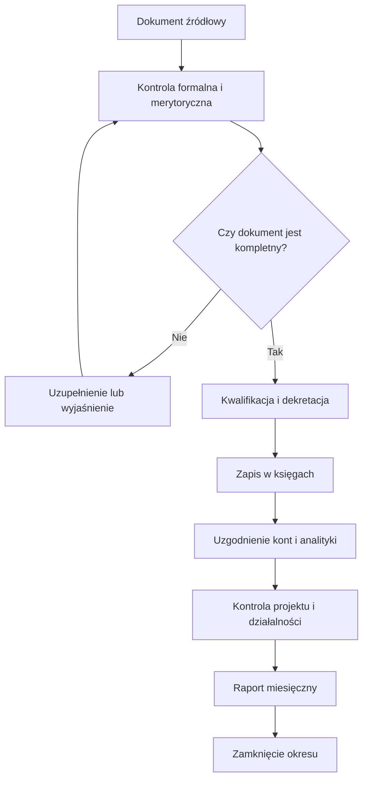

# 21.3. Rachunkowość

## System ewidencji, dokumentowania, wyceny, rozliczania i sprawozdawczości fundacji

**Stan prawny i informacyjny: 27 listopada 2026 r.**

> Rachunkowość fundacji nie jest wyłącznie technicznym zapisem wpływów i wydatków. Jest uporządkowanym systemem informacji o majątku, zobowiązaniach, źródłach finansowania, kosztach realizacji misji i odpowiedzialności osób zarządzających. Jej jakość rozstrzyga o tym, czy fundacja potrafi wykazać, co otrzymała, na jakiej podstawie, w jaki sposób wykorzystała powierzone środki i jaki jest rzeczywisty stan jej spraw.

## Mapa zgodności z aktualnym konspektem

Rozdział realizuje wszystkie trzynaście zagadnień wskazanych w spisie treści kursu:

| Pozycja konspektu | Zakres opracowania |
|---|---|
| 1. Obowiązek prowadzenia rachunkowości | Podmiotowość fundacji, zakres ustawy o rachunkowości, wyjątek uproszczonej ewidencji przychodów i kosztów, odpowiedzialność kierownika jednostki |
| 2. Polityka rachunkowości | Dokumentacja zasad rachunkowości, rok obrotowy, metody wyceny, system informatyczny, ochrona danych, aktualizacja polityki |
| 3. Plan kont | Konstrukcja kont syntetycznych i analitycznych, wymiary ewidencji, przykładowy zakładowy plan kont |
| 4. Ewidencja przychodów | Zasada memoriału, moment ujęcia, rodzaje przychodów, należności, wpływy i rozliczenia |
| 5. Ewidencja kosztów | Koszty rodzajowe i funkcjonalne, koszty bezpośrednie i pośrednie, rozliczanie kosztów wspólnych |
| 6. Ewidencja darowizn | Darowizny pieniężne i rzeczowe, ograniczenia celu, wycena, rejestr darczyńców i środków |
| 7. Ewidencja dotacji i grantów | Umowy, zaliczki, należności, rozliczenia międzyokresowe przychodów, koszty kwalifikowalne i zwroty |
| 8. Ewidencja działalności gospodarczej | Wyodrębnienie przychodów, kosztów i wyniku, podatki, rozliczenia wspólne |
| 9. Ewidencja działalności odpłatnej | Odrębna analityka, kalkulacja kosztów świadczeń i rozgraniczenie z działalnością gospodarczą |
| 10. Ewidencja środków trwałych | Ujęcie, wycena, ewidencja szczegółowa, amortyzacja, inwentaryzacja, likwidacja i darowizny rzeczowe |
| 11. Rozliczenia międzyokresowe | Koszty przyszłych okresów, koszty dotyczące okresu bieżącego, przychody przyszłych okresów, dotacje inwestycyjne i rezerwy |
| 12. Sprawozdania finansowe | Zamknięcie ksiąg, elementy sprawozdania, podpisy, zatwierdzenie, badanie, format elektroniczny i złożenie |
| 13. Archiwizacja dokumentacji | Okresy przechowywania, archiwum elektroniczne, KSeF, kopie bezpieczeństwa, dostęp i ślad audytowy |

### Granice rozdziału i powiązanie z wcześniejszymi opracowaniami

Rozdział 21.1 omawia źródła finansowania, a 21.2 – planowanie finansowe. Niniejszy rozdział wyjaśnia, jak zdarzenia finansowe ujmuje się w księgach rachunkowych, jak dokumentuje się ich przebieg i jak przedstawia się je w sprawozdaniu finansowym.

Nie należy utożsamiać:
- planu finansowego z księgami rachunkowymi;
- ewidencji księgowej z ewidencją budżetu projektu;
- wyciągu bankowego z dowodem wyczerpująco opisującym całą operację;
- rozliczenia dotacji z rocznym sprawozdaniem finansowym;
- sprawozdania finansowego ze sprawozdaniem z działalności fundacji składanym właściwemu ministrowi;
- wyniku finansowego z saldem środków pieniężnych;
- ewidencji podatkowej z rachunkowością bilansową.

Przykłady i konta w rozdziale mają charakter dydaktyczny. Nie zastępują dokumentacji przyjętej przez konkretną fundację, jej statutu, umów finansowania ani indywidualnej oceny księgowej i podatkowej.

# 1. Cel, zakres i efekty kształcenia

## 1.1. Cel rozdziału

Celem jest przygotowanie osoby zarządzającej fundacją, pracownika administracyjnego, księgowego, koordynatora projektu i osoby kontrolującej finanse do rozumienia pełnego cyklu rachunkowości: od identyfikacji zdarzenia gospodarczego, przez dowód księgowy i zapis, po uzgodnienie sald, inwentaryzację, sprawozdanie finansowe i archiwizację.

Rachunkowość powinna umożliwiać odtworzenie rzeczywistego przebiegu zdarzeń. Nie wystarczy wiedzieć, że na rachunek bankowy wpłynęło 10 000 zł. Trzeba ustalić:
- kto przekazał środki;
- na jakiej podstawie prawnej;
- czy jest to darowizna, dotacja, zapłata, zaliczka, pożyczka czy inny tytuł;
- czy środki są ograniczone celem;
- kiedy powstał przychód w ujęciu rachunkowym;
- czy powstała należność, zobowiązanie lub rozliczenie międzyokresowe;
- jak wpływ należy przypisać do działalności statutowej, odpłatnej albo gospodarczej;
- jakie dokumenty potwierdzają operację;
- czy operacja wymaga dodatkowego rozliczenia podatkowego lub sprawozdawczego.

## 1.2. Efekty uczenia się

Po ukończeniu rozdziału uczestnik powinien umieć:

1. wskazać podstawę obowiązku prowadzenia ksiąg rachunkowych przez fundację;
2. rozpoznać, czy fundacja może legalnie korzystać z uproszczonej ewidencji przychodów i kosztów;
3. przygotować projekt polityki rachunkowości;
4. zaprojektować plan kont i analitykę dostosowaną do wielu rodzajów działalności;
5. odróżnić przychód od wpływu pieniężnego oraz koszt od wydatku;
6. zakwalifikować i udokumentować darowiznę, dotację, grant, sprzedaż i koszt;
7. prowadzić wyodrębnioną ewidencję działalności nieodpłatnej, odpłatnej i gospodarczej;
8. prowadzić ewidencję środków trwałych i wartości niematerialnych i prawnych;
9. rozliczać koszty i przychody między okresami;
10. przygotować dane do rocznego sprawozdania finansowego;
11. rozpoznać terminy podpisania, zatwierdzenia i złożenia sprawozdania;
12. zorganizować archiwum dokumentacji księgowej w formie papierowej i elektronicznej.

## 1.3. Zasady nadrzędne

System rachunkowości fundacji powinien opierać się na następujących zasadach:

- **rzetelność** – zapisy odzwierciedlają rzeczywisty przebieg zdarzeń;
- **sprawdzalność** – każdą pozycję można powiązać z dowodem i osobą odpowiedzialną;
- **kompletność** – w księgach ujmuje się wszystkie zdarzenia dotyczące okresu;
- **ciągłość** – stosowane zasady są konsekwentne, a ich zmiany uzasadnione i udokumentowane;
- **ostrożność** – wycena nie może prowadzić do nieuzasadnionego zawyżenia aktywów lub wyniku;
- **memoriał** – zdarzenia ujmuje się w okresie, którego dotyczą, niezależnie od terminu zapłaty;
- **współmierność** – przychody i związane z nimi koszty przypisuje się do właściwych okresów;
- **istotność** – poziom szczegółowości odpowiada znaczeniu informacji, bez pomijania wymogów ustawowych;
- **identyfikowalność** – można ustalić źródło środków, cel, projekt, działalność i sposób wykorzystania;
- **ochrona powierzonych środków** – fundacja chroni majątek, dane darczyńców, beneficjentów, pracowników i partnerów.

# 2. Obowiązek prowadzenia rachunkowości

## 2.1. Fundacja jako jednostka objęta ustawą o rachunkowości

Fundacja jest osobą prawną. Zasadą wynikającą z art. 2 ust. 1 pkt 1 ustawy z dnia 29 września 1994 r. o rachunkowości jest objęcie ustawą innych osób prawnych mających siedzibę lub miejsce sprawowania zarządu w Polsce, z ustawowymi wyjątkami.

W konsekwencji fundacja co do zasady prowadzi księgi rachunkowe na zasadach ustawy o rachunkowości. Nie ma znaczenia, że:
- fundacja nie zatrudnia pracowników;
- prowadzi niewielką liczbę operacji;
- nie osiąga dochodu;
- realizuje wyłącznie cele statutowe;
- korzysta z pracy wolontariuszy;
- nie prowadzi działalności gospodarczej;
- większość jej finansowania stanowią darowizny.

Niewielka skala działania nie jest sama w sobie zwolnieniem z rachunkowości.

## 2.2. Wyjątek dotyczący kościelnych osób prawnych

Art. 2 ust. 4 ustawy o rachunkowości przewiduje szczególną zasadę dla kościelnych osób prawnych nieprowadzących działalności gospodarczej, które prowadzą rachunkowość zgodnie z własnymi przepisami wewnętrznymi.

Nie wolno automatycznie rozciągać tego wyjątku na fundację tylko dlatego, że:
- jej statut obejmuje kult religijny;
- fundacja organizuje nabożeństwa lub wydarzenia religijne;
- członkowie organów deklarują przynależność religijną;
- fundacja wspiera osoby duchowne;
- fundacja otrzymuje darowizny na cele religijne.

O statusie podmiotu rozstrzyga jego rzeczywista forma prawna i podstawa utworzenia, a nie wyłącznie nazwa lub cel statutowy. Fundacja wpisana do KRS nie staje się przez sam fakt realizowania celów religijnych kościelną osobą prawną.

## 2.3. Uproszczona ewidencja przychodów i kosztów – zasady obowiązujące od 2026 r.

Ustawa o rachunkowości dopuszcza w art. 2 ust. 5 stosowanie uproszczonej ewidencji przychodów i kosztów przez jednostki spełniające warunki art. 10a ustawy o działalności pożytku publicznego i o wolontariacie.

Od 1 stycznia 2026 r. należy stosować zmienione warunki art. 10a, wprowadzone ustawą z 8 listopada 2024 r. (Dz. U. poz. 1761). Nie należy bezrefleksyjnie powielać wcześniejszych poradników opartych na progu 100 000 zł i dawnym katalogu źródeł przychodów.

W uproszczeniu organizacja pozarządowa, z wyłączeniem spółek kapitałowych, może korzystać z UEPIK, jeżeli łącznie:
1. nie prowadzi działalności gospodarczej w rozumieniu Prawa przedsiębiorców;
2. nie posiada statusu organizacji pożytku publicznego;
3. w roku poprzedzającym wybór UEPIK nie przekroczyła przychodów 1 000 000 zł, przy czym z limitu wyłącza się wartość darowizn rzeczowych przeznaczonych na prowadzenie działalności statutowej;
4. decyzję o prowadzeniu UEPIK podejmie organ zatwierdzający w rozumieniu przepisów o rachunkowości;
5. dochowa obowiązku zawiadomienia właściwego naczelnika urzędu skarbowego w terminie ustawowym.

W roku rozpoczęcia działalności limit przychodów z roku poprzedniego nie ma zastosowania. Zawiadomienie o wyborze UEPIK składa się do końca trzeciego miesiąca roku podatkowego, w którym rozpoczyna się prowadzenie ewidencji; jednostka rozpoczynająca działalność zawiadamia w terminie 90 dni od jej rozpoczęcia. Należy każdorazowo sprawdzić aktualne brzmienie art. 10a oraz przepisy przejściowe.

Od 1 stycznia 2026 r. obowiązuje nowe rozporządzenie Ministra Finansów i Gospodarki z 22 grudnia 2025 r. w sprawie prowadzenia uproszczonej ewidencji przychodów i kosztów przez niektóre organizacje pozarządowe oraz stowarzyszenia jednostek samorządu terytorialnego (Dz. U. 2025 poz. 1880). Określa ono m.in.:
- zestawienie przychodów i kosztów;
- zestawienie przepływów finansowych;
- wykaz środków trwałych oraz wartości niematerialnych i prawnych;
- zestawienie uzupełniające;
- wymagania dotyczące dowodów i ochrony danych;
- zasady prowadzenia ewidencji elektronicznej.

Wybór UEPIK nie jest jedynie zmianą programu księgowego. Jest wyborem dopuszczonego prawem reżimu ewidencyjnego i podatkowego, który musi być poprzedzony sprawdzeniem wszystkich przesłanek.

### Przykładowa kwalifikacja

| Sytuacja | Możliwość UEPIK |
|---|---|
| Fundacja bez działalności gospodarczej, bez statusu OPP, przychody 80 000 zł, prawidłowa uchwała i terminowe zawiadomienie | Może być możliwa, jeżeli spełniono wszystkie warunki ustawowe |
| Fundacja prowadząca działalność gospodarczą | Nie |
| Fundacja posiadająca status OPP | Nie |
| Fundacja bez działalności gospodarczej, lecz z przychodami ponad 1 000 000 zł w roku poprzednim | Co do zasady nie |
| Fundacja rozpoczynająca działalność | Limit z poprzedniego roku nie ma zastosowania; pozostałe warunki nadal wymagają sprawdzenia |
| Fundacja prowadząca wyłącznie działalność religijną, ale mająca formę fundacji i niespełniająca warunków UEPIK | Prowadzi księgi rachunkowe |

Ważne: prowadzenie UEPIK nie zwalnia z obowiązku dokumentowania zdarzeń, ochrony dokumentów, rozliczania podatków ani przestrzegania umów dotacyjnych. Uproszczenie nie oznacza dowolności.

## 2.4. Pełne księgi rachunkowe a uproszczona ewidencja

| Kryterium | Księgi rachunkowe | UEPIK |
|---|---|---|
| Podstawa | Ustawa o rachunkowości | Art. 10a ustawy o działalności pożytku publicznego i rozporządzenie wykonawcze |
| Zakres | Dziennik, księga główna, księgi pomocnicze, zestawienia i inwentarz | Ustawowe zestawienia, przepływy i wykaz składników majątku |
| Sprawozdanie finansowe według ustawy o rachunkowości | Tak | Nie, jeżeli jednostka prawidłowo korzysta z UEPIK |
| Działalność gospodarcza | Może być prowadzona po spełnieniu odrębnych wymogów | Wyklucza UEPIK |
| Status OPP | Dopuszczalny | Wyklucza UEPIK |
| Plan kont | Wymagany zakładowy plan kont | Nie jest wymagany w tej samej postaci, ale wymagana jest uporządkowana ewidencja |
| Sprawozdawczość projektowa | Analityka księgowa i dodatkowe rejestry | Zestawienia i ewidencje zgodne z rozporządzeniem oraz umowami |

Fundacja, która prowadzi działalność gospodarczą, powinna przyjąć jako punkt wyjścia pełne księgi rachunkowe. Nie może wybrać UEPIK wyłącznie dlatego, że byłoby to tańsze lub prostsze.

## 2.5. Odpowiedzialność zarządu i kierownika jednostki

W rozumieniu ustawy o rachunkowości kierownikiem jednostki jest członek zarządu lub innego organu zarządzającego, a jeżeli organ jest wieloosobowy – członkowie tego organu, z uwzględnieniem ustawowych wyjątków.

Kierownik jednostki odpowiada w szczególności za:
- zapewnienie prowadzenia rachunkowości;
- przyjęcie i aktualizowanie polityki rachunkowości;
- zapewnienie sporządzenia sprawozdania finansowego;
- organizację ochrony dokumentacji;
- nadzór nad terminowością i kompletnością zapisów;
- zapewnienie inwentaryzacji;
- przedstawienie sprawozdania właściwym organom;
- doprowadzenie do zatwierdzenia i złożenia dokumentów.

Powierzenie prowadzenia ksiąg biuru rachunkowemu nie oznacza, że zarząd przestaje odpowiadać za wykonanie obowiązków kierownika jednostki. Umowa z biurem rachunkowym reguluje zakres usług i odpowiedzialność kontraktową, ale nie może uchylić ustawowych obowiązków zarządu.

## 2.6. Rozdzielenie odpowiedzialności

W dobrze zorganizowanej fundacji należy odróżnić:
- odpowiedzialność zarządu za organizację rachunkowości i nadzór;
- odpowiedzialność osoby prowadzącej księgi za prawidłowość powierzonych czynności;
- odpowiedzialność kierowników projektów za merytoryczne potwierdzenie wykonania;
- odpowiedzialność osoby zatwierdzającej wydatek;
- odpowiedzialność osoby dokonującej płatności;
- odpowiedzialność osoby przyjmującej składniki majątku;
- odpowiedzialność osoby przeprowadzającej kontrolę.

Jedna osoba może wykonywać kilka funkcji w małej organizacji, lecz ryzyko konfliktu interesów należy ograniczać przez kontrolę następczą i dokumentowanie decyzji.

# 3. Polityka rachunkowości

## 3.1. Istota polityki rachunkowości

Polityka rachunkowości jest dokumentacją przyjętych przez jednostkę zasad prowadzenia rachunkowości. Art. 10 ustawy o rachunkowości wymaga, aby była sporządzona w języku polskim i obejmowała w szczególności:
- rok obrotowy i okresy sprawozdawcze;
- metody wyceny aktywów i pasywów;
- sposób ustalania wyniku finansowego;
- zakładowy plan kont;
- wykaz ksiąg rachunkowych;
- opis systemu przetwarzania danych;
- opis systemu ochrony danych i dokumentów.

Dokumentację ustala na piśmie i aktualizuje kierownik jednostki. Powinna ona odpowiadać rzeczywistemu sposobowi prowadzenia ksiąg, a nie być wyłącznie formalnym załącznikiem.

## 3.2. Rok obrotowy i okresy sprawozdawcze

Rok obrotowy fundacji może pokrywać się z rokiem kalendarzowym, co jest najczęściej praktycznym rozwiązaniem. Może być także określony inaczej, z zachowaniem warunków ustawowych.

Przy wyborze należy uwzględnić:
- statut i uchwały organów;
- terminy grantów i dotacji;
- cykl realizacji programów;
- terminy rozliczeń podatkowych;
- obowiązki sprawozdawcze;
- możliwość porównywania danych między latami.

Okresy sprawozdawcze mogą obejmować miesiące i inne okresy wymagane do sporządzania zestawień. Dla fundacji wielodziałowej praktyczne jest zamykanie okresów co miesiąc, uzgadnianie sald i przygotowywanie raportów zarządczych.

## 3.3. Metody wyceny i ustalania wyniku

Polityka rachunkowości powinna opisywać sposób wyceny:
- środków trwałych;
- wartości niematerialnych i prawnych;
- zapasów;
- należności;
- zobowiązań;
- środków pieniężnych;
- aktywów i zobowiązań w walutach obcych;
- rozliczeń międzyokresowych;
- rezerw;
- darowizn rzeczowych;
- składników majątku otrzymanych nieodpłatnie.

Nie wolno zastępować zasad bilansowych uproszczonym założeniem, że każda faktura jest kosztem w dniu zapłaty. Należy ustalić, czy zakup stanowi koszt okresu, zapas, środek trwały, wartość niematerialną i prawną, zaliczkę czy rozliczenie międzyokresowe.

## 3.4. Polityka rachunkowości a rodzaje działalności

W fundacji prowadzącej kilka rodzajów działalności polityka powinna wyjaśniać, jak ewidencjonuje się:
- nieodpłatną działalność pożytku publicznego;
- odpłatną działalność pożytku publicznego;
- działalność gospodarczą;
- działalność religijną;
- działalność społeczną;
- działalność opiekuńczą;
- działalność edukacyjną;
- projekty krajowe i międzynarodowe;
- koszty administracyjne i ogólnego zarządu.

Zakres analityki powinien pozwalać na odtworzenie przychodów, kosztów i wyniku każdej formy działalności. Wynika to również z art. 10 ustawy o działalności pożytku publicznego i o wolontariacie.

## 3.5. System informatyczny

Opis systemu informatycznego powinien obejmować:
1. nazwę programu i jego wersję;
2. zakres używanych modułów;
3. sposób nadawania uprawnień;
4. zasady tworzenia i zatwierdzania zapisów;
5. mechanizmy blokowania zamkniętych okresów;
6. sposób korekty zapisów;
7. sposób tworzenia kopii bezpieczeństwa;
8. zasady odtwarzania danych;
9. sposób eksportu ksiąg i zestawień;
10. sposób zachowania historii zmian;
11. procedurę zmiany oprogramowania;
12. osobę odpowiedzialną za administrację systemem.

Fundacja powinna być w stanie odczytać własne dane niezależnie od bieżącego dostawcy programu. Nie należy uzależniać dostępu do dokumentacji od jednej osoby lub jednego konta użytkownika.

## 3.6. Zmiany polityki rachunkowości

Zmiana zasad rachunkowości powinna:
- mieć uzasadnienie;
- być zatwierdzona przez właściwy organ;
- określać datę obowiązywania;
- wskazywać zakres zmian;
- opisywać skutki dla danych porównawczych;
- być udokumentowana zgodnie z ustawą i odpowiednimi standardami.

Krajowy Standard Rachunkowości nr 7 dotyczy zmian zasad rachunkowości, wartości szacunkowych, poprawiania błędów i zdarzeń po dniu bilansowym. Nie należy wprowadzać zmian wstecz tylko po to, by osiągnąć oczekiwany wynik.

## 3.7. Minimalny pakiet polityki rachunkowości

| Dokument lub załącznik | Minimalna treść |
|---|---|
| Uchwała lub decyzja zarządu | Przyjęcie polityki i data obowiązywania |
| Rok obrotowy | Początek, koniec i okresy sprawozdawcze |
| Metody wyceny | Zasady dotyczące aktywów, pasywów i wyniku |
| Plan kont | Konta syntetyczne i analityczne |
| Wykaz ksiąg | Dziennik, księga główna, księgi pomocnicze i zestawienia |
| Opis systemu IT | Programy, funkcje, procedury i parametry |
| Ochrona danych | Dostępy, kopie, archiwum i odtwarzanie |
| Zasady analityki | Projekty, działalności, źródła finansowania i koszty wspólne |
| Procedura zamknięcia | Uzgodnienia, inwentaryzacja, korekty i zatwierdzenie |
| Rejestr zmian | Historia wersji i przyczyn aktualizacji |

# 4. Plan kont fundacji

## 4.1. Zasady projektowania

Zakładowy plan kont powinien być:
- zgodny z ustawą o rachunkowości;
- dopasowany do skali i rodzaju działalności;
- wystarczająco szczegółowy do rozliczania grantów;
- zrozumiały dla osób odpowiedzialnych za finanse;
- spójny z budżetami i sprawozdaniami;
- możliwy do rozwijania bez przebudowy całego systemu;
- odporny na dublowanie zapisów.

Ustawa nie narzuca jednej, uniwersalnej numeracji kont dla każdej fundacji. Przykładowa numeracja poniżej jest modelem dydaktycznym, który wymaga dostosowania do polityki rachunkowości, sprawozdania finansowego i potrzeb organizacji.

## 4.2. Przykładowe zespoły kont

| Zespół | Przeznaczenie | Przykładowe konta |
|---|---|---|
| 0 | Aktywa trwałe | Środki trwałe, wartości niematerialne i prawne, umorzenie, inwestycje w toku |
| 1 | Środki pieniężne i rachunki | Kasa, rachunki bankowe, lokaty, środki w drodze |
| 2 | Rozrachunki | Dostawcy, odbiorcy, pracownicy, podatki, ZUS, grantodawcy |
| 3 | Materiały i towary | Materiały, towary, rozliczenie zakupu, zapasy |
| 4 | Koszty według rodzaju | Amortyzacja, materiały, energia, usługi, wynagrodzenia, podatki i opłaty |
| 5 | Koszty według funkcji | Działalność statutowa, odpłatna, gospodarcza, projekty, administracja |
| 6 | Produkty i rozliczenia kosztów | Produkty, produkcja w toku, rozliczenia kosztów |
| 7 | Przychody i koszty ich osiągnięcia | Przychody działalności, sprzedaż, pozostałe przychody i koszty operacyjne |
| 8 | Fundusze, wynik i rozliczenia | Fundusz statutowy, wynik finansowy, rozliczenia międzyokresowe przychodów |

## 4.3. Analityka – najważniejszy element rachunkowości fundacji

Samo konto syntetyczne nie wystarcza. Fundacja powinna projektować analitykę według kilku niezależnych wymiarów.

Przykładowe wymiary:
- rodzaj działalności;
- program lub dział organizacyjny;
- projekt;
- źródło finansowania;
- umowa dotacyjna;
- darczyńca lub grantodawca;
- kategoria budżetowa;
- rodzaj kosztu;
- miejsce realizacji;
- waluta;
- okres kwalifikowalności;
- status środków: wolne, celowe, do rozliczenia, do zwrotu.

Przykład kodu analitycznego:

    DZIAŁALNOŚĆ / PROJEKT / ŹRÓDŁO / KATEGORIA / OKRES

    SPOŁ / POMOC-2026 / JST-04 / USŁUGI / 2026-11
    EDUK  / KURS-NEURO / DAR-IND / MATERIAŁY / 2026-11
    GOSP  / USŁUGI-01 / WŁASNE / WYNAGRODZENIA / 2026-11
    REL   / KULT-02 / DAR-CEL / WYDARZENIE / 2026-11

Kod jest przykładem organizacyjnym, a nie obowiązkowym standardem prawnym. Najważniejsze jest zachowanie stałej logiki, jednoznaczności i możliwości uzgodnienia analityki z kontami księgi głównej.

## 4.4. Rozdzielenie form działalności

Dla fundacji prowadzącej działalność nieodpłatną, odpłatną i gospodarczą należy zapewnić możliwość określenia przychodów, kosztów i wyników każdej z nich.

Praktyczny model:
- konto syntetyczne ujmuje rodzaj operacji;
- konto analityczne określa formę działalności;
- kolejny wymiar określa projekt;
- następny wymiar identyfikuje źródło finansowania;
- dodatkowy wymiar pozwala ustalić kategorię budżetową.

Nie należy prowadzić trzech odrębnych, niespójnych ksiąg, jeżeli można osiągnąć wymagany efekt w jednym systemie księgowym poprzez prawidłową analitykę. Jedna księga główna może zawierać wiele logicznie rozdzielonych obszarów działalności.

## 4.5. Przykład dekretacji

Fundacja otrzymuje 12 000 zł darowizny na określony cel statutowy. Po sprawdzeniu umowy i warunków darowizny księgowość ujmuje zdarzenie zgodnie z przyjętą polityką rachunkowości.

Przykładowy zapis wpływu środków:

| Konto | Strona Wn | Strona Ma |
|---|---:|---:|
| Rachunek bankowy – środki celowe | 12 000 | – |
| Przychody z darowizn – analityka celu | – | 12 000 |

To uproszczony przykład poglądowy. Właściwy moment ujęcia przychodu i ewentualnego rozliczenia międzyokresowego zależy od charakteru darowizny, momentu uzyskania prawa do środków, warunków i przyjętych zasad rachunkowości.

# 5. Ewidencja przychodów

## 5.1. Przychód a wpływ środków pieniężnych

Przychód w rachunkowości nie jest synonimem wpływu na rachunek bankowy.

Możliwe są sytuacje:
- przychód powstaje przed otrzymaniem zapłaty;
- środki wpływają jako zaliczka, ale świadczenie będzie wykonane później;
- środki otrzymane na finansowanie środka trwałego są rozliczane w czasie;
- wpływ stanowi pożyczkę i nie jest przychodem;
- wpływ jest zwrotem kaucji lub depozytu i nie stanowi przychodu z działalności.

Każdy wpływ należy zakwalifikować na podstawie dokumentu i rzeczywistej treści zdarzenia.

## 5.2. Podstawowe grupy przychodów

| Grupa | Przykład | Istotna analityka |
|---|---|---|
| Darowizny | Wpłaty osób fizycznych i prawnych | Darczyńca, cel, forma |
| Dotacje | Środki publiczne | Organ, umowa, zadanie, okres |
| Granty | Finansowanie projektowe | Program, partner, budżet, waluta |
| Działalność odpłatna | Opłaty za świadczenia statutowe | Rodzaj usługi, koszt i przychód |
| Działalność gospodarcza | Sprzedaż usług i towarów | Produkt, klient, stawka podatku |
| Przychody z majątku | Najem, odsetki, licencje | Składnik majątku, umowa |
| Pozostałe przychody | Odszkodowania, zwroty, rozwiązanie rezerw | Tytuł i podstawa |

## 5.3. Przychody z darowizn

Ewidencja darowizny powinna uwzględniać:
- umowę lub inny dowód przysporzenia;
- datę nabycia prawa do darowizny;
- kwotę lub wartość przedmiotu;
- dane wymagane do identyfikacji darczyńcy;
- wskazany cel, jeżeli występuje;
- datę wpływu albo wydania rzeczy;
- sposób wyceny;
- ograniczenia dotyczące wykorzystania;
- dokument potwierdzający przyjęcie.

Darowizna pieniężna może zostać otrzymana przelewem, gotówką lub innym dopuszczalnym kanałem. Przyjęcie gotówki wymaga dokumentu kasowego i zachowania zasad kontroli kasy.

Darowizna rzeczowa wymaga ustalenia, co fundacja otrzymała, w jakim stanie, o jakiej wartości i czy składnik będzie:
- zużyty w działalności;
- przeznaczony do sprzedaży;
- przyjęty do magazynu;
- uznany za środek trwały;
- przekazany beneficjentowi.

Nie wolno automatycznie księgować każdej darowizny rzeczowej jako środka trwałego. O kwalifikacji decyduje charakter, przeznaczenie, przewidywany okres użytkowania i zasady przyjęte w polityce rachunkowości.

## 5.4. Dotacje i granty jako przychody

W przypadku dotacji i grantów należy przeanalizować:
- czy fundacja nabyła prawo do środków;
- czy środki są zaliczką;
- czy warunki umowy zostały spełnione;
- czy finansowanie dotyczy bieżących kosztów, czy aktywów trwałych;
- czy środki odnoszą się do przyszłych okresów;
- czy występuje obowiązek zwrotu;
- czy umowa przewiduje korekty i sankcje.

Nie należy przyjmować zasady, że każda dotacja staje się przychodem w dniu wpływu. Art. 41 ustawy o rachunkowości przewiduje rozliczenia międzyokresowe przychodów m.in. dla środków otrzymanych na sfinansowanie nabycia lub wytworzenia środków trwałych, które zwiększają stopniowo pozostałe przychody operacyjne równolegle do odpisów amortyzacyjnych.

W innych przypadkach sposób ujęcia zależy od charakteru umowy, spełnienia warunków i zasad rachunkowości. Jeżeli środki podlegają zwrotowi w przypadku niespełnienia warunków, należy ocenić, czy powstaje zobowiązanie, przychód przyszłych okresów lub inne rozliczenie.

## 5.5. Przychody z działalności odpłatnej i gospodarczej

Przychody z działalności odpłatnej i gospodarczej powinny być wyodrębnione w ewidencji.

Dla każdego rodzaju działalności należy ustalić:
- moment wykonania świadczenia;
- dokument sprzedaży;
- należność;
- ewentualną zaliczkę;
- podatek VAT, jeżeli występuje;
- przychód rachunkowy;
- koszt świadczenia;
- wynik działalności;
- powiązanie z właściwym rodzajem działalności statutowej lub gospodarczej.

Nie wolno przypisywać wpływu do działalności gospodarczej tylko dlatego, że pieniądze zostały zapłacone. O kwalifikacji rozstrzyga prawny i ekonomiczny charakter świadczenia.

## 5.6. Przychody w walutach obcych

W przypadku grantów i darowizn zagranicznych fundacja powinna:
- zachować dokument źródłowy w oryginalnej walucie;
- określić datę ujęcia;
- zastosować właściwy kurs zgodnie z ustawą o rachunkowości i przepisami podatkowymi;
- prowadzić analitykę walutową;
- dokumentować różnice kursowe;
- rozdzielić kurs księgowy od kursu zastosowanego przez bank;
- uzgodnić saldo rachunku walutowego.

Nie należy przeliczać wszystkich operacji według jednego dowolnego kursu rocznego. Kurs i moment przeliczenia muszą wynikać z właściwej podstawy prawnej i rodzaju zdarzenia.

# 6. Ewidencja kosztów

## 6.1. Koszt, wydatek i zobowiązanie

Pojęcia te nie są zamienne.

- **Koszt** – wartość zużytych zasobów lub świadczeń przypisana do okresu.
- **Wydatek** – rozchód środków pieniężnych.
- **Zobowiązanie** – obowiązek zapłaty lub innego świadczenia.
- **Należność** – prawo do otrzymania środków lub świadczenia.
- **Aktywo** – kontrolowany zasób, który może przynieść przyszłe korzyści ekonomiczne lub służyć realizacji celów jednostki.

Przykład: fundacja kupuje sprzęt komputerowy za 8 000 zł i płaci od razu. W zależności od zasad kwalifikacji zakup może być środkiem trwałym lub składnikiem o niższej wartości ujmowanym bezpośrednio w kosztach zgodnie z polityką rachunkowości. Sam fakt zapłaty nie rozstrzyga o sposobie ujęcia.

## 6.2. Koszty według rodzaju

Przykładowe grupy:
- amortyzacja;
- zużycie materiałów;
- energia;
- usługi obce;
- podatki i opłaty;
- wynagrodzenia;
- ubezpieczenia społeczne i inne świadczenia;
- podróże służbowe;
- pozostałe koszty rodzajowe.

Ewidencja rodzajowa pozwala ustalić, jakie zasoby fundacja zużywa. Nie wystarcza jednak do rozliczenia projektu lub formy działalności.

## 6.3. Koszty według funkcji

Koszty można równolegle klasyfikować według funkcji:
- działalność statutowa nieodpłatna;
- działalność statutowa odpłatna;
- działalność gospodarcza;
- projekty grantowe;
- administracja;
- zarządzanie;
- fundraising;
- utrzymanie majątku;
- działalność religijna;
- działalność opiekuńcza;
- działalność edukacyjna.

Każda kategoria powinna mieć uzasadnienie i spójne kryterium przypisywania kosztów.

## 6.4. Koszty bezpośrednie i pośrednie

Koszt bezpośredni można przypisać do konkretnego działania lub projektu na podstawie wiarygodnego dowodu. Koszt pośredni służy wielu działaniom i wymaga racjonalnego klucza rozliczeniowego.

Przykłady:
- wynagrodzenie osoby pracującej wyłącznie w projekcie – koszt bezpośredni;
- czynsz za wspólne biuro – zwykle koszt pośredni;
- licencja wykorzystywana tylko w jednym projekcie – koszt bezpośredni;
- usługa księgowa obsługująca całą fundację – koszt wspólny;
- energia w budynku wykorzystywanym przez kilka działów – koszt wspólny, możliwy do rozliczenia według powierzchni, czasu lub innego mierzalnego klucza.

Klucz rozliczenia powinien być:
1. obiektywny;
2. możliwy do zweryfikowania;
3. stosowany konsekwentnie;
4. zgodny z umową finansowania;
5. aktualizowany, gdy zmieniają się warunki.

Nie należy rozliczać wszystkich kosztów pośrednich proporcjonalnie do przychodów, jeżeli nie odzwierciedla to rzeczywistego wykorzystania zasobów.

## 6.5. Koszty wynagrodzeń

Ewidencja wynagrodzeń powinna umożliwiać powiązanie:
- listy płac;
- umowy;
- zakresu obowiązków;
- ewidencji czasu pracy, jeżeli jest wymagana;
- składek;
- podatku;
- kosztu pracodawcy;
- projektu i formy działalności;
- dowodu wypłaty;
- rozliczenia nieobecności i świadczeń.

Koszt wynagrodzenia może być rozdzielony między kilka projektów, ale sposób podziału powinien wynikać z rzeczywistego zaangażowania i dokumentacji czasu pracy lub innego dopuszczalnego, wiarygodnego klucza.

## 6.6. Podatek VAT a koszt

W ewidencji należy rozróżnić:
- VAT podlegający odliczeniu;
- VAT niepodlegający odliczeniu;
- VAT rozliczany proporcją lub prewspółczynnikiem, jeżeli ma zastosowanie;
- VAT finansowany z dotacji, zgodnie z zasadami programu.

Nie należy ujmować VAT jako kosztu, jeżeli fundacja ma prawo do jego odliczenia. Z drugiej strony nie można automatycznie zakładać, że fundacja odliczy VAT od każdego zakupu. Status podatnika, rodzaj działalności, przeznaczenie zakupów i przepisy VAT wymagają odrębnej analizy.

## 6.7. Koszty wspólne – procedura

1. Zidentyfikować koszt.
2. Ustalić, które działania korzystają z zasobu.
3. Wybrać mierzalny klucz rozliczenia.
4. Opisać metodę w dokumentacji.
5. Uzyskać zatwierdzenie osoby uprawnionej.
6. Zastosować metodę w okresie.
7. Zachować kalkulację.
8. Uzgodnić rozliczenie z umowami dotacyjnymi.
9. Przeprowadzić kontrolę kwartalną.
10. Skorygować podział, jeśli dane wejściowe były błędne.

# 7. Ewidencja darowizn

## 7.1. Rejestr darowizn

Fundacja powinna prowadzić rejestr, który umożliwia ustalenie:
- numeru pozycji;
- daty otrzymania;
- darczyńcy;
- rodzaju darowizny;
- wartości;
- dokumentu źródłowego;
- celu darowizny;
- sposobu wykorzystania;
- salda środków celowych;
- daty zakończenia wykorzystania;
- ewentualnego zwrotu.

Dane darczyńcy należy przetwarzać zgodnie z zasadą minimalizacji. Nie każdy przelew wymaga gromadzenia pełnego profilu osoby przekazującej środki. Zakres danych powinien wynikać z obowiązków prawnych, umowy, rachunkowości, podatków i uzasadnionych potrzeb dokumentacyjnych.

## 7.2. Darowizny celowe

Jeżeli darczyńca wskazał cel, fundacja powinna zachować możliwość ustalenia:
- kwoty otrzymanej na cel;
- kosztów sfinansowanych z darowizny;
- pozostałego salda;
- ograniczeń umownych;
- sposobu zakończenia wykorzystania;
- ewentualnego uzgodnienia zmiany celu.

Nie należy traktować środków celowych jak dowolnej rezerwy gotówkowej. Ograniczenie może wynikać z umowy, oświadczenia darczyńcy lub innych okoliczności prawnych.

## 7.3. Darowizny rzeczowe

Przyjęcie darowizny rzeczowej powinno być potwierdzone protokołem lub innym dowodem. Dokument powinien zawierać:
- opis przedmiotu;
- ilość;
- stan techniczny;
- datę przyjęcia;
- dane przekazującego;
- podstawę przekazania;
- wartość i sposób jej ustalenia;
- przeznaczenie;
- osobę przyjmującą.

Wartość należy ustalać według właściwych zasad rachunkowości. Wartość deklarowana przez darczyńcę nie zawsze jest automatycznie prawidłową wartością bilansową.

Jeżeli darowizna rzeczowa jest środkiem trwałym, należy ją ująć w ewidencji środków trwałych. Jeżeli jest materiałem do zużycia, należy rozważyć ujęcie w zapasach i późniejsze rozliczenie zużycia.

## 7.4. Wykorzystanie darowizn

Dla każdej darowizny celowej powinno być możliwe powiązanie:
- dokumentu przyjęcia;
- zapisu księgowego;
- rachunku bankowego lub kasy;
- dokumentu wydatku;
- opisu merytorycznego;
- potwierdzenia wykonania celu;
- ewentualnego zwrotu lub zmiany przeznaczenia.

# 8. Ewidencja dotacji i grantów

## 8.1. Dokumentacja umowy

Przed rozpoczęciem ewidencji należy zarejestrować:
- grantodawcę;
- numer i datę umowy;
- okres realizacji;
- wartość dofinansowania;
- wkład własny;
- harmonogram płatności;
- budżet;
- kategorie kosztów;
- warunki kwalifikowalności;
- zasady zakupów;
- kursy walutowe;
- terminy raportowania;
- obowiązki informacyjne;
- zasady zwrotu środków.

## 8.2. Analityka projektu

Każdy projekt powinien posiadać unikalny kod. Wszystkie przychody, koszty, należności, zobowiązania i rozliczenia dotyczące projektu powinny być oznaczane tym kodem.

W przypadku projektów partnerskich należy dodatkowo identyfikować:
- część realizowaną przez fundację;
- część przekazaną partnerowi;
- środki otrzymane od operatora;
- środki przekazane realizatorowi;
- wkład własny;
- koszty wspólne;
- różnice kursowe;
- środki do zwrotu.

## 8.3. Zaliczka, należność i przychód

Nie każda kwota otrzymana od grantodawcy jest automatycznie przychodem danego okresu.

Możliwe stany:
1. fundacja uzyskała prawo do dotacji, ale środki nie wpłynęły – może wystąpić należność;
2. fundacja otrzymała zaliczkę przed wykonaniem warunków – należy ocenić charakter rozliczenia;
3. fundacja poniosła koszty zgodne z umową – należy ująć koszt w odpowiednim okresie i rozliczyć finansowanie zgodnie z polityką;
4. środki finansują środek trwały – należy rozważyć rozliczenie międzyokresowe przychodów;
5. środki podlegają zwrotowi – należy ująć zobowiązanie lub odpowiednie rozliczenie.

Decyzja księgowa nie może wynikać wyłącznie z nazwy przelewu.

## 8.4. Koszty kwalifikowalne a koszty księgowe

Koszt może być prawidłowo ujęty w księgach, a jednocześnie niekwalifikowalny w projekcie. Przykładowo:
- koszt powstał poza okresem kwalifikowalności;
- wydatek nie mieści się w budżecie;
- brakuje wymaganej procedury zakupowej;
- wydatek został sfinansowany z innego źródła;
- VAT podlega odliczeniu;
- wydatek nie jest zgodny z celem zadania.

Księgi rachunkowe pokazują zdarzenie gospodarcze. Rozliczenie grantowe ocenia dodatkowo zgodność z umową i zasadami programu. Są to dwa powiązane, ale odrębne testy.

## 8.5. Zwroty i korekty

Jeżeli fundacja ustali, że część środków podlega zwrotowi, powinna:
- określić podstawę i kwotę;
- ustalić okres, którego dotyczy korekta;
- ocenić wpływ na przychód, zobowiązanie i wynik;
- sporządzić dokumentację;
- dokonać korekty zapisów, jeżeli jest wymagana;
- uzgodnić zwrot z grantodawcą;
- zachować potwierdzenie płatności;
- skorygować raport projektowy.

Nie wolno ukrywać zwrotu przez kompensowanie go z innym projektem bez podstawy prawnej i umownej.

## 8.6. Kontrola podwójnego finansowania

Przed rozliczeniem wydatku należy sprawdzić:
- czy dokument nie został przypisany do innego projektu;
- czy faktura nie została ujęta dwukrotnie;
- czy wkład własny nie jest wykazywany w kilku projektach w tym samym zakresie;
- czy koszty wspólne podzielono zgodnie z metodą;
- czy nie finansuje się tego samego kosztu z dwóch źródeł;
- czy ewidencja odzwierciedla rzeczywisty udział finansowania.

## 8.7. Karta kontrolna projektu

| Pole | Wymagane działanie |
|---|---|
| Umowa | Rejestracja i weryfikacja |
| Budżet | Wprowadzenie analityki |
| Rachunek bankowy | Identyfikacja wpływów |
| Koszty | Opis i przypisanie do projektu |
| Personel | Powiązanie z czasem pracy i zadaniami |
| Zakupy | Kontrola procedury i dowodów |
| Partnerzy | Uzgodnienie przekazań i rozliczeń |
| Waluta | Kontrola kursów i różnic |
| Raport | Uzgodnienie ksiąg z raportem grantowym |
| Zwrot | Ujęcie i potwierdzenie |

# 9. Ewidencja działalności gospodarczej

## 9.1. Odrębność działalności gospodarczej

Fundacja może prowadzić działalność gospodarczą, jeżeli:
- pozwala na to statut;
- spełnione są warunki ustawowe;
- dokonano wymaganych wpisów do rejestru przedsiębiorców;
- działalność jest prowadzona w sposób zgodny z prawem;
- przychody i koszty są odpowiednio ewidencjonowane;
- wynik jest rozliczany zgodnie z przepisami podatkowymi i statutem.

Działalność gospodarcza nie jest odrębną osobą prawną. Przedsiębiorcą jest fundacja, a nie wewnętrzny dział gospodarczy.

## 9.2. Ewidencja przychodów gospodarczych

Ewidencja powinna pozwalać na ustalenie:
- rodzaju usługi lub towaru;
- daty wykonania;
- odbiorcy;
- ceny;
- rabatów;
- podatku VAT;
- należności;
- zapłaty;
- kosztów bezpośrednich;
- kosztów wspólnych;
- wyniku.

Przychód z działalności gospodarczej powinien być oznaczony w analityce jako gospodarczy, nawet jeżeli jest przeznaczany na cele statutowe.

## 9.3. Ewidencja kosztów działalności gospodarczej

Koszty powinny być przypisane do działalności gospodarczej w sposób uzasadniony. Jeżeli zasoby są wspólne, należy stosować metodę alokacji opisaną w polityce rachunkowości i zgodną z zasadami podatkowymi.

Nie należy finansować kosztów działalności gospodarczej ze środków celowych przeznaczonych na inny projekt, jeśli umowa lub prawo tego zabrania.

## 9.4. Rozliczenia między działalnością gospodarczą a statutową

Jeżeli fundacja wykorzystuje:
- wspólny lokal;
- pracowników;
- samochód;
- sprzęt;
- system informatyczny;
- usługi administracyjne;
- materiały;
- energię;

do kilku rodzajów działalności, należy ustalić wiarygodny sposób przypisania kosztów.

Przykład: fundacja prowadzi odpłatne szkolenia, nieodpłatne działania edukacyjne i komercyjne usługi. Koszt wynajmu sali można rozliczać według faktycznych godzin wykorzystania, jeżeli metoda jest możliwa do udokumentowania. Nie należy arbitralnie przypisywać całego czynszu do jednego rodzaju działalności.

## 9.5. Rachunkowość a rozliczenie podatkowe

Wynik księgowy i dochód podatkowy mogą się różnić. Różnice wynikają m.in. z:
- kosztów niestanowiących kosztów uzyskania przychodów;
- przychodów zwolnionych;
- amortyzacji bilansowej i podatkowej;
- różnic kursowych;
- rozliczeń międzyokresowych;
- korekt i odpisów aktualizujących.

Fundacja powinna prowadzić uzgodnienie wyniku księgowego z podstawą opodatkowania, a nie zastępować ksiąg rachunkowych ewidencją podatkową.

# 10. Ewidencja działalności odpłatnej

## 10.1. Wyodrębnienie rachunkowe

Działalność odpłatna pożytku publicznego wymaga wyodrębnienia w stopniu pozwalającym określić przychody, koszty i wynik. Wynika to z art. 10 ustawy o działalności pożytku publicznego i o wolontariacie.

W ewidencji należy rozdzielić:
- przychody z działalności odpłatnej;
- koszty bezpośrednie;
- koszty wspólne;
- należności;
- rozliczenia z uczestnikami;
- zwroty;
- wynik tej działalności.

## 10.2. Kontrola granicy działalności odpłatnej i gospodarczej

Działalność odpłatna może zostać uznana za działalność gospodarczą, jeżeli wystąpią przesłanki określone w art. 9 ustawy o działalności pożytku publicznego, w tym przekroczenie relacji wynagrodzenia do kosztów albo ustawowego limitu wynagrodzeń.

Księgowość powinna dostarczać dane do bieżącego monitorowania tych granic. Nie wystarczy przeprowadzić kontroli dopiero po zakończeniu roku.

## 10.3. Kalkulacja kosztu świadczenia

Dla danego rodzaju usługi należy ustalić:
- koszty materiałów;
- wynagrodzenia;
- składki;
- koszty sali i wyposażenia;
- koszty obsługi;
- koszty wspólne przypisane według uzasadnionej metody.

Kalkulacja powinna być możliwa do odtworzenia i powiązana z dokumentacją źródłową.

## 10.4. Przykład

Fundacja prowadzi odpłatne szkolenie dla 20 uczestników. Przychód wynosi 6 000 zł. Koszty bezpośrednie wynoszą 4 200 zł, a uzasadniona część kosztów wspólnych 900 zł.

| Pozycja | Kwota |
|---|---:|
| Przychód | 6 000 zł |
| Koszty bezpośrednie | 4 200 zł |
| Koszty wspólne | 900 zł |
| Łączny koszt | 5 100 zł |
| Wynik działalności | 900 zł |

Wynik ten wymaga dalszej oceny prawnej w świetle zasad działalności odpłatnej. Sama dodatnia kwota w tabeli nie przesądza jeszcze o naruszeniu prawa; znaczenie ma sposób kalkulacji, zakres działalności i przesłanki ustawowe.

# 11. Ewidencja środków trwałych

## 11.1. Pojęcie środka trwałego

Środek trwały to składnik majątku spełniający kryteria określone w ustawie o rachunkowości, w szczególności:
- jest kontrolowany przez jednostkę;
- jest kompletny i zdatny do użytku;
- jest przeznaczony na potrzeby jednostki;
- przewidywany okres użytkowania przekracza rok;
- nie jest przeznaczony do sprzedaży w ramach zwykłej działalności.

Przykłady:
- nieruchomość;
- samochód;
- sprzęt rehabilitacyjny;
- urządzenie terapeutyczne;
- wyposażenie pracowni;
- serwer;
- sprzęt komputerowy;
- specjalistyczne urządzenie dydaktyczne.

Nie każdy zakup o wysokiej wartości jest automatycznie środkiem trwałym. Należy zbadać przeznaczenie i kryteria ustawowe.

## 11.2. Wartości niematerialne i prawne

Wartości niematerialne i prawne mogą obejmować m.in.:
- licencje;
- oprogramowanie;
- autorskie prawa majątkowe;
- prawa do znaków;
- określone prawa do projektów i technologii.

Nie należy automatycznie aktywować każdego wydatku na stronę internetową, reklamę, szkolenie lub projekt graficzny. Kwalifikacja zależy od charakteru prawa, kontroli, możliwości identyfikacji, okresu użyteczności i przepisów.

## 11.3. Wycena początkowa

Wartość początkowa środka trwałego może obejmować cenę nabycia lub koszt wytworzenia oraz koszty związane z doprowadzeniem składnika do stanu zdatnego do używania, zgodnie z ustawą.

Przykładowe elementy:
- cena zakupu;
- transport;
- montaż;
- instalacja;
- opłaty związane z nabyciem;
- niepodlegający odliczeniu VAT;
- inne uzasadnione koszty przygotowania do użytkowania.

Kosztów nie należy kapitalizować automatycznie. Należy odróżnić koszty przygotowania środka do używania od późniejszych kosztów eksploatacji i remontów.

## 11.4. Ewidencja szczegółowa środków trwałych

Rejestr powinien zawierać co najmniej:
- numer inwentarzowy;
- nazwę składnika;
- opis i parametry;
- miejsce użytkowania;
- osobę odpowiedzialną;
- datę nabycia;
- datę przyjęcia do używania;
- dokument nabycia;
- wartość początkową;
- metodę i stawkę amortyzacji;
- dotychczasowe umorzenie;
- wartość netto;
- źródło finansowania;
- projekt;
- datę likwidacji lub zbycia.

## 11.5. Amortyzacja bilansowa

Amortyzacja bilansowa powinna odzwierciedlać przewidywany okres ekonomicznej użyteczności składnika majątku. Stawka podatkowa nie zawsze jest właściwą stawką bilansową.

Przed rozpoczęciem amortyzacji należy ustalić:
- przewidywany okres użytkowania;
- metodę amortyzacji;
- wartość początkową;
- ewentualną wartość końcową;
- datę rozpoczęcia amortyzacji;
- sposób aktualizacji szacunków.

## 11.6. Darowizna środka trwałego

Jeżeli fundacja otrzymuje środek trwały nieodpłatnie, należy:
1. udokumentować darowiznę;
2. potwierdzić prawo do składnika;
3. ustalić wartość zgodnie z przepisami;
4. określić datę przyjęcia do używania;
5. wprowadzić składnik do ewidencji;
6. ustalić sposób amortyzacji;
7. ocenić, czy należy rozliczyć przychód w czasie.

Art. 41 ust. 2 ustawy o rachunkowości nakazuje odpowiednio stosować zasady rozliczania przychodów przyszłych okresów do przyjętych nieodpłatnie, w tym w drodze darowizny, środków trwałych oraz wartości niematerialnych i prawnych.

## 11.7. Inwentaryzacja i likwidacja

Inwentaryzacja środków trwałych powinna umożliwiać porównanie:
- stanu rzeczywistego;
- zapisów w ewidencji;
- miejsca użytkowania;
- osoby odpowiedzialnej;
- wartości księgowej;
- stopnia zużycia.

Likwidacja wymaga protokołu, uzasadnienia, decyzji osoby uprawnionej i właściwego ujęcia księgowego. Nie wolno usuwać składnika z ewidencji tylko dlatego, że jest uszkodzony lub nieużywany. Należy ustalić jego rzeczywisty status i sposób zakończenia użytkowania.

## 11.8. Krajowy Standard Rachunkowości nr 11

KSR nr 11 „Środki trwałe” objaśnia m.in. uznawanie, wycenę, ujmowanie, amortyzację i prezentację środków trwałych. Jest przydatnym źródłem interpretacyjnym przy projektowaniu ewidencji, lecz nie zastępuje ustawy ani przyjętej polityki rachunkowości.

# 12. Rozliczenia międzyokresowe

## 12.1. Zasada memoriału i współmierności

Zdarzenie powinno być przypisane do okresu, którego dotyczy. Data zapłaty może być inna niż data powstania kosztu lub przychodu.

Przykłady:
- ubezpieczenie opłacone z góry obejmuje kilka miesięcy;
- usługa wykonana w grudniu zostaje zafakturowana w styczniu;
- grant finansuje koszty realizowane w kolejnych miesiącach;
- fundacja otrzymuje środki na zakup środka trwałego;
- wynagrodzenie za grudzień wypłacane jest w styczniu.

## 12.2. Czynne rozliczenia międzyokresowe kosztów

Czynne rozliczenia międzyokresowe dotyczą kosztów poniesionych, które odnoszą się do przyszłych okresów.

Przykład: fundacja płaci w listopadzie 12 000 zł za roczne ubezpieczenie obejmujące okres od listopada do października następnego roku. Koszt powinien być rozliczany w okresach, których dotyczy, zgodnie z polityką rachunkowości.

## 12.3. Bierne rozliczenia międzyokresowe kosztów i rezerwy

Bierne rozliczenia międzyokresowe kosztów dotyczą prawdopodobnych zobowiązań przypadających na bieżący okres, mimo że faktura lub ostateczne rozliczenie może nadejść później.

Przykłady:
- usługa wykonana, ale jeszcze niezafakturowana;
- koszty, które dotyczą bieżącego okresu, lecz dokument otrzymano po dniu bilansowym;
- przewidywane zobowiązania wynikające z umów i świadczeń.

Rezerwy tworzy się w przypadkach przewidzianych ustawą, gdy istnieje obowiązek lub prawdopodobne zobowiązanie, którego kwotę można wiarygodnie oszacować. Nie należy tworzyć rezerw wyłącznie w celu wygładzenia wyniku finansowego.

## 12.4. Rozliczenia międzyokresowe przychodów

Art. 41 ustawy o rachunkowości wymienia m.in.:
- środki otrzymane lub należne od kontrahentów za świadczenia wykonywane w przyszłych okresach;
- środki na sfinansowanie nabycia lub wytworzenia środków trwałych;
- odpowiednio nieodpłatnie otrzymane środki trwałe i wartości niematerialne i prawne.

Kwoty rozliczane w czasie powinny być przenoszone do przychodów zgodnie z zasadą współmierności i właściwymi przepisami.

## 12.5. Przykład dotacji inwestycyjnej

Fundacja otrzymuje 60 000 zł na zakup urządzenia. Urządzenie zostaje przyjęte do używania, a jego amortyzacja wynosi 12 000 zł rocznie.

Jeżeli finansowanie podlega rozliczeniu zgodnie z art. 41, odpowiednia część rozliczenia międzyokresowego przychodów jest odnoszona do pozostałych przychodów operacyjnych równolegle do amortyzacji finansowanego składnika.

| Pozycja | Kwota roczna |
|---|---:|
| Amortyzacja urządzenia | 12 000 zł |
| Część rozliczenia dotacji odnoszona do przychodów | 12 000 zł |
| Pozostała część finansowania do rozliczenia | Zmniejsza się zgodnie z harmonogramem |

Przykład ma charakter poglądowy. Rzeczywiste księgowanie zależy od wartości finansowania, okresu amortyzacji, warunków umowy i zasad wyceny.

## 12.6. Kontrola rozliczeń na dzień bilansowy

Na dzień bilansowy należy sprawdzić:
- koszty dotyczące bieżącego roku, które nie zostały jeszcze zafakturowane;
- faktury opłacone z góry;
- przychody dotyczące przyszłych okresów;
- dotacje i granty do rozliczenia;
- zobowiązania warunkowe;
- rezerwy;
- należności sporne;
- utratę wartości aktywów;
- różnice kursowe;
- rozliczenia z pracownikami i partnerami.

# 13. Sprawozdania finansowe

## 13.1. Cel sprawozdania finansowego

Sprawozdanie finansowe przedstawia sytuację majątkową, finansową i wynik jednostki za okres. Jest dokumentem formalnym, który musi wynikać z prawidłowo prowadzonych ksiąg.

Nie powinno być przygotowywane jako niezależny arkusz z sumami przepisanymi z wyciągów bankowych. Każda pozycja powinna mieć powiązanie z kontami księgi głównej i odpowiednimi księgami pomocniczymi.

## 13.2. Podstawowe elementy sprawozdania

Zasadniczo sprawozdanie finansowe obejmuje:
1. bilans;
2. rachunek zysków i strat;
3. informację dodatkową, obejmującą wprowadzenie i dodatkowe informacje oraz objaśnienia.

W określonych przypadkach ustawa wymaga również:
- zestawienia zmian w kapitale lub funduszu własnym;
- rachunku przepływów pieniężnych;
- sprawozdania z działalności;
- dodatkowych ujawnień.

Zakres zależy od wielkości jednostki, rodzaju podmiotu i przepisów szczególnych.

## 13.3. Załącznik nr 6 – sprawozdanie organizacji pozarządowej

Dla jednostek objętych art. 3 ust. 2 ustawy o działalności pożytku publicznego, z wyłączeniem spółek kapitałowych, ustawa o rachunkowości przewiduje specjalny zakres informacji w załączniku nr 6.

Załącznik nr 6 jest dostosowany do specyfiki organizacji pozarządowych. Umożliwia wyodrębnienie m.in.:
- przychodów z działalności nieodpłatnej pożytku publicznego;
- przychodów z działalności odpłatnej pożytku publicznego;
- przychodów z pozostałej działalności statutowej;
- kosztów tych rodzajów działalności;
- funduszu statutowego;
- pozostałych funduszy;
- zobowiązań i rozliczeń międzyokresowych.

Jednostki mikro i małe z tej grupy mogą korzystać z zakresu informacyjnego załącznika nr 6 lub nr 1, na zasadach ustawy i po podjęciu wymaganych decyzji. Jeżeli jednostka przekracza progi jednostki małej, należy sprawdzić obowiązek sporządzenia dodatkowych elementów zgodnie z art. 45 i przepisami powiązanymi.

Nie wolno wybierać załącznika wyłącznie na podstawie intuicji. Należy sprawdzić definicję jednostki mikro, małej i pozostałe warunki w aktualnym brzmieniu ustawy.

## 13.4. Progi jednostek mikro i małych

Na dzień 27 listopada 2026 r. ustawa o rachunkowości określa m.in. następujące progi:

| Kategoria | Suma aktywów bilansu | Przychody netto ze sprzedaży towarów i produktów | Średnioroczne zatrudnienie |
|---|---:|---:|---:|
| Jednostka mikro | 2 000 000 zł | 4 000 000 zł | 10 osób |
| Jednostka mała | 33 000 000 zł | 66 000 000 zł | 50 osób |

Status jednostki ustala się na zasadach ustawy, z uwzględnieniem dwóch lat obrotowych i odpowiednich reguł dotyczących jednostek rozpoczynających działalność. Nie należy porównywać samych wpływów na rachunek bankowy z progiem przychodów netto ze sprzedaży.

Nowelizacja Dz. U. 2026 poz. 644 zmieniła m.in. art. 3 ust. 1h i art. 45 ust. 3 oraz wprowadziła przepisy dotyczące europejskiego pojedynczego punktu dostępu. Nie oznacza to, że każda fundacja staje się jednostką dużą lub podlega nowym obowiązkom ESAP. Należy sprawdzić, czy konkretny podmiot mieści się w kategoriach objętych przepisami.

## 13.5. Sporządzenie sprawozdania

Kierownik jednostki zapewnia sporządzenie rocznego sprawozdania finansowego nie później niż w ciągu trzech miesięcy od dnia bilansowego.

Dla roku obrotowego pokrywającego się z kalendarzowym oznacza to zasadniczo termin do 31 marca następnego roku.

Przed sporządzeniem sprawozdania należy:
- zamknąć okresy księgowe;
- uzgodnić konta;
- przeprowadzić inwentaryzację;
- rozliczyć różnice;
- zweryfikować należności i zobowiązania;
- sprawdzić rozliczenia międzyokresowe;
- ustalić wynik;
- zweryfikować kompletność dokumentów;
- przygotować wymagane ujawnienia.

## 13.6. Podpisanie sprawozdania

Sprawozdanie finansowe sporządza się w postaci elektronicznej i opatruje kwalifikowanym podpisem elektronicznym, podpisem zaufanym albo podpisem osobistym.

Podpisują je osoba, której powierzono prowadzenie ksiąg rachunkowych, oraz kierownik jednostki. Jeżeli jednostką kieruje organ wieloosobowy, zastosowanie mają reguły art. 52 ust. 2 i następnych, w tym możliwość podpisania przez co najmniej jedną osobę z organu po złożeniu przez pozostałych członków wymaganych oświadczeń lub odmów.

Podpis nie jest formalnością. Oznacza potwierdzenie, że sprawozdanie spełnia wymagania ustawy. Jeżeli członek organu odmawia podpisu lub złożenia oświadczenia, należy sporządzić pisemne uzasadnienie zgodnie z ustawą i dołączyć je do dokumentacji.

## 13.7. Zatwierdzenie

Roczne sprawozdanie finansowe podlega zatwierdzeniu przez organ zatwierdzający nie później niż w ciągu sześciu miesięcy od dnia bilansowego, chyba że przepisy szczególne stanowią inaczej.

W fundacji należy ustalić, który organ jest organem zatwierdzającym na podstawie:
- ustawy;
- statutu;
- wewnętrznych regulacji;
- zasad właściwych dla danej jednostki.

Nie należy zakładać, że każda uchwała zarządu automatycznie zastępuje zatwierdzenie przez właściwy organ. Jeżeli statut przewiduje inny organ zatwierdzający, trzeba zastosować jego kompetencje.

## 13.8. Złożenie sprawozdania – KRS czy Szef KAS

Droga złożenia zależy od wpisu fundacji do rejestru przedsiębiorców KRS.

| Status fundacji | Miejsce złożenia |
|---|---|
| Fundacja wpisana do rejestru przedsiębiorców KRS | KRS – Repozytorium Dokumentów Finansowych |
| Fundacja wpisana do rejestru fundacji i stowarzyszeń, ale niewpisana do rejestru przedsiębiorców KRS | Szef KAS, jeżeli nie zachodzi ustawowe zwolnienie |
| Fundacja wpisana do obu rejestrów | KRS; nie składa drugi raz tego samego sprawozdania do Szefa KAS |

Dla jednostek składających sprawozdanie do KRS termin wynosi 15 dni od zatwierdzenia. Jeżeli sprawozdanie nie zostanie zatwierdzone w terminie ustawowym, należy zastosować art. 69 ust. 2 ustawy o rachunkowości.

Podatnicy CIT niewpisani do rejestru przedsiębiorców KRS przekazują sprawozdanie Szefowi KAS w terminie 15 dni od zatwierdzenia, zgodnie z art. 27 ust. 2 ustawy o podatku dochodowym od osób prawnych. Należy sprawdzić, czy jednostka nie korzysta ze zwolnienia podmiotowego z obowiązku przekazania sprawozdania.

Nie wolno mylić złożenia sprawozdania do Szefa KAS z wysłaniem go do dowolnego urzędu skarbowego.

## 13.9. Struktury elektroniczne

Sprawozdania jednostek wpisanych do rejestru przedsiębiorców KRS sporządza się w strukturze logicznej i formacie udostępnionym przez ministra właściwego do spraw finansów publicznych.

Ministerstwo Finansów opublikowało struktury stosowane do sprawozdań sporządzanych od 1 stycznia 2026 r., w tym strukturę SFJOPZ(2) dla jednostek, o których mowa w art. 3 ust. 2 ustawy o działalności pożytku publicznego i o wolontariacie.

Nie należy używać starej struktury tylko dlatego, że program księgowy nadal ją udostępnia. Po zakończeniu okresu przejściowego 31 lipca 2026 r. aplikacja e-Sprawozdania Finansowe przyjmuje właściwe, aktualne struktury logiczne.

Przed wysłaniem należy:
1. wybrać strukturę odpowiadającą jednostce;
2. zweryfikować poprawność techniczną pliku;
3. sprawdzić zgodność sum i pozycji;
4. potwierdzić podpisy;
5. zachować plik źródłowy;
6. zachować urzędowe poświadczenie odbioru albo potwierdzenie złożenia.

## 13.10. Nowe Repozytorium Dokumentów Finansowych

Od 2026 r. działa przebudowane Repozytorium Dokumentów Finansowych. Podmioty wpisane do rejestru przedsiębiorców KRS składają dokumenty finansowe przez system teleinformatyczny Ministerstwa Sprawiedliwości.

Należy rozróżnić:
- sporządzenie sprawozdania w programie księgowym;
- walidację struktury;
- podpisanie dokumentu;
- złożenie dokumentu w systemie;
- pobranie potwierdzenia.

Samo zapisanie pliku XML na komputerze nie oznacza złożenia sprawozdania.

## 13.11. Badanie sprawozdania finansowego

Obowiązek badania ustala się na podstawie art. 64 ustawy o rachunkowości i przepisów szczególnych, w tym regulacji dotyczących organizacji pożytku publicznego.

Należy sprawdzić:
- formę prawną;
- wielkość jednostki;
- rodzaj działalności;
- spełnienie progów;
- ewentualne obowiązki wynikające z umowy dotacyjnej;
- wymagania instytucji finansującej;
- szczególne przepisy dotyczące OPP.

Badanie ustawowe nie jest tym samym co:
- kontrola projektu;
- audyt wewnętrzny;
- weryfikacja dokumentacji dotacji;
- kontrola grantodawcy;
- przegląd ksiąg przez biuro rachunkowe.

## 13.12. Sprawozdanie z działalności fundacji

Sprawozdanie finansowe należy odróżnić od sprawozdania z działalności fundacji składanego właściwemu ministrowi na podstawie art. 12 ustawy o fundacjach.

Są to odrębne obowiązki:
- sprawozdanie finansowe przedstawia dane finansowe zgodnie z ustawą o rachunkowości;
- sprawozdanie z działalności fundacji przedstawia informacje o realizacji celów statutowych i działalności w okresie sprawozdawczym.

Złożenie sprawozdania finansowego do KRS lub Szefa KAS nie zastępuje automatycznie sprawozdania z działalności do właściwego ministra. Fundacje posiadające status OPP mogą korzystać z ustawowego zwolnienia z obowiązku składania ministrowi sprawozdania, jeżeli spełniają warunki dotyczące publikacji sprawozdań w BIP NIW.

# 14. Archiwizacja dokumentacji

## 14.1. Dlaczego archiwizacja jest częścią rachunkowości

Dokumentacja księgowa musi być dostępna przez okres wymagany prawem i w sposób pozwalający na odtworzenie zapisów.

Archiwizacja służy:
- kontroli;
- badaniu sprawozdania;
- rozliczaniu dotacji;
- obronie praw fundacji;
- ustalaniu zobowiązań;
- potwierdzaniu praw do majątku;
- ochronie interesów darczyńców i beneficjentów.

## 14.2. Podstawowe okresy przechowywania

Art. 74 ustawy o rachunkowości przewiduje m.in.:

| Rodzaj dokumentacji | Minimalny okres wynikający z ustawy o rachunkowości |
|---|---|
| Zatwierdzone roczne sprawozdania finansowe | Co najmniej 5 lat, licząc od początku roku następującego po roku zatwierdzenia |
| Księgi rachunkowe | 5 lat |
| Dokumenty inwentaryzacyjne | 5 lat |
| Dokumentacja przyjętego sposobu prowadzenia rachunkowości | Co najmniej 5 lat od upływu jej ważności |
| Pozostałe dowody księgowe i sprawozdania wymagane ustawą | Co do zasady 5 lat |
| Dokumenty dotyczące środków trwałych w budowie, pożyczek, kredytów i określonych roszczeń | 5 lat od początku roku po roku ostatecznego zakończenia, spłaty, rozliczenia lub przedawnienia |

Okresy te są minimalne. Inne przepisy mogą wymagać dłuższego przechowywania, np. przepisy podatkowe, pracownicze, grantowe, archiwalne, cywilne lub dotyczące pomocy publicznej.

## 14.3. Dokumentacja projektu

Umowy grantowe mogą wymagać przechowywania dokumentacji przez okres dłuższy niż ustawa o rachunkowości. Fundacja powinna prowadzić rejestr terminów archiwizacji dla każdego projektu.

W rejestrze należy wskazać:
- numer umowy;
- instytucję finansującą;
- datę końcową projektu;
- termin zatwierdzenia rozliczenia;
- okres przechowywania;
- datę najwcześniejszego zniszczenia;
- osobę odpowiedzialną;
- miejsce przechowywania.

Nie należy niszczyć dokumentacji projektu tylko dlatego, że upłynęło pięć lat od wystawienia faktury. Umowa może przewidywać inny termin.

## 14.4. Archiwizacja elektroniczna

Archiwum elektroniczne powinno zapewniać:
- integralność pliku;
- czytelność;
- możliwość wyszukania;
- kontrolę dostępu;
- historię zmian;
- kopie bezpieczeństwa;
- odtwarzanie po awarii;
- powiązanie dokumentu z zapisem księgowym;
- możliwość eksportu danych.

Ważne jest zachowanie oryginalnego dokumentu elektronicznego, a nie wyłącznie zrzutu ekranu lub wydruku, jeżeli oryginał zawiera dane, podpisy lub metadane niezbędne do weryfikacji.

## 14.5. KSeF a przechowywanie dowodów

Od 1 lutego 2026 r. obowiązują przepisy art. 73a ustawy o rachunkowości dotyczące dowodów księgowych przechowywanych w Krajowym Systemie e-Faktur.

Jeżeli okres przechowywania dokumentu w KSeF upłynie wcześniej niż wymagany okres przechowywania dokumentacji księgowej, fundacja musi zachować dowód we własnym archiwum do końca wymaganego okresu.

Nie należy zakładać, że faktura w KSeF rozwiązuje wszystkie obowiązki archiwizacyjne. Fundacja nadal musi przechowywać inne dokumenty, np. umowy, protokoły odbioru, potwierdzenia wykonania usług i dokumenty wewnętrzne.

## 14.6. Ochrona danych i uprawnienia

Dokumenty księgowe mogą zawierać dane osobowe:
- darczyńców;
- pracowników;
- wolontariuszy;
- beneficjentów;
- kontrahentów;
- osób uczestniczących w wydarzeniach.

Dostęp powinien być ograniczony do osób, które potrzebują go do wykonywania obowiązków. Należy stosować:
- indywidualne konta;
- uwierzytelnianie wieloskładnikowe, jeżeli dostępne;
- rejestr dostępu;
- kopie bezpieczeństwa;
- szyfrowanie nośników;
- kontrolę pobierania danych;
- procedurę zgłaszania incydentów;
- zasady niszczenia dokumentacji po upływie okresu przechowywania.

# 15. Cykl miesięczny i roczny rachunkowości

## 15.1. Cykl miesięczny

| Etap | Działanie | Odpowiedzialny |
|---|---|---|
| 1 | Zebranie dokumentów | Działy i kierownicy projektów |
| 2 | Kontrola formalna | Administracja / księgowość |
| 3 | Opis merytoryczny | Osoba odpowiedzialna za zdarzenie |
| 4 | Kwalifikacja księgowa | Osoba prowadząca księgi |
| 5 | Dekretacja | Księgowość |
| 6 | Zapis w księgach | Księgowość |
| 7 | Uzgodnienie banku i kasy | Księgowość |
| 8 | Uzgodnienie rozrachunków | Księgowość i działy |
| 9 | Kontrola analityki projektowej | Koordynator projektu |
| 10 | Raport finansowy | Księgowość / zarząd |
| 11 | Zatwierdzenie zamknięcia | Osoba uprawniona |

## 15.2. Cykl roczny

1. Weryfikacja kompletności zapisów.
2. Uzgodnienie ksiąg pomocniczych z księgą główną.
3. Inwentaryzacja.
4. Weryfikacja należności i zobowiązań.
5. Weryfikacja środków trwałych.
6. Rozliczenie dotacji i grantów.
7. Ujęcie rozliczeń międzyokresowych.
8. Weryfikacja rezerw i odpisów.
9. Ustalenie wyniku finansowego.
10. Sporządzenie sprawozdania finansowego.
11. Podpisanie sprawozdania.
12. Przedstawienie organowi zatwierdzającemu.
13. Zatwierdzenie.
14. Złożenie do właściwego systemu.
15. Archiwizacja dokumentów i potwierdzeń.

## 15.3. Schemat zamknięcia miesiąca

# 16. Studia przypadków

## Przypadek 1. Fundacja otrzymuje darowiznę celową

Fundacja otrzymuje 15 000 zł na zakup sprzętu rehabilitacyjnego.

Prawidłowe działania:
1. ustalić treść oświadczenia darczyńcy;
2. sprawdzić, czy darowizna jest celowa;
3. zarejestrować wpływ;
4. przypisać analitykę źródła i celu;
5. udokumentować zakup;
6. przyjąć sprzęt do ewidencji;
7. ustalić, czy stanowi środek trwały;
8. ocenić rozliczenie przychodu w czasie;
9. zachować dowód wykorzystania darowizny.

Błąd: zaksięgowanie całej kwoty jako środków wolnych i wykorzystanie jej na inne cele bez podstawy.

## Przypadek 2. Dotacja wpłynęła przed realizacją projektu

Fundacja otrzymuje 100 000 zł zaliczki w grudniu, a projekt rozpoczyna się w styczniu.

Należy:
- przeanalizować umowę;
- ustalić, czy powstało prawo do dotacji, czy tylko obowiązek rozliczenia zaliczki;
- rozpoznać ewentualne zobowiązanie lub rozliczenie międzyokresowe;
- nie ujmować automatycznie całej kwoty jako przychodu grudnia;
- prowadzić analitykę projektu;
- uzgodnić saldo z harmonogramem.

## Przypadek 3. Faktura za usługę przychodzi po zakończeniu roku

Usługa została wykonana w grudniu, ale fakturę wystawiono w styczniu.

Należy ustalić, czy koszt dotyczy grudnia i czy istnieje podstawa do ujęcia kosztu lub biernego rozliczenia międzyokresowego. Samo otrzymanie faktury w styczniu nie przesądza o okresie ujęcia.

## Przypadek 4. Fundacja kupuje samochód z dotacji

Fundacja kupuje samochód o wartości 120 000 zł, częściowo finansowany z dotacji.

Należy:
- przeanalizować umowę dotacyjną;
- ustalić wartość początkową;
- określić datę przyjęcia do używania;
- wprowadzić samochód do ewidencji środków trwałych;
- ustalić amortyzację bilansową;
- ustalić rozliczenie środków otrzymanych na finansowanie aktywa;
- oznaczyć źródło finansowania;
- prowadzić dokumentację użytkowania i inwentaryzacji.

## Przypadek 5. Fundacja prowadzi trzy rodzaje działalności

Fundacja prowadzi:
- nieodpłatną pomoc rodzinom;
- odpłatne szkolenia;
- gospodarczą sprzedaż usług.

Koszt księgowości i czynszu dotyczy wszystkich trzech obszarów.

Należy przyjąć i opisać racjonalny klucz podziału kosztów, np. liczbę dokumentów, czas pracy lub wykorzystanie powierzchni, zależnie od charakteru kosztu. Każdy klucz powinien mieć uzasadnienie i dokumentację.

# 17. Narzędzia praktyczne i wzory

## 17.1. Karta kwalifikacji dokumentu

| Pole | Treść do uzupełnienia |
|---|---|
| Numer dokumentu | |
| Data wystawienia | |
| Data operacji | |
| Kontrahent / darczyńca | |
| Rodzaj zdarzenia | |
| Kwota netto | |
| VAT | |
| Kwota brutto | |
| Projekt | |
| Rodzaj działalności | |
| Źródło finansowania | |
| Kategoria budżetowa | |
| Konto syntetyczne | |
| Analityka | |
| Osoba opisująca | |
| Osoba zatwierdzająca | |
| Data przekazania do księgowości | |

## 17.2. Rejestr darowizn

| Nr | Data | Darczyńca | Rodzaj | Wartość | Cel | Dokument | Saldo |
|---|---|---|---|---:|---|---|---:|
| D-001 | | | Pieniężna | | | | |
| D-002 | | | Rzeczowa | | | | |

## 17.3. Rejestr dotacji i grantów

| Pole | Przykładowa zawartość |
|---|---|
| Kod projektu | PROJ-2026-01 |
| Grantodawca | |
| Numer umowy | |
| Wartość umowy | |
| Zaliczka | |
| Refundacja | |
| Wkład własny | |
| Okres kwalifikowalności | |
| Termin raportu | |
| Termin archiwizacji | |
| Saldo do rozliczenia | |

## 17.4. Karta środka trwałego

| Pole | Treść |
|---|---|
| Numer inwentarzowy | |
| Nazwa | |
| Data nabycia | |
| Data przyjęcia do używania | |
| Dokument | |
| Wartość początkowa | |
| Źródło finansowania | |
| Projekt | |
| Stawka amortyzacji | |
| Metoda amortyzacji | |
| Umorzenie | |
| Wartość netto | |
| Miejsce użytkowania | |
| Osoba odpowiedzialna | |
| Data likwidacji | |

## 17.5. Miesięczna lista kontrolna

- [ ] Wszystkie dokumenty zebrano.
- [ ] Dokumenty mają opisy merytoryczne.
- [ ] Dokumenty zostały zakwalifikowane.
- [ ] Wyciągi bankowe uzgodniono.
- [ ] Kasa została uzgodniona.
- [ ] Rozrachunki zostały zweryfikowane.
- [ ] Należności i zobowiązania mają aktualne salda.
- [ ] Koszty przypisano do właściwych projektów.
- [ ] Koszty wspólne rozliczono według zatwierdzonej metody.
- [ ] Darowizny celowe mają aktualne salda.
- [ ] Dotacje i granty mają zgodną analitykę.
- [ ] Działalność odpłatna i gospodarcza są rozdzielone.
- [ ] Zaksięgowano wynagrodzenia i składki.
- [ ] Sprawdzono środki trwałe i amortyzację.
- [ ] Przygotowano raport dla zarządu.
- [ ] Zamknięto okres w systemie.

## 17.6. Roczna lista kontrolna

- [ ] Uzgodniono księgę główną z księgami pomocniczymi.
- [ ] Przeprowadzono inwentaryzację.
- [ ] Rozliczono różnice inwentaryzacyjne.
- [ ] Zweryfikowano środki trwałe.
- [ ] Sprawdzono należności i zobowiązania.
- [ ] Ujęto koszty i przychody dotyczące roku.
- [ ] Rozliczono dotacje i granty.
- [ ] Sprawdzono rozliczenia międzyokresowe.
- [ ] Ustalono wynik finansowy.
- [ ] Sporządzono sprawozdanie.
- [ ] Uzyskano podpisy.
- [ ] Uzyskano zatwierdzenie właściwego organu.
- [ ] Złożono sprawozdanie do właściwego systemu.
- [ ] Zachowano potwierdzenie złożenia.
- [ ] Zarchiwizowano dokumentację.

## 17.7. Minimalna macierz kontroli

| Ryzyko | Kontrola zapobiegawcza | Kontrola wykrywająca |
|---|---|---|
| Brak dokumentu | Lista wymaganych dowodów | Przegląd zapisów bez załączników |
| Podwójne księgowanie | Unikalny numer dokumentu | Raport duplikatów |
| Błędny projekt | Obowiązkowy kod projektu | Uzgodnienie z budżetem |
| Błędna działalność | Słownik analityk | Raport przychodów i kosztów |
| Nieuprawniony wydatek | Matryca zatwierdzeń | Kontrola płatności |
| Brak płynności | Prognoza przepływów | Raport sald i zobowiązań |
| Nieprawidłowa dotacja | Rejestr umów | Uzgodnienie rozliczenia |
| Utrata dokumentów | Kopie bezpieczeństwa | Test odtworzenia |
| Niewłaściwa archiwizacja | Rejestr okresów | Audyt archiwum |
| Błąd sprawozdania | Lista zamknięcia | Kontrola krzyżowa danych |

# 18. Najczęstsze błędy i sposoby ich unikania

## 18.1. Utożsamianie rachunkowości z bankowością

Wyciąg bankowy nie pokazuje wszystkich zdarzeń gospodarczych. Nie zawiera pełnej informacji o należnościach, zobowiązaniach, aktywach, amortyzacji i rozliczeniach międzyokresowych.

## 18.2. Brak wyodrębnienia działalności

Ujmowanie wszystkich wpływów i kosztów na jednej analityce uniemożliwia wiarygodne określenie wyniku działalności nieodpłatnej, odpłatnej i gospodarczej.

## 18.3. Ujmowanie całej dotacji w dniu wpływu

Nie każda dotacja stanowi przychód jednego okresu. Należy zbadać warunki, przeznaczenie i zasady rozliczenia.

## 18.4. Brak dokumentowania darowizn rzeczowych

Przyjęcie rzeczy bez protokołu i wyceny powoduje ryzyko nieprawidłowej ewidencji majątku.

## 18.5. Brak ewidencji środków trwałych

Fundacja nie może opierać się wyłącznie na fakturach zakupowych. Powinna prowadzić ewidencję, inwentaryzację i dokumentację użytkowania.

## 18.6. Mieszanie budżetu projektu z księgami

Budżet grantowy jest narzędziem kontroli kwalifikowalności i limitów. Księgi rachunkowe pokazują zdarzenia zgodnie z ustawą. Jedno nie zastępuje drugiego.

## 18.7. Zbyt ogólny plan kont

Jeżeli plan kont nie pozwala na wyodrębnienie źródeł finansowania i rodzajów działalności, fundacja traci możliwość sprawnego raportowania.

## 18.8. Nieprawidłowe archiwizowanie

Przechowywanie plików wyłącznie na prywatnym komputerze pracownika nie zapewnia ciągłości i bezpieczeństwa. Archiwum powinno należeć do systemu organizacji.

# 19. Plan wdrożenia systemu rachunkowości

## Etap I – diagnoza

1. Sprawdzić status prawny fundacji.
2. Ustalić, czy fundacja prowadzi działalność gospodarczą.
3. Ustalić status OPP.
4. Sprawdzić, czy spełnia warunki UEPIK.
5. Ustalić właściwy rok obrotowy.
6. Przeanalizować źródła finansowania.
7. Zidentyfikować wszystkie rodzaje działalności.
8. Sprawdzić umowy grantowe i dotacyjne.

## Etap II – dokumentacja

1. Przygotować politykę rachunkowości.
2. Opracować plan kont.
3. Ustalić analitykę projektową.
4. Opracować procedurę obiegu dokumentów.
5. Opracować procedurę kontroli wydatków.
6. Opracować procedurę inwentaryzacji.
7. Opracować procedurę archiwizacji.
8. Ustalić uprawnienia w systemie.

## Etap III – uruchomienie

1. Wprowadzić plan kont do programu.
2. Utworzyć rejestry pomocnicze.
3. Ustalić salda otwarcia.
4. Wprowadzić środki trwałe.
5. Wprowadzić rozrachunki.
6. Wprowadzić rozliczenia międzyokresowe.
7. Oznaczyć projekty i źródła finansowania.
8. Przeszkolić pracowników.

## Etap IV – kontrola jakości

1. Przeprowadzić próbne księgowanie.
2. Uzgodnić bank.
3. Uzgodnić analitykę z budżetem.
4. Sprawdzić rozdzielenie działalności.
5. Sprawdzić rejestr darowizn.
6. Sprawdzić rejestr dotacji.
7. Przeprowadzić test archiwizacji.
8. Sporządzić raport dla zarządu.

# 20. Ćwiczenia warsztatowe

## Ćwiczenie 1. Wybór reżimu ewidencyjnego

Fundacja nie prowadzi działalności gospodarczej, nie ma statusu OPP i osiągnęła 750 000 zł przychodów w roku poprzednim. Zarząd rozważa UEPIK.

Zadanie:
1. sprawdzić wszystkie warunki art. 10a;
2. ustalić, czy organ zatwierdzający podjął decyzję;
3. określić termin zawiadomienia;
4. wskazać dokumenty, które należy zachować.

## Ćwiczenie 2. Klasyfikacja wpływów

Sklasyfikuj:
- darowiznę;
- zaliczkę na szkolenie;
- dotację inwestycyjną;
- pożyczkę;
- wpływ z najmu;
- zwrot kosztów.

Wskaż, które zdarzenia mogą być przychodem, zobowiązaniem lub rozliczeniem międzyokresowym.

## Ćwiczenie 3. Plan kont

Zaprojektuj analitykę dla fundacji prowadzącej działalność społeczną, edukacyjną, religijną, odpłatną i gospodarczą. Uwzględnij trzy projekty grantowe i dwa źródła darowizn celowych.

## Ćwiczenie 4. Rozliczenie kosztu wspólnego

Fundacja ponosi 9 000 zł kosztu najmu. Lokal jest używany:
- 50% czasu przez działalność społeczną;
- 30% przez edukację;
- 20% przez działalność gospodarczą.

Oblicz przykładowy podział i opisz, jakie dowody potwierdzają klucz.

## Ćwiczenie 5. Dotacja na środek trwały

Fundacja otrzymuje 40 000 zł na zakup urządzenia. Ustal, jakie dokumenty i zapisy będą potrzebne od otrzymania środków do rocznego sprawozdania.

## Ćwiczenie 6. Zamknięcie roku

Przygotuj listę czynności, które trzeba wykonać przed sporządzeniem sprawozdania finansowego za rok kalendarzowy.

## Ćwiczenie 7. Archiwizacja

Fundacja zakończyła projekt grantowy. Opracuj rejestr dokumentów, daty końcowe przechowywania i zasady dostępu.

## Ćwiczenie 8. Kontrola błędów

W księgach stwierdzono:
- podwójne zaksięgowanie faktury;
- brak dokumentu przyjęcia darowizny rzeczowej;
- koszt projektu przypisany do działalności gospodarczej;
- nieuzgodnione saldo rachunku walutowego.

Zaproponuj kolejność korekt, dokumentację i kontrolę następczą.

# 21. Pytania kontrolne

1. Dlaczego fundacja co do zasady podlega ustawie o rachunkowości?
2. Czy realizowanie celów religijnych automatycznie zwalnia fundację z pełnych ksiąg?
3. Jakie warunki należy spełnić, aby stosować UEPIK od 2026 r.?
4. Kto ustala politykę rachunkowości?
5. Jakie elementy powinna obejmować polityka rachunkowości?
6. Dlaczego plan kont powinien mieć analitykę projektową?
7. Czym różni się przychód od wpływu pieniężnego?
8. Czym różni się koszt od wydatku?
9. Dlaczego dotacja inwestycyjna może być rozliczana w czasie?
10. Jak ewidencjonować darowiznę rzeczową?
11. Dlaczego koszty wspólne wymagają uzasadnionego klucza?
12. Jak rozdzielić działalność odpłatną i gospodarczą?
13. Jakie dane powinien zawierać rejestr środków trwałych?
14. Czym są rozliczenia międzyokresowe przychodów?
15. Kto podpisuje sprawozdanie finansowe fundacji?
16. Jaki jest podstawowy termin sporządzenia rocznego sprawozdania?
17. Jaki jest termin jego zatwierdzenia?
18. Kiedy fundacja składa sprawozdanie do KRS, a kiedy do Szefa KAS?
19. Czy sprawozdanie finansowe zastępuje sprawozdanie z działalności fundacji?
20. Dlaczego archiwizacja jest częścią systemu kontroli wewnętrznej?

# 22. Słownik pojęć

**Aktywa** – kontrolowane przez jednostkę zasoby majątkowe o wiarygodnie określonej wartości, powstałe w wyniku przeszłych zdarzeń.

**Analityka** – szczegółowy podział zapisów księgowych umożliwiający identyfikację rodzaju działalności, projektu, źródła lub innego wymiaru.

**Bierne rozliczenia międzyokresowe kosztów** – kwoty zobowiązań przypadających na bieżący okres, których wysokość można wiarygodnie oszacować.

**Bilans** – zestawienie aktywów, zobowiązań i funduszu własnego na określony dzień.

**Dowód księgowy** – dokument potwierdzający operację gospodarczą i stanowiący podstawę zapisu.

**Fundusz statutowy** – pozycja funduszu własnego ujmowana zgodnie z właściwymi zasadami rachunkowości fundacji.

**Inwentaryzacja** – procedura ustalenia rzeczywistego stanu aktywów i pasywów oraz porównania go z księgami.

**Księga główna** – zbiór zapisów na kontach syntetycznych.

**Księgi pomocnicze** – szczegółowe ewidencje składników aktywów, pasywów, rozrachunków i innych pozycji.

**Memoriał** – zasada ujmowania zdarzeń w okresie, którego dotyczą, niezależnie od terminu zapłaty.

**Plan kont** – wykaz kont i zasad ich stosowania w jednostce.

**Polityka rachunkowości** – przyjęte i udokumentowane zasady prowadzenia rachunkowości.

**Przychody przyszłych okresów** – środki lub należności dotyczące świadczeń lub finansowania odnoszącego się do przyszłych okresów.

**Rozliczenia międzyokresowe** – mechanizm przypisywania kosztów lub przychodów do właściwych okresów.

**Środek trwały** – składnik majątku spełniający kryteria ustawowe, przeznaczony do użytkowania przez jednostkę.

**UEPIK** – uproszczona ewidencja przychodów i kosztów prowadzona przez uprawnione organizacje na warunkach ustawowych.

# 23. Bibliografia i podstawy prawne

## 23.1. Akty prawne – źródła podstawowe

1. Ustawa z dnia 29 września 1994 r. o rachunkowości, tekst jednolity: Dz. U. z 2026 r. poz. 522, z późniejszymi zmianami, w szczególności Dz. U. z 2026 r. poz. 640 i 644.  
   ELI: https://eli.gov.pl/eli/DU/2026/522/ogl  
   Tekst: https://eli.gov.pl/api/acts/DU/2026/522/text.pdf

2. Ustawa z dnia 24 kwietnia 2003 r. o działalności pożytku publicznego i o wolontariacie, tekst jednolity: Dz. U. z 2025 r. poz. 1338, z uwzględnieniem zmian obowiązujących od 1 stycznia 2026 r.  
   ELI: https://eli.gov.pl/eli/DU/2025/1338/ogl

3. Ustawa z dnia 8 listopada 2024 r. o zmianie ustawy o działalności pożytku publicznego i o wolontariacie oraz ustawy o kołach gospodyń wiejskich, Dz. U. poz. 1761.  
   ELI: https://eli.gov.pl/eli/DU/2024/1761/ogl

4. Rozporządzenie Ministra Finansów i Gospodarki z dnia 22 grudnia 2025 r. w sprawie prowadzenia uproszczonej ewidencji przychodów i kosztów przez niektóre organizacje pozarządowe oraz stowarzyszenia jednostek samorządu terytorialnego, Dz. U. 2025 poz. 1880.  
   Tekst: https://eli.gov.pl/api/acts/DU/2025/1880/text/O/D20251880.pdf

5. Ustawa z dnia 15 lutego 1992 r. o podatku dochodowym od osób prawnych, tekst jednolity: Dz. U. z 2026 r. poz. 554, z późniejszymi zmianami.  
   ELI: https://eli.gov.pl/eli/DU/2026/554/ogl

6. Ustawa z dnia 6 kwietnia 1984 r. o fundacjach, tekst jednolity: Dz. U. z 2023 r. poz. 166, z późniejszymi zmianami.  
   ELI: https://eli.gov.pl/eli/DU/2023/166/ogl

7. Ustawa z dnia 20 sierpnia 1997 r. o Krajowym Rejestrze Sądowym, tekst jednolity: Dz. U. z 2025 r. poz. 869, z późniejszymi zmianami.

8. Ustawa z dnia 11 marca 2004 r. o podatku od towarów i usług, z późniejszymi zmianami.

9. Ustawa z dnia 29 sierpnia 1997 r. – Ordynacja podatkowa, z późniejszymi zmianami.

## 23.2. Nowelizacje istotne dla stanu prawnego w 2026 r.

1. Ustawa z dnia 27 lutego 2026 r. o zmianie ustawy o rachunkowości, Dz. U. 2026 poz. 333.
2. Ustawa z dnia 27 marca 2026 r. o zmianie ustawy o biegłych rewidentach, firmach audytorskich oraz nadzorze publicznym oraz ustawy o rachunkowości, Dz. U. 2026 poz. 640.
3. Ustawa z dnia 17 kwietnia 2026 r. o zmianie niektórych ustaw w związku z przekazywaniem informacji do europejskiego pojedynczego punktu dostępu, Dz. U. 2026 poz. 644.  
   Tekst: https://eli.gov.pl/api/acts/DU/2026/644/text.pdf

## 23.3. Krajowe Standardy Rachunkowości

1. KSR nr 1 – Rachunek przepływów pieniężnych.
2. KSR nr 4 – Utrata wartości aktywów.
3. KSR nr 5 – Leasing, najem i dzierżawa.
4. KSR nr 6 – Rezerwy, bierne rozliczenia międzyokresowe kosztów, zobowiązania warunkowe.
5. KSR nr 7 – Zmiany zasad rachunkowości, wartości szacunkowych, poprawianie błędów i zdarzenia po dniu bilansowym.
6. KSR nr 11 – Środki trwałe.

Oficjalna strona Komitetu Standardów Rachunkowości:  
https://www.gov.pl/web/finanse/krajowe-standardy-rachunkowosci

## 23.4. Materiały urzędowe i techniczne

1. Ministerstwo Finansów – elementy sprawozdania finansowego organizacji pozarządowej:  
   https://www.gov.pl/web/finanse/z-jakich-elementow-sklada-sie-sprawozdanie-finansowe-organizacji-pozarzadowej

2. Ministerstwo Finansów – struktury e-sprawozdań:  
   https://www.gov.pl/web/kas/struktury-e-sprawozdan

3. Portal podatkowy – e-Sprawozdania Finansowe:  
   https://www.podatki.gov.pl/e-sprawozdania-finansowe

4. Ministerstwo Sprawiedliwości – nowe Repozytorium Dokumentów Finansowych, komunikat z 13 marca 2026 r.:  
   https://www.gov.pl/web/sprawiedliwosc/innowacyjne-i-bezpieczne-dziala-juz-nowe-repozytorium-dokumentow-finansowych

5. Ministerstwo Finansów – obowiązki sprawozdawcze OPP:  
   https://www.gov.pl/web/pozytek/6-obowiazki-sprawozdawcze-organizacji-pozytku-publicznego

6. Ministerstwo Rozwoju i Technologii – obowiązki sprawozdawcze fundacji wobec ministra:  
   https://www.gov.pl/web/rozwoj-technologia/fundacje

7. Ministerstwo Finansów – komunikat o zakończeniu okresu przejściowego dla struktur e-sprawozdań, 4 sierpnia 2026 r.:  
   https://www.podatki.gov.pl/aktualnosci/komunikat-w-sprawie-aplikacji-e-sprawozdania-finansowe-zakonczenie-okresu-przejsciowego

## 23.5. Zasady korzystania z bibliografii

Przy wdrażaniu rachunkowości należy każdorazowo:
- sprawdzić aktualny tekst ustawy w ELI;
- sprawdzić datę wejścia w życie nowelizacji;
- odróżnić tekst jednolity od późniejszych zmian;
- korzystać z aktualnych struktur logicznych;
- sprawdzić warunki konkretnej umowy dotacyjnej;
- konsultować kwalifikację nietypowych zdarzeń z osobą posiadającą odpowiednie kompetencje zawodowe.

Rozdział ma charakter dydaktyczny i organizacyjny. Nie zastępuje indywidualnej porady prawnej, podatkowej ani opinii biegłego rewidenta.

# 24. Podsumowanie

Prawidłowa rachunkowość fundacji jest systemem odpowiedzialności za powierzony majątek i środki finansowe. Jej zadaniem nie jest jedynie przygotowanie rocznego sprawozdania, ale zapewnienie, że przez cały rok fundacja zna stan swoich aktywów, zobowiązań, należności, źródeł finansowania, kosztów i zobowiązań wobec darczyńców, grantodawców, pracowników, beneficjentów i państwa.

Dobrze zaprojektowany system powinien łączyć:
- zgodność z prawem;
- rzetelne dokumentowanie;
- przejrzysty plan kont;
- rozdzielenie form działalności;
- analitykę projektową;
- kontrolę środków celowych;
- właściwą wycenę majątku;
- rozliczenia międzyokresowe;
- terminową sprawozdawczość;
- bezpieczne archiwum.

Wartość rachunkowości ujawnia się wtedy, gdy fundacja potrafi bez domysłów odpowiedzieć na pytania: skąd pochodzą środki, komu i na jakiej podstawie przysługują, na co zostały przeznaczone, jakie zobowiązania pozostają do wykonania i jaki jest rzeczywisty stan organizacji.

Rzetelna ewidencja jest wyrazem szacunku dla darczyńców, pracowników, wolontariuszy, beneficjentów i całej wspólnoty. Prawda w dokumentacji, sprawiedliwość w rozliczaniu i przejrzystość w zarządzaniu wzmacniają zaufanie do fundacji oraz umożliwiają jej trwałe realizowanie celów statutowych.
