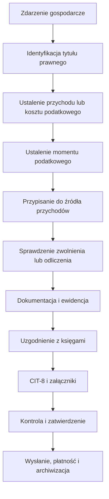

# 22.1. Podatek CIT

## Opodatkowanie fundacji podatkiem dochodowym od osób prawnych – status podatnika, przychody, koszty, dochód, zwolnienia statutowe, działalność gospodarcza, darowizny, CIT-8 i CIT-D

**Stan prawny i informacyjny: 27 listopada 2026 r.**

> Fundacja nie przestaje być podatnikiem dlatego, że nie działa dla zysku, realizuje cele społeczne lub religijne albo przeznacza nadwyżkę na działalność statutową. Jej obowiązki w podatku dochodowym trzeba rozpoznawać na podstawie ustawy, rzeczywistego charakteru zdarzeń i warunków konkretnego zwolnienia. Rzetelne rozliczenie CIT polega na wykazaniu przychodów, prawidłowym ustaleniu kosztów, wyodrębnieniu dochodu, sprawdzeniu przesłanek zwolnienia i zachowaniu dowodów potwierdzających przeznaczenie oraz wydatkowanie środków.

## Mapa zgodności z aktualnym konspektem

Rozdział realizuje wszystkie dwanaście zagadnień wskazanych w spisie treści:

| Pozycja konspektu | Zakres opracowania |
|---|---|
| 1. Fundacja jako podatnik CIT | Podmiotowość podatkowa, rezydencja, obowiązek podatkowy, rok podatkowy i brak automatycznego zwolnienia |
| 2. Przychody podatkowe | Przychody pieniężne i niepieniężne, darowizny, sprzedaż, usługi, najem, odsetki, dotacje i moment rozpoznania |
| 3. Koszty uzyskania przychodów | Test art. 15, wyłączenia art. 16, koszty bezpośrednie i pośrednie, finansowanie zewnętrzne i dokumentacja |
| 4. Dochód podatkowy | Różnica między wynikiem księgowym a podatkowym, źródła przychodów, straty, podstawa opodatkowania i stawki |
| 5. Zwolnienia przedmiotowe | Katalog art. 17 ustawy CIT, zwolnienia właściwe fundacjom, dotacje i status OPP |
| 6. Cele statutowe uprawniające do zwolnienia | Katalog celów z art. 17 ust. 1 pkt 4, znaczenie statutu, rzeczywista działalność i kwalifikacja celu |
| 7. Przeznaczanie i wydatkowanie dochodów | Dwa warunki zwolnienia, uchwały, dowody, wydatki kwalifikowane, środki trwałe i skutki wykorzystania niezgodnego z celem |
| 8. Dochody z działalności gospodarczej | Opodatkowanie działalności gospodarczej, możliwość zwolnienia dochodu przeznaczonego na cele statutowe i ograniczenia |
| 9. Darowizny otrzymywane przez fundację | Przychód podatkowy, zwolnienie statutowe, darowizny rzeczowe, informacja o darczyńcach i CIT-D |
| 10. Darowizny przekazywane innym organizacjom | Brak automatycznego kosztu, odliczenie od dochodu, limit, odbiorca, dokumentacja i zakaz podwójnego rozliczenia |
| 11. Zeznanie CIT-8 | Termin, forma, CIT-8/O, zapłata podatku, korekta i obowiązek złożenia zeznania także przy braku przychodów |
| 12. Informacja CIT-D | Przypadki złożenia, darowizny otrzymane i przekazane, progi identyfikacji darczyńców, jawność informacji i aktualny formularz |

## Granice rozdziału i powiązanie z wcześniejszymi opracowaniami

Rozdział 9.1 zawiera szeroki przegląd podatków fundacji, przychodów zagranicznych, VAT, WHT, grantów i obowiązków JPK. Rozdział 3.5 omawia szczegółowo preferencje podatkowe darowizn religijnych, w tym szczególne przepisy dotyczące działalności charytatywno-opiekuńczej kościelnych osób prawnych. Rozdział 19.1 dotyczy działalności gospodarczej, a rozdział 21.3 – rachunkowości.

Niniejsze opracowanie koncentruje się na krajowym rozliczeniu CIT fundacji i na praktycznym połączeniu tych zagadnień w jeden system podatkowy. Nie powiela pełnych instrukcji VAT, WHT ani zasad rozliczania grantów zagranicznych. W razie wystąpienia tych zdarzeń należy stosować także odpowiednie rozdziały kursu.

Szczególnie ważne jest rozdzielenie pięciu pojęć:

1. **przychód podatkowy** – przysporzenie rozpoznawane zgodnie z ustawą CIT;
2. **koszt uzyskania przychodów** – wydatek lub koszt spełniający warunki art. 15 i niewyłączony przez art. 16;
3. **dochód podatkowy** – wynik ustalony według reguł podatkowych, a nie wyłącznie księgowych;
4. **dochód zwolniony** – dochód, wobec którego spełniono wszystkie przesłanki konkretnego zwolnienia;
5. **środki pieniężne** – stan rachunku lub kasy, który nie jest tym samym co przychód, dochód ani podstawa opodatkowania.

Przykłady liczbowe mają charakter dydaktyczny. Nie stanowią indywidualnej kalkulacji podatku żadnej konkretnej fundacji.

# 1. Cel, zakres i efekty kształcenia

## 1.1. Cel rozdziału

Celem rozdziału jest przygotowanie osób zarządzających fundacją, członków zarządu, księgowych, pracowników administracyjnych i koordynatorów projektów do prawidłowego rozpoznawania skutków podatkowych zdarzeń finansowych oraz do organizacji rocznego rozliczenia CIT.

Fundacja może jednocześnie otrzymywać darowizny, prowadzić działalność nieodpłatną, świadczyć usługi odpłatne, prowadzić działalność gospodarczą, wynajmować majątek, uzyskiwać odsetki i realizować granty. Każde z tych zdarzeń może mieć inny moment powstania przychodu, inny sposób rozliczenia kosztów i odmienną podstawę ewentualnego zwolnienia.

Nie wolno przyjmować uproszczenia, że wszystkie wpływy fundacji są wolne od CIT, ponieważ fundacja nie wypłaca zysku właścicielom. Ustawa CIT nie ustanawia powszechnego zwolnienia dla wszystkich fundacji. Zwolnienie trzeba przypisać do konkretnego dochodu, konkretnego celu i konkretnego sposobu jego wykorzystania.

## 1.2. Efekty uczenia się

Po ukończeniu rozdziału uczestnik powinien umieć:

1. wyjaśnić, dlaczego fundacja jest podatnikiem CIT;
2. wskazać, kiedy powstaje obowiązek podatkowy i jaki jest rok podatkowy;
3. odróżnić przychód podatkowy od wpływu pieniężnego i przychodu księgowego;
4. zakwalifikować darowiznę, dotację, grant, sprzedaż, usługę, najem i odsetki;
5. zastosować test kosztu uzyskania przychodów;
6. rozpoznać wydatki wyłączone z kosztów podatkowych;
7. obliczyć dochód i podstawę opodatkowania;
8. rozdzielić źródła przychodów, w szczególności zyski kapitałowe i inne źródła;
9. sprawdzić warunki zwolnienia z art. 17 ust. 1 pkt 4 ustawy CIT;
10. ocenić, czy cel statutowy fundacji mieści się w katalogu ustawowym;
11. udokumentować przeznaczenie i faktyczne wydatkowanie dochodu;
12. odróżnić zwolnienie fundacji od odliczenia przysługującego darczyńcy;
13. rozpoznać skutki darowizn otrzymanych i przekazanych;
14. przygotować dane do CIT-8, CIT-8/O i CIT-D;
15. ustalić terminy rozliczeń i zapłaty podatku;
16. zorganizować wewnętrzną kontrolę podatkową.

## 1.3. Zasady interpretacyjne

W analizie CIT fundacji należy stosować następującą kolejność:

- najpierw ustalić rzeczywisty charakter zdarzenia;
- następnie ustalić, czy zdarzenie powoduje przychód albo koszt podatkowy;
- ustalić właściwy moment rozpoznania;
- obliczyć dochód zgodnie z ustawą;
- sprawdzić, czy istnieje szczególne zwolnienie lub odliczenie;
- sprawdzić wszystkie warunki pozytywne i negatywne;
- przypisać operację do właściwego źródła przychodów;
- zachować dowody i wykazać ją w odpowiedniej części zeznania.

Zwolnienia podatkowe są wyjątkami od powszechności opodatkowania. Nie należy interpretować ich rozszerzająco ani opierać się wyłącznie na nazwie projektu, uchwale zarządu lub deklaracji darczyńcy.

# 2. Fundacja jako podatnik CIT

## 2.1. Podmiotowość podatkowa fundacji

Podstawowym aktem regulującym podatek dochodowy od osób prawnych jest ustawa z dnia 15 lutego 1992 r. o podatku dochodowym od osób prawnych.

Fundacja uzyskuje osobowość prawną z chwilą wpisu do Krajowego Rejestru Sądowego. Jako osoba prawna co do zasady podlega ustawie CIT na podstawie art. 1 ust. 1.

Podatnikiem jest sama fundacja, a nie:
- fundator;
- prezes zarządu;
- członek zarządu;
- pracownik;
- wolontariusz;
- beneficjent;
- darczyńca.

Majątek fundacji jest odrębny od majątku osób uczestniczących w jej tworzeniu lub zarządzaniu. Z tego powodu rozliczenie podatkowe fundacji musi być prowadzone na jej własny NIP, we właściwym urzędzie skarbowym i w odniesieniu do jej własnego roku podatkowego.

## 2.2. Rezydencja podatkowa

Fundacja mająca siedzibę lub zarząd na terytorium Polski podlega co do zasady nieograniczonemu obowiązkowi podatkowemu od całości dochodów, bez względu na miejsce ich osiągania, z uwzględnieniem umów o unikaniu podwójnego opodatkowania.

Nie oznacza to, że każdy przychód zagraniczny zostanie opodatkowany w Polsce w taki sam sposób. Należy uwzględnić:
- miejsce osiągnięcia dochodu;
- rodzaj świadczenia;
- umowę o unikaniu podwójnego opodatkowania;
- ewentualny zagraniczny zakład;
- podatek pobrany za granicą;
- właściwe zwolnienia i odliczenia.

Zagadnienia transgraniczne zostały szerzej omówione w rozdziale 9.1.

## 2.3. Brak automatycznego zwolnienia fundacji

Fundacja nie jest zwolniona z CIT tylko z tego powodu, że:
- nie ma udziałowców;
- nie wypłaca dywidendy;
- nie działa dla zysku;
- nie prowadzi działalności gospodarczej;
- przeznacza nadwyżkę na cele statutowe;
- realizuje działalność religijną;
- otrzymuje darowizny;
- ma status organizacji pożytku publicznego.

Zwolnienie może wynikać z konkretnego przepisu, zwłaszcza art. 17 ustawy CIT. Każdy przepis ma własny zakres podmiotowy, przedmiotowy i warunki stosowania.

Status OPP nie jest tożsamy ze zwolnieniem z CIT. Fundacja bez statusu OPP może w określonych okolicznościach korzystać z art. 17 ust. 1 pkt 4, a fundacja ze statusem OPP musi odrębnie zbadać przesłanki właściwego zwolnienia.

## 2.4. Rok podatkowy

Zgodnie z art. 8 ustawy CIT rokiem podatkowym jest co do zasady rok kalendarzowy, chyba że podatnik postanowi inaczej w statucie lub innym dokumencie regulującym zasady ustrojowe i zawiadomi właściwego naczelnika urzędu skarbowego w wymaganym terminie.

Dla fundacji oznacza to konieczność uzgodnienia:
- statutu;
- polityki rachunkowości;
- roku obrotowego;
- roku podatkowego;
- terminów rozliczeń projektów;
- terminów sprawozdawczości.

Rok obrotowy i podatkowy powinny być ze sobą spójne, choć ich relacja zależy od właściwych przepisów i przyjętych rozwiązań.

Jeżeli rok podatkowy pokrywa się z kalendarzowym, rozliczenie za 2026 r. będzie co do zasady składane do 31 marca 2027 r. Jeżeli rok podatkowy jest inny, termin ustala się w odniesieniu do jego końca.

## 2.5. Obowiązek złożenia zeznania

Fundacja składa CIT-8 za każdy rok podatkowy, także wtedy, gdy:
- nie osiągnęła przychodów;
- nie prowadziła działalności gospodarczej;
- wszystkie dochody korzystają ze zwolnienia;
- nie wystąpił podatek do zapłaty.

Obowiązek złożenia zeznania jest odrębny od obowiązku zapłaty podatku. Brak podatku należnego nie oznacza automatycznie braku obowiązku deklaracyjnego.

## 2.6. Fundacja a fundacja rodzinna

Fundacji ustanowionej na podstawie ustawy o fundacjach nie należy utożsamiać z fundacją rodzinną utworzoną na podstawie ustawy o fundacji rodzinnej.

Są to odrębne formy prawne, mające inne cele, zasady funkcjonowania i reżimy podatkowe. Stawki oraz zwolnienia właściwe fundacji rodzinnej nie mogą być przenoszone na zwykłą fundację społeczną, edukacyjną, charytatywną lub religijną.

# 3. Przychody podatkowe

## 3.1. Przychód podatkowy a wpływ pieniężny

Przychód podatkowy ustala się według przepisów ustawy CIT, w szczególności art. 12–14. Nie każdy wpływ na rachunek bankowy jest przychodem podatkowym i nie każdy przychód powstaje w dniu otrzymania pieniędzy.

Przykłady:

| Zdarzenie | Typowa kwalifikacja |
|---|---|
| Darowizna pieniężna otrzymana przez fundację | Przychód podatkowy w momencie otrzymania |
| Pożyczka otrzymana | Co do zasady nie jest przychodem z tytułu otrzymania kapitału |
| Zwrot kaucji | Co do zasady nie jest nowym przychodem, jeżeli odpowiada zwrotowi wcześniej wpłaconej kaucji |
| Zaliczka na przyszłą usługę | Co do zasady nie jest przychodem w chwili otrzymania na podstawie art. 12 ust. 4 pkt 1, z uwzględnieniem wyjątków |
| Zapłata za wykonaną usługę | Przychód według zasad właściwych dla działalności gospodarczej |
| Odsetki bankowe | Przychód podatkowy |
| Dotacja budżetowa | Może być przychodem objętym szczególnym zwolnieniem |
| Sprzedaż środka trwałego | Przychód ustalany według właściwych reguł podatkowych |
| Darowizna rzeczowa | Może powodować przychód w wartości ustalonej według przepisów |

Kwalifikacji nie wolno dokonywać wyłącznie na podstawie opisu przelewu. Konieczne jest zbadanie umowy, tytułu prawnego, świadczeń stron i rzeczywistego przebiegu zdarzenia.

## 3.2. Przychody z działalności statutowej

Fundacja może uzyskiwać przychody związane z realizacją celów statutowych, w tym:
- darowizny;
- zapisy i spadki;
- zbiórki;
- składki, jeżeli wynikają z właściwego stosunku prawnego;
- dotacje i granty;
- odpłatne świadczenia;
- przychody z wydarzeń;
- przychody z publikacji;
- przychody z praw autorskich;
- przychody z majątku.

Określenie „działalność statutowa” opisuje cel i organizacyjny charakter aktywności, ale samo w sobie nie przesądza o kwalifikacji podatkowej przychodu.

Przychód z działalności statutowej może być przychodem podatkowym. Dopiero w kolejnym etapie bada się, czy dochód z tego przychodu korzysta ze zwolnienia.

## 3.3. Przychody z działalności gospodarczej

Przychodami podatkowymi mogą być w szczególności:
- ceny usług;
- ceny sprzedawanych towarów;
- opłaty za szkolenia;
- przychody ze sprzedaży publikacji;
- przychody z najmu;
- opłaty licencyjne;
- wynagrodzenia za usługi;
- odsetki;
- przychody ze zbycia składników majątku.

Przychód należny może powstać wcześniej niż wpływ środków pieniężnych. W działalności gospodarczej trzeba stosować reguły art. 12 ust. 3 i następnych, a nie wyłącznie metodę kasową.

## 3.4. Przychody niepieniężne i nieodpłatne świadczenia

Przychodem może być także wartość otrzymanych rzeczy, praw lub nieodpłatnych świadczeń, jeżeli ustawa nie przewiduje wyłączenia.

Przykłady wymagające analizy:
- nieodpłatne udostępnienie lokalu;
- nieodpłatne używanie sprzętu;
- otrzymanie praw majątkowych;
- nieodpłatne wykonanie usługi;
- umorzenie zobowiązania;
- otrzymanie rzeczy w drodze darowizny.

Wartość należy ustalać według właściwych przepisów, w szczególności art. 12 ust. 5–6 ustawy CIT. Nie wolno przyjmować dowolnej wartości deklarowanej przez darczyńcę bez sprawdzenia podstaw wyceny.

## 3.5. Moment powstania przychodu

Dla przychodów z działalności gospodarczej istotne są reguły art. 12 ust. 3a i następnych. Przychód powstaje zasadniczo w dniu wydania rzeczy, zbycia prawa majątkowego lub wykonania usługi albo częściowego wykonania usługi, nie później niż w dniu wystawienia faktury lub uregulowania należności, z uwzględnieniem szczególnych przepisów.

Dla darowizn pieniężnych przychód powstaje co do zasady w momencie otrzymania środków. Ministerstwo Finansów wskazuje w poradniku dla fundacji, że otrzymana darowizna stanowi przychód podatkowy w całości w momencie jej otrzymania.

W przypadku dotacji, grantów i innych środków publicznych należy zbadać zarówno moment rozpoznania przychodu, jak i szczególną podstawę ewentualnego zwolnienia. Samo określenie wpływu jako „grant” nie rozstrzyga sprawy.

## 3.6. Przychody, które nie są przychodem podatkowym

Ustawa CIT zawiera katalog wyłączeń z przychodów. W szczególności należy zbadać:
- otrzymane pożyczki i kredyty;
- zwrócone kaucje;
- określone zaliczki i przedpłaty;
- kwoty odpowiadające podatkowi VAT w przypadkach wskazanych w ustawie;
- inne wpływy wyłączone w art. 12 ust. 4.

Wyłączenie z przychodów nie jest tym samym co zwolnienie podatkowe. Wyłączenie oznacza, że dane zdarzenie nie jest przychodem w rozumieniu określonego przepisu. Zwolnienie zakłada natomiast, że przychód lub dochód podlega kwalifikacji, ale ustawodawca zwalnia go od podatku po spełnieniu warunków.

## 3.7. Karta kwalifikacji przychodu

Dla każdego nietypowego wpływu fundacja powinna przygotować kartę zawierającą:

1. datę wpływu lub zdarzenia;
2. kwotę i walutę;
3. dane kontrahenta lub darczyńcy;
4. umowę lub inną podstawę prawną;
5. opis rzeczywistego świadczenia;
6. kwalifikację podatkową;
7. moment powstania przychodu;
8. źródło przychodów;
9. ewentualne zwolnienie;
10. sposób wykazania w księgach i CIT-8;
11. osobę dokonującą kwalifikacji;
12. dokumenty potwierdzające ustalenia.

# 4. Koszty uzyskania przychodów

## 4.1. Podstawowy test z art. 15 ustawy CIT

Zgodnie z art. 15 ust. 1 ustawy CIT kosztami uzyskania przychodów są koszty poniesione w celu osiągnięcia przychodów albo zachowania lub zabezpieczenia źródła przychodów, z wyjątkiem kosztów wymienionych w art. 16 ust. 1.

Aby wydatek mógł być uznany za koszt podatkowy, należy sprawdzić łącznie:

- czy został rzeczywiście poniesiony przez podatnika;
- czy pozostaje w racjonalnym związku z uzyskaniem przychodu albo zachowaniem lub zabezpieczeniem jego źródła;
- czy ma gospodarcze uzasadnienie;
- czy został właściwie udokumentowany;
- czy nie został wymieniony w katalogu wyłączeń;
- czy nie został rozliczony ponownie w innym miejscu;
- czy nie zachodzi szczególne ograniczenie dotyczące źródła finansowania.

Samo ujęcie wydatku w księgach rachunkowych nie przesądza o jego podatkowej kwalifikacji.

## 4.2. Koszty bezpośrednie i pośrednie

Koszty bezpośrednie można powiązać z konkretnym przychodem, np. materiał wykorzystany do wykonania odpłatnej usługi.

Koszty pośrednie służą ogólnemu funkcjonowaniu źródła przychodów, np.:
- obsługa księgowa;
- najem biura;
- usługi teleinformatyczne;
- ubezpieczenie;
- obsługa prawna;
- koszty administracyjne.

Moment potrącenia zależy od reguł art. 15 ust. 4–4e ustawy CIT. W przypadku kosztów bezpośrednich znaczenie ma przyporządkowanie do przychodu, a w przypadku pośrednich – co do zasady data poniesienia, z uwzględnieniem szczególnych zasad.

## 4.3. Koszty statutowe a koszty podatkowe

Nie każdy wydatek na realizację misji fundacji jest automatycznie kosztem uzyskania przychodów. Należy zbadać jego związek z przychodami i ograniczenia ustawowe.

Przykładowo:
- wynagrodzenie za usługę wykorzystaną przy odpłatnym szkoleniu może spełniać warunki kosztu;
- koszt utrzymania infrastruktury może być kosztem pośrednim, jeżeli służy źródłu przychodów;
- darowizna przekazana innej organizacji co do zasady nie jest kosztem uzyskania przychodów;
- wydatek sfinansowany określonymi zwolnionymi środkami publicznymi może być wyłączony z kosztów na podstawie art. 16 ust. 1 pkt 58;
- wydatek prywatny lub niezwiązany z działalnością fundacji nie spełnia testu art. 15.

Fundacja powinna prowadzić oddzielną analizę rachunkową i podatkową. Koszt bilansowy może nie być kosztem podatkowym, a wydatek może być poniesiony w innym okresie niż moment jego podatkowego potrącenia.

## 4.4. Katalog wydatków wyłączonych

Art. 16 ust. 1 ustawy CIT zawiera katalog wydatków, które nie stanowią kosztów uzyskania przychodów. W praktyce fundacji szczególne znaczenie mają między innymi:

- podatek dochodowy;
- grzywny i kary pieniężne w przypadkach wskazanych ustawą;
- koszty reprezentacji w rozumieniu przepisów;
- darowizny i ofiary wszelkiego rodzaju, z wyjątkami ustawowymi;
- wydatki na spłatę kapitału pożyczki;
- określone odsetki i sankcje;
- wydatki na nabycie środków trwałych, rozliczane poprzez amortyzację, z uwzględnieniem wyjątków;
- wydatki finansowane z określonych dochodów lub przychodów zwolnionych;
- wydatki związane z transakcjami, dla których ustawa przewiduje ograniczenia płatnicze.

Lista wymaga sprawdzenia w aktualnym brzmieniu art. 16. Nie wystarczy ogólne stwierdzenie, że wydatek służy fundacji.

## 4.5. Wydatki finansowane z dotacji i innych zwolnionych środków

Art. 16 ust. 1 pkt 58 ustawy CIT wyłącza z kosztów określone wydatki i koszty bezpośrednio sfinansowane z wymienionych w nim dochodów lub przychodów zwolnionych. W szczególności należy analizować powiązanie z art. 17 ust. 1 pkt 14a, 23, 24, 42, 47, 48, 52, 53 i innymi punktami wskazanymi w aktualnym brzmieniu przepisu.

Nie wolno automatycznie przenosić tego wyłączenia na każde zwolnienie z art. 17 ust. 1 pkt 4. Trzeba odczytać dokładne odesłania ustawowe i ustalić, z jakiego źródła sfinansowano konkretny koszt.

Praktyczna zasada:
- odrębnie oznaczyć środki z dotacji;
- odrębnie oznaczyć wydatki sfinansowane z dotacji;
- sprawdzić konkretny punkt art. 17;
- sprawdzić art. 16 ust. 1 pkt 58;
- nie wykazywać tego samego wydatku jako kosztu podatkowego, jeżeli ustawa wyłącza go z kosztów;
- zachować dokumentację pozwalającą odtworzyć źródło finansowania.

## 4.6. Rozliczanie kosztów wspólnych

Jeżeli koszt służy kilku rodzajom działalności, fundacja powinna przyjąć racjonalny, obiektywny i udokumentowany sposób podziału.

Przykład: miesięczny koszt najmu wynosi 9 000 zł. Lokal jest wykorzystywany:
- w 50% na działalność społeczną;
- w 30% na działalność edukacyjną;
- w 20% na działalność gospodarczą.

Przykładowy podział wynosi odpowiednio 4 500 zł, 2 700 zł i 1 800 zł. Sam procent nie jest jednak wystarczającym dowodem. Fundacja powinna mieć dokumentację wykorzystania powierzchni, czasu, zasobów lub inny klucz adekwatny do charakteru kosztu.

Nie należy przyjmować jednego klucza do wszystkich kosztów bez sprawdzenia ich natury. Koszt energii, najmu, księgowości i reklamy może wymagać różnych metod alokacji.

## 4.7. Koszty dokumentowane i zatwierdzane

Każdy koszt powinien mieć:
- dowód księgowy;
- opis merytoryczny;
- wskazanie związku z działalnością;
- oznaczenie projektu lub źródła finansowania;
- informację o podatkowej kwalifikacji;
- zatwierdzenie zgodne z procedurą;
- dowód zapłaty, jeżeli został uregulowany.

Wydatki na rzecz członków zarządu, fundatora, osób bliskich lub podmiotów powiązanych wymagają szczególnej staranności. Należy sprawdzić podstawę prawną, rynkowość, konflikt interesów, właściwą reprezentację i dokumentację wykonania świadczenia.

# 5. Dochód podatkowy

## 5.1. Dochód a wynik finansowy

Wynik finansowy ustala się zgodnie z ustawą o rachunkowości. Dochód podatkowy ustala się zgodnie z ustawą CIT.

Różnice mogą wynikać między innymi z:
- odmiennego momentu rozpoznania przychodu;
- odmiennego momentu potrącenia kosztu;
- kosztów niestanowiących kosztów uzyskania przychodów;
- przychodów wyłączonych z opodatkowania;
- dochodów zwolnionych;
- różnic amortyzacyjnych;
- szczególnych zasad rozliczania dotacji;
- rozliczenia strat z lat ubiegłych.

Nie wolno przepisywać wyniku z rachunku zysków i strat do CIT-8 bez uzgodnienia podatkowego.

## 5.2. Podstawowy model obliczenia

W uproszczeniu:

**Przychody podatkowe – koszty uzyskania przychodów = dochód podatkowy albo strata podatkowa.**

Następnie:
1. rozdziela się źródła przychodów;
2. uwzględnia się właściwe zwolnienia;
3. uwzględnia się odliczenia przewidziane ustawą;
4. ustala się podstawę opodatkowania;
5. stosuje się właściwą stawkę;
6. odejmuje się zaliczki i inne kwoty uwzględniane w rozliczeniu.

To model dydaktyczny. Faktyczna kalkulacja wymaga zastosowania wszystkich właściwych przepisów, w tym art. 7, 7a, 17, 18, 19 i 24–25 ustawy CIT.

## 5.3. Odrębne źródła przychodów

Ustawa CIT rozróżnia źródła przychodów, w szczególności:
- zyski kapitałowe;
- inne źródła przychodów.

Dochodu i straty nie wolno dowolnie łączyć między źródłami. Strata z jednego źródła co do zasady nie pomniejsza dochodu z drugiego źródła. Dlatego fundacja powinna rozpoznawać, czy przychód dotyczy zysków kapitałowych, czy pozostałych źródeł.

Przychody z darowizn, usług, dotacji, najmu i działalności statutowej wymagają kwalifikacji zgodnie z konkretnym zdarzeniem. Nie należy zakładać, że wszystkie przychody fundacji należą do jednej kategorii bez sprawdzenia ustawy.

## 5.4. Przykład obliczeniowy – wariant uproszczony

Fundacja w roku podatkowym uzyskała:
- przychody podatkowe: 500 000 zł;
- koszty uzyskania przychodów: 350 000 zł;
- dochód podatkowy: 150 000 zł.

Po analizie art. 17 ustawy CIT fundacja wykazuje:
- 110 000 zł dochodu przeznaczonego i wydatkowanego na kwalifikowane cele statutowe;
- 40 000 zł dochodu, który nie spełnia warunków zwolnienia.

Przy założeniu, że wszystkie pozostałe korekty, odliczenia i ograniczenia zostały prawidłowo uwzględnione, kwota 40 000 zł stanowi dochód wymagający dalszej kalkulacji podstawy opodatkowania.

Nie oznacza to, że w każdym przypadku można po prostu odjąć od dochodu kwotę wydatków statutowych. Trzeba ustalić, jaka część dochodu została przeznaczona i rzeczywiście wydatkowana na cele kwalifikowane, a także czy nie występują szczególne wyłączenia.

## 5.5. Stawki CIT w 2026 r.

Podstawowe stawki podatku wynoszą:
- 19% podstawy opodatkowania – stawka podstawowa;
- 9% podstawy opodatkowania – dla dochodów z innych źródeł niż zyski kapitałowe, jeżeli podatnik spełnia warunki ustawowe.

Stawka 9% nie jest automatycznym przywilejem każdej fundacji. Trzeba sprawdzić między innymi:
- status małego podatnika albo warunek rozpoczęcia działalności;
- limit przychodów w bieżącym roku podatkowym;
- limit przychodów ze sprzedaży w poprzednim roku;
- wyłączenia związane z określonymi przekształceniami i restrukturyzacjami;
- odrębność źródła zysków kapitałowych, do którego stawka 9% nie ma zastosowania.

Dla roku 2026 Ministerstwo Finansów wskazuje:
- limit przychodów ze sprzedaży z VAT za poprzedni rok dla statusu małego podatnika: 8 517 000 zł;
- limit przychodów w bieżącym roku uprawniający do stawki 9% dla roku kalendarzowego: 8 431 000 zł.

Wartości te wynikają z przeliczenia równowartości 2 000 000 euro według właściwych kursów NBP. Nie należy używać ich automatycznie dla roku 2027 ani dla podatnika z innym rokiem podatkowym. Wartości na 2027 r. trzeba ustalić po publikacji właściwego kursu i komunikatu Ministerstwa Finansów.

## 5.6. Straty podatkowe

Stratę podatkową ustala się odrębnie dla źródła przychodów. Ustawa CIT przewiduje zasady rozliczania strat z lat ubiegłych, w tym ograniczenia kwotowe i czasowe.

Przed wykorzystaniem straty należy sprawdzić:
- z jakiego źródła powstała;
- w którym roku podatkowym;
- jaka część została już rozliczona;
- czy nie upłynął termin rozliczenia;
- czy nie występują ustawowe ograniczenia;
- czy zmiany organizacyjne lub właścicielskie nie wpływają na możliwość odliczenia.

Fundacja powinna prowadzić rejestr strat podatkowych niezależnie od ewidencji wyniku księgowego.

# 6. Zwolnienia przedmiotowe

## 6.1. Zasada ogólna

Zwolnienia przedmiotowe określone są przede wszystkim w art. 17 ustawy CIT. Fundacja powinna każdorazowo wskazać konkretną podstawę prawną zwolnienia, zamiast posługiwać się ogólnym stwierdzeniem, że „działalność fundacji jest zwolniona”.

W praktyce fundacji szczególne znaczenie mają:
- art. 17 ust. 1 pkt 4 – dochody przeznaczone na określone cele statutowe;
- art. 17 ust. 1 pkt 6c – dochody organizacji pożytku publicznego przeznaczone na działalność statutową, z wyłączeniami ustawowymi;
- art. 17 ust. 1 pkt 23 – określone dochody z bezzwrotnej pomocy zagranicznej;
- art. 17 ust. 1 pkt 47 – określone dotacje otrzymane z budżetu państwa lub budżetu jednostki samorządu terytorialnego;
- inne punkty art. 17 odnoszące się do określonych źródeł lub kategorii środków.

Nie każdy grant, darowizna ani transfer publiczny jest zwolniony na tej samej podstawie. Należy zbadać źródło finansowania, podstawę prawną, sposób przekazania, umowę i warunki ustawowe.

## 6.2. Zwolnienie z art. 17 ust. 1 pkt 4

Jest to jedna z najważniejszych podstaw zwolnienia dla fundacji. Obejmuje dochody podatników, których celem statutowym jest działalność wskazana w przepisie, w części przeznaczonej na te cele.

Zwolnienie nie obejmuje automatycznie wszystkich przychodów ani wszystkich dochodów fundacji. Wymaga spełnienia przesłanek:
1. właściwy cel musi wynikać ze statutu;
2. cel musi mieścić się w katalogu ustawowym;
3. dochód musi być przeznaczony na ten cel;
4. dochód musi zostać faktycznie wydatkowany na ten cel;
5. nie mogą występować wyłączenia ustawowe.

## 6.3. Zwolnienie dotacji budżetowych

Art. 17 ust. 1 pkt 47 ustawy CIT przewiduje zwolnienie określonych dotacji otrzymanych z budżetu państwa lub budżetu jednostki samorządu terytorialnego, z uwzględnieniem wyjątków ustawowych.

Nie należy utożsamiać:
- dotacji z budżetu państwa;
- dotacji z budżetu samorządu;
- środków z agencji rządowej;
- środków europejskich;
- grantu od prywatnej fundacji;
- darowizny od osoby prawnej.

Każde źródło może mieć odrębną podstawę prawną i inne skutki podatkowe. Szczegółowe porównanie grantów i dotacji znajduje się w rozdziale 9.1.

## 6.4. Zwolnienie organizacji pożytku publicznego

Art. 17 ust. 1 pkt 6c dotyczy dochodów organizacji pożytku publicznego przeznaczonych na działalność statutową, z ustawowymi wyłączeniami, w szczególności dotyczącymi działalności gospodarczej.

Nie należy utożsamiać:
- statusu fundacji;
- statusu organizacji pozarządowej;
- statusu OPP;
- prawa do zwolnienia z art. 17 ust. 1 pkt 4.

Status OPP wymaga odrębnego spełnienia warunków ustawowych i wpisu do właściwego rejestru. Nie jest warunkiem korzystania z art. 17 ust. 1 pkt 4.

## 6.5. Zwolnienie nie oznacza braku ewidencji

Dochód zwolniony nadal powinien być:
- prawidłowo rozpoznany;
- ujęty w księgach;
- zakwalifikowany do właściwego źródła;
- wykazany w CIT-8 i odpowiednim załączniku;
- powiązany z dokumentacją przeznaczenia;
- monitorowany do chwili faktycznego wydatkowania.

Zwolnienie podatkowe nie usuwa obowiązku rachunkowego ani obowiązku sprawozdawczego.

# 7. Cele statutowe uprawniające do zwolnienia

## 7.1. Katalog ustawowy

Art. 17 ust. 1 pkt 4 wymienia między innymi następujące rodzaje działalności:
- naukową;
- naukowo-techniczną;
- oświatową, w tym kształcenie studentów;
- kulturalną;
- w zakresie kultury fizycznej i sportu;
- ochrony środowiska;
- wspierania inicjatyw społecznych dotyczących budowy dróg i sieci telekomunikacyjnej na wsi oraz zaopatrzenia wsi w wodę;
- dobroczynności;
- ochrony zdrowia i pomocy społecznej;
- rehabilitacji zawodowej i społecznej osób z niepełnosprawnościami;
- kultu religijnego.

Katalog należy odczytywać ściśle. Cel zapisany w statucie powinien odpowiadać jednej z kategorii ustawowych, a rzeczywista działalność fundacji powinna potwierdzać ten związek.

## 7.2. Znaczenie statutu fundacji

Statut powinien precyzyjnie opisywać cele i sposoby ich realizacji. Ogólne sformułowania, takie jak „wspieranie dobra”, „rozwój człowieka” lub „działanie dla wspólnoty”, mogą nie wystarczyć do wykazania, że konkretny dochód został przeznaczony na cel wymieniony w art. 17 ust. 1 pkt 4.

Przykładowa tabela kwalifikacji:

| Cel statutowy | Możliwa kategoria art. 17 ust. 1 pkt 4 | Co należy wykazać |
|---|---|---|
| Prowadzenie kursów i edukacji | Działalność oświatowa | Program, uczestnicy, materiały, realizacja nauczania |
| Organizowanie koncertów i wydarzeń artystycznych | Działalność kulturalna | Charakter wydarzenia, program, odbiorcy |
| Pomoc osobom ubogim | Dobroczynność lub pomoc społeczna | Kryteria pomocy, beneficjenci, rzeczywisty zakres świadczeń |
| Rehabilitacja | Ochrona zdrowia lub rehabilitacja zawodowa i społeczna | Rodzaj świadczeń, kwalifikacje, dokumentacja realizacji |
| Wspieranie kultu religijnego | Kult religijny | Cel wydarzenia, charakter działań, sposób wydatkowania |
| Ochrona przyrody | Ochrona środowiska | Konkretne działania i ich rezultat |

Tabela jest narzędziem wstępnej kwalifikacji, a nie automatycznym potwierdzeniem prawa do zwolnienia.

## 7.3. Cele religijne i kult religijny

Kult religijny został wprost wymieniony w art. 17 ust. 1 pkt 4. Fundacja, której statut obejmuje taki cel, może analizować możliwość zwolnienia dochodu przeznaczonego i wydatkowanego na jego realizację.

Nie oznacza to jednak, że:
- każda działalność fundacji o charakterze religijnym jest automatycznie zwolniona;
- każda darowizna na rzecz fundacji religijnej korzysta ze zwolnienia;
- fundacja staje się kościelną osobą prawną;
- wydatki prywatne osób związanych z fundacją stają się wydatkami na kult religijny;
- każde wydarzenie o nazwie religijnej spełnia warunki ustawowe.

Należy wykazać rzeczywisty charakter działania, związek ze statutem, przeznaczenie dochodu i dowody jego wydatkowania.

## 7.4. Cele charytatywne, społeczne i zdrowotne

W przypadku działalności dobroczynnej, ochrony zdrowia i pomocy społecznej trzeba opisać:
- rodzaj potrzeb, na które odpowiada fundacja;
- kryteria udzielania pomocy;
- grupę beneficjentów;
- zakres świadczeń;
- sposób kwalifikowania wydatków;
- dokumenty potwierdzające realizację celu.

Nie należy automatycznie utożsamiać działalności dobroczynnej fundacji ze szczególną działalnością charytatywno-opiekuńczą kościelnych osób prawnych. To odrębne reżimy prawne, omówione szerzej w rozdziale 3.5.

## 7.5. Cele oświatowe i edukacyjne

W przypadku działalności edukacyjnej warto zachować:
- program nauczania;
- konspekty;
- listy uczestników;
- potwierdzenia przeprowadzenia zajęć;
- materiały dydaktyczne;
- umowy z prowadzącymi;
- dokumentację zakupu wyposażenia;
- raport z realizacji.

Sama nazwa „kurs”, „szkolenie” lub „akademia” nie rozstrzyga o kwalifikacji. Trzeba ustalić rzeczywisty charakter i cel działania.

## 7.6. Wyłączenia

Art. 17 ust. 1a i 1c przewiduje ograniczenia stosowania zwolnień. W szczególności należy zweryfikować:
- dochody z określonych rodzajów działalności;
- dochody z oddawania środków trwałych lub wartości niematerialnych i prawnych do odpłatnego używania na warunkach leasingu;
- dochody wydatkowane na cele inne niż wymienione w przepisie;
- ograniczenia podmiotowe wskazane w art. 17 ust. 1c.

Nie wystarczy ustalić, że fundacja ma cel statutowy zgodny z art. 17. Należy również zbadać, czy konkretne źródło dochodu i sposób jego wykorzystania nie są objęte wyłączeniem.

# 8. Przeznaczanie i wydatkowanie dochodów

## 8.1. Dwa odrębne warunki

Art. 17 ust. 1 pkt 4 w związku z art. 17 ust. 1b i 1a pkt 2 wymaga przeznaczenia oraz faktycznego wydatkowania dochodu na kwalifikowane cele.

Nie wystarczy:
- wpisać celu do statutu;
- podjąć ogólną uchwałę o przeznaczeniu zysku;
- pozostawić środki na rachunku bankowym;
- opisać przelewu jako „cele statutowe”;
- wydać środków na dowolny cel, który fundacja uznaje za społecznie pożyteczny.

Przeznaczenie i wydatkowanie muszą dotyczyć tego samego celu kwalifikowanego.

## 8.2. Przeznaczenie dochodu

Przeznaczenie dochodu powinno być możliwe do odtworzenia na podstawie:
- uchwały właściwego organu;
- zatwierdzonego planu finansowego;
- budżetu projektu;
- dokumentu określającego cel;
- analityki księgowej;
- rejestru dochodów przeznaczonych na cele statutowe.

Przepisy nie wymagają, aby każda fundacja stosowała identyczny wzór uchwały. Dla celów dowodowych warto jednak przyjąć jednolity dokument, który wskazuje kwotę, rok, cel, podstawę statutową, planowany sposób wydatkowania i osobę odpowiedzialną.

## 8.3. Faktyczne wydatkowanie

Wydatkowanie powinno oznaczać rzeczywiste wykorzystanie dochodu na cel uprawniający do zwolnienia. Wydatki należy dokumentować fakturami, umowami, protokołami, listami wypłat, raportami i innymi dowodami adekwatnymi do zdarzenia.

Przykłady:
- zakup materiałów dydaktycznych na kurs realizujący cel oświatowy;
- wynagrodzenie wykładowcy za przeprowadzone zajęcia;
- zakup sprzętu medycznego wykorzystywanego w działalności ochrony zdrowia;
- sfinansowanie pomocy rzeczowej dla osób potrzebujących;
- organizacja wydarzenia kulturalnego;
- zakup wyposażenia bezpośrednio służącego realizacji celu statutowego.

## 8.4. Wydatkowanie bez względu na termin

Art. 17 ust. 1b przewiduje możliwość wydatkowania dochodu na kwalifikowane cele bez względu na termin. Sam fakt, że fundacja nie wydała środków do końca roku, nie oznacza automatycznie utraty zwolnienia.

Nie wolno jednak wyciągać z tego wniosku, że wystarczy bezterminowo przechowywać środki bez realnego zamiaru ich wykorzystania. Fundacja musi wykazać przeznaczenie, a następnie faktyczne wydatkowanie na kwalifikowany cel.

Jeżeli fundacja zadeklarowała konkretny termin lub przyjęła plan wydatkowania, powinna monitorować jego realizację. W razie zmiany przeznaczenia lub wydatkowania na inny cel należy zbadać skutki podatkowe.

## 8.5. Zakup środków trwałych i wartości niematerialnych

Art. 17 ust. 1b dopuszcza wydatkowanie dochodu między innymi na nabycie środków trwałych oraz wartości niematerialnych i prawnych służących bezpośrednio realizacji kwalifikowanych celów.

Przykłady:
- sprzęt do prowadzenia zajęć edukacyjnych;
- wyposażenie pracowni terapeutycznej;
- urządzenia służące rehabilitacji;
- oprogramowanie wykorzystywane w działalności statutowej;
- wyposażenie ośrodka pomocy.

Warunek bezpośredniego służenia celowi wymaga oceny rzeczywistego przeznaczenia i wykorzystania składnika majątku. Zakup składnika do działalności gospodarczej nie staje się automatycznie wydatkiem na cel statutowy tylko dlatego, że zysk z działalności ma w przyszłości wspierać misję.

## 8.6. Podatki niestanowiące kosztu uzyskania przychodów

Art. 17 ust. 1b przewiduje również możliwość wydatkowania dochodu na opłacenie podatków niestanowiących kosztów uzyskania przychodów, z zastrzeżeniami wynikającymi z ustawy.

Nie należy jednak automatycznie uznawać, że każda płatność publicznoprawna jest wydatkiem na cel statutowy. Trzeba ustalić konkretną podstawę, rodzaj podatku i związek z działalnością objętą zwolnieniem.

## 8.7. Wydatkowanie na cel niekwalifikowany

Jeżeli fundacja przeznaczyła dochód na cel kwalifikowany, a następnie wydała go na cel inny niż określony w art. 17 ust. 1, może utracić prawo do zwolnienia w odniesieniu do tej kwoty.

Przykłady ryzyka:
- finansowanie prywatnych wydatków członka zarządu;
- przekazanie środków osobie fizycznej bez podstawy i związku z celem;
- pożyczka dla podmiotu powiązanego bez właściwego uzasadnienia;
- zakup aktywa wykorzystywanego wyłącznie do celu niekwalifikowanego;
- przeznaczenie dochodu na działalność, która nie mieści się w katalogu zwolnienia;
- wypłata środków w sposób sprzeczny z uchwałą i statutem.

## 8.8. Skutek z art. 25 ust. 4

Jeżeli podatnik uprzednio zadeklarował przeznaczenie dochodu na cele wskazane w art. 17, a następnie wydał dochód na inne cele albo nie wydał go w terminie, który był wymagany w danej sytuacji, art. 25 ust. 4 przewiduje obowiązek wpłaty podatku bez wezwania do 20. dnia miesiąca następującego po miesiącu, w którym dokonano wydatku lub upłynął termin.

Przepis ten dotyczy również dochodów z lat poprzednich zadeklarowanych i niewydatkowanych zgodnie z art. 17 ust. 1b, z uwzględnieniem zastrzeżeń ustawowych.

Nie należy utożsamiać tego obowiązku z typową miesięczną zaliczką. Jest to szczególny mechanizm zapłaty podatku w związku z utratą warunku zwolnienia.

## 8.9. Rejestr dochodów przeznaczonych na cele statutowe

Fundacja powinna prowadzić rejestr obejmujący co najmniej:

| Pole | Opis |
|---|---|
| Rok podatkowy | Rok, w którym osiągnięto dochód |
| Kwota dochodu | Wartość przeznaczona na cel |
| Podstawa prawna | Właściwy punkt art. 17 |
| Cel statutowy | Dokładne wskazanie celu |
| Uchwała | Numer i data uchwały |
| Plan wydatkowania | Opis i przewidywany termin |
| Wydatki | Dokumenty i kwoty |
| Saldo | Niewydatkowana część dochodu |
| Kontrola | Osoba sprawdzająca zgodność |
| Zmiana przeznaczenia | Data, podstawa i skutki podatkowe |

Rejestr powinien być uzgadniany z księgami rachunkowymi, CIT-8/O i dokumentacją wydatków.

# 9. Dochody z działalności gospodarczej

## 9.1. Działalność gospodarcza nie oznacza automatycznie opodatkowania całego dochodu

Fundacja może prowadzić działalność gospodarczą w granicach określonych ustawą o fundacjach i statutem. Dochód z tej działalności jest przychodem i dochodem podatkowym ustalanym zgodnie z ustawą CIT.

Jednocześnie zwolnienie z art. 17 ust. 1 pkt 4 jest związane przede wszystkim z celem, na jaki dochód jest przeznaczony i wydatkowany, a nie wyłącznie z nazwą źródła przychodu. Dochód z działalności gospodarczej może więc wymagać analizy pod kątem zwolnienia statutowego, o ile nie zachodzi wyłączenie ustawowe i spełniono wszystkie przesłanki.

Nie oznacza to, że każda działalność gospodarcza fundacji jest wolna od CIT. Nie zwalnia również z obowiązków VAT, rachunkowości, ewidencji, rejestracyjnych i sprawozdawczych.

## 9.2. Rozdzielenie działalności gospodarczej i statutowej

Fundacja powinna wyodrębniać:
- przychody działalności gospodarczej;
- koszty działalności gospodarczej;
- przychody działalności nieodpłatnej;
- koszty działalności nieodpłatnej;
- przychody działalności odpłatnej pożytku publicznego;
- koszty działalności odpłatnej;
- koszty wspólne;
- dochód przeznaczony na kwalifikowane cele statutowe.

Właściwe rozdzielenie ułatwia ustalenie wyniku podatkowego i sprawdzenie, czy dochód może korzystać ze zwolnienia.

## 9.3. Przykład – sprzedaż usług edukacyjnych

Fundacja prowadzi kursy edukacyjne w ramach działalności gospodarczej. Uzyskuje 200 000 zł przychodu i ponosi 130 000 zł kosztów podatkowych.

Dochód wynosi 70 000 zł.

Jeżeli statut obejmuje działalność oświatową, a fundacja przeznaczy i faktycznie wydatkuje dochód na kwalifikowane cele, może analizować zwolnienie z art. 17 ust. 1 pkt 4.

Nie wystarczy jednak:
- sam zapis o edukacji w statucie;
- przeznaczenie dochodu na dowolny wydatek;
- finansowanie kosztów niezwiązanych z celem;
- brak dokumentacji wydatkowania.

## 9.4. Ograniczenia dotyczące leasingu

Art. 17 ust. 1a zawiera wyłączenie dotyczące określonych dochodów z działalności polegającej na oddaniu środków trwałych lub wartości niematerialnych i prawnych do odpłatnego używania na warunkach leasingu określonych w art. 17a–17k.

Fundacja, która uzyskuje dochody z takich umów, powinna odrębnie zbadać ich kwalifikację. Nie wolno automatycznie obejmować ich zwolnieniem statutowym.

## 9.5. Działalność gospodarcza a OPP

W przypadku organizacji pożytku publicznego należy odróżnić zwolnienie z art. 17 ust. 1 pkt 4 od zwolnienia z art. 17 ust. 1 pkt 6c. To drugie ma własny zakres i wyłączenia, w szczególności dotyczące działalności gospodarczej.

Fundacja posiadająca status OPP powinna zatem sprawdzić, z którego przepisu korzysta w odniesieniu do danego dochodu. Nie należy łączyć obu podstaw w jedną ogólną kategorię.

## 9.6. Sprzedaż majątku

Sprzedaż środka trwałego, nieruchomości, publikacji, sprzętu lub innego składnika majątku może powodować przychód podatkowy. Należy:
- ustalić wartość przychodu;
- ustalić podatkową wartość kosztu;
- uwzględnić dotychczasowe odpisy amortyzacyjne;
- rozpoznać właściwe źródło;
- sprawdzić ewentualne zwolnienie;
- ustalić przeznaczenie i wydatkowanie dochodu.

Nie należy utożsamiać ceny sprzedaży z dochodem. Dochód ustala się po uwzględnieniu właściwych kosztów podatkowych.

# 10. Darowizny otrzymywane przez fundację

## 10.1. Darowizna jako przychód podatkowy

Darowizna pieniężna otrzymana przez fundację stanowi co do zasady przychód podatkowy w momencie otrzymania. Dotyczy to również darowizn, które darczyńca przekazuje na określony cel.

Samo oznaczenie przelewu jako „darowizna na cele statutowe” nie oznacza, że wpływ jest automatycznie zwolniony z CIT. Należy zbadać możliwość zastosowania art. 17 ust. 1 pkt 4 lub innej szczególnej podstawy.

## 10.2. Darowizna a zwolnienie statutowe

Jeżeli dochód z darowizny zostanie przeznaczony i wydatkowany na cele kwalifikowane, może korzystać ze zwolnienia na zasadach art. 17 ust. 1 pkt 4.

Ministerstwo Finansów wskazuje, że fundacja może przeznaczyć dochód z darowizny na kwalifikowane cele statutowe także w innym roku podatkowym. Sam fakt niewydatkowania darowizny do końca roku otrzymania nie powoduje automatycznie utraty zwolnienia, jeżeli zachowane są ustawowe warunki przeznaczenia i późniejszego wydatkowania.

## 10.3. Darowizny pieniężne i rzeczowe

W przypadku darowizny pieniężnej należy zachować:
- potwierdzenie wpływu;
- dane darczyńcy;
- umowę, jeżeli została zawarta;
- opis celu;
- dokumentację ewentualnego ograniczenia sposobu wykorzystania.

W przypadku darowizny rzeczowej należy dodatkowo:
- ustalić przedmiot i jego stan;
- ustalić wartość według właściwych przepisów;
- sporządzić protokół przyjęcia;
- wprowadzić składnik do ewidencji, jeżeli jest to wymagane;
- ustalić, czy przedmiot jest środkiem trwałym, zapasem, materiałem lub innym składnikiem;
- oznaczyć źródło i cel finansowania;
- udokumentować dalsze wykorzystanie.

## 10.4. Darowizna od osoby prawnej i obowiązki informacyjne

Jeżeli fundacja otrzymuje darowizny, które darczyńca może odliczyć na podstawie ustawy CIT lub PIT, należy zbadać obowiązki wynikające z art. 18 ust. 1e–1h ustawy CIT oraz aktualny formularz CIT-D.

W szczególności art. 18 ust. 1e przewiduje wykazywanie łącznej kwoty otrzymanych darowizn i celów ich przeznaczenia, a także identyfikację określonych darczyńców będących osobami prawnymi, gdy:
- jednorazowa darowizna przekracza 15 000 zł; albo
- suma darowizn otrzymanych w roku podatkowym od jednego darczyńcy przekracza 35 000 zł.

Należy odróżnić obowiązek wykazania łącznej kwoty darowizn od obowiązku podania szczegółowych danych darczyńcy po przekroczeniu progów.

## 10.5. Jawność informacji o darowiznach

Art. 18 ust. 1e przewiduje także obowiązek udostępnienia określonych informacji do publicznej wiadomości w terminie składania zeznania. Ustawa określa sposób realizacji tego obowiązku i wyjątki.

Art. 18 ust. 1eb przewiduje zwolnienie z obowiązku publicznego udostępniania informacji w określonych warunkach, jeżeli dochód podatnika za dany rok podatkowy nie przekracza 20 000 zł. Należy sprawdzić dokładne brzmienie przepisu i powiązane obowiązki, ponieważ zwolnienie z publikacji nie oznacza automatycznie zwolnienia ze wszystkich obowiązków informacyjnych.

## 10.6. Darowizna, sponsoring i odpłatne świadczenie

Nie należy kwalifikować jako darowizny każdej wpłaty, której nazwa zawiera słowo „wsparcie”.

Jeżeli fundacja zobowiązuje się do świadczenia wzajemnego, np.:
- reklamy;
- ekspozycji logotypu;
- publikacji materiałów promocyjnych;
- udostępnienia powierzchni;
- wykonania usługi;
- dostarczenia określonego świadczenia,

należy zbadać, czy umowa nie jest sponsoringiem, usługą lub innym odpłatnym stosunkiem prawnym.

Kwalifikacja CIT może być inna niż w przypadku darowizny, a dodatkowo mogą powstać obowiązki w VAT.

# 11. Darowizny przekazywane innym organizacjom

## 11.1. Darowizna nie jest automatycznie kosztem podatkowym

Zasadniczo darowizny i ofiary wszelkiego rodzaju nie stanowią kosztów uzyskania przychodów na podstawie art. 16 ust. 1 pkt 14 ustawy CIT, z uwzględnieniem wyjątków ustawowych.

Nie należy więc zaliczać każdej darowizny przekazanej przez fundację do kosztów podatkowych tylko dlatego, że wspiera ona cele statutowe.

## 11.2. Odliczenie od dochodu

Ustawa CIT przewiduje możliwość odliczenia określonych darowizn od dochodu na podstawie art. 18. Dotyczy to między innymi darowizn:
- na cele określone w art. 4 ustawy o działalności pożytku publicznego i o wolontariacie, przekazanych uprawnionym organizacjom;
- na cele kultu religijnego;
- na określone cele kształcenia zawodowego.

Łączna kwota odliczeń z tytułów wskazanych w art. 18 ust. 1 pkt 1, 7 i 8 nie może co do zasady przekroczyć 10% dochodu, z uwzględnieniem ustawowych warunków i wyłączeń.

Odliczenie nie przysługuje w szczególności w odniesieniu do darowizn na rzecz osób fizycznych oraz podmiotów prowadzących działalność w określonych branżach wymienionych w art. 18 ust. 1a.

## 11.3. Dokumentowanie darowizny przekazanej

W przypadku darowizny pieniężnej należy posiadać dowód wpłaty na rachunek płatniczy obdarowanego lub jego rachunek bankowy w zakresie przewidzianym ustawą.

W przypadku darowizny niepieniężnej należy posiadać:
- dokument określający wartość darowizny;
- oświadczenie obdarowanego o przyjęciu;
- dokument potwierdzający przekazanie;
- dowody wyceny;
- dokumenty potwierdzające kwalifikację celu.

Nie wystarczy samo oświadczenie zarządu o przekazaniu rzeczy.

## 11.4. Zakaz podwójnego rozliczenia

Nie można jednocześnie zaliczyć tej samej darowizny do kosztów uzyskania przychodów i odliczyć jej od dochodu w sposób sprzeczny z ustawą.

Fundacja powinna zachować:
- uchwałę o przekazaniu darowizny;
- umowę lub oświadczenie;
- dowód zapłaty albo protokół przekazania;
- dane obdarowanego;
- potwierdzenie celu;
- wyliczenie limitu;
- informację o ujęciu w CIT-8 i CIT-D.

## 11.5. Darowizna na rzecz osoby fizycznej

Darowizny przekazane bezpośrednio osobie fizycznej nie dają co do zasady prawa do standardowego odliczenia z art. 18 ust. 1 pkt 1 lub 7. Nie oznacza to, że fundacja nie może realizować pomocy osobom fizycznym. Oznacza jedynie, że podatkowa kwalifikacja świadczenia wymaga odrębnej analizy.

Jeżeli fundacja udziela pomocy beneficjentowi w ramach programu statutowego, należy odróżnić:
- darowiznę przekazaną innej organizacji;
- świadczenie pomocowe realizowane w ramach programu;
- zapłatę za usługę;
- zwrot kosztów;
- świadczenie na rzecz osoby fizycznej.

Każda z tych form może wywołać odmienne skutki podatkowe.

## 11.6. Szczególne przepisy dotyczące kościelnej działalności charytatywno-opiekuńczej

Szczególne odliczenia dotyczące darowizn na działalność charytatywno-opiekuńczą kościelnych osób prawnych wynikają z odrębnych ustaw i nie są tożsame ze standardowym odliczeniem z art. 18 ustawy CIT.

Fundacja nie staje się kościelną osobą prawną tylko dlatego, że realizuje działalność religijną lub charytatywną. Szczegółowe warunki tego reżimu zostały omówione w rozdziale 3.5.

# 12. Zeznanie CIT-8

## 12.1. Charakter zeznania

CIT-8 jest rocznym zeznaniem podatnika podatku dochodowego od osób prawnych. Fundacja wykazuje w nim dane niezbędne do ustalenia zobowiązania podatkowego, w tym przychody, koszty, dochód lub stratę, podstawę opodatkowania, odliczenia, zwolnienia i podatek.

Zeznanie powinno wynikać z uzgodnienia:
- ksiąg rachunkowych;
- ewidencji podatkowej;
- rejestru dochodów przeznaczonych na cele statutowe;
- rejestru darowizn;
- rejestru dotacji;
- ewidencji środków trwałych;
- dokumentacji kosztów;
- danych o źródłach przychodów.

## 12.2. Termin złożenia

Zgodnie z art. 27 ust. 1 ustawy CIT zeznanie składa się do końca trzeciego miesiąca roku następującego po roku podatkowym.

Jeżeli rok podatkowy pokrywa się z rokiem kalendarzowym, zeznanie za 2026 r. należy co do zasady złożyć do 31 marca 2027 r.

Jeżeli rok podatkowy kończy się w innym terminie, należy wyznaczyć ostatni dzień trzeciego miesiąca po jego zakończeniu.

## 12.3. Zapłata podatku

W terminie złożenia zeznania należy co do zasady wpłacić należny podatek albo różnicę między podatkiem należnym a sumą zaliczek zapłaconych w trakcie roku.

Brak kwoty do zapłaty nie zwalnia automatycznie z obowiązku złożenia CIT-8.

## 12.4. CIT-8/O

CIT-8/O jest załącznikiem służącym wykazaniu informacji o zwolnieniach, odliczeniach i innych danych przewidzianych dla danego roku podatkowego.

Fundacja korzystająca ze zwolnienia z art. 17 powinna zachować spójność między:
- przychodami i kosztami;
- ustalonym dochodem;
- kwotą dochodu przeznaczoną na cele statutowe;
- kwotą faktycznie wydatkowaną;
- podstawą prawną zwolnienia;
- kwotami wykazanymi w CIT-8/O;
- kwotami przeniesionymi do CIT-8.

Nie należy wykazywać zwolnienia bez dokumentacji potwierdzającej jego przesłanki.

## 12.5. Forma elektroniczna

Zeznania CIT co do zasady składa się elektronicznie z wykorzystaniem właściwego systemu i formularza udostępnionego przez Ministerstwo Finansów. Należy stosować wersję formularza właściwą dla danego roku podatkowego.

Na dzień opracowania Ministerstwo Finansów udostępnia formularz CIT-8(34) dla właściwych okresów oraz odrębne formularze i załączniki. Numer wersji należy zawsze sprawdzić przed wysyłką.

W określonych przypadkach podatnicy osiągający wyłącznie dochody wolne na podstawie art. 17 i niebędący płatnikami podatku dochodowego od osób fizycznych mogą korzystać z wyjątków dotyczących formy złożenia. Nie należy zakładać, że wyjątek obejmuje każdą fundację. Trzeba sprawdzić aktualne przepisy i status podatnika.

## 12.6. Korekta zeznania

Jeżeli fundacja stwierdzi błąd w CIT-8, powinna:
1. ustalić przyczynę błędu;
2. określić, czy błąd wpływa na podatek, zwolnienie, odliczenie lub informację;
3. przygotować kalkulację korekty;
4. złożyć korektę zgodnie z Ordynacją podatkową;
5. dopłacić zaległość wraz z odsetkami, jeżeli powstała;
6. zachować dokumentację przyczyny i sposobu korekty;
7. zaktualizować wewnętrzne procedury, aby zapobiec powtórzeniu błędu.

Nie należy poprawiać deklaracji bez ustalenia, czy korekta nie wymaga także zmiany CIT-8/O, CIT-D lub innych załączników.

# 13. Informacja CIT-D

## 13.1. Charakter formularza

CIT-D to informacja podatnika podatku dochodowego od osób prawnych o otrzymanych lub przekazanych darowiznach.

Nie jest to zeznanie podatkowe zastępujące CIT-8. Nie dotyczy wszystkich wpływów fundacji i nie służy do wykazywania każdej dotacji, zapłaty za usługę ani pożyczki.

Formularz jest związany z obowiązkami informacyjnymi dotyczącymi darowizn i odliczeń.

## 13.2. Darowizny otrzymane

Fundacja otrzymująca darowizny powinna:
- ustalić łączną kwotę darowizn;
- określić cele ich przeznaczenia;
- zidentyfikować darczyńców będących osobami prawnymi w przypadkach wskazanych ustawą;
- ustalić, czy darowizny są wykazywane w CIT-D;
- sprawdzić obowiązek udostępnienia informacji publicznie;
- zachować dokumentację przyjęcia i wykorzystania darowizn.

W szczególności identyfikacja darczyńcy będącego osobą prawną jest wymagana, gdy jednorazowa darowizna przekracza 15 000 zł lub gdy suma darowizn otrzymanych w roku podatkowym od jednego darczyńcy przekracza 35 000 zł.

Progi należy stosować zgodnie z aktualnym brzmieniem art. 18 ust. 1e. Nie wolno ich mylić z limitami odliczenia darowizn po stronie darczyńcy.

## 13.3. Darowizny przekazane

Fundacja przekazująca darowizny i korzystająca z odliczenia na podstawie art. 18 powinna wykazać dane zgodnie z właściwym formularzem CIT-D oraz zeznaniem CIT-8.

Należy sprawdzić:
- czy obdarowany jest podmiotem uprawnionym;
- czy cel mieści się w katalogu ustawowym;
- czy darowizna została faktycznie przekazana;
- czy istnieje dowód wpłaty lub przekazania rzeczy;
- czy nie zachodzi wyłączenie;
- czy limit 10% nie został przekroczony;
- czy darowizna nie została już zaliczona do kosztów.

## 13.4. Obowiązek publicznego udostępnienia informacji

Art. 18 ust. 1e przewiduje udostępnienie określonych informacji o darowiznach do publicznej wiadomości. Może to nastąpić poprzez:
- publikację w Internecie;
- środki masowego przekazu;
- wyłożenie informacji w ogólnie dostępnych pomieszczeniach.

Należy zachować dowód publikacji lub udostępnienia. Jeżeli fundacja korzysta z wyjątku przewidzianego w art. 18 ust. 1eb, powinna udokumentować spełnienie przesłanek wyjątku.

W przypadku podmiotów, które nie składają CIT-8, art. 18 ust. 1f przewiduje odrębny tryb przekazania informacji właściwemu urzędowi i udostępnienia jej publicznie, z uwzględnieniem ustawowych wyjątków.

## 13.5. Aktualny formularz

Ministerstwo Finansów publikuje formularz CIT-D(8) dla lat 2023–2026. Na stronie formularza odnotowano aktualizację wersji w 2026 r., w tym zmianę z 2 października 2026 r.

Przed złożeniem należy:
- pobrać formularz z oficjalnej strony Ministerstwa Finansów;
- sprawdzić wersję i zakres okresów;
- sprawdzić aktualne objaśnienia;
- ustalić, czy formularz ma być załącznikiem do CIT-8, czy odrębną informacją;
- zachować urzędowe poświadczenie odbioru.

## 13.6. Rejestr darowizn dla CIT-D

| Pole | Dane |
|---|---|
| Numer darowizny | |
| Data otrzymania lub przekazania | |
| Darczyńca / obdarowany | |
| Status podmiotu | Osoba fizyczna / osoba prawna / jednostka organizacyjna |
| Kwota lub wartość | |
| Cel | |
| Rodzaj darowizny | Pieniężna / rzeczowa |
| Dokument | Umowa / przelew / protokół |
| Czy przekroczono próg identyfikacji | Tak / nie |
| Czy darowizna jest odliczana | Tak / nie |
| CIT-D | Wymagany / niewymagany / do weryfikacji |
| Data publikacji informacji | |
| Dowód publikacji | |

# 14. Zaliczki, płatności i terminy podatkowe

## 14.1. Zaliczki miesięczne

Zgodnie z art. 25 ustawy CIT podatnicy co do zasady wpłacają zaliczki miesięczne do 20. dnia miesiąca za miesiąc poprzedni, z uwzględnieniem wyjątków i szczególnych zasad.

Zaliczka jest obliczana od dochodu osiągniętego od początku roku podatkowego, z uwzględnieniem zaliczek należnych za poprzednie miesiące.

## 14.2. Zaliczki kwartalne

Ustawa przewiduje możliwość wpłacania zaliczek kwartalnych przez podatników spełniających warunki, w szczególności małych podatników i podatników rozpoczynających działalność, z uwzględnieniem wyłączeń ustawowych.

Nie należy zakładać, że każda fundacja może wybrać zaliczki kwartalne. Należy sprawdzić status podatnika, rok podatkowy i aktualne warunki art. 25.

## 14.3. Dochody przeznaczone na cele statutowe a zaliczki

Art. 25 ust. 3 zawiera szczególne zasady dotyczące podatników, których dochody są w całości wolne od podatku, a także wyjątek odnoszący się do podatników wymienionych w art. 17 ust. 1 przeznaczających dochody na cele statutowe.

Nie wolno zatem automatycznie przyjmować, że każda fundacja korzystająca z art. 17 ust. 1 pkt 4 nie ma żadnych obowiązków związanych z zaliczkami. Trzeba przeanalizować:
- czy wszystkie dochody są wolne;
- czy część dochodów jest opodatkowana;
- czy fundacja stosuje zwolnienie warunkowe;
- czy występuje dochód z innych źródeł;
- czy mają zastosowanie szczególne reguły art. 25 ust. 3–4.

Jeżeli dochód uprzednio przeznaczony na cel kwalifikowany zostanie wydatkowany na inny cel, art. 25 ust. 4 przewiduje zapłatę podatku do 20. dnia miesiąca następującego po miesiącu, w którym dokonano wydatku lub upłynął właściwy termin.

W praktyce fundacja powinna mieć odrębną procedurę kontroli tego przepisu, ponieważ jego zastosowanie może powstać w trakcie roku, a nie dopiero przy sporządzaniu CIT-8.

## 14.4. Podatek należny i odsetki

Jeżeli fundacja nie zapłaci podatku w terminie, może powstać zaległość podatkowa i obowiązek zapłaty odsetek za zwłokę.

W przypadku stwierdzenia błędu należy:
- ustalić datę powstania zaległości;
- obliczyć kwotę podatku;
- obliczyć odsetki zgodnie z aktualną stawką;
- złożyć korektę, jeżeli jest wymagana;
- dokonać płatności;
- ocenić, czy konieczne jest złożenie czynnego żalu, jeżeli zachodzą ustawowe przesłanki.

Nie należy odkładać analizy do końca roku, jeżeli fundacja wcześniej stwierdziła wydatkowanie dochodu na cel niekwalifikowany.

# 15. Elektroniczne księgi i JPK w podatku dochodowym

## 15.1. JPK_PD a CIT-8

JPK_PD i CIT-8 są odrębnymi obowiązkami.

CIT-8 jest rocznym zeznaniem podatkowym. JPK_KR_PD jest ustrukturyzowaną informacją o księgach rachunkowych, a JPK_ST_KR dotyczy ewidencji środków trwałych i wartości niematerialnych i prawnych.

Złożenie CIT-8 nie zastępuje przesłania JPK_PD, jeżeli podatnik jest objęty obowiązkiem. Z kolei przesłanie JPK nie zastępuje CIT-8.

## 15.2. Harmonogram obowiązku

Ministerstwo Finansów wskazuje etapowe wdrażanie obowiązku prowadzenia i przekazywania ksiąg w strukturach JPK_PD.

W uproszczeniu:
- za lata podatkowe rozpoczynające się po 31 grudnia 2024 r. obowiązek obejmuje podatkowe grupy kapitałowe i podatników CIT, których przychody w poprzednim roku przekroczyły 50 mln euro;
- za lata rozpoczynające się po 31 grudnia 2025 r. obejmuje pozostałych podatników CIT obowiązanych do składania JPK_VAT za okresy miesięczne;
- za lata rozpoczynające się po 31 grudnia 2026 r. obejmuje pozostałych podatników, w tym podatników rozliczających VAT kwartalnie.

Fundacja powinna ustalić swoją sytuację na podstawie roku podatkowego, statusu VAT i właściwych przepisów przejściowych. Nie należy opierać się wyłącznie na wysokości przychodów, ponieważ harmonogram uwzględnia również obowiązek przesyłania JPK_VAT.

## 15.3. Termin przekazania

Dla podatników CIT termin przekazania odpowiednich ksiąg w strukturze JPK_KR_PD jest powiązany z terminem złożenia zeznania, z uwzględnieniem szczególnych przepisów i przedłużeń. Ministerstwo Finansów informuje o przedłużeniu terminu dla ksiąg rachunkowych do końca siódmego miesiąca po zakończeniu roku podatkowego lub obrotowego w zakresie objętym właściwymi regulacjami.

Fundacja powinna osobno zaplanować:
- zamknięcie ksiąg;
- sporządzenie CIT-8;
- przygotowanie CIT-8/O i CIT-D;
- wygenerowanie JPK_KR_PD;
- wygenerowanie JPK_ST_KR;
- podpisanie i wysłanie plików;
- archiwizację UPO.

# 16. Zmiany prawne na przełomie 2026 i 2027 r.

## 16.1. Nowelizacja Dz. U. 2026 poz. 1371

Ustawa z 18 września 2026 r. o zmianie ustawy o podatku dochodowym od osób fizycznych oraz ustawy o podatku dochodowym od osób prawnych została ogłoszona w Dz. U. 2026 poz. 1371.

W części dotyczącej CIT przewidziano między innymi zmiany w art. 11e, 11t, 12 i 15d. Część przepisów wchodzi w życie 1 stycznia 2027 r.

W szczególności należy uwzględnić zmianę art. 15d dotyczącą wyłączenia z kosztów uzyskania przychodów określonej części płatności dokonanej bez pośrednictwa rachunku płatniczego w odniesieniu do transakcji objętej art. 19 Prawa przedsiębiorców.

Fundacja prowadząca działalność gospodarczą powinna przed 1 stycznia 2027 r. sprawdzić:
- sposób dokonywania płatności;
- wartość transakcji;
- status kontrahenta;
- zasady stosowania rachunku płatniczego;
- przepisy przejściowe dotyczące faktur i płatności.

## 16.2. Nowelizacja Dz. U. 2026 poz. 1541

Ustawa z 22 października 2026 r. została ogłoszona 24 listopada 2026 r. w Dz. U. 2026 poz. 1541.

W części dotyczącej CIT przewiduje między innymi:
- uchylenie art. 18eb od 1 stycznia 2027 r.;
- zmianę art. 38eb dotyczącą ulgi na robotyzację, w tym przedłużenie okresu jej stosowania do kosztów ponoszonych w latach podatkowych rozpoczynających się do końca 2036 r.;
- przepisy przejściowe dotyczące podatników, których rok podatkowy rozpoczął się przed 1 stycznia 2027 r.

Fundacja prowadząca działalność gospodarczą powinna sprawdzić, czy korzysta z ulg objętych nowelizacją. Nie należy jednak zakładać, że każda fundacja może zastosować ulgę na robotyzację lub ulgę z art. 18eb. Konieczne jest spełnienie warunków właściwego przepisu.

## 16.3. Zasada aktualizacji procedur

Przed rozpoczęciem każdego roku podatkowego fundacja powinna:
1. sprawdzić aktualny tekst ustawy CIT;
2. przejrzeć nowelizacje ogłoszone po tekście jednolitym;
3. sprawdzić daty wejścia w życie;
4. przeanalizować przepisy przejściowe;
5. zaktualizować plan kont i analitykę, jeżeli jest to konieczne;
6. zaktualizować instrukcję CIT-8 i CIT-D;
7. zaktualizować listę kontrolną JPK;
8. przeszkolić osoby odpowiedzialne za płatności i rozliczenia.

# 17. Wewnętrzna procedura rozliczania CIT

## 17.1. Etapy procesu

## 17.2. Podział odpowiedzialności

| Czynność | Odpowiedzialny | Dowód |
|---|---|---|
| Kwalifikacja wpływu | Osoba finansowa / księgowość | Karta kwalifikacji |
| Opis merytoryczny kosztu | Kierownik projektu lub osoba zamawiająca | Opis dokumentu |
| Akceptacja wydatku | Osoba uprawniona zgodnie z reprezentacją i procedurą | Akceptacja |
| Kwalifikacja zwolnienia | Księgowość z konsultacją podatkową w razie potrzeby | Notatka podatkowa |
| Kontrola przeznaczenia dochodu | Zarząd / osoba wyznaczona | Rejestr dochodów |
| Sporządzenie CIT-8 | Księgowość | Projekt zeznania |
| Zatwierdzenie rozliczenia | Osoba uprawniona | Protokół lub akceptacja |
| Wysłanie zeznania | Osoba upoważniona | UPO |
| Zapłata podatku | Osoba uprawniona do płatności | Potwierdzenie przelewu |
| Archiwizacja | Osoba wyznaczona | Rejestr dokumentów |

## 17.3. Roczna lista kontrolna CIT

- [ ] Ustalono prawidłowy rok podatkowy.
- [ ] Zweryfikowano kompletność przychodów.
- [ ] Zweryfikowano przychody niepieniężne.
- [ ] Sprawdzono moment powstania przychodów.
- [ ] Sprawdzono kompletność kosztów.
- [ ] Wyłączono wydatki niestanowiące kosztów podatkowych.
- [ ] Sprawdzono koszty finansowane z dotacji i środków zwolnionych.
- [ ] Rozdzielono źródła przychodów.
- [ ] Uzgodniono wynik księgowy z podatkowym.
- [ ] Sprawdzono straty z lat ubiegłych.
- [ ] Zweryfikowano przesłanki zwolnienia z art. 17.
- [ ] Sprawdzono zgodność celów ze statutem.
- [ ] Uzgodniono rejestr dochodów przeznaczonych na cele statutowe.
- [ ] Zweryfikowano faktyczne wydatkowanie.
- [ ] Sprawdzono wydatki na cele niekwalifikowane.
- [ ] Sprawdzono darowizny otrzymane.
- [ ] Sprawdzono darowizny przekazane.
- [ ] Ustalono obowiązek CIT-D.
- [ ] Ustalono obowiązek publikacji informacji o darowiznach.
- [ ] Przygotowano CIT-8/O.
- [ ] Przygotowano CIT-D, jeżeli jest wymagany.
- [ ] Sprawdzono właściwą wersję formularza.
- [ ] Zweryfikowano zaliczki i płatności.
- [ ] Sprawdzono terminy JPK_PD.
- [ ] Uzgodniono zeznanie z księgami.
- [ ] Uzyskano akceptację osoby uprawnionej.
- [ ] Wysłano zeznanie i zachowano UPO.
- [ ] Zapłacono podatek, jeżeli jest należny.
- [ ] Zarchiwizowano pełny pakiet rozliczenia.

# 18. Studia przypadków

## Studium 1. Darowizna pieniężna na cele edukacyjne

Fundacja otrzymuje 40 000 zł darowizny na rozwój działalności edukacyjnej.

Analiza:
1. darowizna stanowi przychód podatkowy w momencie otrzymania;
2. fundacja sprawdza, czy statut obejmuje działalność oświatową;
3. sprawdza, czy dochód może być przeznaczony na cel z art. 17 ust. 1 pkt 4;
4. podejmuje i dokumentuje decyzję o przeznaczeniu;
5. prowadzi analitykę środków;
6. dokumentuje wydatki na materiały, prowadzących i organizację zajęć;
7. wykazuje przychód i zwolnienie zgodnie z właściwymi formularzami.

Wniosek: sama darowizna nie jest automatycznie zwolniona. Zwolnienie zależy od spełnienia warunków statutowych i faktycznego wydatkowania.

## Studium 2. Darowizna otrzymana w grudniu i wydatkowana w kolejnym roku

Fundacja otrzymuje 25 000 zł w grudniu 2026 r. na zakup sprzętu do zajęć rehabilitacyjnych. Zakup następuje w marcu 2027 r.

Analiza:
- przychód powstaje w 2026 r.;
- fundacja sprawdza, czy cel mieści się w art. 17 ust. 1 pkt 4;
- uchwała lub inny dokument potwierdza przeznaczenie dochodu;
- zakup sprzętu musi bezpośrednio służyć kwalifikowanemu celowi;
- w 2027 r. należy zachować fakturę, protokół przyjęcia i dokumentację wykorzystania;
- fundacja uzgadnia rejestr dochodu z CIT-8/O.

Wniosek: niewydatkowanie darowizny do końca 2026 r. nie oznacza automatycznie utraty zwolnienia, jeżeli dochód został prawidłowo przeznaczony i zostanie faktycznie wydatkowany na kwalifikowany cel.

## Studium 3. Dochód z działalności gospodarczej przeznaczony na cele statutowe

Fundacja osiąga 90 000 zł dochodu z działalności gospodarczej polegającej na sprzedaży usług edukacyjnych. Statut obejmuje działalność oświatową. Zarząd przeznacza dochód na bezpłatne zajęcia dla osób potrzebujących.

Analiza:
- przychody i koszty działalności gospodarczej należy rozliczyć podatkowo;
- trzeba ustalić dochód;
- należy sprawdzić, czy statut i rzeczywiste działania odpowiadają art. 17 ust. 1 pkt 4;
- należy wykazać przeznaczenie dochodu;
- trzeba udokumentować faktyczne wydatkowanie na bezpłatne zajęcia;
- należy sprawdzić wyłączenia z art. 17 ust. 1a i pozostałe warunki.

Wniosek: źródło dochodu nie wyklucza automatycznie zwolnienia, ale samo przeznaczenie środków na działalność fundacji nie wystarczy.

## Studium 4. Dochód wydatkowany na cel niezgodny ze statutem

Fundacja przeznaczyła 30 000 zł dochodu na cele edukacyjne, ale następnie wydała 8 000 zł na prywatne wydatki osoby związanej z zarządem.

Analiza:
- należy ustalić, czy wydatek ma podstawę prawną;
- sprawdzić, czy jest związany z działalnością fundacji;
- ustalić, czy stanowi wydatek na cel z art. 17 ust. 1 pkt 4;
- zbadać, czy powstał obowiązek podatkowy na podstawie art. 25 ust. 4;
- obliczyć kwotę podatku i termin zapłaty;
- rozważyć korektę ewidencji i rozliczenia.

Wniosek: wydatkowanie dochodu na cel niekwalifikowany może spowodować utratę zwolnienia w odpowiedniej części.

## Studium 5. Darowizna rzeczowa

Fundacja otrzymuje sprzęt komputerowy o wartości rynkowej 18 000 zł.

Analiza:
- należy sporządzić dokument przyjęcia;
- ustalić wartość według właściwych przepisów;
- rozpoznać przychód podatkowy;
- ustalić, czy sprzęt jest środkiem trwałym lub wyposażeniem;
- sprawdzić cel statutowy;
- ustalić, czy darowizna i jej wykorzystanie spełniają warunki zwolnienia;
- prowadzić ewidencję majątku;
- sprawdzić, czy występują obowiązki informacyjne dotyczące darowizn.

Wniosek: darowizna rzeczowa wymaga zarówno prawidłowej wyceny, jak i udokumentowania wykorzystania.

## Studium 6. Darowizna przekazana innej fundacji

Fundacja przekazuje 12 000 zł innej organizacji na działalność pożytku publicznego.

Analiza:
- sprawdzić, czy obdarowany jest uprawnionym podmiotem;
- ustalić, czy cel mieści się w art. 4 ustawy o działalności pożytku publicznego;
- sprawdzić art. 18 ustawy CIT;
- ustalić limit 10%;
- udokumentować przelew;
- nie zaliczać darowizny do kosztów, jeżeli wyłącza to art. 16 ust. 1 pkt 14;
- wykazać odliczenie w odpowiednich formularzach.

Wniosek: możliwość odliczenia wymaga spełnienia ustawowych warunków. Sam status fundacji obdarowanej nie jest wystarczający.

## Studium 7. Otrzymanie kilku darowizn od jednej spółki

Fundacja otrzymuje od jednej spółki cztery darowizny po 10 000 zł w jednym roku podatkowym.

Analiza:
- suma darowizn od jednego darczyńcy wynosi 40 000 zł;
- przekroczony został próg 35 000 zł;
- należy zbadać obowiązki informacyjne z art. 18 ust. 1e;
- ustalić, czy wymagane jest wykazanie danych darczyńcy w CIT-D;
- sprawdzić obowiązek publicznego udostępnienia informacji;
- zachować wszystkie potwierdzenia wpływów.

Wniosek: próg należy oceniać łącznie dla darowizn otrzymanych od jednego darczyńcy w danym roku podatkowym, a nie tylko dla pojedynczego przelewu.

## Studium 8. Dochód z działalności gospodarczej i stawka 9%

Fundacja prowadzi działalność gospodarczą i spełnia kryteria małego podatnika. Osiąga dochód z innego źródła niż zyski kapitałowe.

Analiza:
- sprawdzić limit przychodów w poprzednim roku;
- sprawdzić limit przychodów w bieżącym roku;
- sprawdzić wyłączenia z art. 19;
- ustalić, czy fundacja nie została utworzona w okolicznościach wyłączających preferencję;
- ustalić, czy dochód należy do źródła, dla którego można zastosować 9%.

Wniosek: stawka 9% może być dostępna dla fundacji spełniającej warunki, ale nie wynika automatycznie z jej statusu organizacji non-profit.

# 19. Narzędzia praktyczne i wzory

## 19.1. Karta kwalifikacji podatkowej przychodu

| Pole | Treść |
|---|---|
| Numer zdarzenia | |
| Data zdarzenia | |
| Data wpływu | |
| Kontrahent / darczyńca | |
| Podstawa prawna | |
| Rodzaj zdarzenia | |
| Kwota | |
| Waluta | |
| Przychód podatkowy | Tak / nie / do analizy |
| Moment rozpoznania | |
| Źródło przychodów | |
| Możliwe zwolnienie | |
| Podstawa zwolnienia | |
| CIT-8 / CIT-8/O | |
| CIT-D | |
| Osoba kwalifikująca | |
| Data kontroli | |

## 19.2. Karta kwalifikacji kosztu

| Pole | Treść |
|---|---|
| Numer dokumentu | |
| Dostawca | |
| Przedmiot wydatku | |
| Kwota netto / brutto | |
| Data poniesienia | |
| Związek z przychodem | |
| Związek z działalnością statutową | |
| Projekt | |
| Źródło finansowania | |
| Koszt podatkowy | Tak / nie / częściowo |
| Podstawa wyłączenia | |
| Sposób potrącenia | |
| Osoba zatwierdzająca | |
| Dokumentacja | |

## 19.3. Rejestr dochodów przeznaczonych na cele statutowe

| Rok | Kwota dochodu | Podstawa art. 17 | Cel | Uchwała | Wydatkowano | Saldo |
|---|---:|---|---|---|---:|---:|
| | | | | | | |

## 19.4. Rejestr darowizn otrzymanych

| Data | Darczyńca | Kwota | Rodzaj | Cel | Próg 15 000 / 35 000 | CIT-D |
|---|---|---:|---|---|---|---|
| | | | | | | |

## 19.5. Rejestr darowizn przekazanych

| Data | Obdarowany | Kwota | Cel | Podstawa odliczenia | Limit | Dowód |
|---|---|---:|---|---|---:|---|
| | | | | | | |

## 19.6. Notatka podatkowa dotycząca zwolnienia

**Dane fundacji:**  
**Rok podatkowy:**  
**Kwota dochodu:**  
**Źródło dochodu:**  
**Cel statutowy:**  
**Podstawa art. 17:**  
**Dokument potwierdzający cel:**  
**Uchwała o przeznaczeniu:**  
**Plan wydatkowania:**  
**Dokumenty potwierdzające wydatkowanie:**  
**Sprawdzone wyłączenia:**  
**Wniosek:**  
**Osoba sporządzająca:**  
**Osoba weryfikująca:**  

## 19.7. Minimalny pakiet dokumentów do CIT-8

- księgi rachunkowe i zestawienie obrotów i sald;
- uzgodnienie wyniku księgowego i podatkowego;
- rejestr przychodów podatkowych;
- rejestr kosztów podatkowych;
- kalkulacja źródeł przychodów;
- rejestr strat;
- rejestr dochodów zwolnionych;
- uchwały o przeznaczeniu dochodu;
- dowody wydatkowania;
- rejestr darowizn;
- rejestr dotacji i grantów;
- dokumentacja kosztów finansowanych ze środków zwolnionych;
- CIT-8/O;
- CIT-D, jeżeli wymagany;
- zestawienie zaliczek;
- potwierdzenia płatności;
- kopia wysłanego zeznania i UPO.

# 20. Ćwiczenia dydaktyczne

## Ćwiczenie 1. Kwalifikacja darowizny

Fundacja otrzymała 20 000 zł od osoby fizycznej. Darczyńca wskazał cel edukacyjny.

Zadania:
1. ustal moment powstania przychodu;
2. wskaż dokumenty;
3. sprawdź cel statutowy;
4. określ warunki zwolnienia;
5. wskaż sposób ewidencji.

## Ćwiczenie 2. Przychód z usługi

Fundacja wykonała szkolenie za 8 000 zł, ale zapłatę otrzymała miesiąc później.

Zadania:
1. ustal moment powstania przychodu;
2. odróżnij przychód od wpływu;
3. ustal koszty bezpośrednie;
4. określ możliwe zwolnienie;
5. wskaż dokumenty.

## Ćwiczenie 3. Koszt sfinansowany dotacją

Fundacja kupiła sprzęt za 30 000 zł ze środków dotacji budżetowej.

Zadania:
1. ustal podstawę zwolnienia dotacji;
2. sprawdź art. 16 ust. 1 pkt 58;
3. ustal wartość początkową;
4. określ sposób amortyzacji;
5. sprawdź warunki umowy.

## Ćwiczenie 4. Dochód z działalności gospodarczej

Fundacja osiągnęła 100 000 zł dochodu z usług. Całość przeznaczyła na działalność oświatową.

Zadania:
1. ustal, czy statut obejmuje cel oświatowy;
2. sprawdź art. 17 ust. 1 pkt 4;
3. ustal, czy zachodzą wyłączenia;
4. przygotuj kartę przeznaczenia;
5. wskaż dokumenty wydatkowania.

## Ćwiczenie 5. Dochód niewydatkowany do końca roku

Fundacja otrzymała dochód w grudniu i planuje wydać go w następnym roku.

Zadania:
1. ustal moment przychodu;
2. przygotuj dokument przeznaczenia;
3. wskaż sposób ewidencji;
4. wyjaśnij znaczenie art. 17 ust. 1b;
5. ustal sposób monitorowania salda.

## Ćwiczenie 6. Dochód wydatkowany na cel inny niż statutowy

Fundacja przeznaczyła 15 000 zł na cel edukacyjny, ale 3 000 zł wydała na prywatny zakup członka zarządu.

Zadania:
1. określ część zagrożoną utratą zwolnienia;
2. sprawdź art. 25 ust. 4;
3. ustal termin zapłaty;
4. przygotuj dokumentację korekty;
5. zaproponuj kontrolę zapobiegawczą.

## Ćwiczenie 7. Darowizna przekazana innej fundacji

Fundacja przekazuje 5 000 zł na działalność pożytku publicznego.

Zadania:
1. sprawdź status obdarowanego;
2. ustal cel;
3. sprawdź limit odliczenia;
4. udokumentuj przelew;
5. rozstrzygnij, czy darowizna jest kosztem.

## Ćwiczenie 8. CIT-D i próg darowizn

Jedna spółka przekazała fundacji cztery darowizny po 10 000 zł.

Zadania:
1. oblicz sumę;
2. sprawdź próg 35 000 zł;
3. określ obowiązek identyfikacji darczyńcy;
4. przygotuj dane do CIT-D;
5. sprawdź obowiązek publicznego udostępnienia informacji.

## Ćwiczenie 9. Stawka 9%

Fundacja prowadząca działalność gospodarczą chce zastosować stawkę 9%.

Zadania:
1. sprawdź status małego podatnika;
2. sprawdź limit przychodów bieżącego roku;
3. ustal źródło przychodu;
4. sprawdź wyłączenia;
5. udokumentuj wynik analizy.

## Ćwiczenie 10. Roczne zamknięcie podatkowe

Przygotuj harmonogram czynności od 1 stycznia do terminu złożenia CIT-8.

Uwzględnij:
- uzgodnienie ksiąg;
- kwalifikację przychodów;
- kwalifikację kosztów;
- weryfikację zwolnień;
- rejestr dochodów statutowych;
- CIT-8/O;
- CIT-D;
- JPK_PD;
- akceptację zarządu;
- wysyłkę i płatność;
- archiwizację.

# 21. Pytania kontrolne z odpowiedziami

**1. Czy fundacja jest podatnikiem CIT?**  
Tak. Fundacja posiadająca osobowość prawną co do zasady podlega ustawie CIT.

**2. Czy brak działalności gospodarczej zwalnia z CIT?**  
Nie. Brak działalności gospodarczej nie oznacza automatycznego zwolnienia.

**3. Czy wszystkie darowizny są zwolnione?**  
Nie. Darowizna jest co do zasady przychodem podatkowym; zwolnienie wymaga odrębnej podstawy i spełnienia warunków.

**4. Czy darowizna jest przychodem w dniu wpływu?**  
Co do zasady tak, w przypadku darowizny pieniężnej.

**5. Czy wpływ pożyczki jest przychodem?**  
Co do zasady nie, ponieważ otrzymanie kapitału pożyczki jest wyłączone z przychodów na zasadach ustawy.

**6. Czy każda faktura jest kosztem podatkowym?**  
Nie. Wydatek musi spełniać warunki art. 15 i nie może podlegać wyłączeniu z art. 16.

**7. Czy darowizna przekazana przez fundację jest kosztem?**  
Co do zasady nie. Może jednak podlegać odliczeniu od dochodu na podstawie art. 18, jeżeli spełniono warunki.

**8. Czy działalność gospodarcza wyklucza zwolnienie z art. 17 ust. 1 pkt 4?**  
Nie automatycznie. Należy sprawdzić cel, przeznaczenie, wydatkowanie i wyłączenia.

**9. Czy status OPP jest konieczny dla art. 17 ust. 1 pkt 4?**  
Nie.

**10. Czy fundacja bez OPP może korzystać z art. 17 ust. 1 pkt 4?**  
Tak, jeżeli spełnia warunki tego przepisu.

**11. Czy sam statut wystarczy do zwolnienia?**  
Nie. Dochód musi być także przeznaczony i faktycznie wydatkowany na kwalifikowany cel.

**12. Czy dochód musi być wydatkowany do końca roku?**  
Nie. Art. 17 ust. 1b dopuszcza wydatkowanie bez względu na termin, z uwzględnieniem warunków i skutków określonych w ustawie.

**13. Czy zakup środka trwałego może stanowić wydatkowanie dochodu na cel statutowy?**  
Tak, jeżeli środek trwały służy bezpośrednio realizacji kwalifikowanego celu i spełniono warunki ustawowe.

**14. Czy wydatek na dowolną działalność fundacji jest wydatkiem statutowym?**  
Nie. Musi odpowiadać celowi kwalifikowanemu i rzeczywistemu zakresowi statutu.

**15. Czy fundacja musi składać CIT-8, jeśli nie ma przychodów?**  
Co do zasady tak.

**16. Kiedy składa się CIT-8?**  
Do końca trzeciego miesiąca po zakończeniu roku podatkowego.

**17. Czy CIT-8/O zastępuje CIT-8?**  
Nie. Jest załącznikiem do zeznania.

**18. Czy CIT-D dotyczy wszystkich wpływów fundacji?**  
Nie. Dotyczy określonych informacji o darowiznach otrzymanych i przekazanych.

**19. Kiedy identyfikuje się darczyńcę będącego osobą prawną?**  
Gdy jednorazowa darowizna przekracza 15 000 zł albo suma darowizn od jednego darczyńcy w roku przekracza 35 000 zł, zgodnie z art. 18 ust. 1e.

**20. Czy darowizna na rzecz osoby fizycznej daje standardowe odliczenie CIT?**  
Co do zasady nie.

**21. Czy fundacja może stosować stawkę 9%?**  
Tak, jeśli spełnia wszystkie warunki ustawowe i nie zachodzą wyłączenia.

**22. Czy stawka 9% obejmuje zyski kapitałowe?**  
Nie. Dla źródła zysków kapitałowych stosuje się stawkę 19%.

**23. Czy wynik księgowy jest równy dochodowi podatkowemu?**  
Nie. Mogą występować różnice bilansowe i podatkowe.

**24. Czy dotacja zawsze jest zwolniona?**  
Nie. Trzeba wskazać konkretną podstawę prawną i sprawdzić warunki.

**25. Czy CIT-D zastępuje CIT-8?**  
Nie.

**26. Czy JPK_KR_PD zastępuje CIT-8?**  
Nie. Są to odrębne obowiązki.

**27. Czy fundacja może przeznaczyć dochód z działalności gospodarczej na cele statutowe?**  
Tak, ale skutki podatkowe zależą od spełnienia warunków właściwego zwolnienia.

**28. Co się dzieje, gdy dochód zwolniony zostanie wydatkowany na inny cel?**  
Może powstać obowiązek zapłaty podatku na podstawie art. 25 ust. 4.

**29. Czy sama uchwała o przeznaczeniu dochodu wystarczy?**  
Nie. Konieczne jest również faktyczne wydatkowanie na kwalifikowany cel.

**30. Czy fundacja powinna przechowywać dokumenty uzasadniające zwolnienie?**  
Tak. Musi być możliwe wykazanie podstawy prawnej, przeznaczenia i rzeczywistego wykorzystania dochodu.

# 22. Słownik pojęć

**CIT** – podatek dochodowy od osób prawnych.

**CIT-8** – roczne zeznanie podatnika podatku dochodowego od osób prawnych.

**CIT-8/O** – załącznik do zeznania CIT-8 służący wykazaniu określonych zwolnień, odliczeń i informacji.

**CIT-D** – informacja podatnika CIT o otrzymanych lub przekazanych darowiznach.

**Dochód podatkowy** – nadwyżka przychodów nad kosztami uzyskania przychodów ustalona według przepisów podatkowych.

**Dochód zwolniony** – dochód objęty zwolnieniem na podstawie konkretnego przepisu po spełnieniu jego warunków.

**Koszt uzyskania przychodów** – koszt spełniający warunki art. 15 ustawy CIT i niewyłączony na podstawie art. 16.

**Przychód podatkowy** – przysporzenie kwalifikowane jako przychód według ustawy CIT.

**Przeznaczenie dochodu** – udokumentowana decyzja o wykorzystaniu dochodu na określony cel.

**Wydatkowanie dochodu** – rzeczywiste wykorzystanie dochodu na cel wskazany w przepisie uprawniającym do zwolnienia.

**Zwolnienie przedmiotowe** – zwolnienie dotyczące określonych dochodów lub kategorii zdarzeń, a nie automatycznie całego podmiotu.

**Źródło przychodów** – ustawowo wyodrębniona kategoria przychodów, dla której ustala się dochód lub stratę.

**Mały podatnik** – podatnik spełniający ustawowe kryteria wartości przychodów ze sprzedaży, istotne między innymi dla stawki 9% i zaliczek kwartalnych.

**JPK_KR_PD** – struktura logiczna ksiąg rachunkowych dla celów podatków dochodowych.

**JPK_ST_KR** – struktura logiczna ewidencji środków trwałych oraz wartości niematerialnych i prawnych dla podatników przekazujących JPK_KR_PD.

# 23. Bibliografia i źródła prawne

## 23.1. Akty prawne

1. Ustawa z dnia 15 lutego 1992 r. o podatku dochodowym od osób prawnych, tekst jednolity: Dz. U. z 2026 r. poz. 554, z późniejszymi zmianami.  
   ELI: https://eli.gov.pl/eli/DU/2026/554/ogl

2. Ustawa z dnia 29 sierpnia 1997 r. – Ordynacja podatkowa, z późniejszymi zmianami.  
   ELI: https://eli.gov.pl/eli/DU/1997/926/ogl

3. Ustawa z dnia 6 kwietnia 1984 r. o fundacjach, tekst jednolity: Dz. U. z 2023 r. poz. 166, z późniejszymi zmianami.  
   ELI: https://eli.gov.pl/eli/DU/2023/166/ogl

4. Ustawa z dnia 24 kwietnia 2003 r. o działalności pożytku publicznego i o wolontariacie, z późniejszymi zmianami.  
   ELI: https://eli.gov.pl/eli/DU/2003/873/ogl

5. Ustawa z dnia 29 września 1994 r. o rachunkowości, z późniejszymi zmianami.  
   ELI: https://eli.gov.pl/eli/DU/1994/591/ogl

6. Ustawa z dnia 18 września 2026 r. o zmianie ustawy o podatku dochodowym od osób fizycznych oraz ustawy o podatku dochodowym od osób prawnych, Dz. U. 2026 poz. 1371.  
   ELI: https://eli.gov.pl/eli/DU/2026/1371/ogl

7. Ustawa z dnia 22 października 2026 r. o zmianie ustawy o podatku dochodowym od osób fizycznych, ustawy o podatku dochodowym od osób prawnych oraz ustawy o zryczałtowanym podatku dochodowym od niektórych przychodów osiąganych przez osoby fizyczne, Dz. U. 2026 poz. 1541.  
   ELI: https://eli.gov.pl/eli/DU/2026/1541/ogl

## 23.2. Źródła Ministerstwa Finansów

1. Ministerstwo Finansów, **Fundacja – CIT i zwolnienia podatkowe**, poradnik opublikowany 20 maja 2026 r., aktualizacja 13 lipca 2026 r.  
   https://podatki.gov.pl/poradniki-i-informatory/fundacja

2. Ministerstwo Finansów, **Stawki i limity CIT**, aktualizacja 26 listopada 2026 r.  
   https://podatki.gov.pl/podatki-firmowe/cit/cit-klasyczny/stawki-i-limity

3. Ministerstwo Finansów, **Darowizny na działalność pożytku publicznego – CIT**.  
   https://podatki.gov.pl/ulgi-i-odliczenia/darowizny-na-dzialalnosc-pozytku-publicznego-cit

4. Ministerstwo Finansów, **CIT-D – informacja o otrzymanych i przekazanych darowiznach**, formularz CIT-D(8) dla lat 2023–2026.  
   https://www.gov.pl/web/finanse/cit-d

5. Ministerstwo Finansów, **JPK dla podatków dochodowych – JPK_PD**, aktualizacja 17 lipca 2026 r.  
   https://podatki.gov.pl/podatki-firmowe/jednolity-plik-kontrolny/jpk_pd/jpk_pd

6. Ministerstwo Finansów, **Podstawa prawna CIT**.  
   https://podatki.gov.pl/podatki-firmowe/cit/podstawa-prawna

7. System Informacji Celno-Skarbowej EUREKA – interpretacje indywidualne dotyczące art. 17 i 25 ustawy CIT.  
   https://eureka.mf.gov.pl/

## 23.3. Wybrane zagadnienia interpretacyjne

1. Dyrektor Krajowej Informacji Skarbowej, interpretacja dotycząca zwolnienia fundacji prowadzącej działalność oświatową i wynajmu pomieszczeń, sygn. 0111-KDIB1-2.4010.683.2023.2.AW.
2. Dyrektor Krajowej Informacji Skarbowej, interpretacja dotycząca zwolnienia dochodów fundacji i przeznaczania ich na cele statutowe, sygn. 0114-KDIP2-1.4010.481.2025.1.MR1.
3. Dyrektor Krajowej Informacji Skarbowej, interpretacje dotyczące stosowania art. 17 ust. 1 pkt 4 oraz art. 25 ust. 4 ustawy CIT.

Interpretacje indywidualne chronią co do zasady ich adresatów w granicach opisanych stanów faktycznych i zdarzeń przyszłych. Nie są powszechnie obowiązującym źródłem prawa. Mogą jednak pomagać w rozpoznaniu ryzyka i sposobu interpretowania przepisów.

## 23.4. Zasady korzystania ze źródeł

Przed zastosowaniem zwolnienia lub odliczenia należy:
- sprawdzić aktualny tekst ustawy CIT;
- sprawdzić zmiany ogłoszone po tekście jednolitym;
- zweryfikować daty wejścia w życie i przepisy przejściowe;
- korzystać z formularzy opublikowanych przez Ministerstwo Finansów;
- nie opierać się wyłącznie na poradnikach komercyjnych;
- sprawdzić aktualne interpretacje i orzecznictwo;
- w sprawach istotnych kwotowo rozważyć wystąpienie o interpretację indywidualną.

# 24. Standard odpowiedzialnego rozliczenia CIT

## 24.1. Zasada prawdy

Fundacja wykazuje rzeczywisty charakter zdarzeń. Nie zmienia nazwy świadczenia tylko po to, aby uzyskać korzystniejszy skutek podatkowy.

## 24.2. Zasada rozdzielenia

Przychody, koszty, dochody zwolnione, środki celowe i wydatki niekwalifikowane są wyodrębniane w ewidencji.

## 24.3. Zasada dowodowości

Każde zwolnienie i odliczenie musi mieć podstawę prawną oraz dokumenty potwierdzające spełnienie warunków.

## 24.4. Zasada proporcjonalności

Koszty wspólne i świadczenia dotyczące wielu rodzajów działalności rozlicza się według obiektywnych, racjonalnych i udokumentowanych zasad.

## 24.5. Zasada ostrożności

W razie wątpliwości fundacja nie przyjmuje automatycznie najkorzystniejszej kwalifikacji. Dokumentuje niepewność, analizuje przepisy i w razie potrzeby korzysta z profesjonalnej konsultacji lub interpretacji indywidualnej.

## 24.6. Zasada ciągłości

Procedury podatkowe, rejestry i sposób dokumentowania powinny być stosowane konsekwentnie. Zmiany należy opisać i uzasadnić.

# 25. Podsumowanie

Fundacja jest podatnikiem CIT, nawet jeżeli nie działa dla zysku i przeznacza wszystkie środki na działalność statutową. Prawidłowe rozliczenie wymaga ustalenia przychodów, kosztów, dochodu i podstawy opodatkowania, a następnie sprawdzenia, czy konkretna część dochodu może korzystać ze zwolnienia.

Najważniejsze reguły są następujące:

1. darowizna otrzymana przez fundację jest co do zasady przychodem podatkowym;
2. dochód z działalności gospodarczej nie jest automatycznie wyłączony z możliwości zastosowania zwolnienia statutowego, ale wymaga spełnienia warunków;
3. samo przeznaczenie dochodu nie wystarcza – konieczne jest jego faktyczne wydatkowanie na kwalifikowany cel;
4. cele statutowe muszą odpowiadać katalogowi ustawowemu;
5. darowizna przekazana przez fundację nie jest automatycznie kosztem podatkowym;
6. CIT-D dotyczy określonych obowiązków informacyjnych związanych z darowiznami;
7. CIT-8 składa się co do zasady także wtedy, gdy fundacja nie osiągnęła przychodów lub korzysta ze zwolnienia;
8. JPK_PD i CIT-8 są odrębnymi obowiązkami;
9. zmiany z 2026 r. i wchodzące w życie w 2027 r. wymagają aktualizacji procedur;
10. dokumentacja jest równie ważna jak sama kwalifikacja podatkowa.

Dobrze zorganizowane rozliczenie CIT nie służy wyłącznie unikaniu sankcji. Chroni majątek fundacji, wiarygodność jej organów, zaufanie darczyńców i bezpieczeństwo beneficjentów. Przejrzystość podatkowa pozwala realizować cele społeczne, edukacyjne, zdrowotne, dobroczynne i religijne bez mieszania środków prywatnych z majątkiem osoby prawnej.

Rozliczenie podatkowe powinno być rzetelne, sprawdzalne i zgodne z prawem. Właściwie prowadzona fundacja nie ukrywa źródeł finansowania ani sposobu wykorzystania środków, lecz potrafi wykazać każdy istotny etap: od otrzymania przysporzenia, przez jego kwalifikację i przeznaczenie, po rzeczywiste wydatkowanie oraz rozliczenie przed właściwymi organami.
