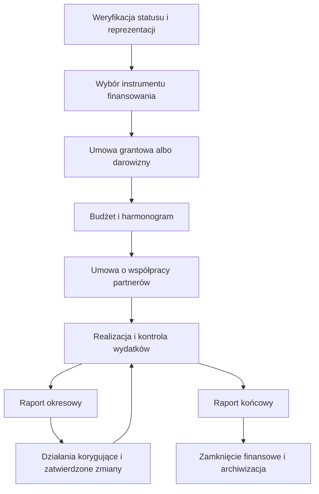
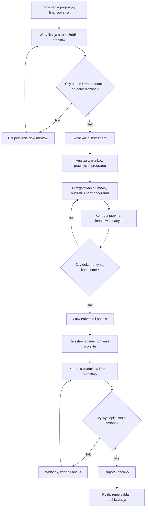

# ✠ ❦ ✧ ROZDZIAŁ 24.2 ✧ ❦ ✠

## DOKUMENTACJA MIĘDZYNARODOWA

### Pakiet dokumentów do finansowania transgranicznego: umowa grantowa, umowa o współpracy, umowa darowizny międzynarodowej, oświadczenie o statusie organizacji, potwierdzenie reprezentacji, budżet, harmonogram, karta kontroli wydatków, raport okresowy i raport końcowy

> **Kurs:** Kurs Uwolnienia – organizacja i prowadzenie działalności religijnej, społecznej, opiekuńczej oraz społeczno-gospodarczej fundacji  
> **Część:** VII – Praktyczne wdrażanie modeli działalności  
> **Moduł:** 24 – Procedury i wzory dokumentów  
> **Rozdział:** 24.2 – Dokumentacja międzynarodowa  
> **Stan odniesienia prawnego i źródłowego:** 27 listopada 2026 r.  
> **Charakter opracowania:** materiał dydaktyczny, wzory robocze, instrukcje wypełniania, listy kontrolne i narzędzia zarządcze

> **Zasada przewodnia:** dokument międzynarodowy ma wiernie opisywać rzeczywiste strony, ich status, cel współpracy, przepływ środków, podział odpowiedzialności i sposób rozliczenia. Nie wolno zastępować prawdy o stosunku prawnym nazwą formularza ani pozorną formalnością. Rzetelny dokument chroni finansującego, organizację realizującą zadanie, partnerów i osoby, którym projekt ma służyć.

---

## 1. Cel, zakres i efekty kształcenia

### 1.1. Cel rozdziału

Celem rozdziału jest przygotowanie uczestnika do stworzenia kompletnego, spójnego i możliwego do zweryfikowania pakietu dokumentów w projekcie finansowanym lub realizowanym z udziałem podmiotów z różnych państw. Uczestnik ma umieć przejść od ustalenia rzeczywistego statusu stron do podpisania właściwej umowy, przygotowania budżetu i harmonogramu, kontroli pojedynczego wydatku oraz sporządzenia raportu okresowego i końcowego.

Dokumentacja międzynarodowa nie jest jednym uniwersalnym formularzem. Jej postać zależy między innymi od:
- państwa siedziby i formy prawnej każdej strony;
- źródła środków i podstawy ich przekazania;
- tego, czy finansowanie pochodzi ze środków prywatnych, publicznych, unijnych czy międzynarodowych;
- tego, czy finansujący jest grantodawcą, darczyńcą, zamawiającym, operatorem programu czy pośrednikiem;
- modelu rozliczania: kosztów rzeczywistych, stawek jednostkowych, ryczałtu, kwoty ryczałtowej lub finansowania zależnego od rezultatów;
- prawa właściwego, jurysdykcji i sposobu rozwiązywania sporów;
- zasad podatkowych, rachunkowych, ochrony danych, sankcji i kontroli;
- warunków konkretnego konkursu, programu lub podpisanej umowy.

Najważniejszym zadaniem nie jest zatem mechaniczne wypełnienie wzoru, lecz dobranie właściwego dokumentu do rzeczywistej relacji prawnej.

### 1.2. Zakres opracowania

Rozdział rozwija dziesięć pozycji wskazanych w spisie treści:

1. umowa grantowa;
2. umowa o współpracy;
3. umowa darowizny międzynarodowej;
4. oświadczenie o statusie organizacji;
5. dokument potwierdzający reprezentację;
6. budżet projektu;
7. harmonogram projektu;
8. karta kontroli wydatków;
9. raport okresowy;
10. raport końcowy.

Każdy wzór zawiera:
- cel i zakres zastosowania;
- informacje wymagane przed wypełnieniem;
- przykładową strukturę lub treść;
- objaśnienie pól;
- typowe błędy;
- listę kontrolną przed zatwierdzeniem.

### 1.3. Efekty uczenia się

Po ukończeniu rozdziału uczestnik potrafi:

1. rozpoznać, czy dokument powinien być umową grantową, umową darowizny, umową współpracy, umową dotacyjną czy dokumentem programu publicznego;
2. wskazać rzeczywiste strony i role uczestników przedsięwzięcia;
3. zweryfikować status prawny i umocowanie przedstawiciela zagranicznej organizacji;
4. przygotować projekt umowy z odpowiednimi załącznikami;
5. rozdzielić umowę finansowania od umowy o współpracy;
6. sporządzić budżet w walucie projektu i określić zasady przeliczeń;
7. zaplanować etapy, kamienie milowe i terminy raportowania;
8. przeprowadzić kontrolę wydatku przed jego zaciągnięciem i po jego poniesieniu;
9. przygotować raport okresowy i końcowy oparty na dowodach;
10. rozpoznać sytuacje wymagające konsultacji prawnej, podatkowej, księgowej lub dotyczącej ochrony danych.

### 1.4. Granice względem innych rozdziałów

Niniejszy rozdział ma charakter dokumentacyjny i wdrożeniowy. Nie zastępuje pogłębionej analizy zagadnień opisanych wcześniej:

| Rozdział | Zakres, do którego odsyła niniejsze opracowanie |
|---|---|
| 6.1 | Instrumenty finansowania i ich zastosowanie |
| 6.2 | Prawne różnice między dotacją, grantem i darowizną |
| 6.3 | Role finansującego, realizatora, partnera, jednostki i beneficjenta |
| 8.1 | Diagnoza potrzeb, logika projektu, cele i wskaźniki |
| 8.2 | Szczegółowa konstrukcja międzynarodowej umowy finansowania |
| 8.3 | Operacyjna realizacja i rozliczanie projektu, rachunki, kursy, ewidencja i archiwizacja |
| 9.1 | Kwalifikacja podatkowa przychodów zagranicznych i transakcji |
| 9.2 | Bezpieczeństwo finansowe, weryfikacja partnerów, źródeł środków i sankcji |
| 9.3 | Ochrona danych osobowych i bezpieczeństwo informacji |
| 24.1 | Dokumentacja darowizn i wydarzeń religijnych |

W rozdziale 24.2 nie powtarza się całej teorii umów i rozliczeń. Przekłada się ją na wzory, pola, załączniki, procedury zatwierdzania i dowody wykonania.

---

## 2. Zasady korzystania z wzorów

### 2.1. Wzór nie jest gotową umową do podpisania

Wzory zawarte w rozdziale są materiałami roboczymi. Przed użyciem należy:
- uzupełnić wszystkie pola dotyczące stron, przedmiotu i zakresu zobowiązań;
- usunąć warianty, które nie dotyczą konkretnej transakcji;
- zweryfikować prawo właściwe i wymagania państwa realizacji;
- sprawdzić statut, zasady reprezentacji i wymagane uchwały;
- uzgodnić dokument z regulaminem programu i decyzją o przyznaniu finansowania;
- sprawdzić skutki podatkowe i rachunkowe;
- przeprowadzić analizę ochrony danych i bezpieczeństwa informacji;
- uzyskać akceptację osób upoważnionych.

Nie należy podpisywać dokumentu, w którym pozostawiono niewypełnione pola dotyczące kwoty, waluty, terminu, rachunku, zakresu odpowiedzialności, prawa właściwego lub zasad zwrotu środków.

### 2.2. Najpierw kwalifikacja prawna, następnie wybór wzoru

Określenie „grant” bywa stosowane w języku organizacji pozarządowych szeroko. Nie przesądza jednak samo o tym, czy przekazanie środków jest dotacją w rozumieniu prawa finansów publicznych, darowizną, umową o finansowanie projektu, zamówieniem czy innym stosunkiem prawnym.

Przed użyciem wzoru należy odpowiedzieć na pytania:

1. Kto przekazuje środki i w jakim charakterze?
2. Skąd pochodzą środki?
3. Czy finansujący działa na podstawie przepisów publicznych, regulaminu prywatnego programu czy własnej decyzji?
4. Czy odbiorca ma obowiązek wykonać świadczenie wzajemne?
5. Czy finansowanie jest zwrotne, warunkowe lub bezzwrotne?
6. Czy rozliczenie następuje według rzeczywistych kosztów, rezultatów czy innego modelu?
7. Czy przekazanie środków wymaga odrębnej decyzji, umowy, porozumienia lub zatwierdzenia?
8. Czy organizacja może przekazać część zadań lub środków partnerowi?
9. Jakie dokumenty stanowią część umowy?
10. Kto i w jakim trybie może zatwierdzać zmiany?

### 2.3. Szczególne zasady programów Unii Europejskiej

W przypadku dotacji finansowanych bezpośrednio z budżetu Unii Europejskiej należy stosować właściwy dla danego programu wzór umowy grantowej, dokumentację naboru, warunki szczególne i aktualne instrukcje Funding & Tenders Portal. Nie należy zastępować urzędowego modelu grant agreement prywatnym wzorem z tego rozdziału.

Rozporządzenie Parlamentu Europejskiego i Rady (UE, Euratom) 2024/2509 ustanawia ramy finansowe budżetu Unii, w tym przepisy dotyczące dotacji. Właściwa forma finansowania i sposób rozliczenia zależą od konkretnego programu, podstawy prawnej i umowy. W szczególności należy odróżnić finansowanie kosztów rzeczywistych od kosztów jednostkowych, ryczałtów, kwot ryczałtowych oraz finansowania niepowiązanego z kosztami.

W projektach unijnych należy korzystać z aktualnej wersji General Model Grant Agreement lub właściwego modelu szczególnego oraz z Annotated Grant Agreement publikowanego przez Komisję Europejską. Wzór i komentarze trzeba sprawdzić ponownie w dniu przygotowania i podpisania umowy, ponieważ dokumentacja programu może być aktualizowana.

### 2.4. Zasada pierwszeństwa dokumentów

Przed podpisaniem należy ustalić hierarchię dokumentów. Przykładowa kolejność może wyglądać następująco:

1. bezwzględnie obowiązujące przepisy prawa;
2. decyzja lub akt przyznający finansowanie, jeżeli ma zastosowanie;
3. umowa główna;
4. warunki szczególne programu;
5. opis projektu i zatwierdzony wniosek;
6. budżet;
7. harmonogram;
8. umowa konsorcjum lub umowa o współpracy;
9. procedury operacyjne i instrukcje raportowania.

Kolejność ta nie jest uniwersalna. Należy ją wpisać do konkretnej umowy i dostosować do regulaminu finansującego. Nie wolno tworzyć postanowienia, które pozornie pozwala umowie prywatnej wyłączyć przepisy bezwzględnie obowiązujące albo warunki publicznego programu.

### 2.5. Minimalny standard redakcyjny

Każdy dokument powinien mieć:
- tytuł i identyfikator;
- numer wersji;
- datę sporządzenia;
- oznaczenie projektu;
- wskazanie stron i osób kontaktowych;
- definicje używanych pojęć;
- datę wejścia w życie;
- wskazanie załączników;
- pola podpisów i akceptacji;
- historię zmian;
- informację o języku wiążącym, jeżeli dokument jest wielojęzyczny.

---

## 3. Architektura dokumentacji projektu

### 3.1. Zestaw podstawowy

| Dokument | Funkcja | Kiedy jest potrzebny |
|---|---|---|
| Umowa grantowa | Określa finansowanie, cel, obowiązki i rozliczenie | Gdy grantodawca i realizator zawierają umowę grantową |
| Umowa o współpracy | Reguluje relacje pomiędzy partnerami | Gdy projekt wykonuje więcej niż jeden podmiot |
| Umowa darowizny międzynarodowej | Dokumentuje nieodpłatne przysporzenie | Gdy środki przekazywane są jako darowizna |
| Oświadczenie o statusie organizacji | Przedstawia dane i status prawny podmiotu | Na etapie weryfikacji partnera lub finansowania |
| Potwierdzenie reprezentacji | Wykazuje, kto może podpisać dokument | Przed zawarciem umowy lub zmianą jej warunków |
| Budżet | Określa plan finansowy | Przed rozpoczęciem i przy każdej zatwierdzonej zmianie |
| Harmonogram | Określa kolejność działań i terminy | Przed rozpoczęciem projektu |
| Karta kontroli wydatków | Dokumentuje ocenę pojedynczego kosztu | Przed zatwierdzeniem wydatku i przy jego rozliczeniu |
| Raport okresowy | Pokazuje postęp i odchylenia | W terminach określonych w umowie |
| Raport końcowy | Zamyka projekt rzeczowo i finansowo | Po zakończeniu działań |

Nie każdy projekt wymaga wszystkich dokumentów w identycznej postaci. Wzór należy stosować proporcjonalnie do wartości, ryzyka, programu i liczby uczestników.

### 3.2. Relacja między dokumentami

Umowa główna nie powinna pozostawiać budżetu, harmonogramu i raportowania w sferze nieformalnych ustaleń. Z kolei umowa o współpracy partnerów nie powinna bez wyraźnej podstawy zmieniać zobowiązań wobec grantodawcy.

### 3.3. Zasada zgodności między dokumentami

Wszystkie dokumenty powinny używać tego samego:
- tytułu i identyfikatora projektu;
- oznaczenia stron i partnerów;
- daty rozpoczęcia i zakończenia;
- waluty i zasad przeliczania;
- kodów kategorii budżetowych;
- definicji rezultatów;
- okresów raportowania;
- zasad zatwierdzania zmian;
- zasad przechowywania dokumentacji.

Jeżeli zmienia się budżet lub harmonogram, należy sprawdzić, czy zmiana wymaga aneksu do umowy grantowej, zgody grantodawcy, aktualizacji umowy partnerskiej, czy jedynie aktualizacji dokumentu wewnętrznego. Nie wolno zakładać, że każda zmiana techniczna jest dozwolona bez formalnej zgody.

---

## 4. Wzór 1 – umowa grantowa

### 4.1. Przeznaczenie wzoru

Poniższy model jest wzorem roboczym do relacji grantowej pomiędzy podmiotami prywatnymi albo do sytuacji, w której regulamin konkretnego programu dopuszcza własny wzór umowy. Nie jest uniwersalnym wzorem dotacji publicznej ani zamiennikiem umowy grantowej Unii Europejskiej.

Jeżeli finansowanie ma charakter publiczny, należy użyć wzoru i podstawy prawnej właściwych dla danego programu. Jeżeli grant jest w istocie darowizną, zamówieniem, pożyczką lub odpłatnym świadczeniem, trzeba zastosować właściwą konstrukcję prawną, a nie pozostawiać błędnej nazwy.

### 4.2. Dane przed sporządzeniem umowy

Przed wypełnieniem należy zgromadzić:
- aktualne dane rejestrowe finansującego;
- aktualne dane rejestrowe beneficjenta;
- dokumenty potwierdzające reprezentację obu stron;
- statut lub dokument założycielski w zakresie celów i kompetencji;
- decyzję grantową albo dokument potwierdzający przyznanie środków;
- zatwierdzony wniosek;
- budżet;
- harmonogram;
- zasady kwalifikowalności;
- zasady raportowania i kontroli;
- informacje o prawie właściwym, walucie i rachunku bankowym.

### 4.3. Model umowy – część identyfikacyjna i zobowiązania

**UMOWA GRANTOWA NR [●]**

zawarta dnia [data] w [miejscowość, państwo] pomiędzy:

**1. Grantodawcą:**  
Pełna nazwa: [●]  
Forma prawna: [●]  
Państwo utworzenia: [●]  
Numer rejestrowy: [●]  
Siedziba: [●]  
Adres: [●]  
Identyfikator podatkowy, jeżeli właściwy: [●]  
Reprezentowany przez: [imię, nazwisko, funkcja]  
Podstawa umocowania: [●]  
dalej: „Grantodawca”,

a

**2. Beneficjentem:**  
Pełna nazwa: [●]  
Forma prawna: [●]  
Państwo utworzenia: [●]  
Numer KRS lub właściwego rejestru: [●]  
Siedziba i adres: [●]  
Identyfikator podatkowy: [●]  
Reprezentowany przez: [●]  
Podstawa umocowania: [●]  
dalej: „Beneficjent”.

Grantodawca i Beneficjent zwani są łącznie „Stronami”, a każdy z osobna „Stroną”.

### 4.4. Przedmiot i cel finansowania

**§ 1. Przedmiot Umowy**

1. Grantodawca przyznaje Beneficjentowi finansowanie w celu realizacji projektu pod nazwą: [pełna nazwa projektu].
2. Projekt będzie realizowany w okresie od [data] do [data] na terytorium [państwa lub państw].
3. Szczegółowy opis działań, rezultatów, grup odbiorców i wskaźników określa Załącznik nr 1 – Opis projektu.
4. Budżet projektu stanowi Załącznik nr 2.
5. Harmonogram stanowi Załącznik nr 3.
6. Finansowanie nie stanowi zapłaty za świadczenie na rzecz Grantodawcy, chyba że rzeczywista treść relacji i odrębne postanowienia umowy wskazują na odpłatny charakter świadczenia. Strony zobowiązują się prawidłowo kwalifikować relację dla celów prawa cywilnego, podatkowego i rachunkowego.

**§ 2. Kwota i waluta**

1. Maksymalna kwota finansowania wynosi [kwota cyframi i słownie] [waluta].
2. Kwota ta stanowi [procent] całkowitego budżetu projektu.
3. Wkład własny Beneficjenta wynosi [kwota i waluta] i jest wnoszony w formie [pieniężnej/rzeczowej/osobowej/innej dopuszczonej przez program].
4. Zasady przeliczania walut, ujmowania różnic kursowych i kosztów bankowych określa Załącznik nr 4 – Zasady finansowe.
5. Kwota maksymalna nie oznacza automatycznego prawa do wypłaty wszystkich środków, jeżeli umowa przewiduje warunki transz, kamieni milowych, rozliczenia lub zwrotu.

**§ 3. Przekazywanie środków**

1. Środki będą przekazywane w transzach określonych w harmonogramie płatności.
2. Warunkiem wypłaty pierwszej transzy jest [np. podpisanie umowy, przekazanie danych rachunku, potwierdzenie reprezentacji, spełnienie warunków programu].
3. Płatność następuje na rachunek Beneficjenta:  
   Nazwa banku: [●]  
   Posiadacz rachunku: [●]  
   IBAN: [●]  
   BIC/SWIFT: [●]  
   Waluta rachunku: [●].
4. Zmiana rachunku wymaga [formy i procedury] oraz niezależnego potwierdzenia przez osoby wskazane do kontaktu.
5. Strony uzgadniają, że sama wiadomość e-mail zawierająca nowy numer rachunku nie stanowi wystarczającej podstawy do zmiany danych płatniczych.
6. Koszty przelewów i banków pośredniczących ponosi [●], z uwzględnieniem zasad programu i informacji bankowych.

### 4.5. Wykorzystanie i kwalifikowalność wydatków

**§ 4. Zasady wykorzystania finansowania**

1. Beneficjent wykorzystuje środki wyłącznie na cel i działania określone w Umowie oraz jej załącznikach.
2. Wydatek może zostać uznany za kwalifikowalny tylko wtedy, gdy spełnia kryteria określone w Umowie, regulaminie programu i przepisach właściwych dla danego finansowania.
3. Beneficjent prowadzi dokumentację pozwalającą wykazać związek wydatku z projektem, jego rzeczywiste poniesienie, zatwierdzenie i zgodność z budżetem.
4. Jeżeli program dopuszcza finansowanie oparte na stawkach jednostkowych, ryczałtach lub kwotach ryczałtowych, dokumentowanie wykonania odbywa się według reguł właściwych dla tej formy. Nie należy automatycznie wymagać faktury jako jedynego dowodu w każdym modelu finansowania.
5. Podatek VAT jest ujmowany zgodnie z jego rzeczywistą odzyskiwalnością i warunkami programu. Sam fakt, że Beneficjent nie działa dla zysku, nie przesądza o braku prawa do odliczenia VAT ani o zwolnieniu z podatku.
6. Wydatki niekwalifikowalne, podwójnie finansowane lub poniesione z naruszeniem warunków Umowy nie mogą być przedstawiane jako prawidłowo rozliczone.
7. Beneficjent nie może dokonywać przesunięć między kategoriami budżetowymi, zmieniać celu ani przedłużać okresu realizacji bez zgody, jeżeli wymaga jej Umowa lub regulamin.

**§ 5. Zakupy, wykonawcy i partnerzy**

1. Beneficjent dokonuje zakupów z zachowaniem zasad gospodarności, przejrzystości, uczciwej konkurencji i unikania konfliktu interesów.
2. Jeżeli zastosowanie mają przepisy o zamówieniach publicznych albo szczególne reguły programu, Beneficjent stosuje je w odpowiednim zakresie.
3. Powierzenie części działań partnerowi lub podwykonawcy nie zwalnia Beneficjenta z odpowiedzialności wobec Grantodawcy, chyba że przepisy i Umowa stanowią inaczej.
4. Przekazanie środków innemu podmiotowi wymaga podstawy prawnej, odpowiedniego postanowienia Umowy i dokumentacji.
5. Beneficjent prowadzi rejestr podwykonawców, partnerów i istotnych zamówień.

### 4.6. Raportowanie, kontrola i archiwizacja

**§ 6. Raportowanie**

1. Beneficjent przekazuje raporty okresowe w terminach: [●].
2. Raport obejmuje część merytoryczną, finansową, wskaźniki, odchylenia, ryzyka i plan działań korygujących.
3. Raport końcowy zostanie przekazany do dnia [●].
4. Raporty sporządza się według wzoru [nazwa i wersja], jeżeli Grantodawca udostępnił obowiązujący formularz.
5. Grantodawca może zwrócić raport do uzupełnienia, wskazując konkretnie braki i termin ich usunięcia.

**§ 7. Kontrola i audyt**

1. Grantodawca może przeprowadzić kontrolę w zakresie określonym w Umowie i regulaminie finansowania.
2. Kontrola powinna być proporcjonalna do celu, wartości i ryzyka projektu.
3. Beneficjent zapewnia dostęp do dokumentów i informacji w zakresie niezbędnym do weryfikacji wykonania Umowy.
4. Dostęp do danych osobowych podlega ograniczeniom wynikającym z RODO i właściwego prawa. Nie należy udostępniać pełnych akt beneficjentów, danych zdrowotnych ani danych ujawniających przekonania religijne, jeżeli cel kontroli można osiągnąć za pomocą danych zagregowanych, zanonimizowanych lub pseudonimizowanych.
5. Z kontroli sporządza się protokół albo raport zawierający zakres, ustalenia, dowody i zalecenia.
6. Strony określają termin i tryb zgłaszania uwag do ustaleń.

**§ 8. Dokumentacja i okres przechowywania**

1. Beneficjent przechowuje dokumentację projektu przez okres wynikający z prawa, Umowy i regulaminu programu, stosując najdłuższy właściwy termin, jeżeli obowiązki się kumulują.
2. Dokumenty elektroniczne przechowuje się w formie zapewniającej integralność, dostępność, autentyczność i możliwość odtworzenia.
3. Jeżeli w toku audytu, postępowania, sporu lub kontroli obowiązek przechowywania trwa nadal, dokumentacji nie wolno usuwać do czasu zakończenia sprawy.
4. Szczegółowy indeks archiwum określa Załącznik nr [●].

### 4.7. Zmiany, odpowiedzialność i zakończenie

**§ 9. Zmiany projektu**

1. Zmiana Umowy wymaga formy [pisemnej/elektronicznej kwalifikowanej/innej dopuszczonej prawem i programem].
2. Wniosek o zmianę zawiera opis przyczyny, zakres, wpływ na budżet, harmonogram, wskaźniki i ryzyka.
3. Zmiana jest skuteczna dopiero po uzyskaniu wymaganej zgody i podpisaniu dokumentu przez osoby upoważnione.
4. Nie wolno antydatować aneksów ani przedstawiać niezatwierdzonej zmiany jako uprzednio zaakceptowanej.

**§ 10. Odpowiedzialność**

1. Każda Strona odpowiada za wykonanie obowiązków, które przyjęła na siebie w Umowie.
2. Strony nie ograniczają odpowiedzialności w zakresie, w którym ograniczenie byłoby sprzeczne z bezwzględnie obowiązującym prawem.
3. Zasady odpowiedzialności za partnerów, podwykonawców, personel i szkody wobec osób trzecich określa [●].
4. Kary umowne, jeżeli są przewidziane, muszą być zgodne z prawem właściwym i odnosić się do zobowiązań, dla których ich zastrzeżenie jest dopuszczalne.

**§ 11. Zawieszenie, rozwiązanie i zwrot środków**

1. Umowa może zostać zawieszona w przypadkach [●].
2. Każda Strona może rozwiązać Umowę w przypadkach i na zasadach określonych w [●].
3. W razie zakończenia projektu Strony sporządzają protokół zamknięcia.
4. Zwrot środków następuje wyłącznie na podstawie i w zakresie wynikającym z Umowy, regulaminu programu lub właściwych przepisów.
5. Rozliczenie powinno odróżniać środki niewykorzystane, wydatki niekwalifikowalne, kwoty sporne i kwoty bezsporne.
6. Beneficjent nie może wydatkować pozostałych środków wyłącznie po to, aby uniknąć ich zwrotu.

**§ 12. Prawo właściwe i rozstrzyganie sporów**

1. Umowa podlega prawu [państwo], z zastrzeżeniem bezwzględnie obowiązujących przepisów, których nie można wyłączyć.
2. Spory Strony w pierwszej kolejności próbują rozwiązać w drodze negocjacji prowadzonych przez osoby umocowane.
3. Jeżeli negocjacje nie przyniosą porozumienia w terminie [●], spór zostanie skierowany do [sądu/arbitrażu/mediacji] zgodnie z prawem właściwym i skuteczną klauzulą jurysdykcyjną.
4. Strony odrębnie weryfikują prawo właściwe dla umowy, właściwość sądu, możliwość uznania i wykonania orzeczenia oraz ewentualną wykonalność arbitrażu.
5. Postanowienie nie obejmuje spraw, które z mocy prawa należą do właściwości organów administracyjnych lub sądów w szczególnym trybie.

**§ 13. Postanowienia końcowe**

1. Umowa wchodzi w życie z dniem [●].
2. Integralną część Umowy stanowią załączniki wymienione w wykazie.
3. Umowę sporządzono w językach [●]. W razie rozbieżności język wiążący określa się jako [●], o ile jest to dopuszczalne.
4. Umowę podpisują osoby prawidłowo umocowane.
5. Umowę sporządzono w [liczba] egzemplarzach lub podpisano w postaci elektronicznej.

**Podpisy Stron**

Grantodawca: ____________________  
Imię, nazwisko, funkcja: [●]  
Data: [●]

Beneficjent: ____________________  
Imię, nazwisko, funkcja: [●]  
Data: [●]

### 4.8. Zalecane załączniki do umowy grantowej

1. Opis projektu i matryca rezultatów.
2. Budżet zatwierdzony.
3. Harmonogram.
4. Zasady finansowe i walutowe.
5. Formularz raportu okresowego.
6. Formularz raportu końcowego.
7. Zasady kontroli i audytu.
8. Wykaz partnerów i podwykonawców.
9. Zasady ochrony danych i bezpieczeństwa informacji, jeżeli są wymagane.
10. Oświadczenia dotyczące konfliktu interesów, sankcji i zgodności, jeżeli wynikają z programu.

### 4.9. Kontrola przed podpisaniem

- [ ] Status obu stron potwierdzony.
- [ ] Reprezentacja i umocowanie potwierdzone.
- [ ] Źródło finansowania i rodzaj instrumentu prawidłowo rozpoznane.
- [ ] Zatwierdzony opis projektu dołączony.
- [ ] Budżet i harmonogram są spójne.
- [ ] Waluta, kurs i koszty transferu są określone.
- [ ] Warunki wypłat są mierzalne i możliwe do spełnienia.
- [ ] Zasady kwalifikowalności nie są sprzeczne z regulaminem.
- [ ] Procedura zmian jest jednoznaczna.
- [ ] Raportowanie i kontrola są proporcjonalne.
- [ ] Ochrona danych i poufność są prawidłowo uregulowane.
- [ ] Prawo właściwe i jurysdykcja zostały ocenione.
- [ ] Załączniki mają numery, daty i wersje.
- [ ] Nie pozostawiono pustych pól ani sprzecznych zapisów.

---

## 5. Wzór 2 – umowa o współpracy międzynarodowej

### 5.1. Przeznaczenie

Umowa o współpracy porządkuje relacje między organizacjami uczestniczącymi w jednym przedsięwzięciu. Może dotyczyć wspólnego przygotowania projektu, realizacji działań, wymiany wiedzy, udostępniania zasobów, prowadzenia szkoleń, świadczenia wsparcia lub współpracy eksperckiej.

Nie należy automatycznie utożsamiać umowy o współpracy z:
- utworzeniem nowej osoby prawnej;
- spółką cywilną;
- konsorcjum o określonej odpowiedzialności;
- pełnomocnictwem do reprezentowania partnera;
- umową podwykonawczą;
- umową o przekazanie dotacji.

Jeżeli strony chcą ustanowić konkretną formę prawną lub wspólną odpowiedzialność, powinny ją nazwać i uregulować wprost.

### 5.2. Model umowy

**UMOWA O WSPÓŁPRACY NR [●]**

zawarta dnia [●] pomiędzy:

**Partnerem 1:** [pełna nazwa, forma prawna, państwo, rejestr, siedziba, reprezentacja]

a

**Partnerem 2:** [pełna nazwa, forma prawna, państwo, rejestr, siedziba, reprezentacja]

zwanymi dalej łącznie „Partnerami”.

**§ 1. Cel współpracy**

1. Partnerzy podejmują współpracę w celu realizacji przedsięwzięcia pod nazwą [●].
2. Celem współpracy jest [opis celu społecznego, edukacyjnego, opiekuńczego lub innego].
3. Współpraca będzie realizowana na terytorium [●] w okresie [●].
4. Umowa określa podział zadań, zasady koordynacji, wymiany informacji, wykorzystania rezultatów i rozliczenia obowiązków.

**§ 2. Status Partnerów i niezależność**

1. Każdy Partner zachowuje odrębną osobowość prawną, majątek, organy i odpowiedzialność.
2. Umowa nie tworzy nowej osoby prawnej, spółki, stosunku agencyjnego ani pełnomocnictwa do reprezentowania drugiego Partnera, chyba że odrębny dokument wyraźnie stanowi inaczej.
3. Żaden Partner nie może zaciągać zobowiązań w imieniu drugiego Partnera bez odpowiedniego umocowania.
4. Każdy Partner odpowiada za działania własnego personelu i osób, którymi posługuje się przy wykonywaniu swoich obowiązków, w granicach prawa i Umowy.

**§ 3. Podział zadań**

Partner 1 odpowiada za:
- [●];
- [●];
- [●].

Partner 2 odpowiada za:
- [●];
- [●];
- [●].

Koordynator wspólny: [imię, nazwisko, organizacja, zakres uprawnień].

Szczegółową macierz odpowiedzialności stanowi Załącznik nr 1.

**§ 4. Finansowanie i zasoby**

1. Każdy Partner finansuje swoje działania w zakresie określonym w Załączniku nr 2.
2. Przekazanie środków między Partnerami wymaga odrębnej podstawy prawnej lub jednoznacznego postanowienia niniejszej Umowy, które określa kwotę, cel, termin, sposób rozliczenia i obowiązek zwrotu.
3. Wkład rzeczowy, osobowy lub lokalowy opisuje się w sposób umożliwiający jego identyfikację i wycenę, jeżeli wymaga tego program.
4. Żaden Partner nie może przedstawiać kosztu poniesionego przez drugiego Partnera jako własnego wydatku bez właściwej podstawy i dokumentacji.

**§ 5. Koordynacja i podejmowanie decyzji**

1. Partnerzy wyznaczają osoby kontaktowe.
2. Spotkania koordynacyjne odbywają się [częstotliwość].
3. Decyzje dotyczące zakresu, budżetu, harmonogramu i rezultatów podejmują osoby wskazane w Załączniku nr 3.
4. Zmiany wpływające na umowę grantową wymagają uprzedniej zgody finansującego, jeżeli wymaga jej umowa grantowa.
5. Protokół ustaleń nie zastępuje aneksu, jeżeli zmiana wymaga formy szczególnej.

**§ 6. Raportowanie i wymiana informacji**

1. Partnerzy przekazują sobie informacje niezbędne do wykonania zadań.
2. Każdy Partner prowadzi dokumentację własnych działań.
3. Terminy przekazywania danych do raportów określa harmonogram.
4. Informacje przekazywane finansującemu muszą być zgodne z dokumentacją źródłową.
5. Partnerzy nie przekazują sobie danych osobowych ponad zakres niezbędny do realizacji określonego celu.

**§ 7. Ochrona danych, poufność i bezpieczeństwo**

1. Strony ustalają odrębnie, czy działają jako niezależni administratorzy, współadministratorzy czy administrator i podmiot przetwarzający.
2. Jeżeli zachodzi powierzenie przetwarzania danych, Strony zawierają umowę spełniającą art. 28 RODO.
3. Jeżeli występuje przekazanie danych do państwa trzeciego, Strony weryfikują podstawę transferu z rozdziału V RODO.
4. Poufność nie wyłącza obowiązków ustawowych, obowiązków sprawozdawczych ani praw osób, których dane dotyczą.
5. Każdy Partner zgłasza drugiemu incydent mogący istotnie naruszyć bezpieczeństwo danych lub realizację projektu w terminie [●], z zachowaniem właściwych terminów ustawowych.

**§ 8. Prawa do rezultatów i materiały**

1. Prawa do materiałów istniejących przed rozpoczęciem współpracy pozostają przy dotychczasowych uprawnionych.
2. Prawa do rezultatów wytworzonych wspólnie określa Załącznik nr 4.
3. Wykorzystanie znaków, nazw, fotografii i materiałów Partnera wymaga zgody w zakresie [●].
4. Licencje, pola eksploatacji, czas i terytorium wykorzystania należy opisać precyzyjnie.
5. Umowa nie przenosi praw autorskich, jeżeli nie zawiera postanowień spełniających wymagania prawa właściwego.

**§ 9. Konflikt interesów, uczciwość i zgodność**

1. Partnerzy ujawniają rzeczywiste lub potencjalne konflikty interesów związane z projektem.
2. Zakazane jest oferowanie lub przyjmowanie niedozwolonych korzyści.
3. Partnerzy stosują przepisy sankcyjne i inne ograniczenia mające zastosowanie do ich działań.
4. Każdy Partner dokumentuje decyzje o wyborze wykonawców i podmiotów, z którymi zawiera umowy.
5. Weryfikacja partnerów i transakcji jest proporcjonalna do ryzyka; nie wolno automatycznie utożsamiać uczestnika programu pomocowego z osobą objętą sankcjami.

**§ 10. Odpowiedzialność i zakończenie współpracy**

1. Partner odpowiada za niewykonanie własnych obowiązków zgodnie z Umową i prawem właściwym.
2. W razie naruszenia Partner wzywa drugą Stronę do usunięcia naruszenia w terminie [●], o ile charakter naruszenia pozwala na naprawę.
3. Zakończenie współpracy nie zwalnia z obowiązku rozliczenia środków, przekazania dokumentacji i ochrony danych.
4. Strony sporządzają protokół zamknięcia współpracy.

**§ 11. Prawo właściwe i spory**

Prawo właściwe: [●].  
Sposób rozwiązywania sporów: [negocjacje/mediacja/sąd/arbitraż].  
Język wiążący: [●].

**Podpisy Partnerów:**  
Partner 1: ____________________  
Partner 2: ____________________

### 5.3. Macierz odpowiedzialności partnerów

| Obszar | Partner 1 | Partner 2 | Koordynator | Dowód wykonania |
|---|---|---|---|---|
| Rekrutacja uczestników | [●] | [●] | [●] | Regulamin i rejestr |
| Organizacja działań | [●] | [●] | [●] | Protokoły, listy działań |
| Zakupy | [●] | [●] | [●] | Oferty, zamówienia |
| Księgowość | [●] | [●] | [●] | Ewidencja |
| Raportowanie | [●] | [●] | [●] | Raport okresowy |
| Ochrona danych | [●] | [●] | [●] | Rejestr czynności, umowy |
| Komunikacja | [●] | [●] | [●] | Materiały i publikacje |

Macierz należy wypełnić konkretnymi osobami lub rolami. Nie należy pozostawiać wszystkich zadań „wspólnych”, jeżeli w praktyce nikt nie będzie odpowiadał za ich wykonanie.

### 5.4. Kontrola umowy o współpracy

- [ ] Każdy Partner jest prawidłowo zidentyfikowany.
- [ ] Każdy Partner ma potwierdzoną reprezentację.
- [ ] Umowa nie sugeruje niezamierzonego utworzenia nowego podmiotu.
- [ ] Zakres zadań jest mierzalny.
- [ ] Podział kosztów jest zgodny z budżetem grantowym.
- [ ] Przekazywanie środków ma podstawę prawną.
- [ ] Odpowiedzialność odpowiada rzeczywistym kompetencjom.
- [ ] Prawa do rezultatów są uregulowane.
- [ ] Role w ochronie danych są ustalone.
- [ ] Zmiany wymagające zgody grantodawcy są objęte procedurą.

---

## 6. Wzór 3 – umowa darowizny międzynarodowej

### 6.1. Kiedy stosować

Umowę darowizny należy stosować wtedy, gdy jedna strona dokonuje nieodpłatnego przysporzenia na rzecz drugiej, a świadczenie nie jest w istocie zapłatą za usługę, sponsoringiem, pożyczką, refundacją ani dotacją publiczną.

W relacji międzynarodowej trzeba dodatkowo ustalić:
- prawo właściwe dla zobowiązania;
- formę wymaganą dla oświadczeń stron;
- status i zdolność stron;
- zasady przekazania środków;
- skutki podatkowe po stronie darczyńcy i obdarowanego;
- czy darowizna zawiera polecenie, warunek lub inne zobowiązanie;
- czy środki mogą być przekazywane dalej.

W prawie polskim należy zwrócić uwagę na art. 888–902 Kodeksu cywilnego, w szczególności art. 890 dotyczący formy oświadczenia darczyńcy oraz art. 893 dotyczący polecenia. Nie należy traktować umowy grantowej jako darowizny tylko dlatego, że środki są bezzwrotne.

### 6.2. Model umowy

**UMOWA DAROWIZNY MIĘDZYNARODOWEJ NR [●]**

zawarta dnia [●] pomiędzy:

**Darczyńcą:**  
Pełna nazwa: [●]  
Forma prawna: [●]  
Państwo siedziby: [●]  
Numer rejestrowy: [●]  
Adres: [●]  
Reprezentacja: [●]  
Podstawa umocowania: [●]

a

**Obdarowanym:**  
Pełna nazwa: [●]  
Forma prawna: [●]  
Państwo siedziby: [●]  
Numer rejestrowy: [●]  
Adres: [●]  
Reprezentacja: [●]  
Podstawa umocowania: [●]

**§ 1. Przedmiot darowizny**

1. Darczyńca zobowiązuje się przekazać Obdarowanemu darowiznę pieniężną w kwocie [●] [waluta].
2. Obdarowany oświadcza, że darowiznę przyjmuje.
3. Darowizna ma charakter nieodpłatny. Darczyńca nie otrzymuje w zamian świadczenia wzajemnego, reklamy, usługi ani prawa do dysponowania organizacją Obdarowanego.
4. Jeżeli strony przewidują obowiązek informacyjny, sprawozdawczy lub wykonanie polecenia, opisują go w sposób odróżniający go od świadczenia wzajemnego.

**§ 2. Cel i przeznaczenie**

1. Darowizna zostaje przekazana na cel: [dokładny opis].
2. Dopuszczalne rodzaje wydatków: [●].
3. Wydatki wyłączone: [●].
4. Darowizna może być wykorzystana w okresie od [●] do [●].
5. Zmiana celu lub przeznaczenia wymaga [zgody darczyńcy/formy i trybu], z zastrzeżeniem prawa właściwego.
6. Strony określają, czy wskazanie celu jest poleceniem, warunkiem czy opisem motywu darowizny. Nie należy używać tych pojęć zamiennie.

**§ 3. Przekazanie darowizny**

1. Darowizna zostanie przekazana przelewem na rachunek Obdarowanego:
   - IBAN: [●];
   - BIC/SWIFT: [●];
   - bank: [●];
   - waluta rachunku: [●].
2. Termin przekazania: [●].
3. Koszty bankowe ponosi [●].
4. Za dzień przekazania uznaje się [●], zgodnie z prawem właściwym i zasadami rozliczenia.
5. Zmiana rachunku wymaga niezależnego potwierdzenia.

**§ 4. Informacja i rozliczenie**

1. Obdarowany przekazuje Darczyńcy informację o wykorzystaniu darowizny do dnia [●].
2. Informacja obejmuje kwoty, kategorie wydatków i opis realizacji celu.
3. Jeżeli Darczyńca nie ma prawa do kontroli określonego w Umowie, raport nie może być traktowany jako nieograniczone uprawnienie do wglądu w dane osób korzystających z pomocy.
4. Dokumenty księgowe i dowody wydatków przechowywane są zgodnie z prawem, polityką rachunkowości i obowiązkami umownymi.

**§ 5. Niewykorzystane środki**

1. Strony ustalają, że niewykorzystana część darowizny zostanie [zwrócona/przeznaczona na wskazany cel po uzyskaniu zgody] do dnia [●].
2. Zwrot następuje na rachunek Darczyńcy [●], z uwzględnieniem kosztów bankowych.
3. Jeżeli strony nie uzgodnią zwrotu, zastosowanie ma właściwe prawo i treść zobowiązania.

**§ 6. Oświadczenia stron**

Darczyńca oświadcza, że:
- posiada prawo do rozporządzania przekazywanymi środkami;
- działa przez osoby umocowane;
- przekazanie środków nie narusza obowiązujących go ograniczeń.

Obdarowany oświadcza, że:
- przyjmuje darowiznę w granicach celów i kompetencji wynikających z jego dokumentów ustrojowych;
- środki zostaną ujęte w ewidencji zgodnie z prawem i polityką rachunkowości;
- osoby reprezentujące są prawidłowo umocowane.

**§ 7. Podatki i koszty**

1. Każda Strona samodzielnie ocenia swoje obowiązki podatkowe, chyba że przepisy nakładają obowiązek na drugą Stronę.
2. Umowa nie stanowi zapewnienia, że Darczyńcy przysługuje odliczenie podatkowe w państwie jego rezydencji.
3. Obdarowany nie gwarantuje zwolnienia podatkowego wyłącznie z powodu posiadania statusu organizacji non-profit.
4. W razie wątpliwości Strony uzyskują odrębną analizę podatkową.

**§ 8. Prawo właściwe i postanowienia końcowe**

Prawo właściwe: [●].  
Tryb rozstrzygania sporów: [●].  
Język wiążący: [●].  
Data wejścia w życie: [●].

Darczyńca: ____________________  
Obdarowany: ____________________

### 6.3. Uwagi szczególne

1. Nie wolno zakładać, że prawo państwa siedziby Obdarowanego automatycznie reguluje całą umowę.
2. Wybór prawa właściwego nie usuwa bezwzględnie obowiązujących przepisów podatkowych, rejestrowych, sankcyjnych i regulacyjnych.
3. Forma umowy darowizny może zależeć od prawa właściwego, przedmiotu darowizny i sposobu wykonania.
4. Jeżeli darowizna jest obciążona poleceniem, trzeba określić jego treść, sposób wykonania i konsekwencje niewykonania.
5. Jeżeli Darczyńca otrzymuje świadczenie promocyjne lub reklamowe, należy zbadać, czy relacja nie jest w rzeczywistości sponsoringiem lub odpłatną usługą.
6. Jeżeli darowizna jest częścią większego programu, należy sprawdzić, czy regulamin programu nie tworzy dodatkowych obowiązków.

---

## 7. Wzór 4 – oświadczenie o statusie organizacji

### 7.1. Funkcja dokumentu

Oświadczenie o statusie organizacji służy przedstawieniu danych identyfikacyjnych i podstawowych informacji o podmiocie. Nie zastępuje odpisu z rejestru, statutu, dokumentu powołania organu, opinii prawnej ani certyfikatu podatkowego.

Nie należy utożsamiać:
- formy prawnej z charakterem działalności;
- statusu organizacji non-profit ze zwolnieniem z CIT;
- statusu organizacji pożytku publicznego z samym wpisem do KRS;
- statusu podatnika VAT z nieprowadzeniem działalności gospodarczej;
- deklaracji o braku udziału w zyskach z automatycznym brakiem obowiązków AML;
- nazwy „międzynarodowa” z odrębną międzynarodową formą prawną.

### 7.2. Formularz

**OŚWIADCZENIE O STATUSIE ORGANIZACJI**

**A. Dane identyfikacyjne**

1. Pełna nazwa: [●]
2. Nazwa skrócona: [●]
3. Forma prawna: [●]
4. Państwo utworzenia: [●]
5. Data utworzenia: [●]
6. Siedziba: [●]
7. Adres: [●]
8. Numer rejestrowy: [●]
9. Organ prowadzący rejestr: [●]
10. Numer identyfikacji podatkowej: [●]
11. Strona internetowa: [●]
12. Osoba kontaktowa: [●]

**B. Status prawny**

1. Podstawa utworzenia: [ustawa/dokument założycielski/inny akt].
2. Data wpisu do rejestru: [●].
3. Czy podmiot posiada osobowość prawną? [tak/nie – podstawa].
4. Czy podmiot działa jako oddział lub przedstawicielstwo? [tak/nie].
5. Czy podmiot ma status organizacji non-profit według prawa właściwego? [tak/nie/nie dotyczy – podstawa].
6. Czy podmiot ma status organizacji pożytku publicznego lub równoważny? [tak/nie/nie dotyczy – podstawa].
7. Czy podmiot prowadzi działalność gospodarczą? [tak/nie – zakres].
8. Czy podmiot jest zarejestrowany jako podatnik VAT? [tak/nie/nie dotyczy – dane].
9. Czy podmiot korzysta ze zwolnienia podatkowego? [tak/nie/nie dotyczy – podstawa, zakres i okres].
10. Czy podmiot podlega szczególnym obowiązkom regulacyjnym? [tak/nie – opis].

**C. Organy i reprezentacja**

1. Organ zarządzający: [●].
2. Skład organu: [●].
3. Sposób reprezentacji: [●].
4. Osoby uprawnione do podpisywania umów: [●].
5. Czy do zawarcia planowanej umowy potrzebna jest uchwała? [tak/nie – podstawa].
6. Czy ustanowiono pełnomocnika? [tak/nie – dokument i zakres].

**D. Działalność i niezależność**

1. Główne cele statutowe: [●].
2. Główne obszary działalności: [●].
3. Państwa prowadzenia działalności: [●].
4. Główne źródła finansowania: [●].
5. Czy podmiot należy do sieci, federacji lub grupy? [●].
6. Czy inny podmiot sprawuje kontrolę lub ma szczególne uprawnienia? [●].
7. Czy występują powiązania z finansującym lub osobami podejmującymi decyzje? [●].

**E. Zgodność i bezpieczeństwo**

1. Czy organizacja posiada procedurę konfliktu interesów? [tak/nie].
2. Czy przeprowadziła ocenę ryzyka finansowego? [tak/nie].
3. Czy jest instytucją obowiązaną w rozumieniu AML? [tak/nie/analiza wymagana – podstawa].
4. Czy weryfikuje sankcje w zakresie wymaganym prawem i ryzykiem? [tak/nie – opis].
5. Czy posiada procedury ochrony danych? [tak/nie].
6. Czy przekazuje dane osobowe poza EOG? [tak/nie – mechanizm].
7. Czy toczą się postępowania, które mogą istotnie wpływać na zdolność realizacji projektu? [tak/nie – opis w zakresie dopuszczalnym prawem].

**F. Załączniki**

- [ ] aktualny odpis z właściwego rejestru;
- [ ] statut lub dokument założycielski;
- [ ] dokument potwierdzający skład organu;
- [ ] dokument potwierdzający reprezentację;
- [ ] pełnomocnictwo, jeżeli dotyczy;
- [ ] dokument podatkowy, jeżeli jest wymagany;
- [ ] sprawozdanie finansowe lub raport roczny, jeżeli jest wymagany;
- [ ] inne: [●].

**G. Oświadczenie końcowe**

Oświadczam, że informacje zawarte w formularzu są zgodne z dokumentami i stanem faktycznym na dzień [●]. Zobowiązuję się poinformować odbiorcę o istotnej zmianie danych, jeżeli może ona wpływać na status, reprezentację lub zdolność realizacji projektu.

Imię i nazwisko: [●]  
Funkcja: [●]  
Podstawa umocowania: [●]  
Data: [●]  
Podpis: ____________________

### 7.3. Zasady weryfikacji oświadczenia

Oświadczenie należy porównać z niezależnymi źródłami:
- rejestrem właściwym dla państwa utworzenia;
- dokumentem założycielskim;
- aktualnym wykazem organów;
- dokumentami podatkowymi;
- oficjalną stroną programu lub grantodawcy;
- dokumentami potwierdzającymi uprawnienia do reprezentacji.

Weryfikacja powinna być proporcjonalna do wartości i ryzyka. Nie należy żądać nadmiernych danych osobowych, dokumentów tożsamości wszystkich członków organizacji ani danych beneficjentów, jeżeli nie ma do tego podstawy.

---

## 8. Wzór 5 – dokument potwierdzający reprezentację

### 8.1. Cel i zakres

Dokument potwierdzający reprezentację ma wykazać, że osoba podpisująca umowę jest uprawniona do działania w imieniu organizacji i że zakres jej umocowania obejmuje daną czynność.

Nie należy utożsamiać:
- członkostwa w zarządzie z prawem samodzielnej reprezentacji;
- funkcji dyrektora z umocowaniem do zawierania każdej umowy;
- pełnomocnictwa do prowadzenia projektu z prawem do zaciągania zobowiązań finansowych;
- potwierdzenia statusu organizacji z potwierdzeniem reprezentacji.

### 8.2. Formularz potwierdzenia

**POTWIERDZENIE UMOCOWANIA DO REPREZENTACJI**

1. Nazwa organizacji: [●]
2. Forma prawna: [●]
3. Państwo utworzenia: [●]
4. Numer rejestrowy: [●]
5. Osoba uprawniona: [imię, nazwisko].
6. Funkcja: [●].
7. Podstawa powołania: [uchwała/decyzja/wpis/rejestr].
8. Data rozpoczęcia kadencji lub umocowania: [●].
9. Data zakończenia lub termin obowiązywania: [●].
10. Sposób reprezentacji: [samodzielnie/łącznie/inny].
11. Zakres umocowania: [●].
12. Czy wymagana jest uchwała organu? [tak/nie].
13. Czy istnieją ograniczenia kwotowe lub przedmiotowe? [tak/nie – opis].
14. Czy ustanowiono pełnomocnika? [tak/nie – dane i dokument].
15. Dokumenty źródłowe: [lista].

Oświadczam, że według dokumentów organizacji i właściwego rejestru, na dzień [●], wskazana osoba jest uprawniona do reprezentowania organizacji w zakresie [●].

Osoba potwierdzająca: [●]  
Funkcja: [●]  
Podstawa uprawnienia do potwierdzenia: [●]  
Data: [●]  
Podpis: ____________________

### 8.3. Lista dokumentów źródłowych

W zależności od państwa i formy prawnej mogą być potrzebne:
- aktualny odpis lub wyciąg z rejestru;
- statut;
- uchwała o powołaniu;
- protokół wyboru organu;
- dokument potwierdzający kadencję;
- pełnomocnictwo;
- uchwała zezwalająca na zawarcie konkretnej umowy;
- dokument tożsamości osoby podpisującej, tylko gdy jest to prawnie uzasadnione i proporcjonalne;
- tłumaczenie dokumentu;
- apostille lub legalizacja, jeżeli wymaga tego właściwy reżim prawny.

Apostille nie potwierdza prawdziwości wszystkich informacji merytorycznych zawartych w dokumencie. Poświadcza określone elementy autentyczności dokumentu publicznego. Nie należy wymagać apostille automatycznie od każdego dokumentu zagranicznego. Trzeba sprawdzić państwo, rodzaj dokumentu, właściwą konwencję i ewentualne zwolnienia.

### 8.4. Niezależna kontrola danych płatniczych

Zmiana rachunku bankowego jest zdarzeniem podwyższonego ryzyka. Przed wykonaniem przelewu:
1. porównaj nazwę posiadacza rachunku z nazwą strony umowy;
2. zweryfikuj IBAN i BIC/SWIFT;
3. skontaktuj się z osobą wskazaną wcześniej w umowie, używając niezależnie znanego kanału;
4. wymagaj drugiej akceptacji zmiany;
5. zachowaj dowód weryfikacji;
6. nie korzystaj z numeru telefonu ani odnośnika podanego wyłącznie w podejrzanej wiadomości o zmianie rachunku.

---

## 9. Wzór 6 – budżet projektu międzynarodowego

### 9.1. Funkcja budżetu

Budżet jest planem finansowym projektu i podstawą kontroli zobowiązań, płatności, wkładu własnego oraz raportowania. Powinien być spójny z opisem działań, harmonogramem i zasadami kwalifikowalności.

Budżet nie jest jedynie listą przewidywanych faktur. Może obejmować:
- koszty rzeczywiste;
- koszty jednostkowe;
- ryczałty;
- kwoty ryczałtowe;
- finansowanie niepowiązane z kosztami;
- wkład własny pieniężny lub rzeczowy, jeżeli program go dopuszcza.

Nie wolno mieszać tych metod bez oznaczenia. Sposób dokumentowania wydatku zależy od formy finansowania.

### 9.2. Metryka budżetu

**BUDŻET PROJEKTU NR [●]**

- Tytuł projektu: [●]
- Grantodawca: [●]
- Beneficjent: [●]
- Partnerzy: [●]
- Okres realizacji: [●]
- Waluta budżetu: [●]
- Data i numer wersji: [●]
- Kurs referencyjny: [źródło, data, zasada stosowania]
- Model rozliczania: [koszty rzeczywiste/stawki jednostkowe/ryczałt/kwota ryczałtowa/inny]
- VAT: [odzyskiwalny/nieodzyskiwalny/mieszany – uzasadnienie]
- Wkład własny: [●]
- Zasady kosztów pośrednich: [●]

### 9.3. Tabela budżetowa

| Kod | Kategoria | Jednostka | Liczba | Koszt jednostkowy | Koszt łączny | Źródło finansowania | Uzasadnienie |
|---|---|---:|---:|---:|---:|---|---|
| A1 | Personel | miesiąc | [●] | [●] | [●] | [●] | [●] |
| A2 | Podróże | podróż | [●] | [●] | [●] | [●] | [●] |
| A3 | Wydarzenia | wydarzenie | [●] | [●] | [●] | [●] | [●] |
| A4 | Materiały | zestaw | [●] | [●] | [●] | [●] | [●] |
| A5 | Tłumaczenia | strona/godzina | [●] | [●] | [●] | [●] | [●] |
| A6 | Usługi zewnętrzne | usługa | [●] | [●] | [●] | [●] | [●] |
| A7 | Koszty pośrednie | ryczałt/procent | [●] | [●] | [●] | [●] | [●] |

**Podsumowanie:**
- koszty bezpośrednie: [●];
- koszty pośrednie: [●];
- całkowity koszt kwalifikowalny: [●];
- kwota grantu: [●];
- wkład własny pieniężny: [●];
- wkład własny rzeczowy: [●];
- inne źródła: [●];
- kwota niekwalifikowalna: [●];
- całkowity koszt projektu: [●].

### 9.4. Przykład liczbowy – wyłącznie dydaktyczny

Założenia:
- waluta: EUR;
- bezpośrednie koszty projektu: 20 000 EUR;
- koszty pośrednie: 10% kosztów bezpośrednich, jeżeli program dopuszcza taki sposób;
- całkowity koszt kwalifikowalny: 22 000 EUR;
- finansowanie grantowe: 90%;
- wkład własny: 10%.

| Kategoria | Kwota EUR |
|---|---:|
| Personel | 10 000 |
| Podróże | 2 000 |
| Wydarzenia | 3 000 |
| Materiały | 2 000 |
| Tłumaczenia | 1 000 |
| Usługi zewnętrzne | 2 000 |
| **Koszty bezpośrednie** | **20 000** |
| Koszty pośrednie – 10% | 2 000 |
| **Razem** | **22 000** |
| Grant – 90% | 19 800 |
| Wkład własny – 10% | 2 200 |

To wyłącznie przykład rachunkowy. Nie stanowi stawki ani limitu obowiązującego w jakimkolwiek programie. Procent kosztów pośrednich, dopuszczalne kategorie, wkład własny i sposób rozliczenia muszą wynikać z dokumentacji konkretnego finansowania.

### 9.5. Waluta i kursy

Budżet powinien odróżniać:
1. walutę zobowiązania w umowie;
2. walutę rachunku bankowego;
3. walutę zapłaty;
4. walutę ksiąg rachunkowych;
5. walutę raportowania.

Nie należy stosować jednego kursu do wszystkich celów bez sprawdzenia:
- zasad rachunkowości;
- zasad podatkowych;
- regulaminu programu;
- postanowień umowy;
- rzeczywistego kursu bankowego;
- daty operacji i daty ujęcia.

**Tabela kursów i przeliczeń**

| Operacja | Data | Kwota w walucie | Kurs | Źródło kursu | Kwota w PLN | Cel zastosowania |
|---|---|---:|---:|---|---:|---|
| Wpływ transzy | [●] | [●] | [●] | [●] | [●] | Księgowość/raport |
| Zapłata faktury | [●] | [●] | [●] | [●] | [●] | Księgowość/raport |
| Zwrot środków | [●] | [●] | [●] | [●] | [●] | Rozliczenie |

### 9.6. Kontrola budżetu

Przed zatwierdzeniem budżetu należy sprawdzić:
- czy każdy koszt ma związek z działaniem i rezultatem;
- czy jednostka, liczba i stawka są realistyczne;
- czy VAT jest prawidłowo zakwalifikowany;
- czy koszty pośrednie są dopuszczalne;
- czy nie ma podwójnego finansowania;
- czy wkład własny jest realny i udokumentowany;
- czy budżet obejmuje koszty transferów i różnic kursowych, jeśli są dopuszczalne;
- czy wydatki przypisano do właściwego okresu;
- czy budżet odpowiada harmonogramowi;
- czy suma kategorii zgadza się z kwotą wnioskowaną.

---

## 10. Wzór 7 – harmonogram projektu

### 10.1. Zasada konstrukcji

Harmonogram powinien pokazywać nie tylko daty wydarzeń, ale również zależności pomiędzy działaniami, odpowiedzialność, kamienie milowe, rezultaty i terminy raportowania.

Każde działanie powinno mieć:
- identyfikator;
- nazwę;
- datę rozpoczęcia;
- datę zakończenia;
- odpowiedzialny podmiot;
- osobę odpowiedzialną;
- mierzalny rezultat;
- dowód wykonania;
- zależności;
- ryzyka i plan awaryjny.

### 10.2. Formularz harmonogramu

**HARMONOGRAM PROJEKTU NR [●]**

| Kod | Działanie | Początek | Koniec | Odpowiedzialny | Rezultat | Dowód | Zależność |
|---|---|---|---|---|---|---|---|
| W1 | Przygotowanie i zawarcie umów | [●] | [●] | [●] | Umowy podpisane | Rejestr umów | — |
| W2 | Rekrutacja uczestników | [●] | [●] | [●] | Grupa uczestników | Zanonimizowany rejestr | W1 |
| W3 | Przygotowanie materiałów | [●] | [●] | [●] | Materiały gotowe | Protokół odbioru | W1 |
| W4 | Realizacja działań | [●] | [●] | [●] | Działania wykonane | Raporty i protokoły | W2, W3 |
| W5 | Monitoring i ewaluacja | [●] | [●] | [●] | Wyniki pomiaru | Raport ewaluacyjny | W4 |
| W6 | Raportowanie i zamknięcie | [●] | [●] | [●] | Raport końcowy | Potwierdzenie złożenia | W5 |

### 10.3. Przykładowy układ dwunastomiesięczny

| Działanie | M1 | M2 | M3 | M4 | M5 | M6 | M7 | M8 | M9 | M10 | M11 | M12 |
|---|:--:|:--:|:--:|:--:|:--:|:--:|:--:|:--:|:--:|:--:|:--:|:--:|
| Przygotowanie umów i procedur | ● | ● | | | | | | | | | | |
| Rekrutacja | | ● | ● | | | | | | | | | |
| Materiały i przygotowanie zespołu | | ● | ● | ● | | | | | | | | |
| Działania główne | | | ● | ● | ● | ● | ● | ● | ● | ● | | |
| Monitoring | | | ● | | ● | | ● | | ● | | ● | |
| Raport okresowy | | | | | | ● | | | | | | |
| Ewaluacja końcowa | | | | | | | | | | ● | ● | |
| Raport końcowy i zamknięcie | | | | | | | | | | | ● | ● |

Tabela jest przykładem. Należy dostosować ją do terminów umowy, sezonowości, dostępności uczestników i realnych zasobów.

### 10.4. Kamienie milowe

| Kod | Kamień milowy | Kryterium osiągnięcia | Termin | Osoba zatwierdzająca |
|---|---|---|---|---|
| K1 | Gotowość organizacyjna | Umowy, procedury i zasoby gotowe | [●] | [●] |
| K2 | Rozpoczęcie działań | Działania uruchomione | [●] | [●] |
| K3 | Osiągnięcie połowy zakresu | Potwierdzone wskaźniki pośrednie | [●] | [●] |
| K4 | Zakończenie działań | Działania wykonane i odebrane | [●] | [●] |
| K5 | Zamknięcie projektu | Raport i saldo zatwierdzone | [●] | [●] |

### 10.5. Procedura aktualizacji harmonogramu

1. Osoba odpowiedzialna identyfikuje odchylenie.
2. Określa przyczynę i wpływ na działania, budżet oraz rezultaty.
3. Proponuje rozwiązanie i nowy termin.
4. Sprawdza, czy zmiana wymaga zgody grantodawcy.
5. Uzyskuje akceptację wewnętrzną.
6. W razie potrzeby podpisuje aneks lub uzyskuje formalną zgodę.
7. Aktualizuje wersję harmonogramu i rejestr zmian.
8. Informuje partnerów i osoby odpowiedzialne.

Nie należy usuwać wcześniejszych wersji. Historia zmian jest częścią ścieżki audytowej.

---

## 11. Wzór 8 – karta kontroli wydatków

### 11.1. Cel karty

Karta kontroli wydatku łączy decyzję o potrzebie zakupu, ocenę budżetową, zgodę na zobowiązanie, dowód wykonania, dokument księgowy, płatność i zatwierdzenie rozliczenia.

Karta nie zastępuje faktury, umowy, protokołu odbioru ani zapisu księgowego. Jest narzędziem kontrolnym, które pozwala odtworzyć przebieg decyzji.

### 11.2. Formularz

**KARTA KONTROLI WYDATKU NR [●]**

**A. Identyfikacja**
- Projekt: [●]
- Partner: [●]
- Numer wydatku: [●]
- Kategoria budżetowa: [●]
- Osoba wnioskująca: [●]
- Data wniosku: [●]
- Dostawca/wykonawca: [●]
- Państwo dostawcy: [●]
- Przedmiot zakupu: [●]

**B. Uzasadnienie**
1. Jakiej potrzeby projektu dotyczy wydatek? [●]
2. Z jakim działaniem i rezultatem jest związany? [●]
3. Czy wydatek został przewidziany w budżecie? [tak/nie].
4. Kod i dostępna kwota budżetu: [●].
5. Czy zakup jest niezbędny i racjonalny? [uzasadnienie].
6. Czy istnieje alternatywa o niższym koszcie lub lepszej jakości? [●].

**C. Ocena formalna i prawna**
- [ ] Podstawa zakupu jest zgodna z regulaminem.
- [ ] Nie występuje niedozwolony konflikt interesów.
- [ ] Wybrano właściwy tryb zakupu.
- [ ] Wymagane oferty lub uzasadnienie wyboru są dołączone.
- [ ] Dostawca został zweryfikowany w zakresie proporcjonalnym do ryzyka.
- [ ] Warunki umowy lub zamówienia są zgodne z budżetem.
- [ ] Sprawdzono ograniczenia sankcyjne w zakresie właściwym dla transakcji.
- [ ] Ustalono skutki podatkowe i walutowe, jeżeli są istotne.

**D. Parametry finansowe**
- Kwota netto: [●]
- VAT: [●]
- Kwota brutto: [●]
- Waluta: [●]
- Kurs i źródło: [●]
- Kwota w walucie ksiąg: [●]
- Czy VAT jest odzyskiwalny? [tak/nie/częściowo – uzasadnienie].
- Źródło finansowania: [●].
- Wkład własny: [●].
- Czy występuje współfinansowanie? [●].

**E. Zatwierdzenie przed zaciągnięciem zobowiązania**
- Kontrola merytoryczna: [imię, data, podpis].
- Kontrola budżetowa: [imię, data, podpis].
- Kontrola formalna: [imię, data, podpis].
- Zatwierdzenie osoby uprawnionej: [imię, data, podpis].
- Numer zamówienia/umowy: [●].

**F. Wykonanie i odbiór**
- Data dostawy lub wykonania: [●].
- Osoba odbierająca: [●].
- Protokół odbioru: [numer/data].
- Uwagi dotyczące jakości lub ilości: [●].
- Czy dostawa odpowiada zamówieniu? [tak/nie – opis].
- Czy wykonano usługę? [tak/nie – dowód].

**G. Dokument księgowy i płatność**
- Rodzaj dokumentu: [faktura/rachunek/nota/inny].
- Numer dokumentu: [●].
- Data wystawienia: [●].
- Data otrzymania: [●].
- Termin płatności: [●].
- Numer przelewu lub transakcji: [●].
- Data zapłaty: [●].
- Kwota zapłacona: [●].
- Różnica względem dokumentu: [●].
- Opis księgowy i kod projektu: [●].

**H. Kontrola końcowa**
- [ ] Wydatek zgodny z celem projektu.
- [ ] Wydatek zgodny z budżetem lub zatwierdzoną zmianą.
- [ ] Dostawa/usługa została odebrana.
- [ ] Dokument księgowy jest prawidłowy.
- [ ] Płatność jest potwierdzona.
- [ ] Ujęcie księgowe jest prawidłowe.
- [ ] Nie występuje podwójne finansowanie.
- [ ] Dokumenty są kompletne i zarchiwizowane.
- [ ] Wydatek ujęto w raporcie lub rejestrze projektu.

Kontrolujący: [●]  
Data: [●]  
Wynik: [zatwierdzono/do uzupełnienia/odrzucono]  
Uzasadnienie: [●]

### 11.3. Rozdzielenie funkcji

W miarę możliwości jedna osoba nie powinna jednocześnie:
- wnioskować o zakup;
- wybierać dostawcy;
- zatwierdzać zobowiązania;
- potwierdzać odbioru;
- zatwierdzać płatności;
- samodzielnie kontrolować własnego wydatku.

W małej organizacji pełny rozdział funkcji może być niemożliwy. Wtedy należy zastosować kontrolę kompensującą, np. zatwierdzenie przez drugą osobę, okresowy przegląd przez zarząd lub kontrolę próby przez osobę niezależną od zakupu.

### 11.4. Zasada dowodowa

Pojedynczy wydatek powinien mieć możliwą do odtworzenia ścieżkę:

**potrzeba → wniosek → budżet → wybór dostawcy → zamówienie → wykonanie → odbiór → dokument → płatność → księgowanie → raport.**

Nie każdy program wymaga identycznego pakietu dowodowego. Przy kosztach rzeczywistych zasadnicze znaczenie mają dowody kosztu i zapłaty, natomiast przy stawkach jednostkowych lub kwotach ryczałtowych decydują warunki danej formy finansowania.

---

## 12. Wzór 9 – raport okresowy

### 12.1. Funkcja raportu

Raport okresowy pozwala grantodawcy i organizacji ocenić, czy projekt przebiega zgodnie z umową, budżetem, harmonogramem i założonymi rezultatami. Powinien przedstawiać zarówno postęp, jak i problemy. Ukrywanie odchyleń zwiększa ryzyko nieprawidłowego rozliczenia i utrudnia naprawę.

### 12.2. Formularz raportu okresowego

**RAPORT OKRESOWY NR [●]**

**A. Dane projektu**
- Tytuł projektu: [●]
- Numer umowy: [●]
- Grantodawca: [●]
- Beneficjent: [●]
- Partnerzy: [●]
- Okres raportowania: [od–do]
- Data złożenia: [●]
- Waluta raportu: [●]
- Osoba sporządzająca: [●]

**B. Podsumowanie zarządcze**

1. Najważniejsze wykonane działania: [●].
2. Najważniejsze osiągnięte rezultaty: [●].
3. Najważniejsze odchylenia: [●].
4. Najważniejsze ryzyka: [●].
5. Decyzje wymagane od grantodawcy: [●].
6. Prognoza do kolejnego okresu: [●].

**C. Postęp rzeczowy**

| Działanie | Plan na okres | Wykonanie | Odchylenie | Dowód | Status |
|---|---|---|---|---|---|
| [●] | [●] | [●] | [●] | [●] | [●] |
| [●] | [●] | [●] | [●] | [●] | [●] |

**D. Wskaźniki**

| Wskaźnik | Wartość docelowa | Wartość narastająco | Wartość w okresie | Źródło danych | Wyjaśnienie |
|---|---:|---:|---:|---|---|
| [●] | [●] | [●] | [●] | [●] | [●] |
| [●] | [●] | [●] | [●] | [●] | [●] |

Wskaźniki powinny mierzyć rzeczywiste rezultaty, a nie wyłącznie liczbę poniesionych wydatków. W przypadku danych osobowych należy wykorzystywać dane zagregowane lub pseudonimizowane, jeśli wystarczają do wykazania postępu.

**E. Wykonanie finansowe**

| Kategoria | Budżet zatwierdzony | Wydatki w okresie | Wydatki narastająco | Zobowiązania | Prognoza do końca |
|---|---:|---:|---:|---:|---:|
| Personel | [●] | [●] | [●] | [●] | [●] |
| Podróże | [●] | [●] | [●] | [●] | [●] |
| Wydarzenia | [●] | [●] | [●] | [●] | [●] |
| Materiały | [●] | [●] | [●] | [●] | [●] |
| Usługi | [●] | [●] | [●] | [●] | [●] |
| Koszty pośrednie | [●] | [●] | [●] | [●] | [●] |
| **Razem** | **[●]** | **[●]** | **[●]** | **[●]** | **[●]** |

W raporcie należy wyjaśnić:
- istotne odchylenia;
- różnice kursowe;
- koszty niekwalifikowalne;
- VAT odzyskiwalny i nieodzyskiwalny;
- niewykorzystane transze;
- ryzyko braku płynności;
- zmiany budżetowe i ich zatwierdzenie.

**F. Partnerzy i wykonawcy**

| Podmiot | Zakres zadań | Postęp | Środki przekazane | Uwagi |
|---|---|---|---:|---|
| [●] | [●] | [●] | [●] | [●] |

**G. Ryzyka i działania korygujące**

| Ryzyko/problem | Przyczyna | Skutek | Działanie | Odpowiedzialny | Termin |
|---|---|---|---|---|---|
| [●] | [●] | [●] | [●] | [●] | [●] |

**H. Zmiany i wnioski**

1. Czy wystąpiła potrzeba zmiany budżetu? [●].
2. Czy wystąpiła potrzeba zmiany harmonogramu? [●].
3. Czy zmiana wymaga zgody grantodawcy? [●].
4. Czy złożono wniosek o zmianę? [numer/data].
5. Czy otrzymano zgodę? [●].
6. Czy wystąpiły zdarzenia mogące wpływać na zgodność projektu? [●].

**I. Oświadczenie**

Oświadczam, że raport został sporządzony na podstawie dokumentacji projektu, a przedstawione informacje są zgodne z wiedzą i dokumentami pozostającymi w dyspozycji organizacji na dzień [●]. Zidentyfikowane nieprawidłowości i odchylenia zostały opisane w raporcie lub załącznikach.

Sporządził: [●]  
Sprawdził: [●]  
Zatwierdził: [●]  
Data i podpis: [●]

### 12.3. Załączniki do raportu okresowego

W zależności od umowy:
- zestawienie wydatków;
- wykaz dokumentów księgowych;
- wyciągi lub potwierdzenia płatności w zakresie wymaganym;
- protokoły odbioru;
- zestawienie wskaźników;
- dokumentacja rezultatów;
- rejestr zmian;
- aktualny harmonogram;
- wyjaśnienia odchyleń;
- inne wymagane załączniki.

Nie należy przekazywać grantodawcy całych akt beneficjentów tylko dlatego, że raport dotyczy projektu społecznego, opiekuńczego, zdrowotnego lub religijnego. Zakres danych musi wynikać z celu, podstawy prawnej i zasad minimalizacji.

---

## 13. Wzór 10 – raport końcowy

### 13.1. Cel raportu końcowego

Raport końcowy zamyka projekt pod względem rzeczowym, finansowym, organizacyjnym i dokumentacyjnym. Powinien umożliwiać niezależnemu czytelnikowi ustalenie:
- co miało zostać wykonane;
- co rzeczywiście wykonano;
- jakie rezultaty osiągnięto;
- jakie środki otrzymano;
- na co je wydatkowano;
- jakie środki pozostały;
- czy wystąpiły nieprawidłowości;
- jak zabezpieczono dokumentację;
- jakie obowiązki pozostają po zakończeniu projektu.

### 13.2. Formularz raportu końcowego

**RAPORT KOŃCOWY PROJEKTU NR [●]**

**A. Identyfikacja**
- Tytuł projektu: [●]
- Numer umowy: [●]
- Grantodawca: [●]
- Beneficjent: [●]
- Partnerzy: [●]
- Okres realizacji: [●]
- Data zakończenia działań: [●]
- Data sporządzenia raportu: [●]
- Waluta raportu: [●]

**B. Streszczenie wykonania**

1. Cel projektu: [●].
2. Najważniejsze działania: [●].
3. Najważniejsze rezultaty: [●].
4. Liczba i charakter odbiorców w ujęciu zgodnym z zasadami ochrony danych: [●].
5. Najważniejsze odchylenia: [●].
6. Wnioski i rekomendacje: [●].

**C. Wykonanie działań**

| Działanie | Plan | Wykonanie | Termin | Dowód | Ocena |
|---|---|---|---|---|---|
| [●] | [●] | [●] | [●] | [●] | [●] |

**D. Osiągnięte rezultaty**

| Wskaźnik | Cel | Wynik | Metoda pomiaru | Dowód | Wyjaśnienie różnicy |
|---|---:|---:|---|---|---|
| [●] | [●] | [●] | [●] | [●] | [●] |

**E. Wykonanie finansowe**

| Pozycja | Kwota zatwierdzona | Kwota wykorzystana | Kwota niekwalifikowalna | Saldo |
|---|---:|---:|---:|---:|
| Koszty bezpośrednie | [●] | [●] | [●] | [●] |
| Koszty pośrednie | [●] | [●] | [●] | [●] |
| Wkład własny | [●] | [●] | [●] | [●] |
| Inne źródła | [●] | [●] | [●] | [●] |
| **Razem** | **[●]** | **[●]** | **[●]** | **[●]** |

**F. Rozliczenie salda**

1. Kwota otrzymanych transz: [●].
2. Kwota wydatków kwalifikowalnych: [●].
3. Kwota wydatków niekwalifikowalnych: [●].
4. Kwota niewykorzystana: [●].
5. Kwota do zwrotu: [●].
6. Data i dowód zwrotu: [●].
7. Kwoty sporne: [●].
8. Uzgodnienie z księgami i rachunkiem bankowym: [●].

**G. Zmiany i nieprawidłowości**

1. Wykaz zatwierdzonych zmian: [●].
2. Wykaz zmian nieistotnych, jeśli program je dopuszcza: [●].
3. Wykaz nieprawidłowości: [●].
4. Działania naprawcze: [●].
5. Niezakończone postępowania lub kontrole: [●].

**H. Trwałość i dalsze wykorzystanie rezultatów**

1. Czy rezultaty będą wykorzystywane po zakończeniu projektu? [●].
2. Kto odpowiada za ich utrzymanie? [●].
3. Jakie koszty będą potrzebne? [●].
4. Czy istnieją ograniczenia prawne, licencyjne lub umowne? [●].
5. Czy planowane jest dalsze finansowanie? [●].

**I. Dokumentacja i archiwum**

1. Miejsce przechowywania dokumentacji: [●].
2. Osoba odpowiedzialna: [●].
3. Wykaz kategorii dokumentów: [●].
4. Okres przechowywania: [●].
5. Ograniczenia dostępu: [●].
6. Zabezpieczenia kopii elektronicznych: [●].
7. Czy istnieją dokumenty objęte kontrolą lub sporem? [●].

**J. Oświadczenie końcowe**

Oświadczam, że raport przedstawia stan realizacji projektu według dokumentacji dostępnej na dzień [●]. Zidentyfikowane różnice, nieprawidłowości, wydatki niekwalifikowalne, środki niewykorzystane i obowiązki pozostające po zakończeniu projektu zostały ujawnione w raporcie lub załącznikach.

Sporządził: [●]  
Sprawdził: [●]  
Zatwierdził organ lub osoba uprawniona: [●]  
Data i podpis: [●]

### 13.3. Zamknięcie projektu

Raport końcowy nie powinien być podpisany przed:
- uzgodnieniem rachunku bankowego;
- uzgodnieniem ewidencji księgowej;
- sprawdzeniem wszystkich transz;
- zamknięciem rejestru zobowiązań;
- rozliczeniem zaliczek;
- wyjaśnieniem różnic kursowych;
- sprawdzeniem VAT i kosztów niekwalifikowalnych;
- rozliczeniem partnerów;
- ustaleniem kwoty zwrotu;
- zarchiwizowaniem dowodów;
- sprawdzeniem, czy istnieją obowiązki trwałości lub dalszego raportowania.

---

## 14. Wspólne klauzule i załączniki

### 14.1. Klauzula komunikacji i doręczeń

Strony wskazują następujące osoby i adresy do komunikacji:
- Grantodawca: [imię, nazwisko, funkcja, adres, e-mail];
- Beneficjent: [imię, nazwisko, funkcja, adres, e-mail];
- Partner: [●].

Umowa powinna określać, które komunikaty mogą być przekazywane zwykłą pocztą elektroniczną, a które wymagają podpisu, potwierdzenia odbioru, systemu grantowego lub innej formy. Nie należy przyjmować, że każda wiadomość e-mail stanowi skuteczne doręczenie oświadczenia o rozwiązaniu umowy, zmianie rachunku lub uznaniu długu.

### 14.2. Klauzula wersji językowych

Jeżeli dokument sporządzono w kilku językach, należy wskazać:
- wszystkie wersje językowe;
- wersję wiążącą w razie rozbieżności;
- sposób rozstrzygania różnic tłumaczeniowych;
- osobę odpowiedzialną za weryfikację tłumaczenia;
- czy załączniki mają tę samą moc co tekst główny.

Tłumaczenie automatyczne może być pomocne roboczo, ale nie powinno być jedyną podstawą podpisania umowy o istotnej wartości lub skutkach prawnych.

### 14.3. Klauzula zmiany rachunku

Zmiana rachunku bankowego wymaga:
1. pisemnego lub innego uzgodnionego w Umowie zawiadomienia;
2. potwierdzenia przez osoby uprawnione;
3. niezależnej weryfikacji z wykorzystaniem wcześniej znanych danych kontaktowych;
4. udokumentowania akceptacji;
5. aktualizacji rejestru kontrahenta.

### 14.4. Klauzula konfliktu interesów

Każda Strona zobowiązuje się ujawnić okoliczności, które mogą wpływać na bezstronność decyzji dotyczących wyboru wykonawcy, partnera, beneficjenta lub osoby zatwierdzającej wydatek. Strona, której dotyczy konflikt, nie powinna uczestniczyć w decyzji w zakresie określonym przez właściwą procedurę.

### 14.5. Klauzula ochrony danych

Klauzula ogólna nie zastępuje umowy powierzenia ani porozumienia współadministratorów. Przed rozpoczęciem wymiany danych należy ustalić:
- cele i podstawy prawne przetwarzania;
- role Stron;
- kategorie danych i osób;
- zakres raportowania;
- okres przechowywania;
- odbiorców danych;
- mechanizm transferu poza EOG;
- środki bezpieczeństwa;
- procedurę realizacji praw osób;
- sposób reagowania na naruszenia.

### 14.6. Klauzula praw do rezultatów

W umowie należy rozdzielić:
- materiały istniejące przed projektem;
- materiały wytworzone w projekcie;
- prawa autorskie;
- licencje;
- dane i bazy danych;
- know-how;
- znaki towarowe;
- prawa do fotografii i wizerunku;
- prawa do publikacji i rozpowszechniania.

Nie należy zakładać, że samo sfinansowanie materiału powoduje automatyczne przeniesienie praw autorskich. Przeniesienie praw i licencja wymagają odpowiedniego określenia zakresu, pól eksploatacji i formy zgodnej z prawem.

### 14.7. Klauzula widoczności finansowania

Wymagania dotyczące logotypów, informacji o źródle finansowania, publikacji rezultatów i komunikacji powinny wynikać z umowy lub regulaminu programu. Przed publikacją należy sprawdzić:
- prawidłową nazwę finansującego;
- wymagane oznaczenia;
- zasady używania znaków;
- wymagane zastrzeżenia;
- ochronę wizerunku i danych uczestników;
- dostępność i rzetelność komunikatu.

---

## 15. Prawo właściwe, jurysdykcja i forma dokumentu

### 15.1. Trzy odrębne pytania

W umowie międzynarodowej należy odrębnie rozstrzygnąć:

1. **Prawo właściwe:** jaki system prawa reguluje zobowiązania umowne?
2. **Jurysdykcja:** sąd którego państwa może rozpoznać spór?
3. **Uznanie i wykonanie:** czy orzeczenie lub rozstrzygnięcie będzie uznane i wykonalne w państwie, w którym znajduje się majątek dłużnika?

Wybór prawa właściwego nie oznacza automatycznie wyboru sądu. Wybór sądu nie rozstrzyga automatycznie, jakie prawo materialne będzie stosowane.

### 15.2. Rozporządzenie Rzym I

W relacjach objętych prawem Unii Europejskiej rozporządzenie Rzym I reguluje prawo właściwe dla zobowiązań umownych w sprawach cywilnych i handlowych. Strony mogą w określonych granicach dokonać wyboru prawa. W braku wyboru stosuje się reguły kolizyjne rozporządzenia.

Nie należy jednak zakładać, że Rzym I rozstrzyga wszystkie zagadnienia dotyczące:
- statusu i zdolności osoby prawnej;
- reprezentacji organów;
- podatków;
- prawa publicznego;
- administracyjnej decyzji o przyznaniu finansowania;
- sankcji;
- ochrony danych;
- ważności czynności w każdym państwie trzecim.

Zakres zastosowania i wyjątki należy sprawdzić w konkretnym przypadku.

### 15.3. Rozporządzenie Bruksela I bis

Rozporządzenie 1215/2012 dotyczy jurysdykcji oraz uznawania i wykonywania orzeczeń w sprawach cywilnych i handlowych. Nie obejmuje w szczególności spraw podatkowych, celnych i administracyjnych, a arbitraż jest wyłączony z jego zakresu.

Klauzula wyboru sądu powinna być precyzyjna. Należy wskazać:
- państwo;
- sąd lub sądy właściwe, jeżeli można je określić;
- zakres sporów objętych klauzulą;
- formę uzgodnienia;
- relację klauzuli do mediacji i arbitrażu.

W relacji z państwem trzecim trzeba dodatkowo sprawdzić lokalne normy jurysdykcyjne i możliwość wykonania orzeczenia.

### 15.4. Podpis elektroniczny

Rozporządzenie eIDAS określa skutki prawne podpisów elektronicznych. Nie można odmówić podpisowi skutku prawnego ani dopuszczalności dowodowej wyłącznie z powodu jego elektronicznej postaci. Kwalifikowany podpis elektroniczny ma skutek równoważny podpisowi własnoręcznemu.

Nie oznacza to jednak, że każdy podpis elektroniczny jest kwalifikowany ani że każda czynność może być dokonana w dowolnej formie. Należy odróżnić:
- zwykły podpis elektroniczny;
- zaawansowany podpis elektroniczny;
- kwalifikowany podpis elektroniczny;
- elektroniczną pieczęć;
- formę dokumentową;
- formę elektroniczną w rozumieniu prawa krajowego;
- formę pisemną.

W polskim prawie cywilnym należy uwzględnić art. 78 i 78¹ Kodeksu cywilnego oraz przepisy szczególne dotyczące danej czynności. W razie wątpliwości należy sprawdzić, czy umowa wymaga formy pisemnej pod rygorem nieważności, formy elektronicznej z kwalifikowanym podpisem czy innej formy szczególnej.

### 15.5. Apostille, legalizacja i tłumaczenie

Przed żądaniem apostille lub legalizacji należy ustalić:
1. czy dokument jest dokumentem publicznym;
2. w jakim państwie został wydany;
3. w jakim państwie będzie używany;
4. czy państwa są stronami właściwej konwencji;
5. czy istnieje zwolnienie z legalizacji;
6. czy wymagane jest tłumaczenie przysięgłe;
7. czy odbiorca akceptuje dokument elektroniczny.

Apostille nie potwierdza prawdziwości treści dokumentu ani prawidłowości decyzji organu. Poświadcza określone elementy autentyczności dokumentu publicznego.

---

## 16. Ochrona danych, bezpieczeństwo finansowe i zgodność

### 16.1. Ochrona danych osobowych

Współpraca międzynarodowa może obejmować dane:
- członków organów i personelu;
- partnerów;
- wykonawców;
- darczyńców;
- uczestników projektu;
- osób korzystających z pomocy;
- dzieci i osób wymagających szczególnej ochrony.

Przed przekazaniem danych partnerowi należy ustalić rolę każdej organizacji. Grantodawca nie staje się automatycznie administratorem wszystkich danych, a partner nie staje się automatycznie podmiotem przetwarzającym.

Dane ujawniające zdrowie, niepełnosprawność, pochodzenie, przekonania religijne lub inne szczególne kategorie wymagają szczególnej podstawy prawnej i zabezpieczeń. W raportach finansowych należy dążyć do stosowania danych zagregowanych, pseudonimizowanych lub zanonimizowanych, gdy wystarczają do wykazania realizacji projektu.

### 16.2. Transfer danych poza EOG

Przekazanie danych do państwa trzeciego wymaga odrębnej analizy rozdziału V RODO. W zależności od okoliczności może być potrzebna decyzja stwierdzająca odpowiedni stopień ochrony, standardowe klauzule umowne lub inny mechanizm przewidziany w RODO.

Samo postanowienie umowy grantowej, że partner „zapewnia ochronę danych”, nie zastępuje wymaganej podstawy transferu. Należy sprawdzić, czy standardowe klauzule umowne są właściwe dla danego układu ról i czy potrzebna jest ocena skutków transferu oraz środki uzupełniające.

### 16.3. Weryfikacja finansującego i partnera

Weryfikacja powinna obejmować, w zakresie proporcjonalnym do ryzyka:
- istnienie organizacji;
- status i cele;
- osoby uprawnione do reprezentacji;
- beneficjentów rzeczywistych lub strukturę kontroli, jeżeli ma to zastosowanie;
- wiarygodność źródła środków;
- sankcje i ograniczenia;
- reputację i doświadczenie;
- zgodność programu z rzeczywistą działalnością finansującego.

Nie każda fundacja jest automatycznie instytucją obowiązaną w rozumieniu polskiej ustawy AML. Obowiązki ustawowe trzeba ustalać na podstawie konkretnych przesłanek. Dobrowolna procedura bezpieczeństwa nie powinna być przedstawiana jako obowiązek ustawowy, jeżeli nie ma do tego podstawy.

### 16.4. Sankcje i pomoc humanitarna

Nie należy stosować automatycznej, nieproporcjonalnej kontroli wobec wszystkich uczestników pomocy. Weryfikacja sankcyjna powinna być oparta na rzeczywistym ryzyku, rodzaju transakcji, stronach i właściwym reżimie prawnym.

Komisja Europejska wskazuje w wytycznych dotyczących pomocy humanitarnej, że należy chronić możliwość dostarczania bezstronnej pomocy osobom potrzebującym, a beneficjenci końcowi pomocy humanitarnej nie powinni być automatycznie poddawani kontroli list sankcyjnych. Jednocześnie organizacja musi zapobiegać obchodzeniu sankcji i przestrzegać ograniczeń dotyczących właściwych podmiotów i przepływów.

### 16.5. Konflikt interesów i nadużycia

Dokumentacja powinna umożliwiać wykazanie:
- kto podjął decyzję;
- jakie kryteria zastosowano;
- kto ujawnił konflikt interesów;
- czy osoba powiązana została wyłączona z decyzji;
- jak wybrano wykonawcę;
- czy cena i zakres świadczenia są racjonalne;
- czy nie wystąpiło podwójne finansowanie;
- czy środki trafiły do właściwego odbiorcy.

---

## 17. Procedura obiegu dokumentów

### 17.1. Etapy

1. Identyfikacja finansującego i partnerów.
2. Weryfikacja statusu prawnego.
3. Weryfikacja reprezentacji.
4. Kwalifikacja instrumentu finansowania.
5. Analiza regulaminu i wymagań programu.
6. Przygotowanie umowy głównej.
7. Przygotowanie umowy o współpracy.
8. Opracowanie budżetu i harmonogramu.
9. Analiza podatkowa, rachunkowa i ochrony danych.
10. Zatwierdzenie przez właściwe organy.
11. Podpisanie umów i rejestracja wersji.
12. Uruchomienie projektu.
13. Kontrola wydatków i raportowanie.
14. Zmiany formalne i aktualizacja dokumentów.
15. Raport końcowy i zamknięcie.
16. Archiwizacja.

### 17.2. Schemat obiegu

### 17.3. Rejestr dokumentów

| ID | Dokument | Wersja | Data | Właściciel | Status | Powiązany dokument |
|---|---|---|---|---|---|---|
| D-01 | Umowa grantowa | [●] | [●] | [●] | [●] | Budżet |
| D-02 | Umowa współpracy | [●] | [●] | [●] | [●] | Umowa grantowa |
| D-03 | Budżet | [●] | [●] | [●] | [●] | Harmonogram |
| D-04 | Harmonogram | [●] | [●] | [●] | [●] | Opis projektu |
| D-05 | Raport okresowy | [●] | [●] | [●] | [●] | Umowa grantowa |
| D-06 | Raport końcowy | [●] | [●] | [●] | [●] | Rozliczenie |

### 17.4. Nazewnictwo plików

Zalecany schemat:

**IDPROJEKTU_TYPDOKUMENTU_WERSJA_DATA_JEZYK.ext**

Przykład: NGO2026_BUDZET_v03_2026-11-27_PL.xlsx

Nie należy nadpisywać podpisanej wersji dokumentu. Każda zmiana powinna tworzyć nową wersję, a poprzednia pozostawać w archiwum z oznaczeniem statusu.

---

## 18. Studium przypadku – grant transgraniczny

### 18.1. Stan faktyczny

Polska fundacja otrzymuje od prywatnej fundacji z Niemiec grant w wysokości 19 800 EUR na realizację dwunastomiesięcznego programu edukacyjnego dla rodzin. W projekcie uczestniczy organizacja partnerska z Czech. Grantodawca wymaga:
- umowy grantowej;
- umowy o współpracy;
- potwierdzenia statusu obu organizacji;
- potwierdzenia reprezentacji;
- budżetu i harmonogramu;
- raportu okresowego po sześciu miesiącach;
- raportu końcowego;
- możliwości kontroli dokumentów finansowych.

Projekt obejmuje szkolenia, konsultacje i działania informacyjne. Nie zakłada przekazywania grantodawcy pełnych danych zdrowotnych ani religijnych uczestników.

### 18.2. Pakiet dokumentów

Fundacja przygotowuje:
1. umowę grantową z fundacją niemiecką;
2. umowę o współpracy z partnerem czeskim;
3. oświadczenie o statusie własnym i partnera;
4. dokumenty potwierdzające reprezentację;
5. budżet w EUR;
6. harmonogram dwunastomiesięczny;
7. kartę kontroli wydatków;
8. formularz raportu okresowego;
9. formularz raportu końcowego;
10. analizę ról administratorów danych.

### 18.3. Najważniejsze ryzyka

| Ryzyko | Możliwy skutek | Zabezpieczenie |
|---|---|---|
| Nieprawidłowa reprezentacja | Nieważność lub bezskuteczność czynności | Rejestr, uchwała, pełnomocnictwo |
| Brak jasnej kwalifikacji grantu | Błędna dokumentacja i podatki | Analiza instrumentu przed podpisaniem |
| Rozbieżne kursy walutowe | Niezgodność raportu i ksiąg | Oddzielne zasady księgowe i raportowe |
| Podwójne finansowanie | Zwrot środków | Rejestr źródeł i kosztów |
| Nadmierne udostępnienie danych | Naruszenie RODO | Dane zagregowane i minimalizacja |
| Nieformalna zmiana budżetu | Koszt niekwalifikowalny | Rejestr zmian i zgody |
| Zmiana rachunku przez oszustwo | Utrata środków | Niezależna weryfikacja bankowa |

### 18.4. Prawidłowy tok działania

1. Fundacja weryfikuje grantodawcę i partnera.
2. Potwierdza status i reprezentację.
3. Analizuje, czy finansowanie jest grantem prywatnym, darowizną czy innym instrumentem.
4. Uzgadnia budżet i harmonogram.
5. Ustala prawo właściwe, język i tryb rozstrzygania sporów.
6. Zawiera umowę grantową.
7. Zawiera umowę o współpracy.
8. Ustala role w ochronie danych.
9. Uruchamia rejestr wydatków i dokumentów.
10. Sporządza raport okresowy na podstawie dokumentacji.
11. Zgłasza i uzyskuje zgodę na wymagane zmiany.
12. Sporządza raport końcowy, uzgadnia saldo i archiwizuje dokumenty.

### 18.5. Wniosek

Najważniejsze jest utrzymanie spójności między umową, budżetem, harmonogramem, dokumentami partnerów i raportami. Dokumentacja nie może być tworzona dopiero po zakończeniu projektu. Powinna powstawać równolegle z decyzjami i działaniami.

---

## 19. Najczęstsze błędy

1. Użycie nazwy „grant” bez sprawdzenia rzeczywistej konstrukcji prawnej.
2. Podpisanie umowy przez osobę bez odpowiedniego umocowania.
3. Brak uchwały organu wymaganej statutem.
4. Sprzeczność między umową grantową i umową partnerską.
5. Brak określenia waluty, kursu i kosztów bankowych.
6. Przyjęcie, że wszystkie koszty pośrednie są automatycznie kwalifikowalne.
7. Założenie, że VAT jest zawsze kosztem projektu.
8. Uznanie każdego przelewu od partnera za prawidłowe finansowanie.
9. Brak rozdzielenia darowizny od sponsoringu i świadczenia wzajemnego.
10. Nieformalne zmiany budżetu i harmonogramu.
11. Brak dowodu odbioru usługi lub dostawy.
12. Podwójne rozliczenie tego samego kosztu.
13. Brak potwierdzenia zmiany rachunku bankowego.
14. Przekazywanie grantodawcy nadmiernych danych osobowych.
15. Używanie jednej wersji raportu bez kontroli zmian.
16. Brak rozliczenia salda i niewykorzystanych środków.
17. Usuwanie dokumentów przed upływem okresu przechowywania.
18. Traktowanie apostille jako potwierdzenia prawdziwości treści dokumentu.
19. Uznanie, że podpis elektroniczny dowolnego rodzaju zawsze spełnia wymóg formy pisemnej.
20. Przyjęcie, że wybór prawa automatycznie wskazuje sąd właściwy.

---

## 20. Lista kontrolna całego pakietu dokumentacyjnego

### 20.1. Przed podpisaniem

- [ ] Ustalono rzeczywisty rodzaj finansowania.
- [ ] Sprawdzono regulamin programu.
- [ ] Zidentyfikowano strony i ich role.
- [ ] Uzyskano aktualne dokumenty rejestrowe.
- [ ] Zweryfikowano reprezentację.
- [ ] Sprawdzono kompetencje organów i wymagane uchwały.
- [ ] Przygotowano umowę główną.
- [ ] Przygotowano umowę o współpracy, jeżeli jest potrzebna.
- [ ] Przygotowano budżet.
- [ ] Przygotowano harmonogram.
- [ ] Ustalono prawo właściwe i jurysdykcję.
- [ ] Ustalono walutę i zasady przeliczeń.
- [ ] Ustalono obowiązki podatkowe.
- [ ] Ustalono role i podstawy ochrony danych.
- [ ] Ustalono zasady kontroli i raportowania.
- [ ] Zatwierdzono dokumenty przez właściwe osoby.

### 20.2. W trakcie projektu

- [ ] Każdy wydatek ma identyfikator.
- [ ] Każdy wydatek ma uzasadnienie.
- [ ] Wydatki są sprawdzane przed zaciągnięciem zobowiązania.
- [ ] Dostawy i usługi są odbierane.
- [ ] Płatności są uzgadniane z dokumentami.
- [ ] Budżet jest monitorowany.
- [ ] Zmiany są rejestrowane.
- [ ] Partnerzy przekazują informacje w terminie.
- [ ] Raport okresowy jest zgodny z księgami i dowodami.
- [ ] Dane osobowe są przekazywane tylko w niezbędnym zakresie.

### 20.3. Przy zamknięciu

- [ ] Wszystkie działania zostały rozliczone.
- [ ] Wszystkie transze zostały uzgodnione.
- [ ] Saldo bankowe jest uzgodnione.
- [ ] Zobowiązania są zamknięte lub opisane.
- [ ] Koszty niekwalifikowalne są wykazane.
- [ ] Niewykorzystane środki rozliczono.
- [ ] Raport końcowy jest zatwierdzony.
- [ ] Partnerzy przekazali dokumentację.
- [ ] Dokumentacja została zarchiwizowana.
- [ ] Ustalono obowiązki trwałości i dalszego raportowania.

---

## 21. Ćwiczenia praktyczne i pytania kontrolne

### 21.1. Ćwiczenie 1 – dobór dokumentu

Zagraniczna organizacja deklaruje przekazanie polskiej fundacji 15 000 EUR. W zamian oczekuje umieszczenia logotypu, publikacji materiałów promocyjnych i przeprowadzenia kampanii informacyjnej.

**Zadanie:**
1. Czy należy automatycznie zastosować umowę darowizny?
2. Jakie fakty trzeba ustalić?
3. Czy występuje świadczenie wzajemne?
4. Jakie mogą być skutki VAT i CIT?
5. Jakie dokumenty należy przygotować?

**Oczekiwany tok odpowiedzi:** zbadać rzeczywisty zakres świadczeń promocyjnych i ich ekwiwalentność. Relacja może mieć charakter sponsoringu lub odpłatnej usługi, a nie darowizny. Konieczna jest odrębna kwalifikacja podatkowa.

### 21.2. Ćwiczenie 2 – reprezentacja

Umowę podpisuje dyrektor zagranicznej fundacji. Rejestr wskazuje, że fundację reprezentuje dwóch członków zarządu łącznie.

**Zadanie:**
1. Czy podpis dyrektora wystarcza?
2. Jakie dokumenty należy uzyskać?
3. Czy potrzebne jest pełnomocnictwo?
4. Jak zweryfikować jego zakres?

**Oczekiwany tok odpowiedzi:** należy zastosować sposób reprezentacji wynikający z rejestru i statutu. Dyrektor może podpisać umowę tylko wtedy, gdy ma odpowiednie umocowanie.

### 21.3. Ćwiczenie 3 – zmiana budżetu

W projekcie pozostaje 1 500 EUR w kategorii podróży, a koszty materiałów wzrosły o 1 200 EUR. Koordynator chce przesunąć środki bez informowania grantodawcy.

**Zadanie:**
1. Czy przesunięcie jest dopuszczalne?
2. Gdzie sprawdzić limit zmian?
3. Kto powinien zatwierdzić zmianę?
4. Jak udokumentować decyzję?

**Oczekiwany tok odpowiedzi:** należy sprawdzić umowę i regulamin. Nie wolno zakładać, że przesunięcie jest dozwolone. Jeżeli wymagana jest zgoda, trzeba uzyskać ją przed dokonaniem wydatku.

### 21.4. Ćwiczenie 4 – raportowanie danych

Grantodawca żąda listy wszystkich uczestników programu wraz z informacją o stanie zdrowia i przekonaniach religijnych.

**Zadanie:**
1. Czy żądanie należy wykonać automatycznie?
2. Jakie podstawy i cele trzeba sprawdzić?
3. Czy wystarczą dane zagregowane?
4. Czy dane szczególnych kategorii mogą być przekazane?

**Oczekiwany tok odpowiedzi:** należy ustalić rolę grantodawcy, podstawę prawną, niezbędność, minimalizację i ewentualny mechanizm transferu. Raportowanie finansowe nie tworzy automatycznie prawa do pełnych akt uczestników.

### 21.5. Ćwiczenie 5 – kurs walutowy

Grantodawca przekazuje 10 000 EUR. Fundacja otrzymuje środki na rachunek walutowy, a następnie część przewalutowuje na PLN.

**Zadanie:**
1. Jakie kursy należy odróżnić?
2. Jakie dokumenty zachować?
3. Jak rozdzielić kurs księgowy i raportowy?
4. Jak udokumentować różnice kursowe?

**Oczekiwany tok odpowiedzi:** należy stosować zasady właściwe dla rachunkowości, podatków i programu. Zachować wyciąg bankowy, potwierdzenie przewalutowania, źródło kursu i sposób ujęcia.

### 21.6. Ćwiczenie 6 – umowa o współpracy

Partner zagraniczny twierdzi, że umowa współpracy pozwala mu podpisywać zamówienia w imieniu polskiej fundacji.

**Zadanie:**
1. Czy takie uprawnienie wynika automatycznie z umowy?
2. Jakie pełnomocnictwo jest potrzebne?
3. Kto ponosi odpowiedzialność wobec dostawcy?
4. Jak ograniczyć ryzyko przekroczenia umocowania?

**Oczekiwany tok odpowiedzi:** umowa o współpracy sama w sobie nie daje automatycznie prawa reprezentacji. Należy udzielić odrębnego, odpowiednio określonego umocowania.

### 21.7. Ćwiczenie 7 – niewykorzystane środki

Po zakończeniu projektu pozostaje 2 000 EUR. Koordynator proponuje zakup sprzętu, który nie był ujęty w budżecie.

**Zadanie:**
1. Czy zakup jest dopuszczalny?
2. Czy wymaga zgody?
3. Jak ustalić kwotę do zwrotu?
4. Jakie dokumenty przygotować?

**Oczekiwany tok odpowiedzi:** nie wolno wydatkować środków wyłącznie w celu uniknięcia zwrotu. Trzeba sprawdzić umowę, uzyskać wymaganą zgodę albo zwrócić środki.

### 21.8. Ćwiczenie 8 – apostille

Partner przekazuje elektroniczny odpis z zagranicznego rejestru. Grantodawca żąda apostille.

**Zadanie:**
1. Czy apostille jest zawsze wymagana?
2. Co poświadcza apostille?
3. Czy dokument elektroniczny może być uznany?
4. Jak zweryfikować autentyczność?

**Oczekiwany tok odpowiedzi:** należy sprawdzić rodzaj dokumentu, państwa, konwencje, zwolnienia i wymagania odbiorcy. Apostille nie poświadcza prawdziwości merytorycznej treści.

### 21.9. Ćwiczenie 9 – raport końcowy

Raport finansowy wskazuje wykorzystanie 100% grantu, ale w księgach istnieje saldo zobowiązań i niezapłacona faktura.

**Zadanie:**
1. Czy projekt jest zamknięty?
2. Jak odróżnić koszt, zobowiązanie i płatność?
3. Jak wykazać pozycję w raporcie?
4. Jak uzgodnić księgi i raport?

**Oczekiwany tok odpowiedzi:** należy zastosować zasady właściwego programu i rachunkowości. Nie można utożsamiać faktury, zobowiązania i zapłaty. Raport musi wiernie odzwierciedlać stan.

### 21.10. Ćwiczenie 10 – projekt dokumentacyjny

Przygotuj pakiet dokumentów dla fikcyjnego projektu realizowanego przez polską fundację i partnera z innego państwa.

Pakiet ma zawierać:
1. umowę grantową;
2. umowę o współpracy;
3. oświadczenia o statusie;
4. dokumenty reprezentacji;
5. budżet;
6. harmonogram;
7. kartę kontroli wydatków;
8. raport okresowy;
9. raport końcowy;
10. rejestr wersji i zmian.

**Kryteria oceny:**
- poprawność kwalifikacji instrumentu;
- kompletność danych stron;
- prawidłowość reprezentacji;
- spójność umowy, budżetu i harmonogramu;
- mierzalność rezultatów;
- kontrola wydatków;
- ochrona danych;
- możliwość odtworzenia ścieżki audytowej;
- prawidłowe rozliczenie salda.

### 21.11. Pytania sprawdzające z odpowiedziami

**1. Czy każdy grant międzynarodowy jest darowizną?**  
Nie. Nazwa „grant” nie przesądza o kwalifikacji. Należy zbadać źródło środków, podstawę prawną, treść zobowiązań i ewentualne świadczenie wzajemne.

**2. Czy umowa o współpracy automatycznie tworzy nową osobę prawną?**  
Nie. Nowy podmiot powstaje tylko wtedy, gdy wynika to z właściwej konstrukcji prawnej i spełniono wymagania prawa.

**3. Czy dyrektor może podpisać każdą umowę fundacji?**  
Nie. Musi posiadać odpowiednie umocowanie wynikające ze statutu, uchwały lub pełnomocnictwa.

**4. Czy budżet jest samodzielnym upoważnieniem do wydawania środków?**  
Nie. Wydatek musi spełniać warunki umowy, programu i prawa.

**5. Czy VAT zawsze jest kosztem projektu?**  
Nie. Należy ustalić, czy i w jakim zakresie podatek jest odzyskiwalny oraz jakie zasady przyjął program.

**6. Czy każdy podpis elektroniczny jest równoważny podpisowi własnoręcznemu?**  
Nie. Równoważny skutek ma kwalifikowany podpis elektroniczny. Inne podpisy mają skutki określone przez eIDAS i prawo właściwe.

**7. Czy apostille potwierdza prawdziwość treści dokumentu?**  
Nie. Poświadcza określone elementy autentyczności dokumentu publicznego.

**8. Czy raport grantowy może zawierać dowolne dane beneficjentów?**  
Nie. Zakres danych musi być niezbędny, zgodny z prawem i właściwie zabezpieczony.

**9. Czy nieformalna zgoda koordynatora wystarczy do zmiany budżetu?**  
Nie, jeżeli umowa lub regulamin wymagają formalnej zgody grantodawcy albo aneksu.

**10. Czy niewykorzystane środki należy wydać przed końcem projektu?**  
Nie. Trzeba je rozliczyć zgodnie z umową. Sztuczne wydatkowanie jest sprzeczne z zasadą rzetelnego gospodarowania.

---

## 22. Słownik pojęć

| Pojęcie | Znaczenie praktyczne |
|---|---|
| Grantodawca | Podmiot przyznający finansowanie w określonym reżimie |
| Beneficjent | Podmiot otrzymujący finansowanie i odpowiedzialny za wykonanie zobowiązań |
| Partner | Podmiot współrealizujący projekt na określonych zasadach |
| Podwykonawca | Podmiot wykonujący określoną usługę lub część zadania na zlecenie |
| Wkład własny | Środki lub zasoby wniesione przez beneficjenta, jeżeli program je dopuszcza |
| Koszt kwalifikowalny | Koszt spełniający warunki określone w programie i umowie |
| Koszt pośredni | Koszt wspierający projekt, którego nie przypisuje się bezpośrednio do pojedynczego działania |
| Kamień milowy | Punkt kontrolny potwierdzający osiągnięcie określonego etapu |
| Rezultat | Zmiana, produkt lub efekt osiągnięty dzięki projektowi |
| Wskaźnik | Mierzalna miara wykonania lub rezultatu |
| Raport okresowy | Informacja o postępie projektu w określonym czasie |
| Raport końcowy | Dokument zamykający projekt rzeczowo i finansowo |
| Aneks | Dokument zmieniający umowę zgodnie z wymaganym trybem |
| Jurysdykcja | Właściwość sądu lub innego organu do rozpoznania sprawy |
| Prawo właściwe | System prawa regulujący określony stosunek prawny |
| Apostille | Poświadczenie określonych elementów autentyczności dokumentu publicznego |
| Kwalifikowany podpis elektroniczny | Podpis elektroniczny o szczególnym statusie prawnym określonym w eIDAS |
| Ścieżka audytowa | Zestaw dowodów pozwalających odtworzyć decyzję, operację i jej rozliczenie |

---

## 23. Minimalny standard dokumentacyjny organizacji

Organizacja realizująca finansowanie międzynarodowe powinna posiadać co najmniej:

1. rejestr umów i porozumień;
2. rejestr partnerów i podwykonawców;
3. dokumenty potwierdzające status i reprezentację;
4. zatwierdzony budżet i harmonogram;
5. rejestr zmian;
6. rejestr wydatków;
7. karty kontroli wydatków;
8. dokumentację odbioru świadczeń;
9. raporty okresowe;
10. raport końcowy;
11. dokumentację rozliczenia salda;
12. rejestr archiwum;
13. procedurę ochrony danych;
14. procedurę konfliktu interesów;
15. procedurę zatwierdzania płatności i zmian rachunku.

W małej fundacji część rejestrów może być prowadzona w jednym systemie informatycznym, o ile zachowana jest identyfikowalność, kontrola dostępu, historia zmian i możliwość odtworzenia dokumentów.

---

## 24. Bibliografia i źródła

### 24.1. Prawo polskie

1. Ustawa z dnia 23 kwietnia 1964 r. – Kodeks cywilny, w szczególności art. 58, 65, 77, 78, 78¹, 353¹, 354, 471, 483, 888–902. Tekst jednolity ogłoszony w Dz.U. z 2026 r. poz. 795.  
   [Elektroniczny Dziennik Ustaw – Kodeks cywilny](https://eli.gov.pl/eli/DU/2026/795/ogl).

2. Ustawa z dnia 4 lutego 2011 r. – Prawo prywatne międzynarodowe.  
   [Elektroniczny Dziennik Ustaw – Prawo prywatne międzynarodowe](https://eli.gov.pl/eli/DU/2011/432/ogl).

3. Ustawa z dnia 6 kwietnia 1984 r. o fundacjach.  
   [Elektroniczny Dziennik Ustaw – ustawa o fundacjach](https://eli.gov.pl/eli/DU/2023/166/ogl).  
   Przed zastosowaniem należy sprawdzić późniejsze nowelizacje i aktualne przepisy przejściowe.

4. Ustawa z dnia 29 września 1994 r. o rachunkowości.  
   [Elektroniczny Dziennik Ustaw – ustawa o rachunkowości](https://eli.gov.pl/eli/DU/1994/591/ogl).  
   Należy uwzględnić nowelizacje, w tym zmiany ogłoszone w 2026 r.

5. Ustawa z dnia 27 sierpnia 2009 r. o finansach publicznych.  
   [Elektroniczny Dziennik Ustaw – ustawa o finansach publicznych](https://eli.gov.pl/eli/DU/2009/1240/ogl).

6. Ustawa z dnia 24 kwietnia 2003 r. o działalności pożytku publicznego i o wolontariacie.  
   [Elektroniczny Dziennik Ustaw – ustawa o działalności pożytku publicznego](https://eli.gov.pl/eli/DU/2003/873/ogl).  
   Należy uwzględnić nowelizację z 19 czerwca 2026 r., Dz.U. z 2026 r. poz. 1040, której część przepisów weszła w życie 1 września 2026 r., a część ma późniejszy termin wejścia w życie.  
   [Nowelizacja z 2026 r.](https://eli.gov.pl/eli/DU/2026/1040/ogl).

7. Ustawa z dnia 15 lutego 1992 r. o podatku dochodowym od osób prawnych. Tekst jednolity ogłoszony w Dz.U. z 2026 r. poz. 554.  
   [Elektroniczny Dziennik Ustaw – CIT](https://eli.gov.pl/eli/DU/2026/554/ogl).  
   Należy sprawdzić nowelizacje ogłoszone po dacie tekstu jednolitego, w tym akty z 2026 r. z odroczonymi terminami wejścia w życie.

8. Ustawa z dnia 11 marca 2004 r. o podatku od towarów i usług. Tekst jednolity ogłoszony w Dz.U. z 2026 r. poz. 1263.  
   [Elektroniczny Dziennik Ustaw – VAT](https://eli.gov.pl/eli/DU/2026/1263/ogl).  
   Należy uwzględnić nowelizacje ogłoszone w 2026 r., w tym przepisy z różnymi terminami wejścia w życie.

### 24.2. Prawo Unii Europejskiej

9. Rozporządzenie Parlamentu Europejskiego i Rady (UE, Euratom) 2024/2509 z dnia 23 września 2024 r. w sprawie zasad finansowych mających zastosowanie do budżetu ogólnego Unii (przekształcenie), w szczególności przepisy tytułu dotyczącego dotacji.  
   [EUR-Lex – rozporządzenie 2024/2509](https://eur-lex.europa.eu/eli/reg/2024/2509/oj?locale=pl).

10. Rozporządzenie (WE) nr 593/2008 Parlamentu Europejskiego i Rady z dnia 17 czerwca 2008 r. w sprawie prawa właściwego dla zobowiązań umownych (Rzym I).  
    [EUR-Lex – Rzym I](https://eur-lex.europa.eu/eli/reg/2008/593/oj?locale=pl).

11. Rozporządzenie Parlamentu Europejskiego i Rady (UE) nr 1215/2012 z dnia 12 grudnia 2012 r. w sprawie jurysdykcji oraz uznawania i wykonywania orzeczeń sądowych w sprawach cywilnych i handlowych (Bruksela I bis).  
    [EUR-Lex – Bruksela I bis](https://eur-lex.europa.eu/eli/reg/2012/1215/oj?locale=pl).

12. Rozporządzenie Parlamentu Europejskiego i Rady (UE) nr 910/2014 w sprawie identyfikacji elektronicznej i usług zaufania (eIDAS), zmienione rozporządzeniem (UE) 2024/1183.  
    [EUR-Lex – eIDAS](https://eur-lex.europa.eu/eli/reg/2014/910/oj?locale=pl).  
    [EUR-Lex – zmiana 2024/1183](https://eur-lex.europa.eu/eli/reg/2024/1183/oj?locale=pl).

13. Rozporządzenie Parlamentu Europejskiego i Rady (UE) 2016/679 – ogólne rozporządzenie o ochronie danych (RODO).  
    [EUR-Lex – RODO](https://eur-lex.europa.eu/eli/reg/2016/679/oj?locale=pl).

14. Decyzja wykonawcza Komisji (UE) 2021/914 z dnia 4 czerwca 2021 r. w sprawie standardowych klauzul umownych dotyczących przekazywania danych osobowych do państw trzecich.  
    [EUR-Lex – decyzja 2021/914](https://eur-lex.europa.eu/eli/dec_impl/2021/914/oj?locale=pl).

### 24.3. Dokumenty i wytyczne Komisji Europejskiej

15. Komisja Europejska, **Annotated Grant Agreement for all EU funding programmes 2021–2027** – aktualna wersja publikowana na portalu Funding & Tenders.  
    [Annotated Grant Agreement](https://ec.europa.eu/info/funding-tenders/opportunities/docs/2021-2027/common/guidance/aga_en.pdf).

16. Komisja Europejska, **Managing your project under a grant agreement** – raportowanie, rezultaty, kontrole, audyty, zmiany umów i przechowywanie dokumentów.  
    [Komisja Europejska – zarządzanie projektem](https://commission.europa.eu/funding-and-tenders/managing-your-project/managing-your-project-under-grant-agreement_en).

17. Komisja Europejska, **EU Funding & Tenders Portal – Online Manual** – przygotowanie umowy, dane uczestników, raportowanie i obsługa projektu.  
    [Funding & Tenders Portal](https://ec.europa.eu/info/funding-tenders/opportunities/portal/).

18. Komisja Europejska, **Guidance note on the provision of humanitarian aid in compliance with EU restrictive measures** – wytyczne dotyczące pomocy humanitarnej i środków ograniczających.  
    [Komisja Europejska – wytyczne sankcyjne dla pomocy humanitarnej](https://commission.europa.eu/publications/sanctions-commission-guidance-note-provision-humanitarian-aid-compliance-eu-restrictive-measures_en).

19. EU Sanctions Helpdesk, **Sanctions due diligence: Where to begin** – podejście oparte na ryzyku i identyfikacja sygnałów ostrzegawczych.  
    [EU Sanctions Helpdesk](https://eu-sanctions-compliance-helpdesk.europa.eu/sanctions-due-diligence-where-begin_en).

### 24.4. Standardy dokumentacyjne i praktyka

20. International Auditing and Assurance Standards Board, **ISA 500 – Audit Evidence** – zasady uzyskiwania wystarczających i odpowiednich dowodów badania, pomocne przy projektowaniu ścieżki dowodowej.
21. International Organization for Standardization, **ISO 31000:2018 – Risk management – Guidelines** – zasady zarządzania ryzykiem.
22. International Organization for Standardization, **ISO 37301:2021 – Compliance management systems – Requirements with guidance for use** – systemy zarządzania zgodnością.
23. International Organization for Standardization, **ISO/IEC 27001:2022 – Information security management systems** – zarządzanie bezpieczeństwem informacji.

### 24.5. Zasady aktualizacji bibliografii

Przed użyciem dokumentów należy:
- sprawdzić aktualne brzmienie ustaw w ELI;
- sprawdzić wersję umowy i przewodnika programu;
- sprawdzić terminy wejścia w życie nowelizacji;
- zweryfikować, czy przepisy przejściowe obejmują dany projekt;
- sprawdzić aktualny status decyzji o adekwatności i klauzul transferowych;
- sprawdzić państwa-strony właściwych konwencji;
- zachować kopię lub odnośnik do wersji dokumentu obowiązującej w dniu podpisania.

---

## 25. Podsumowanie

Dokumentacja międzynarodowa jest systemem powiązanych ze sobą dowodów i zobowiązań. Umowa grantowa określa relację finansowania. Umowa o współpracy rozdziela zadania pomiędzy partnerów. Umowa darowizny dokumentuje nieodpłatne przysporzenie, jeżeli właśnie taka jest rzeczywista konstrukcja. Oświadczenie o statusie i potwierdzenie reprezentacji pozwalają ustalić, z kim organizacja zawiera umowę i kto może ją podpisać. Budżet i harmonogram przekładają cel na zasoby, terminy i rezultaty. Karta kontroli wydatków dokumentuje decyzje finansowe. Raport okresowy umożliwia wczesne wykrywanie odchyleń, a raport końcowy zamyka projekt i potwierdza sposób wykorzystania powierzonych środków.

Najważniejszą zasadą jest spójność dokumentów z rzeczywistym przebiegiem współpracy. Umowa nie może obiecywać czegoś, czego organizacja nie jest w stanie wykonać. Budżet nie może obejmować kosztów bez związku z celem. Raport nie może przedstawiać planu jako wykonanego rezultatu. Oświadczenie o statusie nie może sugerować uprawnień, których podmiot nie posiada. Podpis nie może zastępować prawidłowego umocowania.

Przejrzysta dokumentacja nie jest przeszkodą w realizacji dobra wspólnego. Jest narzędziem ochrony zaufania, majątku organizacji, praw partnerów i godności osób korzystających z projektu. Dobre praktyki dokumentacyjne wymagają prawdy o statusie podmiotu, sprawiedliwego podziału odpowiedzialności, rzetelnego rozliczenia, pokoju w relacjach i szacunku dla każdej osoby.

**Zasada końcowa:** najpierw ustal rzeczywisty stosunek prawny, następnie zweryfikuj strony i ich reprezentację, potem podpisz spójne dokumenty, a na końcu rozlicz środki i rezultaty w sposób możliwy do niezależnego sprawdzenia.

---

> **Zastrzeżenie prawne i dydaktyczne:** rozdział jest materiałem edukacyjnym i zbiorem wzorów roboczych. Nie stanowi indywidualnej porady prawnej, podatkowej, księgowej ani audytowej. Wzory nie są przeznaczone do podpisania bez dostosowania do statusu stron, prawa właściwego, regulaminu programu, rodzaju finansowania, warunków państwa realizacji i aktualnych przepisów. W przypadku środków publicznych, grantów Unii Europejskiej, państw trzecich, wysokiej wartości finansowania, transferu danych szczególnych kategorii, sankcji, arbitrażu lub istotnego ryzyka zwrotu środków należy przeprowadzić indywidualną analizę z udziałem odpowiednich specjalistów.

---

*Opracowanie dydaktyczne. Stan odniesienia prawnego i źródłowego: 27 listopada 2026 r.*

**KONIEC ROZDZIAŁU 24.2**
