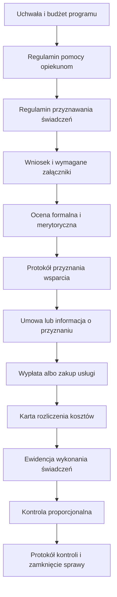
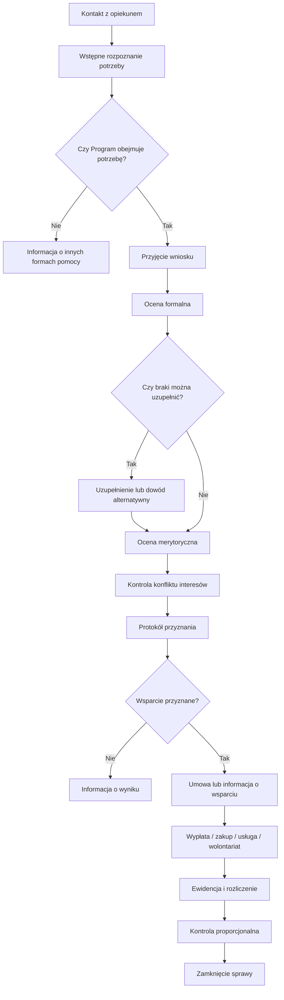

# ✦ ROZDZIAŁ 24.3 ✦
# DOKUMENTACJA OPIEKUŃCZA

## Regulaminy, wnioski, oświadczenia, dokumenty dochodowe, porozumienie wolontariackie, ewidencja świadczeń, rozliczenie kosztów oraz protokoły przyznania i kontroli wsparcia

> **Stan prawny i źródłowy opracowania: 27 listopada 2026 r.**
>
> Materiał jest przeznaczony dla fundatorów, członków zarządów, koordynatorów programów pomocowych, osób odpowiedzialnych za finanse, wolontariat, ochronę danych oraz dla osób przygotowujących dokumentację wsparcia opiekunów rodzinnych i nieformalnych. Wzory są materiałem roboczym. Przed przyjęciem ich jako dokumentów obowiązujących należy dopasować je do statutu fundacji, uchwał organów, źródła finansowania, rzeczywistego modelu świadczenia i aktualnego prawa.

---

## 1. Cel, zakres i efekty kształcenia

### 1.1. Cel rozdziału

Celem rozdziału jest przygotowanie kompletnego, spójnego i możliwego do audytowania pakietu dokumentacji dla programu, w którym fundacja wspiera osoby sprawujące opiekę nad członkiem rodziny lub inną osobą wymagającą pomocy w codziennym funkcjonowaniu.

Dokumentacja ma służyć jednocześnie czterem celom:

1. **Ochronie człowieka** – zapewnieniu, że pomoc odpowiada rzeczywistej potrzebie, szanuje godność, autonomię, prywatność i możliwości osoby wspieranej.
2. **Ochronie opiekuna** – umożliwieniu uzyskania pomocy bez nieuzasadnionego obciążania go dokumentami, kosztami, obowiązkami lub ryzykiem.
3. **Ochronie fundacji** – wykazaniu, że wsparcie zostało przyznane przez właściwą osobę, na podstawie statutu i regulaminu, w granicach budżetu oraz zgodnie z przeznaczeniem środków.
4. **Ochronie darczyńców i finansujących** – zapewnieniu przejrzystości, rozliczalności, zapobiegania podwójnemu finansowaniu i możliwości wykazania rezultatów programu.

Dokumentacja nie może być celem samym w sobie. Nie powinna przekształcać pomocy w biurokratyczną barierę, wymuszać ujawniania całej historii choroby ani uzależniać godnego traktowania od zdolności beneficjenta do zgromadzenia licznych zaświadczeń.

### 1.2. Zakres opracowania

Rozdział obejmuje wszystkie dziesięć pozycji konspektu:

| Nr | Dokument | Funkcja |
|---:|---|---|
| 1 | Regulamin pomocy opiekunom | Określa cel, adresatów, formy i granice programu |
| 2 | Regulamin przyznawania świadczeń | Porządkuje procedurę od wniosku do rozliczenia |
| 3 | Wniosek o pomoc | Zbiera informacje niezbędne do oceny potrzeby |
| 4 | Oświadczenie o utraconym dochodzie | Dokumentuje deklarowany uszczerbek zarobkowy |
| 5 | Dokumenty potwierdzające sytuację dochodową | Umożliwiają proporcjonalną weryfikację kryteriów |
| 6 | Porozumienie wolontariackie | Określa legalny zakres świadczeń wolontariusza |
| 7 | Ewidencja wykonywanych świadczeń | Rejestruje faktyczne wykonanie wsparcia |
| 8 | Karta rozliczenia kosztów | Łączy wydatek z celem, dowodem i płatnością |
| 9 | Protokół przyznania wsparcia | Utrwala rozstrzygnięcie właściwej osoby lub zespołu |
| 10 | Protokół kontroli wykorzystania pomocy | Dokumentuje kontrolę proporcjonalną i jej wynik |

### 1.3. Efekty uczenia się

Po ukończeniu rozdziału uczestnik potrafi:

- rozróżnić program fundacyjny od świadczeń przyznawanych przez organ administracji;
- przygotować regulamin programu pomocy opiekunom i odrębny regulamin procedury przyznawania wsparcia;
- zaprojektować wniosek, który zbiera wyłącznie informacje potrzebne do oceny;
- odróżnić utracone wynagrodzenie, utracony zarobek, rzeczywisty koszt opieki i zwykłe zmniejszenie dyspozycyjności;
- ustalić, jakie dokumenty dochodowe są wystarczające w konkretnym przypadku;
- zawrzeć porozumienie z wolontariuszem zgodnie z ustawą o działalności pożytku publicznego i o wolontariacie;
- prowadzić ewidencję wykonania świadczeń bez ujawniania zbędnych danych o zdrowiu;
- sporządzić kartę rozliczenia kosztów, protokół przyznania wsparcia i protokół kontroli;
- rozpoznać konflikt interesów i wyłączyć osobę zainteresowaną z oceny własnego wniosku;
- stosować zasady minimalizacji danych, ograniczenia dostępu i właściwego okresu przechowywania dokumentacji.

### 1.4. Granice względem innych rozdziałów kursu

Niniejszy rozdział jest przede wszystkim **warsztatem dokumentacyjnym**. Nie powtarza pełnych analiz prawnych i ekonomicznych zawartych w innych materiałach.

| Rozdziały | Zakres już opracowany | Zastosowanie w niniejszym rozdziale |
|---|---|---|
| 10.1–10.3 | Pojęcie opieki, formy opieki, odpowiedzialność i prawa osoby wspieranej | Określenie granic czynności i ochrony godności |
| 11.1–11.3 | Obowiązki społeczne, osoby je wykonujące, granice kwalifikowania opieki | Prawidłowe ustalenie roli opiekuna |
| 12.1–12.3 | Utracony dochód, rekompensowanie kosztów i dochodów | Oświadczenie i dokumenty dochodowe bez powtarzania metody kalkulacji |
| 14.1–14.4 | Podstawy wolontariatu, porozumienie, koszty i organizacja wolontariatu opiekuńczego | Wzór porozumienia i ewidencja wykonania |
| 15.1–15.3 | Pomoc bezpośrednia, przyznawanie świadczeń i kwalifikacja ich rodzaju | Dokumenty dostosowane do programu dla opiekunów |
| 21.3 | Rachunkowość fundacji | Dowody księgowe, rejestry i archiwizacja |
| 23.1–23.2 | Kontrola wewnętrzna i nadzór zewnętrzny | Ścieżka audytowa i protokoły |

**Zasada unikania powtórzeń:** jeżeli kwestia została szczegółowo rozstrzygnięta w rozdziale 12, 14 lub 15, w niniejszym materiale wskazuje się sposób udokumentowania jej wyniku oraz odsyła do właściwego rozdziału. Wzór dokumentu nie zastępuje analizy prawnej świadczenia.

---

## 2. Zanim powstanie dokument – ustalenie modelu pomocy

### 2.1. Kto jest adresatem wsparcia?

Program może wspierać różne osoby. Nie wolno ich utożsamiać.

| Rola | Znaczenie | Przykład |
|---|---|---|
| Wnioskodawca | Osoba składająca wniosek | Córka opiekująca się rodzicem |
| Beneficjent | Osoba, której przyznano wsparcie | Opiekunka albo osoba wymagająca opieki |
| Osoba wspierana | Osoba, której codzienne funkcjonowanie jest przedmiotem pomocy | Rodzic wymagający pomocy |
| Opiekun nieformalny | Osoba faktycznie udzielająca wsparcia bez koniecznego zawodowego statusu opiekuna | Małżonek, dziecko, partner, sąsiad |
| Przedstawiciel ustawowy | Osoba działająca w granicach umocowania wynikającego z prawa | Rodzic małoletniego |
| Pełnomocnik | Osoba działająca na podstawie pełnomocnictwa | Osoba upoważniona do złożenia dokumentów |
| Wolontariusz | Osoba wykonująca świadczenia ochotniczo i bez wynagrodzenia na zasadach ustawowych | Wolontariusz odwiedzający osobę samotną |
| Wykonawca odpłatny | Osoba lub podmiot realizujący usługę za wynagrodzeniem | Firma transportowa lub opiekun zawodowy |

Wniosek powinien wskazywać, czy wsparcie ma być przyznane opiekunowi, osobie wymagającej opieki, czy obu osobom w odrębnych zakresach. Ma to znaczenie dla umowy, płatności, podatków, zgody, danych osobowych i kontroli.

### 2.2. Opiekun rodzinny nie jest automatycznie opiekunem prawnym

W dokumentach należy stosować określenie odpowiadające rzeczywistej roli.

- **Opiekun nieformalny** – osoba faktycznie pomagająca w codziennym funkcjonowaniu.
- **Opiekun faktyczny** – pojęcie używane w określonych ustawach, którego zakres zależy od danego przepisu.
- **Opiekun prawny** – osoba ustanowiona przez sąd w zakresie określonym orzeczeniem.
- **Przedstawiciel ustawowy** – osoba uprawniona do działania na podstawie ustawy.
- **Pełnomocnik** – osoba umocowana przez mocodawcę do określonych czynności.

Pokrewieństwo, wspólne zamieszkanie ani finansowanie opieki nie dają same przez się prawa do reprezentowania dorosłej osoby w każdej sprawie. Jeżeli dokument dotyczy danych, praw lub majątku osoby wymagającej opieki, trzeba ustalić, czy wnioskodawca może działać we własnym imieniu, czy też posiada właściwe umocowanie.

### 2.3. Rozdzielenie programu fundacji od pomocy społecznej państwa

Fundacja może prowadzić własny program wsparcia w granicach statutu, prawa, uchwał i dostępnych środków. Sam fakt, że fundacja przyznaje pomoc, nie czyni jej organem administracji publicznej ani jednostką organizacyjną pomocy społecznej.

Należy rozdzielić:

1. świadczenia przyznawane w drodze decyzji administracyjnej przez właściwy organ;
2. usługi opiekuńcze organizowane przez gminę;
3. zadanie publiczne zlecone fundacji na podstawie umowy;
4. prywatny program pomocowy fundacji finansowany z jej środków lub darowizn;
5. darowiznę na rzecz osoby fizycznej;
6. refundację udokumentowanego wydatku;
7. wynagrodzenie za pracę lub usługę;
8. zwrot kosztów wolontariusza.

W szczególności art. 50 i 50b ustawy o pomocy społecznej, w brzmieniu zmienionym w 2026 r., reguluje określone usługi opiekuńcze w systemie publicznym, w tym wymagania wobec osób wykonujących usługi i standard ich świadczenia. Nie należy automatycznie przenosić tych regulacji na każdy prywatny program fundacji. Jeżeli fundacja realizuje zadanie publiczne lub świadczy usługi w systemie ustawowym, trzeba przeanalizować właściwy reżim odrębnie.

### 2.4. Ustalenie rzeczywistego charakteru świadczenia

Przed przygotowaniem wzoru należy odpowiedzieć na pytania:

1. Kto przekazuje środki?
2. Kto je otrzymuje?
3. Czy środki są nieodpłatne?
4. Czy odbiorca ma obowiązek wykonać świadczenie wzajemne?
5. Czy jest to pokrycie rzeczywiście poniesionego kosztu?
6. Czy jest to wsparcie socjalne, zapomoga, darowizna, grant, refundacja czy wynagrodzenie?
7. Czy istnieje umowa lub regulamin określający cel?
8. Czy środki pochodzą z dotacji, grantu, darowizny celowej czy z majątku własnego fundacji?
9. Czy finansujący narzucił własny wzór dokumentów?
10. Jakie skutki podatkowe i rachunkowe wynikają z rzeczywistego charakteru transferu?

Nie należy dobierać nazwy świadczenia wyłącznie po to, aby osiągnąć korzystniejszy skutek podatkowy. Nazwa, umowa, regulamin, księgowanie i rzeczywisty przebieg działania muszą być zgodne.

### 2.5. Minimalna mapa dokumentów

Nie każda sprawa wymaga wszystkich dokumentów w pełnym zakresie. Zestaw powinien być proporcjonalny do kwoty, ryzyka, rodzaju wsparcia, źródła finansowania i obowiązków prawnych.

---

## 3. Zasady projektowania dokumentacji

### 3.1. Zasada pierwszeństwa człowieka przed formularzem

Wniosek ma pomagać w rozpoznaniu potrzeby, a nie sprawdzać odporność opiekuna na biurokrację. W razie nagłej potrzeby należy przewidzieć tryb uproszczony, o ile pozwala na to regulamin i źródło finansowania.

W praktyce można zastosować:

- wniosek papierowy;
- formularz elektroniczny;
- przyjęcie wniosku ustnie do protokołu, jeżeli regulamin dopuszcza taką formę;
- pomoc pracownika lub koordynatora w wypełnieniu dokumentów;
- możliwość dostarczenia brakującego dokumentu w późniejszym terminie;
- uzasadnione oświadczenie zamiast dokumentu, którego uzyskanie jest obiektywnie niemożliwe.

Uproszczenie nie oznacza braku kontroli. Oznacza dostosowanie sposobu potwierdzenia okoliczności do realiów życia osoby wymagającej pomocy.

### 3.2. Zasada proporcjonalności

Zakres dokumentów powinien zależeć od rodzaju i wartości wsparcia.

| Rodzaj wsparcia | Przykładowy poziom dokumentacji |
|---|---|
| Jednorazowa pomoc rzeczowa o niewielkiej wartości | Wniosek uproszczony, potwierdzenie przekazania |
| Zakup konkretnego sprzętu | Wniosek, uzasadnienie potrzeby, oferta lub faktura, protokół przekazania |
| Cykliczne wsparcie finansowe | Wniosek, ocena kryteriów, protokół przyznania, harmonogram i okresowa weryfikacja |
| Refundacja kosztów | Wniosek lub zgłoszenie, dowód kosztu, karta rozliczenia |
| Wsparcie związane z utraconym dochodem | Dokumenty z rozdziału 12.3, oświadczenie, kalkulacja i protokół |
| Wolontariat opiekuńczy | Porozumienie, karta dopuszczenia, ewidencja świadczeń, dokumentacja bezpieczeństwa |
| Pomoc interwencyjna | Minimalny zapis przyczyny, decyzja osoby upoważnionej, potwierdzenie przekazania, późniejsza weryfikacja |

Nie wolno stosować automatycznie najbardziej rozbudowanego zestawu dokumentów do każdej sprawy.

### 3.3. Zasada rozdzielenia oceny potrzeby i kontroli wydatku

Ocena potrzeby odpowiada na pytanie: **czy i dlaczego wsparcie jest potrzebne?**

Kontrola wydatku odpowiada na pytanie: **czy środki wykorzystano zgodnie z przyznanym celem?**

Są to dwa odrębne etapy. Weryfikacja sytuacji rodzinnej nie powinna być powtarzana przy każdym zakupie, jeżeli nie ma ku temu uzasadnienia. Z kolei faktura za zakup nie dowodzi sama przez się, że osoba spełniała kryteria programu.

### 3.4. Zasada równego traktowania

Kryteria muszą być:

- znane przed złożeniem wniosku;
- związane z celem programu;
- możliwe do zastosowania w porównywalnych przypadkach;
- obiektywne i proporcjonalne;
- wolne od arbitralnego różnicowania;
- stosowane z uwzględnieniem szczególnych okoliczności, jeżeli regulamin przewiduje wyjątki.

Nie należy uzależniać wsparcia od wyznania, światopoglądu, poglądów politycznych, pochodzenia, niepełnosprawności lub innych cech niezwiązanych z celem programu. Jeżeli program ma szczególną grupę docelową, jej określenie musi mieć uzasadnienie w statucie, celu i prawie.

### 3.5. Zasada rozdzielenia ról

W miarę możliwości:

- osoba przyjmująca wniosek nie zatwierdza samodzielnie wypłaty;
- osoba zatwierdzająca nie rozlicza samodzielnie wydatku;
- osoba zainteresowana wynikiem nie uczestniczy w rozstrzyganiu własnej sprawy;
- osoba prowadząca kontrolę nie zmienia samodzielnie warunków przyznania wsparcia;
- księgowość sprawdza dokumenty finansowe, ale nie rozstrzyga samodzielnie o społecznej zasadności pomocy.

W małej fundacji rozdzielenie może być organizowane przez dodatkową kontrolę drugiej osoby, uchwałę organu albo dokumentowane zatwierdzenie przez osobę niezainteresowaną.

---

## 4. Dokument 1 – Regulamin pomocy opiekunom

### 4.1. Funkcja regulaminu

Regulamin pomocy opiekunom jest dokumentem programowym. Określa, komu i w jakim celu fundacja udziela wsparcia, jakie formy pomocy są dostępne, z jakich środków są finansowane i jakie są granice programu.

Nie zastępuje statutu, uchwały organu ani umowy z grantodawcą. Nie może rozszerzać kompetencji fundacji poza statut ani zmieniać warunków dotacji lub darowizny celowej.

### 4.2. Zalecana zawartość

1. Nazwa programu i podstawa jego przyjęcia.
2. Cel i okres obowiązywania.
3. Definicje.
4. Grupa adresatów.
5. Formy pomocy.
6. Kryteria dostępu.
7. Priorytety i sytuacje nagłe.
8. Źródła finansowania.
9. Limity i dostępność budżetu.
10. Zasady składania wniosków.
11. Ochrona danych.
12. Zasady przyznawania wsparcia.
13. Zasady rozliczania.
14. Kontrola wykorzystania pomocy.
15. Tryb wyjaśniania nieprawidłowości.
16. Zasady zmian i zakończenia programu.

### 4.3. Wzór regulaminu

# REGULAMIN PROGRAMU POMOCY OPIEKUNOM

**§ 1. Postanowienia ogólne**

1. Program pod nazwą „[NAZWA PROGRAMU]”, zwany dalej „Programem”, prowadzi Fundacja [NAZWA], z siedzibą w [MIEJSCOWOŚĆ], wpisana do Krajowego Rejestru Sądowego pod numerem [KRS].
2. Program jest realizowany w granicach celów statutowych Fundacji oraz środków przeznaczonych na ten cel.
3. Regulamin określa zasady uczestnictwa, przyznawania, wypłacania, rozliczania i kontroli wsparcia.
4. Program nie zastępuje świadczeń publicznych, usług zdrowotnych ani uprawnień wynikających z odrębnych ustaw.
5. Jeżeli środki pochodzą z dotacji, grantu lub darowizny celowej, pierwszeństwo mają wiążące warunki finansowania, o ile nie są sprzeczne z bezwzględnie obowiązującym prawem.

**§ 2. Cel Programu**

1. Celem Programu jest wspieranie osób sprawujących faktyczną, nieodpłatną lub częściowo odpłatną opiekę nad osobami wymagającymi pomocy w codziennym funkcjonowaniu.
2. Wsparcie może służyć w szczególności:
   1. ograniczeniu nadmiernego obciążenia opiekuna;
   2. poprawie bezpieczeństwa i ciągłości opieki;
   3. umożliwieniu opiekunowi odpoczynku i załatwienia niezbędnych spraw;
   4. pokryciu uzasadnionych kosztów związanych z opieką;
   5. zapewnieniu dostępu do informacji, edukacji i wsparcia;
   6. przeciwdziałaniu izolacji społecznej opiekuna;
   7. ochronie samodzielności i godności osoby wymagającej pomocy.
3. Program nie służy finansowaniu wydatków niezwiązanych z jego celem.

**§ 3. Definicje**

1. Opiekun – osoba, która faktycznie i regularnie udziela pomocy innej osobie w codziennym funkcjonowaniu.
2. Osoba wspierana – osoba, której potrzeby opiekuńcze są związane z celem wniosku.
3. Wnioskodawca – osoba składająca wniosek.
4. Beneficjent – osoba, której przyznano wsparcie.
5. Wsparcie – pomoc pieniężna, rzeczowa, usługowa, organizacyjna, edukacyjna lub wolontariacka udzielana w ramach Programu.
6. Koszt kwalifikowany – wydatek dopuszczony regulaminem, budżetem i warunkami źródła finansowania.
7. Koordynator – osoba wyznaczona do prowadzenia spraw Programu.

**§ 4. Adresaci Programu**

1. O wsparcie może ubiegać się osoba pełnoletnia, która faktycznie sprawuje opiekę i spełnia kryteria Programu.
2. W uzasadnionych przypadkach wsparcie może być przyznane osobie wspieranej, jeżeli odpowiada to celowi Programu i właściwej kwalifikacji prawnej świadczenia.
3. Samo pokrewieństwo, wspólne zamieszkanie albo deklaracja opieki nie przesądzają o spełnieniu kryteriów.
4. Fundacja może uwzględnić opiekę nad osobą niespokrewnioną, jeżeli rzeczywisty zakres pomocy odpowiada celowi Programu.
5. Osoba działająca w imieniu innej osoby przedstawia dokument potwierdzający umocowanie, jeżeli jest ono wymagane.

**§ 5. Formy wsparcia**

1. Program może obejmować:
   1. pomoc rzeczową;
   2. zakup lub dofinansowanie sprzętu i środków pomocniczych;
   3. finansowanie usług zastępczych;
   4. dofinansowanie transportu;
   5. pokrycie uzasadnionych kosztów związanych z opieką;
   6. wsparcie edukacyjne i informacyjne;
   7. wsparcie psychologiczne lub poradnicze, jeżeli Fundacja jest uprawniona do jego organizowania;
   8. organizację wolontariatu;
   9. jednorazową pomoc finansową;
   10. inne formy zgodne ze statutem i budżetem.
2. Forma wsparcia jest dobierana do rozpoznanej potrzeby.
3. Fundacja może zaproponować inną formę pomocy niż wskazana we wniosku, po uzgodnieniu z wnioskodawcą.

**§ 6. Kryteria przyznawania wsparcia**

1. Ocena obejmuje:
   1. rzeczywisty zakres i regularność opieki;
   2. wpływ opieki na sytuację opiekuna;
   3. rodzaj i pilność potrzeby;
   4. dostępność innych źródeł pomocy;
   5. sytuację materialną, jeżeli ma znaczenie dla danego instrumentu;
   6. zgodność wniosku z celami i budżetem Programu.
2. Kryteria dochodowe, jeżeli są stosowane, określa odrębny załącznik lub regulamin przyznawania świadczeń.
3. Progi dochodowe Programu są kryteriami wewnętrznymi i nie mogą być przedstawiane jako ustawowe kryteria pomocy społecznej, jeżeli nie wynikają z właściwych przepisów.
4. Fundacja może uwzględnić szczególne okoliczności, w tym nagłe pogorszenie sytuacji, brak dokumentów możliwych do uzyskania w terminie lub ryzyko przerwania opieki.

**§ 7. Źródła i ograniczenia finansowania**

1. Program może być finansowany ze środków własnych Fundacji, darowizn, grantów, dotacji lub innych legalnych źródeł.
2. Każde źródło finansowania jest ewidencjonowane zgodnie z jego przeznaczeniem.
3. Nie wolno finansować tego samego wydatku dwukrotnie.
4. Wsparcie nie może przekroczyć dostępnego budżetu ani limitu określonego w umowie finansowania.
5. Jeżeli finansujący wymaga odrębnego sposobu dokumentowania, Fundacja stosuje ten sposób w zakresie zgodnym z prawem.

**§ 8. Wniosek i dokumenty**

1. Wsparcie przyznaje się na podstawie wniosku, chyba że regulamin przewiduje udokumentowany tryb interwencyjny.
2. Wniosek powinien zawierać informacje niezbędne do oceny.
3. Fundacja może poprosić o uzupełnienie braków, wskazując konkretny dokument i cel jego pozyskania.
4. Jeżeli dokumentu nie można uzyskać, Fundacja rozważa dowód alternatywny.
5. Nie żąda się pełnej dokumentacji medycznej, jeżeli wystarczy informacja o funkcjonalnej potrzebie wsparcia.

**§ 9. Rozstrzygnięcie**

1. Wniosek rozpatruje osoba lub zespół wskazany w uchwale Zarządu.
2. Rozstrzygnięcie jest dokumentowane protokołem albo kartą rozstrzygnięcia.
3. Osoba pozostająca w konflikcie interesów nie uczestniczy w ocenie ani głosowaniu.
4. Informacja o przyznaniu wsparcia określa formę, wartość lub limit, cel, termin i warunki rozliczenia.
5. Rozstrzygnięcie Fundacji w ramach własnego programu nie jest decyzją administracyjną.

**§ 10. Wypłata i realizacja**

1. Wsparcie przekazuje się w sposób bezpieczny i możliwy do udokumentowania.
2. Preferowany jest przelew na rachunek właściwego odbiorcy albo bezpośrednia płatność na rzecz dostawcy.
3. Przekazanie gotówki wymaga pokwitowania.
4. Zakup rzeczy wymaga dokumentu zakupu i potwierdzenia wydania.
5. Zakres i termin realizacji określa informacja o przyznaniu albo odrębna umowa.

**§ 11. Rozliczenie i kontrola**

1. Beneficjent przedstawia dokumenty rozliczeniowe w zakresie odpowiadającym rodzajowi wsparcia.
2. Kontrola jest proporcjonalna do wartości, ryzyka i celu.
3. Fundacja może poprosić o wyjaśnienia dotyczące rozbieżności.
4. Kontrola nie może naruszać godności, prywatności ani autonomii osoby wspieranej.
5. Zwrot środków może być wymagany wyłącznie na podstawie właściwej podstawy prawnej, umowy lub zaakceptowanego regulaminu oraz po ustaleniu okoliczności sprawy.

**§ 12. Ochrona danych**

1. Fundacja przetwarza dane tylko w zakresie niezbędnym do prowadzenia Programu.
2. Dane o zdrowiu są przetwarzane wyłącznie po ustaleniu właściwej podstawy z art. 6 i wyjątku z art. 9 RODO.
3. Informacja o przetwarzaniu danych jest przekazywana wnioskodawcy.
4. Dostęp do dokumentacji jest ograniczony do osób, których obowiązki tego wymagają.
5. Dokumenty przechowuje się zgodnie z harmonogramem retencji.

**§ 13. Bezpieczeństwo i ochrona osób**

1. Pomoc jest organizowana z poszanowaniem praw osoby wspieranej.
2. Wolontariusz wykonuje wyłącznie zadania określone w porozumieniu i zgodne ze swoimi kompetencjami.
3. Czynności zastrzeżone dla osób posiadających określone kwalifikacje nie mogą być powierzane osobie nieuprawnionej.
4. W razie zagrożenia życia lub zdrowia należy korzystać z właściwych służb i procedur, a nie zastępować ich działaniem programu.

**§ 14. Zmiany i zakończenie Programu**

1. Zmiany regulaminu wymagają zatwierdzenia przez właściwy organ Fundacji.
2. Zmiana nie może wstecznie pozbawiać beneficjenta praw wynikających z zawartej umowy, chyba że zachodzi podstawa prawna do takiego działania.
3. Zakończenie Programu nie zwalnia Fundacji z obowiązku rozliczenia środków i dokumentacji.

**§ 15. Postanowienia końcowe**

1. Regulamin wchodzi w życie z dniem [DATA].
2. Regulamin zatwierdzono uchwałą [NUMER] z dnia [DATA].
3. W sprawach nieuregulowanych stosuje się przepisy prawa, statut Fundacji i właściwe umowy finansowania.

### 4.4. Lista kontrolna przed zatwierdzeniem regulaminu

- [ ] Czy cel Programu mieści się w statucie?
- [ ] Czy wiadomo, kto jest adresatem pomocy?
- [ ] Czy rozdzielono opiekuna i osobę wymagającą opieki?
- [ ] Czy określono formy wsparcia?
- [ ] Czy kryteria są mierzalne i równe?
- [ ] Czy limity wynikają z realnego budżetu?
- [ ] Czy rozróżniono środki własne i powierzone?
- [ ] Czy określono sposób rozliczania?
- [ ] Czy opisano konflikt interesów?
- [ ] Czy wskazano zasady ochrony danych?
- [ ] Czy przewidziano tryb pilny?
- [ ] Czy regulamin nie sugeruje, że Fundacja wydaje decyzje administracyjne?

---

## 5. Dokument 2 – Regulamin przyznawania świadczeń

### 5.1. Różnica między regulaminem Programu a procedurą przyznawania

Regulamin Programu odpowiada na pytanie, **po co i komu Fundacja pomaga**. Regulamin przyznawania świadczeń odpowiada na pytanie, **jak Fundacja rozpatruje wniosek i dokumentuje kolejne czynności**.

W większej organizacji można przyjąć dwa odrębne dokumenty. W małej fundacji można je połączyć, ale trzeba zachować czytelny podział rozdziałów.

### 5.2. Wzór procedury

# REGULAMIN PRZYZNAWANIA WSPARCIA W PROGRAMIE POMOCY OPIEKUNOM

**§ 1. Zakres**

1. Procedura określa czynności od przyjęcia wniosku do zamknięcia sprawy.
2. Procedura obowiązuje koordynatora, osoby oceniające, osoby zatwierdzające i osoby odpowiedzialne za płatności.
3. W sprawach pilnych stosuje się tryb uproszczony, jeżeli został przewidziany w uchwale i budżecie.

**§ 2. Rejestracja wniosku**

1. Każdy wniosek otrzymuje indywidualny numer sprawy.
2. Rejestr zawiera tylko dane niezbędne do zarządzania Programem.
3. Dokumenty identyfikacyjne i dokumenty zawierające dane szczególne mogą być przechowywane w odrębnych, odpowiednio zabezpieczonych częściach akt.
4. Wnioskodawca otrzymuje potwierdzenie przyjęcia wniosku, jeżeli jest to możliwe.

**§ 3. Ocena formalna**

1. Koordynator sprawdza:
   1. kompletność danych niezbędnych do kontaktu;
   2. podpis lub inne potwierdzenie złożenia wniosku;
   3. zgodność wniosku z zakresem Programu;
   4. umocowanie osoby działającej w imieniu innej osoby, jeżeli jest wymagane;
   5. obecność wymaganych załączników.
2. Braki nieistotne nie mogą automatycznie prowadzić do odmowy, jeżeli można je uzupełnić.
3. Wezwanie do uzupełnienia wskazuje konkretny brak, cel dokumentu i termin odpowiedzi.

**§ 4. Ocena merytoryczna**

1. Ocena obejmuje rzeczywistą potrzebę, zgodność z celem, pilność, dostępność budżetu i kryteria Programu.
2. W razie stosowania punktacji kryteria i wagi muszą być zatwierdzone przed naborem.
3. Oceniający dokumentuje podstawowe przesłanki, a nie każdą informację z życia prywatnego wnioskodawcy.
4. Nie wolno wymagać danych medycznych, które nie są potrzebne do ustalenia potrzeby wsparcia.

**§ 5. Weryfikacja dochodu**

1. Dochód jest oceniany według definicji przyjętej w Programie.
2. Regulamin wskazuje, czy uwzględnia się kwoty netto czy brutto, okres referencyjny, dochody nieregularne i jednorazowe.
3. Nie wolno stosować automatycznie definicji dochodu z ustawy o pomocy społecznej, jeżeli Program nie odsyła do niej w sposób świadomy i prawidłowy.
4. Weryfikacja dochodu powinna ograniczać się do danych potrzebnych do oceny kryterium.
5. W szczególnych przypadkach można przyjąć dokument alternatywny lub oświadczenie z uzasadnieniem.

**§ 6. Konflikt interesów**

1. Osoba oceniająca ujawnia powiązania osobiste lub majątkowe, które mogą wpływać na bezstronność.
2. Osoba zainteresowana wynikiem sprawy nie uczestniczy w ocenie ani zatwierdzeniu własnego wniosku.
3. Wyłączenie odnotowuje się w protokole.
4. Jeżeli wniosek składa członek organu Fundacji lub osoba z nim blisko związana, sprawę rozpatruje osoba lub organ niezainteresowany, zgodnie ze statutem i uchwałami.

**§ 7. Rozstrzygnięcie**

1. Rozstrzygnięcie obejmuje przyznanie wsparcia, przyznanie w innej formie, odmowę albo prośbę o uzupełnienie.
2. Protokół zawiera uzasadnienie odnoszące się do kryteriów Programu.
3. Informacja dla wnioskodawcy jest zrozumiała i wskazuje dalsze czynności.
4. Regulamin może przewidywać wniosek o ponowne rozpatrzenie przez osobę, która nie uczestniczyła w pierwotnej ocenie.
5. Tryb wewnętrzny nie jest odwołaniem administracyjnym, chyba że odrębna ustawa stanowi inaczej.

**§ 8. Przygotowanie wypłaty**

1. Przed wypłatą osoba zatwierdzająca sprawdza:
   1. protokół przyznania;
   2. zgodność kwoty z budżetem;
   3. prawidłowość odbiorcy;
   4. właściwy tytuł prawny transferu;
   5. ewentualne warunki umowy finansowania.
2. Płatność wykonuje osoba upoważniona.
3. Płatność potwierdza się dokumentem bankowym albo pokwitowaniem.

**§ 9. Rozliczenie**

1. Beneficjent przedstawia dowody wymagane dla określonego instrumentu.
2. Księgowość sprawdza poprawność dokumentów finansowych.
3. Koordynator sprawdza zgodność z celem wsparcia.
4. Rozbieżności wyjaśnia się przed podjęciem decyzji o ewentualnym zwrocie.

**§ 10. Kontrola**

1. Kontrola może być dokumentowa, rozmową wyjaśniającą albo inną formą przewidzianą regulaminem i umową.
2. Kontrola w miejscu zamieszkania nie jest standardową ani automatyczną metodą weryfikacji.
3. Kontrolę planuje się w sposób najmniej ingerujący w prywatność.
4. Ustalenia zapisuje się w protokole.

**§ 11. Zamknięcie sprawy**

1. Sprawę zamyka się po wykonaniu świadczenia, rozliczeniu i zakończeniu kontroli, jeżeli była wymagana.
2. W rejestrze odnotowuje się datę zamknięcia.
3. Akta przechowuje się zgodnie z harmonogramem retencji.

### 5.3. Wzór karty przebiegu sprawy

| Etap | Data | Osoba odpowiedzialna | Wynik | Dokument |
|---|---|---|---|---|
| Przyjęcie wniosku | [DATA] | [OSOBA] | [WYNIK] | Wniosek nr [ ] |
| Ocena formalna | [DATA] | [OSOBA] | [WYNIK] | Karta formalna |
| Uzupełnienie | [DATA] | [OSOBA] | [WYNIK] | Wezwanie / odpowiedź |
| Ocena merytoryczna | [DATA] | [OSOBA] | [WYNIK] | Karta oceny |
| Kontrola konfliktu | [DATA] | [OSOBA] | [WYNIK] | Oświadczenie |
| Rozstrzygnięcie | [DATA] | [ORGAN/OSOBA] | [WYNIK] | Protokół |
| Wypłata lub zakup | [DATA] | [OSOBA] | [WYNIK] | Dowód płatności |
| Rozliczenie | [DATA] | [OSOBA] | [WYNIK] | Karta kosztów |
| Kontrola końcowa | [DATA] | [OSOBA] | [WYNIK] | Protokół kontroli |
| Zamknięcie | [DATA] | [OSOBA] | [WYNIK] | Karta zamknięcia |

---

## 6. Dokument 3 – Wniosek o pomoc

### 6.1. Zasady konstruowania wniosku

Wniosek powinien być możliwie krótki, zrozumiały i dostępny. Należy unikać pól, które nie służą ocenie konkretnego świadczenia.

W szczególności nie należy automatycznie żądać:

- pełnej historii choroby;
- wszystkich wyników badań;
- kopii dowodu osobistego;
- danych wszystkich członków rodziny;
- numerów rachunków osób niezwiązanych ze sprawą;
- informacji o przekonaniach religijnych lub światopoglądzie;
- szczegółowych danych o wydatkach, które nie mają związku z Programem.

Jeżeli potrzeba dotyczy funkcjonowania, często wystarcza opis czynności, w których osoba wymaga wsparcia, okresu, częstotliwości i rodzaju pomocy.

### 6.2. Wzór wniosku

# WNIOSEK O PRZYZNANIE WSPARCIA W PROGRAMIE POMOCY OPIEKUNOM

**Numer sprawy:** [WYPEŁNIA FUNDACJA]  
**Data wpływu:** [WYPEŁNIA FUNDACJA]

### A. Dane wnioskodawcy

1. Imię i nazwisko: [ ]
2. Adres do korespondencji: [ ]
3. Telefon lub adres poczty elektronicznej: [ ]
4. Preferowany sposób kontaktu: [telefon / poczta elektroniczna / list / inny]
5. Czy wnioskodawca składa wniosek we własnym imieniu? [TAK / NIE]
6. Jeżeli działa w imieniu innej osoby, wskazać podstawę umocowania: [ ]

### B. Dane osoby wymagającej opieki

1. Imię lub oznaczenie osoby: [ ]
2. Relacja z wnioskodawcą: [ ]
3. Czy osoba została poinformowana o złożeniu wniosku? [TAK / NIE / NIE DOTYCZY]
4. Czy wnioskodawca posiada umocowanie do działania w imieniu tej osoby? [TAK / NIE / NIE DOTYCZY]
5. Czy dane tej osoby są niezbędne do rozpatrzenia wniosku? [TAK / NIE – UZASADNIĆ]

**Uwaga:** w przypadku osoby dorosłej samo pokrewieństwo nie oznacza automatycznego prawa do reprezentowania jej ani do wyrażania zgody na przetwarzanie jej danych.

### C. Opis opieki

1. Od kiedy wnioskodawca sprawuje opiekę? [ ]
2. Jak często udziela pomocy? [codziennie / kilka razy w tygodniu / okresowo / doraźnie]
3. Jakie czynności wymagają wsparcia? [ ]
4. Ile orientacyjnie czasu zajmuje opieka? [ ]
5. Czy w opiekę zaangażowane są inne osoby? [ ]
6. Czy występują okresy, w których opiekun nie ma możliwości zapewnienia wsparcia? [ ]
7. Jakie są najważniejsze trudności? [ ]

Opis powinien dotyczyć funkcjonalnej potrzeby pomocy. Nie należy wpisywać rozpoznania medycznego, jeżeli nie jest ono konieczne do oceny wniosku.

### D. Wnioskowana forma pomocy

Zaznaczyć właściwe:

- [ ] pomoc rzeczowa;
- [ ] dofinansowanie zakupu;
- [ ] transport;
- [ ] usługa zastępcza;
- [ ] pomoc finansowa;
- [ ] refundacja kosztów;
- [ ] wsparcie wolontariackie;
- [ ] szkolenie lub edukacja;
- [ ] wsparcie organizacyjne;
- [ ] inne: [ ].

Opis konkretnej potrzeby: [ ]

Wnioskowana kwota lub szacunkowa wartość: [ ]

Termin, w którym pomoc jest potrzebna: [ ]

### E. Sytuacja dochodowa – tylko jeżeli ma znaczenie dla kryteriów Programu

1. Liczba osób w gospodarstwie domowym: [ ]
2. Źródła dochodu uwzględniane w Programie: [ ]
3. Czy wnioskodawca utracił wynagrodzenie lub zarobek w związku z opieką? [TAK / NIE]
4. Czy wnioskodawca poniósł konkretne koszty związane z opieką? [TAK / NIE]
5. Czy otrzymał zwrot tych samych kosztów z innego źródła? [TAK / NIE / NIE DOTYCZY]
6. Dokumenty potwierdzające sytuację dochodową: [ ]

Nie należy wpisywać danych o dochodzie osób trzecich, jeżeli nie są one niezbędne i nie ma właściwej podstawy do ich przetwarzania.

### F. Inne źródła pomocy

1. Czy podobna pomoc została przyznana z innego programu? [TAK / NIE]
2. Jeżeli tak, wskazać rodzaj i zakres, bez przekazywania zbędnych danych: [ ]
3. Czy wniosek dotyczy wydatku już sfinansowanego? [TAK / NIE]
4. Czy wnioskodawca ubiega się o świadczenie publiczne związane z tą samą potrzebą? [TAK / NIE / NIE DOTYCZY]

### G. Załączniki

- [ ] oświadczenie o sytuacji dochodowej;
- [ ] dokumenty potwierdzające dochód;
- [ ] oświadczenie o utraconym dochodzie;
- [ ] dowody poniesionych kosztów;
- [ ] dokument potwierdzający umocowanie;
- [ ] opis potrzeby lub zaświadczenie w ograniczonym zakresie;
- [ ] inne: [ ].

### H. Oświadczenia wnioskodawcy

Oświadczam, że:

1. dane podane we wniosku są zgodne z moją wiedzą;
2. poinformuję Fundację o istotnej zmianie okoliczności, jeżeli może ona wpływać na przyznane wsparcie;
3. nie zgłaszam do rozliczenia tego samego wydatku, który został już w całości sfinansowany z innego źródła;
4. rozumiem, że złożenie wniosku nie gwarantuje przyznania wsparcia;
5. zapoznałem się z regulaminem Programu;
6. otrzymałem informację o przetwarzaniu danych osobowych.

Miejscowość i data: [ ]  
Podpis wnioskodawcy: [ ]

### I. Potwierdzenie przyjęcia

Wniosek przyjęto dnia [ ] pod numerem [ ].

Osoba przyjmująca: [ ]  
Podpis: [ ]

### 6.3. Wniosek uproszczony w sytuacji pilnej

W sytuacji pilnej można zastosować formularz obejmujący:

- imię i nazwisko lub oznaczenie wnioskodawcy;
- bezpieczny sposób kontaktu;
- opis nagłej potrzeby;
- rodzaj niezbędnej pomocy;
- szacunkową wartość;
- termin, w którym pomoc jest konieczna;
- oświadczenie o prawdziwości podstawowych informacji;
- podpis lub inne potwierdzenie złożenia.

Tryb pilny nie zwalnia z udokumentowania wypłaty, źródła środków, osoby zatwierdzającej i późniejszego rozliczenia.

---

## 7. Dokument 4 – Oświadczenie o utraconym dochodzie

### 7.1. Cel dokumentu

Oświadczenie służy udokumentowaniu informacji, że sprawowanie opieki wpłynęło na aktywność zarobkową wnioskodawcy. Nie jest samoistnym dowodem prawa do rekompensaty ani nie przesądza o wysokości należnego świadczenia.

Należy odróżnić:

- utracone wynagrodzenie pracownika;
- utracony zarobek z umowy cywilnoprawnej;
- utracone korzyści z działalności gospodarczej;
- zmniejszenie przychodu bez wykazania utraty dochodu;
- rezygnację z potencjalnej, nieuzyskanej jeszcze możliwości zarobkowania;
- rzeczywiste koszty poniesione w związku z opieką.

Szczegółowa metoda kwalifikacji i kalkulacji została omówiona w rozdziałach 12.1–12.3. Niniejszy wzór dokumentuje fakty i wskazuje źródła dowodowe.

### 7.2. Wzór oświadczenia

# OŚWIADCZENIE O UTRACONYM WYNAGRODZENIU LUB ZAROBKU

Ja, niżej podpisany/a:

Imię i nazwisko: [ ]  
Adres do korespondencji: [ ]  
Numer sprawy Programu: [ ]

oświadczam, że w związku ze sprawowaniem opieki nad osobą wymagającą pomocy w okresie od [ ] do [ ] wystąpiło ograniczenie mojej aktywności zarobkowej opisane poniżej.

### A. Rodzaj aktywności zarobkowej

- [ ] zatrudnienie na podstawie umowy o pracę;
- [ ] umowa zlecenia;
- [ ] umowa o dzieło;
- [ ] działalność gospodarcza;
- [ ] działalność rolnicza;
- [ ] inna aktywność: [ ].

### B. Opis zdarzenia

1. Na czym polegało ograniczenie aktywności zarobkowej? [ ]
2. W jakich dniach lub godzinach wystąpiło? [ ]
3. Czy nastąpiła nieobecność w pracy, zmniejszenie liczby godzin, utrata zlecenia lub ograniczenie działalności? [ ]
4. Czy istnieje dokument potwierdzający tę okoliczność? [ ]
5. Czy utracony przychód lub wynagrodzenie można określić na podstawie dokumentów? [ ]

### C. Kwoty – jeżeli są znane

1. Okres, którego dotyczy wyliczenie: [ ]
2. Kwota brutto: [ ]
3. Kwota netto: [ ]
4. Sposób ustalenia: [ ]
5. Czy kwota ma charakter rzeczywisty, czy szacunkowy? [ ]
6. Czy wystąpiły świadczenia lub rekompensaty z innego źródła? [ ]

**Uwaga:** podanie kwoty szacunkowej nie oznacza, że Fundacja uznaje ją za udowodniony utracony dochód.

### D. Dokumenty potwierdzające

- [ ] zaświadczenie pracodawcy;
- [ ] zestawienie wynagrodzenia;
- [ ] dokument dotyczący nieobecności;
- [ ] dokument rozwiązania lub ograniczenia umowy;
- [ ] zestawienie utraconych zleceń;
- [ ] dokumenty księgowe działalności gospodarczej;
- [ ] inne: [ ].

### E. Oświadczenia

Oświadczam, że:

1. opisane okoliczności są zgodne z moją wiedzą;
2. nie przedstawiam jako utraconego dochodu kwoty, której uzyskanie było wyłącznie hipotetyczne;
3. poinformuję Fundację o otrzymaniu zwrotu lub rekompensaty dotyczącej tego samego uszczerbku, jeżeli ma to znaczenie dla Programu;
4. rozumiem, że oświadczenie podlega ocenie wraz z innymi dowodami;
5. rozumiem, że kwalifikacja podatkowa ewentualnej wypłaty zależy od jej rzeczywistego charakteru i właściwych przepisów.

Miejscowość i data: [ ]  
Podpis: [ ]

### 7.3. Zaświadczenie pracodawcy – wariant pomocniczy

Pracodawca [NAZWA] potwierdza, że pracownik/ca [IMIĘ I NAZWISKO]:

- był/a zatrudniony/a w okresie [ ];
- w okresie [ ] wystąpiła nieobecność lub zmiana wymiaru czasu pracy;
- wynagrodzenie za wskazany okres wyniosło [ ] albo zostało pomniejszone o [ ];
- podstawa ustalenia: [ ];
- dokument sporządzono na wniosek pracownika w celu przedłożenia Fundacji.

Data, osoba upoważniona, podpis: [ ]

**Ważne:** pracodawca nie powinien ujawniać Fundacji diagnozy osoby wymagającej opieki ani innych danych, które nie są niezbędne do potwierdzenia okoliczności zatrudnienia i wynagrodzenia.

---

## 8. Dokument 5 – Dokumenty potwierdzające sytuację dochodową

### 8.1. Zasada dowodzenia bez nadmiernej ingerencji

Dokumenty dochodowe powinny odpowiadać kryterium, które Fundacja rzeczywiście stosuje. Jeżeli Program ocenia dochód netto na osobę, nie należy gromadzić pełnej historii wszystkich transakcji bankowych. Jeżeli ocenia utracone wynagrodzenie, wystarczające może być zaświadczenie pracodawcy i zestawienie wynagrodzenia.

Nie istnieje jeden uniwersalny zestaw dokumentów właściwy dla każdego opiekuna.

### 8.2. Przykładowe dokumenty

| Sytuacja | Możliwy dokument | Co można potwierdzić | Czego nie należy automatycznie żądać |
|---|---|---|---|
| Umowa o pracę | Zaświadczenie pracodawcy lub pasek wynagrodzenia | Wynagrodzenie i okres zatrudnienia | Pełnych akt osobowych |
| Umowa zlecenia | Rachunek, zestawienie wypłat lub zaświadczenie zleceniodawcy | Przychód z określonego zlecenia | Wszystkich umów niezwiązanych z kryterium |
| Działalność gospodarcza | Ewidencja podatkowa lub zestawienie księgowe | Przychód, koszty lub dochód według przyjętej definicji | Pełnego dostępu do systemu księgowego |
| Emerytura lub renta | Odcinek świadczenia lub zaświadczenie | Kwota świadczenia | Całej dokumentacji ZUS |
| Świadczenie publiczne | Decyzja lub informacja o wysokości świadczenia | Rodzaj i kwota świadczenia | Dokumentów dotyczących innych członków rodziny bez potrzeby |
| Dochód nieregularny | Zestawienie z określonego okresu | Zmienność dochodu | Jednego miesiąca jako jedynej podstawy, jeśli jest niereprezentatywny |
| Brak stałego dochodu | Oświadczenie i dostępne dowody alternatywne | Brak lub nieregularność źródeł | Zaświadczenia, którego osoba obiektywnie nie może uzyskać |
| Utrata zlecenia | Informacja zleceniodawcy lub dokument rozwiązania | Zdarzenie i okres | Informacji o całej działalności zleceniodawcy |

### 8.3. Dowody alternatywne

W uzasadnionych przypadkach można wykorzystać:

- oświadczenie wnioskodawcy;
- potwierdzenie złożenia wniosku o świadczenie publiczne;
- dokument z urzędu lub instytucji;
- zestawienie wpływów z ograniczonego okresu;
- zaświadczenie podmiotu wypłacającego;
- dokument potwierdzający zakończenie zatrudnienia;
- potwierdzenie utraty zlecenia;
- inne wiarygodne źródło.

Przyjęcie oświadczenia zamiast dokumentu powinno być uzasadnione w karcie oceny. Nie wolno z góry uznawać, że brak standardowego zaświadczenia oznacza brak potrzeby.

### 8.4. Definicja dochodu w regulaminie

Regulamin powinien jednoznacznie określać:

1. czy analizuje się przychód, dochód, czy środki pozostające do dyspozycji;
2. czy wartości są brutto czy netto;
3. jaki okres jest brany pod uwagę;
4. jak traktuje się dochody jednorazowe;
5. jak traktuje się dochody nieregularne;
6. jak traktuje się świadczenia publiczne;
7. czy uwzględnia się dochód całego gospodarstwa domowego;
8. jak postępuje się w razie zmiany sytuacji w trakcie Programu.

Jeżeli regulamin odwołuje się do definicji ustawowej, powinien wskazywać konkretną ustawę i przepis. Nie należy używać określenia „kryterium dochodowe pomocy społecznej” dla własnego progu fundacji, jeżeli nie jest to rzeczywiście kryterium z ustawy o pomocy społecznej.

### 8.5. Zasady redagowania kopii dokumentów

1. Wnioskodawca może zasłonić dane niezwiązane z oceną.
2. Fundacja powinna wskazać, jakie pola muszą pozostać widoczne.
3. Nie należy przechowywać kopii dokumentu tożsamości, jeżeli wystarcza weryfikacja danych.
4. Jeżeli wystarczy potwierdzenie kwoty, nie należy żądać historii transakcji.
5. Dokumenty zawierające dane szczególne należy przechowywać z ograniczonym dostępem.
6. Osoba przyjmująca dokument powinna odnotować, że sprawdziła jego treść, jeżeli oryginał został jedynie okazany.

### 8.6. Karta weryfikacji sytuacji dochodowej

**Numer sprawy:** [ ]  
**Okres referencyjny:** [ ]  
**Definicja dochodu zastosowana w Programie:** [ ]  
**Dokumenty sprawdzone:** [ ]  
**Kwota przyjęta do oceny:** [ ]  
**Sposób obliczenia:** [ ]  
**Ograniczenia dowodowe:** [ ]  
**Dokumenty alternatywne:** [ ]  
**Wynik:** [spełnia / nie spełnia / wymaga wyjaśnienia]  
**Uzasadnienie:** [ ]  
**Osoba oceniająca:** [ ]  
**Data:** [ ]

---

## 9. Dokument 6 – Porozumienie wolontariackie

### 9.1. Kiedy stosować porozumienie wolontariackie?

Porozumienie stosuje się wtedy, gdy osoba fizyczna rzeczywiście wykonuje świadczenia ochotniczo i bez wynagrodzenia na rzecz uprawnionego korzystającego, w zakresie działalności statutowej i na zasadach ustawy o działalności pożytku publicznego i o wolontariacie.

Nie wystarczy nazwać umowy „wolontariacką”. Jeżeli w rzeczywistości osoba wykonuje pracę podporządkowaną za wynagrodzeniem albo świadczy odpłatną usługę, trzeba ocenić właściwy stosunek prawny.

Wolontariat nie może służyć do zastępowania zatrudnienia ani do wykonywania czynności, do których wolontariusz nie ma wymaganych kwalifikacji.

### 9.2. Najważniejsze wymogi ustawowe

W szczególności należy uwzględnić:

- art. 42 – podmioty, na rzecz których wolontariusz może wykonywać świadczenia;
- art. 43 – kwalifikacje i wymagania odpowiednie do rodzaju świadczeń;
- art. 44 – zakres, sposób i czas wykonywania świadczeń oraz możliwość rozwiązania porozumienia;
- art. 45 – informowanie o ryzyku, bezpieczne warunki, podróże, diety i inne koszty;
- art. 46 – świadczenia zdrowotne i ubezpieczenie NNW w określonych przypadkach;
- art. 47 – obowiązek informowania wolontariusza o prawach i obowiązkach;
- art. 49 – kwalifikowanie wydatków korzystającego.

Porozumienie powinno być sporządzone na piśmie, jeżeli świadczenia mają być wykonywane przez okres dłuższy niż 30 dni. Nawet przy krótszym okresie forma pisemna jest w praktyce zalecana, ponieważ ułatwia określenie zakresu, odpowiedzialności i bezpieczeństwa.

### 9.3. Wzór porozumienia

# POROZUMIENIE O WYKONYWANIU ŚWIADCZEŃ WOLONTARIACKICH

zawarte dnia [DATA] w [MIEJSCOWOŚĆ] pomiędzy:

**Korzystającym:**  
Fundacja [NAZWA], z siedzibą w [ ], KRS [ ], reprezentowana przez [ ], działającego na podstawie [ ],

a

**Wolontariuszem:**  
[IMIĘ I NAZWISKO], zamieszkałym w [ ], kontakt [ ].

Strony zawierają porozumienie następującej treści:

**§ 1. Podstawa i cel**

1. Porozumienie określa zasady wykonywania przez Wolontariusza świadczeń na rzecz Korzystającego w ramach Programu [NAZWA].
2. Świadczenia są wykonywane ochotniczo i bez wynagrodzenia.
3. Świadczenia służą realizacji działalności statutowej Korzystającego i nie dotyczą prowadzonej przez niego działalności gospodarczej.
4. Wolontariusz nie jest uprawniony do reprezentowania Fundacji, chyba że otrzyma odrębne umocowanie.

**§ 2. Zakres świadczeń**

1. Wolontariusz będzie wykonywał następujące czynności:
   1. towarzyszenie osobie wspieranej;
   2. pomoc w organizacji codziennych spraw;
   3. wsparcie w zakupach lub transporcie, jeżeli jest bezpieczne i uzgodnione;
   4. pomoc w utrzymaniu kontaktów społecznych;
   5. przekazywanie koordynatorowi informacji o potrzebie zmiany zakresu wsparcia;
   6. inne czynności: [ ].
2. Wolontariusz nie wykonuje świadczeń zdrowotnych, czynności zastrzeżonych dla zawodów medycznych ani czynności wymagających kwalifikacji, których nie posiada.
3. Wolontariusz nie podejmuje samodzielnie decyzji o lekach, leczeniu, ograniczeniu wolności ani dysponowaniu majątkiem osoby wspieranej.
4. Szczegółowy opis zadań stanowi Załącznik nr 1.

**§ 3. Sposób i czas wykonywania świadczeń**

1. Świadczenia będą wykonywane w [MIEJSCE] w okresie od [ ] do [ ].
2. Orientacyjny wymiar: [ ].
3. Terminy są uzgadniane z koordynatorem i osobą wspieraną.
4. Wolontariusz może odmówić wykonania czynności wykraczającej poza porozumienie lub stwarzającej nieuzasadnione ryzyko.

**§ 4. Koordynacja i nadzór**

1. Koordynatorem jest [IMIĘ I NAZWISKO, KONTAKT].
2. Wolontariusz zgłasza koordynatorowi zdarzenia, które mogą wpływać na bezpieczeństwo lub ciągłość wsparcia.
3. Wolontariusz nie prowadzi samodzielnie oceny medycznej ani postępowania wyjaśniającego w sprawie przemocy.
4. W sytuacji bezpośredniego zagrożenia życia lub zdrowia Wolontariusz wzywa właściwe służby i informuje koordynatora, jeżeli jest to możliwe.

**§ 5. Bezpieczeństwo i przygotowanie**

1. Korzystający informuje Wolontariusza o ryzykach związanych z zadaniami.
2. Korzystający zapewnia instruktaż, dostęp do procedur bezpieczeństwa i środki ochrony odpowiednie do czynności.
3. Wolontariusz oświadcza, że poinformował Korzystającego o ograniczeniach, które mogą wpływać na bezpieczne wykonywanie uzgodnionych zadań, w zakresie niezbędnym do organizacji świadczeń.
4. Wolontariusz zobowiązuje się nie wykonywać czynności przekraczających jego kwalifikacje.
5. Jeżeli działalność dotyczy małoletnich, strony stosują właściwe przepisy o ochronie małoletnich i standardy ochrony, jeżeli mają zastosowanie.

**§ 6. Koszty i ubezpieczenie**

1. Korzystający pokrywa koszty podróży i diety na zasadach określonych w art. 45 ustawy, z uwzględnieniem właściwych przepisów.
2. Inne niezbędne koszty mogą być pokrywane po uprzednim uzgodnieniu i udokumentowaniu.
3. Koszty szkoleń mogą być pokrywane przez Korzystającego.
4. Strony ustalają, że koszty będą rozliczane na podstawie [formularza / rachunku / zestawienia].
5. Korzystający zapewnia ubezpieczenie NNW, jeżeli wynika to z art. 46 ustawy, oraz określa, czy zapewnia dodatkowe OC.
6. Zakres ubezpieczenia, okres i suma ubezpieczenia są potwierdzane odrębnym dokumentem.

**§ 7. Ochrona danych i poufność**

1. Wolontariusz otrzymuje wyłącznie dane potrzebne do wykonania zadań.
2. Wolontariusz nie sporządza prywatnych kopii dokumentacji osoby wspieranej.
3. Informacje o zdrowiu, sytuacji rodzinnej i majątkowej nie mogą być przekazywane osobom nieuprawnionym.
4. Wolontariusz nie publikuje wizerunku ani historii osoby wspieranej bez właściwej podstawy prawnej i odrębnego uzgodnienia.
5. Obowiązki poufności obowiązują także po zakończeniu porozumienia.

**§ 8. Ewidencja świadczeń**

1. Wolontariusz dokumentuje wykonane czynności w zakresie określonym przez Korzystającego.
2. Ewidencja nie powinna zawierać diagnoz, szczegółowych wyników badań ani prywatnych ocen osoby wspieranej.
3. Potwierdzenie wykonania czynności może być dokonywane przez Wolontariusza i – jeżeli jest to możliwe – osobę wspieraną lub osobę uprawnioną.

**§ 9. Rozwiązanie porozumienia**

1. Każda ze stron może rozwiązać porozumienie na zasadach [ ].
2. Porozumienie może zostać rozwiązane ze skutkiem natychmiastowym w razie poważnego naruszenia bezpieczeństwa, poufności lub zakresu świadczeń.
3. Po zakończeniu porozumienia Wolontariusz zwraca dokumenty, identyfikatory i mienie Korzystającego.

**§ 10. Postanowienia końcowe**

1. Zmiany porozumienia wymagają [formy].
2. W sprawach nieuregulowanych stosuje się ustawę o działalności pożytku publicznego i o wolontariacie oraz Kodeks cywilny w zakresie właściwym.
3. Porozumienie sporządzono w dwóch egzemplarzach / w formie elektronicznej.

Korzystający: [PODPIS]  
Wolontariusz: [PODPIS]

### 9.4. Załącznik – opis roli wolontariusza

| Pole | Ustalenie |
|---|---|
| Nazwa zadania | [ ] |
| Cel zadania | [ ] |
| Osoba koordynująca | [ ] |
| Miejsce | [ ] |
| Częstotliwość | [ ] |
| Czynności dozwolone | [ ] |
| Czynności wyłączone | [ ] |
| Wymagane przygotowanie | [ ] |
| Ryzyka i środki ochrony | [ ] |
| Sposób zgłaszania incydentów | [ ] |
| Sposób dokumentowania | [ ] |
| Data przeglądu zakresu | [ ] |

### 9.5. Czynności, których nie należy automatycznie powierzać wolontariuszowi

- podawanie lub modyfikowanie leków;
- wykonywanie iniekcji i innych procedur medycznych;
- ocena stanu klinicznego i ustalanie rozpoznania;
- czynności pielęgnacyjne wymagające kwalifikacji;
- dysponowanie pieniędzmi osoby wspieranej bez odrębnego umocowania;
- podpisywanie dokumentów za osobę wspieraną;
- ograniczanie swobody przemieszczania się;
- samodzielne podejmowanie decyzji o leczeniu;
- wykonywanie transportu, do którego nie ma uprawnień lub warunków bezpieczeństwa.

---

## 10. Dokument 7 – Ewidencja wykonywanych świadczeń

### 10.1. Po co prowadzi się ewidencję?

Ewidencja pozwala ustalić, czy wsparcie rzeczywiście zostało wykonane, w jakim zakresie, przez kogo i w jakim okresie. Jest narzędziem ciągłości opieki, rozliczenia programu i kontroli jakości.

Nie powinna być dziennikiem medycznym ani opisem intymnego życia osoby wspieranej.

Należy rozdzielić:

1. ewidencję pomocy udzielonej przez Fundację;
2. ewidencję świadczeń wolontariusza;
3. ewidencję wydatków;
4. dokumentację medyczną, jeżeli jest prowadzona przez uprawniony podmiot leczniczy.

Fundacja nie staje się podmiotem leczniczym tylko dlatego, że prowadzi program opiekuńczy.

### 10.2. Minimalny zakres ewidencji

| Pole | Zakres |
|---|---|
| Numer sprawy | Identyfikator bez nadmiarowych danych |
| Data | Dzień wykonania |
| Osoba wykonująca | Pracownik, wolontariusz lub usługodawca |
| Rodzaj wsparcia | Kategoria czynności |
| Czas | Czas wykonania, jeżeli jest istotny |
| Miejsce | Miejsce wykonania w zakresie niezbędnym |
| Potwierdzenie | Podpis lub inny sposób potwierdzenia |
| Zdarzenie | Wyłącznie istotne zdarzenia i zgłoszenia |
| Uwagi | Krótki opis organizacyjny |
| Weryfikacja | Osoba sprawdzająca |

### 10.3. Wzór ewidencji

# EWIDENCJA WYKONANYCH ŚWIADCZEŃ

Program: [ ]  
Numer sprawy: [ ]  
Okres: [ ]

| Lp. | Data | Osoba wykonująca | Rodzaj wsparcia | Czas | Potwierdzenie | Uwagi organizacyjne |
|---:|---|---|---|---:|---|---|
| 1 | [ ] | [ ] | [ ] | [ ] | [ ] | [ ] |
| 2 | [ ] | [ ] | [ ] | [ ] | [ ] | [ ] |
| 3 | [ ] | [ ] | [ ] | [ ] | [ ] | [ ] |
| 4 | [ ] | [ ] | [ ] | [ ] | [ ] | [ ] |

Oświadczam, że powyższe wpisy odpowiadają wykonanym czynnościom w zakresie mojej wiedzy.

Osoba prowadząca ewidencję: [ ]  
Data i podpis: [ ]

### 10.4. Potwierdzenie przez osobę wspieraną

Potwierdzenie nie powinno być warunkiem bezwzględnym, jeżeli osoba nie może podpisać dokumentu z przyczyn zdrowotnych, funkcjonalnych lub technicznych. Można zastosować inne wiarygodne sposoby, np. potwierdzenie przez koordynatora na podstawie dokumentacji, oświadczenie wykonawcy albo potwierdzenie przez uprawnionego przedstawiciela.

Nie wolno wymuszać podpisu na osobie, która nie rozumie dokumentu lub nie wyraża zgody.

### 10.5. Zdarzenia i incydenty

Jeżeli wystąpiło zdarzenie mogące wpływać na bezpieczeństwo, należy sporządzić odrębny formularz incydentu. Ewidencja świadczeń zawiera jedynie odsyłacz do numeru incydentu. Nie należy w zwykłej tabeli wpisywać szczegółów medycznych lub intymnych.

---

## 11. Dokument 8 – Karta rozliczenia kosztów

### 11.1. Funkcja karty

Karta rozliczenia kosztów łączy przyznane wsparcie z faktycznym wydatkiem i dowodem jego poniesienia. Powinna umożliwiać odtworzenie:

1. jaki cel finansowano;
2. kto zatwierdził wydatek;
3. kto go poniósł;
4. jaka była kwota;
5. jaki dokument potwierdza koszt;
6. czy wydatek był kwalifikowany;
7. czy otrzymano zwrot z innego źródła;
8. czy pozostało niewykorzystane saldo.

### 11.2. Koszt a utracony dochód

Koszt jest rzeczywistym wydatkiem. Utracony dochód jest ekonomicznym uszczerbkiem związanym z nieuzyskaniem określonego wynagrodzenia lub zarobku. Nie należy łączyć ich w jednym wierszu ani dokumentować tym samym dowodem.

### 11.3. Wzór karty

# KARTA ROZLICZENIA KOSZTÓW

**Numer sprawy:** [ ]  
**Beneficjent:** [ ]  
**Program:** [ ]  
**Okres rozliczenia:** [ ]  
**Kwota przyznana:** [ ]  
**Limit kategorii:** [ ]

| Lp. | Data wydatku | Kategoria | Opis | Dostawca | Numer dowodu | Kwota | Kwota kwalifikowana | Źródło finansowania |
|---:|---|---|---|---|---|---:|---:|---|
| 1 | [ ] | [ ] | [ ] | [ ] | [ ] | [ ] | [ ] | [ ] |
| 2 | [ ] | [ ] | [ ] | [ ] | [ ] | [ ] | [ ] | [ ] |
| 3 | [ ] | [ ] | [ ] | [ ] | [ ] | [ ] | [ ] | [ ] |

**Podsumowanie:**

- kwota przyznana: [ ];
- kwota wydatkowana: [ ];
- kwota uznana za kwalifikowaną: [ ];
- kwota sfinansowana z innych źródeł: [ ];
- saldo: [ ];
- kwota do zwrotu, jeżeli istnieje podstawa: [ ].

**Oświadczenie osoby rozliczającej**

Potwierdzam, że przedstawione dokumenty dotyczą wydatków związanych z celem wsparcia. Informacje o innych źródłach finansowania są zgodne z moją wiedzą.

Imię i nazwisko: [ ]  
Data i podpis: [ ]

**Weryfikacja Fundacji**

- [ ] zgodność z celem;
- [ ] poprawność dowodów;
- [ ] brak podwójnego finansowania;
- [ ] zgodność z budżetem;
- [ ] zgodność z umową lub regulaminem;
- [ ] rozliczenie salda.

Osoba sprawdzająca: [ ]  
Data i podpis: [ ]

### 11.4. Dokumenty potwierdzające koszt

W zależności od rodzaju wydatku mogą to być:

- faktura;
- rachunek;
- paragon, jeżeli pozwala na ustalenie charakteru wydatku i jest akceptowany przez zasady finansowania;
- potwierdzenie płatności;
- umowa z wykonawcą;
- protokół odbioru;
- bilet lub dokument transportowy;
- potwierdzenie zakupu usługi;
- oświadczenie w przypadkach dopuszczonych regulaminem.

Nie każdy wydatek musi być dokumentowany identycznie. Jeżeli finansujący wymaga określonego dowodu, należy stosować jego zasady. Jeżeli ustawa o rachunkowości wymaga dowodu księgowego, dokument powinien spełniać wymagania tej ustawy.

### 11.5. Kontrola podwójnego finansowania

Przed zatwierdzeniem rozliczenia należy sprawdzić:

1. czy ten sam dokument nie został użyty w innym programie;
2. czy wydatek nie został zwrócony przez ubezpieczyciela, NFZ, PFRON, gminę lub inny podmiot;
3. czy koszt nie został pokryty przez rodzinę lub darczyńcę w sposób wyłączający refundację;
4. czy finansowanie częściowe zostało prawidłowo rozdzielone;
5. czy umowa grantowa nie zakazuje łączenia źródeł.

Jeżeli różne źródła finansują różne części jednego kosztu, należy wskazać kwotę i udział każdego źródła.

---

## 12. Dokument 9 – Protokół przyznania wsparcia

### 12.1. Charakter protokołu

Protokół przyznania wsparcia jest wewnętrznym dokumentem Fundacji. Utrwala fakty, ocenę i rozstrzygnięcie osoby lub zespołu upoważnionego do przyznawania pomocy.

Nie jest decyzją administracyjną. Nie powinien zawierać pouczeń właściwych dla postępowania administracyjnego, chyba że Fundacja realizuje zadanie w szczególnym reżimie prawnym, który wymaga odrębnego dokumentu.

Protokół powinien być zwięzły, lecz wystarczająco szczegółowy, aby osoba kontrolująca mogła odtworzyć tok rozumowania.

### 12.2. Wzór protokołu

# PROTOKÓŁ PRZYZNANIA WSPARCIA

**Numer protokołu:** [ ]  
**Numer sprawy:** [ ]  
**Data i miejsce:** [ ]  
**Program:** [ ]

### A. Skład oceniający

1. [IMIĘ I NAZWISKO – FUNKCJA]
2. [IMIĘ I NAZWISKO – FUNKCJA]
3. [IMIĘ I NAZWISKO – FUNKCJA]

### B. Kontrola konfliktu interesów

1. Czy którykolwiek z członków zespołu jest wnioskodawcą, beneficjentem lub osobą blisko powiązaną z wnioskodawcą? [TAK / NIE]
2. Jeżeli tak, kto został wyłączony? [ ]
3. Podstawa wyłączenia i sposób zapewnienia bezstronności: [ ]

### C. Dane sprawy

1. Wnioskodawca: [ ]
2. Osoba wspierana: [ ]
3. Wnioskowana forma pomocy: [ ]
4. Wnioskowana kwota lub wartość: [ ]
5. Data złożenia wniosku: [ ]
6. Wymagane załączniki: [ ]

### D. Ustalenia

1. Potrzeba opiekuńcza: [ ]
2. Sytuacja opiekuna: [ ]
3. Pilność: [ ]
4. Kryteria spełnione: [ ]
5. Kryteria niespełnione lub wymagające wyjaśnienia: [ ]
6. Dostępne inne źródła wsparcia: [ ]
7. Ograniczenia budżetowe: [ ]

### E. Ocena

Zespół stwierdza, że wniosek:

- [ ] spełnia kryteria;
- [ ] spełnia kryteria częściowo;
- [ ] wymaga uzupełnienia;
- [ ] nie spełnia kryteriów.

Uzasadnienie: [ ]

### F. Rozstrzygnięcie

- [ ] przyznać wsparcie w pełnej wysokości;
- [ ] przyznać wsparcie w części;
- [ ] przyznać wsparcie w innej formie;
- [ ] odmówić;
- [ ] odroczyć rozstrzygnięcie do czasu uzupełnienia.

Rodzaj wsparcia: [ ]  
Kwota lub wartość: [ ]  
Cel: [ ]  
Termin realizacji: [ ]  
Warunki rozliczenia: [ ]  
Osoba odpowiedzialna za realizację: [ ]

### G. Warunki i ryzyka

1. Czy wymagane jest odrębne porozumienie lub umowa? [ ]
2. Czy wymagane jest potwierdzenie zakupu lub przekazania rzeczy? [ ]
3. Czy wymagane jest rozliczenie kosztów? [ ]
4. Czy wymagane jest monitorowanie wykonania? [ ]
5. Jakie ryzyka zidentyfikowano? [ ]
6. Jakie zabezpieczenia przyjęto? [ ]

### H. Głosowanie lub zatwierdzenie

Sposób podjęcia rozstrzygnięcia zgodnie z upoważnieniem: [ ]  
Wynik: [ ]  
Osoba zatwierdzająca: [ ]

### I. Podpisy

[IMIĘ I NAZWISKO – PODPIS]  
[IMIĘ I NAZWISKO – PODPIS]  
[IMIĘ I NAZWISKO – PODPIS]

### 12.3. Informacja dla wnioskodawcy

Po sporządzeniu protokołu należy przekazać wnioskodawcy krótką informację, która zawiera:

- wynik rozpatrzenia;
- formę i wartość wsparcia;
- termin realizacji;
- warunki, które należy spełnić;
- dokumenty wymagane do rozliczenia;
- dane kontaktowe koordynatora;
- informację o możliwości zwrócenia się o wyjaśnienie lub ponowne rozpatrzenie, jeżeli przewiduje to regulamin.

Nie należy przesyłać osobom postronnym pełnego protokołu zawierającego dane innych członków zespołu lub informacje o innych wnioskach.

---

## 13. Dokument 10 – Protokół kontroli wykorzystania pomocy

### 13.1. Cel i granice kontroli

Kontrola ma sprawdzić zgodność realizacji wsparcia z jego celem i warunkami. Nie może służyć do poniżania beneficjenta, wymuszania ujawnienia intymnych informacji ani do nieuprawnionego nadzorowania życia rodzinnego.

Kontrola może obejmować:

- dokumenty finansowe;
- potwierdzenie przekazania rzeczy;
- potwierdzenie wykonania usługi;
- ewidencję świadczeń;
- wyjaśnienia beneficjenta;
- potwierdzenie osiągnięcia uzgodnionego rezultatu.

Wizyta w miejscu zamieszkania powinna być stosowana wyjątkowo, gdy jest rzeczywiście potrzebna, dopuszczona przez regulamin lub umowę, odpowiednio uzgodniona i przeprowadzona z poszanowaniem prywatności. Fundacja nie ma władczych uprawnień kontrolnych organu administracji tylko dlatego, że przyznała pomoc.

### 13.2. Zakres kontroli

| Obszar | Pytanie kontrolne | Przykładowy dowód |
|---|---|---|
| Zgodność z celem | Czy pomoc służyła przyznanemu celowi? | Faktura, potwierdzenie usługi |
| Kwota | Czy wydatek mieści się w limicie? | Karta rozliczenia |
| Odbiorca | Czy wsparcie otrzymała właściwa osoba? | Potwierdzenie płatności |
| Wykonanie | Czy usługa lub rzecz została przekazana? | Protokół odbioru |
| Podwójne finansowanie | Czy ten sam koszt nie został rozliczony dwukrotnie? | Oświadczenie i rejestr |
| Bezpieczeństwo | Czy sposób realizacji nie stwarzał ryzyka? | Zgłoszenie incydentu |
| Rezultat | Czy pomoc przyniosła zakładany efekt? | Krótkie podsumowanie |

### 13.3. Wzór protokołu

# PROTOKÓŁ KONTROLI WYKORZYSTANIA POMOCY

**Numer protokołu:** [ ]  
**Numer sprawy:** [ ]  
**Data kontroli:** [ ]  
**Miejsce lub forma kontroli:** [dokumentowa / rozmowa / wizyta uzgodniona / inna]

### A. Podstawa kontroli

1. Regulamin Programu: [ ]
2. Umowa lub informacja o przyznaniu: [ ]
3. Zakres kontroli: [ ]
4. Okres objęty kontrolą: [ ]
5. Osoba upoważniona: [ ]

### B. Zakres dokumentów

- [ ] protokół przyznania wsparcia;
- [ ] potwierdzenie wypłaty;
- [ ] faktury lub rachunki;
- [ ] karta rozliczenia kosztów;
- [ ] ewidencja świadczeń;
- [ ] potwierdzenie przekazania rzeczy;
- [ ] inne: [ ].

### C. Ustalenia

1. Cel wsparcia: [ ]
2. Wartość przyznana: [ ]
3. Wartość wykorzystana: [ ]
4. Wartość rozliczona: [ ]
5. Saldo: [ ]
6. Zgodność z regulaminem: [ ]
7. Zgodność z umową finansowania: [ ]
8. Stwierdzone rozbieżności: [ ]
9. Wyjaśnienia beneficjenta: [ ]

### D. Ocena

- [ ] rozliczenie prawidłowe;
- [ ] rozliczenie prawidłowe z uwagami;
- [ ] konieczne uzupełnienie dokumentów;
- [ ] konieczne wyjaśnienie rozbieżności;
- [ ] stwierdzono nieprawidłowość wymagającą dalszego postępowania.

Uzasadnienie: [ ]

### E. Zalecenia lub dalsze czynności

1. [ ]
2. [ ]
3. Termin uzupełnienia: [ ]
4. Osoba odpowiedzialna: [ ]

### F. Informacja o możliwym zwrocie

Jeżeli występuje kwota potencjalnie podlegająca zwrotowi, należy wskazać:

- kwotę;
- konkretną podstawę umowną lub prawną;
- ustalone okoliczności;
- sposób obliczenia;
- możliwość przedstawienia wyjaśnień;
- termin i sposób dalszego postępowania.

Samo stwierdzenie, że dokument jest niekompletny, nie przesądza automatycznie o obowiązku zwrotu całej pomocy.

### G. Podpisy

Kontrolujący: [ ]  
Beneficjent lub osoba obecna: [ ]  
Data przekazania protokołu: [ ]

Podpis beneficjenta potwierdza zapoznanie się z protokołem, a nie musi oznaczać akceptacji wszystkich ustaleń.

### 13.4. Postępowanie po kontroli

1. Przekazać protokół osobie uprawnionej.
2. Umożliwić przedstawienie wyjaśnień w terminie określonym regulaminem.
3. Rozróżnić brak dokumentu, błąd formalny, wydatek niekwalifikowany i świadome wykorzystanie środków niezgodnie z celem.
4. Ocenić, czy możliwe jest uzupełnienie dokumentacji lub zmiana sposobu rozliczenia.
5. Dopiero po ustaleniu podstawy rozważyć zwrot środków.
6. Udokumentować końcowe rozstrzygnięcie.
7. Zamknąć sprawę i zarchiwizować dokumenty.

---

## 14. Ochrona danych osobowych w dokumentacji opiekuńczej

### 14.1. Dlaczego dokumentacja opiekuńcza wymaga szczególnej ostrożności?

Wniosek może zawierać dane o:

- stanie zdrowia;
- niepełnosprawności;
- funkcjonowaniu i niesamodzielności;
- sytuacji rodzinnej;
- sytuacji majątkowej;
- miejscu pobytu;
- osobach udzielających pomocy;
- relacjach rodzinnych;
- przekonaniach religijnych lub innych szczególnych kategoriach danych, jeżeli ktoś je ujawni.

Dane dotyczące zdrowia należą do szczególnych kategorii danych osobowych w rozumieniu art. 9 RODO. Sam fakt, że wnioskodawca przekazał dokument, nie oznacza, że Fundacja może wykorzystywać go w dowolnym celu.

### 14.2. Dwie podstawy prawne – art. 6 i art. 9 RODO

W przypadku danych zwykłych administrator musi wskazać właściwą przesłankę z art. 6 RODO. Jeżeli dokument zawiera dane szczególne, trzeba dodatkowo ustalić wyjątek od zakazu z art. 9 ust. 1 RODO.

Nie wystarczy wpisać w formularzu ogólnej klauzuli „wyrażam zgodę na przetwarzanie wszystkich danych”. Zgoda musi być dobrowolna, konkretna, świadoma i możliwa do wycofania, a w przypadku danych szczególnych – wyraźna. W pierwszej kolejności należy zbadać, czy właściwy wyjątek wynika z prawa lub charakteru zadania. Fundacja nie może automatycznie powoływać się na podstawy przewidziane dla podmiotów leczniczych lub organów publicznych.

### 14.3. Minimalizacja danych

Przed żądaniem dokumentu należy zadać pięć pytań:

1. Jaką konkretną okoliczność chcemy potwierdzić?
2. Czy można ją potwierdzić dokumentem mniej ingerującym w prywatność?
3. Czy potrzebujemy kopii, czy wystarczy okazanie oryginału?
4. Kto będzie miał dostęp do dokumentu?
5. Jak długo dokument musi być przechowywany?

Przykład: zamiast pełnej dokumentacji szpitalnej można poprosić o ograniczone zaświadczenie potwierdzające, że osoba wymaga określonego rodzaju wsparcia lub że występuje ograniczenie funkcjonalne istotne dla programu.

### 14.4. Rozdzielenie dokumentów

Zalecany model:

- **część identyfikacyjna** – dane kontaktowe i numer sprawy;
- **część merytoryczna** – opis potrzeby i kryteriów;
- **część szczególna** – dokumenty zawierające dane o zdrowiu, jeżeli ich przetwarzanie jest rzeczywiście niezbędne;
- **część finansowa** – dokumenty dochodowe i dowody wydatków;
- **część wykonawcza** – protokoły, ewidencja i rozliczenie.

Dostęp do części szczególnej powinien być ograniczony do osób, które rzeczywiście muszą ją znać. Księgowość nie potrzebuje pełnej historii zdrowia, a wolontariusz nie powinien otrzymywać dokumentów dochodowych.

### 14.5. Informacja o przetwarzaniu danych – wzór

# INFORMACJA O PRZETWARZANIU DANYCH OSOBOWYCH

1. Administratorem danych jest Fundacja [NAZWA], z siedzibą w [ ], kontakt: [ ].
2. Dane są przetwarzane w celu przyjęcia, oceny, realizacji, rozliczenia i kontroli wniosku w Programie [NAZWA].
3. Podstawa prawna przetwarzania danych zwykłych: [właściwa przesłanka art. 6 RODO – do uzupełnienia po analizie].
4. Jeżeli przetwarzane są dane szczególnych kategorii, Fundacja wskazuje odrębną podstawę z art. 9 ust. 2 RODO: [konkretna przesłanka – do uzupełnienia].
5. Odbiorcami danych mogą być wyłącznie podmioty uprawnione lub podmioty przetwarzające działające na podstawie umowy i w niezbędnym zakresie.
6. Dane będą przechowywane przez okres niezbędny do realizacji celu, rozliczenia środków, wypełnienia obowiązków prawnych i ustalenia lub obrony roszczeń, zgodnie z przyjętym harmonogramem retencji.
7. Osobie, której dane dotyczą, przysługują prawa wynikające z RODO, w tym prawo dostępu, sprostowania, ograniczenia, usunięcia lub sprzeciwu – w zakresie, w jakim prawo to przysługuje w konkretnej podstawie przetwarzania.
8. Osoba może wnieść skargę do Prezesa Urzędu Ochrony Danych Osobowych.
9. Podanie danych jest [obowiązkowe / dobrowolne] w zakresie niezbędnym do rozpatrzenia wniosku. Brak danych niezbędnych może uniemożliwić ocenę konkretnego kryterium, ale Fundacja powinna rozważyć dowód alternatywny.
10. Dane nie będą wykorzystywane do publikacji wizerunku, promocji ani marketingu bez odrębnej podstawy prawnej.

### 14.6. Odrębna zgoda na publikację wizerunku

Zgoda na publikację wizerunku, historii rodziny, wypowiedzi lub zdjęcia nie może być warunkiem otrzymania pomocy. Jeżeli Fundacja chce opublikować materiał, powinna uzyskać odrębną, dobrowolną zgodę obejmującą cel, kanały publikacji, czas i możliwość wycofania.

### 14.7. Okres przechowywania

Nie należy przyjmować, że cała dokumentacja opiekuńcza zawsze musi być przechowywana przez pięć lat. Ustawa o rachunkowości określa minimalne okresy dla ksiąg, dowodów i określonych dokumentów, ale nie oznacza to automatycznie, że każda kopia dokumentu medycznego lub cały wniosek musi być przechowywany identycznie.

| Rodzaj dokumentu | Zasada retencji |
|---|---|
| Dowody księgowe i dokumentacja rozliczenia | Według ustawy o rachunkowości, przepisów podatkowych i warunków finansowania |
| Dokumentacja umowy i przyznania | Według okresu potrzebnego do rozliczenia i ustalenia roszczeń |
| Dokumenty medyczne lub dane szczególne | Tylko przez okres uzasadniony celem i podstawą prawną; dostęp ściśle ograniczony |
| Wnioski odrzucone | Krótszy okres, jeżeli nie ma podstaw do dalszego przechowywania |
| Ewidencja wolontariatu | Według obowiązków prawnych, rozliczeniowych i dowodowych |
| Dokumentacja incydentów | Według rodzaju zdarzenia, obowiązków prawnych i ryzyka roszczeń |

Harmonogram retencji powinien wskazywać kategorię, podstawę, okres, sposób usunięcia lub anonimizacji i osobę odpowiedzialną.

### 14.8. Bezpieczeństwo organizacyjne

- stosować indywidualne konta użytkowników;
- ograniczać uprawnienia do minimum;
- zabezpieczać pliki i kopie zapasowe;
- nie wysyłać dokumentów medycznych na prywatne adresy poczty elektronicznej;
- nie przechowywać dokumentacji na prywatnych telefonach;
- nie pozostawiać wniosków na ogólnodostępnym biurku;
- nie przekazywać wolontariuszom pełnych akt beneficjenta;
- rejestrować dostęp do dokumentów szczególnie wrażliwych;
- wdrożyć procedurę zgłaszania naruszeń ochrony danych.

---

## 15. Rozliczenia, księgowość i odpowiedzialność

### 15.1. Zgodność dokumentów z rzeczywistym transferem

Dokumenty powinny opisywać to, co rzeczywiście się wydarzyło. Nie należy nazywać wynagrodzenia darowizną, refundacji zapomogą ani kosztów wolontariatu świadczeniem dla opiekuna tylko dlatego, że dana nazwa wydaje się wygodniejsza.

### 15.2. Minimalna ścieżka dowodowa płatności

1. Wniosek.
2. Ocena.
3. Protokół przyznania.
4. Informacja o przyznaniu lub umowa.
5. Zatwierdzenie płatności.
6. Potwierdzenie przelewu albo pokwitowanie.
7. Dowód zakupu lub wykonania usługi, jeżeli jest wymagany.
8. Karta rozliczenia.
9. Protokół kontroli, jeżeli kontrola była przewidziana.
10. Zamknięcie sprawy.

### 15.3. Podatek dochodowy beneficjenta

Nie każda wypłata z fundacji jest automatycznie wolna od PIT. Art. 21 ust. 1 pkt 79 ustawy o PIT przewiduje zwolnienie świadczeń z pomocy społecznej. Zakres tego zwolnienia należy oceniać z uwzględnieniem ustawy o pomocy społecznej, rzeczywistego charakteru świadczenia, statutu organizacji, kryteriów przyznawania oraz konkretnego stanu faktycznego.

Ministerstwo Finansów opublikowało interpretacje indywidualne, w których wskazano, że świadczenia udzielane przez organizację pozarządową mogą korzystać z tego zwolnienia, jeżeli mają rzeczywiście charakter pomocy społecznej, statut obejmuje taki cel i istnieją jasno określone kryteria. Interpretacja indywidualna chroni jednak wnioskodawcę w granicach opisanego stanu faktycznego; nie jest uniwersalną gwarancją zwolnienia każdej wypłaty z fundacji.

Wypłata rekompensująca utracony zarobek, darowizna, refundacja kosztu i świadczenie z programu pomocowego mogą mieć różne skutki podatkowe. Kwalifikację należy ustalić przed wypłatą, a nie dopiero podczas kontroli.

### 15.4. Odpowiedzialność za dokumentację

| Rola | Odpowiedzialność organizacyjna |
|---|---|
| Zarząd | Zatwierdzenie programu, budżetu, upoważnień i nadzoru |
| Koordynator | Przyjęcie wniosku, prowadzenie sprawy i komunikacja |
| Oceniający | Rzetelna ocena kryteriów i uzasadnienie |
| Osoba zatwierdzająca | Decyzja w granicach umocowania i budżetu |
| Księgowość | Prawidłowość dowodów, ewidencji i płatności |
| Koordynator wolontariatu | Porozumienia, przygotowanie, bezpieczeństwo i ewidencja |
| Osoba odpowiedzialna za dane | Zgodność przetwarzania i zabezpieczenia |
| Kontrolujący | Niezależna, proporcjonalna kontrola i protokół |

Odpowiedzialności nie można przenieść wyłącznie na beneficjenta lub wolontariusza. Fundacja odpowiada za organizację programu i prawidłowe działanie swoich organów oraz osób, którym powierzyła zadania.

---

## 16. Procedura obsługi sprawy – model operacyjny

### 16.1. Etapy postępowania

### 16.2. Terminy wewnętrzne

Regulamin powinien wskazywać terminy, które Fundacja jest w stanie dotrzymać. Przykładowy standard:

| Czynność | Termin wewnętrzny – przykład |
|---|---:|
| Potwierdzenie przyjęcia | 3 dni robocze |
| Ocena formalna | 5 dni roboczych |
| Uzupełnienie braków | 7–14 dni, z możliwością przedłużenia |
| Ocena merytoryczna | 10 dni roboczych od kompletności |
| Informacja o rozstrzygnięciu | 3 dni robocze |
| Wypłata po spełnieniu warunków | 5 dni roboczych |
| Rozliczenie kosztów | Termin określony w informacji o wsparciu |
| Kontrola końcowa | W terminie określonym regulaminem lub umową |

Terminy te są propozycją organizacyjną, a nie terminami ustawowymi.

### 16.3. Tryb interwencyjny

W sytuacji nagłej można zastosować uproszczoną procedurę, jeżeli:

- regulamin przewiduje taki tryb;
- istnieje budżet i właściwe upoważnienie;
- osoba zatwierdzająca jest wskazana;
- zakres pomocy jest niezbędny i ograniczony;
- wypłata jest udokumentowana;
- dokumentacja zostanie uzupełniona w możliwym terminie;
- tryb interwencyjny nie służy obchodzeniu zasad bezstronności.

---

## 17. Przykładowy model budżetu programu

Poniższy model jest przykładem planistycznym, a nie rekomendacją konkretnej kwoty świadczeń.

| Kategoria | Plan roczny | Udział |
|---|---:|---:|
| Pomoc rzeczowa | 18 000 zł | 30% |
| Refundacja kosztów | 12 000 zł | 20% |
| Usługi zastępcze | 12 000 zł | 20% |
| Transport | 6 000 zł | 10% |
| Edukacja i szkolenia opiekunów | 4 800 zł | 8% |
| Organizacja wolontariatu | 4 200 zł | 7% |
| Koszty obsługi programu | 3 000 zł | 5% |
| **Razem** | **60 000 zł** | **100%** |

Przed przyjęciem budżetu należy sprawdzić, czy finansujący dopuszcza koszty administracyjne, koszty osobowe, wkład własny, zakupy rzeczowe, świadczenia pieniężne i wydatki ponoszone bezpośrednio przez beneficjenta.

---

## 18. Studium przypadków

### Przypadek 1. Opiekun nie posiada pełnej dokumentacji dochodowej

Opiekun pracuje dorywczo, a część zleceń była zawierana ustnie. Wniosek dotyczy jednorazowej pomocy w zakupie sprzętu.

**Prawidłowe postępowanie:**

1. Ustalić, czy kryterium dochodowe rzeczywiście jest wymagane.
2. Nie żądać dokumentów, których uzyskanie jest niemożliwe.
3. Rozważyć oświadczenie i dostępne dowody alternatywne.
4. Odnotować ograniczenia dowodowe.
5. Nie utożsamiać braku dokumentu z brakiem potrzeby.
6. Rozstrzygnąć wniosek na podstawie całokształtu dostępnych informacji.

### Przypadek 2. Opiekun składa wniosek dotyczący dorosłego rodzica

Wnioskodawca jest synem osoby wymagającej wsparcia, ale nie jest jej opiekunem prawnym ani pełnomocnikiem.

**Prawidłowe postępowanie:**

1. Ustalić, czy syn składa wniosek we własnym imieniu jako opiekun nieformalny.
2. Nie zakładać, że może reprezentować rodzica.
3. Jeżeli wniosek wymaga danych rodzica, ustalić właściwą podstawę przetwarzania.
4. Jeżeli potrzebna jest zgoda lub oświadczenie rodzica, uzyskać je od osoby uprawnionej.
5. Jeżeli rodzic nie może samodzielnie działać, ustalić właściwą reprezentację zgodnie z prawem.

### Przypadek 3. Wnioskodawca jest członkiem rodziny członka zarządu

Wniosek spełnia kryteria, ale istnieje ryzyko konfliktu interesów.

**Prawidłowe postępowanie:**

1. Ujawnić powiązanie.
2. Wyłączyć osobę zainteresowaną z oceny i głosowania.
3. Zapewnić ocenę przez osoby niezainteresowane.
4. Udokumentować kryteria i uzasadnienie.
5. Zachować tę samą miarę oceny co wobec innych wnioskodawców.
6. Nie odmawiać automatycznie tylko z powodu pokrewieństwa.

### Przypadek 4. Fundacja chce sfinansować zastępstwo opiekuna

Opiekun potrzebuje kilku godzin odpoczynku. Fundacja chce opłacić usługę zastępczą.

**Prawidłowe postępowanie:**

1. Ustalić, czy świadczenie jest usługą odpłatną, refundacją czy zakupem usługi przez Fundację.
2. Sprawdzić kwalifikacje wykonawcy.
3. Określić zakres i termin.
4. Zawrzeć odpowiednią umowę z wykonawcą.
5. Nie nazywać usługi wolontariatem, jeżeli jest odpłatna.
6. Potwierdzić wykonanie i rozliczyć fakturę lub rachunek.

### Przypadek 5. Wolontariusz pomaga rodzinie z małoletnim dzieckiem

Wolontariusz ma regularny kontakt z dzieckiem, a jego zadania obejmują opiekę nad małoletnim.

**Prawidłowe postępowanie:**

1. Ocenić rzeczywisty zakres działalności.
2. Ustalić, czy zastosowanie mają art. 21 i 22b ustawy o ochronie małoletnich.
3. Przeprowadzić wymagane sprawdzenia przed dopuszczeniem do działalności, jeżeli ustawa tego wymaga.
4. Wprowadzić i stosować standardy ochrony małoletnich, jeżeli organizator lub rodzaj działalności jest objęty obowiązkiem.
5. Nie utożsamiać weryfikacji karalności ze standardami ochrony.
6. Zapewnić nadzór, zasady kontaktu i procedurę zgłaszania incydentów.

### Przypadek 6. Opiekun otrzymał już częściowy zwrot kosztów

Wnioskodawca przedstawił fakturę na 1 200 zł. Inny program zwrócił 500 zł.

**Prawidłowe postępowanie:**

1. Ustalić, czy oba programy dopuszczają współfinansowanie.
2. Ustalić, jaka część kosztu pozostaje niepokryta.
3. W karcie rozliczenia wskazać 500 zł z innego źródła.
4. Nie rozliczać ponownie całej faktury.
5. W razie współfinansowania przypisać każdemu źródłu konkretną część kosztu.

### Przypadek 7. Opiekun deklaruje utratę dochodu, ale korzystał z płatnego urlopu

Samo ograniczenie czasu pracy nie oznacza automatycznie utraty wynagrodzenia.

**Prawidłowe postępowanie:**

1. Ustalić rzeczywisty rodzaj urlopu i wypłat.
2. Oddzielić utracone wynagrodzenie od wykorzystania płatnego urlopu.
3. Zastosować metodę z rozdziału 12.3.
4. Nie przyjmować deklarowanej kwoty bez weryfikacji.
5. Nie wymagać danych o stanie zdrowia osoby wspieranej, jeżeli wystarczy potwierdzenie sytuacji zatrudnienia.

### Przypadek 8. Kontrola wykazała brak części dokumentów

Beneficjent nie zachował jednego rachunku, ale wydatek jest prawdopodobny i związany z celem.

**Prawidłowe postępowanie:**

1. Poprosić o wyjaśnienie.
2. Sprawdzić możliwość uzyskania duplikatu.
3. Ocenić, czy dopuszczalny jest dowód alternatywny.
4. Rozróżnić brak dowodu od wydatku niezgodnego z celem.
5. Nie żądać automatycznie zwrotu całości wsparcia.
6. Udokumentować wynik i ewentualne działania naprawcze.

---

## 19. Ćwiczenia warsztatowe

### Ćwiczenie 1. Projekt regulaminu

Przygotuj regulamin programu pomocy opiekunom dla fundacji, która ma budżet 50 000 zł. Wskaż cele, adresatów, formy pomocy, kryteria i zasady rozliczenia.

**Kryteria oceny:** zgodność ze statutem, jasne kryteria, realny budżet, rozdzielenie świadczeń i proporcjonalna dokumentacja.

### Ćwiczenie 2. Wniosek bez nadmiernych danych

Opracuj wniosek dla opiekuna osoby z ograniczoną mobilnością. Nie zbieraj diagnozy, pełnej dokumentacji medycznej ani danych osób niezaangażowanych w sprawę.

**Kryteria oceny:** minimalizacja danych, zrozumiałość, dostępność, wystarczalność informacji.

### Ćwiczenie 3. Oświadczenie o utraconym dochodzie

Przygotuj oświadczenie dla osoby wykonującej zlecenia, która odwołała dwa zlecenia z powodu nagłej potrzeby opieki.

**Kryteria oceny:** odróżnienie przychodu, dochodu i utraconego zarobku, wskazanie okresu i dowodów.

### Ćwiczenie 4. Weryfikacja dochodu

Wnioskodawca przedstawia zaświadczenie o emeryturze, ale nie chce udostępniać pełnej historii rachunku bankowego.

**Kryteria oceny:** wybór dokumentu proporcjonalnego, brak nieuzasadnionego żądania historii transakcji.

### Ćwiczenie 5. Porozumienie wolontariackie

Przygotuj porozumienie dla wolontariusza, który będzie towarzyszył osobie starszej w spacerach i zakupach.

**Kryteria oceny:** zakres, czas, sposób, rozwiązanie, ryzyko, ubezpieczenie i granice kompetencji.

### Ćwiczenie 6. Ewidencja świadczeń

Zaprojektuj ewidencję wizyt wolontariusza bez wpisywania diagnoz i szczegółów medycznych.

**Kryteria oceny:** możliwość wykazania wykonania, minimalizacja danych, czytelność.

### Ćwiczenie 7. Karta kosztów

Beneficjent kupił sprzęt za 900 zł, z czego 300 zł pokrył inny program.

**Kryteria oceny:** prawidłowe wskazanie źródeł, salda i kwoty kwalifikowanej.

### Ćwiczenie 8. Protokół przyznania

Wniosek składa członek rodziny członka zarządu. Przygotuj protokół z wyłączeniem osoby zainteresowanej.

**Kryteria oceny:** konflikt interesów, uzasadnienie, właściwe upoważnienie.

### Ćwiczenie 9. Kontrola wykorzystania

Fundacja finansuje transport, ale beneficjent przedstawił tylko potwierdzenie płatności bez faktury.

**Kryteria oceny:** ocena regulaminu, dowodów alternatywnych, proporcjonalność kontroli.

### Ćwiczenie 10. Ochrona danych

Wnioskodawca przesyła pełną dokumentację szpitalną, mimo że Fundacja potrzebuje jedynie informacji o ograniczeniu funkcjonalnym.

**Kryteria oceny:** minimalizacja, ograniczenie dostępu, ustalenie podstawy prawnej, bezpieczne usunięcie nadmiarowej kopii, jeśli nie istnieje podstawa jej dalszego przechowywania.

---

## 20. Pytania kontrolne z odpowiedziami

**1. Czy fundacja przyznająca wsparcie wydaje decyzję administracyjną?**  
Nie. Własny program fundacji jest co do zasady działaniem prywatnego podmiotu w granicach statutu i prawa. Rozstrzygnięcie wewnętrzne nie jest decyzją administracyjną.

**2. Czy każdy opiekun rodzinny jest opiekunem prawnym?**  
Nie. Opiekun faktyczny, opiekun prawny, przedstawiciel ustawowy i pełnomocnik to odrębne role.

**3. Czy fundacja może żądać pełnej dokumentacji medycznej?**  
Nie automatycznie. Powinna żądać tylko danych niezbędnych do celu i posiadać podstawę z art. 6 oraz – jeżeli dotyczy – wyjątek z art. 9 RODO.

**4. Czy brak zaświadczenia o dochodzie zawsze uzasadnia odmowę?**  
Nie. Należy rozważyć dowód alternatywny, jeżeli regulamin i źródło finansowania na to pozwalają.

**5. Czy oświadczenie o utraconym dochodzie samo dowodzi prawa do rekompensaty?**  
Nie. Jest jednym z dowodów, który wymaga oceny wraz z innymi dokumentami i właściwą kwalifikacją prawną.

**6. Czy wolontariusz może otrzymywać wynagrodzenie za świadczenia wolontariackie?**  
Nie. Wolontariat jest ochotniczy i bez wynagrodzenia. Możliwe jest pokrywanie kosztów na zasadach ustawowych.

**7. Czy porozumienie z wolontariuszem zawsze musi być pisemne?**  
Ustawa wymaga formy pisemnej, gdy świadczenia trwają dłużej niż 30 dni. Forma pisemna jest jednak zalecana także przy krótszym okresie.

**8. Czy fundacja musi zapewnić NNW każdemu wolontariuszowi niezależnie od czasu świadczeń?**  
Ustawa wskazuje szczególny obowiązek zapewnienia NNW dla wolontariusza wykonującego świadczenia nie dłużej niż 30 dni. Dla dłuższych okresów trzeba ocenić właściwy reżim ubezpieczenia wypadkowego i ewentualne ubezpieczenie dodatkowe.

**9. Czy ewidencja wolontariatu może zawierać diagnozy?**  
Co do zasady nie ma takiej potrzeby. Powinna opisywać wykonane zadania i istotne zdarzenia organizacyjne, a nie prowadzić dokumentację medyczną.

**10. Czy kontrola musi odbywać się w domu beneficjenta?**  
Nie. W pierwszej kolejności należy stosować kontrolę dokumentową i wyjaśnienia. Wizyta domowa wymaga uzasadnienia, właściwej podstawy i poszanowania prywatności.

**11. Czy podpis beneficjenta pod protokołem oznacza akceptację ustaleń?**  
Nie musi. Można wskazać, że podpis potwierdza zapoznanie się z dokumentem.

**12. Czy każda wypłata z fundacji jest zwolniona z PIT?**  
Nie. Zwolnienie z art. 21 ust. 1 pkt 79 ustawy o PIT dotyczy świadczeń z pomocy społecznej i wymaga oceny rzeczywistego charakteru świadczenia.

**13. Czy można finansować ten sam wydatek z dwóch źródeł?**  
Nie można rozliczyć tego samego kosztu dwukrotnie. Współfinansowanie jest możliwe, jeżeli zasady obu źródeł na to pozwalają i części finansowania są prawidłowo rozdzielone.

**14. Czy osoba blisko związana z członkiem zarządu może otrzymać wsparcie?**  
Może, jeżeli spełnia kryteria i nie narusza to prawa ani regulaminu. Konieczne jest jednak właściwe wyłączenie osób zainteresowanych i udokumentowanie bezstronnej oceny.

**15. Czy fundacja może zmienić cel przyznanego wsparcia?**  
Tylko w granicach regulaminu, umowy i źródła finansowania, z odpowiednim zatwierdzeniem i dokumentacją.

**16. Czy brak paragonu zawsze oznacza obowiązek zwrotu?**  
Nie. Należy sprawdzić, czy możliwy jest duplikat, inny dowód albo oświadczenie dopuszczone regulaminem i przepisami rachunkowości.

**17. Czy wolontariusz może samodzielnie podejmować decyzje o leczeniu osoby wspieranej?**  
Nie. Wolontariusz nie zastępuje personelu medycznego ani przedstawiciela ustawowego.

**18. Czy fundacja może publikować historię beneficjenta w celach promocyjnych, ponieważ przyjął pomoc?**  
Nie. Przyznanie pomocy nie oznacza zgody na publikację. Potrzebna jest odrębna podstawa prawna i poszanowanie dobrowolności.

**19. Czy okres przechowywania wszystkich dokumentów wynosi pięć lat?**  
Nie. Okres zależy od rodzaju dokumentu, podstawy prawnej, obowiązków rachunkowych i podatkowych, umowy finansowania oraz celu przetwarzania.

**20. Jaka jest najważniejsza zasada dokumentacji opiekuńczej?**  
Dokumentować tyle, ile jest potrzebne do rzetelnej pomocy i rozliczenia, ale nie więcej, niż jest to uzasadnione prawem, celem i bezpieczeństwem osoby.

---

## 21. Listy kontrolne

### 21.1. Lista dla zarządu przed uruchomieniem programu

- [ ] Program mieści się w statucie.
- [ ] Uchwała wskazuje osobę odpowiedzialną.
- [ ] Budżet jest zatwierdzony.
- [ ] Źródła finansowania są rozdzielone.
- [ ] Regulamin programu jest przyjęty.
- [ ] Regulamin przyznawania jest przyjęty.
- [ ] Zasady konfliktu interesów są określone.
- [ ] Wzory dokumentów są spójne.
- [ ] Podstawy przetwarzania danych są ustalone.
- [ ] Harmonogram retencji jest przyjęty.
- [ ] Osoby mają właściwe upoważnienia.
- [ ] Procedura kontroli jest proporcjonalna.
- [ ] Zasady ochrony małoletnich są ocenione, jeżeli program ich dotyczy.
- [ ] Ubezpieczenia wolontariuszy są sprawdzone.

### 21.2. Lista dla koordynatora przed oceną wniosku

- [ ] Wniosek otrzymał numer.
- [ ] Wnioskodawca jest prawidłowo oznaczony.
- [ ] Ustalono, kto jest beneficjentem.
- [ ] Ustalono rolę opiekuna.
- [ ] Sprawdzono umocowanie, jeżeli jest potrzebne.
- [ ] Opisano rzeczywistą potrzebę.
- [ ] Nie żądano nadmiernych danych.
- [ ] Sprawdzono kryteria.
- [ ] Rozważono dowody alternatywne.
- [ ] Sprawdzono inne źródła finansowania.
- [ ] Ujawniono i rozwiązano konflikt interesów.

### 21.3. Lista przed wypłatą

- [ ] Protokół przyznania jest podpisany.
- [ ] Kwota mieści się w budżecie.
- [ ] Tytuł prawny transferu jest prawidłowy.
- [ ] Odbiorca jest właściwy.
- [ ] Rachunek bankowy został zweryfikowany.
- [ ] Warunki finansującego są spełnione.
- [ ] Płatność zatwierdziła osoba uprawniona.
- [ ] Ustalono sposób rozliczenia.

### 21.4. Lista przed zamknięciem sprawy

- [ ] Wsparcie zostało wykonane.
- [ ] Płatność ma dowód.
- [ ] Koszty są rozliczone.
- [ ] Nie stwierdzono podwójnego finansowania.
- [ ] Ewidencja świadczeń jest kompletna.
- [ ] Kontrola została przeprowadzona, jeżeli była wymagana.
- [ ] Beneficjent otrzymał informację o wyniku.
- [ ] Dokumenty mają właściwe oznaczenie.
- [ ] Nadmiarowe kopie zostały usunięte lub zanonimizowane, jeżeli brak podstawy do dalszego przechowywania.
- [ ] Sprawa została zamknięta w rejestrze.

---

## 22. Najczęstsze błędy i sposoby ich usuwania

| Błąd | Ryzyko | Działanie naprawcze |
|---|---|---|
| Jeden formularz dla wszystkich rodzajów pomocy | Brak adekwatności dowodów | Rozdzielić formularze według instrumentu |
| Wymaganie pełnej dokumentacji medycznej | Nadmierne przetwarzanie danych | Stosować dowód funkcjonalnej potrzeby |
| Nazywanie każdej wypłaty darowizną | Błędna kwalifikacja cywilna i podatkowa | Ustalić rzeczywisty charakter świadczenia |
| Brak protokołu przyznania | Brak ścieżki decyzyjnej | Utrwalać kryteria, uzasadnienie i upoważnienie |
| Samodzielne zatwierdzanie własnego wniosku | Konflikt interesów | Wprowadzić wyłączenie i niezależną ocenę |
| Brak rozdzielenia ewidencji i księgowości | Trudność w audycie | Stosować identyfikator sprawy i powiązanie dowodów |
| Kontrola domowa jako standard | Naruszenie prywatności | Preferować kontrolę dokumentową |
| Automatyczny zwrot całej kwoty za brak jednego dowodu | Nieproporcjonalność i spór | Wyjaśnić, poszukać dowodu alternatywnego |
| Wolontariusz wykonuje czynności medyczne | Ryzyko dla osoby i odpowiedzialności | Ograniczyć zadania do kompetencji |
| Brak informacji o ubezpieczeniu | Ryzyko wypadkowe | Weryfikować art. 45–46 ustawy |
| Zbyt długi okres przechowywania | Naruszenie zasady ograniczenia przechowywania | Ustalić retencję dla każdej kategorii |
| Brak potwierdzenia przekazania rzeczy | Spór o wykonanie wsparcia | Sporządzić protokół przekazania |

---

## 23. Materiały dydaktyczne do wdrożenia

### 23.1. Pakiet minimalny

Dla niewielkiego programu pomocy opiekunom rekomenduje się następujący zestaw:

1. uchwała o uruchomieniu programu;
2. regulamin programu;
3. regulamin przyznawania;
4. wniosek o pomoc;
5. informacja o przetwarzaniu danych;
6. karta oceny formalnej;
7. karta oceny merytorycznej;
8. protokół przyznania wsparcia;
9. potwierdzenie wypłaty lub przekazania rzeczy;
10. karta rozliczenia kosztów;
11. protokół kontroli, jeżeli kontrola jest wymagana;
12. karta zamknięcia sprawy.

### 23.2. Pakiet rozszerzony

Jeżeli program obejmuje wolontariat, cykliczne świadczenia lub środki publiczne, należy dodatkowo przygotować:

- porozumienie wolontariackie;
- opis roli i zadań;
- instrukcję bezpieczeństwa;
- ewidencję świadczeń;
- dokumenty ubezpieczeniowe;
- rejestr kosztów wolontariatu;
- procedurę incydentów;
- standardy ochrony małoletnich, jeżeli są wymagane;
- raport okresowy;
- rejestr kontroli i działań naprawczych.

### 23.3. Identyfikator sprawy

Każdej sprawie należy nadać jeden identyfikator, np.:

**OP/2026/001**

Identyfikator powinien pojawiać się na:

- wniosku;
- protokole przyznania;
- informacji o wsparciu;
- karcie kosztów;
- ewidencji świadczeń;
- protokole kontroli;
- karcie zamknięcia.

Nie należy umieszczać w identyfikatorze diagnozy, nazwiska ani innych danych szczególnych.

### 23.4. Wzór karty zamknięcia sprawy

**Numer sprawy:** [ ]  
**Beneficjent:** [ ]  
**Data przyznania:** [ ]  
**Forma wsparcia:** [ ]  
**Kwota lub wartość:** [ ]  
**Data wykonania:** [ ]  
**Rozliczenie:** [ ]  
**Kontrola:** [ ]  
**Nierozwiązane kwestie:** [ ]  
**Data zamknięcia:** [ ]  
**Osoba zamykająca:** [ ]  
**Podpis:** [ ]

---

## 24. Bibliografia i źródła

Poniższy wykaz obejmuje podstawowe akty prawne i materiały urzędowe. Przed wdrożeniem dokumentów należy sprawdzić aktualne brzmienie przepisów, w szczególności przepisy przejściowe, akty zmieniające oraz warunki konkretnego finansowania.

### 24.1. Akty prawne

1. Ustawa z dnia 6 kwietnia 1984 r. o fundacjach, tekst jednolity: Dz. U. z 2023 r. poz. 166, z uwzględnieniem zmian, w tym Dz. U. z 2026 r. poz. 316. [ELI – tekst jednolity](https://eli.gov.pl/eli/DU/2023/166/ogl)
2. Ustawa z dnia 24 kwietnia 2003 r. o działalności pożytku publicznego i o wolontariacie, tekst jednolity: Dz. U. z 2025 r. poz. 1338, z uwzględnieniem zmian, w tym Dz. U. z 2026 r. poz. 1040. [ELI – tekst jednolity](https://eli.gov.pl/eli/DU/2025/1338/ogl)
3. Ustawa z dnia 19 czerwca 2026 r. o zmianie ustawy o działalności pożytku publicznego i o wolontariacie oraz ustawy o grach hazardowych, Dz. U. z 2026 r. poz. 1040. [ELI – akt zmieniający](https://eli.gov.pl/eli/DU/2026/1040/ogl)
4. Ustawa z dnia 12 marca 2004 r. o pomocy społecznej, tekst jednolity: Dz. U. z 2026 r. poz. 639. [Dziennik Ustaw](https://dziennikustaw.gov.pl/DU/2026/639)
5. Ustawa z dnia 11 czerwca 2026 r. o zmianie ustawy o pomocy społecznej, Dz. U. z 2026 r. poz. 974. [ELI – akt zmieniający](https://eli.gov.pl/eli/DU/2026/974/ogl)
6. Ustawa z dnia 23 kwietnia 1964 r. – Kodeks cywilny, tekst jednolity: Dz. U. z 2026 r. poz. 795. [ELI – tekst jednolity](https://eli.gov.pl/eli/DU/2026/795/ogl)
7. Ustawa z dnia 26 lipca 1991 r. o podatku dochodowym od osób fizycznych, tekst jednolity: Dz. U. z 2026 r. poz. 592. [ELI – tekst jednolity](https://eli.gov.pl/eli/DU/2026/592/ogl)
8. Ustawa z dnia 29 września 1994 r. o rachunkowości, tekst jednolity: Dz. U. z 2026 r. poz. 522. [ELI – tekst jednolity](https://eli.gov.pl/eli/DU/2026/522/ogl)
9. Ustawa z dnia 13 maja 2016 r. o przeciwdziałaniu zagrożeniom przestępczością na tle seksualnym i ochronie małoletnich, tekst jednolity: Dz. U. z 2026 r. poz. 110. [ELI – tekst jednolity](https://eli.gov.pl/eli/DU/2026/110/ogl)
10. Rozporządzenie Parlamentu Europejskiego i Rady (UE) 2016/679 z dnia 27 kwietnia 2016 r. – RODO. [EUR-Lex](https://eur-lex.europa.eu/eli/reg/2016/679/oj?locale=pl)

### 24.2. Materiały urzędowe i interpretacyjne

1. Ministerstwo Sprawiedliwości, wyjaśnienia dotyczące art. 21 ustawy o ochronie małoletnich i weryfikacji osób dopuszczanych do działalności z małoletnimi. [Gov.pl – pytania i odpowiedzi](https://www.gov.pl/web/sprawiedliwosc/pytania-do-ustawy-o-ochronie-dzieci2)
2. Ministerstwo Sprawiedliwości, wyjaśnienia dotyczące rozróżnienia procedury sprawdzania karalności i standardów ochrony małoletnich. [Gov.pl](https://www.gov.pl/web/sprawiedliwosc/czy-sprawdzanie-karalnosci-na-podstawie-art-21-ustawy-o-ochronie-maloletnich-to-sa-standardy-ochrony-maloletnich)
3. Komitet do Spraw Pożytku Publicznego, komunikat o zmianach w ustawie o działalności pożytku publicznego od 1 września 2026 r. [Gov.pl](https://www.gov.pl/web/pozytek/komunikat-w-zwiazku-z-wejsciem-w-zycie-1-wrzesnia-2026-r-nowelizacji-ustawy-o-dzialalnosci-pozytku-publicznego-i-o-wolontariacie)
4. Ministerstwo Finansów, interpretacja indywidualna dotycząca świadczeń pomocy społecznej udzielanych przez organizację pozarządową i art. 21 ust. 1 pkt 79 ustawy o PIT. [Eureka MF](https://eureka.mf.gov.pl/informacje/podglad/707853)
5. Urząd Ochrony Danych Osobowych, materiały dotyczące przetwarzania danych szczególnych kategorii. [UODO](https://uodo.gov.pl/)
6. Europejska Rada Ochrony Danych, wytyczne dotyczące zgody na podstawie rozporządzenia 2016/679. [EDPB – Guidelines 05/2020](https://www.edpb.europa.eu/our-work-tools/our-documents/guidelines/guidelines-052020-consent-under-regulation-2016679_en)

### 24.3. Literatura i materiały uzupełniające

1. Komentarze do ustawy o działalności pożytku publicznego i o wolontariacie – w zakresie wolontariatu, obowiązków korzystającego i rozliczania kosztów.
2. Komentarze do ustawy o fundacjach – w zakresie kompetencji zarządu, celu statutowego i reprezentacji.
3. Komentarze do ustawy o pomocy społecznej – w zakresie rozróżnienia systemu publicznego i współpracy z organizacjami pozarządowymi.
4. Komentarze do RODO – w szczególności art. 5, 6, 9, 13, 25, 30 i 32.
5. Materiały edukacyjne dotyczące ochrony praw osób z niepełnosprawnościami, dostępności i opieki środowiskowej.
6. Wewnętrzne procedury Fundacji, uchwały, statut, umowy grantowe i dokumentacja źródeł finansowania.

---

## 25. Podsumowanie i standard wdrożenia

Dobrze przygotowana dokumentacja opiekuńcza nie jest zbiorem formularzy wypełnianych dla samego archiwum. Jest uporządkowanym systemem, który łączy:

- rzeczywistą potrzebę człowieka;
- właściwą podstawę prawną;
- przejrzyste kryteria;
- bezstronne rozstrzygnięcie;
- bezpieczne wykonanie;
- rzetelne rozliczenie;
- proporcjonalną kontrolę;
- ochronę danych i godności.

Najważniejszym błędem byłoby stworzenie dokumentacji, która formalnie wygląda poprawnie, lecz w praktyce uniemożliwia uzyskanie pomocy osobie najbardziej obciążonej opieką. Drugim błędem byłoby przyznawanie środków bez podstawy, bez kontroli i bez możliwości wykazania, komu, po co i na jakich zasadach je przekazano.

Prawidłowy model łączy sprawiedliwość z miłosierdziem: stosuje jednakowe zasady wobec porównywalnych spraw, ale nie ignoruje indywidualnych okoliczności; chroni majątek fundacji, ale nie stawia go ponad godnością człowieka; wymaga dowodów, lecz nie żąda danych, których nie potrzebuje.

### Standard końcowy

Przed uruchomieniem programu zarząd powinien potwierdzić, że:

1. dokumenty są zgodne ze statutem i uchwałami;
2. regulamin odpowiada rzeczywistemu źródłu finansowania;
3. każdy rodzaj transferu ma prawidłową kwalifikację;
4. osoby zatwierdzające mają właściwe upoważnienia;
5. konflikt interesów jest rozpoznawany i dokumentowany;
6. dane o zdrowiu są przetwarzane na właściwej podstawie;
7. wolontariusze wykonują wyłącznie uzgodnione i bezpieczne zadania;
8. wydatki mają dowody i nie są finansowane podwójnie;
9. kontrola jest proporcjonalna i nie narusza prywatności;
10. dokumentacja jest przechowywana tylko przez okres uzasadniony prawem, umową i celem.

**Rezultatem wdrożenia rozdziału powinien być kompletny, możliwy do zastosowania pakiet dokumentów dla programu pomocy opiekunom, który chroni osobę wspieraną, opiekuna, wolontariusza, fundację i środki przeznaczone na dobro wspólne.**
