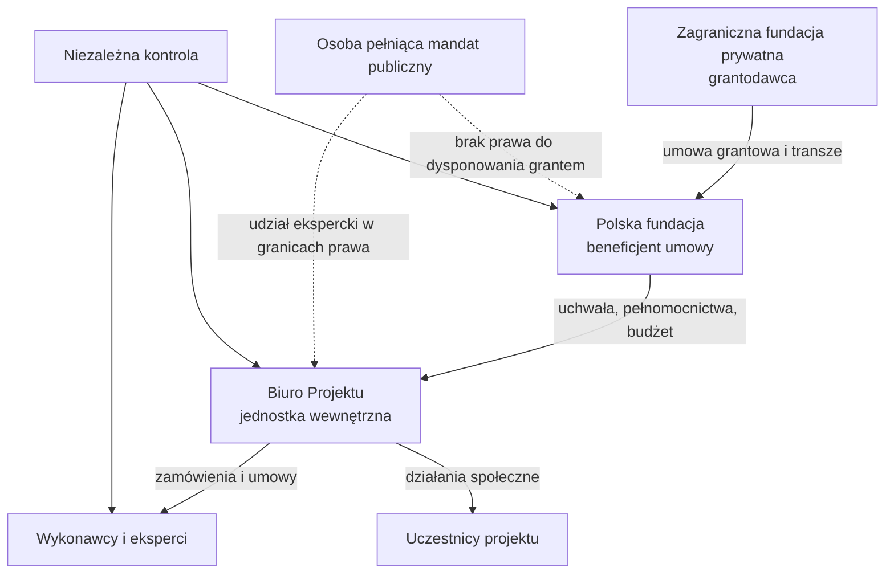
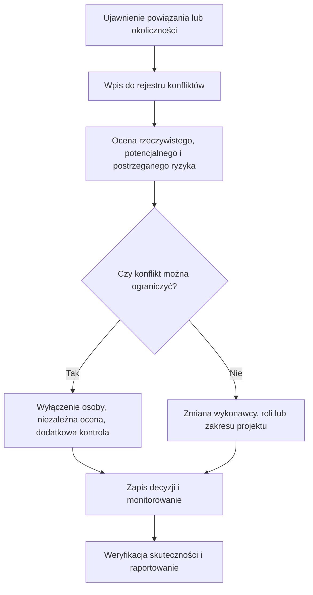
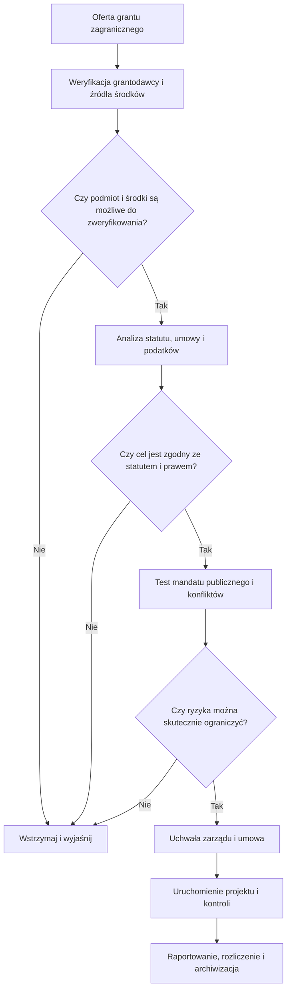

# 25.2. Studium przypadku – grant międzynarodowy

## Zagraniczna organizacja finansująca projekt społeczny fundacji, realizacja przez jednostkę organizacyjną, udział osoby pełniącej mandat publiczny, niezależność, konflikt interesów, rozliczenia transgraniczne i raport końcowy

**Stan prawny i źródłowy opracowania: 28 listopada 2026 r.**  
**Charakter materiału:** studium przypadku, podręcznik wdrożeniowy, zestaw procedur i materiał dydaktyczny.  
**Założenie:** wszystkie nazwy organizacji, osoby, kwoty, zdarzenia i dokumenty przykładowe są fikcyjne. Nie opisują rzeczywistych podmiotów ani osób.

> **Zasada nadrzędna:** zagraniczne pochodzenie pieniędzy nie przesądza ani o ich legalności, ani o zwolnieniu podatkowym, ani o niezależności fundacji. O wyniku decydują rzeczywisty źródłowy charakter środków, status i umocowanie stron, treść umowy, faktyczny sposób zarządzania projektem, przepisy właściwe dla osoby pełniącej mandat publiczny oraz kompletność rozliczenia.

---

## 1. Cel, zakres i efekty kształcenia

### 1.1. Cel rozdziału

Celem rozdziału jest przeprowadzenie pełnego studium przypadku, w którym zagraniczna organizacja pozarządowa przekazuje polskiej fundacji środki na projekt społeczny. Fundacja zawiera umowę finansowania, a zadanie wykonuje jej wewnętrzna jednostka organizacyjna. W przedsięwzięciu uczestniczy osoba pełniąca mandat publiczny. Trzeba zatem wykazać, że:

1. grantodawca i odbiorca zostali prawidłowo zidentyfikowani;
2. umowę zawiera podmiot posiadający osobowość prawną i zdolność do zaciągania zobowiązań;
3. jednostka realizująca działa w granicach umocowania i nie jest błędnie przedstawiana jako odrębna osoba prawna;
4. fundacja zachowuje rzeczywistą niezależność ustrojową, finansową i operacyjną;
5. udział osoby pełniącej mandat publiczny nie prowadzi do niedopuszczalnej korzyści, wykorzystania urzędu, stronniczości ani naruszenia ograniczeń właściwych dla jej funkcji;
6. konflikt interesów zostaje ujawniony, oceniony i odpowiednio zarządzony;
7. wpływy i wydatki są rozliczane zgodnie z umową, polską rachunkowością, właściwymi przepisami podatkowymi i – jeżeli mają zastosowanie – regułami programu międzynarodowego;
8. raport końcowy jest zgodny z dokumentacją źródłową i pozwala odtworzyć przebieg projektu.

### 1.2. Efekty uczenia się

Po ukończeniu rozdziału uczestnik potrafi:

- rozróżnić prywatny grant zagranicznej fundacji, środki zagranicznego państwa, finansowanie organizacji międzynarodowej i grant z budżetu Unii Europejskiej;
- ustalić, czy zagraniczna organizacja jest rzeczywistym finansującym, pośrednikiem, operatorem programu, płatnikiem czy jedynie partnerem;
- sprawdzić istnienie, status, reprezentację i wiarygodność zagranicznego podmiotu;
- ocenić, czy wewnętrzna jednostka fundacji ma osobowość prawną, czy działa wyłącznie jako część fundacji;
- sporządzić mapę relacji prawnych i przepływów pieniężnych;
- przeprowadzić test niezależności fundacji;
- zidentyfikować konflikt rzeczywisty, potencjalny i postrzegany;
- dobrać właściwe ograniczenia dla osoby pełniącej mandat publiczny;
- odróżnić obowiązki posła lub senatora od ograniczeń dotyczących wójta, burmistrza, prezydenta miasta, członka zarządu jednostki samorządu terytorialnego i pracownika administracji;
- rozpoznać ryzyko niedozwolonego finansowania działalności wyborczej;
- ocenić podstawowe skutki w CIT, VAT i rachunkowości;
- przygotować raport merytoryczny i finansowy wraz z rejestrem odchyleń, konfliktów interesów i działań naprawczych.

### 1.3. Granice opracowania

Rozdział nie zastępuje:

- rozdziału 8.2 dotyczącego konstrukcji umowy międzynarodowej;
- rozdziału 8.3 dotyczącego technicznej realizacji i księgowania projektu transgranicznego;
- rozdziału 7.3 dotyczącego konfliktu interesów i transparentności;
- rozdziału 9.1 dotyczącego podatków i przychodów zagranicznych;
- rozdziału 9.2 dotyczącego bezpieczeństwa finansowego, AML i sankcji;
- rozdziału 9.3 dotyczącego danych osobowych i bezpieczeństwa informacji;
- rozdziału 24.4 dotyczącego dokumentacji fundacji.

W tym studium zagadnienia te zostają połączone w jeden przypadek. Nacisk położono na ich wzajemne oddziaływanie, a nie na ponowne przedstawianie pełnych podstaw teoretycznych.

### 1.4. Cztery odrębne pytania

Nie wolno utożsamiać następujących kwestii:

| Pytanie | Co należy ustalić |
|---|---|
| Kto przekazuje środki? | Podmiot prawnie zobowiązany do finansowania, a nie tylko bank nadawcy |
| Kto jest beneficjentem umowy? | Podmiot, który nabywa prawa i przyjmuje obowiązki |
| Kto wykonuje projekt? | Fundacja, jej jednostka, partner, podwykonawca lub inny realizator |
| Kto uczestniczy jako osoba publiczna? | Rola, zakres wpływu, ewentualne korzyści i przepisy szczególne |

---

## 2. Stan faktyczny – modelowe przedsięwzięcie

### 2.1. Podmioty i osoby

Dla potrzeb ćwiczenia przyjmujemy następujący stan faktyczny:

- **Fundacja „Wspólny Most”** – polska fundacja wpisana do Krajowego Rejestru Sądowego, posiadająca osobowość prawną, statut obejmujący pomoc społeczną, edukację, ochronę zdrowia i rozwój wspólnot lokalnych.
- **Civic Bridge Foundation** – fikcyjna zagraniczna fundacja prywatna z siedzibą w państwie członkowskim UE. W podstawowym wariancie finansuje projekt z własnych środków, a nie jako instytucja Unii Europejskiej.
- **Biuro Projektu „Wspólny Most”** – wewnętrzna jednostka organizacyjna fundacji, bez odrębnej osobowości prawnej i bez samodzielnej zdolności do zawierania umów we własnym imieniu.
- **Koordynator projektu** – osoba wyznaczona przez zarząd fundacji do bieżącego prowadzenia przedsięwzięcia.
- **Osoba pełniąca mandat publiczny** – w podstawowym wariancie poseł na Sejm, który ma uczestniczyć w dwóch otwartych spotkaniach eksperckich dotyczących polityki społecznej. Nie jest grantodawcą, nie podpisuje umowy, nie zarządza środkami i nie ocenia ofert dostawców.
- **Wykonawcy** – podmioty wybierane do wykonania usług, dostaw i ewaluacji.
- **Uczestnicy projektu** – osoby i rodziny korzystające z działań społecznych.

Nazwy są wyłącznie ilustracyjne. W rzeczywistym postępowaniu trzeba zastąpić je pełnymi danymi z właściwych rejestrów i dokumentów.

### 2.2. Cel projektu

Projekt obejmuje:

1. lokalne poradnictwo rodzinne i społeczne;
2. warsztaty edukacyjne dla opiekunów;
3. działania integracyjne dla osób zagrożonych wykluczeniem;
4. informację o dostępnych usługach publicznych;
5. szkolenia wolontariuszy;
6. ewaluację jakości i dostępności wsparcia.

Projekt nie obejmuje finansowania partii politycznej, komitetu wyborczego, kampanii wyborczej, prywatnej działalności gospodarczej osoby pełniącej mandat ani osobistych wydatków tej osoby.

### 2.3. Założenia finansowe

Wartość umowy w przykładzie wynosi **100 000 EUR**. Kwota ta jest założeniem dydaktycznym, a nie rekomendacją dotyczącą konkretnego programu.

| Kategoria budżetowa | Plan w EUR | Charakter wydatku |
|---|---:|---|
| Personel projektu | 40 000 | Wynagrodzenia i świadczenia związane z realizacją |
| Usługi specjalistyczne | 18 000 | Poradnictwo, szkolenia, obsługa merytoryczna |
| Bezpośrednie wsparcie uczestników | 15 000 | Świadczenia rzeczowe i koszty usług dla uczestników |
| Spotkania i działania edukacyjne | 10 000 | Sale, materiały, dostępność i organizacja |
| Podróże i logistyka | 5 000 | Koszty podróży zgodne z umową |
| Sprzęt i oprogramowanie | 4 000 | Zakupy niezbędne do projektu |
| Ewaluacja i audyt | 3 000 | Niezależna ocena i kontrola, jeśli przewidziana |
| Koszty pośrednie | 5 000 | Koszty administracyjne w zakresie dopuszczonym umową |
| **Razem** | **100 000** | |

Nie należy zakładać, że każda umowa dopuszcza wszystkie powyższe kategorie. W szczególności koszty pośrednie, rezerwy, wynagrodzenia, zakupy sprzętu, wsparcie dla osób trzecich i audyt mogą podlegać szczególnym limitom lub wyłączeniom.

### 2.4. Wariant podstawowy i wariant pośrednictwa

Podstawowy przypadek zakłada, że zagraniczna fundacja przekazuje środki pochodzące z własnego majątku. Nie jest to automatycznie grant Unii Europejskiej ani pomoc rządu obcego państwa.

Wariant drugi zakłada, że zagraniczna organizacja działa jako upoważniony koordynator lub pośrednik w rozdzielaniu środków pochodzących z budżetu Unii Europejskiej, państwa obcego albo organizacji międzynarodowej. Wtedy trzeba ustalić źródło pierwotne, podstawę programu, status pośrednika, rolę polskiej fundacji i dokumenty potwierdzające mechanizm przekazania środków.

**Warianty te mogą prowadzić do odmiennych skutków podatkowych i kontraktowych.** Nie wolno ich mieszać w jednym rozliczeniu bez wyodrębnienia źródeł.

---

## 3. Mapa relacji prawnych i przepływu środków

### 3.1. Schemat podstawowy

Schemat pokazuje relacje organizacyjne, a nie automatyczne przeniesienie praw lub obowiązków. Biuro Projektu nie staje się stroną umowy tylko dlatego, że prowadzi działania operacyjne.

### 3.2. Zasada jednego rzeczywistego beneficjenta

Jeżeli Biuro Projektu nie ma osobowości prawnej i nie jest odrębnym podmiotem wyposażonym w zdolność prawną, to:

- umowę grantową zawiera fundacja;
- rachunek bankowy należy do fundacji;
- środki są majątkiem fundacji obciążonym warunkami umowy;
- zobowiązania wobec grantodawcy obciążają fundację;
- kierownik Biura Projektu działa w granicach udzielonego umocowania;
- sprawozdanie składa fundacja;
- odpowiedzialność za zgodne z prawem i umową wykorzystanie środków pozostaje po stronie fundacji.

Wewnętrzne wyodrębnienie organizacyjne, budżetowe lub księgowe nie tworzy samoistnie nowej osoby prawnej.

### 3.3. Kiedy jednostka może być samodzielnym uczestnikiem

Trzeba ponownie zbadać status, gdy jednostka:

- posiada odrębną osobowość prawną;
- jest wpisana do właściwego rejestru;
- ma własny organ reprezentacji;
- zawiera umowy we własnym imieniu;
- posiada własny majątek i rachunek;
- samodzielnie odpowiada za zobowiązania.

W takim przypadku nie należy nazywać jej „wewnętrznym biurem” bez dalszej analizy. Może być odrębnym beneficjentem, partnerem, jednostką afiliowaną, podwykonawcą lub innym uczestnikiem – zależnie od rzeczywistego statusu i umowy.

### 3.4. Macierz ról

| Podmiot | Prawo do podpisania umowy grantowej | Prawo do dysponowania środkami | Odpowiedzialność wobec grantodawcy |
|---|---|---|---|
| Zagraniczny grantodawca | Tak, zgodnie z jego reprezentacją | Tak, w granicach jego prawa i umowy | Zgodnie z umową |
| Polska fundacja | Tak, zgodnie z KRS, statutem i uchwałami | Tak, przez uprawnione osoby | Tak, jako beneficjent |
| Biuro Projektu bez osobowości prawnej | Nie we własnym imieniu | Wyłącznie w ramach delegowanych uprawnień | Nie jako odrębna strona, chyba że szczególny przepis stanowi inaczej |
| Koordynator | Tylko z odpowiednim umocowaniem | W zakresie powierzonych czynności | W zakresie odpowiedzialności wewnętrznej i ustawowej |
| Osoba pełniąca mandat publiczny | Nie, jeżeli nie ma odrębnego umocowania i legalnej podstawy | Nie z racji samego mandatu | Nie z racji samego udziału eksperckiego |
| Wykonawca | Nie jako strona umowy grantowej, chyba że odrębnie wskazany | Otrzymuje wynagrodzenie na podstawie własnej umowy | W zakresie własnej umowy |

### 3.5. Zasada zgodności dokumentów

W dokumentach nie mogą występować sprzeczne określenia, np.:

- w umowie stroną jest fundacja;
- w fakturze nabywcą jest Biuro Projektu;
- w raporcie beneficjentem jest koordynator;
- w rejestrze księgowym środki przypisano do prywatnego rachunku osoby fizycznej.

Każda rozbieżność wymaga wyjaśnienia i – gdy jest to potrzebne – korekty dokumentu przed rozliczeniem.

---

## 4. Weryfikacja zagranicznej organizacji finansującej

### 4.1. Ustalenie, kto rzeczywiście finansuje projekt

Nazwa na przelewie bankowym nie wystarcza do ustalenia źródła prawnego środków. Należy ustalić cztery role:

1. podmiot, którego majątek jest źródłem finansowania;
2. podmiot, który podejmuje decyzję o przyznaniu grantu;
3. podmiot, który podpisuje umowę;
4. podmiot, który wykonuje przelew.

Wszystkie cztery role mogą należeć do jednej organizacji, ale mogą też być rozdzielone.

Przykładowo zagraniczna fundacja może podpisywać umowę, natomiast przelew może pochodzić z rachunku operatora płatniczego lub jednostki obsługującej program. Sama różnica nadawcy przelewu nie przesądza o nieprawidłowości, ale musi być wyjaśniona i udokumentowana.

### 4.2. Weryfikacja statusu prawnego

Przed podpisaniem umowy należy zgromadzić:

- pełną nazwę i nazwę w języku oryginalnym;
- formę prawną;
- numer rejestrowy;
- siedzibę i adres;
- statut lub dokument założycielski;
- aktualny dokument rejestrowy;
- dane osób uprawnionych do reprezentacji;
- zasady reprezentacji łącznej lub jednoosobowej;
- dokument pełnomocnictwa, jeżeli podpisuje pełnomocnik;
- sprawozdanie roczne lub finansowe, jeśli jest publicznie dostępne;
- dane rachunku bankowego i potwierdzenie, że rachunek należy do podmiotu lub prawidłowo umocowanego operatora;
- informacje o rzeczywistym źródle środków;
- informację o ewentualnych ograniczeniach, warunkach lub prawach kontrolnych grantodawcy.

Dokumenty należy oceniać według prawa państwa siedziby organizacji. Polski odpis KRS nie zastępuje zagranicznego dokumentu rejestrowego.

### 4.3. Weryfikacja reprezentacji

Należy sprawdzić:

1. czy osoba podpisująca jest ujawniona w rejestrze;
2. czy może działać samodzielnie;
3. czy wymagane są dwa podpisy;
4. czy potrzebna jest uchwała rady lub innego organu;
5. czy statut ogranicza wysokość lub rodzaj grantów;
6. czy pełnomocnictwo obejmuje podpisanie umowy i późniejsze aneksy;
7. czy dokumenty zagraniczne wymagają tłumaczenia, apostille albo legalizacji.

Nie wolno zakładać, że osoba przedstawiająca się jako „prezes”, „dyrektor międzynarodowy” lub „przedstawiciel fundacji” jest uprawniona do zaciągania zobowiązań.

### 4.4. Badanie wiarygodności i reputacji

Weryfikacja powinna obejmować:

- historię działalności;
- publiczne sprawozdania;
- wcześniejsze programy i ich rezultaty;
- źródła finansowania;
- strukturę zarządzania;
- powiązania z podmiotami publicznymi lub komercyjnymi;
- informacje o sporach, sankcjach i istotnych nieprawidłowościach;
- sposób ochrony danych i środków;
- wiarygodność osób kontaktowych.

Negatywna informacja medialna nie jest automatycznie dowodem naruszenia prawa. Powinna jednak zostać zweryfikowana, opisana i uwzględniona w ocenie ryzyka.

### 4.5. Sankcje i bezpieczeństwo finansowe

Przed przyjęciem grantu należy sprawdzić grantodawcę, osoby kontrolujące, pośredników i – w zakresie proporcjonalnym do ryzyka – głównych wykonawców w aktualnych wykazach sankcyjnych.

Nie należy ograniczać się do wyszukania nazwy podmiotu. Warto zweryfikować również:

- warianty pisowni i transliteracji;
- nazwy historyczne;
- numery rejestrowe;
- osoby kontrolujące;
- podmioty zależne;
- powiązania własnościowe;
- państwo pochodzenia środków.

Sama nieobecność w wykazie sankcyjnym nie jest pełnym potwierdzeniem bezpieczeństwa transakcji. Trzeba także ocenić, czy nie zachodzi ryzyko pośredniego udostępnienia środków osobie objętej ograniczeniami.

### 4.6. Kontrola rachunku bankowego

Minimalny standard:

- rachunek wskazany w umowie;
- właściciel rachunku zgodny z umową albo udokumentowany pośrednik;
- potwierdzenie zmiany rachunku przez niezależny kanał komunikacji;
- podwójna autoryzacja zmiany danych płatniczych;
- zakaz kierowania środków na prywatny rachunek członka zarządu, pracownika lub osoby publicznej;
- przechowywanie potwierdzeń transz;
- weryfikacja nietypowych potrąceń bankowych i opłat pośredników.

### 4.7. Kiedy wstrzymać przyjęcie środków

Wstrzymanie jest zasadne, gdy:

- nie można ustalić rzeczywistego grantodawcy;
- dokumenty rejestrowe są sprzeczne;
- podpisujący nie ma wykazanego umocowania;
- grantodawca żąda przelewu na rachunek osoby fizycznej;
- umowa nakazuje ukrywanie źródła środków;
- warunki wskazują na finansowanie kampanii lub partii politycznej;
- grantodawca wymaga wpływu na decyzje publiczne;
- nie da się wyjaśnić pochodzenia środków lub ich pośredników;
- istnieje nierozstrzygnięta przeszkoda sankcyjna albo prawna.

---

## 5. Umowa finansowania – elementy, które muszą być spójne

### 5.1. Strony i charakter umowy

Umowa powinna wskazywać:

- pełną nazwę grantodawcy;
- pełną nazwę fundacji;
- dane rejestrowe;
- osoby reprezentujące;
- podstawę umocowania;
- charakter finansowania;
- źródło środków, jeżeli jest znane i istotne dla obowiązków;
- kwotę i walutę;
- termin i sposób wypłaty;
- cel oraz okres realizacji;
- zasady raportowania i kontroli.

Nie należy bezrefleksyjnie używać pojęć „darowizna”, „dotacja”, „grant”, „zlecenie” i „sponsoring” zamiennie. O kwalifikacji decyduje treść zobowiązań, a nie tytuł dokumentu.

### 5.2. Przedmiot finansowania

Opis celu powinien być:

- konkretny;
- zgodny ze statutem fundacji;
- mierzalny w zakresie rezultatów;
- możliwy do wykonania;
- zgodny z budżetem;
- wolny od niedozwolonych celów politycznych lub prywatnych.

Należy odróżnić rezultat projektu od korzyści osobistej. Przykładowo „przygotowanie poradnika dla opiekunów” jest rezultatem. „Zapewnienie rozpoznawalności posłowi” nie jest właściwym celem społecznym finansowania fundacji.

### 5.3. Minimalny zakres postanowień

| Obszar | Co należy uregulować |
|---|---|
| Cel | Zadania, odbiorcy, rezultaty i wskaźniki |
| Czas | Początek, koniec, okres kwalifikowalności |
| Budżet | Kategorie, limity, przesunięcia, koszty wyłączone |
| Transze | Warunki, terminy, rachunek i dokumenty |
| Wkład własny | Forma, wartość i sposób dokumentowania |
| Jednostka realizująca | Status, zakres działania i odpowiedzialność fundacji |
| Zakupy | Zasady wyboru, porównanie ofert, konflikt interesów |
| Personel | Umowy, kwalifikacje, czas pracy i koszty |
| Dane | Role stron, podstawy przetwarzania, zabezpieczenia |
| Własność intelektualna | Prawa do materiałów, licencje, publikacje |
| Widoczność | Oznaczenia finansowania i zasady komunikacji |
| Kontrola | Dostęp do dokumentów, wizyty i audyt |
| Zmiany | Tryb aneksowania, zgody i powiadomienia |
| Zwrot | Przesłanki, terminy, waluta i odsetki |
| Prawo właściwe | Wyraźny wybór prawa i języka umowy |
| Spory | Sąd, arbitraż lub procedura polubowna |
| Niezależność | Zakaz ingerencji w decyzje publiczne i statutowe |
| Konflikt interesów | Ujawnianie, wyłączenie i działania naprawcze |
| Polityka | Wyłączenie finansowania kampanii, komitetów i partii |

### 5.4. Prawo właściwe i jurysdykcja

W relacjach cywilnych i handlowych z elementem transgranicznym należy zbadać zastosowanie rozporządzenia Rzym I (WE) nr 593/2008.

Strony mogą co do zasady dokonać wyboru prawa właściwego zgodnie z art. 3 rozporządzenia. Jeżeli wyboru nie dokonano, trzeba ustalić właściwą regułę kolizyjną z art. 4 i przepisów szczególnych. Nie należy mechanicznie zakładać, że każda umowa grantowa podlega regule właściwej dla zwykłej umowy usługowej. Charakter konkretnego stosunku może wymagać odrębnej kwalifikacji.

W modelowej umowie rekomendowane jest jednoznaczne wskazanie:

- prawa polskiego jako prawa właściwego;
- języka polskiego jako języka rozstrzygającego albo wskazanie równorzędności wersji;
- właściwego sądu lub uzgodnionej procedury rozwiązywania sporów;
- adresów do doręczeń;
- zasad doręczeń elektronicznych;
- kolejności pierwszeństwa dokumentów.

Wybór prawa nie wyłącza bezwzględnie obowiązujących przepisów polskich, unijnych ani przepisów państwa, w którym wykonywane są czynności.

### 5.5. Wzorcowe postanowienie o niezależności

Przykładowa klauzula do dostosowania przez prawnika:

> Finansowanie jest przeznaczone wyłącznie na realizację celów i działań opisanych w umowie oraz jej załącznikach. Grantodawca nie uzyskuje z tytułu finansowania prawa do wydawania poleceń organom fundacji w sprawach ustrojowych, kadrowych, statutowych ani w sprawach dotyczących wykonywania mandatu publicznego przez osoby trzecie. Fundacja zachowuje samodzielność w doborze metod realizacji projektu, z zastrzeżeniem obowiązku osiągnięcia uzgodnionych rezultatów i przestrzegania warunków finansowania. Żadne środki nie mogą być przeznaczane na finansowanie partii politycznej, komitetu wyborczego ani kampanii wyborczej.

Klauzula nie może być pozorna. Jeżeli w praktyce grantodawca wybiera członków zarządu, narzuca decyzje personalne, wskazuje prywatnych beneficjentów albo wymaga poparcia politycznego, sama deklaracja niezależności nie usuwa ryzyka.

---

## 6. Udział osoby pełniącej mandat publiczny

### 6.1. Dlaczego trzeba ustalić dokładny rodzaj mandatu

Pojęcie „osoba pełniąca mandat publiczny” nie wskazuje jednej, uniwersalnej kategorii prawnej. Inne ograniczenia dotyczą posła lub senatora, inne radnego gminy, inne wójta, burmistrza, prezydenta miasta, członka zarządu powiatu lub województwa, a jeszcze inne pracownika administracji publicznej.

Przed dopuszczeniem osoby do projektu trzeba ustalić:

1. jaki mandat lub funkcję pełni;
2. na jakiej podstawie prawnej;
3. czy pełni dodatkowo inne stanowisko publiczne;
4. czy jest objęta ustawą o ograniczeniu prowadzenia działalności gospodarczej przez osoby pełniące funkcje publiczne;
5. czy jej udział jest dodatkowym zajęciem;
6. czy otrzymuje wynagrodzenie, darowiznę, zwrot kosztów, honorarium lub inną korzyść;
7. czy może wpływać na decyzje publiczne dotyczące fundacji, grantodawcy, wykonawców lub uczestników projektu;
8. czy może korzystać z zasobów urzędu, biura, personelu, danych albo mienia publicznego.

Nie wolno wyciągać wniosku, że skoro dana osoba jest „społecznie zaangażowana”, to nie dotyczą jej ograniczenia związane z mandatem.

### 6.2. Poseł lub senator – podstawowe ograniczenia

Ustawa z 9 maja 1996 r. o wykonywaniu mandatu posła i senatora przewiduje między innymi:

- obowiązek powiadomienia odpowiednio Marszałka Sejmu lub Marszałka Senatu o zamiarze podjęcia dodatkowych zajęć, z ustawowym wyjątkiem dotyczącym działalności podlegającej prawu autorskiemu i prawom pokrewnym;
- zakaz podejmowania dodatkowych zajęć i otrzymywania darowizn mogących podważyć zaufanie wyborców do wykonywania mandatu;
- zakaz powoływania się na mandat lub posługiwania się tytułem posła albo senatora w związku z dodatkowymi zajęciami lub działalnością gospodarczą;
- ograniczenia dotyczące działalności gospodarczej z wykorzystaniem mienia państwowego lub komunalnego;
- obowiązek składania oświadczenia majątkowego.

Podstawowe znaczenie mają art. 33–35 ustawy. Ustawa nie ustanawia prostego, ogólnego zakazu wszelkiego społecznego udziału parlamentarzysty w każdej fundacji. Nie oznacza to jednak, że każda funkcja doradcza, honorowa, odpłatna lub nieodpłatna jest automatycznie dozwolona. Dodatkowo art. 35a ustanawia Rejestr Korzyści. Obejmuje on m.in. określone stanowiska i zajęcia, materialne wspieranie działalności publicznej, darowizny i inne korzyści przekraczające ustawowy próg, wybrane wyjazdy oraz udział w organach fundacji, spółek handlowych i spółdzielni – także wtedy, gdy udział w organie jest nieodpłatny. Zmiany danych objętych Rejestrem należy zgłaszać w terminie 30 dni. Przed rozpoczęciem udziału w organie fundacji parlamentarzysta powinien zatem zbadać obowiązek wpisu do Rejestru Korzyści niezależnie od tego, czy otrzyma wynagrodzenie.

Przed przyjęciem roli należy ustalić, czy konkretna aktywność jest „dodatkowym zajęciem” w rozumieniu przepisów i praktyki właściwych organów parlamentarnych. W razie wątpliwości należy uzyskać pisemną opinię prawną i dopełnić obowiązku informacyjnego, jeżeli ma zastosowanie.

### 6.3. Osoby objęte ustawą antykorupcyjną

Ustawa z 21 sierpnia 1997 r. o ograniczeniu prowadzenia działalności gospodarczej przez osoby pełniące funkcje publiczne zawiera zamknięty zakres podmiotowy i katalog ograniczeń.

Szczególnie istotny jest art. 4 pkt 4: osoby objęte zakresem art. 1 i 2 tej ustawy nie mogą być członkami zarządów fundacji prowadzących działalność gospodarczą.

W praktyce oznacza to konieczność sprawdzenia dwóch elementów:

1. czy dana osoba należy do kategorii wymienionej w art. 1 lub 2 ustawy;
2. czy fundacja rzeczywiście prowadzi działalność gospodarczą w rozumieniu właściwych przepisów.

Nie wolno rozszerzać tego zakazu na każdą osobę, która w potocznym znaczeniu pełni funkcję publiczną. Nie wolno również pomijać zakazu, jeżeli osoba jest objęta ustawą i fundacja prowadzi działalność gospodarczą. Należy odrębnie sprawdzić obowiązki ujawniania korzyści z art. 12 tej ustawy. Po nowelizacji z Dz.U. z 2026 r. poz. 160 próg darowizny podlegającej zgłoszeniu wynosi 25% minimalnego wynagrodzenia za pracę. Nie należy mylić tego progu z odrębną regulacją Rejestru Korzyści parlamentarzystów z art. 35a ustawy o wykonywaniu mandatu posła i senatora.

Wśród osób objętych ustawą znajdują się m.in. wójtowie, burmistrzowie, prezydenci miast, ich zastępcy, skarbnicy i sekretarze gmin, określone osoby zarządzające jednostkami samorządowymi, członkowie zarządów powiatów i województw oraz inne kategorie wymienione w art. 2.

W 2026 r. ustawę nowelizowano m.in. ustawą z 9 stycznia 2026 r., Dz.U. z 2026 r. poz. 160, która zmieniła art. 12 ust. 3 pkt 3 w zakresie progu darowizny ujawnianej w Rejestrze Korzyści prowadzonym na podstawie tej ustawy: próg określono jako 25% minimalnego wynagrodzenia za pracę. Ustawa z 9 stycznia 2026 r., Dz.U. z 2026 r. poz. 177, rozszerzyła z kolei niektóre obowiązki oświadczeniowe Rzecznika Praw Dziecka. Te nowelizacje nie zmieniły zakazu z art. 4 pkt 4, lecz mają znaczenie dla aktualnego zakresu obowiązków oświadczeniowych. Przy ocenie należy sprawdzić, czy po dacie opracowania nie weszła w życie kolejna nowelizacja.

### 6.4. Radny gminy

W odniesieniu do radnego gminy trzeba zbadać w szczególności art. 24e i 24f ustawy o samorządzie gminnym.

Radny:

- nie może podejmować dodatkowych zajęć ani otrzymywać darowizn mogących podważyć zaufanie wyborców do wykonywania mandatu;
- nie może powoływać się na mandat w związku z dodatkowymi zajęciami lub działalnością gospodarczą;
- nie może prowadzić działalności gospodarczej z wykorzystaniem mienia komunalnego gminy, w której uzyskał mandat, ani zarządzać taką działalnością lub występować jako jej przedstawiciel czy pełnomocnik;
- podlega dalszym ograniczeniom dotyczącym określonych spółek i relacji z gminą.

Nie należy automatycznie utożsamiać członkostwa w zarządzie fundacji z członkostwem w zarządzie spółki handlowej. Trzeba jednak zbadać, czy fundacja prowadzi działalność gospodarczą, czy korzysta z mienia komunalnego, czy zawiera umowy z gminą oraz czy radny uczestniczy w decyzjach dotyczących tych relacji.

### 6.5. Wójt, burmistrz, prezydent miasta i członkowie zarządów samorządowych

W przypadku osób wymienionych w art. 2 ustawy z 1997 r. należy szczególnie dokładnie zbadać zakaz z art. 4 pkt 4 dotyczący członkostwa w zarządzie fundacji prowadzącej działalność gospodarczą.

Należy odrębnie ustalić:

- czy fundacja prowadzi działalność gospodarczą;
- czy osoba jest członkiem zarządu, rady fundacji, organu kontroli, pełnomocnikiem lub jedynie uczestnikiem wydarzenia;
- czy funkcja publiczna została wymieniona w art. 1 lub 2 ustawy;
- czy występują dodatkowe ograniczenia w ustawach samorządowych;
- czy fundacja korzysta z mienia jednostki samorządu terytorialnego;
- czy osoba uczestniczyła w decyzjach dotyczących fundacji lub grantodawcy.

### 6.6. Macierz oceny roli osoby publicznej

| Rola | Ryzyko podstawowe | Wymagane działanie |
|---|---|---|
| Gość otwartego wydarzenia | Niskie lub umiarkowane, zależnie od sposobu promocji | Neutralny opis udziału, bez przypisywania poparcia |
| Prelegent nieodpłatny | Możliwe dodatkowe zajęcie i ryzyko wizerunkowe | Weryfikacja obowiązków mandatowych i zasad używania tytułu |
| Ekspert w radzie programowej | Ryzyko wpływu na dobór działań i beneficjentów | Zakres doradczy, brak prawa do decyzji finansowych |
| Członek zarządu fundacji | Wysokie, zależne od rodzaju mandatu i działalności fundacji | Test ustawowych zakazów przed powołaniem |
| Członek komisji zakupowej | Wysokie przy powiązaniach osobistych lub gospodarczych | Deklaracja interesów, wyłączenie, niezależna ocena |
| Osoba podpisująca płatności | Wysokie | Brak łączenia z funkcją publiczną, ścisłe umocowanie i rozdział obowiązków |
| Beneficjent osobistej wypłaty | Bardzo wysokie | Wstrzymanie i odrębna analiza prawna, podatkowa i etyczna |
| Osoba wykorzystująca urząd do pozyskania grantu | Niedopuszczalne ryzyko | Zakaz działania, udokumentowanie i eskalacja |

### 6.7. Zasada braku korzyści pośredniej

Korzyść nie musi być przekazana bezpośrednio osobie publicznej. Ryzyko może powstać, jeżeli grant finansuje:

- przedsiębiorstwo małżonka lub osoby bliskiej;
- fundację faktycznie kontrolowaną przez osobę publiczną;
- prywatne koszty podróży, zakwaterowania lub promocji;
- wydarzenie, którego rzeczywistym celem jest promocja osoby lub ugrupowania;
- usługi wykonywane przez podmiot powiązany;
- zatrudnienie członka rodziny bez obiektywnego uzasadnienia i procedury;
- działania, które mają wywołać określone rozstrzygnięcie publiczne.

Samo pokrewieństwo lub znajomość nie dowodzi naruszenia. Jest jednak czynnikiem, który powinien uruchomić procedurę ujawnienia i oceny.

---

## 7. Niezależność fundacji – test rzeczywisty

### 7.1. Niezależność nie jest samą deklaracją

Fundacja może być formalnie odrębną osobą prawną, a jednocześnie w praktyce pozostawać zależna od grantodawcy, osoby publicznej, partii, przedsiębiorcy lub innego podmiotu.

Niezależność należy oceniać co najmniej w sześciu wymiarach:

1. prawno-ustrojowym;
2. osobowym;
3. finansowym;
4. programowym;
5. operacyjnym;
6. informacyjnym i komunikacyjnym.

### 7.2. Test niezależności prawno-ustrojowej

Należy sprawdzić:

- czy fundacja ma własny statut;
- czy jej organy są powoływane zgodnie ze statutem;
- czy grantodawca nie uzyskał nieformalnego prawa do powoływania lub odwoływania zarządu;
- czy osoba publiczna nie przejęła faktycznej kontroli nad fundacją;
- czy uchwały podejmują właściwe organy;
- czy fundacja może odmówić przyjęcia kolejnego grantu;
- czy fundacja może zmienić wykonawcę w granicach umowy;
- czy grantodawca nie uzyskał prawa do zatwierdzania spraw zastrzeżonych dla organów fundacji.

### 7.3. Test niezależności finansowej

Należy ustalić:

- jaki udział w przychodach stanowi jeden grant;
- czy fundacja posiada inne źródła finansowania;
- czy grantodawca może wstrzymać środki bez obiektywnej podstawy;
- czy środki są przechowywane na rachunku fundacji;
- czy osoby prywatne mają dostęp do środków;
- czy istnieje plan finansowy na wypadek opóźnienia transzy;
- czy fundacja nie zaciągnęła zobowiązań przekraczających jej zdolność finansową;
- czy finansowanie nie uzależnia całej działalności statutowej od jednego darczyńcy.

Koncentracja finansowania nie jest automatycznie nielegalna. Jest jednak ryzykiem zarządczym, które wymaga planu ciągłości działania.

### 7.4. Test niezależności programowej

Grantodawca może wymagać realizacji uzgodnionego projektu, wskaźników i rezultatów. Nie powinien jednak uzyskiwać nieograniczonego prawa do:

- wyboru konkretnych osób jako beneficjentów bez obiektywnych kryteriów;
- wymuszania poparcia politycznego;
- nakazywania fundacji podejmowania interwencji publicznych;
- narzucania treści niezgodnych ze statutem;
- uzależniania transz od publicznego poparcia dla osoby lub organizacji;
- zmiany składu organów fundacji poza statutem;
- ingerowania w decyzje o charakterze religijnym, światopoglądowym lub obywatelskim, jeśli nie wynikają one z legalnego i jasno określonego celu projektu.

### 7.5. Test niezależności operacyjnej

Należy sprawdzić, czy fundacja samodzielnie:

- zatrudnia personel;
- wybiera wykonawców;
- prowadzi księgi;
- kontroluje płatności;
- przechowuje dokumentację;
- przyjmuje skargi;
- ustala procedury ochrony uczestników;
- reaguje na nadużycia;
- prowadzi ewaluację;
- podejmuje decyzje o korekcie działań.

Grantodawca może kontrolować wykorzystanie środków, ale kontrola nie może być pozorem, za którym ukrywa się faktyczne przejęcie zarządzania fundacją.

### 7.6. Test niezależności komunikacyjnej

Komunikacja projektu powinna:

- prawdziwie wskazywać źródło finansowania;
- odróżniać patronat od finansowania;
- nie sugerować poparcia urzędu dla fundacji;
- nie używać tytułu osoby publicznej jako narzędzia pozyskiwania środków, jeśli jest to sprzeczne z przepisami lub standardami etycznymi;
- nie przedstawiać projektu jako przedsięwzięcia urzędu, jeżeli urząd nie jest jego organizatorem;
- nie przypisywać grantodawcy kontroli nad treścią raportu, jeżeli umowa przyznaje mu jedynie prawo weryfikacji.

### 7.7. Skala oceny niezależności

| Ocena | Charakterystyka | Reakcja |
|---|---|---|
| 0 – brak ryzyka | Decyzje i zasoby pozostają pod kontrolą fundacji | Kontynuacja |
| 1 – ryzyko niskie | Grantodawca określa rezultaty, lecz nie ingeruje w organy | Monitorowanie |
| 2 – ryzyko umiarkowane | Silna koncentracja finansowania lub wpływ na wybór wykonawców | Dodatkowe zabezpieczenia |
| 3 – ryzyko wysokie | Nieformalne polecenia, naciski personalne lub polityczne | Wstrzymanie decyzji i analiza prawna |
| 4 – ryzyko krytyczne | Faktyczne przejęcie kontroli lub żądanie działań niezgodnych z prawem | Odmowa, rozwiązanie lub zwrot środków zgodnie z umową |

---

## 8. Konflikt interesów w projekcie

### 8.1. Rodzaje konfliktu

W projekcie mogą wystąpić:

- konflikt rzeczywisty – interes prywatny już wpływa na bezstronność;
- konflikt potencjalny – może powstać w przyszłości;
- konflikt postrzegany – rozsądny obserwator może uznać, że bezstronność jest zagrożona;
- konflikt organizacyjny – interesy dwóch jednostek lub podmiotów pozostają sprzeczne;
- konflikt pośredni – korzyść może trafić do osoby bliskiej lub podmiotu powiązanego.

Brak korzyści finansowej nie wyklucza konfliktu. Nie wystarczy też oświadczenie, że dana osoba „nie miała złych intencji”.

### 8.2. Przykład – firma małżonka osoby publicznej

Załóżmy, że małżonek osoby pełniącej mandat publiczny prowadzi przedsiębiorstwo drukarskie, które chce wykonać materiały edukacyjne projektu.

Nie oznacza to automatycznie, że przedsiębiorstwo nie może uczestniczyć w żadnym postępowaniu. Oznacza jednak, że trzeba:

1. ujawnić powiązanie;
2. zapisać je w rejestrze konfliktów;
3. wyłączyć osobę publiczną z przygotowania opisu zamówienia, wyboru wykonawcy, negocjacji, odbioru i zatwierdzania płatności;
4. wyłączyć z procedury każdą osobę, której bezstronność może być naruszona;
5. przeprowadzić obiektywną procedurę wyboru;
6. udokumentować porównanie ofert;
7. sprawdzić, czy umowa grantowa dopuszcza taki zakup;
8. uzyskać zgodę grantodawcy, jeżeli wymaga tego umowa;
9. rozważyć wybór innego wykonawcy, jeśli konfliktu nie można skutecznie ograniczyć.

Jeżeli grant jest finansowany z budżetu UE i podlega odpowiedniej umowie grantowej, trzeba stosować jej postanowienia o konflikcie interesów i zasadach wyboru zakupów. W przypadku grantów prywatnych należy stosować przepisy prawa polskiego, umowę, regulaminy grantodawcy i wewnętrzną procedurę fundacji. Nie wolno automatycznie przenosić wszystkich przepisów dotyczących grantów UE na prywatny grant zagraniczny.

### 8.3. Procedura zarządzania konfliktem

### 8.4. Minimalny rejestr konfliktów

| Pole | Treść |
|---|---|
| Numer | Kolejny numer sprawy |
| Data | Data zgłoszenia |
| Osoba | Osoba zgłaszająca lub objęta oceną |
| Rola | Funkcja w projekcie lub organie |
| Powiązanie | Rodzinne, finansowe, organizacyjne, polityczne lub inne |
| Przedmiot | Decyzja, zakup, płatność, wybór beneficjenta |
| Ocena | Rzeczywisty, potencjalny lub postrzegany |
| Środki zaradcze | Wyłączenie, zastępstwo, niezależna ocena |
| Decyzja | Kto i kiedy zatwierdził |
| Kontrola | Czy środki zaradcze były skuteczne |

### 8.5. Odpowiedzialność przy grantach Unii Europejskiej

Jeżeli środki pochodzą z budżetu UE i są przekazywane na podstawie umowy grantowej UE, trzeba zbadać między innymi:

- art. 61 rozporządzenia finansowego UE 2024/2509 – w zakresie osób zaangażowanych w wykonywanie budżetu Unii;
- art. 12 odpowiedniego Model Grant Agreement – w zakresie obowiązków beneficjentów;
- postanowienia dotyczące zakupów, podwykonawstwa, partnerów, raportowania i kontroli;
- warunki konkretnego programu i naboru.

W Model Grant Agreement konflikt interesów obejmuje okoliczności rodzinne, emocjonalne, polityczne, narodowe, ekonomiczne oraz inne interesy bezpośrednie i pośrednie. Beneficjent powinien zapobiegać konfliktom, ujawniać je i podejmować działania naprawcze. Nie jest konieczne wykazanie, że osoba faktycznie uzyskała korzyść.

---

## 9. Zakaz wykorzystywania grantu do działalności wyborczej

### 9.1. Rozdzielenie projektu społecznego od kampanii

Projekt społeczny nie może być narzędziem obchodzenia przepisów o finansowaniu partii i komitetów wyborczych.

Należy bezwzględnie wykluczyć:

- opłacanie materiałów wyborczych;
- finansowanie spotkań kampanijnych;
- wynajem sal na cele wyborcze;
- opłacanie personelu komitetu;
- finansowanie reklam i publikacji służących agitacji;
- pokrywanie kosztów podróży związanych z kampanią;
- przekazywanie środków lub świadczeń komitetowi wyborczemu;
- świadczenia niepieniężne, które w rzeczywistości wspierają kampanię.

Kodeks wyborczy w art. 132 określa dopuszczalne źródła finansowania komitetów wyborczych. W szczególności środki komitetów wyborczych organizacji i wyborców mogą pochodzić wyłącznie z określonych wpłat obywateli polskich mających stałe miejsce zamieszkania w Polsce oraz kredytów bankowych na cele wyborcze. Nie wolno traktować zagranicznego grantu fundacji jako swobodnego źródła finansowania komitetu.

### 9.2. Zasada oddzielnego obiegu

Jeżeli osoba publiczna prowadzi działalność polityczną, fundacja powinna utrzymywać:

- odrębny budżet projektu;
- odrębne rachunki lub jednoznaczną analitykę księgową;
- odrębne listy uczestników;
- odrębne materiały promocyjne;
- odrębne umowy i faktury;
- odrębne kanały komunikacji;
- zakaz używania zasobów projektu na cele wyborcze.

Nie wystarczy samo oświadczenie, że „projekt nie jest polityczny”. Trzeba wykazać to sposobem organizacji, przepływami pieniędzy i rzeczywistym przebiegiem działań.

### 9.3. Test wydarzenia publicznego

Przed udziałem osoby publicznej w wydarzeniu należy odpowiedzieć:

1. Czy wydarzenie jest otwarte na równych zasadach?
2. Czy program ma charakter merytoryczny, a nie wyborczy?
3. Czy osoba występuje jako ekspert, gość czy kandydat?
4. Czy używane są symbole, hasła lub materiały kampanijne?
5. Czy fundacja ponosi koszty, które w rzeczywistości służą promocji osoby?
6. Czy wydarzenie odbywa się w okresie kampanii?
7. Czy grantodawca wymaga neutralności politycznej?
8. Czy dokumentacja pozwala wykazać społeczny cel wydarzenia?

W razie wątpliwości wydarzenie należy zmienić, odroczyć lub wyłączyć z finansowania grantowego.

---

## 10. Rozliczenia międzynarodowe

### 10.1. Zasada oddzielnej analizy podatkowej

Nie istnieje jedno zwolnienie podatkowe obejmujące każdy grant zagraniczny.

Należy oddzielnie zbadać:

1. przychód i dochód fundacji;
2. ewentualne zwolnienie w CIT;
3. wpływ środków na VAT;
4. skutki podatkowe zakupów i usług;
5. ewentualny podatek u źródła przy wypłatach za granicę;
6. różnice kursowe;
7. sposób ujęcia środków w księgach;
8. warunki umowy i obowiązki sprawozdawcze.

### 10.2. CIT – zasada ogólna

Fundacja jest podatnikiem podatku dochodowego od osób prawnych. Sam fakt, że środki pochodzą z zagranicy, nie powoduje automatycznego zwolnienia.

Ministerstwo Finansów w poradniku dotyczącym fundacji, aktualizowanym 13 lipca 2026 r., wskazuje, że fundacja nie jest bezwarunkowo zwolniona z CIT, a zwolnienie dochodu zależy od spełnienia warunków ustawowych.

W szczególności należy zbadać:

- art. 17 ust. 1 pkt 4 ustawy o CIT – dochody przeznaczone na określone cele statutowe;
- art. 17 ust. 1 pkt 23 – dochody pochodzące ze środków bezzwrotnej pomocy od określonych podmiotów zagranicznych i międzynarodowych;
- inne przepisy art. 17, jeżeli źródło finansowania i status beneficjenta odpowiadają ich warunkom.

### 10.3. Art. 17 ust. 1 pkt 4 CIT – cele statutowe

Zwolnienie może dotyczyć dochodu przeznaczonego i wydatkowanego na cele wymienione w ustawie, między innymi działalność:

- naukową;
- naukowo-techniczną;
- oświatową;
- kulturalną;
- w zakresie kultury fizycznej i sportu;
- dobroczynną;
- ochrony zdrowia i pomocy społecznej;
- rehabilitacji zawodowej i społecznej;
- kultu religijnego;
- ochrony środowiska.

Trzeba zweryfikować, czy cel fundacji jest zgodny z ustawowym katalogiem oraz czy wydatkowanie nastąpiło w rzeczywistości na ten cel.

Nie wystarcza, że w umowie grantowej użyto sformułowania „projekt społeczny”. Trzeba wykazać związek wydatków z właściwym celem statutowym i ustawowym.

### 10.4. Art. 17 ust. 1 pkt 23 CIT – bezzwrotna pomoc zagraniczna

To zwolnienie wymaga szczególnej ostrożności.

Przepis dotyczy dochodów uzyskanych od:

- rządów państw obcych;
- organizacji międzynarodowych;
- międzynarodowych instytucji finansowych;

jeżeli pochodzą one ze środków bezzwrotnej pomocy przyznanej na podstawie wskazanych w ustawie jednostronnych deklaracji lub umów.

**Prywatna zagraniczna fundacja przekazująca własne środki nie staje się przez sam fakt zagranicznej siedziby rządem państwa obcego, organizacją międzynarodową ani międzynarodową instytucją finansową.** Dlatego w podstawowym wariancie tego studium nie wolno automatycznie stosować art. 17 ust. 1 pkt 23.

Inna sytuacja może wystąpić, gdy zagraniczna organizacja działa jako upoważniony pośrednik w przekazywaniu środków bezzwrotnej pomocy pochodzących z budżetu UE lub innego kwalifikowanego źródła. Wtedy należy udokumentować:

- źródło pierwotne;
- program i podstawę finansowania;
- status koordynatora lub pośrednika;
- upoważnienie do rozdzielania środków;
- status polskiego beneficjenta;
- zakres własnych zadań beneficjenta;
- brak odpłatnego świadczenia odrębnych usług na rzecz pośrednika, jeśli ma to znaczenie dla kwalifikacji;
- zasady rozliczenia i zwrotu.

W listopadzie 2026 r. Dyrektor Krajowej Informacji Skarbowej wydał interpretacje indywidualne dotyczące zastosowania art. 17 ust. 1 pkt 23 do środków pochodzących z projektów finansowanych z budżetu UE, przekazywanych beneficjentom przez upoważnionych koordynatorów. W interpretacjach o sygnaturach 0111-KDIB1-1.4010.570.2026.2.LG i 0111-KDIB1-1.4010.571.2026.2.LG istotne były między innymi źródło finansowania, status beneficjenta, mechanizm przekazywania środków i fakt, czy odbiorca wykonuje własne zadania projektowe, czy odrębne usługi na rzecz pośrednika. Obie interpretacje dotyczyły konkretnego podatnika będącego spółką z ograniczoną odpowiedzialnością i opisanych w nich projektów. Nie stanowią automatycznej ochrony dla fundacji ani dla innego stanu faktycznego; mogą jedynie wskazywać kierunek analizy, jeżeli fakty i podstawa prawna są porównywalne.

Interpretacja indywidualna chroni w granicach przepisów i opisanego stanu faktycznego przede wszystkim jej adresata. Nie można przenieść jej skutku automatycznie na każdą fundację i każdy grant.

### 10.5. Warianty CIT – tabela decyzyjna

| Źródło finansowania | Możliwa podstawa analizy | Wniosek wstępny |
|---|---|---|
| Własne środki prywatnej fundacji zagranicznej | Art. 17 ust. 1 pkt 4 i pozostałe właściwe przepisy | Brak automatycznego zwolnienia z pkt 23 |
| Środki rządu obcego państwa | Art. 17 ust. 1 pkt 23 i dokumenty źródłowe | Możliwe zwolnienie po spełnieniu warunków |
| Środki organizacji międzynarodowej | Art. 17 ust. 1 pkt 23 i dokumenty programu | Możliwe zwolnienie po spełnieniu warunków |
| Środki budżetu UE przekazywane przez koordynatora | Art. 17 ust. 1 pkt 23, program i interpretacje dotyczące mechanizmu pośrednictwa | Wymaga pełnego udokumentowania źródła i statusu |
| Dotacja z budżetu państwa lub JST | Art. 17 ust. 1 pkt 47, zależnie od formy i źródła | Nie utożsamiać z grantem prywatnym |
| Dochód z działalności statutowej fundacji | Art. 17 ust. 1 pkt 4, jeśli spełnione warunki | Zwolnienie zależne od celu i wydatkowania |

### 10.6. CIT – dokumenty do analizy

Do teczki podatkowej należy dołączyć:

- umowę grantową;
- dokument przyznania finansowania;
- statut grantodawcy;
- dokument potwierdzający źródło środków;
- umowę programu nadrzędnego, jeżeli istnieje;
- dokument upoważniający pośrednika do rozdzielania środków;
- potwierdzenia transz;
- ewidencję księgową;
- budżet i jego zmiany;
- dowody wydatków;
- opis celu statutowego;
- analizę kwalifikacji przychodu i dochodu;
- notatkę księgową lub opinię doradcy podatkowego.

Jeżeli status środków nie jest jednoznaczny, należy rozważyć wystąpienie o interpretację indywidualną przed przyjęciem istotnej transzy albo przed złożeniem zeznania.

### 10.7. VAT – grant a wynagrodzenie

Otrzymanie pieniędzy nie zawsze oznacza czynność opodatkowaną VAT. Zgodnie z art. 29a ustawy o VAT do podstawy opodatkowania wlicza się dotacje, subwencje i dopłaty o podobnym charakterze mające bezpośredni wpływ na cenę dostarczanych towarów lub świadczonych usług.

Należy zatem ustalić:

- czy fundacja wykonuje usługę na rzecz grantodawcy;
- czy grantodawca jest rzeczywistym nabywcą usługi;
- czy środki są wynagrodzeniem za określone świadczenie;
- czy grant jest dopłatą do ceny usług świadczonych uczestnikom;
- czy grantodawca uzyskuje indywidualną, wzajemną korzyść;
- czy świadczenia mają charakter nieodpłatnego zadania społecznego;
- czy występują odrębne usługi promocyjne, reklamowe lub doradcze.

Samo zobowiązanie do sporządzenia raportu i umożliwienia kontroli nie przesądza jeszcze o odpłatnym świadczeniu usługi na rzecz grantodawcy. Decyduje rzeczywista treść relacji.

Jeżeli fundacja obiecuje grantodawcy odrębne usługi reklamowe, sponsoringowe lub inne świadczenie wzajemne, należy przeprowadzić osobną analizę VAT.

### 10.8. Podatek u źródła przy wydatkach zagranicznych

Otrzymanie grantu nie oznacza automatycznie obowiązku poboru podatku u źródła. Obowiązek może natomiast powstać przy określonych wypłatach z Polski na rzecz nierezydentów, np. za niektóre usługi niematerialne, odsetki, należności licencyjne lub inne świadczenia wymienione w ustawie o CIT.

Przed wypłatą na rzecz zagranicznego wykonawcy należy sprawdzić:

- rodzaj świadczenia;
- miejsce i charakter wykonania;
- status podatkowy odbiorcy;
- certyfikat rezydencji, jeśli jest wymagany;
- właściwą umowę o unikaniu podwójnego opodatkowania;
- obowiązki płatnika;
- zasady należytej staranności;
- ewentualne obowiązki informacyjne i deklaracyjne.

Nie należy zakładać, że każdy zagraniczny przelew jest neutralny podatkowo.

### 10.9. Rachunkowość i waluta

Ustawa o rachunkowości wymaga właściwego ujmowania operacji w walutach obcych. Zgodnie z art. 30 ustawy o rachunkowości aktywa i pasywa wyrażone w walutach obcych podlegają wycenie na dzień bilansowy według zasad ustawowych, z uwzględnieniem przewidzianych wyjątków.

Trzeba rozdzielić:

1. walutę umowy;
2. walutę rachunku bankowego;
3. walutę ksiąg rachunkowych;
4. walutę raportu dla grantodawcy;
5. kurs wymagany przez program lub umowę;
6. kurs zastosowany przez bank;
7. kurs używany do celów podatkowych.

Nie wolno zastępować jednego kursu innym tylko dlatego, że daje korzystniejszy wynik.

### 10.10. Przykład kursowy

Załóżmy, że grant wynosi 100 000 EUR. Dla ilustracji budżetowej przyjmujemy kurs planistyczny 4,50 PLN/EUR, co daje 450 000 PLN.

Jest to wyłącznie założenie planistyczne. Nie oznacza, że dokładnie ten kurs należy zastosować do ksiąg, rozliczenia podatkowego lub raportu grantowego.

W dniu 27 listopada 2026 r. tabela A NBP podawała kurs średni EUR 4,4673 PLN. Dla tej daty wartość referencyjna 100 000 EUR wynosiłaby 446 730 PLN. Rzeczywiste ujęcie księgowe zależy jednak od daty i rodzaju operacji oraz zasad ustawy o rachunkowości.

### 10.11. Grant Unii Europejskiej – odrębne reguły walutowe

Jeżeli grant jest finansowany z programu UE i umowa stosuje Model Grant Agreement, należy przestrzegać reguł walutowych określonych w umowie, w tym odpowiedniego wariantu art. 21.3 dotyczącego waluty sprawozdań i przeliczania kosztów na euro.

W standardowym wariancie beneficjenci, których księgi są prowadzone w walucie innej niż euro, przeliczają koszty według średniej dziennych kursów publikowanych przez EBC w odpowiednim okresie raportowym, a gdy brak kursu – według właściwych kursów miesięcznych Komisji Europejskiej. Ostatecznie należy jednak zastosować wersję umowy i wariant wybrany w konkretnym programie.

### 10.12. Rejestr różnic kursowych

| Data | Zdarzenie | Kwota w walucie | Kurs księgowy | Kurs raportowy | Różnica | Dokument |
|---|---|---:|---:|---:|---:|---|
| Data wpływu | Otrzymanie transzy | EUR | Według ustawy | Według umowy | Wyliczona | Wyciąg bankowy |
| Data wydatku | Zapłata wykonawcy | EUR/PLN | Według ustawy | Według umowy | Wyliczona | Faktura i przelew |
| Dzień bilansowy | Wycena pozycji walutowej | EUR | Według art. 30 | Nie dotyczy lub według umowy | Wyliczona | Zestawienie księgowe |
| Raport końcowy | Zestawienie dla grantodawcy | EUR | Nie zastępuje ksiąg | Według umowy | Wyliczona | Raport |

---

## 11. Realizacja projektu przez jednostkę organizacyjną

### 11.1. Uchwała zarządu

Zarząd fundacji powinien podjąć uchwałę, która co najmniej:

- przyjmuje projekt do realizacji;
- wskazuje umowę i źródło finansowania;
- zatwierdza budżet;
- wskazuje osobę odpowiedzialną;
- określa jednostkę organizacyjną;
- ustala zakres umocowania koordynatora;
- określa zasady zatwierdzania wydatków;
- ustanawia procedurę konfliktu interesów;
- wyznacza osobę kontrolującą;
- określa sposób raportowania zarządowi;
- wskazuje osoby uprawnione do podpisywania dokumentów;
- zakazuje wykorzystywania środków na cele prywatne i polityczne.

Uchwała nie może zastąpić wymaganej zmiany statutu ani zgody organu, jeżeli taka zgoda jest wymagana.

### 11.2. Regulamin projektu

Regulamin powinien określać:

1. strukturę zespołu;
2. odpowiedzialność koordynatora;
3. sposób planowania wydatków;
4. limity akceptacji;
5. sposób wyboru wykonawców;
6. obieg faktur;
7. zasady dokumentowania pracy;
8. zasady udzielania wsparcia uczestnikom;
9. zasady ochrony danych;
10. sposób zgłaszania nieprawidłowości;
11. tryb aktualizacji budżetu;
12. archiwizację;
13. kontrolę wewnętrzną;
14. raportowanie.

### 11.3. Rozdzielenie obowiązków

Nie należy łączyć w jednej osobie wszystkich etapów:

- wnioskowania o wydatek;
- wyboru wykonawcy;
- zatwierdzania umowy;
- potwierdzania odbioru;
- księgowania;
- autoryzacji płatności;
- kontroli końcowej.

W małej fundacji nie zawsze jest możliwe pełne rozdzielenie personelu. Wtedy należy zastosować kontrolę zastępczą: drugi podpis, niezależną kontrolę dokumentów, okresowy przegląd przez członka organu kontroli lub zewnętrznego księgowego.

### 11.4. RACI – odpowiedzialność w projekcie

Legenda: R – wykonuje, A – odpowiada ostatecznie, C – konsultowany, I – informowany.

| Zadanie | Zarząd | Koordynator | Księgowość | Kontroler | Osoba publiczna |
|---|---|---|---|---|---|
| Przyjęcie grantu | A | C | C | C | I |
| Podpisanie umowy | A | C | I | C | I |
| Plan projektu | A | R | C | C | C tylko w zakresie eksperckim |
| Wybór wykonawcy | A lub delegowany | R | C | C | Wyłączona przy konflikcie |
| Zatwierdzenie wydatku | A lub delegowany | R | C | I | Brak |
| Księgowanie | I | C | R/A w zakresie ksiąg | C | Brak |
| Kontrola | I | C | C | R | Brak |
| Raport końcowy | A | R | R w części finansowej | C | I |

### 11.5. Jednostka wewnętrzna a umowy

Umowy z wykonawcami podpisuje fundacja przez osoby uprawnione. Kierownik Biura Projektu może podpisywać dokumenty tylko wtedy, gdy ma odpowiednie pełnomocnictwo lub upoważnienie.

Pełnomocnictwo powinno wskazywać:

- zakres czynności;
- limit wartości;
- czas obowiązywania;
- możliwość lub zakaz udzielania dalszych pełnomocnictw;
- sposób raportowania;
- ograniczenia dotyczące umów z podmiotami powiązanymi;
- zasady podpisywania aneksów;
- sposób odwołania pełnomocnictwa.

### 11.6. Ewidencja księgowa

W księgach należy zapewnić możliwość identyfikacji:

- wpływów z konkretnej umowy;
- wydatków przypisanych do projektu;
- wkładu własnego;
- kosztów niekwalifikowalnych;
- różnic kursowych;
- zobowiązań;
- zaliczek;
- rozrachunków z wykonawcami;
- środków niewykorzystanych;
- majątku nabytego w projekcie.

Odrębny rachunek bankowy może ułatwiać kontrolę, lecz nie zastępuje prawidłowej analityki księgowej.

---

## 12. Kontrola wydatków i zakupów

### 12.1. Zasady wyboru wykonawcy

Przed zakupem należy ustalić:

- czy umowa grantowa wymaga konkurencyjności;
- czy grantodawca wymaga określonej liczby ofert;
- czy obowiązują limity kwotowe;
- czy fundacja podlega ustawie Prawo zamówień publicznych;
- czy wykonawca jest powiązany z osobą uczestniczącą w projekcie;
- czy cena jest rynkowa;
- czy wydatek jest niezbędny;
- czy jest zgodny z budżetem;
- czy wydatek nie jest podwójnie finansowany.

Nie można uznać, że prywatny grant zagraniczny automatycznie zwalnia fundację ze wszystkich zasad zakupowych. Zakres obowiązków zależy od statusu fundacji, źródła środków, rodzaju zamówienia i warunków umowy.

### 12.2. Karta oceny zakupu

| Kryterium | Tak/Nie | Uzasadnienie |
|---|---|---|
| Wydatek przewidziany w budżecie | | |
| Wydatek konieczny do realizacji | | |
| Zgodność ze statutem | | |
| Zgodność z umową grantową | | |
| Weryfikacja wykonawcy | | |
| Brak konfliktu interesów lub wdrożone zabezpieczenia | | |
| Porównanie ofert | | |
| Cena racjonalna i rynkowa | | |
| Odbiór potwierdzony | | |
| Dokument księgowy prawidłowy | | |
| Zatwierdzenie przez uprawnioną osobę | | |

### 12.3. Podwójne finansowanie

Ten sam koszt nie może być rozliczony jako wydatek w dwóch grantach, jeśli umowy lub właściwe przepisy tego zabraniają.

Fundacja powinna prowadzić rejestr, który pozwala sprawdzić:

- numer faktury;
- projekt;
- źródło finansowania;
- kategorię budżetową;
- kwotę przypisaną;
- ewentualny wkład własny;
- część kosztu sfinansowaną z innego źródła.

Jeżeli koszt jest współfinansowany, trzeba wyraźnie rozdzielić części i posiadać dowód, że nie następuje podwójne rozliczenie tej samej kwoty.

### 12.4. Wydatki niekwalifikowalne

Przykładowe wydatki, które mogą zostać uznane za niekwalifikowalne zależnie od umowy:

- prywatne koszty osoby publicznej;
- koszty kampanii lub działalności partyjnej;
- wydatki bez dowodu;
- wydatki poza okresem projektu;
- wydatki niezwiązane z celem;
- koszty niezatwierdzonej zmiany budżetu;
- kary i grzywny, jeżeli umowa je wyłącza;
- koszty zawyżone wskutek konfliktu interesów;
- koszty podwójnie finansowane;
- wydatki na podmiot objęty sankcjami, jeśli płatność jest zakazana.

---

## 13. Ochrona uczestników i danych

### 13.1. Zasada minimalizacji

Projekt społeczny może obejmować dane o zdrowiu, sytuacji rodzinnej, niepełnosprawności, dochodach, religii lub innych szczególnych kategoriach danych. Nie należy przekazywać grantodawcy pełnej dokumentacji uczestników, jeżeli wystarczają dane zagregowane lub pseudonimizowane.

### 13.2. Rola grantodawcy

Grantodawca nie staje się automatycznie podmiotem przetwarzającym dane osobowe. Trzeba ustalić, czy:

- jest odrębnym administratorem;
- jest współadministratorem;
- jest podmiotem przetwarzającym;
- otrzymuje wyłącznie raporty zagregowane;
- otrzymuje dane pseudonimizowane;
- otrzymuje dane osobowe na podstawie odrębnej podstawy prawnej.

### 13.3. Raportowanie bez ujawniania zbędnych danych

W raporcie można wskazać:

- liczbę uczestników;
- liczbę spotkań;
- liczbę godzin wsparcia;
- liczbę osób korzystających z poradnictwa;
- liczbę rodzin objętych działaniami;
- poziom realizacji wskaźników;
- wyniki ankiet w formie zagregowanej.

Nie należy przesyłać nazwisk, adresów, diagnoz, historii rodzinnych ani kopii dokumentów tożsamości, jeśli nie ma ku temu podstawy i rzeczywistej konieczności.

### 13.4. Bezpieczeństwo wymiany dokumentów

Należy stosować:

- kontrolę dostępu;
- szyfrowanie plików zawierających dane wrażliwe;
- oddzielne kanały przesyłania haseł;
- rejestr udostępnień;
- ograniczenie czasu dostępu;
- pseudonimizację;
- procedurę incydentów;
- umowy i klauzule wymagane przez RODO.

---

## 14. Harmonogram realizacji i kontroli

### 14.1. Etapy

| Etap | Działanie | Dokument końcowy |
|---|---|---|
| T–60 do T–30 | Weryfikacja grantodawcy i źródła środków | Karta due diligence |
| T–30 do T–14 | Analiza statutu, mandatu publicznego i konfliktów | Opinia prawna i rejestr konfliktów |
| T–14 do T–7 | Negocjacja umowy i budżetu | Projekt umowy |
| T–7 do T0 | Uchwała zarządu i umocowania | Uchwała i pełnomocnictwa |
| T0 | Podpisanie umowy | Umowa grantowa |
| T+1 do T+30 | Organizacja zespołu i ewidencji | Plan projektu i rejestry |
| Każdy miesiąc | Kontrola wydatków i wskaźników | Raport miesięczny |
| Każdy kwartał | Raport do grantodawcy, jeżeli wymagany | Raport okresowy |
| Koniec projektu | Rozliczenie i ewaluacja | Raport końcowy |
| Po zakończeniu | Archiwizacja i kontrola trwałości | Protokół zamknięcia |

### 14.2. Punkty kontrolne

Nie należy rozpoczynać wydatków, zanim:

- umowa nie została skutecznie podpisana;
- fundacja nie potwierdziła umocowania osób;
- budżet nie został zatwierdzony;
- jednostka organizacyjna nie otrzymała zakresu zadań;
- osoba publiczna nie przeszła testu roli;
- konflikty interesów nie zostały ujawnione;
- nie ustalono zasad zakupów;
- nie uruchomiono ewidencji i kontroli;
- nie potwierdzono podstawy przetwarzania danych.

---

## 15. Studium liczbowe – rozliczenie projektu

### 15.1. Plan i wykonanie

Załóżmy, że projekt został zrealizowany w zakresie pozwalającym na rozliczenie wydatków według rzeczywistych kosztów. W umowie przewidziano raportowanie w EUR.

| Kategoria | Plan EUR | Wykonanie EUR | Odchylenie EUR |
|---|---:|---:|---:|
| Personel | 40 000 | 38 000 | –2 000 |
| Usługi specjalistyczne | 18 000 | 17 000 | –1 000 |
| Bezpośrednie wsparcie uczestników | 15 000 | 14 500 | –500 |
| Spotkania i edukacja | 10 000 | 9 600 | –400 |
| Podróże i logistyka | 5 000 | 4 200 | –800 |
| Sprzęt i oprogramowanie | 4 000 | 4 000 | 0 |
| Ewaluacja i audyt | 3 000 | 3 000 | 0 |
| Koszty pośrednie | 5 000 | 4 500 | –500 |
| **Razem** | **100 000** | **94 800** | **–5 200** |

W tym przykładzie pozostaje 5 200 EUR. Sposób postępowania z saldem zależy od umowy: może ono podlegać zwrotowi, pomniejszeniu płatności końcowej, przesunięciu zgodnie z aneksem lub innemu rozliczeniu dopuszczonemu przez grantodawcę.

Nie wolno samodzielnie przeznaczyć salda na nowy cel tylko dlatego, że fundacja uważa go za społecznie pożyteczny.

### 15.2. Uzgodnienie ksiąg z raportem

Raport finansowy powinien być możliwy do uzgodnienia z:

1. księgami rachunkowymi;
2. wyciągami bankowymi;
3. rejestrem faktur;
4. umowami z wykonawcami;
5. protokołami odbioru;
6. listami płac lub ewidencją czasu pracy, jeśli wymaga tego umowa;
7. rejestrem świadczeń dla uczestników;
8. ewidencją majątku;
9. rejestrem kursów walut;
10. zatwierdzonym budżetem.

Jeżeli grantodawca stosuje uproszczone rozliczenie ryczałtowe lub kwotę ryczałtową, zakres dowodów może być inny. Wtedy należy wykazać wykonanie rezultatów zgodnie z umową, a nie tworzyć pozorną dokumentację kosztów, których umowa nie wymaga.

### 15.3. Przykład raportu z odchylenia

**Odchylenie:** koszty podróży niższe o 800 EUR od planu.

**Przyczyna:** część konsultacji przeprowadzono zdalnie, bez obniżenia liczby uczestników i bez zmiany rezultatu.

**Dowody:** harmonogram, protokoły spotkań, lista obecności, faktury za platformę, zestawienie wskaźników.

**Ocena:** rezultat został osiągnięty; nie wystąpił spadek jakości; należy sprawdzić, czy umowa wymaga zgody na przesunięcie budżetowe.

**Działanie:** złożyć wniosek o przesunięcie środków, jeżeli wymagany, albo wykazać saldo do zwrotu zgodnie z umową.

---

## 16. Raport końcowy – struktura i wzór

### 16.1. Raport merytoryczny

Raport powinien zawierać:

1. tytuł i numer projektu;
2. nazwę grantodawcy;
3. nazwę beneficjenta;
4. okres realizacji;
5. kwotę przyznaną;
6. cel projektu;
7. grupy docelowe;
8. wykonane działania;
9. osiągnięte rezultaty;
10. wskaźniki;
11. opis odchyleń;
12. problemy i ryzyka;
13. działania naprawcze;
14. opis udziału partnerów i wykonawców;
15. informację o konflikcie interesów;
16. informację o ochronie danych;
17. wnioski i rekomendacje.

### 16.2. Raport finansowy

Raport powinien zawierać:

- kwotę otrzymanych transz;
- daty wpływów;
- walutę;
- kursy wymagane przez umowę;
- wykonanie budżetu;
- wydatki według kategorii;
- koszty niekwalifikowalne;
- wkład własny;
- saldo;
- różnice kursowe;
- odsetki lub przychody uboczne, jeśli umowa wymaga ich wykazania;
- zobowiązania nieuregulowane;
- kwotę do zwrotu lub rozliczenia.

### 16.3. Wzór raportu końcowego

#### A. Dane identyfikacyjne

- Nazwa projektu:
- Numer umowy:
- Grantodawca:
- Beneficjent:
- Okres realizacji:
- Osoba odpowiedzialna:
- Data raportu:

#### B. Streszczenie wykonania

Krótki opis celu, najważniejszych działań, rezultatów i wykorzystania środków.

#### C. Realizacja zadań

| Zadanie | Plan | Wykonanie | Dowód | Status |
|---|---|---|---|---|
| Zadanie 1 | | | | |
| Zadanie 2 | | | | |
| Zadanie 3 | | | | |

#### D. Wskaźniki

| Wskaźnik | Wartość docelowa | Wartość osiągnięta | Źródło danych |
|---|---:|---:|---|
| Liczba uczestników | | | |
| Liczba spotkań | | | |
| Liczba godzin wsparcia | | | |
| Liczba materiałów | | | |
| Ocena satysfakcji | | | |

#### E. Rozliczenie finansowe

| Kategoria | Budżet | Wydatki | Różnica | Uzasadnienie |
|---|---:|---:|---:|---|
| Personel | | | | |
| Usługi | | | | |
| Wsparcie uczestników | | | | |
| Działania edukacyjne | | | | |
| Podróże | | | | |
| Sprzęt | | | | |
| Ewaluacja | | | | |
| Koszty pośrednie | | | | |
| **Razem** | | | | |

#### F. Konflikt interesów i niezależność

- Czy zgłoszono konflikt interesów?
- Czy osoba została wyłączona z decyzji?
- Czy zastosowano niezależną ocenę?
- Czy grantodawca został poinformowany, jeśli wymagała tego umowa?
- Czy stwierdzono próbę wpływania na decyzje publiczne?
- Czy środki były wykorzystywane wyłącznie zgodnie z umową?

#### G. Oświadczenie końcowe

Raport powinien być podpisany przez osoby uprawnione do reprezentacji fundacji zgodnie z umową, statutem i wewnętrznymi procedurami.

### 16.4. Raport grantowy a sprawozdanie fundacji

Raport dla grantodawcy nie zastępuje:

- rocznego sprawozdania z działalności fundacji;
- sprawozdania finansowego;
- zeznania CIT-8;
- informacji i obowiązków OPP, jeżeli fundacja ma taki status;
- obowiązków wynikających z umowy i właściwych przepisów.

Fundacja powinna prowadzić osobny kalendarz sprawozdawczy. W szczególności trzeba sprawdzić, czy obowiązek sprawozdania do właściwego ministra wynika z art. 12 ustawy o fundacjach i czy fundacja spełnia warunki ustawowego wyjątku dotyczącego OPP.

---

## 17. Rejestr ryzyk

| Nr | Ryzyko | Prawdopodobieństwo | Skutek | Zabezpieczenie |
|---:|---|---|---|---|
| 1 | Nieustalone źródło środków | Średnie | Wysoki | Due diligence i dokumenty źródłowe |
| 2 | Nieprawidłowa reprezentacja grantodawcy | Niskie/średnie | Wysoki | Rejestr i pełnomocnictwa |
| 3 | Jednostka podpisuje umowę bez osobowości prawnej | Średnie | Wysoki | Umowa przez fundację |
| 4 | Niejasne źródło podatkowego zwolnienia | Wysokie | Wysoki | Opinia podatkowa i interpretacja |
| 5 | Konflikt interesów przy zakupach | Średnie | Wysoki | Rejestr, wyłączenie, konkurencyjność |
| 6 | Wykorzystanie projektu do promocji politycznej | Średnie | Bardzo wysoki | Neutralność i rozdzielenie komunikacji |
| 7 | Naruszenie zakazu ustawowego osoby publicznej | Niskie/średnie | Bardzo wysoki | Test mandatu przed powołaniem |
| 8 | Błędny kurs walutowy | Średnie | Średni/wysoki | Rejestr kursów i procedura księgowa |
| 9 | Podwójne finansowanie | Średnie | Wysoki | Analityka kosztów |
| 10 | Brak dowodów wydatków | Średnie | Wysoki | Kontrola dokumentów |
| 11 | Naruszenie RODO | Średnie | Wysoki | Minimalizacja i kontrola dostępu |
| 12 | Nieprawidłowa zmiana budżetu | Średnie | Wysoki | Aneks lub zgoda przed wydatkiem |
| 13 | Wypłata na niezweryfikowany rachunek | Niskie | Bardzo wysoki | Podwójna weryfikacja |
| 14 | Brak zwrotu salda | Średnie | Wysoki | Rejestr zobowiązań i harmonogram |
| 15 | Nieprawidłowa archiwizacja | Średnie | Średni | Harmonogram retencji |

### 17.1. Zasada eskalacji

Jeżeli ryzyko dotyczy możliwego naruszenia zakazu ustawowego, sankcji, korupcji, finansowania wyborczego, fałszowania dokumentów lub świadomego ukrywania beneficjenta, sprawy nie należy rozstrzygać wyłącznie na poziomie koordynatora. Trzeba wstrzymać czynność, zabezpieczyć dokumenty, powiadomić właściwy organ fundacji i uzyskać niezależną ocenę prawną.

---

## 18. Procedury i listy kontrolne

### 18.1. Lista kontrolna przed przyjęciem grantu

- [ ] Ustalono pełną nazwę grantodawcy.
- [ ] Potwierdzono jego istnienie w rejestrze.
- [ ] Zbadano reprezentację i umocowanie.
- [ ] Ustalono źródło pierwotne środków.
- [ ] Zidentyfikowano ewentualnego pośrednika.
- [ ] Sprawdzono wykazy sankcyjne.
- [ ] Sprawdzono rachunek bankowy.
- [ ] Przeanalizowano statut fundacji.
- [ ] Potwierdzono zgodność projektu z celami statutowymi.
- [ ] Ustalono skutki podatkowe.
- [ ] Ustalono walutę i zasady kursowe.
- [ ] Ustalono prawo właściwe i jurysdykcję.
- [ ] Sprawdzono zasady audytu i raportowania.
- [ ] Ustalono prawa do rezultatów i publikacji.
- [ ] Sprawdzono warunki rozwiązania umowy i zwrotu środków.

### 18.2. Lista kontrolna osoby pełniącej mandat publiczny

- [ ] Ustalono dokładny mandat i podstawę prawną.
- [ ] Sprawdzono zakres ustawowych ograniczeń.
- [ ] Ustalono, czy udział jest dodatkowym zajęciem.
- [ ] Zbadano, czy przysługuje wynagrodzenie lub inna korzyść.
- [ ] Sprawdzono, czy fundacja prowadzi działalność gospodarczą.
- [ ] Sprawdzono, czy osoba może być członkiem organu fundacji.
- [ ] Zbadano powiązania rodzinne i gospodarcze.
- [ ] Złożono deklarację konfliktu interesów.
- [ ] Określono zakres udziału i wyłączenia.
- [ ] Zakazano używania urzędu do pozyskiwania środków.
- [ ] Zakazano wykorzystania zasobów publicznych bez podstawy prawnej.
- [ ] Sprawdzono rozdzielenie projektu od kampanii wyborczej.
- [ ] Ustalono zasady komunikacji i używania tytułu.

### 18.3. Lista kontrolna jednostki organizacyjnej

- [ ] Potwierdzono, że jednostka jest częścią fundacji albo odrębnym podmiotem.
- [ ] Wskazano kierownika.
- [ ] Udzielono wymaganych pełnomocnictw.
- [ ] Zatwierdzono budżet.
- [ ] Ustalono limity wydatków.
- [ ] Ustalono procedurę zakupów.
- [ ] Ustalono obieg dokumentów.
- [ ] Ustalono ewidencję czasu pracy.
- [ ] Ustalono rejestr uczestników.
- [ ] Ustalono kontrolę płatności.
- [ ] Ustalono procedurę incydentów.
- [ ] Ustalono raportowanie do zarządu.

### 18.4. Lista kontrolna raportu końcowego

- [ ] Raport zgodny z zakresem umowy.
- [ ] Wszystkie zadania mają dowody realizacji.
- [ ] Wskaźniki są policzone według jednolitej metodologii.
- [ ] Wydatki są uzgodnione z księgami.
- [ ] Kursy walut są udokumentowane.
- [ ] Odchylenia mają uzasadnienie.
- [ ] Zmiany budżetowe mają podstawę.
- [ ] Konflikty interesów zostały opisane.
- [ ] Nie stwierdzono podwójnego finansowania.
- [ ] Dane uczestników zostały zminimalizowane.
- [ ] Saldo zostało rozliczone.
- [ ] Raport zatwierdziły osoby uprawnione.
- [ ] Dokumenty zostały zarchiwizowane.

---

## 19. Wzory dokumentów

### 19.1. Wzór deklaracji konfliktu interesów

**DEKLARACJA KONFLIKTU INTERESÓW – PROJEKT MIĘDZYNARODOWY**

1. Imię i nazwisko:
2. Funkcja w projekcie:
3. Funkcja publiczna, jeśli dotyczy:
4. Zakres obowiązków:
5. Powiązania rodzinne, gospodarcze lub organizacyjne mogące mieć znaczenie:
6. Udział w podmiotach, które mogą ubiegać się o zamówienie:
7. Korzyści majątkowe lub osobiste związane z projektem:
8. Inne okoliczności mogące wpływać na bezstronność:
9. Proponowane środki zaradcze:
10. Data i podpis.

Oświadczam, że podane informacje są zgodne z moją wiedzą. Zobowiązuję się do niezwłocznego zgłaszania zmian.

### 19.2. Wzór protokołu wyłączenia

**PROTOKÓŁ WYŁĄCZENIA Z CZYNNOŚCI**

- Numer projektu:
- Numer sprawy:
- Data:
- Osoba wyłączona:
- Zakres wyłączenia:
- Przyczyna:
- Czynności, których osoba nie wykonuje:
- Osoba zastępująca:
- Sposób przekazania dokumentów:
- Potwierdzenie braku udziału w decyzji:
- Podpis osoby prowadzącej:
- Podpis osoby zatwierdzającej:

### 19.3. Wzór uchwały zarządu

**UCHWAŁA ZARZĄDU FUNDACJI W SPRAWIE PRZYJĘCIA GRANTU I REALIZACJI PROJEKTU**

Zarząd Fundacji, działając na podstawie statutu oraz obowiązujących przepisów, postanawia:

1. przyjąć do realizacji projekt pod nazwą …;
2. zaakceptować umowę finansowania z dnia …;
3. zatwierdzić budżet projektu w kwocie …;
4. wyznaczyć Biuro Projektu jako jednostkę wewnętrzną odpowiedzialną za wykonanie zadań;
5. powierzyć funkcję koordynatora …;
6. określić zakres pełnomocnictw zgodnie z załącznikiem;
7. ustanowić procedurę kontroli wydatków;
8. ustanowić rejestr konfliktów interesów;
9. zobowiązać koordynatora do raportowania zarządowi;
10. zakazać wykorzystania środków na cele prywatne, partyjne i wyborcze;
11. wskazać osobę odpowiedzialną za końcowe rozliczenie;
12. określić datę wejścia uchwały w życie.

Uchwała nie zastępuje innych zgód, jeżeli wymagają ich statut, umowa lub przepisy prawa.

### 19.4. Wzór rejestru transz

| Nr transzy | Data wpływu | Waluta | Kwota | Nadawca | Rachunek | Kurs księgowy | Kurs raportowy | Dokument |
|---|---|---|---:|---|---|---|---|---|
| 1 | | | | | | | | |
| 2 | | | | | | | | |
| 3 | | | | | | | | |

### 19.5. Wzór protokołu odbioru usługi

**PROTOKÓŁ ODBIORU USŁUGI W PROJEKCIE**

- Numer umowy z wykonawcą:
- Nazwa wykonawcy:
- Przedmiot:
- Termin:
- Zakres wykonania:
- Rezultat:
- Załączniki:
- Zastrzeżenia:
- Potwierdzenie zgodności z umową:
- Osoba odbierająca:
- Data i podpis:

### 19.6. Wzór oświadczenia o braku podwójnego finansowania

Oświadczam, że wydatek wskazany w dokumentach … został przypisany do projektu … w kwocie … i nie został rozliczony w innej części jako ten sam koszt, z zastrzeżeniem jawnie wykazanego współfinansowania zgodnego z warunkami obu źródeł.

Data, imię i nazwisko, funkcja, podpis.

---

## 20. Studium decyzyjne – czy przyjąć grant?

### 20.1. Drzewo decyzji

### 20.2. Wynik dla wariantu podstawowego

Jeżeli zagraniczna fundacja prywatna jest wiarygodna, środki pochodzą z jej własnego majątku, projekt jest zgodny ze statutem, umowa nie narusza prawa, osoba publiczna nie przejmuje zarządzania ani nie uzyskuje niedozwolonej korzyści, a fundacja ma właściwe procedury, przyjęcie grantu może być dopuszczalne.

Nie oznacza to automatycznego zwolnienia podatkowego z art. 17 ust. 1 pkt 23 CIT. Wariant ten wymaga osobnej oceny art. 17 ust. 1 pkt 4 i innych właściwych przepisów.

### 20.3. Wynik dla wariantu pośrednictwa

Jeżeli zagraniczna organizacja przekazuje środki jako upoważniony pośrednik programu UE lub innego kwalifikowanego źródła bezzwrotnej pomocy, należy zebrać dokumenty programu nadrzędnego i zbadać warunki zwolnienia. Samo oświadczenie pośrednika nie wystarcza.

### 20.4. Wynik negatywny

Grant należy odrzucić lub wstrzymać, jeżeli jego rzeczywistym warunkiem jest:

- wsparcie kampanii lub partii;
- uzyskanie wpływu na decyzję publiczną;
- finansowanie osoby prywatnej pod pozorem projektu;
- zatajenie źródła środków;
- obejście sankcji;
- naruszenie zakazu ustawowego dotyczącego osoby publicznej;
- przekazanie środków na niezweryfikowany rachunek;
- przejęcie przez grantodawcę faktycznej kontroli nad fundacją;
- rozliczenie fikcyjnych kosztów lub usług.

---

## 21. Ćwiczenia warsztatowe

### Ćwiczenie 1. Grant od prywatnej fundacji zagranicznej

Polska fundacja otrzymuje 80 000 EUR od prywatnej fundacji z innego państwa UE. Grantodawca nie jest instytucją UE i finansuje projekt z własnych środków.

**Zadanie:** oceń możliwość zastosowania art. 17 ust. 1 pkt 23 CIT.

**Odpowiedź modelowa:** samo zagraniczne pochodzenie środków nie wystarcza. Prywatna fundacja nie staje się rządem obcego państwa, organizacją międzynarodową ani międzynarodową instytucją finansową. Należy zbadać inne podstawy zwolnienia, w tym art. 17 ust. 1 pkt 4, i rzeczywiste wydatkowanie na cele ustawowe.

### Ćwiczenie 2. Grant przekazywany przez koordynatora programu UE

Zagraniczna organizacja podpisuje umowę z polską fundacją, ale środki pochodzą z programu UE. Koordynator ma upoważnienie do rozdzielania środków.

**Zadanie:** wskaż dokumenty niezbędne do oceny art. 17 ust. 1 pkt 23 CIT.

**Odpowiedź modelowa:** umowa nadrzędna, regulamin programu, dokument upoważnienia koordynatora, źródło pierwotne środków, status beneficjenta, zakres jego zadań, zasady rozliczeń, potwierdzenia transz oraz analiza, czy odbiorca wykonuje własne zadania, czy odpłatne usługi na rzecz koordynatora.

### Ćwiczenie 3. Poseł jako ekspert

Poseł bierze udział w dwóch nieodpłatnych spotkaniach eksperckich.

**Zadanie:** czy udział jest automatycznie dozwolony?

**Odpowiedź modelowa:** nie można wydać automatycznej odpowiedzi. Należy ocenić, czy aktywność stanowi dodatkowe zajęcie w rozumieniu art. 33 ustawy o wykonywaniu mandatu posła i senatora, czy może podważać zaufanie wyborców, czy osoba używa tytułu oraz czy uzyskuje korzyść. Trzeba sprawdzić obowiązki informacyjne i zasady parlamentarne.

### Ćwiczenie 4. Wójt w zarządzie fundacji prowadzącej działalność gospodarczą

Wójt zostaje zaproszony do zarządu fundacji, która prowadzi działalność gospodarczą.

**Zadanie:** wskaż podstawowe ryzyko.

**Odpowiedź modelowa:** wójt jest kategorią objętą art. 2 ustawy o ograniczeniu prowadzenia działalności gospodarczej przez osoby pełniące funkcje publiczne. Art. 4 pkt 4 tej ustawy przewiduje zakaz członkostwa w zarządach fundacji prowadzących działalność gospodarczą. Przed powołaniem trzeba ustalić rzeczywisty status fundacji i zastosować aktualne brzmienie ustawy.

### Ćwiczenie 5. Firma małżonka osoby publicznej

Małżonek osoby publicznej składa ofertę na druk materiałów edukacyjnych.

**Zadanie:** zaproponuj zabezpieczenia.

**Odpowiedź modelowa:** ujawnienie powiązania, wpis do rejestru, wyłączenie osoby publicznej i osób zależnych od niej z przygotowania i wyboru, niezależna ocena ofert, porównanie ceny rynkowej, kontrola zgodności z umową grantową i pisemna decyzja. Jeśli nie można zapewnić bezstronności, należy wybrać innego wykonawcę.

### Ćwiczenie 6. Biuro Projektu podpisuje umowę

Wewnętrzne biuro fundacji podpisuje umowę z wykonawcą, ale nie ma osobowości prawnej ani pełnomocnictwa.

**Zadanie:** oceń prawidłowość.

**Odpowiedź modelowa:** sama nazwa jednostki nie daje jej zdolności do zawierania umów. Należy ustalić, kto złożył oświadczenie woli, czy istnieje umocowanie i czy można skutecznie potwierdzić czynność. Nie wolno pozostawić niejasności w dokumentacji.

### Ćwiczenie 7. Wydarzenie przedwyborcze

Fundacja organizuje spotkanie społeczne, na którym osoba publiczna promuje swoje hasło wyborcze. Koszty sali i transmisji są finansowane z grantu zagranicznego.

**Zadanie:** czy wydatek może być rozliczony?

**Odpowiedź modelowa:** istnieje poważne ryzyko, że środki zostały użyte na działalność wyborczą. Należy wstrzymać rozliczenie, ustalić rzeczywisty charakter wydarzenia, odseparować koszty i przeanalizować przepisy Kodeksu wyborczego oraz umowę grantową. Nie wolno finansować komitetu lub kampanii z grantu fundacji.

### Ćwiczenie 8. Raport końcowy wykazuje saldo

Fundacja otrzymała 100 000 EUR i poniosła 94 800 EUR kosztów.

**Zadanie:** co zrobić z pozostałymi 5 200 EUR?

**Odpowiedź modelowa:** zastosować umowę: zwrot, pomniejszenie płatności końcowej lub inną dopuszczoną procedurę. Nie wolno samodzielnie zmienić celu ani zatrzymać salda bez podstawy.

---

## 22. Pytania kontrolne z odpowiedziami

1. **Czy każdy grant zagraniczny korzysta ze zwolnienia z art. 17 ust. 1 pkt 23 CIT?**  
   Nie. Przepis dotyczy określonych źródeł bezzwrotnej pomocy i określonych podmiotów. Prywatna fundacja zagraniczna nie spełnia automatycznie tego warunku.

2. **Czy jednostka organizacyjna fundacji może być beneficjentem umowy bez osobowości prawnej?**  
   Nie jako odrębna osoba prawna tylko z racji nazwy. Trzeba ustalić jej rzeczywisty status i umocowanie.

3. **Czy zagraniczny podmiot podpisujący umowę musi być nadawcą przelewu?**  
   Nie zawsze, ale różnica musi mieć udokumentowaną podstawę.

4. **Czy osoba publiczna może zawsze uczestniczyć w projekcie społecznym?**  
   Nie. Jej rola wymaga oceny według rodzaju mandatu, dodatkowych zajęć, korzyści i przepisów szczególnych.

5. **Czy poseł może otrzymać każdą darowiznę, jeżeli jest ona przekazana fundacji?**  
   Nie. Trzeba zbadać, czy osoba publiczna nie otrzymuje korzyści bezpośrednio lub pośrednio oraz czy nie zachodzi naruszenie art. 33 ustawy o wykonywaniu mandatu.

6. **Czy każdy radny jest objęty zakazem z art. 4 pkt 4 ustawy antykorupcyjnej?**  
   Nie można tego przyjąć bez sprawdzenia zakresu podmiotowego ustawy. Radny podlega również przepisom ustawy samorządowej.

7. **Czy wójt może zasiadać w zarządzie fundacji prowadzącej działalność gospodarczą?**  
   Co do zasady zakaz z art. 4 pkt 4 ustawy z 1997 r. obejmuje osoby wymienione w art. 1 i 2, w tym wójta.

8. **Czy udział małżonka w firmie wykonawcy automatycznie oznacza korupcję?**  
   Nie. Jest to jednak istotny konflikt interesów wymagający ujawnienia i odpowiedniego zarządzania.

9. **Czy brak wynagrodzenia wyklucza konflikt interesów?**  
   Nie. Konflikt może mieć charakter osobisty, rodzinny, polityczny lub organizacyjny.

10. **Czy grant prywatny podlega automatycznie przepisom Model Grant Agreement UE?**  
    Nie. Reguły UE mają zastosowanie, jeżeli wynikają z konkretnego programu, umowy lub właściwych przepisów.

11. **Czy grant zawsze jest poza VAT?**  
    Nie. Należy zbadać, czy środki mają bezpośredni wpływ na cenę świadczenia lub stanowią zapłatę za usługę.

12. **Czy raport grantowy zastępuje CIT-8?**  
    Nie.

13. **Czy raport grantowy zastępuje roczne sprawozdanie fundacji do właściwego ministra?**  
    Nie, chyba że szczególny przepis przewiduje zwolnienie z tego obowiązku po spełnieniu warunków.

14. **Czy można użyć kursu bankowego do wszystkich celów?**  
    Nie. Kurs bankowy, księgowy, podatkowy i raportowy mogą być różne.

15. **Czy grantodawca może dowolnie wybierać beneficjentów końcowych?**  
    Nie, jeżeli naruszałoby to statut, prawo, umowę lub niezależność fundacji. Kryteria powinny być obiektywne i udokumentowane.

16. **Czy fundacja może przekazać grant osobie publicznej jako świadczenie prywatne?**  
    Nie bez odrębnej podstawy prawnej, umownej i podatkowej. Taki przepływ wymaga szczególnie rygorystycznej analizy.

17. **Czy sama kontrola grantodawcy oznacza utratę niezależności fundacji?**  
    Nie. Kontrola wykorzystania środków jest normalnym elementem grantowania. Problem powstaje, gdy grantodawca przejmuje faktyczne decyzje ustrojowe lub polityczne.

18. **Czy można zmienić budżet po rozpoczęciu projektu?**  
    Tylko w granicach umowy i właściwej procedury. Czasem wymaga to uprzedniej zgody lub aneksu.

19. **Czy można przekazać grant na prywatny rachunek koordynatora?**  
    Nie w modelu, w którym beneficjentem jest fundacja. Środki powinny być przyjmowane i ewidencjonowane przez uprawniony podmiot.

20. **Jaki jest najważniejszy warunek raportu końcowego?**  
    Spójność między umową, budżetem, księgami, dowodami, rezultatami i faktycznym przebiegiem projektu.

---

## 23. Najczęstsze błędy i sposoby ich naprawy

| Błąd | Dlaczego jest niebezpieczny | Działanie naprawcze |
|---|---|---|
| Uznanie każdego zagranicznego grantu za pomoc zwolnioną z CIT | Błędna kwalifikacja podatkowa | Analiza źródła, statusu i mechanizmu |
| Podpisanie umowy przez jednostkę bez umocowania | Ryzyko nieskuteczności czynności | Potwierdzenie reprezentacji i pełnomocnictw |
| Brak badania osoby publicznej | Ryzyko naruszenia przepisów szczególnych | Test mandatu przed rozpoczęciem udziału |
| Brak rejestru konfliktów | Brak rozliczalności decyzji | Rejestr i protokoły wyłączenia |
| Używanie tytułu publicznego do promocji grantu | Ryzyko naruszenia zaufania i zasad mandatu | Neutralna komunikacja |
| Mieszanie projektu z kampanią | Ryzyko nielegalnego finansowania wyborczego | Odrębne budżety i zakaz finansowania kampanii |
| Brak analityki księgowej | Brak możliwości rozliczenia | Konta i rejestry projektowe |
| Użycie niewłaściwego kursu | Zniekształcenie sprawozdania | Rejestr kursów i procedura |
| Zbyt szerokie przekazywanie danych uczestników | Ryzyko naruszenia RODO | Minimalizacja i pseudonimizacja |
| Samodzielne zatrzymanie salda | Ryzyko roszczenia o zwrot | Stosowanie umowy i protokół zamknięcia |

---

## 24. Wnioski z przypadku

### 24.1. Wnioski prawne

1. Grant zagraniczny wymaga ustalenia rzeczywistego źródła środków, a nie tylko kraju siedziby grantodawcy.
2. Podmiotem odpowiedzialnym wobec grantodawcy jest co do zasady fundacja, jeżeli to ona jest stroną umowy.
3. Jednostka organizacyjna bez osobowości prawnej działa w granicach umocowania fundacji.
4. Osoba pełniąca mandat publiczny wymaga indywidualnego testu ustawowych ograniczeń.
5. Zakaz członkostwa w zarządzie fundacji prowadzącej działalność gospodarczą z art. 4 pkt 4 ustawy antykorupcyjnej dotyczy osób objętych zakresem art. 1 i 2 tej ustawy.
6. Konflikt interesów nie jest tożsamy z korupcją, ale wymaga ujawnienia i zarządzania.
7. Grant nie może być wykorzystywany do obchodzenia reguł finansowania wyborów.
8. Zwolnienie z CIT zależy od źródła i warunków ustawowych.
9. VAT wymaga oceny, czy występuje świadczenie wzajemne lub bezpośredni wpływ finansowania na cenę.
10. Rozliczenia walutowe muszą być zgodne z ustawą o rachunkowości i umową.

### 24.2. Wnioski organizacyjne

Dobrze zaprojektowany projekt powinien mieć:

- jednego, prawidłowo oznaczonego beneficjenta;
- jednoznaczny podział kompetencji;
- niezależną kontrolę;
- rejestr konfliktów interesów;
- przejrzystą procedurę zakupów;
- analitykę księgową;
- procedurę raportowania;
- zabezpieczenia danych;
- odrębny obieg dokumentów;
- plan zamknięcia i archiwizacji.

### 24.3. Wnioski etyczne

Zaufanie publiczne jest wartością, której nie można zastąpić formalnym spełnieniem minimum dokumentacyjnego. Fundacja powinna umieć wykazać nie tylko to, że nie naruszyła prawa, lecz także to, że jej decyzje były rzetelne, niezależne, sprawiedliwe i możliwe do obrony przed rozsądnym obserwatorem.

Osoba publiczna może wspierać inicjatywy społeczne w granicach prawa, ale urząd nie jest prywatnym zasobem, a środki przeznaczone na dobro wspólne nie mogą służyć osobistej promocji, prywatnemu interesowi ani wpływaniu na decyzje państwa.

### 24.4. Zasada końcowa

**Prawidłowy grant to nie tylko pieniądze otrzymane na dobry cel. To udokumentowana relacja, w której źródło środków, podmiot, umowa, osoby, decyzje, wydatki i rezultaty pozostają ze sobą zgodne.**

---

## 25. Bibliografia i źródła

### 25.1. Akty prawne Rzeczypospolitej Polskiej

1. Ustawa z dnia 15 lutego 1992 r. o podatku dochodowym od osób prawnych, tekst jednolity: Dz.U. z 2026 r. poz. 554 ze zm. – [ELI, tekst jednolity](https://eli.gov.pl/eli/DU/2026/554/ogl).
2. Ustawa z dnia 11 marca 2004 r. o podatku od towarów i usług, tekst jednolity: Dz.U. z 2026 r. poz. 1263 ze zm. – [ELI, tekst jednolity](https://eli.gov.pl/eli/DU/2026/1263/ogl).
3. Ustawa z dnia 29 września 1994 r. o rachunkowości, tekst jednolity: Dz.U. z 2026 r. poz. 522 ze zm. – [ELI, tekst jednolity](https://eli.gov.pl/eli/DU/2026/522/ogl).
4. Ustawa z dnia 6 kwietnia 1984 r. o fundacjach – [ELI](https://eli.gov.pl/eli/DU/1984/203/ogl).
5. Ustawa z dnia 9 maja 1996 r. o wykonywaniu mandatu posła i senatora, tekst jednolity: Dz.U. z 2026 r. poz. 1282, uwzględniający stan prawny na 14 września 2026 r. – [ELI, tekst jednolity](https://eli.gov.pl/api/acts/DU/2026/1282/text.html).
6. Ustawa z dnia 21 sierpnia 1997 r. o ograniczeniu prowadzenia działalności gospodarczej przez osoby pełniące funkcje publiczne, tekst jednolity: Dz.U. z 2025 r. poz. 499 ze zm. – [ELI, tekst jednolity](https://eli.gov.pl/eli/DU/2025/499/ogl).
7. Ustawa z dnia 9 stycznia 2026 r. o zmianie niektórych ustaw związanych z funkcjonowaniem administracji rządowej, Dz.U. z 2026 r. poz. 160, art. 3 – [ELI](https://eli.gov.pl/eli/DU/2026/160/ogl).
8. Ustawa z dnia 9 stycznia 2026 r. o zmianie ustawy o ograniczeniu prowadzenia działalności gospodarczej przez osoby pełniące funkcje publiczne, Dz.U. z 2026 r. poz. 177 – [ELI](https://eli.gov.pl/eli/DU/2026/177/ogl).
8. Ustawa z dnia 8 marca 1990 r. o samorządzie gminnym, tekst jednolity: Dz.U. z 2024 r. poz. 609 ze zm. – [Sejm, tekst ustawy](https://api.sejm.gov.pl/eli/acts/DU/2024/609/text.html).
9. Ustawa z dnia 5 stycznia 2011 r. – Kodeks wyborczy, tekst jednolity: Dz.U. z 2026 r. poz. 1261 ze zm. – [ELI, tekst jednolity](https://eli.gov.pl/eli/DU/2026/1261/ogl).
10. Ustawa z dnia 24 kwietnia 2003 r. o działalności pożytku publicznego i o wolontariacie – [ELI](https://api.sejm.gov.pl/eli/acts/DU/2024/1491/text.html).

### 25.2. Prawo Unii Europejskiej i dokumenty Komisji Europejskiej

11. Rozporządzenie Parlamentu Europejskiego i Rady (UE, Euratom) 2024/2509 z dnia 23 września 2024 r. w sprawie zasad finansowych mających zastosowanie do budżetu ogólnego Unii – [EUR-Lex](https://eur-lex.europa.eu/legal-content/EN/TXT/?uri=CELEX:32024R2509).
12. Rozporządzenie (WE) nr 593/2008 w sprawie prawa właściwego dla zobowiązań umownych (Rzym I) – [EUR-Lex](https://eur-lex.europa.eu/eli/reg/2008/593/oj/eng).
13. European Commission, EU Grants: AGA – Annotated Grant Agreement, Version 2.0, 1 April 2025 – [PDF](https://ec.europa.eu/info/funding-tenders/opportunities/docs/2021-2027/common/guidance/aga_en.pdf).
14. European Commission, EU Funding & Tenders Portal Online Manual, Version 1.2, 1 November 2025 – [PDF](https://ec.europa.eu/info/funding-tenders/opportunities/docs/2021-2027/common/guidance/om_en.pdf).
15. European Commission, EU Financial Sanctions – consolidated resources – [Komisja Europejska](https://finance.ec.europa.eu/eu-and-world/sanctions-restrictive-measures/overview-sanctions-and-related-resources_en).

### 25.3. Źródła urzędowe i interpretacje

16. Ministerstwo Finansów, „Fundacja” – poradnik podatkowy, publikacja 20 maja 2026 r., aktualizacja 13 lipca 2026 r. – [podatki.gov.pl](https://podatki.gov.pl/poradniki-i-informatory/fundacja).
17. Dyrektor Krajowej Informacji Skarbowej, interpretacja indywidualna z 5 listopada 2026 r., sygn. 0111-KDIB1-1.4010.570.2026.2.LG – [Eureka MF](https://eureka.mf.gov.pl/informacje/podglad/718164).
18. Dyrektor Krajowej Informacji Skarbowej, interpretacja indywidualna z 5 listopada 2026 r., sygn. 0111-KDIB1-1.4010.571.2026.2.LG – [Eureka MF](https://eureka.mf.gov.pl/informacje/podglad/718168).
19. Ministerstwo Sprawiedliwości, dostęp do Krajowego Rejestru Sądowego – [Portal Rejestrów Sądowych](https://prs.ms.gov.pl/krs).
20. Ministerstwo Sprawiedliwości, „Fundacje – nadzór” – informacje o organie nadzoru, rocznych sprawozdaniach, KRS i CRBR – [gov.pl](https://www.gov.pl/web/sprawiedliwosc/fundacje-nadzor).
21. Ministerstwo Spraw Zagranicznych, sankcje międzynarodowe – [gov.pl](https://www.gov.pl/web/dyplomacja/sankcje-miedzynarodowe).
22. Ministerstwo Spraw Wewnętrznych i Administracji, krajowa lista osób i podmiotów objętych sankcjami – [gov.pl](https://www.gov.pl/web/mswia/lista-osob-i-podmiotow-objetych-sankcjami).
23. Narodowy Bank Polski, tabela A kursów średnich – [NBP](https://nbp.pl/statystyka-i-sprawozdawczosc/kursy/tabela-a/).

### 25.4. Źródła pomocnicze i standardy

24. Rozporządzenie Parlamentu Europejskiego i Rady (UE) 2016/679 – ogólne rozporządzenie o ochronie danych (RODO) – [EUR-Lex](https://eur-lex.europa.eu/eli/reg/2016/679/oj).
25. FATF, International Standards on Combating Money Laundering and the Financing of Terrorism & Proliferation – [FATF](https://www.fatf-gafi.org/en/publications/Fatfrecommendations/Fatf-recommendations.html).

---

## 26. Słownik pojęć

**Beneficjent umowy** – podmiot, któremu przyznano finansowanie i który przyjął prawa oraz obowiązki określone w umowie.

**Grantodawca** – podmiot udzielający finansowania na warunkach określonych w umowie lub programie.

**Pośrednik** – podmiot przekazujący środki lub obsługujący ich dystrybucję, niekoniecznie będący pierwotnym źródłem finansowania.

**Jednostka organizacyjna** – wyodrębniona organizacyjnie część podmiotu; nie musi posiadać osobowości prawnej.

**Konflikt interesów** – sytuacja, w której interes prywatny lub inny interes może wpływać albo obiektywnie sprawiać wrażenie wpływu na bezstronność decyzji.

**Niezależność fundacji** – rzeczywista zdolność organów fundacji do podejmowania decyzji zgodnie z prawem i statutem, bez niedopuszczalnego przejęcia kontroli przez podmiot finansujący lub osobę trzecią.

**Koszt kwalifikowalny** – koszt dopuszczony do finansowania na podstawie właściwej umowy lub regulaminu programu.

**Różnica kursowa** – różnica wynikająca z przeliczenia wartości walutowych według właściwych kursów i dat.

**Raport merytoryczny** – opis wykonania zadań, rezultatów i wskaźników.

**Raport finansowy** – zestawienie wpływów, wydatków, salda, różnic kursowych i innych elementów wymaganych umową.

**Beneficjent końcowy** – osoba lub podmiot, który korzysta z rezultatów projektu; nie musi być stroną umowy grantowej.

**Wkład własny** – środki lub zasoby wniesione przez beneficjenta, jeśli umowa wymaga ich wykazania.

---

## 27. Materiał do pracy własnej

Przygotuj dla wybranej fundacji modelowy pakiet dokumentacji obejmujący:

1. kartę weryfikacji zagranicznego grantodawcy;
2. mapę źródła i przepływu środków;
3. projekt uchwały zarządu o przyjęciu grantu;
4. kartę analizy statutu;
5. kartę oceny roli osoby pełniącej mandat publiczny;
6. deklarację konfliktu interesów;
7. rejestr konfliktów;
8. regulamin pracy jednostki projektowej;
9. rejestr transz i kursów;
10. kartę oceny zakupów;
11. rejestr wydatków;
12. raport okresowy;
13. raport końcowy;
14. protokół zamknięcia projektu;
15. harmonogram archiwizacji.

Każdy dokument powinien być spójny z pozostałymi. Nie należy tworzyć formularzy, których fundacja nie jest w stanie faktycznie stosować.

---

## 28. Podsumowanie dydaktyczne

Międzynarodowy grant społeczny może być ważnym narzędziem rozwoju działalności fundacji, lecz wymaga odpowiedzialnego zarządzania. Zagraniczny grantodawca nie przejmuje automatycznie kompetencji organów fundacji, jednostka organizacyjna nie staje się automatycznie osobą prawną, a osoba pełniąca mandat publiczny nie może wykorzystywać swojej funkcji do prywatnych korzyści lub wpływania na projekt.

Prawidłowe postępowanie wymaga rozdzielenia:

- źródła finansowania od podmiotu wypłacającego;
- beneficjenta od wykonawcy;
- jednostki wewnętrznej od odrębnej osoby prawnej;
- mandatu publicznego od prywatnej działalności;
- konfliktu interesów od korupcji;
- grantu od wynagrodzenia za usługę;
- raportu grantowego od obowiązków ustawowych;
- kursu bankowego od kursu księgowego i raportowego.

Najważniejszym miernikiem prawidłowości jest możliwość odtworzenia całej drogi: od źródła środków, przez umowę, uchwałę i decyzje, aż do ostatniej faktury, rezultatu, raportu i rozliczenia salda.

Działalność fundacji powinna służyć dobru wspólnemu, być prowadzona z poszanowaniem godności uczestników, niezależności organizacji, praworządności i uczciwego gospodarowania powierzonymi środkami. Prawda w dokumentacji, piękno w służbie, sprawiedliwość w podziale wsparcia, pokój w relacjach i miłość w praktycznej pomocy stanowią właściwy etyczny fundament takiego przedsięwzięcia.
