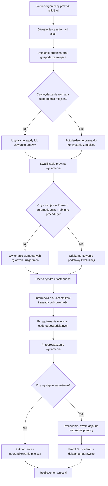

<!--
KURS UWOLNIENIA
Rozdział 2.3 – Organizacja działalności religijnej
Plik: 2_3_organizacja_dzialalnosci_religijnej.md
Stan odniesienia prawnego: 25 listopada 2026 r.
Charakter materiału: edukacyjny, prawno-organizacyjny i praktyczny.
-->

<div align="center">

# ✠ ❦ ✧ ROZDZIAŁ 2.3 ✧ ❦ ✠

## ORGANIZACJA DZIAŁALNOŚCI RELIGIJNEJ

### Indywidualne i wspólnotowe praktyki, nabożeństwa w świątyniach i domach, spotkania w pomieszczeniach organizacji, zasady uczestnictwa, dobrowolność, bezpieczeństwo i odpowiedzialność organizatora

❦ ━━━━━━━━━━━━━━━━━━━━━━━━━━━━━━━━━━━━━━━━━━━━━━━━━━━━━━━━━ ❦

**KURS UWOLNIENIA**

*Organizacja i prowadzenie działalności religijnej, społecznej, opiekuńczej oraz społeczno-gospodarczej fundacji*

**Stan odniesienia prawnego: 25 listopada 2026 r.**

</div>

> **Myśl przewodnia rozdziału**
>
> Dobrze zorganizowana praktyka religijna nie polega na mnożeniu formalności, lecz na takim przygotowaniu miejsca, czasu, zasad i odpowiedzialności, aby ludzie mogli korzystać z wolności sumienia i religii w sposób pokojowy, dobrowolny, bezpieczny i godny. Porządek organizacyjny nie zastępuje życia duchowego, a bezpieczeństwo nie jest przeciwieństwem wolności. Oba służą człowiekowi i wspólnocie.

---

## 1. Cel, zakres i efekty kształcenia

### 1.1. Cel rozdziału

Celem rozdziału jest przedstawienie praktycznej metody organizowania działalności religijnej w różnych miejscach i formach: w świątyni, domu prywatnym, lokalu fundacji, pomieszczeniu udostępnionym przez inną osobę, a także w przestrzeni publicznej. Materiał obejmuje zarówno praktyki indywidualne, jak i spotkania wspólnotowe, nabożeństwa, modlitwy, uroczystości oraz wydarzenia o charakterze religijnym.

Rozdział koncentruje się na organizacji przedsięwzięcia, a nie na rozstrzyganiu, kto jest duchownym lub kto ma prawo wykonywać określoną czynność religijną. Status osób, ich kompetencje, upoważnienia i odpowiedzialność zostały omówione w rozdziale 2.2. Podstawowe pojęcia kultu, wolności sumienia i religii oraz indywidualnego i wspólnotowego praktykowania wiary przedstawiono w rozdziale 2.1.

W niniejszym rozdziale najważniejsze jest pytanie: **jak przygotować i przeprowadzić praktykę religijną zgodnie z jej charakterem, z poszanowaniem prawa, godności uczestników, bezpieczeństwa oraz praw osób, które nie uczestniczą w wydarzeniu?**

### 1.2. Zakres materiału

Opracowanie obejmuje:

1. zasady prawne i organizacyjne działalności religijnej;
2. indywidualne wykonywanie praktyk religijnych;
3. organizowanie nabożeństw w świątyniach;
4. nabożeństwa i spotkania modlitewne w domach;
5. spotkania religijne w pomieszczeniach fundacji i innych organizacji;
6. wydarzenia religijne w przestrzeni publicznej;
7. tworzenie i funkcjonowanie wspólnot religijnych;
8. regulaminy, harmonogramy i dokumentowanie wydarzeń;
9. dobrowolność uczestnictwa i poszanowanie odmiennych przekonań;
10. bezpieczeństwo, dostępność i odpowiedzialność organizatora;
11. rozdzielenie działalności religijnej od odpłatnej, gospodarczej i komercyjnej;
12. praktyczne procedury, wzory kart organizacyjnych, listy kontrolne i analizę przypadków.

### 1.3. Efekty uczenia się

Po ukończeniu rozdziału uczestnik powinien umieć:

- rozróżnić prywatną praktykę religijną, spotkanie wspólnotowe, wydarzenie otwarte i zgromadzenie w rozumieniu właściwych przepisów;
- wskazać, kto jest organizatorem wydarzenia i kto odpowiada za miejsce;
- dobrać formę organizacyjną do rzeczywistego charakteru praktyki;
- przygotować kartę wydarzenia, harmonogram i podstawowy plan bezpieczeństwa;
- określić zasady uczestnictwa, dobrowolności i ochrony prywatności;
- rozpoznać sytuacje wymagające uzyskania zgody właściciela, zarządcy lub właściwego organu;
- odróżnić darowiznę od opłaty, wynagrodzenia i ceny usługi;
- zaplanować dokumentowanie wydarzenia bez nadmiernego gromadzenia danych o przekonaniach religijnych;
- przeprowadzić ocenę ryzyka i przygotować procedurę reagowania na zdarzenia niepożądane.

### 1.4. Granice opracowania

Rozdział nie zastępuje:

- prawa wewnętrznego konkretnego kościoła lub innego związku wyznaniowego;
- wymaganych decyzji, zgód i uzgodnień administracyjnych;
- dokumentacji technicznej budynku;
- instrukcji bezpieczeństwa pożarowego;
- indywidualnej analizy podatkowej, cywilnoprawnej lub administracyjnej;
- opinii prawnika, rzeczoznawcy do spraw zabezpieczeń przeciwpożarowych albo innego specjalisty, gdy charakter przedsięwzięcia wymaga takiej oceny.

---

## 2. Podstawowe zasady organizowania działalności religijnej

### 2.1. Wolność praktykowania religii

Wolność sumienia i religii obejmuje możliwość indywidualnego i wspólnotowego, prywatnego i publicznego uzewnętrzniania przekonań. W praktyce oznacza to, że człowiek może modlić się samodzielnie, uczestniczyć w spotkaniu religijnym, organizować modlitwę w domu albo korzystać z posługi wspólnoty – w granicach prawa i z poszanowaniem praw innych osób.

Organizacja nie powinna traktować wolności religijnej jako przywileju przyznawanego przez zarząd, kierownika lokalu lub koordynatora. Zadaniem organizatora jest stworzenie warunków do zgodnego z prawem korzystania z tej wolności, a nie arbitralne rozstrzyganie o czyichś przekonaniach.

### 2.2. Dobrowolność

Uczestnictwo w praktyce religijnej powinno być dobrowolne. Zaproszenie, informacja o wydarzeniu lub możliwość uczestnictwa nie mogą być przekształcane w przymus, nacisk, warunek uzyskania pomocy ani narzędzie wywierania wpływu na osobę zależną.

Dobrowolność oznacza w szczególności, że uczestnik:

- otrzymuje zrozumiałą informację o religijnym charakterze wydarzenia;
- może odmówić udziału bez sankcji i upokorzenia;
- może opuścić spotkanie;
- nie musi ujawniać swoich przekonań religijnych;
- nie powinien być nakłaniany do składania darowizny;
- nie może być uzależniany od udziału w modlitwie przy korzystaniu z niezwiązanej z nią pomocy.

### 2.3. Poszanowanie innych osób

Organizowanie praktyk religijnych wymaga uwzględnienia praw uczestników, sąsiadów, właścicieli nieruchomości, innych użytkowników budynku i osób o odmiennych przekonaniach. Dotyczy to zwłaszcza hałasu, zajmowania przestrzeni wspólnej, utrudniania ruchu, bezpieczeństwa pożarowego, prywatności i korzystania z nieruchomości.

Poszanowanie innych nie oznacza rezygnacji z praktyk religijnych. Oznacza wybór takiego sposobu ich organizacji, który nie narusza praw osób trzecich i nie tworzy nieuzasadnionych zagrożeń.

### 2.4. Rozdzielenie wolności religijnej od statusu organizacji

Prawo jednostki do modlitwy i praktykowania religii nie jest tym samym co status prawny podmiotu organizującego wydarzenie. Nieformalne grono osób może wspólnie się modlić, ale sama wspólna modlitwa nie nadaje grupie osobowości prawnej, prawa do reprezentowania innego podmiotu ani automatycznie statusu kościoła lub związku wyznaniowego.

Jeżeli grupa zamierza regularnie zawierać umowy, zatrudniać osoby, przyjmować darowizny, wynajmować lokale lub występować wobec organów publicznych, powinna jasno ustalić, jaki podmiot jest stroną czynności i kto odpowiada za zobowiązania. Zagadnienia te należy oceniać łącznie z rozdziałami 1.4 i 2.2.

### 2.5. Zasada proporcjonalności formalności

Nie każda modlitwa wymaga regulaminu, listy obecności, zgłoszenia lub odrębnego planu bezpieczeństwa. Zakres dokumentacji powinien odpowiadać skali, miejscu, częstotliwości i ryzyku wydarzenia.

Przykładowo:

- prywatna modlitwa jednej osoby nie wymaga tworzenia dokumentacji wydarzenia;
- niewielkie spotkanie rodzinne może wymagać jedynie uzgodnienia z domownikami i zachowania zwykłych zasad bezpieczeństwa;
- cykliczne nabożeństwo w lokalu organizacji wymaga już ustalenia zasad korzystania z pomieszczenia, odpowiedzialności, dostępności i bezpieczeństwa;
- wydarzenie otwarte w przestrzeni publicznej może wymagać odrębnej kwalifikacji prawnej, uzgodnienia zajęcia terenu lub zastosowania szczególnych procedur.

---

## 3. Ramy prawne organizowania działalności religijnej

### 3.1. Konstytucja Rzeczypospolitej Polskiej

Podstawowe znaczenie mają w szczególności:

- art. 25 – zasady relacji państwa z kościołami i innymi związkami wyznaniowymi, równouprawnienie i bezstronność władz publicznych;
- art. 31 – wolność człowieka i granice korzystania z praw;
- art. 32 – równość wobec prawa i zakaz dyskryminacji;
- art. 47 – ochrona życia prywatnego;
- art. 53 – wolność sumienia i religii;
- art. 57 – wolność pokojowych zgromadzeń, z uwzględnieniem ustawowych ograniczeń;
- art. 58 – wolność zrzeszania się.

Wolność religijna nie jest uprawnieniem do naruszania cudzych praw. Ograniczenia uzewnętrzniania religii muszą mieć podstawę prawną i spełniać konstytucyjne warunki, w tym wymóg konieczności i proporcjonalności. Organizator nie powinien samodzielnie tworzyć ograniczeń, których nie uzasadnia prawo, ale powinien respektować ograniczenia wynikające z ustaw i prawomocnych decyzji.

### 3.2. Ustawa o gwarancjach wolności sumienia i wyznania

Ustawa z 17 maja 1989 r. o gwarancjach wolności sumienia i wyznania reguluje podstawowe aspekty korzystania z wolności religijnej oraz działalności kościołów i innych związków wyznaniowych.

Istotne dla organizatora są w szczególności:

- art. 1–2 – zakres wolności sumienia i wyznania oraz przykładowe formy jej wykonywania;
- art. 19 – swoboda pełnienia funkcji religijnych przez kościoły i inne związki wyznaniowe, w tym organizowanie i publiczne sprawowanie kultu, udzielanie posług religijnych i organizowanie obrzędów;
- art. 20 – nauczanie religii i wychowanie religijne dzieci i młodzieży zgodnie z wyborem rodziców lub opiekunów prawnych;
- art. 21 i następne – szczególne formy działalności oświatowo-wychowawczej i opiekuńczej na zasadach ustawowych.

Należy pamiętać o art. 18 tej ustawy: sytuacja niektórych kościołów i związków wyznaniowych jest uregulowana odrębnymi ustawami. Dlatego przed zastosowaniem przepisu ogólnego należy sprawdzić, czy dany podmiot nie podlega regulacji szczególnej.

### 3.3. Prawo o zgromadzeniach

Ustawa z 24 lipca 2015 r. – Prawo o zgromadzeniach zawiera własną definicję zgromadzenia. Nie każde spotkanie kilku osób, nabożeństwo lub uroczystość jest zgromadzeniem w rozumieniu tej ustawy.

Zgodnie z art. 2 pkt 2 ustawy jej przepisów nie stosuje się do zgromadzeń odbywanych w ramach działalności kościołów i innych związków wyznaniowych. Wyłączenie to należy stosować zgodnie z jego treścią i rzeczywistym charakterem wydarzenia. Nie wolno automatycznie rozciągać go na każdą imprezę, manifestację lub spotkanie organizowane przez fundację, przedsiębiorcę albo nieformalną grupę, tylko dlatego, że uczestnicy deklarują religijny światopogląd.

Przed wydarzeniem w przestrzeni publicznej należy ustalić:

1. kto jest organizatorem;
2. jaki jest rzeczywisty cel i charakter wydarzenia;
3. czy jest ono organizowane w ramach działalności kościoła lub innego związku wyznaniowego;
4. czy spełnia ustawową definicję zgromadzenia;
5. czy obowiązują inne przepisy dotyczące dróg, ruchu, zajęcia terenu, bezpieczeństwa lub ochrony zabytków.

### 3.4. Przepisy dotyczące miejsca i bezpieczeństwa

W zależności od rodzaju miejsca i wydarzenia zastosowanie mogą mieć między innymi:

- Kodeks cywilny – własność, posiadanie, najem, użyczenie, odpowiedzialność za szkodę;
- Prawo budowlane – sposób użytkowania obiektu, bezpieczeństwo użytkowania i ewentualna zmiana sposobu użytkowania;
- ustawa o ochronie przeciwpożarowej oraz przepisy wykonawcze – zabezpieczenie obiektu, drogi ewakuacyjne, urządzenia przeciwpożarowe i obowiązki właściciela, zarządcy lub użytkownika;
- Prawo o zgromadzeniach – gdy wydarzenie mieści się w zakresie tej ustawy;
- przepisy o drogach publicznych i ruchu drogowym – gdy wydarzenie wiąże się z zajęciem pasa drogowego, przemarszem lub zmianą organizacji ruchu;
- przepisy lokalne – w zakresie, w jakim zostały wydane na podstawie ustaw i obowiązują na danym terenie;
- RODO – gdy organizator przetwarza dane osobowe uczestników, w tym informacje mogące ujawniać przekonania religijne;
- przepisy o ochronie małoletnich – jeżeli wydarzenie obejmuje działalność z udziałem dzieci lub młodzieży.

### 3.5. Hierarchia i aktualność źródeł

W razie wątpliwości pierwszeństwo ma aktualny tekst aktu prawnego i jego późniejsze nowelizacje, a nie streszczenie, poradnik, regulamin organizacji czy informacja prasowa. Tekst jednolity nie gwarantuje, że po jego ogłoszeniu nie nastąpiły kolejne zmiany.

Organizator powinien prowadzić prosty rejestr źródeł prawnych wykorzystywanych przy wydarzeniach o podwyższonym ryzyku: nazwa aktu, właściwe przepisy, data sprawdzenia, osoba dokonująca weryfikacji i ewentualne decyzje lub uzgodnienia.

---

## 4. Formy organizowania praktyk religijnych

### 4.1. Praktyka indywidualna

Praktyka indywidualna jest wykonywana przez osobę samodzielnie, bez konieczności organizowania wydarzenia dla innych. Może obejmować modlitwę, czytanie tekstów religijnych, medytację, post, osobiste obchody świąt lub inne czynności wynikające z przekonań danej osoby.

Z punktu widzenia organizacyjnego nie należy tworzyć zbędnych procedur dla czynności, które pozostają w sferze prywatnej i nie angażują cudzej nieruchomości, zasobów organizacji ani praw innych osób.

### 4.2. Praktyka wspólnotowa

Praktyka wspólnotowa polega na wspólnym wykonywaniu czynności religijnych przez dwie lub więcej osób. Może mieć charakter spontaniczny, rodzinny, sąsiedzki, cykliczny lub formalnie zorganizowany.

Wraz ze wzrostem skali i regularności spotkań rośnie znaczenie ustalenia:

- miejsca i zasad korzystania z niego;
- osoby odpowiedzialnej za organizację;
- godzin rozpoczęcia i zakończenia;
- sposobu informowania uczestników;
- zasad bezpieczeństwa;
- zasad ochrony dzieci i osób zależnych;
- zasad gromadzenia danych i dokumentowania wydarzeń.

### 4.3. Spotkanie zamknięte i wydarzenie otwarte

Spotkanie zamknięte jest kierowane do określonego kręgu osób, na przykład rodziny, członków wspólnoty lub zaproszonych uczestników. Wydarzenie otwarte jest komunikowane szerzej i może przyciągać osoby, których organizator wcześniej nie zna.

Samo użycie słów „otwarte”, „publiczne” lub „wspólnotowe” w ogłoszeniu nie przesądza o kwalifikacji prawnej. Liczy się rzeczywisty sposób dostępu, cel, miejsce, organizator i właściwe przepisy.

### 4.4. Cykliczne i jednorazowe wydarzenia

Wydarzenie jednorazowe może wymagać krótkiej karty organizacyjnej, zwłaszcza gdy odbywa się poza prywatnym mieszkaniem. Wydarzenie cykliczne powinno mieć bardziej trwałe zasady: harmonogram, osobę koordynującą, procedurę odwołania, zasady korzystania z pomieszczenia, sposób reagowania na incydenty i okresowy przegląd ryzyka.

Cykliczność sama w sobie nie tworzy osobowości prawnej ani nie zmienia automatycznie charakteru praktyki. Może jednak ujawnić, że działalność wymaga stabilnego zaplecza prawnego, lokalowego, finansowego i organizacyjnego.

---

## 5. Organizacja praktyk religijnych w świątyni

### 5.1. Świątynia jako miejsce praktyk

Świątynia, kościół, kaplica, dom modlitwy lub inne miejsce kultu jest przestrzenią przeznaczoną do określonych praktyk religijnych zgodnie z porządkiem właściwej wspólnoty. Organizator powinien respektować zasady gospodarza miejsca, jego przeznaczenie, wewnętrzne regulacje, zasady liturgiczne oraz obowiązujące przepisy państwowe.

Nie należy zakładać, że każda osoba może samodzielnie organizować dowolne nabożeństwo w świątyni. Konieczne jest uzgodnienie z podmiotem uprawnionym do dysponowania miejscem oraz – jeśli wymaga tego porządek wspólnoty – z właściwymi osobami odpowiedzialnymi za jego funkcjonowanie.

### 5.2. Uzgodnienie wydarzenia

Przed wydarzeniem należy ustalić:

1. nazwę i charakter praktyki;
2. osobę lub podmiot odpowiedzialny;
3. datę, czas i przewidywany czas trwania;
4. przewidywaną liczbę uczestników;
5. zasady korzystania z wyposażenia;
6. sposób przygotowania i sprzątnięcia miejsca;
7. dostępność dla osób z niepełnosprawnościami;
8. możliwość fotografowania lub nagrywania;
9. zasady zbierania dobrowolnych ofiar;
10. sposób postępowania w razie zagrożenia.

### 5.3. Wyposażenie i przedmioty używane podczas praktyki

Świece, kadzidła, lampy, urządzenia nagłaśniające, przewody elektryczne, tekstylia i inne przedmioty mogą mieć znaczenie religijne, ale ich używanie musi uwzględniać bezpieczeństwo. Nie wolno zastawiać wyjść, dróg ewakuacyjnych, gaśnic, hydrantów ani urządzeń alarmowych.

Otwarte źródła ognia należy stosować zgodnie z zasadami bezpieczeństwa miejsca i przepisami przeciwpożarowymi. Jeżeli gospodarz obiektu zakazuje używania świec lub kadzideł z przyczyn bezpieczeństwa, organizator powinien uzgodnić bezpieczną alternatywę.

### 5.4. Uczestnicy i porządek wydarzenia

Gospodarz miejsca może ustalić neutralne, uzasadnione zasady porządkowe, na przykład dotyczące wejścia, przemieszczania się, ciszy, fotografowania, opieki nad dziećmi, korzystania z pomieszczeń pomocniczych i ochrony wyposażenia. Zasady te nie powinny służyć nieuzasadnionemu wykluczaniu osób ani naruszaniu ich godności.

---

## 6. Organizowanie nabożeństw domowych

### 6.1. Charakter nabożeństwa domowego

Nabożeństwo domowe jest praktyką religijną odbywającą się w mieszkaniu, domu lub innym prywatnym miejscu udostępnionym na ten cel. Może być wykonywane przez rodzinę, zaproszonych gości, niewielką grupę sąsiedzką albo osobę prowadzącą spotkanie modlitewne.

Wolność praktykowania religii nie jest ograniczona wyłącznie do budynków sakralnych. Nie oznacza to jednak, że każde wykorzystanie prywatnego lokalu do regularnych spotkań o dużej skali pozostaje obojętne dla praw właściciela, sąsiadów, przepisów budowlanych i bezpieczeństwa.

### 6.2. Zgoda na korzystanie z lokalu

Organizator powinien ustalić, czy ma prawo korzystać z miejsca. W przypadku mieszkania wynajmowanego należy uwzględnić umowę najmu, zasady współkorzystania z lokalu i prawa innych mieszkańców. W przypadku domu rodzinnego należy uzgodnić organizację spotkania z domownikami, zwłaszcza gdy wpływa ono na ich prywatność lub codzienne funkcjonowanie.

Nie wolno zakładać, że zgoda jednej osoby automatycznie uprawnia do wykorzystywania części wspólnych budynku, parkingu, ogrodu sąsiada albo drogi wewnętrznej.

### 6.3. Skala i częstotliwość spotkań

Małe spotkanie rodzinne nie jest tym samym co regularne wydarzenie otwarte dla kilkudziesięciu osób. Jeżeli sposób użytkowania lokalu zmienia się w sposób mogący podlegać ocenie na gruncie Prawa budowlanego, należy skonsultować to z właściwym organem lub projektantem. Nie każda cykliczna modlitwa oznacza zmianę sposobu użytkowania obiektu; ocena zależy od rzeczywistych warunków i skutków zmiany.

### 6.4. Zasady sąsiedzkie

Organizator powinien ograniczyć hałas, nie blokować wejść i przejazdów, nie zajmować cudzych miejsc postojowych oraz zapewnić bezpieczne dojście. Należy uwzględnić ciszę nocną wynikającą z ogólnych zasad ochrony spokoju i porządku oraz lokalne uwarunkowania.

### 6.5. Minimalna karta spotkania domowego

W przypadku regularnych spotkań warto prowadzić prostą kartę organizacyjną zawierającą:

- nazwę lub krótki opis spotkania;
- adres miejsca, przechowywany z należytą ostrożnością;
- osobę odpowiedzialną;
- uzgodnione godziny;
- maksymalną liczbę osób wynikającą z warunków lokalu;
- podstawowe zasady bezpieczeństwa;
- informację o dostępności i ewentualnych ograniczeniach;
- sposób kontaktu w sytuacji nagłej.

Nie ma potrzeby tworzenia imiennej listy uczestników, jeżeli nie istnieje konkretna, zgodna z prawem potrzeba jej prowadzenia.

---

## 7. Organizowanie modlitw w pomieszczeniach fundacji i innych organizacji

### 7.1. Zasada zgodności z celem i dokumentami organizacji

Fundacja może udostępniać pomieszczenia na spotkania zgodne z jej celami statutowymi i zasadami działania, o ile ma do tego odpowiednią podstawę prawną i faktyczne prawo dysponowania lokalem. Należy jednak odróżnić:

- działalność samej fundacji;
- działalność wspólnoty religijnej;
- prywatną inicjatywę osoby lub grupy;
- odpłatne udostępnienie pomieszczenia;
- użyczenie lub nieodpłatne udostępnienie;
- współorganizowanie wydarzenia.

Samo udostępnienie sali nie oznacza, że fundacja staje się kościołem lub związkiem wyznaniowym. Nie oznacza też, że fundacja przejmuje automatycznie odpowiedzialność za treść wszystkich praktyk religijnych. Zakres odpowiedzialności należy ustalić na podstawie rzeczywistych ról, umów, przepisów i okoliczności.

### 7.2. Umowa lub uzgodnienie korzystania z pomieszczenia

W zależności od skali i częstotliwości wydarzenia warto zawrzeć umowę użyczenia, najmu albo sporządzić pisemne uzgodnienie. Dokument powinien określać:

1. strony i osoby reprezentujące;
2. pomieszczenie i zakres udostępnienia;
3. cel korzystania;
4. daty i godziny;
5. zasady dostępu do części wspólnych;
6. odpowiedzialność za wyposażenie;
7. zasady sprzątania i przywrócenia pomieszczenia;
8. koszty mediów i ewentualne opłaty;
9. zasady bezpieczeństwa;
10. zasady fotografowania i przetwarzania danych;
11. warunki odwołania wydarzenia;
12. odpowiedzialność za szkody i sposób zgłaszania incydentów.

### 7.3. Rozdzielenie funkcji organizatora i gospodarza lokalu

Jeżeli fundacja tylko udostępnia pomieszczenie, a wspólnota samodzielnie prowadzi nabożeństwo, należy jasno wskazać, kto odpowiada za:

- program religijny;
- prowadzącego;
- informowanie uczestników;
- przyjmowanie dobrowolnych ofiar;
- bezpieczeństwo w czasie wydarzenia;
- dokumentowanie i publikowanie materiałów;
- kontakt z uczestnikami.

Nie można jednak umową wyłączyć obowiązków, których prawo przypisuje właścicielowi, zarządcy, użytkownikowi lub faktycznie władającemu obiektem. Umowa powinna odpowiadać rzeczywistemu podziałowi zadań.

### 7.4. Współorganizowanie wydarzenia przez fundację

Jeżeli fundacja współtworzy wydarzenie, zapewnia personel, reklamuje je, pobiera opłaty lub zarządza uczestnikami, jej rola jest szersza niż rola biernego gospodarza lokalu. Wówczas powinna ocenić własne obowiązki statutowe, cywilnoprawne, podatkowe, dotyczące ochrony danych i bezpieczeństwa.

### 7.5. Zasady korzystania z lokalu

Regulamin pomieszczenia może określać godziny, liczbę osób, dostępność, sposób korzystania z wyposażenia, zakaz blokowania wyjść, zasady używania świec, nagłośnienia i urządzeń elektrycznych oraz procedurę zgłaszania szkód. Zasady powinny być jasne, dostępne i jednakowo stosowane wobec porównywalnych wydarzeń.

---

## 8. Organizowanie modlitw i wydarzeń w przestrzeni publicznej

### 8.1. Rozpoznanie miejsca

Przestrzeń publiczna może obejmować plac, park, ulicę, chodnik, skwer, teren należący do jednostki samorządu, teren prywatny dostępny publicznie lub inną przestrzeń, w której organizator nie ma wyłącznego prawa dysponowania miejscem.

Przed wydarzeniem należy ustalić właściciela lub zarządcę terenu, zasady korzystania z niego, możliwe ograniczenia lokalne oraz wpływ wydarzenia na ruch pieszy i kołowy.

### 8.2. Odróżnienie praktyki religijnej od zgromadzenia ustawowego

Nie każde wydarzenie religijne w przestrzeni publicznej jest zgromadzeniem w rozumieniu Prawa o zgromadzeniach. Ustawa zawiera definicję zgromadzenia oraz wyłączenie dotyczące zgromadzeń odbywanych w ramach działalności kościołów i innych związków wyznaniowych.

Kwalifikacja wymaga oceny rzeczywistego celu i organizatora. Jeżeli wydarzenie jest organizowane przez fundację, stowarzyszenie, przedsiębiorcę lub nieformalną grupę, nie wolno przyjmować wyłączenia tylko na podstawie religijnego charakteru części programu.

### 8.3. Przemarsz, procesja i korzystanie z dróg

Jeżeli wydarzenie obejmuje przemarsz, zajęcie pasa drogowego, czasowe wyłączenie ruchu, ustawienie urządzeń, sceny, namiotu lub innej infrastruktury, należy sprawdzić przepisy dotyczące dróg publicznych, ruchu drogowego, zgromadzeń i zarządzania terenem. Właściwe zgody i procedury zależą od konkretnego rodzaju drogi, miejsca, organizatora i wydarzenia.

Nie należy utożsamiać wyłączenia z Prawa o zgromadzeniach z automatycznym zwolnieniem z pozostałych obowiązków. Wyłączenie spod jednej ustawy nie uchyla przepisów o bezpieczeństwie, ruchu, własności, ochronie zabytków ani innych regulacji.

### 8.4. Plan wydarzenia publicznego

Plan powinien zawierać:

- dokładną lokalizację i mapę obszaru;
- datę, godziny i czas trwania;
- przewidywaną liczbę uczestników;
- osobę odpowiedzialną i zastępcę;
- opis przebiegu i ewentualnej trasy;
- sposób zapewnienia drożności przejść i dojazdu służb;
- ocenę zagrożeń;
- sposób komunikacji z uczestnikami;
- zasady reagowania na pogodę, tłok, konflikt lub zagrożenie;
- listę wymaganych zgód i uzgodnień;
- plan sprzątania i przywrócenia terenu.

### 8.5. Pokojowy charakter i relacje z otoczeniem

Organizator powinien zaplanować wydarzenie tak, aby umożliwiało pokojowe praktykowanie religii i nie naruszało praw innych osób. Nie powinien prowokować konfliktów, blokować dostępu do budynków, utrudniać służbom wykonywania zadań ani używać nagłośnienia w sposób naruszający przepisy.

W przypadku wystąpienia zagrożenia należy kierować się bezpieczeństwem ludzi, a nie dążeniem do bezwarunkowego kontynuowania programu.

---

## 9. Tworzenie i funkcjonowanie wspólnot religijnych

### 9.1. Wspólnota jako relacja osób

Wspólnota religijna może powstawać przez wspólne wyznawanie przekonań, modlitwę, praktyki, nauczanie i wzajemne wsparcie. Jej więź może mieć charakter rodzinny, sąsiedzki, lokalny, międzyregionalny lub międzynarodowy.

Nie każda wspólnota musi od razu posiadać rozbudowaną strukturę organizacyjną. Jednocześnie regularna działalność obejmująca majątek, umowy, zatrudnienie, zbiórki i reprezentację wymaga ustalenia odpowiedniej formy prawnej.

### 9.2. Wspólnota nieformalna i podmiot zorganizowany

Wspólnota nieformalna może organizować prywatne spotkania i korzystać z wolności religijnej. Nie należy jednak przypisywać jej automatycznie osobowości prawnej, prawa do zawierania umów we własnym imieniu ani możliwości posługiwania się numerami rejestrowymi innego podmiotu.

Jeżeli czynności prawne wykonuje fundacja, stroną umowy jest fundacja, a nie „wspólnota” jako nieokreślona grupa, chyba że przepisy i dokumenty pozwalają na inną konstrukcję. Osoby działające za fundację muszą posiadać właściwe umocowanie.

### 9.3. Minimalna struktura organizacyjna

W przypadku cyklicznej działalności warto ustalić:

- osobę koordynującą;
- osobę odpowiedzialną za miejsce;
- osobę prowadzącą lub zaproszoną do prowadzenia praktyki;
- osobę odpowiedzialną za bezpieczeństwo;
- osobę kontaktową dla uczestników;
- sposób podejmowania decyzji;
- sposób rozwiązywania sporów;
- zasady przyjmowania i rozliczania dobrowolnych środków.

Role te mogą być łączone, jeśli skala wydarzenia i przepisy na to pozwalają. Przy większej liczbie uczestników lub podwyższonym ryzyku należy unikać sytuacji, w której jedna osoba ma wykonywać wszystkie zadania jednocześnie.

### 9.4. Zasady członkostwa i uczestnictwa

Należy odróżnić członkostwo w formalnej organizacji od udziału w pojedynczym nabożeństwie. Uczestnik wydarzenia nie staje się automatycznie członkiem fundacji, związku wyznaniowego ani wspólnoty formalnej.

Jeżeli wspólnota prowadzi członkostwo, powinna określić jego zasady w odpowiednich dokumentach i zgodnie z właściwą formą prawną. Nie należy tworzyć rejestrów członków pod pretekstem zwykłej listy uczestników, jeżeli nie ma to podstawy i celu.

### 9.5. Współpraca między wspólnotami

Współpraca ekumeniczna, międzywyznaniowa lub międzyreligijna powinna opierać się na dobrowolności, równości partnerów, jasnym opisie celu oraz poszanowaniu odrębności doktrynalnej i liturgicznej. Wspólny projekt nie oznacza, że uczestniczące wspólnoty rezygnują ze swojej tożsamości lub przekazują sobie wzajemnie kompetencje religijne.

---

## 10. Regulamin działalności religijnej

### 10.1. Funkcja regulaminu

Regulamin porządkuje powtarzalne zasady organizacji. Nie zastępuje prawa powszechnie obowiązującego, statutu fundacji ani prawa wewnętrznego wspólnoty. Nie może również przyznawać organizatorowi uprawnień, których nie posiada.

Regulamin powinien być zwięzły, zrozumiały, dostępny dla uczestników i dostosowany do rzeczywistego charakteru działalności.

### 10.2. Zalecana struktura regulaminu

1. nazwa organizatora i charakter spotkań;
2. cel i zakres regulaminu;
3. miejsce i harmonogram;
4. sposób informowania o wydarzeniach;
5. zasady uczestnictwa;
6. dobrowolność i możliwość rezygnacji;
7. zasady zachowania i poszanowania innych osób;
8. zasady udziału dzieci i osób wymagających wsparcia;
9. zasady bezpieczeństwa;
10. zasady korzystania z pomieszczeń i wyposażenia;
11. zasady fotografowania, nagrywania i publikacji;
12. zasady zbierania dobrowolnych ofiar lub darowizn;
13. procedura zgłaszania skarg i incydentów;
14. zasady odwołania wydarzenia;
15. data wejścia w życie i sposób aktualizacji.

### 10.3. Regulamin a autonomia wspólnoty

Fundacja udostępniająca lokal może określić zasady bezpieczeństwa, porządku i korzystania z nieruchomości. Nie powinna jednak bez podstawy ingerować w doktrynę, liturgię lub wewnętrzne rozstrzygnięcia wspólnoty religijnej.

Analogicznie wspólnota religijna nie może żądać od fundacji naruszania jej statutu, przepisów rachunkowych, zasad bezpieczeństwa lub praw osób trzecich.

### 10.4. Przegląd regulaminu

Regulamin należy przeglądać co najmniej wtedy, gdy:

- zmienia się miejsce lub skala spotkań;
- pojawiają się dzieci lub osoby szczególnie zależne;
- zmienia się sposób finansowania;
- rozpoczyna się fotografowanie lub transmisja;
- zmienia się organizator albo podział odpowiedzialności;
- wystąpił incydent wskazujący na lukę w procedurze;
- zmieniają się przepisy.

---

## 11. Harmonogramy i planowanie wydarzeń

### 11.1. Roczny i okresowy plan praktyk

Cykliczna wspólnota może opracować plan roczny, kwartalny lub miesięczny. Harmonogram powinien uwzględniać święta, kalendarz właściwy dla wspólnoty, dostępność miejsca, możliwości osób prowadzących, okresy remontów i inne wydarzenia.

Harmonogram ma charakter organizacyjny. Nie powinien być przedstawiany jako źródło obowiązku religijnego dla osób, które nie zadeklarowały uczestnictwa.

### 11.2. Karta pojedynczego wydarzenia

Każde wydarzenie o zorganizowanym charakterze powinno mieć kartę zawierającą co najmniej:

| Pole | Treść |
|---|---|
| Nazwa | Krótka i neutralna nazwa wydarzenia |
| Charakter | Modlitwa, nabożeństwo, spotkanie, uroczystość |
| Organizator | Osoba lub podmiot faktycznie organizujący |
| Gospodarz miejsca | Właściciel, zarządca lub uprawniony użytkownik |
| Data i czas | Początek, koniec, czas przygotowania i sprzątania |
| Miejsce | Adres i konkretne pomieszczenie lub teren |
| Liczba uczestników | Realistyczne oszacowanie |
| Prowadzący | Osoba odpowiedzialna za część religijną |
| Koordynator | Osoba kontaktowa i organizacyjna |
| Bezpieczeństwo | Podstawowe ryzyka i działania zapobiegawcze |
| Dostępność | Informacja o barierach i możliwym wsparciu |
| Dane i wizerunek | Czy planuje się listę, zdjęcia, nagrania lub transmisję |
| Finansowanie | Czy przewidziano darowizny, opłaty lub inne środki |
| Uzgodnienia | Zgody, umowy i decyzje, jeżeli są wymagane |

### 11.3. Plan przygotowania

Przy większych wydarzeniach należy określić terminy:

- uzgodnienia miejsca;
- potwierdzenia prowadzącego;
- oceny ryzyka;
- sprawdzenia wyposażenia;
- przygotowania komunikatu dla uczestników;
- weryfikacji wymaganych zgód;
- przygotowania osób odpowiedzialnych;
- kontroli pomieszczenia przed otwarciem;
- zamknięcia i rozliczenia wydarzenia.

### 11.4. Odwołanie i zmiana wydarzenia

Organizator powinien przewidzieć, kto może odwołać lub przenieść wydarzenie, jak informuje się uczestników i co dzieje się z dobrowolnymi wpłatami, jeżeli wydarzenie zostało sfinansowane przez darczyńców. W razie zagrożenia bezpieczeństwa decyzja o przerwaniu spotkania powinna mieć pierwszeństwo przed realizacją programu.

---

## 12. Zasady uczestnictwa

### 12.1. Informacja przed wydarzeniem

Uczestnik powinien otrzymać informację adekwatną do charakteru spotkania: czego dotyczy wydarzenie, gdzie i kiedy się odbywa, czy jest otwarte, czy przewidziano określone elementy obrzędowe, czy będzie fotografowanie i czy istnieją szczególne warunki udziału.

Informacja nie musi ujawniać szczegółów doktrynalnych, które należą do porządku wspólnoty, ale nie powinna wprowadzać w błąd co do charakteru wydarzenia.

### 12.2. Udział bez obowiązku deklarowania przekonań

W typowym otwartym wydarzeniu religijnym nie należy żądać od każdej osoby deklaracji wyznania, przynależności lub światopoglądu. Jeżeli określona praktyka jest przeznaczona wyłącznie dla osób spełniających warunki właściwe danej wspólnocie, informacja o tym powinna być przedstawiona jasno i bez poniżania pozostałych uczestników.

### 12.3. Zasady zachowania

Organizator może określić neutralne zasady dotyczące bezpieczeństwa i porządku, np. zakaz blokowania przejść, niszczenia wyposażenia, zakłócania przebiegu wydarzenia lub nagrywania w miejscach objętych uzasadnionym zakazem. Zasady muszą być proporcjonalne i nie mogą służyć arbitralnemu wykluczaniu.

### 12.4. Rezygnacja z uczestnictwa

Uczestnik powinien móc opuścić spotkanie bez konieczności uzasadniania swojej decyzji. W przypadku dzieci i osób wymagających opieki należy wcześniej ustalić bezpieczny sposób wyjścia i przekazania odpowiedzialności opiekunowi.

---

## 13. Dobrowolność uczestnictwa i ochrona przed naciskiem

### 13.1. Zakaz przymusu

Niedopuszczalne jest wymuszanie udziału w praktyce religijnej poprzez groźbę utraty pomocy, pracy, świadczenia, miejsca w programie, dostępu do usługi lub innej korzyści niezwiązanej z dobrowolnym uczestnictwem.

Szczególnej ostrożności wymagają relacje, w których organizator ma przewagę nad uczestnikiem: relacja pracodawca–pracownik, opiekun–podopieczny, nauczyciel–uczeń, terapeuta–pacjent, kierownik–wolontariusz lub osoba udzielająca pomocy–beneficjent.

### 13.2. Oddzielenie pomocy od praktyki religijnej

Jeżeli fundacja prowadzi pomoc społeczną, zdrowotną, edukacyjną lub opiekuńczą, korzystanie z pomocy nie powinno być uzależnione od udziału w modlitwie, nabożeństwie, spotkaniu formacyjnym lub złożenia deklaracji religijnej, chyba że szczególny charakter odrębnego programu i jego zgodność z prawem zostały jasno określone, a udział jest rzeczywiście dobrowolny.

Osoba potrzebująca pomocy nie może być wykorzystywana jako środek do pozyskiwania uczestników praktyk religijnych lub darczyńców.

### 13.3. Dobrowolność darowizn

Dobrowolna ofiara nie powinna być przedstawiana jako obowiązkowa opłata za modlitwę, przyjęcie do wspólnoty lub uzyskanie pomocy. Jeżeli wydarzenie jest odpłatne, należy nazwać i opisać świadczenie zgodnie z rzeczywistym charakterem prawnym i finansowym.

### 13.4. Komunikacja bez manipulacji

Organizator powinien unikać komunikatów opartych na zastraszaniu, zawstydzaniu, obiecywaniu pewnych skutków zdrowotnych lub materialnych w zamian za udział, wpłatę albo posłuszeństwo. Wypowiedzi religijne powinny być odróżniane od informacji medycznej, prawnej i finansowej.

---

## 14. Bezpieczeństwo uczestników

### 14.1. Odpowiedzialność za bezpieczeństwo

Bezpieczeństwo jest obowiązkiem organizacyjnym i prawnym, a nie wyłącznie dobrą praktyką. Ustawa o ochronie przeciwpożarowej przewiduje obowiązki dotyczące zabezpieczenia budynków, obiektów i terenów. Zakres odpowiedzialności właściciela, zarządcy i użytkownika zależy od przepisów oraz powierzonych zadań. Umowa może regulować podział czynności, lecz nie powinna być traktowana jako sposób na uchylenie obowiązków ustawowych.

### 14.2. Ocena ryzyka

Przed wydarzeniem należy ocenić:

- liczbę i profil uczestników;
- warunki lokalowe;
- liczbę i dostępność wyjść;
- możliwość ewakuacji;
- źródła ognia i ciepła;
- stan instalacji elektrycznej;
- nagłośnienie i przewody;
- schody, progi i inne bariery;
- warunki pogodowe w przypadku wydarzeń zewnętrznych;
- ryzyko tłoku, konfliktu lub paniki;
- obecność dzieci, osób starszych i osób z niepełnosprawnościami;
- możliwość wezwania służb ratunkowych.

### 14.3. Bezpieczeństwo pożarowe

Organizator nie może przekraczać dopuszczalnej liczby osób wynikającej z warunków obiektu i właściwych przepisów. Nie wolno zastawiać dróg ewakuacyjnych, wyjść, gaśnic, hydrantów ani urządzeń alarmowych. Otwarty ogień, świece i kadzidła należy stosować tylko wtedy, gdy jest to dopuszczalne i bezpieczne w danym miejscu.

Właściciel, zarządca lub użytkownik powinien znać obowiązujące zasady ochrony przeciwpożarowej. Organizator wydarzenia powinien zapoznać się z zasadami obiektu i nie wprowadzać wyposażenia lub dekoracji, które zwiększają zagrożenie.

### 14.4. Pierwsza pomoc i sytuacje nagłe

W zależności od skali wydarzenia należy wyznaczyć osobę, która wie, jak wezwać pomoc, wskazać adres służbom, udostępnić dojście ratownikom i przekazać podstawowe informacje. Nie należy podejmować działań medycznych wykraczających poza posiadane kompetencje.

W przypadku bezpośredniego zagrożenia życia lub zdrowia należy niezwłocznie wezwać odpowiednie służby ratunkowe. Modlitwa, błogosławieństwo ani rozmowa duchowa nie zastępują pomocy medycznej.

### 14.5. Przerwanie wydarzenia

Wydarzenie należy przerwać lub ewakuować uczestników, jeżeli wystąpi pożar, zadymienie, zagrożenie konstrukcyjne, gwałtowne zjawisko pogodowe, niekontrolowany tłok, przemoc lub inne poważne niebezpieczeństwo. Osoba odpowiedzialna powinna znać sposób ogłoszenia przerwania i wskazania bezpiecznego miejsca.

---

## 15. Dostępność i szczególne potrzeby uczestników

### 15.1. Dostępność fizyczna

Organizator powinien sprawdzić, czy do miejsca wydarzenia można dotrzeć bezpiecznie, czy dostępne są przejścia, toalety, miejsca siedzące i odpowiednie oświetlenie. Jeżeli istnieją bariery architektoniczne, należy poinformować o nich przed wydarzeniem i – w miarę możliwości – zaproponować alternatywę.

### 15.2. Dostępność komunikacyjna

Warto uwzględnić potrzeby osób z niepełnosprawnością słuchu, wzroku, trudnościami poznawczymi lub ograniczoną znajomością języka. Możliwe rozwiązania to czytelne ogłoszenia, duży druk, materiały elektroniczne, spokojne tempo komunikacji, tłumaczenie lub wsparcie osoby towarzyszącej.

### 15.3. Osoby starsze i osoby wymagające wsparcia

Nie należy zakładać, że każda osoba starsza lub z niepełnosprawnością potrzebuje pomocy. Należy zapytać, czy wsparcie jest potrzebne i w jakiej formie. Pomoc powinna respektować autonomię, prywatność i godność uczestnika.

### 15.4. Dzieci i opiekunowie

Przed wydarzeniem należy ustalić, czy dzieci uczestniczą pod opieką rodzica lub opiekuna, czy organizator przejmuje określone zadania opiekuńcze i jakie standardy ochrony małoletnich mają zastosowanie. Nie wolno zakładać, że sam religijny charakter spotkania zwalnia z obowiązków ochronnych.

---

## 16. Dokumentowanie wydarzeń i prowadzenie harmonogramów

### 16.1. Cel dokumentowania

Dokumentacja ma służyć bezpieczeństwu, ciągłości organizacyjnej, rozliczalności i możliwości odtworzenia istotnych decyzji. Nie powinna być tworzona wyłącznie po to, aby gromadzić informacje o religijności uczestników.

### 16.2. Dokumenty podstawowe

W zależności od charakteru wydarzenia można stosować:

- kartę wydarzenia;
- harmonogram;
- zgodę lub umowę korzystania z miejsca;
- listę osób odpowiedzialnych;
- plan bezpieczeństwa;
- protokół przekazania pomieszczenia;
- rejestr incydentów;
- dokumentację wydatków;
- sprawozdanie z wydarzenia;
- dokumentację zgód dotyczących wizerunku, jeżeli jest potrzebna.

### 16.3. Lista obecności

Lista obecności nie powinna być automatycznym elementem każdego spotkania religijnego. Jeżeli nie jest konieczna, lepiej ograniczyć się do anonimowego oszacowania liczby uczestników. Imienna lista może ujawniać przekonania religijne, a więc prowadzić do przetwarzania szczególnych kategorii danych osobowych.

Jeżeli istnieje konkretna podstawa i cel prowadzenia listy, należy określić administratora, podstawę prawną, zakres danych, czas przechowywania, dostęp i obowiązek informacyjny. Nie wolno gromadzić danych „na wszelki wypadek”.

### 16.4. Sprawozdanie po wydarzeniu

Sprawozdanie może obejmować:

- datę i miejsce;
- rzeczywisty przebieg;
- liczbę uczestników w ujęciu zbiorczym;
- wykorzystane zasoby;
- poniesione wydatki;
- problemy organizacyjne;
- incydenty i sposób ich rozwiązania;
- wnioski do kolejnego wydarzenia.

Nie należy zamieszczać zbędnych informacji o indywidualnych przekonaniach, stanie zdrowia, sytuacji rodzinnej ani osobistych wypowiedziach uczestników.

---

## 17. Ochrona danych osobowych, wizerunku i prywatności

### 17.1. Dane dotyczące przekonań religijnych

Dane ujawniające przekonania religijne należą do szczególnych kategorii danych w rozumieniu art. 9 RODO. Już sama imienna lista uczestników spotkania, jeżeli jednoznacznie wskazuje na udział w praktyce określonej religii, może ujawniać takie przekonania.

Organizator powinien zatem stosować zasadę minimalizacji: zbierać tylko dane rzeczywiście potrzebne, mieć właściwą podstawę prawną, ograniczać dostęp i nie przechowywać danych dłużej, niż jest to konieczne.

### 17.2. Informacja o przetwarzaniu danych

Jeżeli organizator zbiera dane uczestników, powinien przekazać im informacje wymagane przez RODO, w tym o administratorze, celu, podstawie prawnej, odbiorcach, okresie przechowywania, prawach osoby i możliwości kontaktu w sprawach danych.

Nie należy zakładać, że zgoda na udział w wydarzeniu jest jednocześnie zgodą na publikację wizerunku, zapisanie adresu e-mail, przesyłanie newslettera lub przetwarzanie informacji o wyznaniu.

### 17.3. Zdjęcia, nagrania i transmisje

Przed rozpoczęciem fotografowania lub nagrywania należy poinformować uczestników o celu i sposobie wykorzystania materiałów. Wizerunek może podlegać ochronie na podstawie przepisów o dobrach osobistych i prawie autorskim, a jego utrwalanie i publikacja mogą wiązać się z obowiązkami wynikającymi z RODO.

Nie należy przyjmować, że obecność w miejscu publicznym automatycznie oznacza zgodę na dowolną publikację zbliżeń, wypowiedzi lub materiałów umożliwiających identyfikację osoby jako uczestnika określonej praktyki religijnej. Każdy przypadek wymaga oceny podstawy prawnej i okoliczności.

### 17.4. Dzieci na zdjęciach

Publikowanie wizerunku dzieci wymaga szczególnej ostrożności. Należy uwzględnić przepisy, prawa rodziców lub opiekunów, dobro dziecka i jego zdanie odpowiednie do wieku i dojrzałości. Najbezpieczniejszym rozwiązaniem jest ograniczenie publikacji materiałów identyfikujących dzieci, jeśli nie ma istotnego celu i prawidłowej podstawy.

### 17.5. Poufność rozmów

Wydarzenie religijne może obejmować rozmowy osobiste, modlitwę wstawienniczą lub towarzyszenie duchowe. Organizator powinien unikać nagrywania takich rozmów bez wyraźnej, właściwej podstawy i poinformowania osób. Szczególne zasady dotyczące tajemnicy spowiedzi oraz innych form poufności zostały omówione w rozdziale 2.2.

---

## 18. Finansowanie i rozdzielenie działalności religijnej od komercyjnej

### 18.1. Dobrowolna ofiara i darowizna

Dobrowolna ofiara lub darowizna nie jest automatycznie ceną za usługę. O jej kwalifikacji decydują rzeczywiste warunki przekazania środków, istnienie lub brak świadczenia wzajemnego, dokumenty i sposób działania organizatora.

Nie należy używać określenia „darowizna”, jeżeli w rzeczywistości uczestnik musi zapłacić określoną kwotę, aby otrzymać świadczenie. Nie należy też przedstawiać dobrowolnej darowizny jako warunku uzyskania modlitwy, pomocy lub przyjęcia do wspólnoty.

### 18.2. Odpłatne wydarzenie

Jeżeli uczestnik płaci za udział w szkoleniu, koncercie, wynajem miejsca, posiłek lub inną usługę, należy określić rzeczywisty przedmiot świadczenia i jego podstawę prawną. Religijny kontekst wydarzenia nie przesądza sam w sobie o zwolnieniu podatkowym ani o braku obowiązków ewidencyjnych.

### 18.3. Działalność pożytku publicznego

Jeżeli fundacja prowadzi działalność pożytku publicznego, należy odróżniać działalność nieodpłatną, odpłatną i gospodarczą. Ustawa o działalności pożytku publicznego i o wolontariacie zawiera definicje oraz warunki tych form. W szczególności art. 6–9 określają, kiedy działalność pożytku publicznego może być nieodpłatna lub odpłatna i w jakich warunkach działalność odpłatna staje się działalnością gospodarczą.

Nie wolno zakładać, że każda aktywność religijna fundacji jest automatycznie działalnością pożytku publicznego albo że każda wpłata na wydarzenie jest darowizną.

### 18.4. Rozdzielenie rachunkowe

Jeżeli fundacja wspiera działalność religijną, powinna zapewnić możliwość ustalenia:

- kto otrzymał środki;
- jaki był cel przekazania;
- kto zatwierdził wydatek;
- jakie dokumenty potwierdzają operację;
- czy wydatek mieścił się w statucie i umowie;
- czy nie doszło do prywatnego przysporzenia bez podstawy.

Wydatki osobiste, koszty wydarzenia, wynagrodzenia, zwrot kosztów i darowizny powinny być prawidłowo rozróżnione.

### 18.5. Informacja finansowa dla uczestników

Jeżeli podczas wydarzenia zbierane są środki, komunikat powinien wskazywać, czy jest to dobrowolna darowizna, składka, opłata za świadczenie czy inna forma przekazania pieniędzy. Powinien też wskazywać odbiorcę i – gdy jest to darowizna celowa – cel, na jaki środki zostaną przeznaczone.

---

## 19. Odpowiedzialność organizatora i podział ról

### 19.1. Organizator

Organizatorem jest podmiot lub osoba, która faktycznie podejmuje decyzje o przygotowaniu i przeprowadzeniu wydarzenia. Nazwa na plakacie nie zawsze przesądza o rzeczywistej roli. Należy analizować, kto zawiera umowę, udostępnia miejsce, kontroluje przebieg, zatrudnia personel, przyjmuje środki i odpowiada za uczestników.

### 19.2. Gospodarz miejsca

Gospodarz miejsca odpowiada za zakres obowiązków wynikający z prawa, umowy i faktycznego władania obiektem. Powinien przekazać organizatorowi informacje o ograniczeniach technicznych, zasadach bezpieczeństwa i sposobie korzystania z pomieszczeń.

### 19.3. Prowadzący praktykę religijną

Prowadzący odpowiada za wykonywanie powierzonych mu czynności w granicach statusu i kompetencji. Nie należy automatycznie przypisywać mu wszystkich obowiązków właściciela lokalu, organizatora lub administratora danych.

### 19.4. Koordynator wydarzenia

Koordynator nadzoruje harmonogram, kontakt z uczestnikami, przygotowanie sali, przepływ informacji i współpracę osób odpowiedzialnych. Powinien znać plan reagowania na incydenty i wiedzieć, komu przekazać decyzję w sytuacji kryzysowej.

### 19.5. Macierz odpowiedzialności

| Zadanie | Organizator | Gospodarz miejsca | Prowadzący | Koordynator |
|---|---|---|---|---|
| Określenie celu wydarzenia | Odpowiada | Konsultuje | Konsultuje | Wspiera |
| Uzgodnienie miejsca | Odpowiada | Zatwierdza w zakresie swoich praw | Informowany | Wspiera |
| Program religijny | Uzgadnia zakres organizacyjny | Informowany | Odpowiada za powierzony program | Wspiera |
| Bezpieczeństwo obiektu | Koordynuje swoje zadania | Odpowiada w granicach prawa i umowy | Przestrzega zasad | Monitoruje |
| Informacja dla uczestników | Odpowiada | Przekazuje ograniczenia | Przekazuje informacje o programie | Wykonuje |
| Finanse wydarzenia | Odpowiada za rozliczenie podmiotu | Zgodnie z umową | Rozlicza powierzone środki | Dokumentuje |
| Incydent | Podejmuje decyzje organizacyjne | Współdziała | Reaguje zgodnie z rolą | Uruchamia procedurę |
| Zamknięcie wydarzenia | Nadzoruje | Odbiera miejsce | Kończy część religijną | Koordynuje |

Macierz jest przykładowa. Rzeczywisty podział obowiązków musi wynikać z dokumentów, przepisów i faktycznego przebiegu wydarzenia.

---

## 20. Najczęstsze błędy organizacyjne i ryzyka

### 20.1. Błędy w kwalifikacji prawnej

- uznawanie każdego spotkania religijnego za zgromadzenie publiczne;
- przyjmowanie, że każde wydarzenie religijne jest wyłączone spod Prawa o zgromadzeniach;
- utożsamianie fundacji z kościołem lub związkiem wyznaniowym;
- zakładanie, że sama zgoda właściciela lokalu zastępuje wszystkie wymagane uzgodnienia;
- traktowanie regulaminu jako aktu nadrzędnego wobec ustaw.

### 20.2. Błędy organizacyjne

- brak wskazania osoby odpowiedzialnej;
- brak uzgodnienia miejsca;
- przekroczenie liczby osób dopuszczalnej w obiekcie;
- zastawianie dróg ewakuacyjnych;
- brak informacji o charakterze wydarzenia;
- nieprzygotowanie na sytuacje nagłe;
- brak planu zakończenia lub odwołania wydarzenia;
- brak rozdzielenia odpowiedzialności gospodarza i organizatora.

### 20.3. Błędy dotyczące dobrowolności

- uzależnianie pomocy od udziału w modlitwie;
- przedstawianie dobrowolnej ofiary jako obowiązkowej opłaty;
- wywieranie presji na osoby zależne;
- utrudnianie opuszczenia spotkania;
- wykorzystywanie autorytetu religijnego do uzyskiwania prywatnych korzyści.

### 20.4. Błędy dotyczące danych

- prowadzenie imiennych list bez określonego celu i podstawy;
- publikowanie zdjęć bez sprawdzenia zasad ochrony wizerunku;
- ujawnianie przekonań religijnych uczestników;
- przechowywanie danych dłużej niż to konieczne;
- łączenie list uczestników z bazą darczyńców bez właściwej podstawy.

### 20.5. Błędy finansowe

- nazywanie ceny usługi darowizną;
- brak dokumentów potwierdzających wydatki;
- mieszanie pieniędzy fundacji i osób prywatnych;
- brak wskazania odbiorcy środków;
- niewłaściwe rozliczenie kosztów wydarzenia;
- brak kontroli, czy finansowanie mieści się w celach statutowych.

---

## 21. Procedura organizowania wydarzenia religijnego

### 21.1. Etap 1 – opis zamiaru

Organizator sporządza krótki opis wydarzenia: cel, charakter religijny, przewidywana forma, miejsce, termin, liczba uczestników i sposób finansowania.

### 21.2. Etap 2 – ustalenie organizatora i gospodarza

Należy ustalić, kto rzeczywiście organizuje wydarzenie, kto udostępnia miejsce i kto będzie wykonywał poszczególne zadania. Jeżeli uczestniczy fundacja, należy określić, czy jest organizatorem, współorganizatorem, gospodarzem lokalu czy jedynie podmiotem wspierającym.

### 21.3. Etap 3 – kwalifikacja prawna

Należy sprawdzić:

- czy wydarzenie jest praktyką indywidualną, wspólnotową, otwartą lub publiczną;
- czy organizuje je kościół lub inny związek wyznaniowy w ramach swojej działalności;
- czy Prawo o zgromadzeniach ma zastosowanie;
- czy potrzebna jest zgoda właściciela lub zarządcy;
- czy planowane jest zajęcie drogi lub terenu;
- czy występują szczególne obowiązki budowlane, przeciwpożarowe, sanitarne lub dotyczące ochrony małoletnich.

### 21.4. Etap 4 – uzgodnienie miejsca

Organizator uzyskuje zgodę lub zawiera umowę z osobą uprawnioną do dysponowania miejscem. Uzgodnienie powinno obejmować czas, zakres korzystania, odpowiedzialność, wyposażenie, sprzątanie i koszty.

### 21.5. Etap 5 – plan bezpieczeństwa i dostępności

Należy przeprowadzić ocenę ryzyka odpowiednią do skali wydarzenia. Trzeba sprawdzić liczbę osób, wyjścia, drogi ewakuacyjne, urządzenia, źródła ognia, dostępność i sposób wezwania pomocy.

### 21.6. Etap 6 – informacja i zasady uczestnictwa

Uczestnicy powinni otrzymać jasną informację o charakterze wydarzenia, miejscu, czasie, zasadach uczestnictwa, ewentualnym fotografowaniu i dobrowolnym charakterze udziału.

### 21.7. Etap 7 – przygotowanie i realizacja

Przed otwarciem należy sprawdzić pomieszczenie, wyposażenie, dostępność i gotowość osób odpowiedzialnych. W trakcie wydarzenia koordynator monitoruje porządek i reaguje na nieprzewidziane sytuacje.

### 21.8. Etap 8 – zakończenie i rozliczenie

Po wydarzeniu należy zabezpieczyć miejsce, sprawdzić wyposażenie, usunąć odpady, rozliczyć wydatki i odnotować istotne incydenty. Dokumentację przechowuje się przez okres wynikający z właściwych przepisów i uzasadnionego celu.

### 21.9. Schemat decyzyjny



### 21.10. Zasada wstrzymania

Jeżeli nie można ustalić, kto ma prawo udostępnić miejsce, czy wydarzenie wymaga zgłoszenia, czy obiekt jest bezpieczny albo kto odpowiada za uczestników, należy wstrzymać przygotowania do czasu wyjaśnienia wątpliwości. Nie należy zastępować brakującej zgody domysłem lub samym przekonaniem o słuszności celu.

---

## 22. Przykłady praktyczne

### Przypadek A. Modlitwa rodzinna w domu

Rodzina spotyka się wieczorem na wspólnej modlitwie. Nie zaprasza osób spoza rodziny, nie prowadzi zbiórki i nie wykorzystuje pomieszczeń do działalności gospodarczej.

**Ocena:** jest to typowa praktyka prywatna. Nie ma potrzeby tworzenia rozbudowanej dokumentacji wydarzenia. Należy jedynie respektować prawa domowników, zasady korzystania z lokalu i zwykłe reguły bezpieczeństwa.

### Przypadek B. Cykliczne nabożeństwo domowe dla zaproszonych osób

Właściciel domu zaprasza raz w tygodniu kilkanaście osób. Spotkanie ma stały harmonogram, a uczestnicy przychodzą dobrowolnie.

**Ocena:** warto ustalić zasady korzystania z domu, liczbę uczestników, godziny, odpowiedzialność i bezpieczeństwo. Należy sprawdzić, czy skala i sposób użytkowania lokalu nie rodzą dodatkowych obowiązków. Nie należy automatycznie kwalifikować spotkania jako działalności gospodarczej ani jako zgromadzenia ustawowego.

### Przypadek C. Fundacja udostępnia salę wspólnocie modlitewnej

Fundacja udostępnia salę raz w tygodniu. Wspólnota samodzielnie ustala program i prowadzącego.

**Ocena:** strony powinny pisemnie ustalić zasady korzystania z lokalu, podział odpowiedzialności, dostęp do wyposażenia, bezpieczeństwo, sprzątanie i ewentualne koszty. Fundacja nie staje się przez to automatycznie organizatorem każdej czynności religijnej.

### Przypadek D. Fundacja organizuje otwarte spotkanie modlitewne na placu

Fundacja publikuje zaproszenie do szerokiego grona osób i planuje użycie nagłośnienia oraz ustawienie namiotu.

**Ocena:** należy ustalić charakter wydarzenia, prawo do korzystania z terenu, ewentualne zajęcie pasa drogowego, zasady ruchu, bezpieczeństwo i wpływ na otoczenie. Nie można automatycznie zastosować wyłączenia z Prawa o zgromadzeniach, jeżeli fundacja nie działa jako kościół lub inny związek wyznaniowy w ramach jego działalności.

### Przypadek E. Procesja organizowana przez związek wyznaniowy

Związek wyznaniowy organizuje procesję w ramach swojej działalności religijnej.

**Ocena:** należy zbadać zastosowanie art. 2 pkt 2 Prawa o zgromadzeniach, a niezależnie od tego sprawdzić przepisy dotyczące dróg, ruchu, zajęcia terenu, bezpieczeństwa i uzgodnień z właściwymi podmiotami. Wyłączenie z jednej ustawy nie jest zwolnieniem z całego porządku prawnego.

### Przypadek F. Modlitwa połączona z udzielaniem pomocy żywnościowej

Fundacja wydaje paczki żywnościowe, a następnie zaprasza beneficjentów do wspólnej modlitwy.

**Ocena:** zaproszenie powinno być wyraźnie dobrowolne. Otrzymanie pomocy nie może zależeć od udziału w modlitwie. Należy rozdzielić procedurę pomocy od praktyki religijnej, a dane beneficjentów chronić zgodnie z prawem.

### Przypadek G. Spotkanie z dziećmi w lokalu organizacji

Organizator planuje cotygodniowe zajęcia religijne dla dzieci, bez obecności rodziców.

**Ocena:** należy ustalić podstawę organizacyjną, zasady zgody rodziców lub opiekunów, standardy ochrony małoletnich, weryfikację osób dopuszczanych do działalności z dziećmi, zasady odbioru i przekazywania dzieci oraz procedury reagowania na zagrożenia. Religijny charakter zajęć nie zwalnia z obowiązków ochronnych.

### Przypadek H. Spotkanie modlitewne z dobrowolną zbiórką

Po spotkaniu organizator informuje, że uczestnicy mogą dobrowolnie wesprzeć koszty wynajmu sali.

**Ocena:** należy jasno wskazać odbiorcę i cel środków. Wpłata nie może być warunkiem udziału. Jeżeli kwota jest obowiązkowa lub stanowi warunek otrzymania świadczenia, należy ocenić, czy nie jest to opłata za usługę, a nie darowizna.

### Przypadek I. Fotografowanie uczestników nabożeństwa

Organizator chce opublikować zdjęcia osób uczestniczących w spotkaniu.

**Ocena:** należy wcześniej ustalić cel, podstawę prawną, zakres publikacji i sposób poinformowania uczestników. Szczególną ostrożność trzeba zachować przy zbliżeniach i materiałach pozwalających zidentyfikować konkretną osobę jako uczestnika praktyki religijnej. Nie należy traktować samego wejścia na wydarzenie jako zgody na dowolną publikację wizerunku.

### Przypadek J. Wydarzenie religijne reklamowane jako terapia

Organizator ogłasza nabożeństwo, twierdząc, że uczestnictwo gwarantuje wyleczenie choroby.

**Ocena:** należy oddzielić treść religijną od twierdzeń medycznych. Nie wolno przedstawiać praktyki religijnej jako gwarantowanego świadczenia zdrowotnego ani nakłaniać do rezygnacji z leczenia. Komunikaty powinny być prawdziwe i nie wprowadzać uczestników w błąd.

---

## 23. Wzory dokumentów i narzędzi organizacyjnych

### 23.1. Wzór karty wydarzenia

```text
KARTA WYDARZENIA RELIGIJNEGO

1. Nazwa wydarzenia:
2. Charakter wydarzenia:
3. Cel i krótki opis:
4. Organizator:
5. Gospodarz miejsca:
6. Osoba prowadząca:
7. Koordynator:
8. Data i godziny:
9. Miejsce:
10. Przewidywana liczba uczestników:
11. Sposób informowania uczestników:
12. Zasady uczestnictwa i dobrowolności:
13. Zasady udziału dzieci:
14. Dostępność i możliwe bariery:
15. Ocena ryzyka:
16. Plan reagowania na zagrożenia:
17. Zasady fotografowania i nagrywania:
18. Sposób finansowania:
19. Wymagane zgody i uzgodnienia:
20. Osoba zatwierdzająca:
21. Data zatwierdzenia:
```

### 23.2. Wzór uzgodnienia udostępnienia pomieszczenia

```text
UZGODNIENIE KORZYSTANIA Z POMIESZCZENIA

1. Strony:
   - podmiot udostępniający:
   - podmiot lub osoba korzystająca:
   - osoby reprezentujące:

2. Przedmiot:
   - adres i pomieszczenie:
   - zakres udostępnienia:
   - wyposażenie:

3. Cel:
   - rodzaj spotkania:
   - częstotliwość:
   - przewidywana liczba uczestników:

4. Czas:
   - daty:
   - godziny:
   - czas przygotowania i sprzątania:

5. Odpowiedzialność:
   - osoba kontaktowa:
   - zasady bezpieczeństwa:
   - zasady ochrony przeciwpożarowej:
   - zgłaszanie szkód i incydentów:

6. Koszty:
   - zasady rozliczenia mediów:
   - ewentualne wynagrodzenie lub zwrot kosztów:
   - sposób dokumentowania płatności:

7. Dane i wizerunek:
   - zasady fotografowania:
   - zasady przetwarzania danych:

8. Postanowienia końcowe:
   - zasady odwołania:
   - data i podpisy:
```

Wzór wymaga dostosowania do rzeczywistej umowy i statusu stron. Nie zastępuje umowy najmu, użyczenia ani wymaganych zgód.

### 23.3. Wzór informacji dla uczestników

```text
INFORMACJA O SPOTKANIU

Spotkanie:
Data i godzina:
Miejsce:
Organizator:
Charakter wydarzenia:
Osoba kontaktowa:

Udział jest dobrowolny. Każdy uczestnik może odmówić udziału
w poszczególnych elementach spotkania lub opuścić wydarzenie.

Informacja o dostępności:
Informacja o zasadach fotografowania i nagrywania:
Informacja o ewentualnych kosztach lub dobrowolnych darowiznach:
Zasady udziału dzieci:
```

### 23.4. Wzór protokołu po wydarzeniu

```text
PROTOKÓŁ ZAKOŃCZENIA WYDARZENIA

1. Nazwa, data i miejsce:
2. Osoba odpowiedzialna:
3. Rzeczywista liczba uczestników (zbiorczo):
4. Czy wydarzenie przebiegło zgodnie z planem?
5. Czy wystąpiły incydenty?
6. Czy wystąpiły szkody?
7. Czy pomieszczenie zostało uporządkowane?
8. Czy rozliczono wydatki?
9. Czy zgłoszono uwagi uczestników?
10. Zalecenia na przyszłość:
11. Data i podpis osoby sporządzającej:
```

### 23.5. Wzór rejestru incydentów

Rejestr powinien zawierać tylko informacje niezbędne do wyjaśnienia zdarzenia i wdrożenia działań naprawczych. Nie należy wpisywać nieistotnych informacji o przekonaniach, stanie zdrowia lub życiu prywatnym uczestników.

| Pole | Opis |
|---|---|
| Numer | Kolejny numer zdarzenia |
| Data i miejsce | Kiedy i gdzie wystąpiło |
| Rodzaj | Bezpieczeństwo, szkoda, konflikt, naruszenie zasad |
| Opis | Fakty, bez ocen i niepotwierdzonych oskarżeń |
| Działania | Co zrobiono bezpośrednio po zdarzeniu |
| Osoba odpowiedzialna | Kto koordynował reakcję |
| Dalsze kroki | Zgłoszenie, naprawa, zmiana procedury |
| Zamknięcie | Data i sposób zakończenia sprawy |

---

## 24. Lista kontrolna organizatora

### A. Charakter wydarzenia

- [ ] Określono, czy praktyka jest indywidualna, rodzinna, wspólnotowa, otwarta czy publiczna.
- [ ] Opisano rzeczywisty cel i przebieg.
- [ ] Ustalono, czy wydarzenie jest częścią działalności kościoła lub innego związku wyznaniowego.
- [ ] Nie utożsamiono religijnego charakteru spotkania z automatycznym wyłączeniem spod innych przepisów.

### B. Organizator i miejsce

- [ ] Ustalono rzeczywistego organizatora.
- [ ] Ustalono gospodarza miejsca.
- [ ] Potwierdzono prawo do korzystania z lokalu lub terenu.
- [ ] Określono zakres odpowiedzialności stron.
- [ ] Sprawdzono warunki techniczne i ograniczenia miejsca.

### C. Wymogi prawne

- [ ] Sprawdzono, czy Prawo o zgromadzeniach ma zastosowanie.
- [ ] Sprawdzono przepisy dotyczące dróg i zajęcia terenu.
- [ ] Sprawdzono ewentualne wymogi budowlane i przeciwpożarowe.
- [ ] Sprawdzono zasady ochrony małoletnich, jeżeli uczestniczą dzieci.
- [ ] Sprawdzono zasady ochrony danych i wizerunku.

### D. Dobrowolność i uczestnicy

- [ ] Udział jest dobrowolny.
- [ ] Pomoc i inne świadczenia nie są uzależnione od udziału w modlitwie.
- [ ] Uczestnicy otrzymali informację o charakterze wydarzenia.
- [ ] Można opuścić spotkanie bez presji.
- [ ] Zasady udziału dzieci są jasne.
- [ ] Uwzględniono szczególne potrzeby uczestników.

### E. Bezpieczeństwo

- [ ] Określono przewidywaną liczbę uczestników.
- [ ] Sprawdzono wyjścia i drogi ewakuacyjne.
- [ ] Nie zastawiono urządzeń przeciwpożarowych.
- [ ] Ustalono zasady używania świec, kadzideł i sprzętu.
- [ ] Wyznaczono osobę kontaktową w sytuacji nagłej.
- [ ] Przygotowano sposób wezwania pomocy.
- [ ] Ustalono warunki przerwania wydarzenia.

### F. Finanse i dokumentacja

- [ ] Określono, czy środki są darowizną, opłatą, wynagrodzeniem czy zwrotem kosztów.
- [ ] Wskazano odbiorcę środków.
- [ ] Zapewniono prawidłowe dokumentowanie wydatków.
- [ ] Nie gromadzi się zbędnych danych o uczestnikach.
- [ ] Ustalono zasady fotografowania i nagrywania.
- [ ] Określono sposób zakończenia i rozliczenia wydarzenia.

---

## 25. Ćwiczenia praktyczne i pytania kontrolne

### 25.1. Ćwiczenia

**Ćwiczenie 1. Kwalifikacja praktyki**

Przeanalizuj trzy sytuacje: modlitwę rodzinną w domu, cykliczne spotkanie w sali fundacji i otwarte nabożeństwo na placu. Dla każdej określ organizatora, miejsce, skalę, wymagane uzgodnienia i zakres dokumentacji.

**Ćwiczenie 2. Podział odpowiedzialności**

Fundacja udostępnia salę wspólnocie religijnej. Przygotuj macierz zadań dla fundacji, wspólnoty, prowadzącego i koordynatora. Wskaż, które obowiązki wynikają z umowy, a które z przepisów.

**Ćwiczenie 3. Dobrowolność**

Fundacja wydaje żywność i proponuje beneficjentom udział w modlitwie. Opracuj procedurę, która zapewni rzeczywistą dobrowolność i wykluczy uzależnienie pomocy od praktyki religijnej.

**Ćwiczenie 4. Wydarzenie publiczne**

Wspólnota planuje procesję przez kilka ulic. Sporządź listę zagadnień do sprawdzenia: status organizatora, charakter wydarzenia, zastosowanie Prawa o zgromadzeniach, zajęcie drogi, ruch, bezpieczeństwo i komunikacja z uczestnikami.

**Ćwiczenie 5. Dane osobowe**

Organizator chce prowadzić imienną listę uczestników, publikować zdjęcia i wysyłać zaproszenia. Określ cele, zakres danych, podstawy prawne, obowiązki informacyjne i zasady ograniczania dostępu.

**Ćwiczenie 6. Bezpieczeństwo pożarowe**

W sali planowane jest użycie świec, kadzideł i dekoracji tekstylnych. Wskaż ryzyka i przygotuj bezpieczny wariant organizacyjny, uwzględniając zasady gospodarza obiektu i przepisy przeciwpożarowe.

**Ćwiczenie 7. Darowizna czy opłata**

Uczestnicy mają przekazać określoną kwotę, aby wziąć udział w spotkaniu. Przeanalizuj, czy jest to darowizna, opłata za usługę czy inny rodzaj świadczenia. Uzasadnij odpowiedź rzeczywistymi warunkami, a nie nazwą na plakacie.

**Ćwiczenie 8. Regulamin**

Przygotuj regulamin cyklicznych spotkań religijnych w lokalu organizacji. Uwzględnij cel, miejsce, harmonogram, dobrowolność, dzieci, bezpieczeństwo, dane, finanse, skargi i odwołanie wydarzenia.

### 25.2. Pytania kontrolne

1. Jakie znaczenie ma dobrowolność uczestnictwa w praktyce religijnej?
2. Dlaczego praktyka indywidualna nie wymaga takiej samej dokumentacji jak duże wydarzenie?
3. Czy każde spotkanie religijne jest zgromadzeniem w rozumieniu Prawa o zgromadzeniach?
4. Jakie znaczenie ma art. 2 pkt 2 Prawa o zgromadzeniach?
5. Dlaczego wyłączenie spod jednej ustawy nie oznacza zwolnienia z innych obowiązków?
6. Kto może udostępnić pomieszczenie na nabożeństwo?
7. Jak odróżnić rolę gospodarza lokalu od roli organizatora?
8. Jakie elementy powinny znaleźć się w karcie wydarzenia?
9. Kiedy warto sporządzić regulamin działalności religijnej?
10. Dlaczego nie należy uzależniać pomocy społecznej od udziału w modlitwie?
11. Jakie ryzyka powstają przy prowadzeniu imiennych list uczestników?
12. Dlaczego dane o przekonaniach religijnych wymagają szczególnej ochrony?
13. Jakie obowiązki należy sprawdzić przy fotografowaniu uczestników?
14. Jakie elementy obejmuje podstawowa ocena ryzyka?
15. Kiedy należy przerwać wydarzenie?
16. Jakie kwestie trzeba uzgodnić przy procesji lub przemarszu?
17. Dlaczego regularne spotkanie w domu wymaga analizy skali i sposobu korzystania z lokalu?
18. Jak odróżnić darowiznę od opłaty za świadczenie?
19. Dlaczego fundacja udostępniająca salę nie staje się automatycznie związkiem wyznaniowym?
20. Jakie dokumenty warto zachować po wydarzeniu?
21. Kto odpowiada za bezpieczeństwo obiektu?
22. Jak uwzględnić potrzeby osób z niepełnosprawnościami?
23. Jak powinien wyglądać podział zadań między organizatorem, gospodarzem i prowadzącym?
24. Dlaczego regulamin nie może uchylać obowiązków wynikających z ustaw?

### 25.3. Kryteria oceny ćwiczeń

Praca uczestnika powinna wykazać, że potrafi:

- prawidłowo opisać wydarzenie bez przypisywania mu z góry określonego statusu;
- rozpoznać właściwe podmioty i ich role;
- odróżnić prawo wewnętrzne wspólnoty od prawa państwowego;
- dobrać formalności proporcjonalnie do skali i ryzyka;
- chronić dobrowolność, prywatność i godność uczestników;
- przygotować realny plan bezpieczeństwa;
- prawidłowo rozróżnić przepływy finansowe;
- wskazać, kiedy konieczna jest konsultacja ze specjalistą.

---

## 26. Słownik podstawowych pojęć

| Pojęcie | Znaczenie w rozdziale |
|---|---|
| Praktyka religijna | Czynność wykonywana w związku z przekonaniami religijnymi |
| Kult religijny | Zespół czynności i form oddawania czci lub praktykowania religii |
| Nabożeństwo | Zorganizowana forma wspólnej praktyki religijnej |
| Wspólnota religijna | Grupa osób połączonych przekonaniami i praktykami religijnymi |
| Organizator | Osoba lub podmiot faktycznie przygotowujący i prowadzący wydarzenie |
| Gospodarz miejsca | Podmiot uprawniony do dysponowania miejscem lub odpowiedzialny za jego udostępnienie |
| Koordynator | Osoba nadzorująca przebieg organizacyjny wydarzenia |
| Wydarzenie otwarte | Spotkanie komunikowane szerokiemu kręgowi osób |
| Zgromadzenie ustawowe | Zgrupowanie osób spełniające definicję określoną w Prawie o zgromadzeniach |
| Dobrowolność | Swoboda podjęcia i zakończenia uczestnictwa bez przymusu |
| Darowizna | Nieodpłatne przysporzenie na rzecz obdarowanego, oceniane według rzeczywistej treści czynności |
| Opłata | Kwota należna za określone świadczenie lub korzystanie |
| Ocena ryzyka | Proces identyfikowania zagrożeń i określania działań zapobiegawczych |
| Minimalizacja danych | Ograniczenie przetwarzanych danych do zakresu niezbędnego do celu |
| Incydent | Zdarzenie wymagające odnotowania lub reakcji organizacyjnej |
| Dostępność | Możliwość korzystania z miejsca, informacji i wydarzenia przez osoby o różnych potrzebach |

---

<div align="center">

❦ ━━━━━━━━━━━━━━━━━━━━━━━━━━━━━━━━━━━━━━━━━━━━━━━━━━━━━━━━━ ❦

## Podsumowanie – wolność, porządek i odpowiedzialność

Organizacja działalności religijnej wymaga rozpoznania rzeczywistego charakteru praktyki, miejsca, organizatora, uczestników i ryzyka. Nie każda modlitwa jest wydarzeniem publicznym, nie każde wydarzenie religijne jest zgromadzeniem ustawowym i nie każde udostępnienie sali oznacza przejęcie funkcji wspólnoty religijnej przez fundację.

Dobre przygotowanie spotkania powinno zapewniać dobrowolność, bezpieczeństwo, poszanowanie odmiennych przekonań, ochronę danych i przejrzystość finansową. Regulamin i dokumentacja mają wspierać odpowiedzialne działanie, a nie zastępować wolność sumienia lub tworzyć pozorne uprawnienia.

**Zasada końcowa:** praktyka religijna powinna być organizowana tak, aby jej forma służyła człowiekowi, nie naruszała praw innych osób i pozostawała zgodna z prawem.

❦ ━━━━━━━━━━━━━━━━━━━━━━━━━━━━━━━━━━━━━━━━━━━━━━━━━━━━━━━━━ ❦

## 27. Bibliografia i źródła

### 27.1. Akty prawa polskiego

1. **Konstytucja Rzeczypospolitej Polskiej z 2 kwietnia 1997 r.** – w szczególności art. 25, 31, 32, 47, 53, 57 i 58.  
   [Elektroniczny Dziennik Ustaw – tekst Konstytucji](https://eli.gov.pl/api/acts/DU/1997/483/text.html)

2. **Ustawa z 17 maja 1989 r. o gwarancjach wolności sumienia i wyznania** – w szczególności art. 1–2, 18–21.  
   [ELI – tekst jednolity, Dz.U. 2023 poz. 265](https://eli.gov.pl/api/acts/DU/2023/265/text.html)

3. **Ustawa z 24 lipca 2015 r. – Prawo o zgromadzeniach** – w szczególności art. 1–3 oraz przepisy o organizowaniu, odbywaniu i rozwiązywaniu zgromadzeń.  
   [ELI – tekst jednolity, Dz.U. 2022 poz. 1389](https://eli.gov.pl/api/acts/DU/2022/1389/text.html)

4. **Ustawa z 24 sierpnia 1991 r. o ochronie przeciwpożarowej** – w szczególności art. 3–4.  
   [ELI – tekst jednolity, Dz.U. 2024 poz. 275](https://eli.gov.pl/api/acts/DU/2024/275/text.html)

5. **Rozporządzenie Ministra Spraw Wewnętrznych i Administracji z 7 czerwca 2010 r. w sprawie ochrony przeciwpożarowej budynków, innych obiektów budowlanych i terenów** – w szczególności przepisy dotyczące ewakuacji i użytkowania obiektów.  
   [ELI – tekst jednolity, Dz.U. 2023 poz. 822](https://eli.gov.pl/api/acts/DU/2023/822/text.html)

6. **Ustawa z 7 lipca 1994 r. – Prawo budowlane** – w szczególności przepisy o bezpiecznym użytkowaniu obiektu i zmianie sposobu użytkowania.  
   [ELI – tekst jednolity, Dz.U. 2025 poz. 418](https://api.sejm.gov.pl/eli/acts/DU/2025/418/text.html)

7. **Ustawa z 24 kwietnia 2003 r. o działalności pożytku publicznego i o wolontariacie** – w szczególności art. 6–9 oraz przepisy o działalności organizacji pozarządowych.  
   [ELI – tekst jednolity, Dz.U. 2025 poz. 1338](https://eli.gov.pl/eli/DU/2025/1338/ogl)

8. **Rozporządzenie Parlamentu Europejskiego i Rady (UE) 2016/679 (RODO)** – w szczególności art. 5, 6, 9, 12–14, 24 i 32.  
   [EUR-Lex – tekst RODO w języku polskim](https://eur-lex.europa.eu/eli/reg/2016/679/oj?locale=pl)

### 27.2. Standardy międzynarodowe

1. **Powszechna Deklaracja Praw Człowieka**, art. 18 – wolność myśli, sumienia i religii.  
   [Organizacja Narodów Zjednoczonych](https://www.un.org/en/about-us/universal-declaration-of-human-rights)

2. **Międzynarodowy Pakt Praw Obywatelskich i Politycznych**, art. 18, 21 i 22.  
   [OHCHR – International Covenant on Civil and Political Rights](https://www.ohchr.org/en/instruments-mechanisms/instruments/international-covenant-civil-and-political-rights)

3. **Europejska Konwencja Praw Człowieka**, art. 9, 11 i 14.  
   [Europejski Trybunał Praw Człowieka – tekst Konwencji](https://www.echr.coe.int/documents/d/echr/convention_pol)

### 27.3. Zasady korzystania ze źródeł

- Należy korzystać z oficjalnych publikatorów prawa i sprawdzać późniejsze nowelizacje.
- Tekst jednolity jest punktem wyjścia, a nie gwarancją braku zmian po dacie jego ogłoszenia.
- Wyłączenie spod Prawa o zgromadzeniach nie oznacza zwolnienia z przepisów o drogach, własności, bezpieczeństwie, ochronie przeciwpożarowej lub ochronie danych.
- Przepisy dotyczące konkretnego kościoła lub związku wyznaniowego nie mogą być automatycznie stosowane do innych wspólnot.
- W sprawach wymagających interpretacji indywidualnej należy uwzględnić aktualne przepisy, dokumenty organizacji, treść umów i rzeczywisty przebieg wydarzenia.
- Materiał ma charakter edukacyjny i organizacyjny. Nie stanowi indywidualnej porady prawnej ani wiążącej wykładni prawa wewnętrznego wspólnoty.

---

<div align="center">

❦ ━━━━━━━━━━━━━━━━━━━━━━━━━━━━━━━━━━━━━━━━━━━━━━━━━━━━━━━━━ ❦

**KONIEC ROZDZIAŁU 2.3**

*Wolność praktykowania. Dobrowolność uczestnictwa. Bezpieczeństwo. Odpowiedzialność.*

❦ ━━━━━━━━━━━━━━━━━━━━━━━━━━━━━━━━━━━━━━━━━━━━━━━━━━━━━━━━━ ❦

</div>
