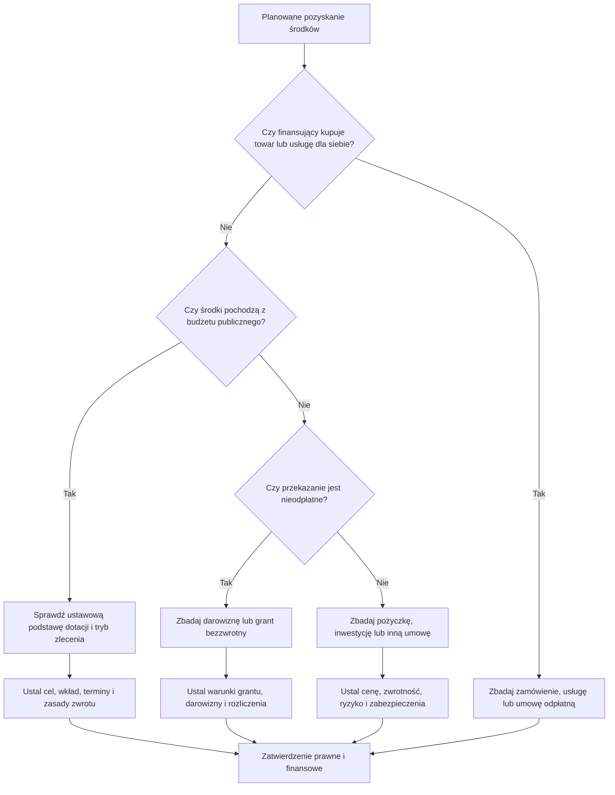
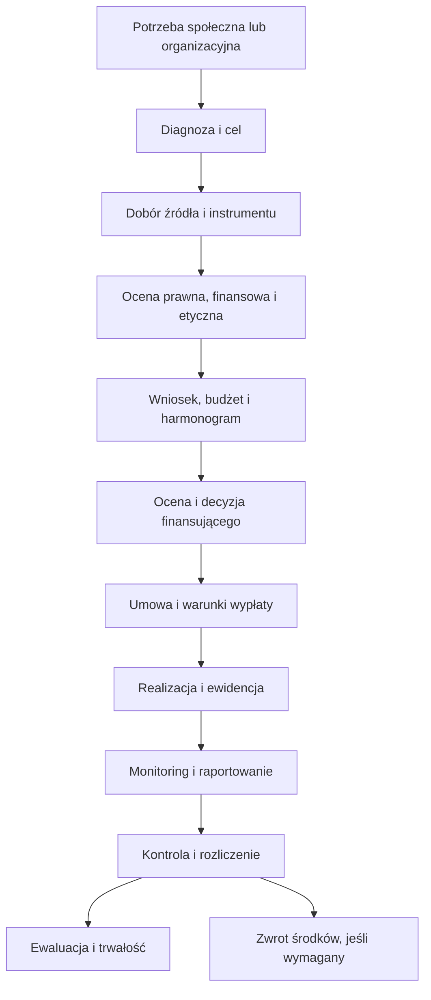

# ✠ ❦ ✧ ROZDZIAŁ 6.1 ✧ ❦ ✠

## INSTRUMENTY FINANSOWANIA

### Dotacje celowe, granty międzynarodowe, darowizny, umowy finansowania projektów, porozumienia o współpracy, finansowanie programów społecznych, zadań publicznych, inicjatyw obywatelskich, działalności statutowej, pomocy humanitarnej i rozwoju organizacji

> **Stan odniesienia prawnego i organizacyjnego: 25 listopada 2026 r.**  
> Materiał ma charakter edukacyjny. Nie zastępuje indywidualnej opinii prawnej, podatkowej ani analizy warunków konkretnego konkursu lub umowy. W finansowaniu transgranicznym należy każdorazowo sprawdzić prawo właściwe, status finansującego i odbiorcy, warunki programu, zasady transferu środków oraz wymagania dotyczące kontroli i sprawozdawczości.

---

## 1. Cel, zakres i efekty kształcenia

### 1.1. Cel rozdziału

Celem rozdziału jest przedstawienie instrumentów, za pomocą których organizacje pozarządowe, fundacje, stowarzyszenia, instytucje publiczne, organizacje międzynarodowe, fundacje grantodawcze, podmioty humanitarne i partnerzy społeczni przekazują lub udostępniają środki na realizację celów społecznych, edukacyjnych, opiekuńczych, zdrowotnych, religijnych, rozwojowych i humanitarnych.

Uczestnik ma nauczyć się rozpoznawać nie tylko nazwę finansowania, lecz przede wszystkim jego rzeczywistą konstrukcję. Ten sam przepływ pieniężny może być w dokumentach określany jako grant, dotacja, wsparcie, dofinansowanie, darowizna, wkład partnerski lub środki projektowe, jednak nazwa użyta przez strony nie przesądza sama o kwalifikacji prawnej, podatkowej ani rachunkowej.

Prawidłowe rozpoznanie instrumentu powinno poprzedzać:
- przyjęcie zobowiązania przez organizację;
- przygotowanie budżetu;
- podpisanie umowy;
- uruchomienie rachunku lub ewidencji projektu;
- przekazanie środków jednostce wewnętrznej albo partnerowi;
- rozpoczęcie wydatków;
- określenie obowiązków sprawozdawczych i kontrolnych.

### 1.2. Zakres opracowania

Rozdział obejmuje dwanaście zagadnień przewidzianych w spisie treści:

1. dotację celową;
2. grant międzynarodowy;
3. umowę darowizny;
4. umowę o finansowanie projektu;
5. umowę o współpracy organizacji;
6. finansowanie programu społecznego;
7. finansowanie zadania publicznego;
8. finansowanie inicjatywy obywatelskiej;
9. finansowanie działalności statutowej;
10. finansowanie działań humanitarnych;
11. finansowanie rozwoju organizacji;
12. finansowanie działań partnerskich.

Dla zachowania porządku rozdział omawia również formy przekazywania środków, finansowanie bezpośrednie i pośrednie, wkład własny, finansowanie wieloletnie, finansowanie oparte na kosztach, ryczałtach lub rezultatach oraz podstawowe zasady zarządzania ryzykiem.

### 1.3. Efekty uczenia się

Po zakończeniu nauki uczestnik powinien potrafić:

1. odróżnić źródło finansowania od instrumentu prawnego i technicznego sposobu wypłaty;
2. rozpoznać, czy środki pochodzą z budżetu publicznego, funduszu celowego, budżetu Unii Europejskiej, organizacji międzynarodowej, fundacji prywatnej czy przedsiębiorstwa;
3. ustalić, czy przekazanie środków jest dotacją w rozumieniu prawa finansów publicznych, grantem w rozumieniu regulaminu programu, darowizną, świadczeniem wynikającym z umowy czy zapłatą za usługę;
4. dobrać instrument do celu, czasu trwania, ryzyka i zdolności organizacyjnej projektu;
5. zaplanować finansowanie bezpośrednie i pośrednie;
6. rozpoznać obowiązek wkładu własnego i prawidłowo go udokumentować;
7. ocenić, czy finansowanie może być przekazywane dalej partnerom lub beneficjentom;
8. przygotować podstawową kartę warunków finansowania;
9. wskazać ryzyka podwójnego finansowania, niekwalifikowalności wydatków, nieosiągnięcia rezultatów, kursowe i płynnościowe;
10. zaprojektować minimalny system kontroli i rozliczenia instrumentu.

### 1.4. Powiązanie z innymi rozdziałami

- Rozdział 4.3 omawia system pozyskiwania środków, kanały fundraisingowe, darowizny, zbiórki i sponsoring.
- Rozdziały 5.1 i 5.2 omawiają charakter organizacji międzynarodowych, status prawny uczestników współpracy, reprezentację i umocowanie.
- Rozdział 6.2 pogłębia różnice pomiędzy dotacją, grantem i darowizną. W niniejszym rozdziale rozróżnienia te służą przede wszystkim do wyboru instrumentu, nie zastępują pełnej analizy prawnej.
- Rozdział 6.3 będzie dotyczył struktury relacji pomiędzy finansującym, realizatorem, partnerami, jednostkami organizacyjnymi i odbiorcami.
- Rozdziały 8 i 9 rozwijają przygotowanie projektu, rozliczenia transgraniczne, podatki, bezpieczeństwo finansowe i ochronę informacji.

### 1.5. Zasada nadrzędna

**Nie należy podpisywać umowy wyłącznie dlatego, że jej nazwa brzmi korzystnie.** Najpierw trzeba ustalić, co finansujący rzeczywiście przekazuje, czego oczekuje w zamian, jakie ryzyko przejmuje organizacja i na jakich warunkach środki mogą być wydane.

---

## 2. Instrument finansowania – pojęcie i podstawowe rozróżnienia

### 2.1. Instrument jako konstrukcja przekazania zasobów

Instrument finansowania to uporządkowany mechanizm, za pomocą którego podmiot finansujący udostępnia organizacji zasoby pieniężne, rzeczowe lub inne świadczenia w celu osiągnięcia określonego celu.

Instrument powinien odpowiadać na co najmniej siedem pytań:

1. Kto przekazuje środki?
2. Kto je otrzymuje?
3. Jaki cel ma zostać osiągnięty?
4. Czy odbiorca ma obowiązek świadczenia wzajemnego?
5. Czy środki są zwrotne, bezzwrotne, warunkowe czy rozliczane po wykonaniu zadania?
6. Według jakiej metody ustala się kwotę należną?
7. Jakie dokumenty potwierdzają prawidłowe wykorzystanie środków?

### 2.2. Źródło, instrument i przepływ – trzy różne poziomy

| Poziom | Pytanie | Przykład |
|:--|:--|:--|
| Źródło | Skąd pochodzą środki? | budżet samorządu, program UE, fundacja zagraniczna |
| Instrument | Na jakiej podstawie środki są przekazywane? | dotacja celowa, grant, darowizna, pożyczka |
| Przepływ | W jaki sposób środki docierają do realizatora? | zaliczka, transze, refundacja, płatność po osiągnięciu etapu |

Przykład: środki pochodzą z programu Unii Europejskiej, są przyznawane w formie grantu na projekt społeczny, a wypłacane w postaci zaliczki, płatności okresowych i płatności końcowej. „Program UE” jest źródłem, „grant” instrumentem, a „zaliczka i transze” sposobem przepływu.

### 2.3. Klasyfikacja według źródła

| Źródło | Typowy finansujący | Charakterystyczne wymagania |
|:--|:--|:--|
| Publiczne krajowe | minister, wojewoda, samorząd, agencja publiczna | podstawa ustawowa, konkurs lub inny tryb, kontrola środków publicznych |
| Unijne | Komisja Europejska, agencja, instytucja zarządzająca | regulamin programu, umowa grantowa, zasady kwalifikowalności i audytu |
| Międzynarodowe wielostronne | organizacja systemu ONZ, fundusz wielostronny, bank rozwoju | procedury partnerstwa, ocena zdolności, standardy ochronne i sprawozdawcze |
| Zagraniczne publiczne | ministerstwo, agencja rozwoju, ambasada lub fundusz państwowy | przepisy kraju finansującego, warunki programu, wymogi transgraniczne |
| Prywatne filantropijne | fundacja, fundusz rodzinny, organizacja dobroczynna | umowa, regulamin grantowy, polityka grantodawcy |
| Korporacyjne | przedsiębiorstwo, fundacja korporacyjna | zasady etyczne, konflikt interesów, widoczność sponsora, zgodność z prawem konkurencji |
| Społecznościowe | darczyńcy indywidualni, platforma zbiórkowa | regulamin platformy, przejrzystość kampanii, ochrona danych |
| Partnerskie | kilka organizacji łączących zasoby | podział odpowiedzialności, wkłady, zarządzanie i rozliczenie |

### 2.4. Klasyfikacja według celu

1. **Finansowanie projektu** – wspiera określone działania, harmonogram i rezultaty.
2. **Finansowanie programu** – obejmuje zestaw powiązanych projektów lub usług realizowanych w dłuższym okresie.
3. **Finansowanie instytucjonalne** – wzmacnia zdolność organizacji do wykonywania jej misji, w tym zasoby kadrowe, administracyjne i systemy.
4. **Finansowanie operacyjne** – pokrywa uzgodnioną część bieżącego funkcjonowania organizacji.
5. **Finansowanie rozwojowe** – służy budowaniu nowych kompetencji, infrastruktury, procedur, partnerstw lub systemów.
6. **Finansowanie kryzysowe i humanitarne** – odpowiada na pilne potrzeby osób dotkniętych kryzysem, katastrofą lub konfliktem.
7. **Finansowanie inwestycyjne** – służy nabyciu, budowie lub ulepszeniu składników majątku.
8. **Finansowanie pomocy bezpośredniej** – zasila wsparcie osób lub rodzin, zgodnie z kryteriami programu.

### 2.5. Klasyfikacja według sposobu rozliczania

- refundacja rzeczywiście poniesionych kosztów;
- płatność według stawek jednostkowych;
- finansowanie ryczałtowe;
- kwota ryczałtowa za uzgodniony pakiet działań lub rezultatów;
- płatność po osiągnięciu kamieni milowych;
- finansowanie niepowiązane bezpośrednio z kosztami, oparte na warunkach lub wskaźnikach;
- wkład rzeczowy lub usługowy;
- instrument zwrotny, np. pożyczka albo gwarancja.

Nie należy utożsamiać uproszczonej metody rozliczania z brakiem obowiązku wykazania, że działanie zostało wykonane. Ryczałt może ograniczać konieczność przedstawiania każdego dokumentu kosztowego, ale zwykle wymaga wiarygodnego potwierdzenia rezultatów i spełnienia warunków umowy.

---

## 3. Mapa doboru instrumentu finansowania

### 3.1. Pytania diagnostyczne

Przed wyborem instrumentu organizacja powinna przeprowadzić krótką diagnozę:

1. Czy finansujący dysponuje środkami publicznymi?
2. Czy istnieje szczególna ustawa, program albo regulamin?
3. Czy finansujący kupuje konkretną usługę, czy wspiera realizację celu publicznego lub społecznego?
4. Czy przekazanie ma charakter nieodpłatny?
5. Czy organizacja ma wykonać projekt samodzielnie, czy w konsorcjum?
6. Czy dopuszczalne jest przekazywanie środków dalszym realizatorom?
7. Czy wymagany jest wkład własny?
8. Czy finansowanie jest zaliczkowe, refundacyjne czy mieszane?
9. Czy organizacja może pokryć koszty przed otrzymaniem refundacji?
10. Czy okres finansowania odpowiada okresowi potrzebnemu do osiągnięcia trwałego rezultatu?

### 3.2. Schemat wstępnej kwalifikacji

Schemat ma charakter orientacyjny. W praktyce niektóre programy łączą kilka konstrukcji, a kwalifikacja wymaga analizy przepisów szczególnych i treści dokumentów.

### 3.3. Macierz doboru

| Potrzeba organizacji | Instrument, który warto zbadać | Główne ryzyko |
|:--|:--|:--|
| Realizacja zadania publicznego zleconego przez samorząd | dotacja celowa na wsparcie lub powierzenie | niezgodność wydatków z umową i trybem publicznym |
| Projekt międzynarodowy z partnerami | grant projektowy lub umowa finansowania | niejasny podział obowiązków i kosztów |
| Finansowanie konkretnego celu bez świadczenia wzajemnego | darowizna celowa | nieprecyzyjne określenie celu i skutków niewykonania |
| Pokrycie części kosztów programu społecznego | grant programowy lub umowa o finansowanie | brak płynności lub niedoszacowanie kosztów |
| Długofalowe utrzymanie zdolności organizacji | grant instytucjonalny lub operacyjny | nadmierna zależność od jednego grantodawcy |
| Wspólne działanie kilku organizacji | umowa partnerska i odrębne umowy finansowe | rozproszenie odpowiedzialności |
| Szybka reakcja humanitarna | grant kryzysowy, fundusz celowy, finansowanie rzeczowe | opóźnienia, bezpieczeństwo i brak kontroli łańcucha dostaw |
| Zaangażowanie mieszkańców w zadanie lokalne | inicjatywa lokalna | błędne założenie, że jest to zwykła dotacja dla NGO |

---

## 4. Dotacja celowa

### 4.1. Dotacja jako instrument prawa finansów publicznych

W polskim prawie dotacja nie jest ogólną nazwą każdego bezzwrotnego przekazania pieniędzy. Ustawa o finansach publicznych określa dotacje jako środki z budżetu państwa, budżetów jednostek samorządu terytorialnego oraz państwowych funduszy celowych, podlegające szczególnym zasadom rozliczania i przeznaczone na finansowanie lub dofinansowanie zadań publicznych na podstawie ustawy, odrębnych ustaw lub umów międzynarodowych.

Art. 126 ustawy o finansach publicznych zawiera definicję dotacji, a art. 127 wskazuje kategorie dotacji celowych. Wśród nich znajdują się m.in. środki na finansowanie lub dofinansowanie zadań zleconych do realizacji organizacjom pozarządowym oraz określonych programów i projektów finansowanych z udziałem środków europejskich.

Z tego wynika ważna zasada praktyczna: **prywatny grant zagranicznej fundacji nie staje się dotacją celową w rozumieniu ustawy o finansach publicznych tylko dlatego, że strony nazwą go „dotacją”**. O kwalifikacji decydują źródło, podstawa prawna, charakter relacji i właściwe przepisy.

### 4.2. Dotacja na finansowanie i dotacja na dofinansowanie

W systemie zlecania zadań publicznych ustawa o działalności pożytku publicznego i o wolontariacie rozróżnia:

- **powierzenie realizacji zadania publicznego** – wraz z udzieleniem dotacji na finansowanie jego realizacji;
- **wspieranie realizacji zadania publicznego** – wraz z udzieleniem dotacji na dofinansowanie jego realizacji.

Wybór trybu ma znaczenie dla budżetu, wkładu organizacji i sposobu przedstawienia źródeł finansowania. Nie należy automatycznie zakładać, że każda dotacja pokrywa 100% kosztów albo że każdy konkurs wymaga identycznego procentowego wkładu własnego. Decydują przepisy, ogłoszenie konkursowe, program i umowa.

### 4.3. Podstawowe elementy umowy dotacyjnej

Umowa powinna w szczególności porządkować:

1. szczegółowy opis zadania;
2. cel i termin wykonania;
3. wysokość dotacji;
4. harmonogram i tryb płatności;
5. termin wykorzystania środków;
6. zasady kwalifikowalności wydatków;
7. zakres dopuszczalnych przesunięć budżetowych;
8. sposób prowadzenia ewidencji;
9. sposób i termin rozliczenia rzeczowego oraz finansowego;
10. tryb kontroli;
11. termin i sposób zwrotu niewykorzystanych lub nieprawidłowo wykorzystanych środków;
12. zasady informowania o zmianach w projekcie.

Art. 150 i 151 ustawy o finansach publicznych wskazują elementy umów dotyczących dotacji celowych udzielanych przez dysponentów części budżetowych, a art. 221 reguluje dotacje z budżetów jednostek samorządu terytorialnego dla podmiotów spoza sektora finansów publicznych, które nie działają w celu osiągnięcia zysku, na cele publiczne związane z zadaniami danej jednostki.

W przypadku dotacji z budżetu samorządu, udzielanej na podstawie art. 221 ustawy o finansach publicznych, należy sprawdzić również uchwałę organu stanowiącego określającą tryb postępowania, sposób rozliczania i kontroli, jeżeli chodzi o zadania inne niż objęte ustawą o działalności pożytku publicznego.

### 4.4. Wkład własny – zasady planowania

Wkład własny może mieć postać:

- środków pieniężnych organizacji;
- środków z innych źródeł;
- wkładu rzeczowego;
- pracy społecznej lub wolontariackiej, jeśli regulamin dopuszcza jej wycenę;
- udostępnienia pomieszczeń, sprzętu lub infrastruktury;
- innych zasobów zaakceptowanych przez finansującego.

Każdy wkład powinien być:
1. dopuszczony przez regulamin lub umowę;
2. realny i możliwy do wykazania;
3. wyceniony według przyjętej metody;
4. przypisany do konkretnego zadania;
5. wolny od podwójnego wykazywania w kilku projektach;
6. możliwy do udokumentowania w razie kontroli.

### 4.5. Zmiany obowiązujące od 1 września 2026 r.

Ustawa z 19 czerwca 2026 r. o zmianie ustawy o działalności pożytku publicznego i o wolontariacie oraz ustawy o grach hazardowych (Dz. U. z 2026 r. poz. 1040) wprowadziła m.in. nowe rozwiązania dotyczące wkładów przy zlecaniu zadań publicznych.

W przypadku zlecania zadania w formie wspierania organizacja zapewnia wkład rzeczowy lub osobowy. Jeżeli organ zlecający dopuści taką możliwość, całość albo część tych wkładów może zostać zastąpiona środkami finansowymi własnymi lub pochodzącymi z innych źródeł; informację o tym należy zawrzeć w ofercie. W przypadku dofinansowania przez samorząd inwestycji związanych z realizacją zadania publicznego, o których mowa w art. 221 ustawy o finansach publicznych, wymagane jest zapewnienie środków finansowych własnych lub pochodzących z innych źródeł.

Nowelizacja przewidziała także zmiany w zasadach małych grantów, które wchodzą w życie **1 stycznia 2027 r.** Nie wolno stosować przyszłych limitów do postępowań, do których mają zastosowanie przepisy dotychczasowe.

Na dzień 25 listopada 2026 r. art. 19a ustawy w brzmieniu obowiązującym przewiduje m.in. limit 10 000 zł dofinansowania lub finansowania pojedynczego zadania oraz okres realizacji nie dłuższy niż 90 dni. Łączna kwota środków przekazanych temu samemu podmiotowi w tym trybie w danym roku kalendarzowym nie może przekroczyć 20 000 zł, a pula małych grantów nie może przekroczyć 20% dotacji planowanych w danym roku budżetowym na realizację zadań publicznych. Od 1 stycznia 2027 r. ustawa przewiduje zmianę tych wartości odpowiednio do 20 000 zł, 40 000 zł i 30%. Przed złożeniem oferty należy sprawdzić datę wszczęcia postępowania i przepisy przejściowe.

### 4.6. Ewidencja i rozliczenie

Art. 152 ustawy o finansach publicznych oraz art. 16 ust. 5 ustawy o działalności pożytku publicznego przewidują wyodrębnienie ewidencji środków otrzymanych na realizację zadania i wydatków z tych środków. Zakres techniczny ewidencji należy dopasować do rodzaju podmiotu, jego polityki rachunkowości, umowy i przepisów szczególnych.

Organizacja powinna zapewnić:
- identyfikowalność każdej transakcji;
- przypisanie kosztu do zadania i pozycji budżetu;
- dowód zapłaty;
- dokument źródłowy;
- kontrolę kwalifikowalności;
- rozdzielenie kosztów projektu od kosztów innych działań;
- uzgodnienie ewidencji księgowej z raportem dla finansującego.

### 4.7. Kiedy dotacja celowa jest właściwa?

Dotacja celowa jest właściwym instrumentem wtedy, gdy istnieje odpowiednia podstawa prawna, finansujący jest uprawniony do jej udzielenia, zadanie mieści się w jego kompetencjach i celach programu, a organizacja spełnia kryteria podmiotowe i merytoryczne.

Nie należy stosować tej nazwy do dowolnego transferu prywatnego, aby uzyskać pozór szczególnego statusu lub preferencji prawnej.

---

## 5. Grant międzynarodowy

### 5.1. Charakterystyka grantu

Grant międzynarodowy to bezzwrotne lub warunkowo bezzwrotne finansowanie udzielane przez podmiot zagraniczny, wielostronny albo ponadnarodowy na realizację projektu, programu, działań statutowych lub rozwoju organizacji. Szczegółowa konstrukcja wynika z regulaminu programu, decyzji grantowej i umowy.

W praktyce grant może być:
- grantem projektowym;
- grantem operacyjnym lub instytucjonalnym;
- grantem wieloletnim;
- grantem partnerskim;
- grantem humanitarnym;
- grantem rozwojowym;
- grantem przekazywanym przez operatora lub pośrednika;
- grantem obejmującym dalsze wsparcie mniejszych organizacji.

Warto pamiętać, że słowo „grant” nie tworzy jednej uniwersalnej umowy nazwanej w polskim prawie cywilnym. W zależności od źródła i treści może chodzić o umowę grantową opartą na regulaminie programu, umowę nienazwaną, darowiznę z warunkami, instrument publicznoprawny albo szczególną umowę wynikającą z prawa programu.

### 5.2. Grant projektowy i grant operacyjny

**Grant projektowy** finansuje określone działanie lub zestaw działań. Zwykle wymaga:
- opisu problemu;
- celu i rezultatów;
- harmonogramu;
- budżetu;
- wskaźników;
- planu zarządzania;
- informacji o partnerach;
- raportowania.

**Grant operacyjny lub instytucjonalny** wspiera funkcjonowanie organizacji albo jej uzgodniony program pracy. Może obejmować koszty personelu, administracji, systemów informatycznych, zarządzania, rozwoju kompetencji i utrzymania zdolności do realizacji misji. Nie oznacza to automatycznie swobody wydatkowania bez ograniczeń – grantodawca określa dopuszczalne koszty, okres i sposób rozliczenia.

W prawie finansowym Unii Europejskiej art. 183 rozporządzenia 2024/2509 odróżnia granty na działanie (action grants) od grantów operacyjnych (operating grants). To rozróżnienie odnosi się do grantów objętych zakresem tego rozporządzenia, a nie automatycznie do każdego prywatnego grantu międzynarodowego.

### 5.3. Granty Unii Europejskiej

W programach zarządzanych bezpośrednio przez instytucje Unii Europejskiej grant jest przyznawany na podstawie opublikowanego zaproszenia do składania wniosków, z wyjątkami określonymi w przepisach. Po pozytywnej ocenie i decyzji o przyznaniu wsparcia zawierana jest umowa grantowa.

Organizacja powinna sprawdzić:
1. kto jest instytucją przyznającą grant;
2. czy konkurs jest prowadzony w zarządzaniu bezpośrednim, pośrednim czy dzielonym;
3. jakie podmioty mogą być wnioskodawcami;
4. czy wymagane jest partnerstwo międzynarodowe;
5. jakie są kryteria kwalifikowalności i wyboru;
6. czy wnioskodawca musi wykazać zdolność finansową i operacyjną;
7. jaka jest forma finansowania;
8. jakie są zasady wkładu własnego;
9. jakie są ograniczenia dotyczące kumulacji grantów i podwójnego finansowania;
10. jakie obowiązki sprawozdawcze, audytowe i informacyjne będą obowiązywać.

### 5.4. Formy wkładu Unii Europejskiej

Art. 125 rozporządzenia Parlamentu Europejskiego i Rady (UE, Euratom) 2024/2509 przewiduje różne formy wkładu z budżetu Unii, m.in.:

- finansowanie niepowiązane bezpośrednio z kosztami, oparte na spełnieniu warunków lub osiągnięciu określonych rezultatów;
- zwrot rzeczywiście poniesionych kosztów kwalifikowalnych;
- koszty jednostkowe;
- kwoty ryczałtowe;
- finansowanie stawką ryczałtową;
- połączenie kilku form.

Nie każda forma będzie dostępna w każdym programie. Odpowiednią metodę określa właściwy akt, program, zaproszenie i umowa.

**Zwrot kosztów rzeczywistych** wymaga udokumentowania poniesionych kosztów i wykazania ich kwalifikowalności.

**Koszt jednostkowy** polega na zastosowaniu z góry określonej stawki do liczby jednostek, np. liczby godzin, dni, uczestników lub innych jednostek wskazanych w programie.

**Kwota ryczałtowa** obejmuje określony zakres kosztów lub działania w ustalonej z góry kwocie. Rozliczenie może być powiązane z wykonaniem uzgodnionego pakietu działań lub rezultatów.

**Stawka ryczałtowa** polega na obliczeniu określonej kategorii kosztu według procentu lub innej stawki przewidzianej w regulaminie.

**Finansowanie oparte na rezultatach** wiąże wypłatę z osiągnięciem wcześniej określonych kamieni milowych, wskaźników lub warunków. Wymaga szczególnie starannego zaprojektowania mierników i dowodów ich osiągnięcia.

### 5.5. Zasady grantów z budżetu UE

Rozporządzenie 2024/2509 wskazuje podstawowe zasady grantów, w tym:
- równe traktowanie;
- przejrzystość;
- współfinansowanie;
- zakaz niedozwolonej kumulacji i podwójnego finansowania tych samych kosztów;
- zasadę nieretroaktywności;
- zasadę nienastawienia na osiągnięcie zysku, z wyjątkami przewidzianymi w rozporządzeniu.

Nie należy przenosić tych zasad automatycznie na każdy prywatny grant. W przypadku finansowania prywatnego obowiązują warunki umowy i właściwe przepisy. W przypadku grantu unijnego należy czytać rozporządzenie, program, zaproszenie i umowę łącznie.

### 5.6. Wkład własny w grancie międzynarodowym

Wkład własny może być pieniężny albo rzeczowy, jeżeli program dopuszcza jego uznanie. Może pochodzić z zasobów organizacji, przychodów projektu albo wkładów stron trzecich. Nie należy zakładać, że każda praca wolontariusza, użyczenie sali czy nieodpłatna usługa automatycznie stanowi kwalifikowalny wkład własny.

Przed wyceną wkładu trzeba ustalić:
- czy wkład jest wymagany;
- czy dopuszcza się wkład rzeczowy;
- czy praca społeczna może być wyceniona;
- jaka metoda wyceny jest akceptowana;
- jakie dowody trzeba zgromadzić;
- czy wkład można łączyć z innymi źródłami;
- czy ten sam wkład nie został już wykazany w innym projekcie.

### 5.7. Zaliczki, transze i płatność końcowa

Grantodawca może stosować:
- zaliczkę po podpisaniu umowy;
- transze po spełnieniu warunków;
- płatności okresowe;
- refundację kosztów;
- płatność końcową po zatwierdzeniu raportu.

Organizacja powinna obliczyć, czy posiada płynność wystarczającą do ponoszenia wydatków przed refundacją. Wysokość grantu nie jest równoznaczna z dostępnością gotówki w każdym momencie realizacji.

### 5.8. Umowa grantowa i jej zmiany

Umowa grantowa powinna określać co najmniej:
- cel i zakres działania;
- strony i partnerów;
- okres realizacji;
- budżet i źródła finansowania;
- zasady płatności;
- koszty kwalifikowalne i niekwalifikowalne;
- zasady zmian budżetowych;
- wskaźniki i rezultaty;
- obowiązki raportowe;
- kontrolę i audyt;
- zasady widoczności finansowania;
- prawa do rezultatów i własności intelektualnej;
- odpowiedzialność za naruszenia;
- zasady zwrotu środków;
- warunki rozwiązania umowy;
- prawo właściwe i sposób rozwiązywania sporów.

Komisja Europejska wskazuje, że zmiany umów grantowych wymagają formy i trybu przewidzianego w danej umowie. Organizacja nie powinna wprowadzać istotnych zmian w projekcie wyłącznie na podstawie ustnej zgody opiekuna projektu.

---

## 6. Umowa darowizny jako instrument finansowania

### 6.1. Zastosowanie darowizny

Darowizna może być wykorzystywana do finansowania:
- konkretnego wydarzenia;
- zakupu wyposażenia;
- programu edukacyjnego;
- pomocy rodzinom;
- działalności opiekuńczej;
- działań religijnych;
- rozwoju organizacji;
- kosztów inwestycyjnych;
- wkładu własnego do projektu, jeżeli grantodawca dopuszcza takie źródło.

Darowizna może być pieniężna lub rzeczowa, jednorazowa albo powtarzalna, przeznaczona na określony cel albo przekazana bez szczególnego ograniczenia celu.

### 6.2. Darowizna od zagranicznej organizacji

Przy darowiźnie transgranicznej należy ustalić:
1. kto jest rzeczywistym darczyńcą;
2. czy darczyńca ma zdolność do dokonania przysporzenia;
3. czy osoba podpisująca ma właściwe umocowanie;
4. czy darowizna ma określony cel lub polecenie;
5. jakie prawo reguluje umowę;
6. czy występują ograniczenia dotyczące waluty lub transferu;
7. czy darowizna jest powiązana z innym świadczeniem;
8. jakie skutki podatkowe i księgowe powstają po stronie odbiorcy.

### 6.3. Darowizna a niezależność organizacji

Darczyńca może wskazać cel, na który chce przeznaczyć środki, jednak organizacja powinna ocenić, czy warunki darowizny są zgodne z jej statutem, prawem, misją i zasadami etycznymi.

Należy odmówić przyjęcia środków, jeżeli warunki:
- wymagają działań niezgodnych z prawem;
- naruszają godność lub prawa odbiorców pomocy;
- wymuszają nieuprawnione ujawnianie danych;
- prowadzą do konfliktu interesów;
- pozbawiają organizację niezależności w sposób sprzeczny z jej celami;
- tworzą ryzyko wykorzystania organizacji do ukrycia pochodzenia środków.

### 6.4. Minimalna dokumentacja

W dokumentacji darowizny warto zachować:
- umowę lub oświadczenie darczyńcy;
- dokument potwierdzający przyjęcie darowizny;
- dowód transferu;
- opis celu;
- zgodę właściwego organu organizacji, jeśli wymaga tego statut lub regulamin;
- potwierdzenie zgodności darowizny z celami statutowymi;
- zapis w ewidencji księgowej;
- raport z wykorzystania środków, jeżeli wynika z umowy lub przyjętej polityki.

Szczegółowe konstrukcje darowizny, jej formę, polecenie i odpowiedzialność obdarowanego rozwijają rozdziały 3.1–3.5 oraz 4.1–4.3.

---

## 7. Umowa o finansowanie projektu

### 7.1. Pojęcie i funkcja

Umowa o finansowanie projektu porządkuje przekazanie środków na określone przedsięwzięcie. Może być zawierana między organizacją finansującą a organizacją realizującą, między operatorem programu a realizatorem albo między organizacjami współfinansującymi wspólny projekt.

Nie jest to jedna uniwersalna umowa nazwana w polskim prawie. Jej konstrukcja zależy od źródła finansowania, rodzaju świadczeń, przepisów szczególnych i rzeczywistego celu relacji.

### 7.2. Podstawowe elementy

1. identyfikacja stron;
2. definicje projektu i jego rezultatów;
3. cel i grupa odbiorców;
4. zakres rzeczowy;
5. harmonogram;
6. budżet;
7. kwota finansowania;
8. wkład własny;
9. zasady płatności;
10. katalog wydatków dopuszczalnych;
11. zasady dokonywania zakupów;
12. zasady zatrudniania i angażowania osób;
13. monitorowanie rezultatów;
14. raportowanie;
15. kontrola i audyt;
16. prawa do materiałów, danych i rezultatów;
17. zasady informowania o finansowaniu;
18. ochrona danych;
19. odpowiedzialność stron;
20. zmiany, zawieszenie i zakończenie projektu.

### 7.3. Budżet jako część umowy

Budżet powinien być możliwy do odczytania przez osobę, która nie uczestniczyła w przygotowaniu projektu. Każda pozycja powinna zawierać:
- nazwę kosztu;
- jednostkę miary;
- liczbę jednostek;
- stawkę;
- wartość całkowitą;
- źródło finansowania;
- uzasadnienie związku z projektem;
- informację o podatku VAT, jeśli jest istotna;
- wskazanie, czy koszt jest bezpośredni czy pośredni.

Przykład uproszczony:

| Pozycja | Jednostka | Ilość | Stawka | Wartość |
|:--|--:|--:|--:|--:|
| Warsztaty dla rodzin | spotkanie | 12 | 1 500 zł | 18 000 zł |
| Materiały edukacyjne | pakiet | 100 | 45 zł | 4 500 zł |
| Koordynacja projektu | miesiąc | 6 | 2 000 zł | 12 000 zł |
| Dostępność i tłumaczenia | pakiet | 1 | 5 000 zł | 5 000 zł |
| Ewaluacja | usługa | 1 | 3 500 zł | 3 500 zł |
| **Razem** |  |  |  | **43 000 zł** |

Tabela jest przykładem planistycznym, a nie wzorem kwalifikowalności. Każda pozycja musi być dopuszczona przez konkretny regulamin i umowę.

### 7.4. Zmiany w projekcie

Umowa powinna określać, które zmiany wymagają uprzedniej zgody finansującego, a które mogą być dokonywane w ramach limitów lub przesunięć. Szczególnej kontroli wymagają:
- zmiana celu;
- zmiana grupy odbiorców;
- wydłużenie okresu realizacji;
- zmiana partnera;
- istotne przesunięcia budżetowe;
- zmiana metody osiągania rezultatów;
- zmiana rachunku bankowego;
- przekazanie części zadań podmiotowi trzeciemu.

Zasada operacyjna: jeżeli zmiana może wpłynąć na zgodność z umową, należy uzyskać zgodę w formie przewidzianej w umowie przed jej wdrożeniem.

---

## 8. Umowa o współpracy organizacji

### 8.1. Cel porozumienia

Umowa o współpracy określa sposób wspólnego działania co najmniej dwóch podmiotów. Może dotyczyć:
- przygotowania wspólnego projektu;
- wymiany wiedzy i ekspertów;
- udostępniania infrastruktury;
- organizacji wydarzeń;
- wspólnego świadczenia pomocy;
- prowadzenia działań edukacyjnych;
- współpracy w projektach międzynarodowych;
- wspólnego pozyskiwania finansowania.

Porozumienie o współpracy nie musi samo w sobie być instrumentem przekazania pieniędzy. Może jedynie ustalać zasady współdziałania, podczas gdy finansowanie jest regulowane odrębną umową.

### 8.2. Co należy uregulować?

1. cel i zakres współpracy;
2. zadania każdej strony;
3. osoby kontaktowe;
4. sposób podejmowania decyzji;
5. harmonogram;
6. zasady finansowania;
7. wkłady rzeczowe i osobowe;
8. odpowiedzialność za działania własne;
9. zasady używania nazw, znaków i materiałów;
10. własność intelektualną;
11. ochronę danych;
12. poufność;
13. konflikty interesów;
14. zasady rozwiązywania sporów;
15. czas obowiązywania i zakończenie współpracy.

### 8.3. Rozdzielenie porozumienia od umowy finansowej

Jeżeli partner A przekazuje partnerowi B 20 000 euro na realizację określonej części projektu, porozumienie o współpracy powinno być uzupełnione dokumentem, który jasno określi:
- czy jest to grant, darowizna, zaliczka, refundacja czy zapłata;
- czy partner B działa jako współbeneficjent, podwykonawca czy realizator dalszego wsparcia;
- jakie koszty może pokrywać;
- jak ma dokumentować wydatki;
- kto odpowiada za zwrot środków;
- jakie uprawnienia kontrolne ma partner A.

Nie należy pozostawiać tych kwestii wyłącznie w korespondencji elektronicznej lub ustnych ustaleniach.

---

## 9. Finansowanie programu społecznego

### 9.1. Program a pojedynczy projekt

Program społeczny jest zwykle szerszy niż pojedynczy projekt. Może obejmować kilka etapów, lokalizacji, grup odbiorców i działań. Przykładowo program wspierania rodzin może składać się z:
- diagnozy potrzeb;
- konsultacji specjalistycznych;
- warsztatów edukacyjnych;
- poradnictwa;
- wsparcia opiekuńczego;
- szkoleń dla osób pomagających;
- ewaluacji i rozwoju modelu.

Finansowanie programu powinno umożliwiać ocenę zarówno pojedynczych działań, jak i łącznego wpływu programu.

### 9.2. Modele finansowania programu

1. grant jednego finansującego na cały program;
2. kilka grantów przypisanych do odrębnych komponentów;
3. finansowanie publiczne połączone z prywatnym;
4. grant instytucjonalny połączony z finansowaniem projektowym;
5. umowa wieloletnia z corocznym planem działań;
6. finansowanie przez operatora, który przekazuje środki realizatorom;
7. połączenie finansowania pieniężnego i wkładu rzeczowego.

### 9.3. Planowanie programu

Program powinien mieć:
- diagnozę społeczną;
- teorię zmiany;
- cele długoterminowe;
- rezultaty bezpośrednie;
- wskaźniki;
- plan działań;
- budżet roczny i wieloletni;
- plan trwałości;
- system monitorowania;
- plan ochrony odbiorców;
- zasady współpracy z partnerami.

### 9.4. Przykład konstrukcji

Program „Rodzina i Wspólnota” może obejmować trzyletni okres realizacji. Finansowanie jest dzielone na komponenty:
- edukacja i profilaktyka;
- poradnictwo i wsparcie;
- wolontariat i przygotowanie kadr;
- rozwój narzędzi cyfrowych;
- monitoring i ewaluacja.

Nie należy zakładać, że każdy grantodawca zaakceptuje finansowanie kosztów całego programu. Wniosek powinien dokładnie wskazywać, które działania są finansowane z danego instrumentu, a które z innych źródeł.

---

## 10. Finansowanie zadania publicznego

### 10.1. Podstawy współpracy administracji i organizacji

Ustawa o działalności pożytku publicznego i o wolontariacie określa zasady współpracy organów administracji publicznej z organizacjami pozarządowymi i innymi uprawnionymi podmiotami. Art. 11 przewiduje wspieranie lub powierzanie realizacji zadań publicznych, co do zasady w drodze otwartego konkursu ofert albo w trybach szczególnych wskazanych w ustawie.

Art. 16 określa umowę o wsparcie lub powierzenie realizacji zadania publicznego. Umowa wymaga formy pisemnej pod rygorem nieważności, a organizacja zobowiązuje się wykonać zadanie w zakresie i na zasadach w niej określonych. Ustawa przewiduje również obowiązek wyodrębnienia w ewidencji księgowej środków otrzymanych na realizację zadania.

### 10.2. Konkurs ofert

Konkurs powinien jasno określać:
- przedmiot zadania;
- adresatów;
- oczekiwane rezultaty;
- termin;
- wysokość środków;
- wymagania formalne;
- kryteria oceny;
- zasady wkładu własnego;
- sposób składania ofert;
- obowiązki sprawozdawcze.

Organizacja powinna ocenić, czy zadanie mieści się w jej celach statutowych i czy posiada odpowiednią zdolność organizacyjną, finansową i kadrową.

### 10.3. Wsparcie i powierzenie

W trybie wspierania organizacja otrzymuje dofinansowanie zadania i wnosi zasoby własne lub inne źródła finansowania w zakresie określonym w konkursie i umowie.

W trybie powierzania organ przekazuje dotację na finansowanie realizacji zadania. Nie zwalnia to organizacji z obowiązku prawidłowego wykonania zadania i rozliczenia środków.

### 10.4. Małe granty

Art. 19a przewiduje uproszczony tryb zlecania zadań publicznych o charakterze lokalnym lub regionalnym. Na dzień 25 listopada 2026 r. obowiązujące limity ustawowe wynoszą:
- maksymalnie 10 000 zł dofinansowania lub finansowania pojedynczego zadania;
- okres realizacji nie dłuższy niż 90 dni;
- maksymalnie 20 000 zł środków przekazanych temu samemu podmiotowi w danym roku kalendarzowym w tym trybie;
- pula środków w tym trybie nie może przekroczyć 20% dotacji planowanych w danym roku budżetowym na realizację zadań publicznych.

Zmiany zwiększające te wartości do 20 000 zł, 40 000 zł i 30% zostały uchwalone w 2026 r., ale zgodnie z przepisem wejścia w życie zaczną obowiązywać 1 stycznia 2027 r. Przy planowaniu zadania należy więc sprawdzić datę złożenia oferty i właściwe przepisy przejściowe.

### 10.5. Operator projektu i realizatorzy

Ustawa przewiduje również model, w którym operator projektu zleca realizację projektów wybranym realizatorom. W takim modelu operator odpowiada za zasady wyboru, monitorowania i oceniania realizatorów, a umowy z realizatorami powinny określać ich obowiązki i warunki przekazania środków.

To rozwiązanie należy odróżnić od zwykłego podwykonawstwa. Przekazanie środków na samodzielną realizację projektu może wymagać odrębnych zasad wyboru, umowy, raportowania i kontroli.

### 10.6. Praktyczna procedura

1. Ustalić właściwy organ administracji i zakres jego zadań.
2. Sprawdzić, czy zadanie mieści się w sferze pożytku publicznego.
3. Zweryfikować uprawnienie organizacji do udziału.
4. Przeczytać ogłoszenie konkursowe i regulamin.
5. Ustalić tryb: wsparcie, powierzenie, mały grant lub inny tryb ustawowy.
6. Opracować ofertę i budżet.
7. Udokumentować wkład własny.
8. Sprawdzić warunki umowy przed podpisaniem.
9. Wydzielić ewidencję.
10. Prowadzić dokumentację działań i wydatków.
11. Złożyć sprawozdanie.
12. Zwrócić środki w przypadkach i terminach przewidzianych prawem lub umową.

---

## 11. Finansowanie inicjatywy obywatelskiej

### 11.1. Inicjatywa lokalna – odmienny model

Inicjatywa lokalna, uregulowana w art. 19b–19h ustawy o działalności pożytku publicznego i o wolontariacie, polega na tym, że mieszkańcy jednostki samorządu terytorialnego składają wniosek o realizację zadania publicznego bezpośrednio albo za pośrednictwem organizacji pozarządowej lub innego uprawnionego podmiotu.

Nie jest to po prostu zwykła dotacja dla organizacji. Konstrukcja zakłada współdziałanie mieszkańców i samorządu oraz wniesienie przez wnioskodawcę określonego wkładu.

### 11.2. Zakres i tryb

Wniosek może dotyczyć zadań wskazanych w art. 19b, w tym określonych działań infrastrukturalnych, społecznych, kulturalnych, edukacyjnych, sportowych, turystycznych, przyrodniczych i rewitalizacyjnych.

Organ stanowiący samorządu określa tryb i szczegółowe kryteria oceny wniosków. Kryteria powinny uwzględniać przede wszystkim wkład pracy społecznej. Po zaakceptowaniu wniosku organ wykonawczy zawiera z wnioskodawcą umowę o wykonanie inicjatywy lokalnej.

### 11.3. Wkład wnioskodawcy

Wkład może polegać na:
- pracy społecznej;
- świadczeniu pieniężnym;
- świadczeniu rzeczowym.

Samorząd może udostępnić wnioskodawcy rzeczy konieczne do wykonania inicjatywy na czas trwania umowy. Dokumenty realizacyjne, w tym harmonogram i kosztorys, są opracowywane wspólnie przez organ wykonawczy i wnioskodawcę.

### 11.4. Kiedy warto rozważyć inicjatywę lokalną?

Przykłady:
- wspólne urządzenie miejsca spotkań mieszkańców;
- lokalna akcja edukacyjna;
- sąsiedzka inicjatywa kulturalna;
- uporządkowanie i zazielenienie przestrzeni;
- przedsięwzięcie służące poprawie bezpieczeństwa lub integracji społecznej.

Organizacja powinna sprawdzić uchwałę lokalną, kryteria oceny, dostępność zasobów samorządu i sposób zawarcia umowy. Nie należy automatycznie przenosić na inicjatywę lokalną zasad rozliczania klasycznej dotacji.

---

## 12. Finansowanie działalności statutowej

### 12.1. Pojęcie finansowania statutowego

Finansowanie działalności statutowej obejmuje środki służące realizacji celów określonych w statucie organizacji. Może mieć charakter:
- nieograniczony szczegółowym celem, ale ograniczony celami statutowymi;
- celowy, przypisany do określonego programu;
- operacyjny, przeznaczony na uzgodnione koszty funkcjonowania;
- rozwojowy, służący zwiększeniu zdolności organizacji.

Nie należy utożsamiać finansowania statutowego z całkowitą swobodą wydatkowania. Statut, przepisy, umowy, zasady rachunkowości i obowiązki podatkowe nadal wyznaczają granice wykorzystania środków.

### 12.2. Przychody wspierające działalność statutową

Źródłami mogą być:
- darowizny;
- granty;
- dotacje;
- składki członkowskie, jeśli dotyczą stowarzyszenia;
- przychody z działalności odpłatnej;
- przychody z działalności gospodarczej;
- dochody z majątku;
- odsetki i inne legalne przychody;
- wkłady rzeczowe i świadczenia partnerów.

Każde źródło należy kwalifikować według rzeczywistego charakteru i odrębnych zasad. Samo przeznaczenie przychodu na cele statutowe nie przesądza automatycznie o zwolnieniu podatkowym.

### 12.3. Finansowanie podstawowe i projektowe

Finansowanie podstawowe powinno zapewniać ciągłość funkcjonowania organizacji. Finansowanie projektowe służy wykonaniu określonych działań w określonym czasie.

Organizacja, która finansuje wszystkie koszty stałe z krótkich grantów projektowych, może utracić płynność po zakończeniu projektów. Dlatego należy rozdzielać:
- koszty stałe;
- koszty bezpośrednie projektów;
- koszty pośrednie;
- koszty rozwoju;
- rezerwy i zobowiązania długoterminowe.

### 12.4. Grant instytucjonalny

Grant instytucjonalny może wspierać:
- zarządzanie organizacją;
- rozwój kompetencji pracowników i wolontariuszy;
- systemy informatyczne;
- bezpieczeństwo informacji;
- księgowość i kontrolę;
- opracowanie procedur;
- rozwój partnerstw;
- komunikację i dostępność;
- ewaluację i planowanie strategiczne.

Warunki grantu mogą jednak ograniczać rodzaje kosztów, okres ich ponoszenia i dopuszczalne przesunięcia. Należy sprawdzić, czy finansujący dopuszcza pokrywanie kosztów administracyjnych i kosztów ogólnych.

---

## 13. Finansowanie działań humanitarnych

### 13.1. Charakterystyka

Finansowanie humanitarne służy ochronie życia, zdrowia, godności i podstawowych warunków bytowych osób dotkniętych konfliktem, katastrofą, przymusowym przesiedleniem, klęską żywiołową lub innym kryzysem.

Wymaga szczególnej uwagi w zakresie:
- szybkości reagowania;
- bezpieczeństwa personelu i odbiorców;
- neutralności i bezstronności;
- ochrony dzieci i osób szczególnie narażonych;
- zapobiegania nadużyciom;
- przeciwdziałania wykorzystywaniu seksualnemu i przemocy;
- kontroli łańcucha dostaw;
- weryfikacji partnerów lokalnych;
- dokumentowania pomocy i jej dystrybucji.

### 13.2. Typowe instrumenty

1. grant kryzysowy;
2. grant na pilną interwencję;
3. środki z funduszu wspólnego;
4. finansowanie przez organizację międzynarodową;
5. grant przekazywany przez operatora;
6. pomoc rzeczowa;
7. zakup i dystrybucja podstawowych produktów;
8. finansowanie usług medycznych, schronienia, żywności, wody i ochrony;
9. bezpośrednie wsparcie osób potrzebujących, jeśli dopuszcza je program;
10. wsparcie zdolności lokalnych organizacji.

### 13.3. Fundusze wspólne

Przykładem mechanizmu wielostronnego są Country-Based Pooled Funds zarządzane w systemie OCHA. Fundusze te mogą przekazywać środki organizacjom międzynarodowym i krajowym, a w określonych modelach środki mogą być dalej przekazywane podmiotom realizującym zadania jako podgrantobiorcy.

Przed przystąpieniem do takiego finansowania organizacja powinna sprawdzić:
- kryteria kwalifikacji partnera;
- procedurę oceny zdolności;
- wymagania rejestracyjne;
- zasady zarządzania ryzykiem;
- obowiązki dotyczące ochrony beneficjentów;
- zasady zamówień i dystrybucji;
- warunki dalszego przekazywania środków;
- wymogi raportowania i audytu.

### 13.4. Bezpieczeństwo i odpowiedzialność

W działaniach humanitarnych nie wystarcza dowód zakupu. Organizacja powinna wykazać, że pomoc dotarła do właściwych osób, została rozdysponowana według przejrzystych kryteriów i nie spowodowała nieuzasadnionego ryzyka.

W szczególności należy:
- unikać publikowania danych, które mogą narazić odbiorców;
- chronić wizerunek i godność osób;
- stosować bezpieczne kanały zgłaszania skarg;
- prowadzić rejestr dystrybucji w zakresie proporcjonalnym do ryzyka;
- kontrolować konflikty interesów;
- oceniać ryzyko korupcji i przejęcia pomocy;
- przewidywać procedury reagowania na incydenty.

---

## 14. Finansowanie rozwoju organizacji

### 14.1. Rozwój jako odrębny cel finansowania

Organizacja nie powinna ograniczać planowania do bieżących projektów. Trwałość misji wymaga inwestowania w zdolność do działania, jakość zarządzania, bezpieczeństwo, kadry, partnerstwa i systemy.

Finansowanie rozwoju może obejmować:
- przygotowanie strategii;
- rozwój kompetencji;
- szkolenia i mentoring;
- cyfryzację;
- zarządzanie wiedzą;
- rozwój systemu kontroli;
- przygotowanie standardów jakości;
- budowanie partnerstw międzynarodowych;
- rozwój dostępności;
- wzmocnienie zaplecza administracyjnego;
- rozwój metod ewaluacji.

### 14.2. Grant na rozwój instytucjonalny

Wniosek o finansowanie rozwoju powinien wykazywać:
1. zdiagnozowany problem organizacyjny;
2. wpływ problemu na realizację misji;
3. proponowaną zmianę;
4. mierzalne rezultaty;
5. plan utrzymania rezultatów po zakończeniu finansowania;
6. odpowiedzialność za wdrożenie;
7. budżet;
8. ryzyka;
9. sposób pomiaru postępu.

### 14.3. Trwałość rezultatów

Zakup systemu informatycznego nie jest sam w sobie trwałym rezultatem. Organizacja musi zapewnić:
- osoby odpowiedzialne za system;
- środki na utrzymanie;
- aktualizacje;
- kopie zapasowe;
- bezpieczeństwo;
- szkolenie użytkowników;
- procedury i dokumentację;
- plan wyjścia z rozwiązania, jeżeli dostawca przestanie świadczyć usługę.

Analogicznie, szkolenie personelu powinno prowadzić do rzeczywistej zmiany praktyki, a nie tylko do wydania zaświadczeń.

---

## 15. Finansowanie działań partnerskich

### 15.1. Model partnerski

W projektach międzynarodowych partnerstwo może obejmować:
- wspólne przygotowanie projektu;
- podział zadań;
- wspólny budżet;
- przekazywanie środków pomiędzy partnerami;
- współdzielenie infrastruktury;
- wymianę personelu i ekspertów;
- wspólną ewaluację;
- wspólne upowszechnianie rezultatów.

Partnerstwo nie zwalnia stron z konieczności jasnego określenia, kto jest beneficjentem grantu, kto jest współbeneficjentem, kto otrzymuje środki jako realizator dalszego projektu, a kto świadczy usługę.

### 15.2. Partner główny i partnerzy

W zależności od programu można spotkać:
- koordynatora lub lidera konsorcjum;
- beneficjentów;
- partnerów stowarzyszonych;
- podmioty współpracujące;
- podwykonawców;
- realizatorów projektów;
- odbiorców wsparcia.

Nazwy te mają znaczenie tylko w zakresie określonym przez dany program i umowę. Nie wolno zakładać, że „partner” zawsze ma prawo do otrzymywania części grantu.

### 15.3. Dalsze przekazywanie środków

Jeżeli organizacja otrzymuje grant, a następnie ma przekazać część środków mniejszym organizacjom lub osobom, musi sprawdzić, czy finansujący dopuszcza taki model.

W grantach finansowanych z budżetu UE art. 207 rozporządzenia 2024/2509 przewiduje szczególne warunki finansowego wsparcia stron trzecich. Warunki tego wsparcia muszą być określone w umowie grantowej, w tym maksymalna kwota, rodzaje działań, kategorie odbiorców i kryteria wyboru. Przepis przewiduje zasadniczy limit 60 000 euro dla wsparcia pojedynczej strony trzeciej oraz wyjątki, m.in. w określonych działaniach humanitarnych, kryzysowych i ochrony ludności. Właściwy program i umowa mogą ustanawiać dodatkowe warunki.

Nie należy mylić:
- podgrantu lub wsparcia finansowego dla strony trzeciej;
- podwykonawstwa;
- zakupu towarów lub usług;
- przekazania darowizny;
- udzielenia pomocy bezpośredniej beneficjentowi.

Każdy z tych modeli może mieć inne skutki prawne, podatkowe, księgowe i kontrolne.

### 15.4. Minimalne zabezpieczenia dalszego finansowania

Przed przekazaniem środków dalej organizacja powinna posiadać:
- podstawę w umowie głównej;
- regulamin wyboru realizatorów;
- kryteria kwalifikacji;
- zasady konfliktu interesów;
- umowę z realizatorem;
- budżet;
- zasady płatności;
- obowiązki sprawozdawcze;
- prawo kontroli;
- procedurę zwrotu środków;
- zasady ochrony danych i odbiorców.

---

## 16. Formy wypłaty i rozliczania środków

### 16.1. Zaliczka

Zaliczka umożliwia rozpoczęcie działań bez konieczności wcześniejszego finansowania wszystkich kosztów z zasobów organizacji. Powinna być powiązana z harmonogramem i zasadami rozliczenia.

Ryzyko: organizacja może otrzymać środki, ale nie osiągnąć rezultatów albo nie wydać ich w terminie. Warto zatem ustalić limity wydatków, prognozę płynności i procedurę zwrotu niewykorzystanych środków.

### 16.2. Refundacja

Refundacja polega na zwrocie kosztów po ich poniesieniu i udokumentowaniu. Wymaga posiadania kapitału obrotowego lub innego źródła płynności.

Ryzyka:
- opóźnione płatności;
- niekwalifikowalność wydatku;
- brak dokumentu;
- różnice kursowe;
- brak zgodności z budżetem;
- utrata płynności.

### 16.3. Płatność transzami

Transze mogą być powiązane z upływem czasu, raportem, osiągnięciem kamienia milowego albo spełnieniem warunku. Należy sprawdzić, czy warunek płatności jest obiektywny i czy organizacja może go udokumentować.

### 16.4. Ryczałt, stawka jednostkowa i finansowanie za rezultat

W metodach uproszczonych najważniejsze jest dokładne zdefiniowanie:
- co jest jednostką;
- jaka stawka obowiązuje;
- jakie dowody potwierdzają liczbę jednostek;
- jaki rezultat uruchamia płatność;
- jakie odstępstwa są dopuszczalne;
- co się dzieje, gdy rezultat zostanie osiągnięty częściowo.

### 16.5. Wkład rzeczowy

Wkład rzeczowy może obejmować np. użyczenie sali, sprzętu, materiałów lub usług. Należy ustalić, czy finansujący uznaje go jako wkład, jak jest wyceniany i jak ma być dokumentowany.

### 16.6. Wkład osobowy

Wkład osobowy może obejmować pracę wolontariuszy, ekspertów lub innych osób, jeżeli program dopuszcza taki sposób wykazania. Wycena nie może być dowolna. Trzeba ustalić metodę, stawki, ewidencję czasu i zakres czynności.

### 16.7. Przykładowe porównanie

| Forma | Kiedy jest użyteczna | Główne wymaganie |
|:--|:--|:--|
| Zaliczka | projekt wymaga wydatków na początku | zabezpieczenie prawidłowego wykorzystania i rozliczenia |
| Refundacja | finansujący chce płacić po poniesieniu kosztu | płynność i komplet dowodów |
| Transze | projekt ma etapy | jasne warunki każdej płatności |
| Kwota ryczałtowa | rezultat jest dobrze zdefiniowany | dowód wykonania uzgodnionego zakresu |
| Koszt jednostkowy | działania są powtarzalne | wiarygodna ewidencja jednostek |
| Wkład rzeczowy | partner udostępnia zasoby | dopuszczalność i wycena |
| Finansowanie za rezultat | rezultat można obiektywnie zmierzyć | wiarygodne wskaźniki i procedura weryfikacji |

---

## 17. Ocena finansującego i bezpieczeństwo finansowania

### 17.1. Dlaczego należy badać również finansującego?

Organizacja nie powinna ograniczać due diligence do weryfikacji własnego statusu. Powinna również rozumieć, z kim zawiera relację, skąd pochodzą środki, jakie warunki są nakładane i czy przyjęcie finansowania nie naraża jej na ryzyko prawne, reputacyjne lub operacyjne.

### 17.2. Zakres oceny

1. tożsamość i status prawny finansującego;
2. sposób reprezentacji;
3. źródło środków;
4. zgodność działalności finansującego z prawem;
5. ewentualne sankcje;
6. powiązania z osobami pełniącymi funkcje publiczne;
7. konflikt interesów;
8. warunki dotyczące odbiorców;
9. wymagania w zakresie danych;
10. możliwość przeprowadzenia kontroli;
11. reputacja i wcześniejsze spory;
12. możliwość rzeczywistej wypłaty środków.

### 17.3. Ryzyko warunków nieetycznych

Należy szczególnie ostrożnie oceniać finansowanie, które:
- wymaga dyskryminowania odbiorców;
- uzależnia pomoc od przymusu religijnego, politycznego lub światopoglądowego;
- wymaga ujawniania nadmiarowych danych wrażliwych;
- narusza niezależność organizacji;
- zakłada pozorne działania;
- wymaga ukrywania źródła finansowania;
- zmusza do nierzetelnego raportowania;
- prowadzi do nadużywania wizerunku osób korzystających z pomocy.

### 17.4. Kontrola konfliktu interesów

Organizacja powinna posiadać procedurę, która:
- identyfikuje powiązania osobowe i gospodarcze;
- wymaga ujawnienia konfliktu;
- wyłącza osobę zainteresowaną z decyzji;
- dokumentuje wybór partnerów i dostawców;
- zapewnia porównywalne warunki transakcji;
- przechowuje uzasadnienie decyzji.

---

## 18. Cykl życia instrumentu finansowania

### 18.1. Etapy

1. diagnoza potrzeby;
2. wybór źródła;
3. kwalifikacja prawna instrumentu;
4. weryfikacja finansującego;
5. ocena zdolności organizacji;
6. przygotowanie koncepcji i budżetu;
7. złożenie wniosku;
8. negocjacje i decyzja;
9. podpisanie umowy;
10. uruchomienie finansowania;
11. realizacja;
12. monitorowanie;
13. raportowanie;
14. kontrola i audyt;
15. rozliczenie końcowe;
16. zwrot środków, jeżeli jest wymagany;
17. ewaluacja i utrzymanie rezultatów.

### 18.2. Schemat cyklu

### 18.3. Punkty kontrolne

| Etap | Kontrola | Dowód |
|:--|:--|:--|
| Przed wnioskiem | zgodność celu ze statutem | analiza statutu i uchwała |
| Przed podpisaniem | kwalifikacja instrumentu i umocowanie | opinia lub karta prawna |
| Przed pierwszą płatnością | spełnienie warunków umowy | lista kontrolna |
| W trakcie realizacji | zgodność działań z budżetem | ewidencja i raporty |
| Przed zmianą | zgoda na zmianę, jeśli wymagana | aneks lub akceptacja |
| Przed raportem | uzgodnienie danych finansowych i merytorycznych | zestawienie kontrolne |
| Po zakończeniu | zamknięcie zobowiązań i archiwizacja | protokół zamknięcia |

---

## 19. Projektowanie budżetu i zarządzanie płynnością

### 19.1. Budżet projektu a budżet organizacji

Budżet projektu nie jest tożsamy z budżetem całej organizacji. Projekt może finansować wyłącznie część kosztów, a część wydatków może być pokrywana z innych źródeł. Konieczne jest rozdzielenie:
- kosztów bezpośrednich projektu;
- kosztów pośrednich;
- kosztów administracyjnych;
- kosztów niekwalifikowalnych;
- wkładu własnego;
- kosztów finansowanych z innych grantów;
- kosztów ponoszonych poza okresem kwalifikowalności.

### 19.2. Test płynności

Przed podpisaniem umowy należy odpowiedzieć:
1. Czy organizacja ma środki na rozpoczęcie projektu?
2. Czy zaliczka wystarczy na pierwsze miesiące?
3. Kiedy nastąpi kolejna transza?
4. Czy refundacja będzie opóźniona?
5. Czy organizacja ma rezerwę na różnice kursowe?
6. Czy może terminowo płacić wynagrodzenia i dostawców?
7. Czy istnieje plan na wypadek wstrzymania płatności?

### 19.3. Przykład przepływów

Założenie: projekt trwa 12 miesięcy, jego budżet wynosi 120 000 zł, a finansowanie pokrywa 90% kosztów. Wkład własny wynosi 12 000 zł. Finansujący wypłaca 30% zaliczki, a pozostałą część w transzach po raportach.

Organizacja powinna sprawdzić, czy 36 000 zł zaliczki oraz 12 000 zł wkładu własnego wystarczą do uruchomienia działań i pokrycia zobowiązań do czasu kolejnej płatności. Należy uwzględnić terminy faktur, wynagrodzeń, podatków i składek, a nie tylko miesięczną sumę kosztów.

### 19.4. Rezerwa i ryzyko kursowe

W projekcie transgranicznym warto zaplanować:
- walutę budżetu;
- walutę rachunku;
- datę przeliczenia;
- źródło kursu;
- sposób księgowania różnic kursowych;
- dopuszczalność rezerwy;
- zasady wykorzystania oszczędności;
- sposób pokrycia niedoboru.

Nie należy zakładać, że różnice kursowe będą automatycznie kwalifikowalne. Trzeba sprawdzić regulamin i umowę.

---

## 20. Karta oceny instrumentu finansowania

Poniższy wzór może być wykorzystany przez zarząd, dyrektora projektu lub osobę odpowiedzialną za finanse.

| Obszar | Pytanie kontrolne | Ocena / uwagi |
|:--|:--|:--|
| Źródło | Kto przekazuje środki? |  |
| Status | Czy finansujący ma prawo finansować takie działania? |  |
| Instrument | Jaka jest rzeczywista konstrukcja prawna? |  |
| Cel | Czy cel jest zgodny ze statutem? |  |
| Odbiorcy | Czy grupa docelowa jest prawidłowo określona? |  |
| Kwota | Czy kwota odpowiada realnym kosztom? |  |
| Wkład | Czy wymagany jest wkład własny? |  |
| Płatności | Zaliczka, transze czy refundacja? |  |
| Koszty | Czy zasady kwalifikowalności są jasne? |  |
| Partnerzy | Czy wolno przekazywać środki dalej? |  |
| Kontrola | Jakie są uprawnienia finansującego? |  |
| Dane | Czy zakres danych jest proporcjonalny? |  |
| Ryzyko | Czy istnieje ryzyko płynności, kursowe lub reputacyjne? |  |
| Zmiany | Jak uzyskuje się zgodę na zmianę? |  |
| Zakończenie | Jak rozlicza się niewykorzystane środki? |  |
| Trwałość | Jak będą utrzymane rezultaty? |  |

### 20.1. Rekomendowana procedura akceptacji

1. Osoba merytoryczna opisuje cel i potrzebę.
2. Koordynator projektu przedstawia plan działań.
3. Osoba finansowa analizuje budżet i płynność.
4. Osoba odpowiedzialna za zgodność analizuje instrument i umowę.
5. Zarząd lub inny właściwy organ podejmuje decyzję.
6. Decyzja jest dokumentowana.
7. Dopiero po spełnieniu wymaganych warunków następuje podpisanie umowy i uruchomienie projektu.

---

## 21. Studium przypadków

### 21.1. Przypadek A – zagraniczna fundacja finansuje polski projekt edukacyjny

Fundacja zagraniczna przyznaje polskiej fundacji 40 000 euro na cykl warsztatów dla rodzin. Wypłata ma nastąpić w dwóch transzach, a rozliczenie obejmuje raport merytoryczny i finansowy.

**Analiza:**
- ustalić, czy jest to grant, darowizna czy inna umowa;
- zweryfikować finansującego i reprezentanta;
- sprawdzić zgodność projektu ze statutem;
- określić koszty kwalifikowalne;
- ustalić kurs i zasady przeliczeń;
- określić, czy można przekazywać część środków partnerom;
- zaplanować płynność między transzami.

**Wniosek:** nie należy podpisywać dokumentu bez określenia charakteru finansowania i warunków rozliczenia.

### 21.2. Przypadek B – grantodawca wymaga wkładu własnego

Grantodawca wymaga 15% wkładu własnego. Organizacja planuje wykazać użyczenie sali, pracę wolontariuszy i środki pieniężne.

**Analiza:**
- sprawdzić, czy wszystkie trzy formy wkładu są dopuszczalne;
- ustalić metodę wyceny;
- zapewnić ewidencję godzin;
- przygotować dokument użyczenia sali;
- oddzielić wkład od kosztów finansowanych z grantu;
- wykluczyć podwójne wykazanie tego samego wkładu.

**Wniosek:** wkład własny musi być rzeczywisty, dopuszczalny i możliwy do wykazania.

### 21.3. Przypadek C – grantodawca pozwala finansować mniejsze organizacje

Organizacja otrzymuje grant na program rozwoju lokalnych inicjatyw i chce przekazać część środków dziesięciu małym stowarzyszeniom.

**Analiza:**
- sprawdzić, czy umowa dopuszcza dalsze wsparcie;
- ustalić kryteria wyboru;
- przygotować regulamin;
- opisać kategorie beneficjentów i rodzaje działań;
- określić maksymalne kwoty;
- przygotować umowy i system raportowania;
- uwzględnić kontrole i zwroty.

**Wniosek:** możliwość dalszego przekazywania środków musi wynikać z dokumentów programu. Nie wolno domniemywać takiego uprawnienia.

### 21.4. Przypadek D – samorząd wspiera zadanie społeczne

Samorząd ogłasza konkurs na realizację działań wspierających rodziny. Fundacja składa ofertę z wkładem rzeczowym i osobowym.

**Analiza:**
- sprawdzić, czy zadanie mieści się w sferze zadań publicznych;
- określić, czy jest to wspieranie czy powierzenie;
- sprawdzić wymogi wkładu;
- uwzględnić zmiany art. 5 ustawy obowiązujące od 1 września 2026 r.;
- sprawdzić, czy organ dopuszcza zastąpienie części wkładu rzeczowego lub osobowego środkami finansowymi;
- dopasować ofertę do aktualnych wzorów i ogłoszenia.

**Wniosek:** wkład własny trzeba planować zgodnie z aktualnym brzmieniem ustawy i warunkami konkursu.

### 21.5. Przypadek E – mieszkańcy chcą zorganizować lokalną inicjatywę

Grupa mieszkańców chce urządzić miejsce spotkań i prowadzić cykl zajęć edukacyjnych. Samorząd może udostępnić materiały i sprzęt, a mieszkańcy deklarują pracę społeczną.

**Analiza:**
- sprawdzić, czy przedsięwzięcie mieści się w art. 19b;
- odszukać uchwałę lokalną i kryteria oceny;
- przygotować wniosek;
- ustalić wkład pracy i rzeczowy;
- uzgodnić harmonogram i kosztorys;
- zawrzeć umowę o wykonanie inicjatywy lokalnej.

**Wniosek:** inicjatywa lokalna jest modelem współdziałania mieszkańców i samorządu, a nie klasycznym grantem dla organizacji.

### 21.6. Przypadek F – organizacja otrzymuje grant operacyjny

Międzynarodowa fundacja chce wspierać funkcjonowanie organizacji przez dwa lata, w tym koszty koordynacji, księgowości, bezpieczeństwa informacji i rozwoju kadry.

**Analiza:**
- ustalić, czy grantodawca finansuje koszty operacyjne;
- przygotować plan pracy organizacji;
- określić mierniki rozwoju;
- zaplanować trwałość finansowania po zakończeniu grantu;
- sprawdzić, czy koszty nie są równolegle finansowane z innych źródeł;
- określić sposób rozliczania kosztów wspólnych.

**Wniosek:** grant instytucjonalny może zwiększać trwałość organizacji, jeżeli jego warunki odpowiadają rzeczywistym potrzebom i nie tworzą nadmiernej zależności od jednego źródła.

### 21.7. Przypadek G – pomoc humanitarna w sytuacji kryzysowej

Organizacja otrzymuje środki na zakup żywności, środków higienicznych i organizację transportu dla osób ewakuowanych.

**Analiza:**
- zweryfikować partnerów i dostawców;
- ustalić kryteria pomocy;
- zabezpieczyć dane odbiorców;
- udokumentować dystrybucję;
- zaplanować kontrolę jakości i bezpieczeństwa;
- ustalić procedurę skarg i zgłoszeń nadużyć;
- uwzględnić ryzyko logistyczne i kursowe.

**Wniosek:** szybkość działania nie zwalnia z obowiązku ochrony odbiorców i odpowiedzialnego dokumentowania pomocy.

---

## 22. Najczęstsze błędy w doborze instrumentów

### 22.1. Błędy kwalifikacji

1. Używanie słowa „dotacja” wobec każdego transferu.
2. Przyjmowanie, że grant zawsze jest darowizną.
3. Traktowanie umowy o współpracy jako wystarczającej podstawy przekazania środków.
4. Mylenie grantu z zakupem usługi.
5. Uznawanie, że każde finansowanie bezzwrotne jest wolne od obowiązków rozliczeniowych.
6. Zakładanie, że prywatny grant podlega wszystkim zasadom dotacji publicznej.
7. Pomijanie prawa obcego lub warunków programu.

### 22.2. Błędy budżetowe

1. Brak wkładu własnego w budżecie.
2. Podwójne wykazanie tego samego kosztu.
3. Zbyt niskie koszty koordynacji.
4. Nieuwzględnienie kosztów pośrednich.
5. Nieuwzględnienie różnic kursowych.
6. Brak rezerwy płynnościowej.
7. Brak planu finansowania po zakończeniu grantu.

### 22.3. Błędy umowne

1. Niejasny opis rezultatów.
2. Brak zasad zmian budżetowych.
3. Brak określenia prawa do kontroli.
4. Brak zasad dalszego przekazywania środków.
5. Niejasna odpowiedzialność partnerów.
6. Brak terminu zwrotu niewykorzystanych środków.
7. Ustne uzgadnianie zmian bez wymaganej formy.

### 22.4. Sposób naprawy

Każdy instrument powinien przejść przez trzy kontrole:
- **prawną** – czy podstawa i konstrukcja są właściwe;
- **finansową** – czy budżet i przepływy są wykonalne;
- **merytoryczną i etyczną** – czy cel jest zgodny z misją, prawem i godnością odbiorców.

---

## 23. Ćwiczenia praktyczne

### 23.1. Ćwiczenie 1 – identyfikacja instrumentu

Podmiot zagraniczny przekazuje fundacji 25 000 euro na organizację cyklu zajęć. Fundacja ma przedstawić raport i zwrócić niewykorzystaną kwotę.

Zadania:
1. wskaż możliwe konstrukcje prawne;
2. wypisz dokumenty, które należy przeanalizować;
3. wskaż pytania do finansującego;
4. określ ryzyka przed podpisaniem.

### 23.2. Ćwiczenie 2 – wybór modelu wypłaty

Projekt ma trwać 18 miesięcy. Organizacja nie dysponuje dużym kapitałem obrotowym. Finansujący proponuje refundację kosztów co sześć miesięcy.

Zadania:
1. oblicz minimalną potrzebną płynność;
2. wskaż ryzyko opóźnienia refundacji;
3. zaproponuj alternatywny harmonogram płatności;
4. wskaż zabezpieczenia umowne.

### 23.3. Ćwiczenie 3 – wkład własny

Program wymaga wkładu własnego. Organizacja chce wykazać pracę wolontariuszy, salę i środki pieniężne.

Zadania:
1. ustal, czy każda forma jest dopuszczalna;
2. przygotuj sposób wyceny;
3. zaprojektuj ewidencję;
4. sprawdź, czy wkład nie jest finansowany z innego projektu.

### 23.4. Ćwiczenie 4 – grant z dalszym wsparciem

Organizacja otrzymuje grant i chce przekazać środki pięciu lokalnym podmiotom.

Zadania:
1. ustal, czy umowa pozwala na dalsze wsparcie;
2. przygotuj kryteria wyboru;
3. określ minimalny zakres umowy;
4. zaprojektuj kontrolę i raportowanie.

### 23.5. Ćwiczenie 5 – inicjatywa lokalna

Grupa mieszkańców chce zorganizować wydarzenie edukacyjne z pomocą samorządu.

Zadania:
1. ustal, czy przedsięwzięcie może być inicjatywą lokalną;
2. przygotuj opis wkładu mieszkańców;
3. sporządź wstępny kosztorys;
4. określ dokumenty do uzgodnienia z samorządem.

### 23.6. Ćwiczenie 6 – finansowanie instytucjonalne

Fundacja otrzymuje propozycję trzyletniego finansowania kosztów administracyjnych i rozwoju organizacji.

Zadania:
1. przygotuj plan wykorzystania środków;
2. określ mierniki rozwoju;
3. zaprojektuj plan trwałości;
4. oceń ryzyko uzależnienia od jednego finansującego.

### 23.7. Pytania kontrolne

1. Dlaczego nazwa „dotacja” nie przesądza o kwalifikacji prawnej transferu?
2. Czym różni się źródło finansowania od instrumentu?
3. Jakie są podstawowe elementy umowy dotacyjnej?
4. Jakie zasady obowiązują przy wkładzie własnym?
5. Czym różni się grant projektowy od operacyjnego?
6. Jakie formy finansowania przewiduje art. 125 rozporządzenia 2024/2509?
7. Na czym polega zakaz podwójnego finansowania tych samych kosztów w grantach UE?
8. Dlaczego zaliczka i refundacja generują odmienne ryzyka płynności?
9. Kiedy inicjatywa lokalna nie jest klasyczną dotacją?
10. Jakie warunki trzeba spełnić, aby przekazywać grant dalej?
11. Dlaczego grant humanitarny wymaga szczególnej ochrony odbiorców?
12. Jak zaprojektować finansowanie instytucjonalne, aby utrzymać rezultaty po zakończeniu wsparcia?

---

## 24. Słownik pojęć

| Pojęcie | Znaczenie |
|:--|:--|
| Instrument finansowania | mechanizm prawny i organizacyjny przekazania lub udostępnienia zasobów |
| Źródło finansowania | podmiot lub fundusz, z którego pochodzą środki |
| Dotacja celowa | środki publiczne przeznaczone na finansowanie lub dofinansowanie określonego zadania, w reżimie prawa finansów publicznych |
| Grant | finansowanie przyznawane na warunkach programu lub umowy; jego kwalifikacja zależy od konkretnej konstrukcji |
| Grant projektowy | finansowanie określonego działania lub projektu |
| Grant operacyjny | finansowanie uzgodnionego programu pracy lub funkcjonowania organizacji |
| Darowizna | nieodpłatne przysporzenie na rzecz obdarowanego |
| Wkład własny | zasoby własne lub inne wkłady, które organizacja wnosi do realizacji zadania |
| Refundacja | zwrot kosztów po ich poniesieniu i wykazaniu |
| Zaliczka | środki przekazane przed wykonaniem całości lub części działań |
| Transza | część finansowania wypłacana po spełnieniu określonych warunków |
| Koszt kwalifikowalny | koszt dopuszczony do finansowania na podstawie właściwych zasad |
| Kwota ryczałtowa | z góry ustalona kwota za określony zakres działań lub rezultatów |
| Koszt jednostkowy | kwota przypisana do jednostki określonej w programie |
| Finansowanie za rezultat | płatność zależna od osiągnięcia uzgodnionych warunków lub wskaźników |
| Podgrant | dalsze wsparcie finansowe udzielane przez beneficjenta innemu podmiotowi, jeżeli dopuszcza je umowa |
| Operator projektu | podmiot organizujący i nadzorujący realizację projektów przez wybranych realizatorów |
| Inicjatywa lokalna | forma współpracy mieszkańców z jednostką samorządu terytorialnego przy realizacji zadania publicznego |
| Finansowanie instytucjonalne | środki wspierające zdolność organizacji do wykonywania jej misji |
| Finansowanie humanitarne | środki służące ochronie życia, zdrowia, godności i podstawowych potrzeb osób dotkniętych kryzysem |

---

## 25. Standard wdrożeniowy dla organizacji

### 25.1. Model minimalny

Organizacja powinna posiadać:
- wykaz źródeł finansowania;
- kartę kwalifikacji instrumentu;
- procedurę akceptacji umów;
- plan budżetu i płynności;
- zasady ewidencji środków;
- rejestr umów i terminów;
- procedurę zatwierdzania zmian;
- listę kontrolną rozliczenia.

### 25.2. Model dojrzały

Dojrzała organizacja dodatkowo posiada:
- wieloletnią strategię finansowania;
- zróżnicowany portfel finansujących;
- procedurę due diligence;
- politykę konfliktu interesów;
- procedurę zarządzania ryzykiem;
- system kontroli projektów;
- standardy ochrony beneficjentów;
- procedurę zarządzania podgrantami;
- system monitorowania rezultatów;
- plan trwałości projektów;
- okresową ocenę zależności od pojedynczych źródeł.

### 25.3. Plan wdrożenia w 30 dni

| Okres | Działanie | Rezultat |
|:--|:--|:--|
| Dni 1–5 | Spisanie wszystkich źródeł i instrumentów | mapa finansowania |
| Dni 6–10 | Przygotowanie karty kwalifikacji instrumentu | jednolita procedura |
| Dni 11–15 | Opracowanie zasad akceptacji umów | kontrola przed podpisaniem |
| Dni 16–20 | Uporządkowanie budżetów i ewidencji | przejrzystość finansowa |
| Dni 21–25 | Opracowanie rejestru ryzyk | kontrola ryzyka |
| Dni 26–30 | Przegląd portfela finansowania i plan trwałości | plan dalszego rozwoju |

### 25.4. Kryteria dojrzałości

System finansowania można uznać za uporządkowany, jeżeli:
1. każda kwota ma określone źródło i podstawę;
2. każdy instrument jest prawidłowo zakwalifikowany;
3. każda umowa ma właściciela procesu;
4. budżet jest powiązany z działaniami i rezultatami;
5. wkład własny jest udokumentowany;
6. organizacja potrafi wykazać brak podwójnego finansowania;
7. istnieje plan płynności;
8. zmiany są zatwierdzane w wymaganym trybie;
9. rozliczenie finansowe jest zgodne z rzeczowym;
10. organizacja potrafi utrzymać najważniejsze rezultaty po zakończeniu finansowania.

---

## 26. Podsumowanie

### 26.1. Najważniejsze wnioski

1. Instrument finansowania należy kwalifikować według źródła, podstawy prawnej, treści umowy i rzeczywistego charakteru świadczeń.
2. Dotacja celowa w rozumieniu prawa finansów publicznych nie jest tym samym co prywatny grant zagraniczny.
3. Grant międzynarodowy może finansować projekt, program lub rozwój organizacji, ale warunki zależą od konkretnego programu.
4. Darowizna może wspierać cele statutowe, lecz jej warunki muszą być zgodne z prawem i misją organizacji.
5. Umowa o współpracy nie zawsze jest wystarczającą podstawą przekazania środków.
6. Finansowanie zadania publicznego wymaga stosowania właściwego trybu i warunków ustawowych.
7. Inicjatywa lokalna jest odrębną formą współpracy mieszkańców z samorządem.
8. Finansowanie instytucjonalne wzmacnia trwałość organizacji, jeśli nie tworzy nadmiernej zależności od jednego źródła.
9. W działaniach humanitarnych ochrona osób korzystających z pomocy jest równie ważna jak prawidłowe rozliczenie wydatków.
10. Dalsze przekazywanie środków wymaga wyraźnej podstawy i systemu kontroli.
11. Zaliczka, refundacja, ryczałt i płatność za rezultat generują odmienne ryzyka.
12. Rzetelne finansowanie łączy legalność, przejrzystość, odpowiedzialność i troskę o dobro osób, którym organizacja służy.

### 26.2. Standard końcowy

Każdy instrument finansowania powinien być:
- legalny;
- zrozumiały;
- zgodny ze statutem;
- dopasowany do celu;
- możliwy do udźwignięcia finansowo;
- przejrzysty dla stron;
- możliwy do rozliczenia;
- odporny na konflikt interesów;
- bezpieczny dla odbiorców;
- zaprojektowany z myślą o trwałości rezultatów.

### 26.3. Zasada odpowiedzialności

Środki finansowe są narzędziem realizacji celu, a nie celem samym w sobie. Organizacja przyjmująca finansowanie powinna chronić zaufanie darczyńców, grantodawców, partnerów i osób korzystających z pomocy. Uczciwość oznacza nie tylko zgodność dokumentów z wymaganiami, lecz także zgodność rzeczywistych działań z deklarowanym celem.

---

## 27. Bibliografia i źródła

### 27.1. Akty prawa polskiego

1. Ustawa z dnia 27 sierpnia 2009 r. o finansach publicznych, tekst jednolity: Dz. U. z 2026 r. poz. 1447. W szczególności art. 126–127, 150–152 i 221.  
   [Elektroniczny tekst w Dzienniku Ustaw – ELI](https://eli.gov.pl/api/acts/DU/2026/1447/text/T/D20261447L.pdf)

2. Ustawa z dnia 24 kwietnia 2003 r. o działalności pożytku publicznego i o wolontariacie, tekst jednolity: Dz. U. z 2025 r. poz. 1338, z uwzględnieniem późniejszych zmian. W szczególności art. 3–5, 11–19a i 19b–19h.  
   [Tekst jednolity – ELI](https://eli.gov.pl/api/acts/DU/2025/1338/text/T/D20251338L.pdf)

3. Ustawa z dnia 19 czerwca 2026 r. o zmianie ustawy o działalności pożytku publicznego i o wolontariacie oraz ustawy o grach hazardowych, Dz. U. z 2026 r. poz. 1040.  
   [Tekst aktu – ELI](https://eli.gov.pl/eli/DU/2026/1040/ogl)

4. Ustawa z dnia 6 kwietnia 1984 r. o fundacjach, tekst jednolity: Dz. U. z 2023 r. poz. 166.  
   [Tekst aktu – ELI](https://eli.gov.pl/eli/DU/2023/166/ogl)

5. Rozporządzenie Przewodniczącego Komitetu do spraw Pożytku Publicznego z dnia 24 października 2018 r. w sprawie wzorów ofert i ramowych wzorów umów dotyczących realizacji zadań publicznych oraz wzorów sprawozdań z wykonania tych zadań, z późniejszymi zmianami, w tym Dz. U. z 2025 r. poz. 1789.  
   [Akt zmieniający – ELI](https://eli.gov.pl/eli/DU/2025/1789/ogl)

### 27.2. Prawo Unii Europejskiej

6. Rozporządzenie Parlamentu Europejskiego i Rady (UE, Euratom) 2024/2509 z dnia 23 września 2024 r. w sprawie zasad finansowych mających zastosowanie do budżetu ogólnego Unii (wersja przekształcona). W szczególności art. 125, 183–184, 191–196, 199–201 i 207.  
   [Tekst aktu w EUR-Lex](https://eur-lex.europa.eu/eli/reg/2024/2509/oj)

7. Komisja Europejska, *EU Grants and procurement* – podstawowe informacje o grantach i zamówieniach publicznych.  
   [Strona Komisji Europejskiej](https://commission.europa.eu/strategy-and-policy/eu-budget/how-it-works/annual-lifecycle/implementation/grants-and-procurement_en)

8. Komisja Europejska, *Before you apply: EU funding for beginners* – rodzaje finansowania i poszukiwanie partnerów.  
   [Przewodnik Komisji Europejskiej](https://commission.europa.eu/funding-and-tenders/how-apply/you-apply-eu-funding-beginners_en)

9. Komisja Europejska, *Managing your project under a grant agreement* – umowa grantowa, raportowanie, rezultaty, kontrola i audyt.  
   [Przewodnik Komisji Europejskiej](https://commission.europa.eu/funding-and-tenders/managing-your-project/managing-your-project-under-grant-agreement_en)

### 27.3. Źródła urzędowe i praktyczne

10. Komitet do spraw Pożytku Publicznego, komunikat z 2 września 2026 r. dotyczący wejścia w życie nowelizacji ustawy o działalności pożytku publicznego i o wolontariacie oraz stosowania wzorów dokumentów.  
    [Komunikat na portalu gov.pl](https://www.gov.pl/web/pozytek/komunikat-w-zwiazku-z-wejsciem-w-zycie-1-wrzesnia-2026-r-nowelizacji-ustawy-o-dzialalnosci-pozytku-publicznego-i-o-wolontariacie)

11. United Nations Office for the Coordination of Humanitarian Affairs (OCHA), *Country-Based Pooled Funds Data Hub* – informacje o przepływach środków, beneficjentach głównych i dalszych realizatorach.  
    [OCHA Pooled Funds Data Hub](https://pfbi.unocha.org/)

12. Komisja Europejska, *Funding & Tenders Portal* – informacje o konkursach, dokumentach programowych, partnerstwach i zarządzaniu projektami.  
    [Funding & Tenders Portal](https://ec.europa.eu/info/funding-tenders/opportunities/portal/screen/home)

### 27.4. Uwagi do korzystania ze źródeł

- Podstawą oceny prawnej jest akt prawny w brzmieniu obowiązującym w dniu danej czynności, a nie sam opis konkursu lub komentarz internetowy.
- W przypadku ustawy o działalności pożytku publicznego należy łączyć tekst jednolity z późniejszymi nowelizacjami i przepisami przejściowymi.
- Regulamin konkursu i umowa grantowa mogą ustanawiać warunki szczególne, ale nie mogą uchylać bezwzględnie obowiązujących przepisów prawa.
- W programach Unii Europejskiej należy korzystać z aktualnej wersji dokumentacji właściwej dla danego programu i okresu finansowania.
- W projektach międzynarodowych trzeba sprawdzić prawo właściwe, walutę, sankcje, obowiązki podatkowe i zasady transferu środków.
- Przed wykorzystaniem wzorów umów należy je dostosować do konkretnego instrumentu, stron, celu, źródła finansowania i rozkładu ryzyk.

---

> **Zastrzeżenie końcowe:** materiał opisuje instrumenty finansowania na poziomie organizacyjnym. Szczegółowe różnice prawne pomiędzy dotacją, grantem i darowizną, w tym skutki podatkowe, obowiązki stron i zasady zwrotu, są rozwijane w kolejnym rozdziale 6.2. Przed podpisaniem konkretnej umowy należy zweryfikować aktualny tekst przepisów, dokumentację programu oraz kompetencje osób reprezentujących wszystkie strony.
