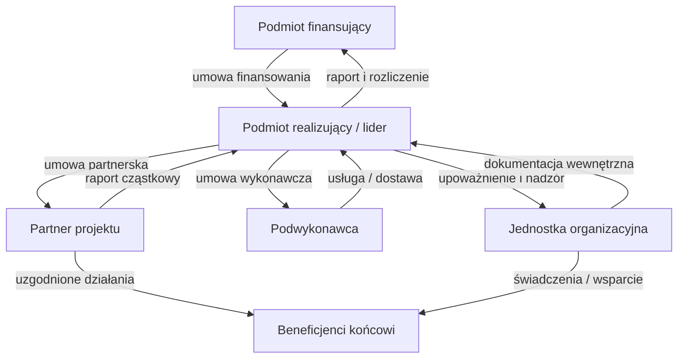
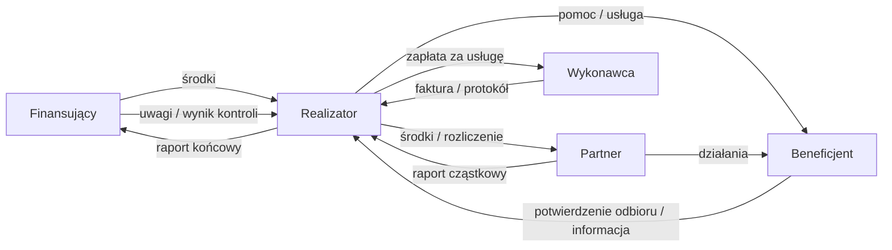
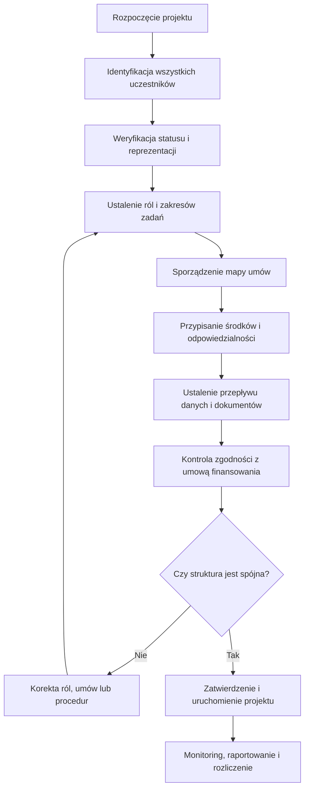

# ✠ ❦ ✧ ROZDZIAŁ 6.3 ✧ ❦ ✠

## STRUKTURA RELACJI POMIĘDZY PODMIOTAMI

### Role prawne i organizacyjne w finansowaniu celowym; relacje między finansującym, realizatorem, partnerem, jednostką organizacyjną i beneficjentem końcowym; reprezentacja, odpowiedzialność, przepływ środków, nadzór, kontrola i rozliczenie

> **Stan prawny opracowania:** 25 listopada 2026 r.  
> **Miejsce w programie:** część III – międzynarodowe finansowanie działalności organizacji pozarządowych; moduł 6 – finansowanie celowe pomiędzy organizacjami międzynarodowymi.  
> **Powiązanie z rozdziałami poprzednimi:** rozdział 6.1 przedstawia instrumenty finansowania, a rozdział 6.2 wyjaśnia różnice między dotacją, grantem i darowizną. Niniejszy rozdział opisuje strukturę podmiotową przedsięwzięcia: kto przekazuje środki, kto zawiera umowę, kto wykonuje zadanie, kto współpracuje, kto otrzymuje wsparcie i kto odpowiada za poszczególne obowiązki.

---

## 1. Cel, zakres i efekty kształcenia

### 1.1. Cel rozdziału

Celem rozdziału jest nauczenie uczestnika projektowania i analizowania relacji prawnych oraz organizacyjnych pomiędzy wszystkimi uczestnikami przedsięwzięcia finansowanego ze środków krajowych lub zagranicznych. Prawidłowa struktura relacji pozwala uniknąć sytuacji, w której pieniądze przekazuje jeden podmiot, umowę podpisuje inny, działania wykonuje jednostka nieposiadająca odpowiedniego umocowania, a odpowiedzialność za rezultat pozostaje niejasna.

W praktyce grantowej i społecznej często występuje kilka poziomów współpracy. Przykładowo instytucja publiczna lub fundacja międzynarodowa finansuje projekt operatora, operator wybiera lokalnych realizatorów, organizacja krajowa koordynuje zadanie, jej oddział wykonuje część czynności, a bezpośrednimi odbiorcami pomocy są osoby lub rodziny. Każdy z tych uczestników może mieć odmienny status prawny, zakres kompetencji, odpowiedzialność i dostęp do środków.

Nie wolno utożsamiać:
- podmiotu finansującego z podmiotem, który technicznie wykonuje przelew;
- podmiotu realizującego projekt z każdym podmiotem, który uczestniczy w jego wykonaniu;
- partnera projektu z podwykonawcą;
- jednostki organizacyjnej z odrębną osobą prawną;
- beneficjenta końcowego z grantobiorcą;
- koordynatora projektu z osobą uprawnioną do reprezentacji;
- odpowiedzialności za wykonanie zadania z odpowiedzialnością za każdy czyn osoby uczestniczącej w projekcie.

### 1.2. Zakres opracowania

Rozdział obejmuje dziesięć zagadnień wskazanych w spisie treści:
1. podmiot finansujący;
2. podmiot realizujący;
3. podmiot współpracujący;
4. jednostka organizacyjna realizująca zadanie;
5. beneficjent końcowy;
6. przedstawicielstwo organizacji;
7. koordynator projektu;
8. osoba odpowiedzialna za finanse;
9. osoba odpowiedzialna za rozliczenie projektu;
10. odpowiedzialność za wykonanie zobowiązań.

Dla prawidłowego zrozumienia tych zagadnień omówiono także relacje umowne, łańcuch finansowania, reprezentację, delegowanie zadań, podwykonawstwo, ochronę danych, kontrolę, konflikt interesów, rozliczenia i zakończenie projektu.

### 1.3. Efekty uczenia się

Po ukończeniu rozdziału uczestnik:
- rozpoznaje role poszczególnych uczestników projektu i odróżnia ich status prawny od funkcji organizacyjnej;
- potrafi sporządzić mapę podmiotów i relacji umownych;
- ustala, kto jest stroną umowy i kto może skutecznie ją podpisać;
- odróżnia partnera, podwykonawcę, operatora, realizatora i beneficjenta końcowego;
- rozpoznaje, kiedy oddział lub inna jednostka działa w imieniu osoby prawnej, a kiedy posiada odrębną osobowość prawną;
- przypisuje odpowiedzialność za zadania, środki, dokumenty i rezultaty;
- projektuje zasady przepływu środków oraz obiegu dokumentacji;
- identyfikuje ryzyko związane z nieuprawnionym delegowaniem zadań;
- potrafi przygotować macierz odpowiedzialności i kartę weryfikacji podmiotu;
- rozumie, że odpowiedzialność umowna, organizacyjna, pracownicza, deliktowa i publicznoprawna mają odrębne podstawy.

### 1.4. Zasada nadrzędna: każda rola musi mieć podstawę

Każda istotna rola w projekcie powinna wynikać z jednego lub kilku dokumentów:
- ustawy lub innego przepisu;
- statutu i regulaminu organizacji;
- uchwały właściwego organu;
- umowy finansowania;
- umowy partnerskiej lub konsorcjum;
- umowy z realizatorem albo podwykonawcą;
- pełnomocnictwa;
- zakresu obowiązków lub upoważnienia wewnętrznego;
- regulaminu projektu i zatwierdzonego budżetu.

Sam wpis w prezentacji, schemacie organizacyjnym, stopce poczty elektronicznej albo na stronie internetowej nie tworzy automatycznie umocowania do zawierania umów ani zaciągania zobowiązań.

---

## 2. Mapa uczestników przedsięwzięcia

### 2.1. Podstawowe role

| Rola | Główna funkcja | Typowe źródło kompetencji | Podstawowe ryzyko |
|---|---|---|---|
| Podmiot finansujący | Zapewnia środki i określa warunki finansowania | Ustawa, regulamin programu, umowa, statut | Niejasne warunki, nieprawidłowe przekazanie lub kontrola środków |
| Podmiot realizujący | Przyjmuje zobowiązanie do wykonania projektu lub zadania | Umowa finansowania, umowa o realizację | Niewykonanie lub nienależyte wykonanie zobowiązań |
| Podmiot współpracujący | Wnosi zasoby, wiedzę, personel lub wykonuje uzgodnioną część działań | Umowa partnerska, porozumienie, umowa konsorcjum | Niejasny podział zadań i odpowiedzialności |
| Operator | Organizuje nabór, wybór i finansowanie dalszych realizatorów | Umowa z instytucją nadrzędną, regulamin, właściwy program | Naruszenie procedury wyboru, nadzoru i rozliczeń |
| Jednostka organizacyjna | Wykonuje działania w ramach struktury podmiotu | Statut, regulamin, uchwała, pełnomocnictwo | Działanie bez samodzielnej kompetencji lub poza umocowaniem |
| Beneficjent końcowy | Otrzymuje usługę, pomoc, rzecz lub inną korzyść | Regulamin wsparcia, decyzja, umowa lub zasady programu | Niewłaściwe kryteria, naruszenie praw i prywatności |
| Przedstawiciel | Składa oświadczenia woli w imieniu reprezentowanego | Ustawa, statut, wpis w rejestrze, pełnomocnictwo | Brak lub przekroczenie umocowania |
| Koordynator | Organizuje bieżące wykonanie projektu | Zakres obowiązków, uchwała, umowa, upoważnienie | Podejmowanie decyzji bez kompetencji |
| Osoba odpowiedzialna za finanse | Prowadzi kontrolę budżetu i przepływów | Zakres obowiązków, procedury finansowe | Błędy ewidencji, płatności i kontroli |
| Osoba odpowiedzialna za rozliczenie | Przygotowuje raporty i dokumentację końcową | Zakres obowiązków, procedura rozliczeniowa | Niekompletne lub nierzetelne rozliczenie |

W jednej organizacji kilka ról może być wykonywanych przez tę samą osobę, jeżeli jest to zgodne z prawem, statutem, zasadami reprezentacji i wymogami programu. Rozdzielenie funkcji jest jednak wskazane, gdy ogranicza ryzyko błędu, nadużycia lub konfliktu interesów.

### 2.2. Status prawny a funkcja projektowa

Status prawny odpowiada na pytanie, kto jest podmiotem praw i obowiązków. Funkcja projektowa odpowiada na pytanie, jaką czynność dana osoba lub organizacja wykonuje w przedsięwzięciu.

Przykłady:
- fundacja jest osobą prawną; jej prezes może być członkiem organu, ale nie jest przez to samodzielnie właścicielem majątku fundacji;
- oddział fundacji może być jednostką organizacyjną tej samej osoby prawnej, a nie osobnym podmiotem;
- koordynator może zarządzać harmonogramem, ale nie musi mieć prawa do podpisania umowy grantowej;
- beneficjent końcowy może być osobą fizyczną, rodziną lub wspólnotą, nie stając się przez to stroną umowy finansowania;
- partner może być odrębną osobą prawną i odpowiadać za własne działania w granicach umowy, podczas gdy lider odpowiada wobec finansującego za zobowiązania przyjęte w umowie głównej.

### 2.3. Schemat podstawowego łańcucha relacji

Schemat przedstawia model przykładowy, a nie obowiązkową strukturę każdego projektu. W konkretnej sprawie trzeba sprawdzić, czy finansujący zawarł umowę bezpośrednio z liderem, operatorem, partnerami czy kilkoma podmiotami.

### 2.4. Relacje prawne a relacje faktyczne

Relacja faktyczna może istnieć bez odrębnej umowy, np. pracownik wykonuje zadanie w ramach stosunku pracy, wolontariusz działa na podstawie porozumienia, a komórka organizacyjna realizuje polecenie właściwego organu. Nie oznacza to jednak, że można pominąć wymagane prawem dokumenty.

Należy odróżniać:
- **relację organizacyjną** – wynikającą ze struktury i podporządkowania wewnętrznego;
- **relację przedstawicielstwa** – pozwalającą działać w cudzym imieniu;
- **relację zobowiązaniową** – wynikającą z umowy lub innego źródła zobowiązania;
- **relację finansową** – dotyczącą przekazania, przechowywania, wydatkowania lub zwrotu środków;
- **relację usługową** – polegającą na wykonaniu określonego świadczenia;
- **relację pomocową** – w której osoba otrzymuje wsparcie według kryteriów programu;
- **relację nadzorczą lub kontrolną** – w której określony podmiot może sprawdzać prawidłowość działania.

---

## 3. Podmiot finansujący

### 3.1. Definicja i zakres roli

Podmiot finansujący to podmiot, który na podstawie określonego stosunku prawnego zapewnia środki na realizację przedsięwzięcia. Może nim być organ administracji publicznej, jednostka samorządu terytorialnego, instytucja Unii Europejskiej, fundacja prywatna, przedsiębiorca, osoba fizyczna, organizacja międzynarodowa lub operator dysponujący środkami przeznaczonymi na dalsze finansowanie.

Nie należy automatycznie utożsamiać finansującego z właścicielem środków, dysponentem budżetowym, płatnikiem ani administratorem programu. W programach wielopoziomowych te funkcje mogą być rozdzielone.

### 3.2. Rodzaje finansujących

1. **Finansujący publiczny** – podmiot udzielający finansowania w ramach kompetencji i podstawy prawnej właściwej dla środków publicznych.
2. **Finansujący unijny lub międzynarodowy** – instytucja albo podmiot zarządzający programem na podstawie regulacji i dokumentów programu.
3. **Finansujący prywatny** – fundacja, stowarzyszenie, przedsiębiorca lub osoba fizyczna przekazująca środki z majątku prywatnego.
4. **Finansujący pośredni** – podmiot, który przekazuje środki dalej na podstawie umowy z instytucją nadrzędną.
5. **Darczyńca** – osoba dokonująca przysporzenia, które może mieć charakter darowizny, jeżeli spełnia przesłanki prawa cywilnego.
6. **Sponsor** – podmiot finansujący w zamian za uzgodnione świadczenia promocyjne lub inne świadczenie wzajemne; relacja wymaga odrębnej kwalifikacji prawnej.

### 3.3. Podstawowe obowiązki finansującego

Zakres obowiązków wynika z podstawy prawnej i treści umowy. Typowo obejmuje:
- określenie warunków programu w sposób jasny i niedyskryminujący;
- wskazanie uprawnionych odbiorców i kryteriów wyboru;
- zapewnienie środków w granicach przyjętego zobowiązania;
- przekazanie informacji o harmonogramie i warunkach płatności;
- rozpatrywanie wniosków o zmianę projektu w trybie określonym dokumentacją;
- wykonywanie kontroli w granicach prawa i umowy;
- ochronę informacji poufnych i danych osobowych;
- przyjęcie i ocenę raportu;
- rozliczenie projektu oraz podjęcie decyzji o ewentualnym zwrocie środków na podstawie właściwych przesłanek.

Finansujący nie może dowolnie rozszerzać swoich uprawnień kontrolnych poza podstawę prawną lub umowną. Z drugiej strony realizator nie może odmawiać kontroli, która została prawidłowo przewidziana w przepisach lub umowie.

### 3.4. Weryfikacja podmiotu finansującego

Przed przyjęciem środków należy sprawdzić:
- pełną nazwę i formę prawną;
- państwo siedziby i adres;
- rejestr, numer identyfikacyjny i status prawny;
- sposób reprezentacji;
- osoby uprawnione do podpisania dokumentów;
- źródło środków i rolę ewentualnego operatora;
- podstawę prawną finansowania;
- regulamin, konkurs, decyzję lub umowę;
- warunki płatności, kontroli i zwrotu;
- ograniczenia sankcyjne i ryzyka reputacyjne;
- zgodność proponowanego finansowania ze statutem organizacji.

Nie wystarczy zweryfikować logo, domeny internetowej lub wizytówki osoby kontaktowej. W przypadku podmiotu zagranicznego warto uzyskać aktualny odpis z właściwego rejestru, statut lub dokument założycielski oraz dokument potwierdzający umocowanie reprezentanta.

### 3.5. Pytania kontrolne wobec finansującego

1. Czy finansujący jest stroną umowy, czy jedynie operatorem płatności?
2. Kto jest właścicielem lub dysponentem środków?
3. Czy środki są publiczne, unijne, prywatne czy powierzone?
4. Jaki przepis lub dokument programu stanowi podstawę finansowania?
5. Czy finansujący może przekazywać środki dalszym realizatorom?
6. Czy wymagane jest odrębne zatwierdzenie partnerów i podwykonawców?
7. Jakie koszty są kwalifikowane?
8. Jakie są terminy płatności i rozliczeń?
9. Jakie są zasady kontroli i audytu?
10. Jakie okoliczności powodują obowiązek zwrotu?

---

## 4. Podmiot realizujący

### 4.1. Pojęcie realizatora

Podmiot realizujący jest podmiotem, który przyjmuje na siebie obowiązek wykonania projektu, zadania lub określonej części przedsięwzięcia. W umowie może występować jako grantobiorca, beneficjent projektu, zleceniobiorca, lider, operator albo wykonawca – nazwa zależy od programu i rodzaju stosunku prawnego.

Najważniejsze jest ustalenie, jakie zobowiązania przyjął na siebie w rzeczywistości. Podmiot otrzymujący środki nie zawsze wykonuje wszystkie działania samodzielnie. Może korzystać z pracowników, wolontariuszy, partnerów, jednostek wewnętrznych i podwykonawców, ale musi robić to zgodnie z prawem i dokumentacją finansowania.

### 4.2. Zdolność do realizacji

Przed podpisaniem umowy należy ocenić:
- czy podmiot istnieje i ma zdolność prawną;
- czy jego cele statutowe obejmują planowane działania;
- czy posiada wymagane wpisy, zezwolenia lub uprawnienia;
- czy dysponuje personelem, zasobami i doświadczeniem;
- czy może przyjąć środki w danym reżimie;
- czy ma odpowiednią zdolność finansową i organizacyjną;
- czy może zapewnić wymagany wkład własny;
- czy jest w stanie prowadzić odrębną ewidencję i dokumentację;
- czy nie zachodzą przesłanki wykluczenia z programu;
- czy jego organy prawidłowo podjęły decyzję o przystąpieniu do projektu.

### 4.3. Główne obowiązki realizatora

W zależności od programu realizator może być zobowiązany do:
1. wykonania działań zgodnie z umową i harmonogramem;
2. wykorzystania środków zgodnie z przeznaczeniem;
3. zapewnienia wkładu własnego;
4. prowadzenia ewidencji finansowej;
5. dokumentowania kosztów i rezultatów;
6. przestrzegania zasad konkurencyjności i zamówień, jeżeli mają zastosowanie;
7. zapewnienia ochrony danych osobowych;
8. przestrzegania praw autorskich i zasad dostępności;
9. informowania finansującego o ryzykach i zmianach;
10. umożliwienia kontroli i audytu;
11. przygotowania raportów;
12. zwrotu środków w przypadkach przewidzianych prawem lub umową.

### 4.4. Lider i konsorcjum

W projektach partnerskich jeden podmiot może pełnić funkcję lidera. Lider:
- składa wniosek albo reprezentuje wspólną ofertę, jeśli regulamin na to pozwala;
- koordynuje współpracę;
- utrzymuje kontakt z finansującym;
- gromadzi raporty partnerów;
- zarządza przepływem informacji i – jeżeli umowa to dopuszcza – środków;
- odpowiada wobec finansującego w zakresie wynikającym z umowy głównej.

Partnerzy zachowują własny status prawny i odpowiadają za obowiązki, które przyjęli. Nie wolno jednak zakładać, że sama nazwa „konsorcjum” tworzy nową osobę prawną albo automatycznie ustanawia solidarną odpowiedzialność wszystkich uczestników. Skutek prawny zależy od przepisów, rodzaju umowy i jej treści.

### 4.5. Realizator a wykonawca usługi

Realizator projektu odpowiada za osiągnięcie celu i wykonanie zobowiązań określonych w umowie finansowania. Wykonawca usługi lub dostawca może wykonywać tylko wyodrębnioną czynność na rzecz realizatora, np. druk materiałów, transport, obsługę informatyczną lub wynajem sali.

Wykonawca nie staje się automatycznie partnerem projektu ani beneficjentem finansowania. Otrzymuje wynagrodzenie na podstawie własnej umowy, faktury lub innego dokumentu właściwego dla danej transakcji.

---

## 5. Podmiot współpracujący, partner i podwykonawca

### 5.1. Partner projektu

Partner to podmiot uczestniczący w realizacji projektu na podstawie uzgodnionego podziału zadań, zasobów i odpowiedzialności. Partner może wnosić:
- personel;
- wiedzę specjalistyczną;
- infrastrukturę;
- dostęp do grup odbiorców;
- doświadczenie lokalne;
- wkład finansowy lub rzeczowy;
- działania merytoryczne;
- wsparcie organizacyjne.

Partnerstwo nie powinno być pozorne. Jeżeli podmiot nie uczestniczy w zarządzaniu ani realizacji projektu, a jedynie wystawia fakturę za usługę, może być w rzeczywistości wykonawcą, a nie partnerem.

### 5.2. Podwykonawca

Podwykonawca wykonuje na rzecz realizatora określoną część czynności na podstawie umowy. Zasadniczo nie przejmuje całej odpowiedzialności realizatora wobec finansującego. Realizator pozostaje odpowiedzialny w zakresie wynikającym z umowy głównej, a następnie może dochodzić od podwykonawcy odpowiedzialności na podstawie umowy podwykonawczej.

Należy sprawdzić:
- czy dokumentacja finansowania dopuszcza podwykonawstwo;
- czy wymaga uprzedniej zgody finansującego;
- czy istnieją limity powierzania zadań;
- czy wybór wykonawcy podlega zasadom konkurencyjności lub zamówień;
- czy koszt jest kwalifikowany;
- czy umowa określa standard wykonania, termin, wynagrodzenie i odpowiedzialność;
- czy podwykonawca spełnia wymogi bezpieczeństwa, ochrony danych i poufności.

### 5.3. Partner a podwykonawca – porównanie

| Kryterium | Partner | Podwykonawca |
|---|---|---|
| Udział w koncepcji projektu | Często istotny | Zwykle ograniczony do zakresu zamówienia |
| Podział zadań | Uzgodniony wspólnie | Określony przez zamawiającego |
| Wkład własny | Może być wymagany | Zwykle nie jest elementem relacji |
| Wynagrodzenie | Zależne od konstrukcji partnerstwa i budżetu | Wynagrodzenie za usługę, dostawę lub robotę |
| Odpowiedzialność wobec finansującego | Zależna od umowy głównej i partnerstwa | Zwykle realizator odpowiada wobec finansującego |
| Samodzielność | Partner wykonuje własny zakres działań | Wykonawca realizuje zamówiony zakres |
| Raportowanie | Może raportować do lidera i finansującego | Raportuje przede wszystkim realizatorowi |
| Status prawny | Zwykle odrębny podmiot | Odrębny podmiot lub osoba wykonująca usługę |

Tabela ma charakter funkcjonalny. W konkretnym programie nazwy partnera, realizatora i wykonawcy mogą być zdefiniowane odmiennie.

### 5.4. Operator i dalsi realizatorzy

W niektórych programach występuje operator, który otrzymuje środki od instytucji nadrzędnej i organizuje wybór mniejszych projektów lub realizatorów. Operator może:
- ogłaszać nabór;
- określać warunki wyboru zgodnie z umową nadrzędną;
- oceniać wnioski;
- zawierać umowy z realizatorami;
- przekazywać środki;
- monitorować projekty;
- przyjmować sprawozdania;
- rozliczać środki wobec instytucji finansującej.

Jeżeli finansowanie jest dotacją na realizację zadania publicznego, trzeba uwzględnić szczególne przepisy dotyczące operatora projektu i realizatorów. Ustawa o działalności pożytku publicznego i o wolontariacie przewiduje w art. 16a szczególny mechanizm zlecania realizacji projektów przez operatora wybranym realizatorom, na zasadach określonych w ofercie i umowie. Nie wolno automatycznie przenosić tego mechanizmu na prywatne granty, które podlegają własnej dokumentacji.

### 5.5. Współpraca bez przekazania środków

Nie każdy partner musi otrzymywać pieniądze. Współpraca może polegać na:
- udostępnieniu lokalu;
- przekazaniu materiałów;
- skierowaniu uczestników;
- udzieleniu konsultacji;
- promocji wydarzenia;
- wsparciu logistycznym;
- wymianie wiedzy;
- udziale eksperta;
- zapewnieniu wolontariuszy.

Wartość wkładu rzeczowego lub osobowego może być wykazywana jako wkład własny, jeżeli pozwalają na to reguły programu. Nie należy przypisywać wartości pieniężnej wkładowi, którego nie da się wiarygodnie udokumentować albo którego program nie dopuszcza.

---

## 6. Jednostka organizacyjna realizująca zadanie

### 6.1. Jednostka organizacyjna a osoba prawna

Jednostka organizacyjna to wyodrębniona część struktury organizacji, powołana do wykonywania określonych zadań. Może działać pod nazwą oddziału, filii, biura, centrum, placówki, domu, ośrodka, zespołu lub jednostki terenowej.

Samo wyodrębnienie organizacyjne, nazwa, adres, własny kierownik lub odrębny rachunek techniczny nie oznaczają jeszcze uzyskania osobowości prawnej. Osobowość prawna powstaje w sposób określony w ustawie, co do zasady z chwilą wpisu do właściwego rejestru, jeżeli przepisy szczególne nie stanowią inaczej.

### 6.2. Typy jednostek

| Typ | Charakter | Kto jest stroną umowy? |
|---|---|---|
| Dział wewnętrzny | Komórka organizacyjna bez odrębnej podmiotowości | Osoba prawna, w której strukturze działa |
| Oddział terenowy bez osobowości prawnej | Jednostka tej samej osoby prawnej | Zasadniczo osoba prawna przez właściwą reprezentację |
| Placówka lub centrum | Jednostka wykonująca zadania statutowe | Podmiot prowadzący, chyba że przepisy stanowią inaczej |
| Jednostka z osobowością prawną | Odrębny podmiot prawa | Sama jednostka przez własne organy |
| Przedstawicielstwo | Forma reprezentowania lub obecności organizacji | Podmiot reprezentowany, z uwzględnieniem przepisów szczególnych |
| Oddział przedsiębiorcy zagranicznego | Struktura organizacyjna przedsiębiorcy | Przedsiębiorca zagraniczny w granicach właściwych przepisów |

### 6.3. Umocowanie jednostki do działania

Jednostka organizacyjna może otrzymać kompetencje do:
- prowadzenia określonych działań;
- organizowania pracy personelu;
- przyjmowania dokumentów;
- przygotowywania wniosków i raportów;
- dokonywania wydatków w ramach zatwierdzonego budżetu;
- zawierania umów, jeżeli właściwy podmiot udzielił odpowiedniego umocowania;
- reprezentowania organizacji w określonych sprawach.

Trzeba rozróżnić uprawnienia wewnętrzne od zewnętrznego umocowania do składania oświadczeń woli. Kierownik placówki może być upoważniony do zatwierdzania grafiku i wydatków w określonym limicie, ale nie musi mieć prawa do zawierania umów finansowania, zaciągania kredytu lub rozporządzania nieruchomością.

### 6.4. Wyodrębnienie budżetowe i księgowe

Jednostka może mieć:
- własny plan wydatków;
- centrum kosztów;
- rejestr dokumentów;
- ewidencję pomocniczą;
- odrębny rachunek bankowy, jeśli jest to prawnie i organizacyjnie dopuszczalne;
- własny harmonogram działań;
- lokalny rejestr beneficjentów.

Nie oznacza to automatycznie, że jednostka jest odrębnym podatnikiem, właścicielem majątku lub stroną umowy. Ewidencja pomocnicza ma zapewniać możliwość przypisania operacji do projektu i jednostki, ale księgi rachunkowe prowadzi podmiot zobowiązany ustawą.

### 6.5. Zasada działania w granicach struktury

Jednostka organizacyjna nie powinna:
- podpisywać umów w imieniu organizacji bez umocowania;
- przyjmować zobowiązań przekraczających zatwierdzony budżet;
- przekazywać środków innemu podmiotowi bez zgody i podstawy prawnej;
- zmieniać celu projektu;
- zatrudniać personelu w imieniu organizacji bez kompetencji;
- przedstawiać się jako odrębna osoba prawna, jeśli nią nie jest;
- udostępniać danych beneficjentów bez właściwej podstawy.

### 6.6. Przykład

Fundacja prowadzi trzy centra wsparcia rodzin w różnych miejscowościach. Umowę grantową podpisuje fundacja, ponieważ centra nie mają osobowości prawnej. Kierownik centrum może odpowiadać za rekrutację, harmonogram, dokumentację uczestników i zatwierdzanie drobnych wydatków w limicie. Umowy z dostawcami zawiera zarząd lub pełnomocnik, zgodnie z zasadami reprezentacji i upoważnieniami. Raporty z centrów trafiają do koordynatora projektu, a następnie do osoby odpowiedzialnej za rozliczenie.

---

## 7. Beneficjent końcowy

### 7.1. Pojęcie beneficjenta końcowego

Beneficjent końcowy to osoba, rodzina, grupa lub społeczność, do której bezpośrednio kierowane są rezultaty projektu. W zależności od programu może być nazywany odbiorcą wsparcia, uczestnikiem, osobą uprawnioną, grupą docelową, użytkownikiem usługi lub beneficjentem ostatecznym.

Beneficjent końcowy nie musi otrzymywać pieniędzy. Może otrzymać:
- usługę społeczną;
- poradnictwo;
- szkolenie;
- pomoc rzeczową;
- świadczenie opiekuńcze;
- dostęp do infrastruktury;
- materiały edukacyjne;
- wsparcie psychologiczne;
- rehabilitację lub inne świadczenie, jeżeli realizator spełnia wymagania prawne;
- możliwość udziału w wydarzeniu;
- wsparcie organizacyjne lub informacyjne.

### 7.2. Beneficjent projektu a beneficjent rzeczywisty

Pojęcia te nie są tożsame.

- **Beneficjent projektu** – odbiorca działań lub korzyści wynikających z projektu.
- **Beneficjent rzeczywisty** – pojęcie prawne używane m.in. w przepisach o przeciwdziałaniu praniu pieniędzy i finansowaniu terroryzmu, odnoszące się do osoby fizycznej sprawującej ostateczną kontrolę nad klientem lub w imieniu której nawiązywana jest relacja gospodarcza, zgodnie z definicją ustawową.

Nie należy używać tych terminów zamiennie. Uczestnik warsztatów nie staje się z tego powodu beneficjentem rzeczywistym fundacji, a beneficjent rzeczywisty fundacji nie jest automatycznie odbiorcą jej pomocy.

### 7.3. Zasady kwalifikacji odbiorców wsparcia

Regulamin programu powinien określać:
1. grupę uprawnioną;
2. kryteria dostępu;
3. sposób zgłoszenia;
4. dokumenty wymagane do oceny;
5. sposób podejmowania decyzji;
6. zasady informowania o wyniku;
7. tryb zgłaszania zastrzeżeń, jeśli przewidziano;
8. zasady rezygnacji;
9. warunki zakończenia wsparcia;
10. zasady ochrony danych.

Kryteria powinny być związane z celem projektu, proporcjonalne i stosowane jednakowo wobec osób znajdujących się w porównywalnej sytuacji. Należy unikać arbitralności, konfliktu interesów i dyskryminacji.

### 7.4. Prawa i godność beneficjenta

Organizacja powinna zapewnić:
- dobrowolność udziału, z uwzględnieniem charakteru danego świadczenia;
- jasną informację o zakresie wsparcia;
- poszanowanie godności, prywatności i autonomii;
- ochronę danych osobowych;
- dostępność komunikacji i usług w granicach wymagań prawnych i możliwości projektu;
- bezpieczny sposób zgłaszania skarg;
- ochronę przed nadużyciem, przemocą i wykorzystaniem zależności;
- rzetelne informowanie o ograniczeniach świadczenia.

Pomoc nie może być wykorzystywana do wymuszania deklaracji religijnych, politycznych, osobistych lub ekonomicznych. Jeżeli projekt ma charakter religijny, zasady uczestnictwa powinny być jawne, a zakres świadczeń niezwiązanych z praktyką religijną nie może być uzależniany od przymusu światopoglądowego.

### 7.5. Dokumentowanie wsparcia

Dokumentacja może obejmować:
- formularz zgłoszeniowy;
- potwierdzenie spełnienia kryteriów;
- zgodę lub inną właściwą podstawę przetwarzania danych, jeśli jest wymagana;
- kartę udzielonego wsparcia;
- potwierdzenie odbioru rzeczy lub usługi;
- listę obecności, jeżeli jest uzasadniona;
- anonimowe lub pseudonimizowane zestawienia statystyczne;
- dokumentację skarg i działań naprawczych.

Należy zbierać wyłącznie dane niezbędne do realizacji celu i obowiązków prawnych. Nie wolno gromadzić nadmiarowych danych o zdrowiu, sytuacji rodzinnej, przekonaniach religijnych lub innych szczególnych kategoriach danych bez właściwej podstawy prawnej i odpowiednich zabezpieczeń.

---

## 8. Przedstawicielstwo organizacji i umocowanie

### 8.1. Reprezentacja osoby prawnej

Osoba prawna działa przez swoje organy w sposób przewidziany w ustawie i statucie. W fundacji podstawowe znaczenie ma ustawa o fundacjach oraz postanowienia statutu określające skład, sposób powoływania i zasady reprezentacji zarządu.

Przed podpisaniem umowy należy zweryfikować:
- aktualny wpis w Krajowym Rejestrze Sądowym lub właściwym rejestrze zagranicznym;
- skład organu;
- sposób reprezentacji;
- ewentualne ograniczenia wynikające ze statutu;
- wymagane uchwały;
- konflikt interesów;
- tożsamość osoby podpisującej.

Wpis w rejestrze jest ważnym źródłem informacji, ale nie zastępuje analizy statutu i wymogów konkretnej czynności.

### 8.2. Przedstawiciel ustawowy i pełnomocnik

Umocowanie do działania w cudzym imieniu może wynikać z ustawy albo z oświadczenia reprezentowanego, czyli pełnomocnictwa. Pełnomocnictwo ogólne obejmuje zasadniczo czynności zwykłego zarządu; do czynności przekraczających ten zakres wymagane jest pełnomocnictwo rodzajowe lub szczególne, zależnie od czynności.

Należy ustalić:
- kto udzielił pełnomocnictwa;
- czy był do tego uprawniony;
- komu je udzielono;
- jaki jest zakres przedmiotowy i czasowy;
- czy obejmuje podpisanie umowy, aneksu, oświadczeń i raportów;
- czy pozwala na udzielanie dalszych pełnomocnictw;
- czy nie zostało odwołane lub nie wygasło.

### 8.3. Skutki działania bez umocowania

Zawarcie umowy przez osobę działającą bez umocowania lub z przekroczeniem jego zakresu może wymagać potwierdzenia przez reprezentowanego. Brak potwierdzenia może prowadzić do konsekwencji określonych w Kodeksie cywilnym, w tym odpowiedzialności osoby, która zawarła umowę jako rzekomy pełnomocnik.

Dlatego nie należy:
- podpisywać umowy „w imieniu fundacji” wyłącznie na podstawie stanowiska koordynatora;
- zakładać, że kierownik jednostki może zawrzeć każdą umowę;
- traktować pieczęci organizacji jako dowodu umocowania;
- uznawać adresu e-mail lub podpisu w stopce za pełnomocnictwo;
- przyjmować, że zgoda ustna organu zastępuje wymaganą formę uchwały lub pełnomocnictwa.

### 8.4. Przedstawicielstwo w relacji transgranicznej

W relacji międzynarodowej należy dodatkowo sprawdzić:
- prawo właściwe dla statusu i reprezentacji organizacji;
- sposób wykazania umocowania w państwie siedziby;
- wymóg apostille lub legalizacji dokumentu, jeżeli ma zastosowanie;
- tłumaczenie przysięgłe lub inne wymagane tłumaczenie;
- możliwość podpisu elektronicznego i jego uznawania;
- wymagania co do formy umowy;
- prawo właściwe dla umowy oraz właściwość sądu lub tryb arbitrażowy.

Nie można przyjmować, że dokument wystawiony w jednym państwie automatycznie spełnia wszystkie wymogi formalne w innym państwie.

---

## 9. Koordynator projektu

### 9.1. Charakter funkcji

Koordynator odpowiada za bieżącą organizację wykonania projektu. Jest łącznikiem między zarządem, finansującym, partnerami, jednostkami organizacyjnymi, personelem i beneficjentami.

Koordynator może:
- przygotowywać harmonogram;
- organizować spotkania;
- monitorować postęp;
- zbierać informacje od partnerów;
- identyfikować ryzyka;
- przygotowywać propozycje zmian;
- nadzorować terminowość dokumentacji;
- raportować zarządowi;
- koordynować komunikację.

Nie oznacza to automatycznie prawa do reprezentowania organizacji, zmiany budżetu, zaciągania zobowiązań, zatwierdzania wydatków lub składania wiążących oświadczeń wobec finansującego.

### 9.2. Zakres obowiązków koordynatora

Zakres obowiązków powinien określać:
1. cel i zakres funkcji;
2. podległość organizacyjną;
3. uprawnienia decyzyjne;
4. obowiązki informacyjne;
5. odpowiedzialność za harmonogram;
6. sposób współpracy z partnerami;
7. zasady eskalacji problemów;
8. uprawnienia do dostępu do danych;
9. zasady zastępstwa;
10. sposób dokumentowania decyzji.

### 9.3. Granice kompetencji

Koordynator nie powinien samodzielnie:
- zmieniać zakresu rzeczowego projektu, jeżeli wymaga to zgody finansującego;
- zatwierdzać kosztów poza przyznanym limitem;
- zmieniać beneficjentów z naruszeniem kryteriów;
- zawierać umów bez pełnomocnictwa;
- składać oświadczeń o rozliczeniu bez weryfikacji danych;
- zatwierdzać własnych wydatków;
- usuwać dokumentacji;
- przekazywać danych partnerom bez podstawy.

### 9.4. Raportowanie i eskalacja

Koordynator powinien zgłosić zarządowi lub osobie uprawnionej w szczególności:
- ryzyko opóźnienia;
- zagrożenie dla rezultatu;
- brak środków lub płynności;
- podejrzenie nadużycia;
- konflikt interesów;
- naruszenie ochrony danych;
- konieczność zmiany umowy;
- nieprawidłowość w dokumentach partnera;
- ryzyko zwrotu finansowania.

---

## 10. Osoba odpowiedzialna za finanse

### 10.1. Rola finansowa

Osoba odpowiedzialna za finanse organizuje kontrolę przepływu środków, budżetu, płatności i ewidencji. W zależności od struktury może być to główny księgowy, księgowy projektu, dyrektor finansowy, skarbnik albo pracownik administracyjny.

Nie należy utożsamiać funkcji osoby odpowiedzialnej za finanse z ustawową odpowiedzialnością kierownika jednostki za rachunkowość. Podział zadań musi uwzględniać ustawę o rachunkowości i rzeczywiste powierzenie obowiązków.

### 10.2. Główne obowiązki

- kontrola budżetu i dostępności środków;
- weryfikacja formalno-rachunkowa dokumentów;
- przypisywanie wydatków do kategorii i zadań;
- kontrola limitów i terminów;
- weryfikacja kwalifikowalności kosztów według dokumentacji programu;
- monitorowanie wkładu własnego;
- kontrola płatności i sald;
- uzgadnianie danych z księgowością;
- przygotowywanie zestawień finansowych;
- przechowywanie dokumentacji zgodnie z zasadami organizacji;
- sygnalizowanie niezgodności i ryzyk.

### 10.3. Rozdział funkcji i zasada dwóch par oczu

Dla ograniczenia ryzyka warto oddzielić:
- zlecenie zakupu;
- wybór dostawcy;
- odbiór towaru lub usługi;
- zatwierdzenie faktury;
- wykonanie przelewu;
- księgowanie;
- uzgodnienie rachunku;
- raportowanie.

W małej organizacji nie zawsze da się rozdzielić wszystkie funkcje między różne osoby. Wówczas należy wprowadzić kontrolę zastępczą, np. zatwierdzanie płatności przez drugą osobę, okresowy przegląd dokumentów przez członka zarządu lub zewnętrznego księgowego.

### 10.4. Przepływ środków

Każda płatność powinna mieć:
1. podstawę prawną lub umowną;
2. związek z celem projektu;
3. zatwierdzony budżet;
4. dokument potwierdzający zdarzenie gospodarcze;
5. akceptację osoby uprawnionej;
6. właściwe ujęcie księgowe;
7. dowód wykonania płatności;
8. przypisanie do okresu i kategorii kosztu.

Środki projektu nie powinny być mieszane z prywatnymi środkami osób zarządzających. Jeżeli program wymaga odrębnego rachunku, należy go prowadzić zgodnie z umową. Jeżeli odrębny rachunek nie jest wymagany, należy zapewnić jednoznaczną identyfikację operacji w ewidencji.

---

## 11. Osoba odpowiedzialna za rozliczenie projektu

### 11.1. Rozliczenie jako proces

Rozliczenie nie jest wyłącznie przygotowaniem tabeli wydatków. Obejmuje wykazanie, że:
- projekt został zrealizowany w uzgodnionym zakresie;
- środki wykorzystano zgodnie z przeznaczeniem;
- koszty zostały prawidłowo udokumentowane;
- osiągnięto wymagane rezultaty;
- zachowano warunki umowy i programu;
- rozpoznano i wyjaśniono odchylenia;
- zwrócono środki, jeśli powstał taki obowiązek.

### 11.2. Zadania osoby rozliczającej

1. Zebranie raportów merytorycznych.
2. Zebranie dokumentów finansowych.
3. Uzgodnienie kosztów z budżetem.
4. Sprawdzenie kwalifikowalności.
5. Weryfikacja terminów.
6. Uzgodnienie wkładu własnego.
7. Weryfikacja wskaźników i rezultatów.
8. Wyjaśnienie rozbieżności.
9. Przygotowanie raportu okresowego lub końcowego.
10. Przygotowanie dokumentacji do kontroli.
11. Archiwizacja dokumentów.
12. Monitorowanie obowiązku zwrotu lub korekty.

### 11.3. Rozliczenie finansowe i merytoryczne

| Obszar | Pytanie kontrolne | Przykładowy dowód |
|---|---|---|
| Zakres działań | Czy wykonano zaplanowane czynności? | Harmonogram, protokół, raport |
| Uczestnicy | Czy wsparcie trafiło do uprawnionych osób? | Zanonimizowana lista, karta wsparcia |
| Rezultaty | Czy osiągnięto wskaźniki? | Ankiety, zestawienia, dokumentacja rezultatów |
| Koszty | Czy wydatek jest rzeczywisty i prawidłowo udokumentowany? | Faktura, rachunek, dowód zapłaty |
| Celowość | Czy wydatek służył projektowi? | Opis merytoryczny i dekretacja |
| Termin | Czy koszt i działanie mieszczą się w okresie kwalifikowalności? | Data dokumentu i wykonania |
| Wkład własny | Czy wniesiono wkład zgodnie z umową? | Dowody finansowe lub dokumentacja wkładu |
| Zmiany | Czy uzyskano wymagane zgody? | Aneks, zgoda, korespondencja |
| Trwałość | Czy spełniono obowiązki po zakończeniu? | Rejestr, instrukcja, protokół |
| Zwrot | Czy pozostały środki do zwrotu? | Uzgodnienie salda i dowód przelewu |

### 11.4. Zasada rozdzielenia przygotowania i zatwierdzenia

Osoba przygotowująca raport nie powinna automatycznie zatwierdzać go w imieniu całej organizacji, jeśli statut, umowa lub procedury wymagają decyzji zarządu albo innego organu. Raport powinien przejść kontrolę merytoryczną i finansową, a następnie zostać podpisany przez osoby uprawnione.

---

## 12. Odpowiedzialność za wykonanie zobowiązań

### 12.1. Odpowiedzialność podmiotu

Podmiot będący stroną umowy odpowiada za zobowiązania, które przyjął, na zasadach wynikających z umowy i przepisów. W przypadku osoby prawnej obowiązki wykonuje ona przez właściwe organy i osoby działające w jej imieniu.

W razie naruszenia umowy mogą powstać konsekwencje takie jak:
- obowiązek wykonania zobowiązania;
- obowiązek usunięcia nieprawidłowości;
- obowiązek zwrotu części lub całości środków;
- obowiązek zapłaty odsetek;
- obowiązek naprawienia szkody;
- rozwiązanie lub wypowiedzenie umowy;
- utrata prawa do dalszego finansowania;
- odpowiedzialność za naruszenie przepisów administracyjnych, podatkowych lub karnych, jeżeli spełnione są przesłanki odpowiednich przepisów.

Nie każda nieprawidłowość oznacza automatycznie odpowiedzialność karną lub osobistą członka zarządu. Każdy rodzaj odpowiedzialności wymaga odrębnej podstawy i oceny przesłanek.

### 12.2. Odpowiedzialność partnera i podwykonawcy

Partner odpowiada w zakresie wynikającym z umowy partnerstwa, umowy głównej i właściwych przepisów. Podwykonawca odpowiada wobec strony, z którą zawarł umowę, za niewykonanie lub nienależyte wykonanie własnego zobowiązania.

Realizator powinien w umowie z partnerem lub podwykonawcą uwzględnić:
- dokładny zakres prac;
- standard wykonania;
- harmonogram;
- budżet i zasady płatności;
- dokumentowanie kosztów;
- obowiązki informacyjne;
- kontrolę i audyt, jeżeli są wymagane;
- zasady ochrony danych;
- poufność;
- prawa autorskie;
- odpowiedzialność i procedurę naprawczą;
- rozwiązanie umowy;
- zasady zwrotu środków;
- obowiązki po zakończeniu projektu.

### 12.3. Odpowiedzialność organów i osób zarządzających

Członek organu nie odpowiada automatycznie za każde zobowiązanie osoby prawnej. Może jednak ponosić odpowiedzialność na podstawie przepisów, jeżeli spełnione są określone przesłanki, np. za zawinione działanie lub zaniechanie, naruszenie obowiązków ustawowych, szkodę wyrządzoną organizacji albo naruszenie szczególnych obowiązków publicznoprawnych.

Należy rozdzielić:
- odpowiedzialność osoby prawnej wobec kontrahenta;
- odpowiedzialność członka organu wobec organizacji;
- odpowiedzialność pracownika lub zleceniobiorcy wobec pracodawcy albo zleceniodawcy;
- odpowiedzialność pełnomocnika za przekroczenie umocowania;
- odpowiedzialność deliktową za czyn niedozwolony;
- odpowiedzialność podatkową i administracyjną wynikającą z przepisów szczególnych;
- odpowiedzialność karną, która wymaga spełnienia znamion czynu zabronionego.

### 12.4. Solidarność odpowiedzialności

Odpowiedzialności solidarnej nie należy domniemywać wyłącznie z faktu, że kilka podmiotów uczestniczy w jednym projekcie. Solidarność musi wynikać z ustawy albo czynności prawnej. Jeżeli kilka organizacji składa ofertę wspólną lub zawiera umowę konsorcjum, trzeba szczegółowo przeanalizować postanowienia umowy i właściwe przepisy, zamiast zakładać identyczny zakres odpowiedzialności wszystkich uczestników.

### 12.5. Odpowiedzialność za beneficjentów końcowych

Organizacja odpowiada za własne obowiązki wobec beneficjentów, w tym za:
- prawidłowe kryteria przyznawania pomocy;
- rzetelne informowanie;
- bezpieczeństwo świadczeń;
- ochronę danych;
- prawidłowe rozpatrywanie skarg;
- zgodność działania z prawem i regulaminem;
- nadzór nad personelem i wykonawcami.

Beneficjent końcowy nie powinien być obciążany odpowiedzialnością za błędy w relacji między finansującym a realizatorem, chyba że sam jest stroną odrębnego stosunku prawnego i istnieje konkretna podstawa jego odpowiedzialności.

---

## 13. Przepływ środków, dokumentów i informacji

### 13.1. Trzy równoległe przepływy

W projekcie należy oddzielnie zaprojektować:

**Przepływ środków**
- finansujący → realizator;
- realizator → partner lub podwykonawca, jeśli dopuszczono;
- realizator lub partner → beneficjent końcowy, jeżeli przewiduje to program;
- zwrot środków → podmiot wskazany w umowie.

**Przepływ dokumentów**
- wniosek i załączniki;
- umowa i aneksy;
- zamówienia i umowy wykonawcze;
- dokumenty księgowe;
- protokoły odbioru;
- ewidencja uczestników;
- raporty partnerów;
- raporty finansowe i merytoryczne;
- dokumentacja kontroli i audytu.

**Przepływ informacji**
- decyzje i zgody;
- zgłoszenia ryzyk;
- zmiany harmonogramu;
- informacje o nieprawidłowościach;
- dane o rezultatach;
- komunikaty do beneficjentów;
- informacje wymagane przez finansującego.

Nie należy zakładać, że osoba, która otrzymuje informację, ma prawo zatwierdzić zmianę umowy. Kanały komunikacji i uprawnienia decyzyjne muszą być określone oddzielnie.

### 13.2. Schemat przepływów

### 13.3. Identyfikowalność operacji

Każda istotna operacja powinna być możliwa do odtworzenia:
- kto ją zainicjował;
- na jakiej podstawie;
- kto ją zatwierdził;
- kto ją wykonał;
- jaki dokument ją potwierdza;
- do jakiego zadania i budżetu została przypisana;
- jaki był jej rezultat;
- czy wymagała zgody finansującego.

W praktyce pomocny jest numer projektu, numer zadania, kod kosztu i jednoznaczny opis dokumentu.

### 13.4. Zmiany w projekcie

Zmiana osoby odpowiedzialnej, partnera, jednostki realizującej, budżetu lub zakresu zadania może wymagać:
- zgody zarządu;
- uchwały;
- aktualizacji pełnomocnictwa;
- aneksu do umowy;
- zgody finansującego;
- aktualizacji regulaminu;
- aktualizacji informacji dla beneficjentów;
- zmiany dokumentacji ochrony danych.

Przed wdrożeniem zmiany należy sprawdzić, czy dokumentacja programu dopuszcza zmianę i w jakiej formie.

---

## 14. Ochrona danych osobowych i poufność w strukturze wielopodmiotowej

### 14.1. Role w ochronie danych

W projekcie wielopodmiotowym trzeba ustalić, kto jest:
- administratorem danych;
- współadministratorem, jeżeli podmioty wspólnie ustalają cele i sposoby przetwarzania;
- podmiotem przetwarzającym;
- dalszym podmiotem przetwarzającym;
- odbiorcą danych;
- osobą upoważnioną do przetwarzania.

Nazwy użyte w umowie nie przesądzają o rzeczywistej roli. O kwalifikacji decydują faktyczne cele i sposoby przetwarzania.

### 14.2. Minimalizacja i ograniczenie dostępu

Należy stosować zasadę, że partner otrzymuje tylko te dane, które są niezbędne do wykonania jego zadania. Koordynator nie musi mieć dostępu do pełnej dokumentacji zdrowotnej beneficjenta, jeśli do organizacji harmonogramu wystarczy informacja o dostępności i rodzaju potrzebnego wsparcia.

Dane szczególnych kategorii, w tym dane o zdrowiu, przekonaniach religijnych i światopoglądzie, wymagają szczególnej ostrożności i odpowiedniej podstawy prawnej.

### 14.3. Umowy i dokumentacja

W zależności od modelu współpracy należy rozważyć:
- umowę powierzenia przetwarzania danych;
- uzgodnienie współadministratorów;
- zobowiązania do poufności;
- procedurę zgłaszania naruszeń;
- zasady retencji i usuwania danych;
- ograniczenia transferu danych poza Europejski Obszar Gospodarczy;
- rejestr czynności i kategorii przetwarzania;
- analizę ryzyka i ocenę skutków dla ochrony danych, jeżeli jest wymagana.

---

## 15. Konflikt interesów, niezależność i przejrzystość

### 15.1. Typowe źródła konfliktu interesów

Konflikt może powstać, gdy:
- osoba oceniająca wniosek jest związana z wnioskodawcą;
- członek organu zatwierdza umowę z podmiotem bliskiej osoby;
- koordynator wybiera własną firmę jako wykonawcę;
- partner rozlicza koszty, które sam zatwierdził;
- beneficjent otrzymuje wsparcie poza kryteriami;
- osoba pełniąca funkcję publiczną wykorzystuje zasoby lub autorytet funkcji w prywatnym przedsięwzięciu;
- finansujący wpływa na decyzje organizacji w sposób sprzeczny z jej statutem lub prawem.

### 15.2. Procedura zarządzania konfliktem

1. Ujawnienie powiązania.
2. Zapisanie informacji w rejestrze konfliktów.
3. Ocena, czy konflikt jest rzeczywisty, potencjalny lub postrzegany.
4. Wyłączenie osoby z oceny lub decyzji, jeśli jest to wymagane.
5. Wybór niezależnego decydenta.
6. Udokumentowanie decyzji.
7. Monitorowanie relacji.
8. Ponowna ocena w razie zmiany okoliczności.

### 15.3. Niezależność organizacji

Finansowanie nie powinno prowadzić do nieuprawnionego przejęcia kontroli nad organizacją. W umowie należy precyzyjnie określić:
- zakres celu, na który przeznaczono środki;
- uprawnienia kontrolne;
- granice ingerencji w zarządzanie;
- prawa do rezultatów i materiałów;
- zasady komunikacji;
- warunki zmiany projektu;
- ochronę misji statutowej i niezależności decyzji.

Organizacja powinna odrzucić warunki sprzeczne z prawem, statutem, godnością beneficjentów lub zasadą przejrzystości.

---

## 16. Praktyczna procedura projektowania relacji

### 16.1. Etap I – identyfikacja podmiotów

Dla każdego uczestnika należy zapisać:
- nazwę i formę prawną;
- kraj siedziby;
- numer rejestracyjny;
- status prawny;
- reprezentantów;
- rolę w projekcie;
- podstawę udziału;
- zakres zadań;
- sposób finansowania.

### 16.2. Etap II – mapa umów

Należy wskazać każdą relację umowną:
- finansujący – realizator;
- lider – partner;
- realizator – podwykonawca;
- organizacja – pracownik;
- organizacja – wolontariusz;
- organizacja – beneficjent;
- administrator – podmiot przetwarzający;
- podmiot – pełnomocnik.

Nie każda relacja wymaga odrębnej umowy nazwanej. Wymagana forma zależy od przepisów, charakteru relacji i dokumentacji programu.

### 16.3. Etap III – przypisanie odpowiedzialności

Dla każdego zadania należy wskazać:
- kto wykonuje;
- kto zatwierdza;
- kto kontroluje;
- kto raportuje;
- kto finansuje;
- kto przechowuje dokumenty;
- kto podejmuje decyzję o zmianie.

### 16.4. Etap IV – kontrola spójności

Należy zweryfikować, czy:
- umowa główna dopuszcza partnerów i podwykonawców;
- zakres zadań partnera odpowiada budżetowi;
- jednostka organizacyjna ma odpowiednie umocowanie;
- osoby podpisujące dokumenty są uprawnione;
- przepływ środków odpowiada przepływowi obowiązków;
- beneficjenci są kwalifikowani według jawnych kryteriów;
- ochrona danych odpowiada rzeczywistemu modelowi;
- raporty cząstkowe pozwalają sporządzić raport końcowy;
- odpowiedzialność nie jest przypisana podmiotowi, który nie ma kontroli nad danym obowiązkiem.

### 16.5. Schemat procedury

---

## 17. Narzędzia praktyczne

### 17.1. Karta identyfikacji podmiotu

| Pole | Informacja do uzupełnienia |
|---|---|
| Pełna nazwa |  |
| Forma prawna |  |
| Kraj i siedziba |  |
| Numer rejestracyjny |  |
| Organ reprezentacji |  |
| Sposób reprezentacji |  |
| Osoba podpisująca |  |
| Rola w projekcie |  |
| Podstawa udziału |  |
| Zakres zadań |  |
| Zakres finansowania |  |
| Odpowiedzialność |  |
| Dokumenty weryfikacyjne |  |
| Data weryfikacji |  |
| Osoba weryfikująca |  |

### 17.2. Macierz odpowiedzialności RACI

RACI jest narzędziem zarządzania, a nie kategorią prawną. Pomaga ustalić, kto wykonuje zadanie (R – Responsible), kto ponosi wewnętrzną odpowiedzialność decyzyjną i zatwierdza (A – Accountable), kto jest konsultowany (C – Consulted), a kto informowany (I – Informed).

| Zadanie | Zarząd | Koordynator | Finanse | Partner | Jednostka |
|---|---|---|---|---|---|
| Podpisanie umowy głównej | A/R* | C | C | I | I |
| Przygotowanie harmonogramu | A | R | C | C | C |
| Zatwierdzenie budżetu | A | C | R/C | C | I |
| Wykonanie działań | A | R | I | R* | R* |
| Kontrola wydatków | A | C | R | C | I |
| Raport merytoryczny | A | R | C | R* | R* |
| Raport finansowy | A | C | R | C | I |
| Zatwierdzenie rozliczenia | A/R* | C | R/C | I | I |

* Oznaczenia należy dostosować do statutu, umowy i rzeczywistego modelu. RACI nie może zastępować prawnie wymaganej reprezentacji ani uchwały właściwego organu.

### 17.3. Karta kontroli relacji umownej

Przed zawarciem każdej umowy należy odpowiedzieć:
- Czy strony zostały prawidłowo oznaczone?
- Czy każda strona ma zdolność do zawarcia umowy?
- Czy osoby podpisujące są umocowane?
- Czy przedmiot i zakres umowy są jednoznaczne?
- Czy podział zadań odpowiada dokumentacji finansowania?
- Czy określono budżet i zasady płatności?
- Czy określono sposób raportowania?
- Czy wskazano odpowiedzialność i procedurę naprawczą?
- Czy uregulowano ochronę danych i poufność?
- Czy określono prawa do materiałów i rezultatów?
- Czy umowa dopuszcza kontrolę i audyt?
- Czy określono zasady zmiany, rozwiązania i rozliczenia?

### 17.4. Rejestr ryzyk podmiotowych

| Ryzyko | Prawdopodobny skutek | Działanie zapobiegawcze |
|---|---|---|
| Niezweryfikowany finansujący | Utrata środków, oszustwo, ryzyko sankcyjne | Weryfikacja rejestru, źródła środków i reprezentacji |
| Brak umocowania podpisującego | Spór o skuteczność umowy | Kontrola rejestru, statutu i pełnomocnictw |
| Partner bez jasno określonego zakresu | Luki w realizacji | Umowa partnerstwa i macierz odpowiedzialności |
| Niedozwolone podwykonawstwo | Koszty niekwalifikowane, naruszenie umowy | Weryfikacja zgód i procedur wyboru |
| Jednostka bez osobowości prawnej podpisuje umowę | Ryzyko wadliwej reprezentacji | Umowę podpisuje właściwy podmiot przez umocowaną osobę |
| Brak ewidencji przepływów | Trudności w kontroli | Oznaczenia projektu i uzgodnienia księgowe |
| Niejasne kryteria beneficjentów | Skargi i nierówne traktowanie | Regulamin i udokumentowany proces kwalifikacji |
| Nadmierny dostęp do danych | Naruszenie RODO | Minimalizacja, role i upoważnienia |
| Konflikt interesów | Utrata wiarygodności, zakwestionowanie wydatków | Ujawnianie powiązań i wyłączenie z decyzji |
| Brak rozdziału funkcji | Błąd lub nadużycie bez wykrycia | Zasada dwóch par oczu i kontrola zastępcza |

---

## 18. Studium przypadków

### 18.1. Przypadek A – fundacja i jej lokalne centrum

Fundacja otrzymuje grant na prowadzenie centrum wsparcia rodzin. Centrum nie ma osobowości prawnej, ale posiada kierownika i własny budżet pomocniczy.

**Prawidłowy model:**
- fundacja jest stroną umowy finansowania;
- zarząd fundacji odpowiada za reprezentację zgodnie ze statutem;
- kierownik centrum realizuje zadania w granicach upoważnienia;
- księgowość fundacji prowadzi ewidencję operacji;
- koordynator zbiera raporty;
- beneficjenci otrzymują wsparcie na podstawie regulaminu.

**Błąd do uniknięcia:** wskazanie centrum jako odrębnego grantobiorcy, mimo że nie ma ono osobowości prawnej ani innej zdolności do samodzielnego występowania jako strona danej umowy.

### 18.2. Przypadek B – międzynarodowy lider i partner krajowy

Fundacja zagraniczna finansuje projekt, a polskie stowarzyszenie jest liderem. Fundacja lokalna ma wykonać część działań.

Należy ustalić:
- czy polskie stowarzyszenie może angażować partnerów;
- czy fundacja lokalna jest partnerem czy podwykonawcą;
- czy finansujący musi zatwierdzić jej udział;
- kto odpowiada za wydatki i raporty;
- czy środki są przekazywane dalej;
- czy relacja jest zgodna z zasadami programu.

**Wniosek:** nazwanie lokalnej fundacji partnerem nie wystarcza. Trzeba opisać jej zadania, wkład, uprawnienia, odpowiedzialność, budżet i relację z liderem.

### 18.3. Przypadek C – operator i realizatorzy projektów

Organizacja otrzymuje środki na prowadzenie programu grantowego dla małych inicjatyw lokalnych. Wybiera lokalne podmioty, które realizują projekty.

Należy rozstrzygnąć:
- czy organizacja działa jako operator w rozumieniu konkretnego programu;
- jaka procedura wyboru realizatorów jest wiążąca;
- czy zawierane umowy są umowami o realizację projektu;
- jakie koszty może pokrywać operator;
- jak rozliczane są środki przekazane realizatorom;
- jakie dokumenty musi przechowywać operator;
- kto i w jakim zakresie kontroluje realizatorów.

Jeżeli jest to mechanizm objęty art. 16a ustawy o działalności pożytku publicznego i o wolontariacie, należy stosować właściwe zasady ustawowe oraz postanowienia umowy z organem administracji publicznej. Jeżeli jest to program prywatny, podstawą będą jego regulamin i umowy.

### 18.4. Przypadek D – beneficjent otrzymuje pomoc rzeczową

Fundacja kupuje sprzęt pomocniczy i przekazuje go rodzinie. Rodzina nie jest stroną umowy grantowej.

Należy:
- określić kryteria przyznania pomocy;
- potwierdzić potrzebę i zgodność z celem projektu;
- udokumentować zakup;
- sporządzić potwierdzenie przekazania;
- poinformować beneficjenta o warunkach korzystania, jeśli są istotne;
- nie wymagać danych wykraczających poza niezbędne;
- nie przenosić na rodzinę obowiązków sprawozdawczych grantobiorcy, chyba że odrębny stosunek prawny uzasadnia określone obowiązki.

### 18.5. Przypadek E – koordynator podpisuje umowę bez pełnomocnictwa

Koordynator projektu podpisuje umowę z dostawcą, mimo że nie ma prawa reprezentacji ani pełnomocnictwa.

**Działania naprawcze:**
1. wstrzymać dalsze wykonywanie czynności, jeżeli jest to możliwe i zasadne;
2. przekazać dokument właściwemu organowi;
3. ocenić możliwość i skutki potwierdzenia umowy;
4. poinformować kontrahenta zgodnie z prawem;
5. ocenić ewentualną odpowiedzialność osoby działającej bez umocowania;
6. wprowadzić procedurę kontroli podpisów i pełnomocnictw.

Nie należy automatycznie zakładać, że umowa jest nieważna w każdym przypadku – skutki zależą od rodzaju czynności, treści przepisów i ewentualnego potwierdzenia.

### 18.6. Przypadek F – konflikt interesów przy wyborze wykonawcy

Członek zarządu proponuje firmę należącą do osoby bliskiej i uczestniczy w zatwierdzaniu wydatku.

**Prawidłowe postępowanie:**
- ujawnić powiązanie;
- sprawdzić statut, regulamin i warunki finansowania;
- wyłączyć osobę z decyzji, jeśli jest to wymagane lub potrzebne dla bezstronności;
- przeprowadzić wybór w sposób przejrzysty;
- udokumentować porównanie ofert i uzasadnienie;
- sprawdzić rynkowość ceny;
- zachować dokumentację na potrzeby kontroli.

### 18.7. Przypadek G – partner nie przekazuje raportu

Partner nie przekazał raportu cząstkowego, przez co lider nie może rozliczyć projektu w terminie.

**Działania:**
1. sprawdzić termin i obowiązek raportowania w umowie;
2. wezwać partnera do uzupełnienia dokumentów;
3. udokumentować wezwanie;
4. ocenić wpływ opóźnienia na raport końcowy;
5. poinformować finansującego, jeżeli wymaga tego umowa;
6. uruchomić procedurę naprawczą;
7. rozważyć konsekwencje kontraktowe;
8. poprawić harmonogram raportowania na przyszłość.

---

## 19. Najczęstsze błędy i sposoby ich eliminowania

1. **Błąd: uznanie każdej jednostki za osobę prawną.**  
   Korekta: sprawdzić rejestr i przepisy regulujące powstanie osobowości prawnej.

2. **Błąd: utożsamianie koordynatora z reprezentantem.**  
   Korekta: oddzielić funkcję zarządczą od umocowania do składania oświadczeń woli.

3. **Błąd: nazywanie każdego wykonawcy partnerem.**  
   Korekta: ocenić rzeczywisty udział, ryzyko, wkład i zakres zobowiązań.

4. **Błąd: przekazywanie środków dalej bez sprawdzenia umowy głównej.**  
   Korekta: uzyskać wymaganą zgodę i zawrzeć właściwą umowę.

5. **Błąd: brak przypisania odpowiedzialności.**  
   Korekta: sporządzić macierz zadań, uprawnień, zatwierdzeń i raportowania.

6. **Błąd: uznanie beneficjenta końcowego za grantobiorcę.**  
   Korekta: odróżnić odbiorcę świadczenia od strony umowy finansowania.

7. **Błąd: wspólne konto i brak identyfikacji kosztów.**  
   Korekta: wprowadzić ewidencję pozwalającą przypisać operacje do projektu.

8. **Błąd: brak weryfikacji reprezentacji zagranicznego partnera.**  
   Korekta: pozyskać dokumenty rejestrowe, statut i pełnomocnictwa.

9. **Błąd: traktowanie RACI jako dokumentu prawnego.**  
   Korekta: używać RACI do zarządzania, a umocowanie określać w prawidłowych dokumentach.

10. **Błąd: brak ochrony danych między partnerami.**  
    Korekta: określić role administratorów i procesorów oraz ograniczyć zakres przekazywanych danych.

---

## 20. Lista kontrolna przed uruchomieniem projektu

### A. Podmioty i status prawny
- [ ] Zidentyfikowano wszystkich uczestników.
- [ ] Zweryfikowano formę prawną i rejestr każdego podmiotu.
- [ ] Ustalono, kto jest stroną umowy finansowania.
- [ ] Ustalono, czy jednostki terenowe mają osobowość prawną.
- [ ] Zweryfikowano reprezentację i pełnomocnictwa.
- [ ] Sprawdzono ograniczenia statutowe.

### B. Relacje i umowy
- [ ] Sporządzono mapę relacji.
- [ ] Określono rolę lidera, partnera, operatora i podwykonawcy.
- [ ] Określono zakres zadań każdego uczestnika.
- [ ] Sprawdzono dopuszczalność podwykonawstwa i przekazywania środków.
- [ ] Uregulowano raportowanie i kontrolę.
- [ ] Określono zasady zmian i zakończenia współpracy.

### C. Finanse i dokumentacja
- [ ] Określono przepływ środków.
- [ ] Ustalono budżety cząstkowe.
- [ ] Ustalono zasady ewidencji.
- [ ] Rozdzielono funkcje zatwierdzania i płatności.
- [ ] Określono dokumenty potwierdzające wykonanie zadań.
- [ ] Ustalono zasady zwrotu środków.

### D. Beneficjenci i bezpieczeństwo
- [ ] Określono grupę docelową i kryteria dostępu.
- [ ] Przygotowano regulamin wsparcia.
- [ ] Ustalono podstawy przetwarzania danych.
- [ ] Ograniczono dostęp do danych do niezbędnego zakresu.
- [ ] Wprowadzono procedurę skarg i zgłaszania nieprawidłowości.
- [ ] Zidentyfikowano ryzyka konfliktu interesów.

### E. Odpowiedzialność i rozliczenie
- [ ] Sporządzono macierz odpowiedzialności.
- [ ] Wyznaczono osobę odpowiedzialną za finanse.
- [ ] Wyznaczono osobę odpowiedzialną za rozliczenie.
- [ ] Określono sposób zatwierdzania raportów.
- [ ] Ustalono terminy raportów cząstkowych.
- [ ] Zapewniono archiwizację i gotowość do kontroli.

---

## 21. Ćwiczenia praktyczne

### Ćwiczenie 1. Mapa podmiotów

Dla przykładowego projektu pomocy rodzinom przygotuj diagram obejmujący:
- zagranicznego finansującego;
- polską fundację jako lidera;
- lokalne stowarzyszenie jako partnera;
- centrum fundacji jako jednostkę organizacyjną;
- firmę świadczącą usługę transportową;
- rodziny jako beneficjentów końcowych.

Wskaż wszystkie relacje umowne i wyjaśnij, kto jest stroną każdej umowy.

### Ćwiczenie 2. Weryfikacja reprezentacji

Otrzymujesz umowę podpisaną przez dyrektora projektu. Przygotuj listę dokumentów, które należy sprawdzić, aby ustalić, czy dyrektor mógł skutecznie podpisać umowę w imieniu fundacji.

### Ćwiczenie 3. Partner czy podwykonawca?

Organizacja lokalna prowadzi rekrutację uczestników, realizuje warsztaty, raportuje rezultaty i wnosi własny personel. Firma zewnętrzna zapewnia wyłącznie wynajem sprzętu. Uzasadnij, dlaczego pierwsza relacja może mieć charakter partnerski, a druga wykonawczy, oraz wskaż, jakie dokumenty trzeba sprawdzić.

### Ćwiczenie 4. Rozdzielenie ról

W niewielkiej fundacji jedna osoba jest koordynatorem, księgowym projektu i osobą zatwierdzającą płatności. Zidentyfikuj ryzyka i zaproponuj realny system kontroli zastępczej.

### Ćwiczenie 5. Odpowiedzialność za raport

Partner nie przekazał dokumentacji, a lider złożył niekompletny raport finansującemu. Określ:
- obowiązki lidera;
- obowiązki partnera;
- możliwe działania naprawcze;
- dokumenty, które należy zabezpieczyć;
- sposób zapobiegania podobnej sytuacji.

### Ćwiczenie 6. Beneficjent końcowy

Fundacja przekazuje rodzinie sprzęt rehabilitacyjny. Zaprojektuj kryteria kwalifikacji, minimalny zakres dokumentacji, potwierdzenie przekazania oraz zasady ochrony danych.

### Ćwiczenie 7. Konflikt interesów

Członek organu organizacji jest powiązany z podmiotem, który ma wykonać usługę w projekcie. Przygotuj procedurę ujawnienia i zarządzania konfliktem interesów.

---

## 22. Pytania kontrolne

1. Czym różni się podmiot finansujący od operatora płatności?
2. Kto jest podmiotem realizującym projekt?
3. Czy każdy partner musi otrzymywać środki finansowe?
4. Czym różni się partner od podwykonawcy?
5. Czy oddział fundacji bez osobowości prawnej może być stroną umowy we własnym imieniu?
6. Czy kierownik jednostki organizacyjnej może zawierać umowy bez pełnomocnictwa?
7. Czym różni się beneficjent projektu od beneficjenta rzeczywistego?
8. Jakie są podstawowe obowiązki koordynatora?
9. Dlaczego osoba odpowiedzialna za finanse nie zawsze jest osobą uprawnioną do reprezentacji?
10. Co obejmuje rozliczenie merytoryczne?
11. Czy solidarność odpowiedzialności partnerów powstaje automatycznie?
12. Jakie dokumenty potwierdzają umocowanie reprezentanta?
13. Jak należy postąpić w razie przekroczenia zakresu pełnomocnictwa?
14. Kiedy konieczna jest umowa powierzenia przetwarzania danych?
15. Jakie są podstawowe elementy mapy relacji projektowych?
16. Dlaczego przepływ środków powinien być spójny z podziałem obowiązków?
17. Jakie ryzyka powstają, gdy jedna osoba inicjuje, zatwierdza i rozlicza płatność?
18. Jakie warunki należy sprawdzić przed przekazaniem środków dalszemu realizatorowi?

---

## 23. Słownik pojęć

- **Finansujący** – podmiot zapewniający środki na podstawie określonego stosunku prawnego.
- **Grantobiorca** – podmiot, któremu przyznano finansowanie w ramach programu grantowego.
- **Realizator** – podmiot wykonujący zadanie lub projekt.
- **Lider** – podmiot koordynujący wspólne przedsięwzięcie i reprezentujący partnerstwo w zakresie określonym dokumentacją.
- **Partner** – podmiot uczestniczący w realizacji projektu na podstawie uzgodnionego podziału zadań.
- **Podwykonawca** – podmiot wykonujący określoną część świadczenia na rzecz realizatora.
- **Operator** – podmiot organizujący program lub dalsze zlecanie projektów zgodnie z podstawą prawną i umową.
- **Jednostka organizacyjna** – wyodrębniona część struktury organizacji, której status prawny zależy od przepisów i dokumentów ustrojowych.
- **Przedstawiciel** – osoba uprawniona do działania w cudzym imieniu.
- **Pełnomocnictwo** – umocowanie udzielone przez reprezentowanego do dokonywania czynności prawnych w jego imieniu.
- **Koordynator** – osoba organizująca bieżące wykonanie projektu w granicach przyznanych kompetencji.
- **Beneficjent końcowy** – odbiorca działań lub korzyści projektu.
- **Beneficjent rzeczywisty** – termin ustawowy odnoszący się do osoby fizycznej sprawującej ostateczną kontrolę, zgodnie z właściwymi przepisami.
- **RACI** – narzędzie przypisywania ról przy wykonywaniu zadań.
- **Rozliczenie merytoryczne** – wykazanie wykonanych działań i rezultatów.
- **Rozliczenie finansowe** – wykazanie prawidłowości i wysokości wydatków oraz przepływów.
- **Umocowanie** – prawna podstawa działania w cudzym imieniu lub w określonym zakresie.
- **Konflikt interesów** – sytuacja, w której interes prywatny może wpływać lub sprawiać wrażenie wpływu na bezstronność decyzji.

---

## 24. Bibliografia i źródła

### 24.1. Akty prawne – Polska

1. Konstytucja Rzeczypospolitej Polskiej z 2 kwietnia 1997 r., w szczególności art. 12, 25, 31, 32, 53 i 58.
2. Ustawa z 23 kwietnia 1964 r. – Kodeks cywilny, w szczególności art. 33¹, 35, 37–39, 95–109, 353¹, 471 i nast.
3. Ustawa z 6 kwietnia 1984 r. o fundacjach, w szczególności przepisy dotyczące ustanowienia, statutu, zarządu, nadzoru i reprezentacji fundacji.
4. Ustawa z 24 kwietnia 2003 r. o działalności pożytku publicznego i o wolontariacie, w szczególności art. 3, 11, 14, 16, 16a, 17 i 18.
5. Ustawa z 27 sierpnia 2009 r. o finansach publicznych, w szczególności przepisy o dotacjach, kontroli i rozliczaniu środków publicznych.
6. Ustawa z 29 września 1994 r. o rachunkowości, w szczególności art. 4, 10, 20–24 i 52.
7. Ustawa z 29 sierpnia 1997 r. o ochronie danych osobowych oraz rozporządzenie (UE) 2016/679 – RODO.
8. Ustawa z 1 marca 2018 r. o przeciwdziałaniu praniu pieniędzy oraz finansowaniu terroryzmu – w zakresie, w jakim ma zastosowanie do danego podmiotu i relacji.

### 24.2. Prawo Unii Europejskiej

1. Rozporządzenie Parlamentu Europejskiego i Rady (UE) 2016/679 – ogólne rozporządzenie o ochronie danych.
2. Rozporządzenie Parlamentu Europejskiego i Rady (UE, Euratom) 2024/2509 w sprawie zasad finansowych mających zastosowanie do budżetu ogólnego Unii.
3. Rozporządzenie (WE) nr 593/2008 (Rzym I) w sprawie prawa właściwego dla zobowiązań umownych.
4. Rozporządzenie (UE) nr 1215/2012 (Bruksela I bis) w sprawie jurysdykcji oraz uznawania i wykonywania orzeczeń w sprawach cywilnych i handlowych.

### 24.3. Źródła urzędowe i informacyjne

- ELI – Elektroniczny Dziennik Ustaw: https://eli.gov.pl/
- Internetowy System Aktów Prawnych: https://isap.sejm.gov.pl/
- Krajowy Rejestr Sądowy: https://ekrs.ms.gov.pl/
- Centralny Rejestr Beneficjentów Rzeczywistych: https://crbr.podatki.gov.pl/
- Urząd Ochrony Danych Osobowych: https://uodo.gov.pl/
- Portal Funduszy Europejskich: https://www.funduszeeuropejskie.gov.pl/
- Komisja Europejska – Funding & Tenders Portal: https://ec.europa.eu/info/funding-tenders/opportunities/portal/

### 24.4. Uwagi do stosowania źródeł

Przed zawarciem umowy należy sprawdzić aktualne brzmienie przepisów, regulamin programu, wytyczne finansującego oraz dokumentację konkretnego naboru. W przypadku współpracy międzynarodowej trzeba dodatkowo ustalić prawo właściwe dla statusu organizacji, reprezentacji i umowy. Bibliografia ma charakter dydaktyczny i nie zastępuje analizy prawnej konkretnego projektu.

---

## 25. Podsumowanie rozdziału

Bezpieczny projekt wymaga zgodności czterech elementów:

1. **Podmiotowości** – wiadomo, kto jest stroną, kto posiada osobowość prawną, a kto działa jako jednostka lub przedstawiciel.
2. **Umocowania** – każda osoba podpisująca dokument lub podejmująca decyzję ma odpowiednią podstawę kompetencyjną.
3. **Odpowiedzialności** – każde zadanie, wydatek, raport i rezultat ma przypisanego wykonawcę oraz właściwy poziom zatwierdzenia.
4. **Identyfikowalności** – można odtworzyć przepływ środków, dokumentów i informacji od finansującego do beneficjenta oraz z powrotem w postaci raportu i rozliczenia.

Najważniejsza reguła praktyczna brzmi: **odpowiedzialność musi odpowiadać rzeczywistym kompetencjom i możliwości kontroli nad zadaniem**. Nie należy przypisywać obowiązku podmiotowi, który nie ma prawnej ani faktycznej możliwości jego wykonania. Jednocześnie nie wolno rozpraszać odpowiedzialności tak, aby żaden uczestnik nie odpowiadał za całość zobowiązania przyjętego wobec finansującego.

Przejrzysta struktura nie jest wyłącznie formalnością. Chroni środki, organizację, jej członków, partnerów i beneficjentów. Ułatwia współpracę, ogranicza ryzyko sporów oraz pozwala prowadzić działalność społeczną i pomocową w sposób odpowiedzialny, uczciwy i godny.

> **Zasada końcowa:** każda osoba i każda organizacja powinna znać granice swoich praw, obowiązków i kompetencji. Współpraca oparta na prawdzie, jawności, sprawiedliwym podziale zadań i poszanowaniu godności człowieka służy dobru wspólnemu i trwałości przedsięwzięcia.
