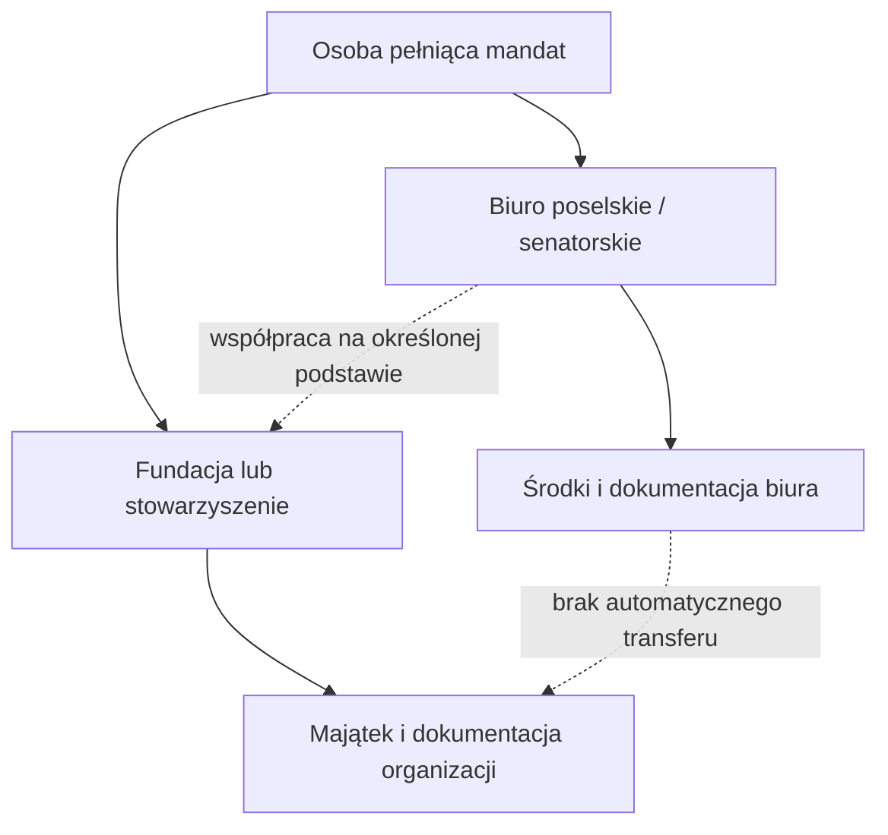
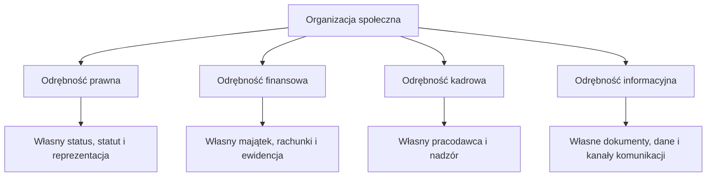
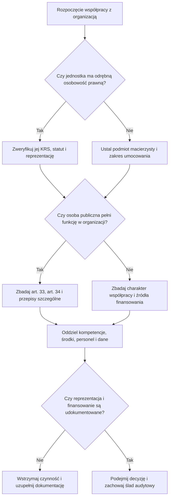

# 7.2. Jednostka organizacyjna związana z osobą pełniącą mandat publiczny

**Kurs:** Kurs uwolnienia  
**Moduł:** 7. Odpowiedzialność publiczna, społeczna i organizacyjna  
**Rozdział:** 7.2. Jednostka organizacyjna związana z osobą pełniącą mandat publiczny  
**Stan prawny przyjęty do opracowania:** 25 listopada 2026 r.  
**Charakter materiału:** opracowanie dydaktyczne, prawno-organizacyjne i praktyczne

> **Zasada przewodnia:** osoba pełniąca mandat publiczny, urząd publiczny, organizacja społeczna i jej jednostki organizacyjne mogą ze sobą współpracować, ale nie wolno utożsamiać ich kompetencji, majątku, odpowiedzialności ani źródeł finansowania. Dobra służba publiczna wymaga jasnych granic, a dobra działalność społeczna – rzeczywistej samodzielności, odpowiedzialności i przejrzystości.

## Wprowadzenie

Rozdział rozwija dwanaście zagadnień wskazanych w spisie treści kursu: pojęcie jednostki organizacyjnej, jednostkę fundacji, jednostkę stowarzyszenia, biuro poselskie, organizację współpracującą z parlamentarzystą, organizację założoną przez osobę pełniącą mandat, organizację, w której osoba publiczna pełni funkcję zarządczą lub nadzorczą, samodzielność prawną i finansową, przyjmowanie darowizn i grantów, reprezentację, odpowiedzialność za zobowiązania oraz granice wykorzystywania tytułu i autorytetu funkcji publicznej.

Punktem wyjścia jest rozróżnienie między **osobą**, **osobą prawną**, **jednostką organizacyjną**, **organem osoby prawnej**, **oddziałem lub jednostką terenową**, **biurem służącym wykonywaniu mandatu** oraz **organizacją współpracującą z osobą publiczną**. Nazwy potoczne bywają podobne, lecz skutki prawne mogą być zasadniczo odmienne. „Oddział”, „biuro”, „centrum”, „instytut”, „przedstawicielstwo” albo „placówka” nie uzyskują samodzielności prawnej tylko dlatego, że mają własną nazwę, adres, kierownika, pieczęć, stronę internetową lub budżet wewnętrzny.

W rozdziale szczególną uwagę poświęcono posłom i senatorom, ponieważ poprzedni rozdział 7.1 omawia mandat parlamentarny i biura poselskie. Nie należy jednak automatycznie przenosić wniosków dotyczących parlamentarzystów na radnych, wójtów, burmistrzów, prezydentów miast, członków zarządów jednostek samorządu terytorialnego, urzędników, członków organów spółek komunalnych ani inne osoby wykonujące funkcje publiczne. W tych przypadkach mogą obowiązywać odmienne, dodatkowe przepisy szczególne.

Materiał nie rozstrzyga indywidualnej sprawy konkretnej osoby lub organizacji. W razie wątpliwości co do dopuszczalności łączenia funkcji, obowiązku zgłoszenia dodatkowego zajęcia, przyjęcia darowizny, udziału w konkursie dotacyjnym lub reprezentacji podmiotu należy przeprowadzić ocenę konkretnego stanu faktycznego, sprawdzić aktualne przepisy i – jeżeli stawka lub ryzyko są istotne – uzyskać opinię prawną.

## Cele kształcenia i efekty uczenia się

Po ukończeniu rozdziału uczestnik powinien umieć:

1. wyjaśnić różnicę między jednostką organizacyjną a osobą prawną;
2. rozpoznać, czy fundacja, stowarzyszenie, oddział, biuro lub placówka może samodzielnie nabywać prawa i zaciągać zobowiązania;
3. odczytać ze statutu zasady tworzenia jednostek, ich kompetencje, sposób finansowania i reprezentacji;
4. odróżnić biuro poselskie lub senatorskie od fundacji, stowarzyszenia i prywatnego biura organizacji społecznej;
5. prawidłowo opisać związek między osobą pełniącą mandat publiczny a organizacją;
6. rozpoznać, kiedy funkcja w organizacji może stanowić dodatkowe zajęcie wymagające oceny obowiązków wynikających z ustawy o wykonywaniu mandatu posła i senatora;
7. odróżnić zakaz szczególny od ogólnego podejrzenia konfliktu interesów;
8. zweryfikować samodzielność prawną i finansową organizacji;
9. sprawdzić, kto może przyjąć darowiznę, złożyć ofertę grantową, podpisać umowę i odpowiadać za jej wykonanie;
10. przygotować dokumentację ograniczającą ryzyko pomieszania środków publicznych i prywatnych;
11. rozpoznać niedopuszczalne lub ryzykowne wykorzystywanie tytułu, autorytetu, zasobów i infrastruktury funkcji publicznej;
12. zastosować praktyczną listę kontrolną przed rozpoczęciem współpracy z organizacją związaną z osobą publiczną.

## 1. Pojęcie jednostki organizacyjnej

### 1.1. Jednostka organizacyjna jako sposób uporządkowania działalności

Jednostka organizacyjna to wyodrębniona część struktury, której przypisano określone zadania, zakres działania, zasoby, sposób kierowania i odpowiedzialność wewnętrzną. Może działać na poziomie terytorialnym, rzeczowym, zawodowym, edukacyjnym, administracyjnym albo projektowym.

Przykładami nazw jednostek organizacyjnych są:

- oddział regionalny fundacji;
- koło terenowe stowarzyszenia;
- centrum edukacyjne;
- ośrodek pomocy;
- placówka szkoleniowa;
- biuro projektu;
- zespół ekspercki;
- komisja programowa;
- biuro poselskie;
- punkt konsultacyjny.

Samo wyodrębnienie organizacyjne nie przesądza o osobowości prawnej. Jednostka może mieć własnego kierownika, harmonogram, lokal, pracowników, regulamin, budżet cząstkowy i odrębny numer rachunku analitycznego, a mimo to pozostawać częścią jednej osoby prawnej.

### 1.2. Osobowość prawna i zdolność prawna

Kodeks cywilny stanowi, że osobami prawnymi są Skarb Państwa i jednostki organizacyjne, którym przepisy szczególne przyznają osobowość prawną (art. 33). Odmienną kategorię tworzą jednostki organizacyjne niebędące osobami prawnymi, którym ustawa przyznaje zdolność prawną. Do takich jednostek stosuje się odpowiednio przepisy o osobach prawnych, a ich członkowie mogą ponosić odpowiedzialność subsydiarną za zobowiązania na zasadach określonych w art. 33¹ Kodeksu cywilnego.

W praktyce trzeba więc odpowiedzieć na dwa odrębne pytania:

1. Czy dana struktura ma osobowość prawną?
2. Jeżeli jej nie ma, czy przepis szczególny przyznaje jej mimo to zdolność prawną?

Nie wolno wnioskować o samodzielności prawnej wyłącznie z faktu, że jednostka prowadzi własną działalność, posiada lokal, zatrudnia osoby, gromadzi dokumenty albo posługuje się własną nazwą.

### 1.3. Organ, jednostka, oddział i przedstawiciel

Pojęcia te nie są zamienne:

| Pojęcie | Znaczenie | Typowa konsekwencja |
|---|---|---|
| Osoba prawna | Samodzielny podmiot prawa utworzony i działający na podstawie przepisów | Może we własnym imieniu nabywać prawa i zaciągać zobowiązania |
| Organ osoby prawnej | Ustawowo lub statutowo określony składnik struktury uprawniony do działania za osobę prawną | Działa w granicach ustawy i statutu |
| Jednostka wewnętrzna | Część struktury osoby prawnej | Co do zasady nie staje się przez to odrębnym podmiotem |
| Oddział lub jednostka terenowa | Wyodrębniona część działalności, czasem wyposażona w osobowość prawną na podstawie szczególnej regulacji | Status zależy od właściwej ustawy, statutu i wpisu |
| Przedstawiciel | Osoba działająca w granicach umocowania za inny podmiot | Skutki czynności przypisuje się reprezentowanemu |
| Pełnomocnik | Osoba umocowana do dokonania określonych czynności prawnych | Nie staje się przez to organem ani właścicielem podmiotu |

Zgodnie z art. 38 Kodeksu cywilnego osoba prawna działa przez swoje organy w sposób przewidziany w ustawie i opartym na niej statucie. Dlatego dokumentem podstawowym przy weryfikacji kompetencji nie jest wizytówka kierownika, lecz właściwa ustawa, aktualny statut, wpis rejestrowy, uchwała o powołaniu i – w razie potrzeby – pełnomocnictwo.

### 1.4. Związek organizacji z osobą pełniącą mandat

Organizacja może być związana z osobą pełniącą mandat publiczny na wiele sposobów:

- osoba ustanowiła fundację jako fundator;
- osoba jest członkiem stowarzyszenia;
- osoba zasiada w zarządzie, radzie fundacji lub komisji rewizyjnej;
- osoba jest pracownikiem, doradcą, ekspertem albo wolontariuszem;
- osoba udziela organizacji darowizn lub wsparcia rzeczowego;
- organizacja współpracuje z biurem parlamentarzysty;
- osoba publiczna objęła patronat honorowy nad wydarzeniem;
- organizacja współpracuje z rodziną, współpracownikami lub podmiotami gospodarczymi powiązanymi z osobą publiczną.

Każdy z tych związków ma inną treść. Samo pokrewieństwo, znajomość, wspólna inicjatywa albo publiczne poparcie nie tworzą automatycznie nowej osoby prawnej, nie przenoszą majątku i nie nadają organizacji uprawnień organu państwa. Mogą jednak mieć znaczenie dla oceny przejrzystości, niezależności, konfliktu interesów i zaufania społecznego.

## 2. Jednostka organizacyjna fundacji

### 2.1. Fundacja jako osoba prawna

Fundacja jest formą organizacyjną opartą na majątku przeznaczonym przez fundatora na określony, zgodny z prawem cel. Ustawa o fundacjach wskazuje przykładowo cele społecznie lub gospodarczo użyteczne, w tym ochronę zdrowia, rozwój nauki, oświatę, kulturę, pomoc społeczną i ochronę środowiska.

Fundator określa statut, w którym wskazuje między innymi nazwę, siedzibę, majątek, cele, zasady, formy i zakres działalności, skład i organizację zarządu oraz sposób powoływania i obowiązki członków zarządu. Statut może przewidywać również inne organy fundacji.

Fundacja podlega wpisowi do Krajowego Rejestru Sądowego i uzyskuje osobowość prawną z chwilą wpisania do KRS (art. 7 ustawy o fundacjach). Od tego momentu podmiotem praw i obowiązków jest fundacja, a nie fundator, dyrektor jej placówki, kierownik oddziału ani osoba, której nazwisko pojawia się w nazwie projektu.

### 2.2. Jednostki wewnętrzne fundacji

Fundacja może organizować działalność w różnych miejscach i obszarach. Statut lub regulaminy mogą przewidywać oddziały, ośrodki, centra, placówki, zespoły, rady programowe, komisje i inne jednostki wewnętrzne.

Jeżeli przepisy szczególne nie przyznają danej jednostce odrębnej osobowości prawnej, pozostaje ona częścią fundacji. W konsekwencji:

- majątek oddziału jest majątkiem fundacji;
- umowa zawierana przez oddział jest umową fundacji, jeżeli podpisuje ją osoba prawidłowo umocowana;
- kierownik oddziału nie uzyskuje automatycznie prawa do reprezentowania fundacji;
- budżet oddziału jest częścią planu finansowego fundacji;
- środki przyznane oddziałowi nie stają się prywatnym majątkiem kierownika;
- sprawozdawczość jednostki służy rozliczeniu działalności całej fundacji;
- odpowiedzialność wobec kontrahentów ponosi właściwy podmiot, a nie nazwa placówki jako taka.

Przykład: Fundacja prowadzi trzy centra edukacyjne w różnych miastach. Jeżeli centra są jednostkami wewnętrznymi, umowy o wynajem lokalu, zakup sprzętu, zatrudnienie personelu i realizację projektu zawiera fundacja przez osoby uprawnione. Centrum może mieć kierownika i wewnętrzny budżet, lecz nie staje się przez to odrębną fundacją.

### 2.3. Statut i regulamin jednostki

Statut powinien rozstrzygać, kto może tworzyć i likwidować jednostki, jaki jest ich zakres terytorialny, jakie zadania wykonują, kto powołuje kierowników, komu podlegają, jak są finansowane i jak składają sprawozdania. Regulamin jednostki może doprecyzować codzienny sposób pracy, ale nie może samodzielnie nadać jej osobowości prawnej, której ustawa nie przyznaje.

Przykładowy zakres regulaminu jednostki wewnętrznej:

1. nazwa i miejsce działania;
2. cel i zadania;
3. zakres kompetencji kierownika;
4. zasady podejmowania decyzji;
5. obieg dokumentów;
6. zasady wydatkowania przyznanego budżetu;
7. sposób zamawiania towarów i usług;
8. zasady zatrudniania i nadzoru nad personelem;
9. zasady ochrony danych i dokumentacji;
10. sposób raportowania do zarządu fundacji;
11. zasady używania nazwy, logo i pieczęci;
12. procedura zakończenia działalności jednostki.

### 2.4. Budżet jednostki nie jest odrębnym majątkiem

Wewnętrzne wyodrębnienie budżetu jest narzędziem zarządzania. Nie oznacza przeniesienia własności środków na kierownika jednostki. Zarząd fundacji powinien określić limity wydatków, uprawnienia do zatwierdzania kosztów, wymagane dokumenty, zasady kontroli i sposób rozliczenia.

W szczególności nie należy:

- przelewać środków fundacji na prywatny rachunek kierownika bez właściwej podstawy;
- zawierać umów w imieniu jednostki, która nie ma zdolności prawnej;
- przedstawiać budżetu wewnętrznego jako odrębnego majątku;
- używać środków oddziału do celów osobistych;
- przenosić kosztów między projektami bez podstawy i dokumentacji;
- przedstawiać kontrahentom nieprawdziwych informacji o statusie prawnym placówki.

### 2.5. Elektroniczne podejmowanie uchwał – zmiana obowiązująca od 2026 r.

Przy organizowaniu pracy fundacji należy uwzględnić zmianę ustawową z 23 stycznia 2026 r. (Dz. U. z 2026 r. poz. 316), obowiązującą od 27 marca 2026 r. Uchyliła ona art. 5 ust. 1b ustawy o fundacjach, który wiązał stosowanie rozwiązań dotyczących głosowania elektronicznego ze stanem zagrożenia epidemicznego lub stanem epidemii. Art. 5 ust. 1a ustawy o fundacjach odsyła do odpowiedniego stosowania przepisów art. 10 ust. 1a–1d Prawa o stowarzyszeniach.

Oznacza to, że regulacje dotyczące elektronicznego udziału i głosowania nie są już ograniczone wyłącznie do okresu stanu epidemicznego. Należy jednak każdorazowo sprawdzić statut, sposób zawiadomienia, identyfikację uczestników, możliwość rzeczywistego udziału w obradach, oddawanie głosów i utrwalenie wyników. Statut może wprowadzać szczególne zasady, ograniczenia albo wyłączenia w granicach dopuszczonych ustawą.

## 3. Jednostka organizacyjna stowarzyszenia

### 3.1. Stowarzyszenie rejestrowe

Stowarzyszenie jest dobrowolnym, samorządnym i trwałym zrzeszeniem o celach niezarobkowych. Samodzielnie określa cele, programy działania i struktury organizacyjne. Stowarzyszenie rejestrowe uzyskuje osobowość prawną z chwilą wpisu do KRS.

Najwyższą władzą stowarzyszenia jest walne zebranie członków, a stowarzyszenie ma obowiązek posiadać zarząd i organ kontroli wewnętrznej. Statut określa między innymi sposób reprezentowania stowarzyszenia, zaciągania zobowiązań majątkowych, powoływania władz, uzyskiwania środków i zmiany statutu.

Nie wolno przyjmować, że osoba, która założyła stowarzyszenie lub była jego pierwszym prezesem, może samodzielnie podejmować wszystkie decyzje. Kompetencje wynikają z ustawy, statutu, uchwał i prawidłowego umocowania.

### 3.2. Terenowa jednostka organizacyjna bez osobowości prawnej

Prawo o stowarzyszeniach pozwala tworzyć terenowe jednostki organizacyjne. Statut powinien określać zasady ich tworzenia i rozwiązywania, strukturę, organy, sposób wyboru lub powoływania oraz – w przewidzianych ustawą przypadkach – możliwość wynagradzania członków zarządu jednostki.

Jeżeli jednostka terenowa nie uzyskała odrębnej osobowości prawnej, działa w strukturze stowarzyszenia. Jej kierownik lub zarząd jednostki wykonuje kompetencje wynikające ze statutu i uchwał, ale nie staje się automatycznie niezależnym podmiotem prawa.

W praktyce oznacza to, że:

- umowa powinna wskazywać stowarzyszenie jako stronę;
- jednostka nie może przypisywać sobie praw majątkowych stowarzyszenia;
- sposób podpisywania dokumentów musi odpowiadać zasadom reprezentacji;
- wydatki jednostki muszą być ujęte w księgach stowarzyszenia;
- jednostka odpowiada wewnętrznie przed właściwymi władzami stowarzyszenia;
- sprawozdania jednostki są częścią nadzoru i rozliczenia stowarzyszenia.

### 3.3. Terenowa jednostka stowarzyszenia z osobowością prawną

Art. 10a Prawa o stowarzyszeniach przewiduje możliwość uzyskania przez terenową jednostkę osobowości prawnej, jeżeli statut stowarzyszenia tak stanowi. Statut musi wówczas określić warunki uzyskania osobowości prawnej, zasady gospodarowania majątkiem, sposób reprezentowania jednostki, w tym zaciągania zobowiązań majątkowych i zawierania umów z członkami jej zarządu, oraz szczegółowe zasady likwidacji.

Jednostka uzyskuje osobowość prawną i może rozpocząć działalność po wpisie do KRS. Wniosek o wpis i wykreślenie składa zarząd stowarzyszenia.

To rozwiązanie wymaga szczególnej staranności. Nie wystarczy uchwała o utworzeniu oddziału ani nadanie mu odrębnej nazwy. Trzeba sprawdzić:

1. czy statut macierzystego stowarzyszenia przewiduje osobowość prawną jednostki;
2. czy spełniono warunki statutowe;
3. czy określono majątek i sposób gospodarowania nim;
4. czy prawidłowo uregulowano reprezentację;
5. czy dokonano wymaganego wpisu do KRS;
6. czy ujawniono osoby uprawnione do reprezentacji;
7. czy jednostka prowadzi działalność i rozliczenia zgodnie ze swoim statusem.

Z chwilą wykreślenia jednostki z osobowością prawną z KRS traci ona osobowość prawną, a stowarzyszenie wstępuje we wszystkie jej prawa i obowiązki. Przy likwidacji majątek pozostały po likwidacji jednostki pozostaje majątkiem stowarzyszenia, zgodnie z art. 10a ust. 6–7.

### 3.4. Stowarzyszenie zwykłe

Stowarzyszenie zwykłe jest uproszczoną formą zrzeszenia i nie posiada osobowości prawnej. Nie oznacza to jednak, że jest jedynie nieformalną grupą pozbawioną wszelkich praw. Ustawa przyznaje mu zdolność prawną: może we własnym imieniu nabywać prawa, w tym własność i inne prawa rzeczowe, zaciągać zobowiązania, pozywać i być pozywane.

Istotna jest odpowiedzialność członków. Zgodnie z art. 40 ust. 1b Prawa o stowarzyszeniach każdy członek odpowiada za zobowiązania stowarzyszenia zwykłego bez ograniczeń całym swoim majątkiem, solidarnie z pozostałymi członkami oraz ze stowarzyszeniem; odpowiedzialność ta powstaje, gdy egzekucja z majątku stowarzyszenia okaże się bezskuteczna. Ustawa dopuszcza wniesienie powództwa przeciwko członkowi także przed wykazaniem bezskuteczności egzekucji.

Stowarzyszenie zwykłe:

- powstaje po wpisie do ewidencji stowarzyszeń zwykłych;
- nie może tworzyć terenowych jednostek organizacyjnych;
- nie może zrzeszać osób prawnych;
- nie może prowadzić działalności gospodarczej;
- nie może prowadzić odpłatnej działalności pożytku publicznego;
- może przyjmować środki wskazane w ustawie i otrzymywać dotacje na zasadach określonych w odrębnych przepisach.

Z tego powodu wybór formy prawnej powinien być poprzedzony oceną skali działalności, rodzaju zobowiązań, potrzeb finansowych i ryzyka osobistej odpowiedzialności członków.

### 3.5. Porównanie jednostek i form prawnych

| Forma | Osobowość prawna | Zdolność do nabywania praw i zaciągania zobowiązań | Kto co do zasady odpowiada |
|---|---|---|---|
| Fundacja wpisana do KRS | Tak | Fundacja we własnym imieniu | Fundacja, z uwzględnieniem szczególnych podstaw odpowiedzialności osób działających |
| Stowarzyszenie rejestrowe | Tak | Stowarzyszenie we własnym imieniu | Stowarzyszenie, z uwzględnieniem szczególnych podstaw odpowiedzialności osób |
| Jednostka wewnętrzna fundacji | Nie odrębnie | W granicach umocowania działa za fundację | Fundacja jako podmiot, z możliwą odrębną odpowiedzialnością osoby działającej bez umocowania |
| Jednostka terenowa stowarzyszenia bez osobowości prawnej | Nie odrębnie | W ramach stowarzyszenia i jego umocowań | Stowarzyszenie jako osoba prawna |
| Jednostka terenowa stowarzyszenia wpisana do KRS z osobowością prawną | Tak | Jednostka we własnym imieniu | Jednostka, z uwzględnieniem ustawowych skutków jej wykreślenia i likwidacji |
| Stowarzyszenie zwykłe | Nie | Tak, na podstawie art. 40 ustawy | Stowarzyszenie i członkowie na zasadach ustawowych |
| Biuro poselskie lub senatorskie | Nie jest odrębną osobą prawną | Nie jest samodzielnym podmiotem prawa; obsługuje działalność parlamentarzysty | Zależnie od konkretnej czynności, jej strony i ustawowych zasad |

## 4. Biuro poselskie i senatorskie

### 4.1. Podstawa prawna i funkcja

Biura poselskie, senatorskie lub poselsko-senatorskie służą obsłudze działalności parlamentarzysty w terenie. Art. 23 ustawy o wykonywaniu mandatu posła i senatora określa ich podstawowe ramy organizacyjne, zasady ryczałtu, zatrudniania pracowników, korzystania ze społecznych współpracowników i rozliczania środków.

Biuro nie jest fundacją, stowarzyszeniem ani odrębnym organem administracji publicznej. Nie należy utożsamiać go z organizacją społeczną, nawet jeżeli w tym samym miejscu odbywają się spotkania z mieszkańcami, przedstawicielami fundacji lub grup obywatelskich.

### 4.2. Ryczałt i środki przeznaczone na biuro

Ustawa przewiduje ryczałt na pokrycie kosztów związanych z funkcjonowaniem biura. Środki te nie mogą być wykorzystywane na inne cele niż określone w ustawie. Parlamentarzysta ma również obowiązek składać rozliczenia kwot ryczałtu w ustawowo wskazanych okresach.

Zasada ta wymaga praktycznego rozdzielenia:

- wydatków biura parlamentarnego;
- wydatków fundacji lub stowarzyszenia;
- prywatnych wydatków osoby pełniącej mandat;
- wydatków kampanii wyborczej;
- wydatków działalności gospodarczej;
- kosztów wspólnych, jeżeli ich współdzielenie jest w ogóle prawnie dopuszczalne i odpowiednio udokumentowane.

Nie wystarczy opisanie wydatku jako „społecznego”, „obywatelskiego” lub „na rzecz mieszkańców”. Decyduje rzeczywisty cel, podstawa prawna, dokumentacja i źródło środków.

### 4.3. Pracownicy biura

Art. 23 przewiduje, że poseł lub senator może zatrudniać pracowników biura we własnym imieniu na czas określony, nie dłuższy niż czas sprawowania mandatu. Działalność parlamentarzysty może być także wspierana przez społecznych współpracowników.

Ta konstrukcja odróżnia personel biura parlamentarnego od personelu fundacji. Pracownik biura nie staje się automatycznie pracownikiem organizacji społecznej, a pracownik fundacji nie staje się pracownikiem biura tylko dlatego, że obie struktury współpracują.

W razie współpracy należy ustalić:

- kto jest pracodawcą lub zleceniodawcą;
- kto wydaje polecenia i nadzoruje pracę;
- z jakich środków wypłacane jest wynagrodzenie;
- kto odpowiada za dokumentację pracowniczą;
- kto jest administratorem danych osobowych;
- kto ponosi koszty podróży, sprzętu i materiałów;
- czy dana czynność mieści się w zakresie pracy biura, czy w działalności organizacji.

### 4.4. Współpraca biura z fundacją lub stowarzyszeniem

Współpraca może przybierać formę spotkania, konsultacji, przekazania informacji, udziału w debacie, przyjęcia postulatu, wspólnego wydarzenia albo kontaktu z mieszkańcami. Nie oznacza to, że organizacja staje się częścią biura ani że biuro staje się jednostką organizacyjną fundacji.

Przy współpracy należy zachować cztery granice:

1. **granicę prawną** – każdy podmiot zachowuje własny status i kompetencje;
2. **granicę finansową** – każde źródło środków służy właściwemu celowi;
3. **granicę kadrową** – wiadomo, kto zatrudnia i nadzoruje daną osobę;
4. **granicę informacyjną** – wiadomo, kto gromadzi i wykorzystuje dane oraz dokumenty.

### 4.5. Schemat rozdzielenia biura i organizacji

Schemat pokazuje odrębność struktur. Współpraca nie oznacza połączenia ich majątków, pracowników, danych ani kompetencji.

## 5. Organizacja społeczna współpracująca z parlamentarzystą

### 5.1. Dopuszczalność współpracy

Organizacje społeczne mogą przedstawiać postulaty, opinie i wnioski, uczestniczyć w debacie publicznej, prowadzić konsultacje i realizować zadania statutowe. Ustawa o wykonywaniu mandatu posła i senatora przewiduje przyjmowanie przez parlamentarzystów opinii, postulatów i wniosków wyborców oraz ich organizacji i uwzględnianie ich w działalności parlamentarnej.

Współpraca jest prawidłowa, gdy służy rozpoznaniu potrzeb społecznych, wymianie informacji, analizie problemów i zgodnej z prawem realizacji zadań. Nie powinna tworzyć fikcyjnego podporządkowania organizacji parlamentarzyście ani pozoru, że organizacja reprezentuje Sejm lub Senat.

### 5.2. Niezależność organizacji

Organizacja społeczna zachowuje własne cele, statut, organy, majątek, rachunkowość i odpowiedzialność. Osoba pełniąca mandat może być jednym z uczestników współpracy, ale nie uzyskuje z tego tytułu nieograniczonej kompetencji do wydawania organizacji poleceń.

Jeżeli parlamentarzysta jest jednocześnie fundatorem, członkiem stowarzyszenia lub członkiem jego organu, zakres jego praw wynika z właściwej ustawy i statutu. Nie można go rozszerzać przez sam fakt posiadania mandatu publicznego.

### 5.3. Dokumentowanie współpracy

W zależności od jej zakresu warto stosować:

- protokół spotkania;
- notatkę z konsultacji;
- listę obecności, jeśli jest potrzebna i zgodna z zasadami ochrony danych;
- opis celu wydarzenia;
- umowę o współpracy, jeżeli powstają zobowiązania;
- porozumienie o udostępnieniu lokalu lub sprzętu;
- odrębne rozliczenie kosztów;
- zgodę na wykorzystanie wizerunku lub materiałów, jeżeli jest wymagana;
- dokumentację przekazania darowizny albo świadczenia rzeczowego.

Nie każda rozmowa wymaga umowy. Umowa lub protokół są jednak potrzebne wtedy, gdy strony zobowiązują się do określonych świadczeń, przekazują środki, udostępniają zasoby albo ponoszą koszty.

## 6. Organizacja założona przez osobę pełniącą mandat publiczny

### 6.1. Fundator a fundacja

Osoba fizyczna może ustanowić fundację. Sam fakt bycia fundatorem nie oznacza jednak, że fundacja pozostaje prywatną własnością fundatora. Po uzyskaniu osobowości prawnej fundacja jest odrębnym podmiotem, którego majątek jest przeznaczony na cele określone w ustawie i statucie.

Fundator może zastrzec w statucie określone uprawnienia, na przykład wpływ na powoływanie organów lub określone decyzje, o ile mieszczą się one w granicach prawa. Nie można jednak zakładać, że fundator ma zawsze prawo do samodzielnego rozporządzania majątkiem fundacji albo do zastępowania zarządu.

Należy odróżnić:

- ustanowienie fundacji;
- wykonywanie uprawnień fundatora;
- członkostwo w organie fundacji;
- reprezentowanie fundacji;
- zarządzanie jej majątkiem;
- korzystanie z jej świadczeń.

Każda z tych czynności wymaga odrębnej podstawy.

### 6.2. Członek założyciel stowarzyszenia

W stowarzyszeniu rejestrowym założyciele tworzą zrzeszenie i przyjmują statut, lecz po rejestracji sposób podejmowania decyzji wynika z ustawy i statutu. Członek założyciel nie otrzymuje automatycznie prawa weta ani stałego prawa do kierowania organizacją.

Władza członka wynika z członkostwa, a władza członka zarządu – z powołania do organu i zakresu kompetencji. Warto zatem unikać określeń sugerujących, że „założyciel jest właścicielem stowarzyszenia”.

### 6.3. Organizacja założona przez parlamentarzystę nie staje się organem państwa

Fundacja lub stowarzyszenie założone przez posła albo senatora nie uzyskuje przez to:

- kompetencji Sejmu lub Senatu;
- prawa do wydawania decyzji administracyjnych;
- prawa do używania środków budżetowych biura parlamentarnego na cele statutowe;
- szczególnego pierwszeństwa w konkursach dotacyjnych;
- prawa do występowania w imieniu wyborców bez właściwego umocowania;
- statusu państwowej lub samorządowej osoby prawnej;
- immunitetu ani ochrony właściwej parlamentarzyście.

Organizacja powinna komunikować swój status zgodnie z prawdą. Informacja o osobie założyciela może być elementem historii organizacji, ale nie może tworzyć fałszywego wrażenia, że organizacja jest częścią organu władzy publicznej.

### 6.4. Uprawnienia fundatora i autonomia zarządu

Dobrze zaprojektowany statut rozdziela kompetencje fundatora, zarządu i organu nadzorczego. W szczególności powinien określać:

- kto powołuje i odwołuje członków zarządu;
- czy i w jakich sprawach fundator może wyrażać zgodę;
- kto zatwierdza sprawozdania;
- kto podejmuje decyzje o zbyciu nieruchomości;
- kto zmienia statut;
- kto podejmuje decyzję o połączeniu lub likwidacji;
- jak rozstrzyga się spór między organami;
- jak dokumentuje się decyzje i konflikty interesów.

Jeżeli fundator jest jednocześnie osobą pełniącą mandat publiczny, należy szczególnie starannie rozdzielić jego aktywność publiczną, prywatną i organizacyjną. Nie oznacza to automatycznego zakazu założenia organizacji, lecz zwiększa znaczenie prawidłowej oceny dopuszczalności łączenia ról.

## 7. Organizacja, w której osoba publiczna pełni funkcję zarządczą lub nadzorczą

### 7.1. Rodzaje funkcji

Osoba pełniąca mandat może pozostawać z organizacją w różnych relacjach:

| Rola | Typowe uprawnienie lub obowiązek | Co należy zweryfikować |
|---|---|---|
| Fundator | Uprawnienia wskazane w statucie i ustawie | Czy zachowano wyłącznie uprawnienia statutowe |
| Członek stowarzyszenia | Prawa członkowskie | Statut, udział w głosowaniach, prawa i obowiązki |
| Członek zarządu | Prowadzenie spraw i reprezentacja w granicach umocowania | Statut, KRS, dodatkowe zajęcie, wynagrodzenie |
| Członek organu nadzoru | Kontrola lub nadzór w zakresie statutowym | Niezależność, zakres kontroli, powiązania |
| Pracownik | Wykonywanie pracy na podstawie stosunku prawnego | Dodatkowe zajęcie, wynagrodzenie, obowiązki publiczne |
| Wolontariusz | Nieodpłatne świadczenia na zasadach ustawowych | Zakres obowiązków, dokumentacja i realny charakter współpracy |
| Doradca lub ekspert | Opinia albo usługa | Umowa, odpłatność, niezależność i używanie tytułu |
| Patron honorowy | Funkcja reprezentacyjna lub symboliczna | Zakres zgody, sposób prezentowania patronatu |
| Darczyńca | Przekazanie środków lub rzeczy | Źródło, warunki, jawność i ewentualne korzyści pośrednie |

### 7.2. Dodatkowe zajęcia – art. 33 ustawy o wykonywaniu mandatu

Według tekstu jednolitego ustawy o wykonywaniu mandatu posła i senatora ogłoszonego w Dz. U. z 2026 r. poz. 1282:

- art. 33 ust. 1 zobowiązuje posła lub senatora do powiadomienia odpowiedniego Marszałka Sejmu albo Marszałka Senatu o zamiarze podjęcia dodatkowych zajęć, z wyjątkiem działalności podlegającej prawu autorskiemu i prawom pokrewnym;
- art. 33 ust. 2 zakazuje podejmowania dodatkowych zajęć i otrzymywania darowizn mogących podważyć zaufanie wyborców do wykonywania mandatu zgodnie z dobrem Narodu;
- art. 33 ust. 3 zakazuje powoływania się na mandat lub posługiwania się tytułem posła albo senatora w związku z podjętymi dodatkowymi zajęciami bądź działalnością gospodarczą prowadzoną na własny rachunek lub wspólnie z innymi osobami;
- naruszenie wskazanych obowiązków może powodować odpowiedzialność regulaminową.

Ustawa nie zawiera w tym miejscu wyczerpującej definicji „dodatkowych zajęć”. Dlatego nie należy z góry przesądzać, że każda nieodpłatna czynność społeczna jest takim zajęciem ani że nieodpłatna funkcja w zarządzie zawsze pozostaje poza zakresem przepisu. Znaczenie mogą mieć rzeczywisty zakres obowiązków, regularność, odpowiedzialność, sposób wykonywania funkcji, wynagrodzenie i okoliczności sprawy.

**Praktyczna reguła ostrożności:** przed objęciem funkcji zarządczej, nadzorczej, eksperckiej lub pracowniczej w organizacji osoba pełniąca mandat powinna ustalić, czy dana rola stanowi dodatkowe zajęcie w rozumieniu ustawy, jakie obowiązki informacyjne mają zastosowanie i czy przyjęcie funkcji nie podważy zaufania do wykonywania mandatu. Brak wynagrodzenia nie powinien być traktowany jako automatyczna odpowiedź na wszystkie te pytania.

### 7.3. Ograniczenia działalności gospodarczej – art. 34

Art. 34 ustawy o wykonywaniu mandatu posła i senatora przewiduje szczególne ograniczenia:

1. poseł lub senator nie może prowadzić działalności gospodarczej na własny rachunek lub wspólnie z innymi osobami z wykorzystaniem mienia państwowego lub komunalnego, zarządzać taką działalnością ani być jej przedstawicielem lub pełnomocnikiem;
2. poseł lub senator nie może być członkiem władz zarządzających, kontrolnych i rewizyjnych ani pełnomocnikiem handlowym przedsiębiorców z udziałem państwowych lub komunalnych osób prawnych albo przedsiębiorców, w których takie osoby uczestniczą;
3. ustawa reguluje także skutki funkcji objętej przed rozpoczęciem mandatu;
4. przewiduje ograniczenie dotyczące pakietu udziałów lub akcji w określonych spółkach z udziałem państwowych lub komunalnych osób prawnych.

Przepisów tych nie wolno rozszerzać bez podstawy na każdą fundację i każde stowarzyszenie. Nie ustanawiają one prostego, generalnego zakazu zasiadania parlamentarzysty w organach każdej organizacji społecznej. Jednocześnie nie wolno pomijać ich wtedy, gdy organizacja prowadzi działalność gospodarczą, pozostaje w relacji z podmiotami państwowymi lub samorządowymi albo korzysta z mienia publicznego.

Trzeba rozróżnić co najmniej trzy sytuacje:

- organizacja jest nieprowadzącą działalności gospodarczej fundacją lub stowarzyszeniem;
- organizacja prowadzi działalność gospodarczą w zakresie dopuszczonym przepisami i statutem;
- organizacja jest przedsiębiorcą, w którym uczestniczą państwowe lub komunalne osoby prawne, albo wykonuje działalność z wykorzystaniem mienia państwowego lub komunalnego.

Nie są to sytuacje równoważne. W przypadku wątpliwości należy przeanalizować rzeczywisty status podmiotu, strukturę udziału, tytuł prawny do mienia i zakres czynności osoby pełniącej mandat.

### 7.4. Brak automatycznego zakazu nie oznacza braku obowiązków

Prawidłowy wniosek nie brzmi: „parlamentarzysta może bez ograniczeń zasiadać w każdym zarządzie organizacji”. Nieprawidłowy jest także wniosek przeciwny: „parlamentarzysta nie może zasiadać w żadnym zarządzie fundacji lub stowarzyszenia”.

Należy przeprowadzić ocenę obejmującą:

1. formę prawną organizacji;
2. jej rzeczywistą działalność, w tym działalność gospodarczą;
3. źródła finansowania i rodzaj majątku;
4. udział podmiotów państwowych lub samorządowych;
5. zakres funkcji osoby publicznej;
6. odpłatność lub nieodpłatność funkcji;
7. obowiązki informacyjne wynikające z art. 33;
8. ograniczenia wynikające z art. 34;
9. przepisy szczególne właściwe dla danego rodzaju mandatu;
10. ryzyko naruszenia zaufania wyborców i zasad etyki.

### 7.5. Inne funkcje publiczne

Rozdział koncentruje się na mandacie posła i senatora. W przypadku radnych, wójtów, burmistrzów, prezydentów miast, członków zarządów jednostek samorządu terytorialnego, kierowników jednostek publicznych i innych osób pełniących funkcje publiczne trzeba dodatkowo sprawdzić właściwe ustawy ustrojowe, przepisy antykorupcyjne, zasady łączenia funkcji, zakazy dotyczące działalności gospodarczej i lokalne regulacje.

Nie należy stosować art. 33–34 ustawy o wykonywaniu mandatu posła i senatora jako uniwersalnej podstawy oceny wszystkich funkcji publicznych.

## 8. Samodzielność prawna i finansowa organizacji

### 8.1. Samodzielność prawna

Organizacja jest samodzielna prawnie wtedy, gdy właściwe przepisy nadają jej odpowiedni status, a jej organy i przedstawiciele działają w granicach prawa i statutu. Weryfikacja powinna obejmować:

- nazwę i formę prawną;
- podstawę utworzenia;
- wpis do KRS albo właściwej ewidencji;
- aktualny statut lub regulamin;
- organy i ich kadencje;
- sposób reprezentacji;
- ewentualne pełnomocnictwa;
- informacje o likwidacji, rozwiązaniu, zawieszeniu lub innych postępowaniach;
- zakres działalności i ewentualny status OPP.

Nie wolno utożsamiać samodzielności organizacyjnej z samodzielnością prawną. Kierownik może samodzielnie planować działania, ale nie musi mieć prawa do podpisywania umów.

### 8.2. Samodzielność finansowa

Samodzielność finansowa wymaga prawidłowego przypisania środków do podmiotu, który jest ich właścicielem lub dysponentem na podstawie właściwego tytułu prawnego. W praktyce obejmuje:

- odrębne rachunki bankowe właściwych podmiotów;
- prawidłową ewidencję księgową;
- rozdzielenie środków prywatnych i publicznych;
- identyfikację źródeł przychodów;
- dokumentowanie darowizn i świadczeń rzeczowych;
- przypisywanie kosztów do właściwych zadań;
- kontrolę wydatków i zatwierdzanie płatności;
- sprawozdawczość;
- archiwizację dokumentów;
- kontrolę zgodności wydatków z umowami grantowymi.

Jedna osoba może pełnić funkcję w dwóch podmiotach, ale nie oznacza to, że wolno jej swobodnie przesuwać środki między rachunkami lub rozliczać ten sam koszt w dwóch miejscach.

### 8.3. Cztery obszary odrębności

Każdy z czterech obszarów powinien być możliwy do wykazania na podstawie dokumentów, a nie jedynie deklaracji.

### 8.4. Współdzielenie zasobów

Współdzielenie lokalu, sprzętu, samochodu, usług informatycznych, personelu lub materiałów promocyjnych nie musi być niedopuszczalne. Musi jednak mieć właściwą podstawę, cel, sposób rozliczenia i dokumentację.

Przykładowo:

- wspólny lokal wymaga określenia, kto jest najemcą, kto ponosi koszty i na jakiej podstawie korzysta z niego drugi podmiot;
- wspólny sprzęt wymaga ustalenia właściciela, użytkownika, zasad odpowiedzialności i ewidencji;
- wspólna obsługa księgowa wymaga określenia zakresu usługi, poufności i dostępu do danych;
- pracownik wykonujący zadania dla dwóch podmiotów wymaga prawidłowego uregulowania czasu pracy, poleceń, wynagrodzenia i odpowiedzialności;
- wspólna strona internetowa nie może sugerować, że organizacja jest organem państwa lub częścią biura parlamentarnego.

Współdzielenie zasobów nie może służyć ukrywaniu rzeczywistego beneficjenta, obchodzeniu ograniczeń finansowych ani finansowaniu działalności prywatnej ze środków przeznaczonych na mandat.

## 9. Prawo do przyjmowania darowizn i grantów

### 9.1. Darowizny

Fundacja może otrzymywać składniki majątkowe zgodnie z ustawą, statutem i ogólnymi przepisami prawa. Prawo o stowarzyszeniach przewiduje, że majątek stowarzyszenia może pochodzić między innymi ze składek, darowizn, spadków, zapisów, dochodów z działalności i ofiarności publicznej. Stowarzyszenie może przyjmować darowizny z zachowaniem obowiązujących przepisów.

Przed przyjęciem darowizny należy ustalić:

- kto jest darczyńcą;
- kto jest obdarowanym;
- jaki jest przedmiot i wartość darowizny;
- czy darowizna ma określony cel lub warunki;
- kto jest uprawniony do jej przyjęcia;
- czy statut i właściwe przepisy pozwalają ją przyjąć;
- czy darowizna nie wiąże się z niedopuszczalnym świadczeniem wzajemnym;
- czy jej przyjęcie nie narusza warunków dotacji lub innego finansowania;
- jak należy ją ująć w ewidencji;
- czy zachodzi obowiązek podatkowy, sprawozdawczy lub informacyjny.

### 9.2. Darowizna dla organizacji a darowizna dla osoby publicznej

Należy odróżnić darowiznę przekazaną organizacji od darowizny przekazanej parlamentarzyście. Nie są to automatycznie te same zdarzenia prawne. Nie wolno jednak tworzyć konstrukcji pozornej, w której świadczenie formalnie trafia do organizacji, a w rzeczywistości służy prywatnej korzyści osoby pełniącej mandat.

Art. 33 ustawy o wykonywaniu mandatu posła i senatora zakazuje przyjmowania darowizn mogących podważyć zaufanie wyborców do wykonywania mandatu. Ocena świadczenia na rzecz organizacji powiązanej z parlamentarzystą wymaga zbadania rzeczywistego beneficjenta, celu, warunków, przepływów finansowych i ewentualnej korzyści osobistej lub pośredniej.

Szczegółowa procedura ujawniania konfliktów interesów, dokumentowania powiązań darczyńcy z osobą publiczną i wyłączania się z decyzji jest rozwinięta w następnym rozdziale 7.3.

### 9.3. Granty i środki publiczne

Organizacja może ubiegać się o dotację lub grant, jeżeli spełnia warunki programu, konkursu, ustawy, regulaminu i umowy. Sam fakt, że fundację założył parlamentarzysta albo że w jej organie zasiada osoba publiczna, nie tworzy automatycznie prawa do dotacji ani automatycznego zwolnienia z wymogów konkursowych.

W szczególności należy sprawdzić:

1. czy dana forma prawna jest uprawniona do udziału;
2. czy statut obejmuje zakres zadania;
3. czy organizacja spełnia wymogi stażu, doświadczenia i zdolności realizacyjnej;
4. czy osoby reprezentujące organizację są prawidłowo umocowane;
5. czy program zawiera ograniczenia dotyczące powiązań osobowych;
6. czy występuje konflikt interesów w komisji, organie przyznającym środki lub po stronie wnioskodawcy;
7. czy koszty są kwalifikowalne;
8. czy wkład własny jest rzeczywiście dostępny;
9. czy nie dochodzi do podwójnego finansowania;
10. czy organizacja potrafi prowadzić odrębną ewidencję i rozliczyć zadanie.

Ustawa o działalności pożytku publicznego i o wolontariacie określa zasady współpracy administracji z organizacjami pozarządowymi, zlecania zadań publicznych i uzyskiwania statusu organizacji pożytku publicznego. Zasady te nie oznaczają, że każda organizacja ma roszczenie o przyznanie środków. Organ ocenia między innymi możliwość realizacji zadania, kalkulację kosztów, jakość wykonania i kwalifikacje osób uczestniczących w realizacji.

### 9.4. Rozdzielenie źródeł finansowania

Przykładowa tabela ewidencyjna:

| Źródło | Przeznaczenie | Dokument podstawowy | Sposób rozliczenia |
|---|---|---|---|
| Darowizna prywatna | Cel określony przez darczyńcę lub statut | Umowa darowizny, potwierdzenie przekazania | Ewidencja darowizny i wykorzystania |
| Dotacja publiczna | Zadanie określone w umowie | Umowa dotacyjna i oferta | Ewidencja projektu, faktury, sprawozdanie |
| Grant prywatny | Cel określony w umowie grantowej | Umowa grantowa | Rozliczenie według warunków grantodawcy |
| Składki członkowskie | Cele stowarzyszenia | Statut i uchwały | Ewidencja składek |
| Środki własne organizacji | Działalność statutowa | Dokumenty źródłowe | Księgi rachunkowe i wewnętrzny plan finansowy |
| Ryczałt biura parlamentarnego | Funkcjonowanie biura w zakresie ustawowym | Dokumenty biura i zasady rozliczania ryczałtu | Odrębne rozliczenie w Kancelarii Sejmu lub Senatu |

Środki przeznaczone na prowadzenie biura parlamentarnego nie mogą być traktowane jako wkład własny fundacji, darowizna na rzecz stowarzyszenia ani źródło finansowania prywatnego projektu. Jeżeli organizacja otrzymuje środki publiczne z innego programu, należy rozliczać je zgodnie z właściwą umową i zasadami programu.

## 10. Reprezentacja podmiotu

### 10.1. Zasada reprezentacji

Osoba prawna działa przez swoje organy w sposób określony w ustawie i statucie. Zasada ta ma bezpośrednie znaczenie dla umów, wniosków dotacyjnych, oświadczeń, pełnomocnictw, zobowiązań finansowych i wystąpień przed urzędami.

Przed podpisaniem dokumentu należy ustalić:

- pełną nazwę podmiotu;
- formę prawną;
- numer KRS albo numer właściwej ewidencji;
- siedzibę;
- aktualny skład organu;
- sposób reprezentacji;
- zakres pełnomocnictwa;
- czy czynność wymaga uchwały organu;
- czy istnieją ograniczenia statutowe;
- czy podpisujący nie działa w warunkach konfliktu ról.

### 10.2. KRS jako podstawowe narzędzie weryfikacji

Ministerstwo Sprawiedliwości udostępnia bezpłatną wyszukiwarkę KRS i możliwość pobrania informacji odpowiadającej odpisowi aktualnemu. Z rejestru można ustalić między innymi status prawny organizacji, sposób reprezentacji, dane osób ujawnionych w rejestrze, informacje o działalności oraz określone dane o sytuacji podmiotu.

Przed zawarciem istotnej umowy należy pobrać aktualny odpis i zachować go w dokumentacji. W przypadku wątpliwości warto porównać dane z KRS ze statutem, uchwałami o powołaniu i dokumentami tożsamości osób podpisujących.

Wpis w KRS nie zastępuje analizy statutu. Jeżeli statut wymaga współdziałania dwóch członków zarządu, podpis jednej osoby może nie wystarczyć. Jeżeli czynność wymaga uchwały, samo ujawnienie członka zarządu w rejestrze nie zastępuje uchwały.

### 10.3. Jednostka wewnętrzna a podpisywanie umów

Jeżeli oddział fundacji lub stowarzyszenia nie jest odrębną osobą prawną, umowę zawiera fundacja lub stowarzyszenie przez właściwie umocowaną osobę. Możliwe jest udzielenie kierownikowi jednostki pełnomocnictwa do określonych czynności, ale nie tworzy to nowej osoby prawnej.

Prawidłowy opis strony umowy powinien wskazywać podmiot, a nie tylko jego wewnętrzną placówkę.

**Przykład konstrukcji strony umowy:**

> Fundacja [pełna nazwa], z siedzibą w [miejscowość], wpisana do Krajowego Rejestru Sądowego pod numerem [numer], reprezentowana przez [osoby i sposób reprezentacji zgodny z KRS i statutem], działająca w ramach swojej jednostki organizacyjnej [nazwa jednostki].

Jeżeli jednostka posiada własną osobowość prawną i wpis do KRS, stroną umowy powinna być ta jednostka, a nie podmiot macierzysty – chyba że umowa i właściwe umocowanie wskazują na inną konstrukcję dopuszczoną prawem.

### 10.4. Brak umocowania i przekroczenie kompetencji

Art. 39 Kodeksu cywilnego reguluje skutki zawarcia umowy przez osobę działającą jako organ osoby prawnej bez umocowania albo z przekroczeniem jego zakresu. W określonych sytuacjach ważność umowy zależy od jej potwierdzenia przez osobę prawną. Brak potwierdzenia może prowadzić do osobistej odpowiedzialności osoby, która wystąpiła jako organ bez odpowiedniego umocowania.

Dlatego przed podpisaniem umowy nie wystarczy sprawdzić, czy osoba jest „prezesem”, „dyrektorem” albo „kierownikiem”. Trzeba zweryfikować, czy ma prawo reprezentować dany podmiot w danej czynności i czy działa zgodnie z zasadami reprezentacji.

## 11. Odpowiedzialność za zobowiązania finansowe

### 11.1. Zasada odrębności zobowiązań

Jeżeli fundacja lub stowarzyszenie rejestrowe jest osobą prawną, to ono jest stroną umowy i co do zasady odpowiada za zobowiązania zaciągnięte w jego imieniu. Nie oznacza to jednak, że osoby zasiadające w organach nigdy nie ponoszą osobistej odpowiedzialności. Odpowiedzialność może wynikać z własnego czynu, przekroczenia umocowania, naruszenia szczególnych obowiązków, przepisów podatkowych, prawa pracy, prawa karnego lub innych ustaw.

### 11.2. Odpowiedzialność jednostki wewnętrznej

Jeżeli jednostka nie ma osobowości prawnej ani odrębnej zdolności prawnej, jej zobowiązania są zobowiązaniami właściwego podmiotu, o ile zostały zaciągnięte w jego imieniu i przez osobę umocowaną. Wewnętrzny regulamin może określać odpowiedzialność kierownika wobec fundacji, ale nie zmienia automatycznie tego, kto jest stroną umowy wobec kontrahenta.

### 11.3. Odpowiedzialność stowarzyszenia zwykłego

W stowarzyszeniu zwykłym członkowie ponoszą szczególną odpowiedzialność za zobowiązania na zasadach określonych w art. 40 ust. 1b Prawa o stowarzyszeniach. Wybór tej formy organizacyjnej wymaga zatem świadomego rozważenia ryzyka osobistego.

### 11.4. Odpowiedzialność przy tworzeniu stowarzyszenia

Prawo o stowarzyszeniach przewiduje również odpowiedzialność za czynności niezbędne do rozpoczęcia działalności dokonane przed wpisem stowarzyszenia do KRS. Należy zatem odróżnić okres organizacyjny od okresu po uzyskaniu osobowości prawnej i nie podpisywać umów w sposób, który ukrywa rzeczywisty status podmiotu.

### 11.5. Rodzaje ryzyka

| Obszar | Przykładowe naruszenie | Możliwy skutek |
|---|---|---|
| Cywilny | Umowa podpisana bez umocowania | Spór o skuteczność umowy i odpowiedzialność osoby działającej |
| Finansowy | Wydatek niezgodny z umową dotacyjną | Zwrot środków, odsetki lub inne sankcje |
| Podatkowy | Nieprawidłowe rozliczenie przychodów lub świadczeń | Zaległość podatkowa i odpowiedzialność przewidziana w przepisach |
| Pracowniczy | Nieprawidłowe zatrudnienie lub rozliczenie pracy | Roszczenia pracownicze i sankcje |
| Organizacyjny | Działanie poza statutem | Nadzór, uchylenie uchwały lub inne skutki ustawowe |
| Reputacyjny | Sugerowanie poparcia organu państwa | Utrata zaufania i ryzyko prawne |
| Publiczny | Użycie środków przeznaczonych na mandat na inny cel | Odpowiedzialność wynikająca z właściwych przepisów |

Nie należy zakładać, że sama funkcja w zarządzie powoduje automatyczną odpowiedzialność za każdy dług organizacji. Nie należy też zakładać, że członek organu jest zawsze zwolniony z odpowiedzialności. Każdy przypadek wymaga ustalenia podstawy prawnej, zakresu obowiązków, winy, szkody, związku przyczynowego i właściwych przepisów szczególnych.

## 12. Granice wykorzystywania tytułu i autorytetu funkcji publicznej

### 12.1. Tytuł publiczny nie jest własnością organizacji

Tytuł posła lub senatora jest związany z wykonywaniem mandatu. Nie jest prywatnym znakiem handlowym, zasobem marketingowym ani gwarancją poparcia instytucjonalnego.

Art. 33 ust. 3 ustawy o wykonywaniu mandatu posła i senatora zakazuje powoływania się na mandat lub posługiwania się tytułem posła albo senatora w związku z dodatkowymi zajęciami bądź działalnością gospodarczą prowadzoną na własny rachunek lub wspólnie z innymi osobami.

W praktyce należy szczególnie uważać na:

- reklamy usług lub działalności gospodarczej;
- materiały promujące odpłatne szkolenia, konsultacje lub usługi;
- zbiórki i kampanie fundraisingowe;
- oferty kierowane do podmiotów publicznych;
- materiały sponsorowane;
- zaproszenia sugerujące urzędowe poparcie;
- używanie tytułu w nazwie produktu lub usługi;
- komunikaty, które łączą prywatną działalność z autorytetem urzędu.

Nie należy automatycznie utożsamiać neutralnej informacji biograficznej z reklamą. Ocenia się jednak kontekst, cel, sposób prezentacji i związek z dodatkowym zajęciem. W razie wątpliwości należy zrezygnować z promocyjnego wykorzystania tytułu i uzyskać indywidualną opinię prawną.

### 12.2. Autorytet a instytucjonalne poparcie

Organizacja nie może bez podstawy sugerować, że jej działalność jest oficjalnie zatwierdzona, finansowana lub prowadzona przez Sejm, Senat albo inny organ państwa. Udział osoby publicznej w wydarzeniu, spotkaniu lub dyskusji nie oznacza automatycznie poparcia instytucji.

Należy rozdzielić:

- prywatny udział osoby;
- udział w ramach wykonywania mandatu;
- patronat honorowy;
- oficjalne stanowisko organu;
- współpracę formalną na podstawie umowy;
- finansowanie ze środków publicznych.

Każda z tych form wymaga właściwego opisu i dokumentacji.

### 12.3. Symbole, nazwy i materiały

Nie należy wykorzystywać logotypów, pieczęci, papieru firmowego, adresów poczty elektronicznej, numerów telefonów, sprzętu ani materiałów organu publicznego do promocji prywatnej działalności organizacji bez odpowiedniej podstawy i zgody. Nie wolno też tworzyć wrażenia, że pracownicy organizacji są pracownikami biura parlamentarnego albo że wolontariusze działają w imieniu organu państwa.

W materiałach informacyjnych organizacji należy stosować prawdziwy opis jej formy prawnej, zakresu działalności, źródeł finansowania i relacji z osobami publicznymi.

### 12.4. Przykładowa neutralna informacja o statusie organizacji

> Organizacja działa jako odrębny podmiot na podstawie własnego statutu i właściwych przepisów prawa. Nie jest organem administracji publicznej ani jednostką organizacyjną Sejmu lub Senatu. Współpraca z osobami pełniącymi funkcje publiczne nie zmienia jej statusu prawnego ani zasad odpowiedzialności.

Taki komunikat powinien odpowiadać rzeczywistemu stanowi prawnemu. Nie zastępuje wymaganych zgód, umów, procedur ani obowiązków informacyjnych.

## 13. Praktyczny model weryfikacji organizacji związanej z osobą publiczną

Poniższy model można zastosować przed rozpoczęciem współpracy, zawarciem umowy, przekazaniem darowizny, złożeniem wniosku grantowego albo powołaniem osoby pełniącej mandat do organu organizacji.

### 13.1. Etap pierwszy – identyfikacja podmiotu

1. Ustal pełną nazwę podmiotu.
2. Ustal jego formę prawną.
3. Znajdź numer KRS albo właściwej ewidencji.
4. Pobierz aktualny odpis.
5. Ustal, czy jednostka jest samodzielną osobą prawną, czy tylko częścią innego podmiotu.
6. Odczytaj statut i regulaminy.
7. Sprawdź aktualne organy i sposób reprezentacji.

### 13.2. Etap drugi – identyfikacja relacji osobowych

1. Ustal, czy osoba publiczna jest fundatorem, członkiem, członkiem zarządu, członkiem organu nadzoru, pracownikiem, doradcą, wolontariuszem, darczyńcą czy patronem.
2. Ustal, czy funkcja jest odpłatna.
3. Ustal rzeczywisty zakres czynności.
4. Ustal, czy organizacja prowadzi działalność gospodarczą.
5. Ustal, czy w organizacji uczestniczą podmioty państwowe lub samorządowe.
6. Ustal, czy organizacja korzysta z mienia publicznego.
7. Ustal, czy relacja może wymagać powiadomienia Marszałka Sejmu lub Senatu albo zastosowania innych przepisów szczególnych.

### 13.3. Etap trzeci – weryfikacja finansów

1. Ustal właściciela rachunku bankowego.
2. Ustal źródło każdego transferu.
3. Ustal, czy darowizna jest przeznaczona na konkretny cel.
4. Ustal, czy grant dopuszcza dany podmiot i jego powiązania.
5. Sprawdź zakaz podwójnego finansowania.
6. Ustal zasady rozliczania kosztów wspólnych.
7. Sprawdź, czy środki biura parlamentarnego nie są wykorzystywane do celów organizacji.
8. Zachowaj dokumentację decyzji i przepływów.

### 13.4. Etap czwarty – reprezentacja i odpowiedzialność

1. Ustal, kto może podpisać umowę.
2. Sprawdź, czy wymagana jest uchwała organu.
3. Sprawdź pełnomocnictwa.
4. Ustal, kto odpowiada za wykonanie zadania.
5. Ustal, kto odpowiada za rozliczenie finansowe.
6. Ustal, kto przechowuje dokumenty.
7. Ustal, kto jest administratorem danych.
8. Zapisz zasady zakończenia współpracy i zwrotu powierzonych rzeczy.

### 13.5. Drzewo decyzyjne

### 13.6. Sygnały ostrzegawcze

| Sygnał | Dlaczego jest istotny | Działanie naprawcze |
|---|---|---|
| Organizacja nie potrafi wskazać własnego statusu prawnego | Ryzyko zawarcia umowy z niewłaściwym podmiotem | Sprawdź rejestr i statut |
| Kierownik podpisuje umowy bez pełnomocnictwa | Ryzyko wadliwej reprezentacji | Zweryfikuj umocowanie i sposób reprezentacji |
| Rachunek organizacji jest używany do wydatków prywatnych | Pomieszanie majątków | Rozdziel rachunki i wprowadź kontrolę płatności |
| Ryczałt biura parlamentarnego finansuje wydarzenie fundacji | Możliwe wykorzystanie środków niezgodnie z przeznaczeniem | Oddziel źródła i rozlicz koszty zgodnie z prawem |
| Materiały organizacji sugerują, że jest ona częścią Sejmu lub Senatu | Wprowadzenie odbiorców w błąd | Skoryguj komunikację i oznaczenia |
| Nie wiadomo, kto jest pracodawcą | Ryzyko pracownicze i finansowe | Ureguluj umowy, nadzór i koszty |
| Jednostka wewnętrzna występuje jako samodzielny wnioskodawca bez podstawy | Ryzyko odrzucenia wniosku lub wadliwej umowy | Wskaż właściwy podmiot |
| Grant i darowizna finansują ten sam koszt | Ryzyko podwójnego finansowania | Prowadź odrębną ewidencję i weryfikuj budżety |
| Nie ujawniono istotnych powiązań osobowych | Ryzyko reputacyjne i konfliktu interesów | Wprowadź odpowiednią dokumentację i ocenę |
| Używa się tytułu publicznego w reklamie działalności dodatkowej | Ryzyko naruszenia art. 33 ust. 3 | Usuń promocyjne wykorzystanie tytułu |

## 14. Przykłady praktyczne i studia przypadków

### Przypadek 1. Parlamentarzysta ustanawia fundację

Poseł ustanawia fundację zajmującą się edukacją obywatelską. Fundacja zostaje wpisana do KRS. Poseł pozostaje fundatorem, ale nie wchodzi do zarządu.

**Ocena:**

- fundacja jest odrębną osobą prawną;
- majątek przekazany fundacji należy do fundacji;
- zakres uprawnień fundatora wynika ze statutu;
- fundacja nie staje się jednostką Sejmu;
- jej umowy podpisują osoby uprawnione do reprezentacji;
- samo ustanowienie fundacji nie oznacza automatycznie, że poseł może używać tytułu publicznego do jej reklamy;
- należy zbadać, czy konkretne działania fundatora stanowią dodatkowe zajęcie albo tworzą inne obowiązki wynikające z ustawy.

**Wniosek:** status fundatora nie zastępuje analizy uprawnień statutowych ani ograniczeń związanych z mandatem.

### Przypadek 2. Parlamentarzysta zostaje członkiem zarządu fundacji

Senator zostaje powołany do zarządu fundacji, która prowadzi nieodpłatne działania społeczne i nie prowadzi działalności gospodarczej.

**Ocena:**

- należy sprawdzić statut, KRS, zakres reprezentacji i rzeczywiste obowiązki;
- trzeba ocenić, czy funkcja jest dodatkowym zajęciem w rozumieniu art. 33 ust. 1;
- nie można zakładać, że nieodpłatność automatycznie zwalnia z obowiązków;
- należy ocenić, czy funkcja lub przyjmowane świadczenia mogą podważyć zaufanie wyborców;
- art. 34 nie ustanawia ogólnego zakazu członkostwa w zarządzie każdej fundacji, ale trzeba sprawdzić, czy nie zachodzi szczególny stan objęty jego zakresem;
- organizacja nie może wykorzystywać tytułu senatora w sposób zakazany przez art. 33 ust. 3.

**Wniosek:** nie wolno wydawać automatycznej odpowiedzi bez oceny rodzaju funkcji i okoliczności.

### Przypadek 3. Fundacja otwiera regionalne centrum

Fundacja tworzy centrum regionalne z kierownikiem, personelem, lokalem i budżetem cząstkowym. Centrum ma własną stronę internetową i pieczęć.

**Ocena:**

- sama nazwa, lokal i budżet nie tworzą osobowości prawnej;
- należy sprawdzić statut i uchwałę o utworzeniu jednostki;
- umowy zawiera fundacja przez osoby uprawnione;
- środki centrum są częścią majątku fundacji;
- kierownik może podpisywać dokumenty tylko w granicach umocowania;
- na stronie należy jasno wskazać, że centrum jest jednostką fundacji.

**Wniosek:** centrum może być samodzielne organizacyjnie, ale pozostawać niesamodzielne prawnie.

### Przypadek 4. Stowarzyszenie tworzy oddział terenowy z osobowością prawną

Stowarzyszenie chce, aby oddział regionalny samodzielnie zawierał umowy, zatrudniał pracowników i składał wnioski o dotacje.

**Ocena:**

- statut musi przewidywać możliwość uzyskania osobowości prawnej przez jednostkę;
- należy określić warunki, majątek, reprezentację, umowy z członkami zarządu i zasady likwidacji;
- jednostka musi zostać wpisana do KRS;
- należy zweryfikować jej odrębny wpis i sposób reprezentacji;
- dokumenty finansowe muszą odpowiadać rzeczywistej strukturze;
- trzeba uwzględnić ustawowe skutki wykreślenia jednostki z KRS.

**Wniosek:** oddział może uzyskać osobowość prawną, ale wyłącznie na warunkach ustawowych i statutowych.

### Przypadek 5. Biuro parlamentarzysty i fundacja korzystają z tego samego lokalu

W jednym lokalu odbywają się dyżury parlamentarzysty i zajęcia fundacji.

**Ocena:**

- należy ustalić tytuł prawny do lokalu;
- trzeba oddzielić pomieszczenia, terminy i koszty, jeśli jest to konieczne;
- środki przeznaczone na biuro parlamentarzysty nie mogą finansować prywatnej działalności fundacji;
- sprzęt, personel, materiały i dane nie mogą być automatycznie współdzielone;
- należy zachować dokumentację korzystania z zasobów;
- informacja dla mieszkańców powinna rozróżniać dyżur parlamentarny od działalności fundacji.

**Wniosek:** współistnienie dwóch aktywności w jednym miejscu wymaga wyraźnej podstawy i przejrzystego rozliczenia.

### Przypadek 6. Fundacja powiązana z parlamentarzystą ubiega się o dotację

Fundacja, której fundatorem jest poseł, składa ofertę w otwartym konkursie na realizację zadania publicznego.

**Ocena:**

- trzeba sprawdzić, czy fundacja spełnia warunki programu;
- należy ustalić, czy osoba pełniąca mandat uczestniczy w organie przyznającym środki lub może wpływać na wynik;
- należy stosować te same kryteria oceny, które obowiązują innych wnioskodawców;
- wszelkie powiązania wymagające ujawnienia powinny być dokumentowane;
- środki po przyznaniu muszą być rozliczane zgodnie z umową;
- nie wolno wykorzystywać środków biura parlamentarnego do finansowania wkładu własnego bez wyraźnej podstawy prawnej.

**Wniosek:** samo powiązanie nie przesądza o zakazie udziału w konkursie, ale nie może być źródłem uprzywilejowania ani zatajenia relacji.

### Przypadek 7. Kierownik jednostki wewnętrznej podpisuje umowę we własnym imieniu

Kierownik regionalnego centrum podpisuje umowę jako „Dyrektor Centrum”, nie wskazując fundacji ani pełnomocnictwa.

**Ocena:**

- należy ustalić, czy centrum ma osobowość prawną;
- jeżeli nie, stroną powinna być fundacja;
- należy sprawdzić, czy kierownik ma umocowanie do reprezentowania fundacji;
- trzeba ocenić skutki działania bez umocowania według Kodeksu cywilnego;
- dokumenty powinny zostać skorygowane przed rozpoczęciem realizacji, jeżeli to możliwe.

**Wniosek:** funkcja kierownika nie zastępuje umocowania do reprezentacji.

## 15. Narzędzia praktyczne

### 15.1. Karta identyfikacyjna podmiotu

| Pole | Dane do uzupełnienia |
|---|---|
| Pełna nazwa | ................................................................ |
| Forma prawna | ................................................................ |
| Numer KRS / ewidencji | ................................................................ |
| NIP / REGON | ................................................................ |
| Siedziba | ................................................................ |
| Podmiot macierzysty, jeżeli istnieje | ................................................................ |
| Czy jednostka ma osobowość prawną? | Tak / Nie / Do ustalenia |
| Podstawa utworzenia | ................................................................ |
| Aktualny statut lub regulamin | ................................................................ |
| Organ reprezentacji | ................................................................ |
| Sposób reprezentacji | ................................................................ |
| Osoby uprawnione do podpisu | ................................................................ |
| Zakres działalności gospodarczej | ................................................................ |
| Źródła finansowania | ................................................................ |
| Związek z osobą pełniącą mandat | ................................................................ |
| Data ostatniej weryfikacji | ................................................................ |

### 15.2. Karta relacji z osobą pełniącą mandat

| Pytanie | Odpowiedź / dokument |
|---|---|
| Jaka jest funkcja osoby w organizacji? | ................................................................ |
| Czy funkcja jest odpłatna? | ................................................................ |
| Czy osoba zasiada w organie? | ................................................................ |
| Czy osoba reprezentuje organizację? | ................................................................ |
| Czy organizacja prowadzi działalność gospodarczą? | ................................................................ |
| Czy korzysta z mienia publicznego? | ................................................................ |
| Czy występują podmioty państwowe lub samorządowe? | ................................................................ |
| Czy należy zbadać obowiązek z art. 33 ustawy mandatowej? | ................................................................ |
| Czy występuje sytuacja objęta art. 34? | ................................................................ |
| Czy istnieje pisemna opinia prawna? | ................................................................ |
| Czy informacja o relacji jest rzetelnie przedstawiona? | ................................................................ |

### 15.3. Wzór krótkiej procedury przed podpisaniem umowy

1. Pracownik przygotowujący umowę wskazuje pełną nazwę strony.
2. Osoba odpowiedzialna za dokumentację pobiera aktualny odpis KRS lub właściwy dokument ewidencyjny.
3. Weryfikuje się statut i sposób reprezentacji.
4. Sprawdza się pełnomocnictwo lub uchwałę, jeżeli są wymagane.
5. Ustala się, czy podpisujący działa za właściwy podmiot.
6. Ustala się źródło finansowania umowy.
7. Sprawdza się, czy umowa nie miesza środków biura parlamentarnego i organizacji.
8. W razie powiązania z osobą publiczną dokumentuje się ocenę właściwych ograniczeń.
9. Umowę podpisują osoby uprawnione.
10. Dokument zostaje zarchiwizowany w dokumentacji właściwego podmiotu.

### 15.4. Przykładowy zapis regulaminu jednostki wewnętrznej fundacji

> Jednostka jest wewnętrzną jednostką organizacyjną Fundacji i nie posiada odrębnej osobowości prawnej. Działa na podstawie statutu Fundacji, uchwał jej właściwych organów oraz niniejszego regulaminu. Jednostka nie nabywa we własnym imieniu praw ani nie zaciąga zobowiązań, chyba że czynność jest dokonywana przez osobę należycie umocowaną w imieniu Fundacji. Majątek wykorzystywany przez jednostkę pozostaje majątkiem Fundacji. Kierownik jednostki odpowiada za wykonywanie zadań, prawidłowy obieg dokumentów, gospodarowanie powierzonym mieniem i przedstawianie okresowych sprawozdań właściwemu organowi Fundacji.

Zapis jest przykładem do dostosowania. Nie zastępuje analizy statutu, uchwał, przepisów podatkowych, rachunkowych i zasad reprezentacji.

### 15.5. Przykładowe elementy regulacji oddziału stowarzyszenia z osobowością prawną

Jeżeli stowarzyszenie zamierza ustanowić jednostkę terenową z osobowością prawną, statut powinien uwzględniać co najmniej elementy wymagane przez art. 10a Prawa o stowarzyszeniach:

- warunki uzyskania osobowości prawnej;
- zasady gospodarowania majątkiem;
- sposób reprezentacji;
- zasady zaciągania zobowiązań;
- zasady zawierania umów z członkami zarządu;
- szczegółowe zasady likwidacji;
- relację jednostki do stowarzyszenia macierzystego;
- sposób kontroli i nadzoru;
- zasady przekazywania informacji i dokumentów.

W statucie należy także uregulować skutki reorganizacji, wykreślenia z KRS i zakończenia działalności jednostki.

### 15.6. Minimalna dokumentacja rozdzielenia zasobów

W zależności od skali współpracy dokumentacja powinna obejmować:

- umowę najmu, użyczenia lub udostępnienia lokalu;
- protokół przekazania sprzętu;
- zasady rozliczania mediów i usług;
- umowę dotyczącą usług wspólnych;
- zakres obowiązków pracownika lub współpracownika;
- ewidencję czasu pracy, jeżeli jest wymagana;
- dokumentację dostępu do danych;
- zasady używania znaków i materiałów;
- ewidencję kosztów;
- protokół zakończenia korzystania z zasobów.

## 16. Dobre praktyki zarządcze i etyczne

### 16.1. Zasada jawnego statusu

Każdy podmiot powinien jasno komunikować, kim jest, na jakiej podstawie działa i czy jest samodzielną osobą prawną. Nie należy budować autorytetu organizacji na niejasnym sugerowaniu, że posiada ona kompetencje urzędu lub organu państwa.

### 16.2. Zasada odpowiedzialnej reprezentacji

Osoba podpisująca dokument powinna rozumieć, za jaki podmiot działa, w jakim zakresie jest umocowana i jakie zobowiązania powstają. Nie wolno traktować podpisu jako czynności czysto formalnej.

### 16.3. Zasada przejrzystych pieniędzy

Każda wpłata, darowizna, dotacja i wydatek powinny mieć możliwe do odtworzenia źródło, cel, dokument i sposób rozliczenia. W razie wątpliwości lepiej wstrzymać transfer niż dokonywać go na podstawie niejasnego ustnego uzgodnienia.

### 16.4. Zasada niezależności organizacji

Organizacja społeczna nie powinna być jedynie pozornym przedłużeniem prywatnych, gospodarczych lub politycznych interesów osoby publicznej. Jej organy powinny podejmować decyzje zgodnie z prawem, statutem i dobrem organizacji.

### 16.5. Zasada równego traktowania

Współpraca z parlamentarzystą nie może służyć uzyskaniu nieuzasadnionej przewagi w konkursach, dostępie do instytucji, zamówieniach, zatrudnieniu czy rozdziale środków. Organizacja powinna móc wykazać, że decyzje podejmowano według jawnych i obiektywnych kryteriów.

### 16.6. Zasada rzetelnej komunikacji

Informacje o założycielach, członkach organów, partnerach, darczyńcach i patronach powinny być prawdziwe, aktualne i przedstawiane bez wyolbrzymiania znaczenia funkcji publicznej. Nie należy sugerować poparcia instytucjonalnego, którego nie udzielono.

### 16.7. Zasada troski o dobro wspólne

Prawidłowe rozdzielenie struktur nie ma służyć utrudnianiu współpracy. Ma umożliwić jej uczciwe prowadzenie. Współpraca obywateli z osobami pełniącymi mandat publiczny może wzmacniać dobro wspólne, jeżeli respektuje wolność zrzeszania się, niezależność organizacji, odpowiedzialność za powierzony majątek i równość wobec prawa.

## 17. Najczęstsze błędy interpretacyjne

1. **„Każdy oddział jest osobą prawną”.** Nieprawda. Status oddziału zależy od przepisów, statutu i wymaganego wpisu.
2. **„Kierownik może podpisywać wszystkie umowy”.** Nieprawda. Potrzebne jest właściwe umocowanie.
3. **„Fundator jest właścicielem fundacji”.** Nieprawda. Fundacja jest odrębną osobą prawną, a prawa fundatora wynikają z ustawy i statutu.
4. **„Stowarzyszenie zwykłe nie może niczego nabywać”.** Nieprawda. Ustawa przyznaje mu zdolność prawną, ale ustanawia szczególne ograniczenia i odpowiedzialność członków.
5. **„Biuro poselskie jest organizacją społeczną”.** Nieprawda. Jest formą obsługi działalności parlamentarzysty.
6. **„Współpraca z posłem oznacza poparcie Sejmu”.** Nieprawda. Współpraca nie jest automatycznie stanowiskiem instytucji.
7. **„Każda funkcja w fundacji jest zakazana parlamentarzyście”.** Nie wynika to z ogólnych przepisów art. 33–34. Trzeba zbadać konkretną funkcję i ograniczenia.
8. **„Nieodpłatna funkcja nigdy nie jest dodatkowym zajęciem”.** Nie należy przyjmować takiego uproszczenia.
9. **„Organizacja może otrzymać środki z biura parlamentarnego, bo działa społecznie”.** Nie. Środki biura mają ustawowo określone przeznaczenie.
10. **„Własny budżet oddziału oznacza własny majątek”.** Nie. Budżet wewnętrzny nie zmienia automatycznie właściciela środków.
11. **„Wpis w KRS zastępuje statut”.** Nie. KRS i statut trzeba czytać łącznie.
12. **„Osoba publiczna może używać tytułu w reklamie organizacji, bo jest jej założycielem”.** Nie. Należy uwzględnić art. 33 ust. 3 i kontekst wykorzystania tytułu.

## 18. Ćwiczenia dydaktyczne

### Ćwiczenie 1. Rozpoznawanie statusu jednostki

Fundacja prowadzi ośrodek rehabilitacyjny. Ośrodek ma dyrektora, własną stronę internetową, harmonogram, pieczęć i budżet cząstkowy. Nie ma odrębnego wpisu do KRS.

**Pytania:**

1. Czy ośrodek jest automatycznie osobą prawną?
2. Kto powinien być stroną umowy o zakup sprzętu?
3. Czy dyrektor może podpisywać umowy bez pełnomocnictwa?
4. Czy środki ośrodka są odrębnym majątkiem?

**Oczekiwane wnioski:** sama struktura organizacyjna nie tworzy osobowości prawnej; stroną umowy jest fundacja, jeżeli ośrodek jest jej jednostką wewnętrzną; dyrektor musi działać w granicach umocowania; budżet cząstkowy jest narzędziem zarządzania majątkiem fundacji.

### Ćwiczenie 2. Oddział stowarzyszenia

Stowarzyszenie tworzy oddział wojewódzki i uchwałą nadaje mu nazwę oraz wybiera kierownika. Oddział chce samodzielnie składać oferty konkursowe i podpisywać umowy.

**Pytania:**

1. Czy uchwała wystarcza do uzyskania osobowości prawnej?
2. Jakie postanowienia powinien zawierać statut?
3. Jaki wpis jest konieczny?
4. Kto będzie stroną umowy, jeśli oddział nie ma osobowości prawnej?

**Oczekiwane wnioski:** należy zastosować art. 10a Prawa o stowarzyszeniach; statut musi określić wymagane warunki; jednostka uzyskuje osobowość prawną po wpisie do KRS; bez odrębnej osobowości prawnej działa w imieniu stowarzyszenia macierzystego.

### Ćwiczenie 3. Funkcja parlamentarzysty w fundacji

Senator ma zostać członkiem zarządu fundacji, która prowadzi szkolenia i otrzymuje darowizny.

**Pytania:**

1. Czy sam fakt członkostwa w zarządzie jest zawsze zakazany?
2. Jakie znaczenie ma odpłatność funkcji?
3. Co należy zbadać na podstawie art. 33?
4. Czy art. 34 ma zastosowanie do każdej fundacji?
5. Jakie dokumenty należy przeanalizować przed przyjęciem funkcji?

**Oczekiwane wnioski:** nie ma podstaw do automatycznego stwierdzenia generalnego zakazu ani generalnej swobody; trzeba zbadać charakter dodatkowego zajęcia, ryzyko podważenia zaufania, zasady używania tytułu, działalność gospodarczą, udział podmiotów publicznych i przepisy szczególne.

### Ćwiczenie 4. Środki biura i środki fundacji

Biuro parlamentarzysty i fundacja organizują wspólną konferencję. Część kosztów pokrywa ryczałt biura, a część darowizna prywatna.

**Pytania:**

1. Czy można po prostu opłacić wszystkie faktury z jednego rachunku?
2. Jak rozdzielić koszty?
3. Kto powinien być organizatorem w dokumentach?
4. Jak udokumentować korzystanie z lokalu i sprzętu?
5. Jak opisać wydarzenie, aby nie sugerować, że fundacja jest częścią Sejmu?

**Oczekiwane wnioski:** należy odrębnie ustalić podstawę i cel każdego wydatku; nie wolno wykorzystywać ryczałtu na cele inne niż ustawowe; dokumenty powinny identyfikować właściwe podmioty i zakres ich odpowiedzialności.

### Ćwiczenie 5. Darowizna dla organizacji powiązanej z osobą publiczną

Przedsiębiorca przekazuje darowiznę fundacji, której fundator zasiada w parlamencie. Przedsiębiorca oczekuje później wsparcia w uzyskaniu decyzji administracyjnej.

**Pytania:**

1. Czy darowizna na rzecz fundacji jest automatycznie darowizną na rzecz parlamentarzysty?
2. Czy oczekiwanie określonej korzyści zmienia ocenę zdarzenia?
3. Jakie informacje i dokumenty należy zachować?
4. Które zagadnienia należy pogłębić w rozdziale 7.3?

**Oczekiwane wnioski:** nie wolno utożsamiać każdej darowizny na rzecz organizacji z osobistą darowizną dla parlamentarzysty, ale trzeba zbadać rzeczywistego beneficjenta, warunki, przepływy i oczekiwane świadczenia. Szczegółowa ocena konfliktu interesów należy do kolejnego rozdziału.

### Ćwiczenie 6. Odpowiedzialność członków stowarzyszenia zwykłego

Trzyosobowe stowarzyszenie zwykłe zaciąga zobowiązanie, którego nie może spłacić.

**Pytania:**

1. Czy stowarzyszenie zwykłe ma osobowość prawną?
2. Czy może zaciągać zobowiązania?
3. Jak kształtuje się odpowiedzialność członków?
4. Jakie ograniczenia dotyczą działalności stowarzyszenia zwykłego?

**Oczekiwane wnioski:** stowarzyszenie zwykłe nie ma osobowości prawnej, lecz ma zdolność prawną; członkowie ponoszą odpowiedzialność na zasadach art. 40 ust. 1b; forma ta nie może prowadzić działalności gospodarczej ani odpłatnej działalności pożytku publicznego.

## 19. Pytania sprawdzające

1. Czym różni się jednostka organizacyjna od osoby prawnej?
2. Kiedy fundacja uzyskuje osobowość prawną?
3. Czy oddział fundacji może mieć własny majątek niezależny od fundacji?
4. Jakie warunki musi spełnić terenowa jednostka stowarzyszenia, aby uzyskać osobowość prawną?
5. Czym różni się stowarzyszenie zwykłe od stowarzyszenia rejestrowego?
6. Jaka jest podstawowa funkcja biura poselskiego?
7. Czy pracownik biura parlamentarnego staje się automatycznie pracownikiem fundacji współpracującej z parlamentarzystą?
8. Jakie znaczenie ma art. 33 ustawy o wykonywaniu mandatu posła i senatora?
9. Dlaczego art. 34 nie może być przedstawiany jako ogólny zakaz zasiadania w zarządzie każdej organizacji społecznej?
10. Jakie dokumenty należy sprawdzić przed podpisaniem umowy przez jednostkę terenową?
11. Czym różni się darowizna dla organizacji od darowizny dla osoby pełniącej mandat?
12. Dlaczego środki ryczałtu biura parlamentarnego muszą być rozliczane odrębnie?
13. Jakie skutki może wywołać podpisanie umowy bez umocowania?
14. Jakie elementy składają się na samodzielność finansową organizacji?
15. Dlaczego tytuł publiczny nie powinien być wykorzystywany jako narzędzie promocji prywatnej działalności?

### Proponowane odpowiedzi

1. Jednostka organizacyjna jest częścią struktury; osoba prawna jest odrębnym podmiotem prawa.
2. Fundacja uzyskuje osobowość prawną z chwilą wpisu do KRS.
3. Nie, jeżeli oddział jest tylko jednostką wewnętrzną; majątek pozostaje majątkiem fundacji.
4. Statut musi przewidywać taką możliwość i spełniać wymogi art. 10a, a jednostka musi zostać wpisana do KRS.
5. Stowarzyszenie rejestrowe ma osobowość prawną po wpisie do KRS; zwykłe jej nie ma, ale posiada ustawową zdolność prawną i szczególny reżim odpowiedzialności.
6. Obsługa działalności parlamentarzysty w terenie.
7. Nie. To odrębne relacje prawne i pracownicze.
8. Reguluje między innymi dodatkowe zajęcia, darowizny i zakaz posługiwania się tytułem w związku z określonymi dodatkowymi zajęciami.
9. Ponieważ zakaz z art. 34 ma określony zakres podmiotowy i przedmiotowy, a nie obejmuje automatycznie wszystkich organizacji społecznych.
10. KRS, statut, sposób reprezentacji, uchwałę i pełnomocnictwo.
11. Różni się obdarowany i podstawa prawna; trzeba jednak zbadać rzeczywistego beneficjenta i pośrednie korzyści.
12. Ponieważ ustawa określa cel tych środków i nakazuje ich rozliczanie.
13. Może powstać spór o skuteczność umowy i odpowiedzialność osoby działającej bez umocowania.
14. Odrębne rachunki, ewidencja, źródła, cele, dokumenty, kontrola i rozliczenia.
15. Ponieważ może to wprowadzać odbiorców w błąd i naruszać ustawowe granice wykorzystywania mandatu.

## 20. Słownik pojęć

**Fundator** – osoba, która ustanawia fundację i określa jej cel oraz majątek; zakres jej dalszych uprawnień wynika z ustawy i statutu.

**Fundacja** – osoba prawna ustanowiona dla realizacji określonego celu, uzyskująca osobowość prawną z chwilą wpisu do KRS.

**Stowarzyszenie rejestrowe** – dobrowolne zrzeszenie o celach niezarobkowych, uzyskujące osobowość prawną po wpisie do KRS.

**Stowarzyszenie zwykłe** – uproszczona forma zrzeszenia nieposiadająca osobowości prawnej, lecz posiadająca zdolność prawną na zasadach ustawy.

**Jednostka wewnętrzna** – część struktury fundacji lub stowarzyszenia, która nie uzyskuje automatycznie odrębnej osobowości prawnej.

**Jednostka terenowa stowarzyszenia** – jednostka tworzona na podstawie statutu; może uzyskać osobowość prawną na warunkach art. 10a Prawa o stowarzyszeniach.

**Organ osoby prawnej** – ustawowo lub statutowo określony składnik struktury uprawniony do działania za osobę prawną.

**Reprezentacja** – działanie w imieniu podmiotu w granicach wynikających z ustawy, statutu, wpisu i pełnomocnictwa.

**Pełnomocnictwo** – umocowanie do dokonania określonych czynności prawnych w imieniu mocodawcy.

**Biuro poselskie lub senatorskie** – struktura służąca obsłudze działalności parlamentarzysty w terenie, działająca w ramach przepisów o wykonywaniu mandatu.

**Dodatkowe zajęcie** – aktywność podlegająca ocenie na gruncie art. 33 ustawy o wykonywaniu mandatu; zakres wymaga analizy konkretnego stanu faktycznego.

**Darowizna** – nieodpłatne świadczenie na rzecz obdarowanego, którego przyjęcie i skutki podlegają właściwym przepisom.

**Grant** – środki przyznane na warunkach określonych przez grantodawcę, program lub umowę.

**Dotacja** – środki publiczne lub inne środki przekazywane na zasadach określonych w odpowiednich przepisach.

**Samodzielność prawna** – możliwość występowania jako odrębny podmiot praw i obowiązków na podstawie właściwych przepisów.

**Samodzielność finansowa** – zdolność do prawidłowego zarządzania własnymi środkami i rozliczania ich zgodnie z prawem, statutem i umowami.

**Zdolność prawna jednostki organizacyjnej** – możliwość nabywania praw i zaciągania zobowiązań, którą ustawa może przyznać jednostce nieposiadającej osobowości prawnej.

## 21. Bibliografia i źródła prawne

Stan prawny i linki zweryfikowano na potrzeby opracowania według stanu przyjętego na 25 listopada 2026 r. W razie wykorzystania materiału w konkretnej sprawie należy sprawdzić aktualne brzmienie przepisów, ich przepisy przejściowe, statut organizacji i warunki właściwego programu finansowania.

### Akty prawne

1. **Ustawa z dnia 9 maja 1996 r. o wykonywaniu mandatu posła i senatora**, tekst jednolity ogłoszony obwieszczeniem Marszałka Sejmu z 17 września 2026 r., Dz. U. z 2026 r. poz. 1282, w szczególności art. 23, 33–35.  
   [Dziennik Ustaw – tekst jednolity, Dz. U. 2026 poz. 1282](https://eli.gov.pl/api/acts/DU/2026/1282/text/O/D20261282.pdf)

2. **Ustawa z dnia 6 kwietnia 1984 r. o fundacjach**, tekst jednolity ogłoszony w Dz. U. z 2023 r. poz. 166, z uwzględnieniem zmiany z 2026 r.  
   [ELI – ustawa o fundacjach, Dz. U. 2023 poz. 166](https://eli.gov.pl/api/acts/DU/2023/166/text.html)

3. **Ustawa z dnia 7 kwietnia 1989 r. – Prawo o stowarzyszeniach**, tekst jednolity ogłoszony w Dz. U. z 2020 r. poz. 2261, z uwzględnieniem późniejszych zmian, w tym zmiany z 2026 r.  
   [ELI – Prawo o stowarzyszeniach, Dz. U. 2020 poz. 2261](https://eli.gov.pl/api/acts/DU/2020/2261/text.html)

4. **Ustawa z dnia 23 stycznia 2026 r. o zmianie ustawy o fundacjach oraz ustawy – Prawo o stowarzyszeniach**, Dz. U. z 2026 r. poz. 316; weszła w życie 27 marca 2026 r.  
   [ELI – Dz. U. 2026 poz. 316](https://eli.gov.pl/eli/DU/2026/316/ogl)

5. **Ustawa z dnia 23 kwietnia 1964 r. – Kodeks cywilny**, tekst jednolity ogłoszony w Dz. U. z 2024 r. poz. 1061, w szczególności art. 33, 33¹, 35, 37–39, 43¹ i przepisy o zobowiązaniach.  
   [Dziennik Ustaw – tekst jednolity Kodeksu cywilnego, Dz. U. 2024 poz. 1061](https://eli.gov.pl/api/acts/DU/2024/1061/text.pdf)

6. **Ustawa z dnia 24 kwietnia 2003 r. o działalności pożytku publicznego i o wolontariacie**, tekst jednolity ogłoszony w Dz. U. z 2023 r. poz. 571, z późniejszymi zmianami.  
   [ELI – ustawa o działalności pożytku publicznego i o wolontariacie](https://eli.gov.pl/api/acts/DU/2023/571/text.html)

7. **Ustawa z dnia 29 września 1994 r. o rachunkowości**, w szczególności przepisy dotyczące podmiotów objętych obowiązkiem prowadzenia ksiąg rachunkowych i dokumentowania operacji gospodarczych.  
   [ELI – tekst ustawy o rachunkowości](https://eli.gov.pl/api/acts/DU/2023/120/text.html)

### Źródła urzędowe i narzędzia weryfikacji

8. **Ministerstwo Sprawiedliwości – Portal Rejestrów Sądowych, Krajowy Rejestr Sądowy.** Wyszukiwarka umożliwia sprawdzenie podmiotu i pobranie informacji odpowiadającej odpisowi aktualnemu lub pełnemu.  
   [Portal Rejestrów Sądowych – KRS](https://prs.ms.gov.pl/krs/)

9. **Gov.pl – Uzyskaj informacje z Krajowego Rejestru Sądowego.** Informacje o statusie prawnym, sposobie reprezentacji i dokumentach rejestrowych.  
   [Gov.pl – KRS](https://www.gov.pl/web/gov/uzyskaj-informacje-z-krajowego-rejestru-sadowego)

10. **Sejm Rzeczypospolitej Polskiej – ustawa o wykonywaniu mandatu posła i senatora.** Tekst jednolity i materiały legislacyjne publikowane w oficjalnych źródłach państwowych.  
    [Elektroniczny Dziennik Ustaw – ELI](https://eli.gov.pl/)

### Wskazówki bibliograficzne

Przy dalszej pracy należy korzystać przede wszystkim z tekstów ogłoszonych w Dzienniku Ustaw i systemie ELI, a następnie z aktualnych wpisów KRS, statutów, uchwał, regulaminów oraz dokumentów programu grantowego. Komentarze prawnicze, poradniki organizacji pozarządowych i opracowania eksperckie mogą pomagać w interpretacji, lecz nie zastępują ustawy ani dokumentów konkretnego podmiotu.

## 22. Podsumowanie

Jednostka organizacyjna jest przede wszystkim sposobem zorganizowania pracy. Nie staje się odrębną osobą prawną przez nadanie nazwy, ustanowienie kierownika, utworzenie strony internetowej, przyznanie budżetu wewnętrznego ani otwarcie lokalu. Jej status wynika z ustawy, statutu, właściwych uchwał i – jeżeli wymagają tego przepisy – wpisu do rejestru.

Fundacja jest osobą prawną po wpisie do KRS. Stowarzyszenie rejestrowe uzyskuje osobowość prawną po wpisie do KRS. Terenowa jednostka stowarzyszenia może uzyskać osobowość prawną, jeżeli statut spełnia wymagania ustawowe i dokonano odpowiedniego wpisu. Stowarzyszenie zwykłe nie ma osobowości prawnej, ale ma ustawową zdolność prawną i szczególny reżim odpowiedzialności członków. Biuro poselskie lub senatorskie służy obsłudze działalności parlamentarzysty i nie jest tym samym co organizacja społeczna.

Osoba pełniąca mandat publiczny może pozostawać z organizacją w różnych relacjach, ale każda z nich wymaga osobnej oceny. Nie wolno automatycznie zakładać ani pełnej swobody, ani generalnego zakazu. W przypadku posłów i senatorów szczególne znaczenie mają art. 23 oraz art. 33–34 ustawy o wykonywaniu mandatu posła i senatora. Ocenia się rzeczywisty charakter funkcji, dodatkowe zajęcia, źródła finansowania, używanie tytułu, rodzaj działalności i ewentualny udział podmiotów publicznych.

Prawidłowa organizacja związana z osobą publiczną powinna mieć jasny status, własne organy, prawidłową reprezentację, przejrzyste finanse, odrębną dokumentację i rzeczywistą zdolność do podejmowania decyzji zgodnie z prawem i statutem. Współpraca z osobą publiczną może służyć dobru wspólnemu, lecz nie może prowadzić do pomieszania urzędu, prywatnych interesów, środków publicznych i majątku organizacji.

**Najważniejszy test praktyczny:** przed każdą czynnością należy umieć odpowiedzieć na pięć pytań: kto działa, w czyim imieniu, na jakiej podstawie, z jakich środków i kto ponosi odpowiedzialność. Jeżeli odpowiedź na którekolwiek z nich jest niejasna, czynność należy wstrzymać do czasu wyjaśnienia statusu, umocowania i finansowania.

Rzetelne rozdzielenie podmiotów nie osłabia współpracy społecznej. Przeciwnie – chroni ludzi, organizacje, instytucje publiczne i dobro wspólne przed nadużyciem, nieporozumieniem i nieuzasadnioną odpowiedzialnością. Prawda o statusie, sprawiedliwość w rozdziale zasobów, pokój w relacjach i miłość wyrażona odpowiedzialną służbą wymagają, aby każda osoba i każda organizacja działały w granicach powierzonych im praw i obowiązków.
