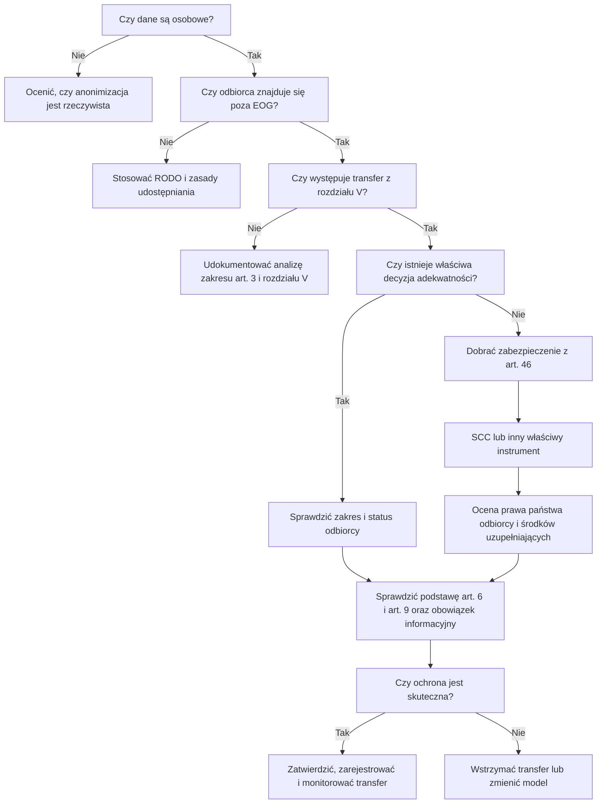
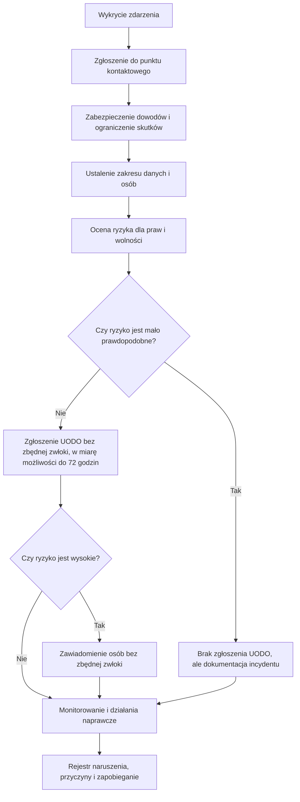

# ✦ ROZDZIAŁ 9.3 ✦

# DANE OSOBOWE I BEZPIECZEŃSTWO INFORMACJI

**Kurs:** Kurs uwolnienia – organizacja i prowadzenie działalności religijnej, społecznej, opiekuńczej oraz społeczno-gospodarczej fundacji  
**Część:** III – Międzynarodowe finansowanie działalności organizacji pozarządowych  
**Moduł:** 9 – Międzynarodowe rozliczenia finansowe, podatkowe i compliance  
**Rozdział:** 9.3. Dane osobowe i bezpieczeństwo informacji  
**Stan odniesienia prawnego i źródłowego:** 26 listopada 2026 r.  
**Charakter opracowania:** materiał dydaktyczny, prawno-organizacyjny, informacyjny i praktyczny

> **Zasada przewodnia:** człowiek nie jest rekordem w bazie, numerem sprawy ani pozycją w raporcie grantowym. Dane opisujące jego zdrowie, sytuację rodzinną, przekonania, niepełnosprawność, trudności materialne lub udział w praktykach religijnych wymagają szczególnej troski. Organizacja, której powierzono takie informacje, powinna umieć wykazać, dlaczego je gromadzi, kto może z nich korzystać, komu je przekazuje, jak długo je przechowuje i w jaki sposób chroni je przed utratą lub ujawnieniem.

> **Granica zakresu:** rozdział 9.1 omawia kwalifikację podatkową przychodów i transakcji, a rozdział 9.2 – weryfikację finansujących, beneficjentów rzeczywistych, sankcji i ryzyka nadużyć. Rozdział 8.3 opisuje operacyjną ewidencję i rozliczanie projektu. Niniejszy rozdział koncentruje się na legalności przetwarzania danych osób fizycznych, prawach tych osób, odpowiedzialności administratora, udostępnianiu danych partnerom zagranicznym, zabezpieczeniach informacji i reagowaniu na naruszenia. Nie należy utożsamiać kontroli finansowej z nieograniczonym prawem do poznawania danych beneficjentów.

---

## Cel rozdziału

Celem rozdziału jest przygotowanie osób zarządzających fundacją, koordynatorów projektów, pracowników, wolontariuszy, osób odpowiedzialnych za dokumentację i współpracę międzynarodową do prawidłowego zarządzania danymi osobowymi oraz informacjami poufnymi w całym cyklu działalności organizacji.

Uczestnik powinien umieć przełożyć zasady RODO na konkretne procesy: nabór do programu pomocy, ocenę wniosku, kontakt z rodziną, udzielenie świadczenia, prowadzenie dokumentacji, raportowanie grantodawcy, współpracę z zagranicznym partnerem, korzystanie z systemów informatycznych, archiwizację i usuwanie danych.

## Efekty kształcenia

Po ukończeniu rozdziału uczestnik potrafi:

1. rozpoznać dane osobowe, dane szczególnych kategorii i inne informacje wymagające podwyższonej ochrony;
2. określić, kto jest administratorem, współadministratorem i podmiotem przetwarzającym;
3. wskazać podstawę z art. 6 RODO oraz – gdy to konieczne – odrębną przesłankę z art. 9 lub art. 10 RODO;
4. zastosować zasady celowości, minimalizacji, prawidłowości, ograniczenia przechowywania, integralności, poufności i rozliczalności;
5. przygotować informację dla osoby, której dane dotyczą;
6. odróżnić przekazanie danych partnerowi w EOG od transferu do państwa trzeciego;
7. dobrać właściwy mechanizm transferu danych poza EOG i ocenić potrzebę dodatkowych zabezpieczeń;
8. przygotować umowę powierzenia, uzgodnienie współadministratorów lub porozumienie o udostępnianiu danych;
9. wdrożyć kontrolę dostępu, szyfrowanie, kopie zapasowe, bezpieczną komunikację i ochronę dokumentacji papierowej;
10. określić okres przechowywania danych na podstawie celu, prawa i umowy, zamiast stosować jeden termin do wszystkich dokumentów;
11. rozpoznać przesłanki oceny skutków dla ochrony danych i wyznaczenia inspektora ochrony danych;
12. obsłużyć żądanie osoby, której dane dotyczą, oraz incydent bezpieczeństwa;
13. wykazać, że zabezpieczenia są adekwatne do ryzyka, rodzaju danych, skali przetwarzania i sytuacji osób.

---

# 1. Podstawy prawne i pojęciowe ochrony danych

## 1.1. Podstawowy porządek prawny

Najważniejszym aktem jest rozporządzenie Parlamentu Europejskiego i Rady (UE) 2016/679, nazywane ogólnym rozporządzeniem o ochronie danych – RODO. Jest ono bezpośrednio stosowane w państwach członkowskich Unii Europejskiej. W Polsce jego stosowanie uzupełnia przede wszystkim ustawa z 10 maja 2018 r. o ochronie danych osobowych, która reguluje między innymi organizację i kompetencje organu nadzorczego oraz krajowe kwestie proceduralne.

W zależności od rodzaju działalności zastosowanie mogą mieć także przepisy szczególne, między innymi dotyczące:

- działalności leczniczej i dokumentacji medycznej;
- pomocy społecznej i świadczeń publicznych;
- prawa pracy i dokumentacji pracowniczej;
- rachunkowości, podatków i archiwizacji dokumentów;
- oświaty, opieki nad dziećmi i działalności wychowawczej;
- tajemnic zawodowych;
- komunikacji elektronicznej, usług cyfrowych i cyberbezpieczeństwa;
- zamówień, grantów i programów finansowanych ze środków publicznych.

Nie każdy przepis, który nakazuje zachować dokument, daje prawo do dowolnego kopiowania wszystkich danych z tego dokumentu. Należy ustalić, jaki konkretny zakres danych jest potrzebny do wykonania obowiązku.

## 1.2. Dane osobowe

Danymi osobowymi są informacje o zidentyfikowanej lub możliwej do zidentyfikowania osobie fizycznej. Identyfikacja może następować bezpośrednio, na przykład przez imię i nazwisko, albo pośrednio, na przykład przez połączenie numeru sprawy, miejscowości, wieku, rodzaju świadczenia i innych cech.

Przykłady danych osobowych w fundacji:

- imię i nazwisko beneficjenta;
- adres, numer telefonu i adres poczty elektronicznej;
- numer PESEL, numer dokumentu tożsamości lub identyfikator sprawy;
- dane rodzica, opiekuna albo członka rodziny;
- informacje o zatrudnieniu i sytuacji materialnej;
- historia kontaktów z fundacją;
- zdjęcie, nagranie głosu lub wizerunek;
- identyfikator urządzenia lub adres IP, jeżeli pozwala powiązać aktywność z osobą;
- informacja o udziale w określonym programie pomocowym.

Nie jest konieczne, aby pojedyncza informacja samodzielnie identyfikowała człowieka. Wystarczy, że identyfikacja jest możliwa przy użyciu środków, których można racjonalnie oczekiwać.

## 1.3. Dane szczególnych kategorii

Art. 9 ust. 1 RODO obejmuje szczególne kategorie danych osobowych, których przetwarzanie jest co do zasady zabronione, chyba że zachodzi jedna z przesłanek wyjątku wskazanych w art. 9 ust. 2 RODO.

Do szczególnych kategorii należą dane ujawniające:

1. pochodzenie rasowe lub etniczne;
2. poglądy polityczne;
3. przekonania religijne lub światopoglądowe;
4. przynależność do związków zawodowych;
5. dane genetyczne;
6. dane biometryczne przetwarzane w celu jednoznacznego zidentyfikowania osoby;
7. dane dotyczące zdrowia;
8. dane dotyczące seksualności lub orientacji seksualnej.

Dla fundacji prowadzącej działalność opiekuńczą, zdrowotną, religijną, edukacyjną i pomocową szczególne znaczenie mają dane o zdrowiu, niepełnosprawności, diagnozach, leczeniu, stanie psychofizycznym, praktykach religijnych i przynależności do wspólnoty wyznaniowej.

Należy odróżnić szczególne kategorie danych w rozumieniu art. 9 od danych, które są po prostu bardzo poufne. Informacja o zadłużeniu, dochodzie, numerze rachunku bankowego lub sytuacji mieszkaniowej może być niezwykle wrażliwa życiowo, choć nie musi należeć do katalogu art. 9. Nadal wymaga podstawy prawnej, minimalizacji i zabezpieczeń.

Dane dotyczące wyroków skazujących i naruszeń prawa podlegają odrębnemu reżimowi art. 10 RODO. Nie należy ich traktować jak zwykłych danych identyfikacyjnych.

## 1.4. Dane o zdrowiu

Dane o zdrowiu obejmują informacje ujawniające stan zdrowia fizycznego lub psychicznego, przeszłe, obecne lub przyszłe, w tym dane o świadczeniach zdrowotnych, które ujawniają informacje o stanie zdrowia.

W praktyce mogą to być:

- rozpoznania i kody chorób;
- wyniki badań i opisy konsultacji;
- informacje o niepełnosprawności;
- zalecenia terapeutyczne;
- informacje o lekach i rehabilitacji;
- dane o hospitalizacji;
- informacje o potrzebie opieki długoterminowej;
- dokumentacja potwierdzająca szczególną potrzebę wsparcia.

Fundacja nie powinna gromadzić pełnej dokumentacji medycznej tylko dlatego, że może być ona przydatna. Jeżeli do przyznania określonego świadczenia wystarcza zaświadczenie potwierdzające spełnienie kryterium, należy rozważyć pozyskanie właśnie takiego ograniczonego dokumentu, a nie całej historii leczenia.

## 1.5. Dane ujawniające przekonania religijne

Informacja o uczestnictwie w nabożeństwie, przynależności do wspólnoty, korzystaniu z posługi religijnej lub zgłoszeniu się do programu religijnego może ujawniać przekonania religijne. Nie oznacza to, że każda organizacja religijna może swobodnie gromadzić i przekazywać takie informacje.

Należy każdorazowo ustalić:

- czy informacja rzeczywiście ujawnia przekonania religijne;
- w jakim celu jest potrzebna;
- czy przetwarzanie jest niezbędne;
- jaka przesłanka z art. 9 ust. 2 ma zastosowanie;
- czy zachodzą warunki i ograniczenia tej przesłanki;
- czy dane mogą być udostępnione poza organizację;
- czy osoba została prawidłowo poinformowana.

Samo określenie organizacji jako religijnej nie zwalnia jej z RODO.

## 1.6. Pseudonimizacja i anonimizacja

Pseudonimizacja polega na takim przetworzeniu danych, aby bez dodatkowych informacji nie można było ich przypisać konkretnej osobie. Przykładem jest zastąpienie nazwiska kodem beneficjenta i przechowywanie tabeli powiązań w oddzielnym, lepiej zabezpieczonym miejscu.

Dane pseudonimizowane nadal są danymi osobowymi, jeżeli ponowna identyfikacja jest możliwa przy użyciu dodatkowych informacji.

Anonimizacja powinna uniemożliwiać identyfikację osoby w sposób nieodwracalny przy uwzględnieniu rozsądnie dostępnych środków. Samo usunięcie nazwiska nie zawsze wystarcza. W małej miejscowości połączenie wieku, rodzaju choroby, daty wydarzenia i nazwy programu może pozwolić rozpoznać osobę.

**Zasada praktyczna:** grantodawca powinien otrzymywać dane zbiorcze albo pseudonimizowane, jeśli do kontroli projektu nie potrzebuje danych bezpośrednio identyfikujących beneficjenta.

---

# 2. Zasady przetwarzania danych w działalności fundacji

## 2.1. Zasada zgodności z prawem, rzetelności i przejrzystości

Każda operacja na danych musi mieć podstawę prawną, być wykonywana uczciwie i pozostawać zrozumiała dla osoby, której dane dotyczą.

Organizacja powinna umieć odpowiedzieć na pytania:

- kto przetwarza dane;
- w jakim celu;
- na jakiej podstawie;
- jakie kategorie danych są wykorzystywane;
- komu są udostępniane;
- jak długo będą przechowywane;
- jakie prawa ma osoba.

Nie wolno ukrywać rzeczywistego celu pod ogólnym określeniem „cele administracyjne” lub „obsługa projektu”, jeżeli faktycznie dane są wykorzystywane do kilku odrębnych celów.

## 2.2. Ograniczenie celu

Dane należy zbierać w konkretnych, wyraźnych i prawnie uzasadnionych celach. Nie można pozyskiwać dokumentacji beneficjenta z zamiarem późniejszego, nieokreślonego wykorzystania.

Przykładowe odrębne cele:

- przyjęcie i rozpatrzenie wniosku o pomoc;
- ocena spełnienia kryteriów programu;
- kontakt z beneficjentem;
- realizacja i rozliczenie świadczenia;
- spełnienie obowiązku prawnego;
- obrona przed roszczeniem;
- przekazanie informacji grantodawcy;
- publikacja dobrowolnej historii lub wizerunku beneficjenta;
- prowadzenie badań lub ewaluacji.

Każdy cel powinien mieć własną analizę podstawy prawnej, zakresu danych i okresu przechowywania. Zgoda na publikację zdjęcia nie jest automatycznie zgodą na przekazanie pełnej dokumentacji zdrowotnej partnerowi zagranicznemu.

## 2.3. Minimalizacja danych

Organizacja powinna gromadzić tylko dane adekwatne, stosowne i ograniczone do tego, co niezbędne.

Przykład: jeżeli program przyznaje dofinansowanie do rehabilitacji osobom z określoną niepełnosprawnością, nie musi automatycznie zbierać całej dokumentacji medycznej, historii wszystkich hospitalizacji, danych o członkach rodziny i pełnej historii zatrudnienia.

Test minimalizacji:

1. Jaką konkretną decyzję lub czynność ma umożliwić dana informacja?
2. Czy można osiągnąć ten cel przy użyciu mniejszego zakresu danych?
3. Czy można przyjąć dokument potwierdzający kryterium zamiast kopii pełnej dokumentacji?
4. Czy dane można pseudonimizować?
5. Czy dostęp do danych może być ograniczony do jednej roli?
6. Czy grantodawca rzeczywiście wymaga danych identyfikujących, czy wystarczy zestawienie statystyczne?

## 2.4. Prawidłowość i aktualność

Dane powinny być prawidłowe i w razie potrzeby aktualizowane. Błędna informacja może prowadzić do odmowy pomocy, niewłaściwego skierowania, utraty świadczenia albo naruszenia prywatności.

Organizacja powinna umożliwiać zgłaszanie korekt, określić sposób weryfikacji i dokumentować istotne zmiany. Nie należy jednak bez potrzeby kopiować aktualizacji do wszystkich systemów i dokumentów, w których dane występowały.

## 2.5. Ograniczenie przechowywania

Dane identyfikujące należy przechowywać nie dłużej, niż jest to konieczne do celów przetwarzania, chyba że właściwy przepis lub prawidłowo ustalony wyjątek uzasadnia dalsze przechowywanie.

Nie istnieje jeden uniwersalny okres przechowywania wszystkich danych fundacji. Okres może zależeć od:

- rodzaju dokumentu;
- podstawy prawnej;
- celu i etapu programu;
- wymogów umowy grantowej;
- przepisów rachunkowych i podatkowych;
- obowiązków dotyczących dokumentacji medycznej;
- okresów przedawnienia roszczeń;
- prawnie uzasadnionej potrzeby zabezpieczenia dowodów.

Zachowanie dokumentu księgowego nie oznacza automatycznie, że wolno zachować każdy załącznik zawierający nadmiarowe dane zdrowotne. Należy rozdzielać część dowodową konieczną do rozliczenia od informacji, których dalsze przechowywanie nie jest uzasadnione.

## 2.6. Integralność, poufność i rozliczalność

Dane muszą być chronione przed przypadkowym lub niezgodnym z prawem zniszczeniem, utratą, zmianą, nieuprawnionym ujawnieniem i dostępem.

Rozliczalność oznacza, że administrator nie tylko przestrzega zasad, ale potrafi wykazać, że je wdrożył. W praktyce potrzebne są:

- rejestr czynności przetwarzania;
- dokumentacja podstaw prawnych;
- informacje dla osób;
- umowy z podmiotami przetwarzającymi;
- wykaz odbiorców i transferów;
- analiza ryzyka;
- procedury dostępu i retencji;
- dokumentacja szkoleń;
- rejestr naruszeń;
- dowody przeglądu zabezpieczeń.

---

# 3. Podstawa prawna przetwarzania

## 3.1. Dwuetapowy test legalności

W przypadku danych zwykłych administrator musi wskazać co najmniej jedną podstawę z art. 6 ust. 1 RODO. Jeżeli przetwarzanie obejmuje dane szczególnych kategorii, trzeba dodatkowo wykazać właściwą przesłankę z art. 9 ust. 2 RODO. W przypadku danych o wyrokach skazujących należy uwzględnić art. 10 RODO.

Podstawa z art. 6 nie zastępuje wyjątku z art. 9. Zgoda zwykła na przetwarzanie danych kontaktowych nie jest automatycznie wyraźną zgodą na przetwarzanie danych zdrowotnych.

## 3.2. Podstawy z art. 6 ust. 1 RODO

| Podstawa | Kiedy może mieć zastosowanie | Uwaga praktyczna |
|:--|:--|:--|
| Zgoda – lit. a | Osoba świadomie i dobrowolnie zgadza się na określony cel | Musi być możliwa do wycofania; nie może być wymuszona |
| Umowa – lit. b | Przetwarzanie jest niezbędne do umowy z osobą lub działań przed jej zawarciem na jej żądanie | Umowa z grantodawcą nie oznacza automatycznie umowy z beneficjentem |
| Obowiązek prawny – lit. c | Przetwarzanie jest niezbędne do wykonania obowiązku wynikającego z prawa | Trzeba wskazać konkretny przepis |
| Żywotne interesy – lit. d | Przetwarzanie jest niezbędne do ochrony życia lub zdrowia, gdy osoba nie może wyrazić zgody | Nie jest ogólną podstawą rutynowej obsługi programu |
| Zadanie publiczne – lit. e | Przetwarzanie jest niezbędne do zadania realizowanego w interesie publicznym lub w ramach władzy publicznej | Fundacja nie może przyjąć tej podstawy tylko dlatego, że działa społecznie |
| Prawnie uzasadniony interes – lit. f | Przetwarzanie jest niezbędne dla interesu administratora lub strony trzeciej, a prawa osoby nie przeważają | Nie stosuje się do organów publicznych przy wykonywaniu ich zadań |

## 3.3. Zgoda

Zgoda musi być dobrowolna, konkretna, świadoma, jednoznaczna i możliwa do wykazania. Jeżeli dotyczy danych szczególnych kategorii na podstawie art. 9 ust. 2 lit. a, musi być wyraźna.

Nie należy uzależniać przyznania podstawowej pomocy od zgody na publikację wizerunku, przekazanie danych sponsorowi, marketing albo opowiadanie publicznie historii beneficjenta, jeżeli te czynności nie są niezbędne do udzielenia pomocy.

Wycofanie zgody nie wpływa na zgodność z prawem przetwarzania, którego dokonano przed jej wycofaniem. Po wycofaniu trzeba jednak zaprzestać dalszego przetwarzania opartego wyłącznie na tej zgodzie, chyba że istnieje inna, rzeczywiście właściwa podstawa prawna i osoba została o niej poinformowana.

## 3.4. Umowa i obsługa świadczenia

Art. 6 ust. 1 lit. b może mieć zastosowanie, gdy osoba jest stroną umowy lub podejmuje działania przed jej zawarciem na własne żądanie. Nie należy rozciągać tej podstawy na wszystkie osoby, których dane są przetwarzane w projekcie.

Jeżeli beneficjent nie zawiera umowy z fundacją, samo istnienie umowy grantowej między fundacją a finansującym nie oznacza, że wszystkie dane beneficjenta można przetwarzać na podstawie umowy z beneficjentem.

## 3.5. Prawnie uzasadniony interes

W przypadku art. 6 ust. 1 lit. f administrator powinien przeprowadzić trzystopniowy test:

1. określić rzeczywisty i zgodny z prawem interes;
2. wykazać, że przetwarzanie jest niezbędne do realizacji tego interesu;
3. zważyć interes administratora z prawami, wolnościami i uzasadnionymi oczekiwaniami osoby.

Test powinien być zapisany i podlegać przeglądowi, zwłaszcza gdy zmienia się cel, skala lub rodzaj danych.

Przykładem może być ograniczone przetwarzanie danych kontaktowych w celu zabezpieczenia roszczeń lub ochrony infrastruktury. Nie oznacza to jednak automatycznej możliwości oparcia na tej podstawie przetwarzania danych zdrowotnych – w takim przypadku potrzebna jest również przesłanka z art. 9.

## 3.6. Szczególne kategorie danych – art. 9 RODO

W działalności fundacji mogą mieć znaczenie między innymi następujące wyjątki:

- art. 9 ust. 2 lit. a – wyraźna zgoda na określony cel;
- art. 9 ust. 2 lit. c – ochrona żywotnych interesów, gdy osoba jest fizycznie lub prawnie niezdolna do wyrażenia zgody;
- art. 9 ust. 2 lit. d – określone przetwarzanie przez fundację, stowarzyszenie lub inny nienastawiony na zysk podmiot o celach politycznych, filozoficznych, religijnych lub związkowych, przy spełnieniu wszystkich warunków tego przepisu;
- art. 9 ust. 2 lit. f – ustalenie, dochodzenie lub obrona roszczeń;
- art. 9 ust. 2 lit. g – ważny interes publiczny na podstawie prawa Unii lub państwa członkowskiego;
- art. 9 ust. 2 lit. h – określone cele profilaktyki zdrowotnej, medycyny pracy, diagnozy, opieki lub leczenia, z uwzględnieniem właściwych podstaw prawnych i tajemnicy zawodowej;
- art. 9 ust. 2 lit. j – cele archiwalne w interesie publicznym, naukowe, historyczne lub statystyczne, na warunkach prawa i zabezpieczeń.

### Szczególna ostrożność przy art. 9 ust. 2 lit. d

Wyjątek dotyczący organizacji o celach religijnych lub filozoficznych nie jest ogólnym zezwoleniem na przetwarzanie danych każdej osoby, która zwróciła się do fundacji.

Przepis wymaga między innymi, aby przetwarzanie odbywało się w ramach uprawnionej działalności podmiotu, z odpowiednimi zabezpieczeniami, dotyczyło wyłącznie członków, byłych członków albo osób utrzymujących z podmiotem stałe kontakty w związku z jego celami oraz aby dane nie były ujawniane poza ten podmiot bez zgody osób.

Nie należy automatycznie uznawać, że osoba, która jednorazowo złożyła wniosek o pomoc, spełnia warunek stałego kontaktu. Nie należy też zakładać, że wyjątek obejmuje przekazanie danych grantodawcy, partnerowi zagranicznemu albo sponsorowi.

## 3.7. Dane dotyczące dzieci i osób wymagających szczególnej ochrony

Przetwarzanie danych dzieci powinno uwzględniać ich wiek, dojrzałość, sytuację i ryzyko szkody. Informacja kierowana do dziecka powinna być zrozumiała. W sprawach wymagających przedstawicielstwa należy ustalić właściwy zakres działania rodzica lub opiekuna prawnego, ale nie wolno zakładać, że każda osoba dorosła towarzysząca dziecku jest uprawniona do dostępu do całej dokumentacji.

W programach wsparcia rodzin należy rozdzielić dane:

- dziecka;
- rodzica lub opiekuna;
- pozostałych członków gospodarstwa domowego;
- osoby składającej wniosek;
- osoby odbierającej świadczenie.

Dane jednego członka rodziny nie powinny być automatycznie udostępniane pozostałym. Organizacja powinna mieć procedurę weryfikacji uprawnienia do reprezentacji i dostępu.

## 3.8. Macierz legalności przetwarzania

Przed rozpoczęciem nowego procesu należy sporządzić tabelę:

| Element | Pytanie kontrolne | Przykładowy zapis |
|:--|:--|:--|
| Cel | Po co dane są potrzebne? | Rozpatrzenie wniosku o rehabilitację |
| Osoby | Czyich danych dotyczy proces? | Wnioskodawca i opiekun |
| Kategorie | Jakie dane są niezbędne? | Kontakt, kryterium uprawnienia |
| Art. 6 | Jaka podstawa legalizuje dane zwykłe? | Ustalona po analizie konkretnego procesu |
| Art. 9 | Czy występują dane szczególne i jaki wyjątek ma zastosowanie? | Wskazanie konkretnej przesłanki |
| Odbiorcy | Kto otrzyma dane? | Upoważnieni pracownicy, ewentualnie partner |
| Retencja | Jak długo dane będą potrzebne? | Termin wynikający z celu i przepisów |
| Zabezpieczenia | Jak ograniczono ryzyko? | Dostęp według ról, szyfrowanie, rejestr |
| Informacja | Jak poinformowano osobę? | Klauzula informacyjna z datą i wersją |

---

# 4. Role i odpowiedzialność podmiotów

## 4.1. Administrator danych

Administratorem jest podmiot, który samodzielnie lub wspólnie z innymi ustala cele i sposoby przetwarzania danych. W typowym modelu fundacji administratorem jest fundacja jako osoba prawna, a nie automatycznie fundator, prezes, dyrektor, pracownik lub koordynator.

Organ zarządzający podejmuje decyzje i zapewnia zasoby, ale nie może przenieść całej odpowiedzialności na pracownika, informatyka, księgowego ani inspektora ochrony danych.

## 4.2. Podmiot przetwarzający

Podmiot przetwarzający działa w imieniu administratora i na jego udokumentowane polecenie. Przykładami mogą być dostawca hostingu, systemu obsługi wniosków, usług pocztowych, kopii zapasowych lub zewnętrzna firma archiwizacyjna.

Sama nazwa w umowie nie rozstrzyga o roli. Jeżeli dostawca samodzielnie wykorzystuje dane do własnych celów, może być odrębnym administratorem w tym zakresie.

## 4.3. Współadministratorzy

Współadministracja występuje, gdy co najmniej dwa podmioty wspólnie ustalają cele i sposoby przetwarzania. Nie wynika ona automatycznie z partnerstwa projektowego ani wspólnego finansowania.

Jeżeli fundacja i zagraniczny partner wspólnie projektują formularz, kryteria naboru, sposób oceny i wspólną bazę, należy zbadać, czy nie występuje wspólne ustalanie celów i zasadniczych środków.

W razie współadministracji podmioty zawierają uzgodnienie zgodnie z art. 26 RODO. Powinno ono przejrzyście rozdzielać obowiązki, w szczególności dotyczące informacji, praw osób i bezpieczeństwa. Istota uzgodnienia musi być udostępniona osobie, której dane dotyczą.

## 4.4. Umowa powierzenia – art. 28 RODO

Jeżeli zewnętrzny dostawca przetwarza dane w imieniu fundacji, należy zawrzeć umowę lub inny wiążący instrument określający co najmniej:

- przedmiot i czas trwania przetwarzania;
- charakter i cel operacji;
- rodzaj danych i kategorie osób;
- prawa i obowiązki administratora;
- przetwarzanie wyłącznie na udokumentowane polecenie;
- zobowiązanie osób upoważnionych do poufności;
- środki bezpieczeństwa z art. 32;
- zasady korzystania z dalszych podmiotów przetwarzających;
- pomoc w realizacji praw osób;
- pomoc przy naruszeniach, DPIA i konsultacjach;
- usunięcie lub zwrot danych po zakończeniu usługi, według wyboru administratora, o ile prawo nie nakazuje przechowywania;
- możliwość audytu i udostępnienia informacji potrzebnych do wykazania zgodności.

Umowa nie powinna ograniczać się do zdania „dostawca przestrzega RODO”. Musi odzwierciedlać rzeczywisty zakres operacji i ryzyko.

## 4.5. Partner finansujący nie zawsze jest procesorem

Grantodawca może być:

- niezależnym administratorem danych, które otrzymuje w celu wykonania własnych obowiązków;
- współadministratorem, jeżeli wspólnie z fundacją ustala cele i sposoby przetwarzania;
- podmiotem przetwarzającym, jeżeli działa wyłącznie w imieniu fundacji.

Nie wolno automatycznie uznawać każdego finansującego za administratora ani każdego partnera za procesora. Należy zbadać rzeczywiste kompetencje, cele, zakres decyzji i przepływ danych.

## 4.6. Tabela wyboru właściwej relacji

| Sytuacja | Prawdopodobna rola | Wymagany dokument |
|:--|:--|:--|
| Dostawca hostingu przechowuje dane na polecenie fundacji | Podmiot przetwarzający | Umowa z art. 28 |
| Fundacja i partner wspólnie ustalają nabór i kryteria oceny | Możliwi współadministratorzy | Uzgodnienie z art. 26 |
| Grantodawca otrzymuje ograniczone raporty dla własnych obowiązków | Możliwy odrębny administrator | Porozumienie o udostępnianiu i opis ról |
| Tłumacz otrzymuje dokumenty wyłącznie w celu tłumaczenia na polecenie fundacji | Podmiot przetwarzający lub osoba upoważniona, zależnie od modelu | Umowa powierzenia lub odpowiednie zobowiązanie |
| Partner samodzielnie prowadzi własny program i sam ustala cele | Odrębny administrator | Porozumienie o udostępnianiu i przejrzysta informacja |

---

# 5. Informowanie osób i realizacja ich praw

## 5.1. Obowiązek informacyjny

Przy pozyskiwaniu danych od osoby należy przekazać informacje z art. 13 RODO. Jeżeli dane pochodzą z innego źródła, zastosowanie ma art. 14 RODO, z uwzględnieniem jego wyjątków.

Informacja powinna być przekazana w zwięzłej, przejrzystej, zrozumiałej i łatwo dostępnej formie. Może być wielowarstwowa: najważniejsze informacje w formularzu, a pełna klauzula w dokumencie lub na stronie internetowej.

Klauzula powinna uwzględniać między innymi:

1. tożsamość i dane kontaktowe administratora;
2. dane kontaktowe inspektora ochrony danych, jeżeli został wyznaczony;
3. cele i podstawy prawne;
4. prawnie uzasadnione interesy, jeżeli są podstawą;
5. odbiorców lub kategorie odbiorców;
6. zamiar transferu do państwa trzeciego i podstawę transferu;
7. okres przechowywania lub kryteria jego ustalenia;
8. prawa osoby;
9. prawo wniesienia skargi do organu nadzorczego;
10. informację o dobrowolności lub obowiązku podania danych i konsekwencjach ich niepodania;
11. informacje o zautomatyzowanym podejmowaniu decyzji, jeżeli występuje.

Przy danych pozyskanych z innego źródła trzeba dodatkowo wskazać kategorie danych i źródło ich pochodzenia, w tym informację, czy pochodzą ze źródeł publicznie dostępnych, jeśli ma to zastosowanie.

## 5.2. Prawa osoby, której dane dotyczą

Osoba może korzystać z praw przewidzianych w RODO, w szczególności:

- prawa dostępu do danych;
- prawa do uzyskania kopii;
- prawa do sprostowania;
- prawa do usunięcia, gdy zachodzą przesłanki;
- prawa do ograniczenia przetwarzania;
- prawa do przenoszenia danych, jeżeli spełnione są warunki;
- prawa sprzeciwu, gdy podstawą jest art. 6 ust. 1 lit. e lub f;
- prawa do niepodlegania określonym decyzjom opartym wyłącznie na zautomatyzowanym przetwarzaniu;
- prawa do cofnięcia zgody, gdy przetwarzanie opiera się na zgodzie.

Nie każde prawo ma zastosowanie w każdej sytuacji. Na przykład prawo do przenoszenia danych nie jest ogólnym prawem do uzyskania wszystkich akt fundacji w dowolnym formacie.

## 5.3. Termin odpowiedzi

Co do zasady administrator odpowiada bez zbędnej zwłoki, nie później niż w ciągu miesiąca od otrzymania żądania. Termin może zostać przedłużony o kolejne dwa miesiące ze względu na skomplikowany charakter lub liczbę żądań, ale o przedłużeniu i jego przyczynach trzeba poinformować osobę w ciągu pierwszego miesiąca.

Jeżeli administrator nie podejmuje działań, powinien poinformować o przyczynach oraz o możliwości wniesienia skargi do organu nadzorczego i skorzystania ze środka ochrony prawnej.

## 5.4. Weryfikacja tożsamości wnioskodawcy

Organizacja powinna zweryfikować, czy żądanie pochodzi od osoby uprawnionej, ale nie powinna zbierać nadmiarowych kopii dokumentów tożsamości.

Weryfikacja powinna być proporcjonalna do ryzyka. Można wykorzystać już istniejący kanał kontaktu, identyfikator sprawy lub inne adekwatne środki. Kopia dokumentu tożsamości nie powinna być standardowo wymagana przy każdym żądaniu.

W przypadku przedstawiciela należy ustalić zakres jego umocowania, a w przypadku dziecka – właściwe zasady przedstawicielstwa i prawa dziecka.

## 5.5. Dostęp a prawa innych osób

Prawo dostępu nie może naruszać praw i wolności innych osób. Jeżeli dokument zawiera dane kilku beneficjentów, przed przekazaniem kopii należy rozważyć anonimizację lub wyłączenie danych osób trzecich.

Nie należy odmawiać dostępu do całego dokumentu tylko dlatego, że zawiera on również informacje o innych osobach, jeżeli możliwe jest bezpieczne wydzielenie części dotyczącej wnioskodawcy.

## 5.6. Rejestr żądań

Rejestr powinien zawierać:

- datę wpływu;
- kanał otrzymania;
- rodzaj żądania;
- identyfikator osoby lub sprawy;
- osobę odpowiedzialną;
- datę weryfikacji;
- termin ustawowy;
- podjęte czynności;
- datę i sposób odpowiedzi;
- uzasadnienie odmowy lub ograniczenia, jeżeli wystąpiło;
- informację o ewentualnym przedłużeniu.

Rejestr powinien sam zawierać możliwie mało danych osobowych.

---

# 6. Udostępnianie danych partnerom zagranicznym

## 6.1. Najpierw cel i rola, potem transfer

Przed przekazaniem danych zagranicznemu partnerowi należy odpowiedzieć na pięć pytań:

1. Jaki konkretny cel wymaga przekazania danych?
2. Czy partner musi znać tożsamość beneficjenta?
3. Czy wystarczy raport zbiorczy lub pseudonimizowany?
4. Jaka jest rola partnera: administrator, współadministrator czy procesor?
5. Czy przekazanie jest transferem do państwa trzeciego w rozumieniu rozdziału V RODO?

Nie należy rozpoczynać od wyboru narzędzia komunikacji. Najpierw trzeba ustalić, czy przekazanie jest legalne i konieczne.

## 6.2. Dane przekazywane w raportach grantowych

W wielu programach grantodawca potrzebuje potwierdzenia:

- liczby uczestników;
- rodzaju udzielonego wsparcia;
- osiągniętych rezultatów;
- kosztów i kategorii wydatków;
- zgodności z kryteriami programu;
- prawidłowości realizacji.

Nie oznacza to automatycznie potrzeby otrzymania imion, nazwisk, adresów, numerów PESEL, diagnoz lub pełnej dokumentacji beneficjentów.

Preferowana kolejność rozwiązań:

1. raport zagregowany;
2. raport z identyfikatorami projektu;
3. dane pseudonimizowane;
4. ograniczony zestaw danych identyfikujących, gdy jest to niezbędne i legalne;
5. dokumentacja źródłowa udostępniana w kontrolowanym trybie, tylko w wymaganym zakresie.

## 6.3. Zasady bezpiecznego udostępniania

Przed przekazaniem danych należy:

- potwierdzić odbiorcę i jego uprawnienie;
- sprawdzić, czy przekazanie jest objęte informacją dla osoby;
- zweryfikować podstawę prawną;
- ustalić zakres i format danych;
- zastosować pseudonimizację lub szyfrowanie, gdy to właściwe;
- przekazać hasło innym kanałem niż zaszyfrowany plik;
- ustalić termin usunięcia lub zwrotu danych;
- zarejestrować przekazanie;
- ograniczyć dalsze przekazywanie przez odbiorcę;
- zachować dowód wykonania czynności.

Nie należy wysyłać zbiorczych list beneficjentów do wielu partnerów w kopii jawnej. Nie należy udostępniać całego folderu, jeżeli partner potrzebuje jednego dokumentu.

## 6.4. Umowa i instrukcje dla partnera

Umowa o współpracy powinna rozstrzygać:

- role stron;
- cele i podstawy przetwarzania;
- zakres danych;
- zasady dalszego udostępniania;
- zabezpieczenia;
- osoby uprawnione;
- terminy przechowywania;
- obsługę praw osób;
- obsługę incydentów;
- audyty i możliwość weryfikacji;
- zasady zwrotu i usunięcia danych;
- transfery do dalszych odbiorców;
- prawo właściwe i mechanizm rozstrzygania sporów, z zastrzeżeniem bezwzględnie obowiązujących przepisów RODO.

Sama klauzula poufności nie zastępuje umowy z art. 28, uzgodnienia z art. 26 ani mechanizmu transferu z rozdziału V.

---

# 7. Transfer danych poza Europejski Obszar Gospodarczy

## 7.1. EOG i państwo trzecie

Europejski Obszar Gospodarczy obejmuje państwa Unii Europejskiej oraz Islandię, Liechtenstein i Norwegię. Przepływ danych w ramach EOG nie jest transferem do państwa trzeciego w rozumieniu rozdziału V RODO, choć nadal obowiązują zasady ochrony danych.

Państwo spoza EOG jest co do zasady państwem trzecim dla potrzeb rozdziału V. Wielka Brytania pozostaje państwem trzecim, mimo że Komisja Europejska przyjęła decyzję stwierdzającą odpowiedni stopień ochrony. Podobnie decyzja adekwatności dla określonych organizacji w Stanach Zjednoczonych nie zmienia ich statusu geograficznego.

## 7.2. Kiedy może wystąpić transfer

Transfer może wystąpić między innymi wtedy, gdy administrator lub procesor objęty RODO udostępnia dane odrębnemu administratorowi lub procesorowi w państwie trzecim.

Przykłady:

- fundacja przekazuje listę beneficjentów partnerowi w państwie spoza EOG;
- dostawca systemu udostępnia dane personelowi wsparcia technicznego w państwie trzecim;
- zagraniczny podwykonawca otrzymuje dostęp do dokumentacji;
- dane są udostępniane organizacji międzynarodowej poza EOG;
- kopie zapasowe lub systemy obsługi są dostępne dla odrębnego podmiotu z państwa trzeciego.

Nie każda sytuacja technicznego przechowywania w chmurze jest automatycznie transferem do odrębnego odbiorcy, ale lokalizacja, dostęp zdalny, podwykonawcy i struktura dostawcy muszą zostać zbadane. Sama deklaracja, że serwer znajduje się w EOG, nie rozstrzyga wszystkich kwestii dostępu i dalszego przekazywania.

## 7.3. Mechanizmy z rozdziału V RODO

| Mechanizm | Podstawa | Zastosowanie |
|:--|:--|:--|
| Decyzja adekwatności | Art. 45 RODO | Transfer do państwa, terytorium lub określonego sektora objętego decyzją Komisji |
| Odpowiednie zabezpieczenia | Art. 46 RODO | Między innymi standardowe klauzule umowne, wiążące reguły korporacyjne i inne przewidziane instrumenty |
| Wyjątki szczególne | Art. 49 RODO | Wyłącznie w konkretnych sytuacjach i przy spełnieniu warunków przepisu |

Nie należy zakładać, że samo podpisanie umowy z zagranicznym partnerem legalizuje transfer.

## 7.4. Decyzje adekwatności

Decyzja adekwatności oznacza, że Komisja Europejska uznała poziom ochrony w danym państwie, terytorium lub określonym sektorze za odpowiedni. Transfer na tej podstawie może odbywać się bez dodatkowego zezwolenia właściwego organu, z zachowaniem pozostałych obowiązków RODO.

Zakres decyzji trzeba sprawdzić dokładnie. Może ona dotyczyć wyłącznie określonych podmiotów lub sektorów, a nie całego państwa.

W szczególności:

- w Kanadzie decyzja obejmuje określone organizacje komercyjne podlegające właściwym przepisom;
- w Stanach Zjednoczonych decyzja dotycząca EU–US Data Privacy Framework obejmuje organizacje uczestniczące w tym systemie i znajdujące się na właściwej liście;
- w przypadku Wielkiej Brytanii należy uwzględniać aktualną decyzję i jej zakres, w tym odnowienie przyjęte w grudniu 2025 r.

Lista Komisji może się zmieniać. Przed każdym istotnym transferem należy sprawdzić aktualny wykaz i zakres decyzji, zamiast kopiować listę państw do niezmienianej procedury.

## 7.5. EU–US Data Privacy Framework

Decyzja wykonawcza Komisji (UE) 2023/1795 z 10 lipca 2023 r. stwierdza odpowiedni stopień ochrony dla danych przekazywanych z Unii do organizacji w Stanach Zjednoczonych znajdujących się na liście Data Privacy Framework.

Fundacja nie może uznać, że każda amerykańska organizacja, platforma chmurowa lub firma technologiczna jest objęta tą decyzją. Trzeba sprawdzić:

1. czy odbiorca znajduje się na oficjalnej liście;
2. czy jego certyfikacja jest aktualna;
3. czy obejmuje właściwy zakres usług i kategorii danych;
4. czy odbiorca działa jako administrator czy procesor;
5. czy dalsze przekazanie danych jest zgodne z warunkami programu;
6. czy nadal obowiązuje właściwa decyzja adekwatności.

Decyzja może być monitorowana, zmieniana, zawieszana lub uchylana. Dlatego wynik kontroli powinien zawierać datę sprawdzenia.

## 7.6. Standardowe klauzule umowne

Jeżeli nie ma decyzji adekwatności, jednym z podstawowych instrumentów są standardowe klauzule umowne przyjęte decyzją wykonawczą Komisji (UE) 2021/914.

Właściwy moduł zależy od relacji stron:

- administrator – administrator;
- administrator – procesor;
- procesor – procesor;
- procesor – administrator.

Klauzule należy dobrać do rzeczywistej roli stron i uzupełnić wymagane załączniki, opis przetwarzania, środki bezpieczeństwa oraz informacje o dalszych odbiorcach.

SCC nie są uniwersalnym formularzem, który można podpisać bez analizy. Nie zastępują podstawy z art. 6 i art. 9, informacji dla osoby ani umowy powierzenia, jeżeli jest ona wymagana.

## 7.7. Ocena skutków transferu i środki uzupełniające

Po wyroku Trybunału Sprawiedliwości UE w sprawie C-311/18 Schrems II oraz zgodnie z zaleceniami EROD należy ocenić, czy prawo i praktyka państwa odbiorcy nie uniemożliwiają skutecznego przestrzegania gwarancji zawartych w SCC lub innym instrumencie.

Analiza powinna obejmować:

- rodzaj przekazywanych danych;
- możliwość identyfikacji osób;
- charakter odbiorcy i jego podwykonawców;
- zakres dostępu władz publicznych w państwie odbiorcy;
- dostępne środki ochrony prawnej;
- możliwość szyfrowania danych w sposób, który uniemożliwia odbiorcy dostęp do treści;
- pseudonimizację;
- ograniczenie zakresu i czasu transferu;
- techniczne i organizacyjne środki uzupełniające.

Jeżeli nie można zapewnić poziomu ochrony zasadniczo równoważnego ochronie w EOG, transfer należy wstrzymać lub zmienić jego model.

## 7.8. Wyjątki z art. 49 RODO

Wyjątki z art. 49 mogą obejmować między innymi:

- wyraźną zgodę osoby, po poinformowaniu jej o możliwym ryzyku;
- niezbędność do wykonania umowy z osobą lub działań przedumownych na jej żądanie;
- niezbędność do zawarcia lub wykonania umowy zawartej w interesie osoby;
- ważne względy interesu publicznego;
- ustalenie, dochodzenie lub obronę roszczeń;
- ochronę żywotnych interesów;
- określone transfery z rejestru publicznego;
- szczególne, ograniczone sytuacje związane z prawnie uzasadnionymi interesami administratora, po spełnieniu rygorystycznych warunków.

Wyjątki te nie powinny być używane jako stała podstawa regularnego przekazywania list beneficjentów partnerowi w państwie trzecim. Jeżeli transfer jest powtarzalny, należy poszukać właściwego mechanizmu z art. 45 lub 46.

## 7.9. Schemat decyzyjny transferu

---

# 8. Zabezpieczanie dokumentacji papierowej

## 8.1. Klasyfikacja dokumentów

Dokumenty należy klasyfikować według ryzyka i potrzeby dostępu. Przykładowe poziomy:

| Poziom | Przykłady | Zabezpieczenia |
|:--|:--|:--|
| Publiczne | Statut, publiczne sprawozdanie, ogłoszenie | Kontrola wersji i integralności |
| Wewnętrzne | Harmonogram, instrukcja pracy | Dostęp dla personelu |
| Poufne | Umowy, dane kontaktowe kontrahentów | Dostęp według ról, zamknięte szafy |
| Szczególnie chronione | Dokumentacja zdrowotna, religijna, opiekuńcza, dane dzieci | Ograniczony dostęp, rejestr udostępnień, szyfrowanie kopii cyfrowych, kontrolowane przechowywanie |

Poziom klasyfikacji nie zastępuje kwalifikacji prawnej danych. Jest narzędziem organizacyjnym ułatwiającym dobór zabezpieczeń.

## 8.2. Zasady obiegu dokumentów

Dokumenty zawierające dane osobowe powinny być:

- odbierane w kontrolowanym punkcie;
- rejestrowane bez przepisywania nadmiarowych danych;
- przekazywane wyłącznie osobom uprawnionym;
- przechowywane w zamykanych szafach lub pomieszczeniach;
- wynoszone poza siedzibę tylko w uzasadnionych sytuacjach;
- transportowane w zamkniętych opakowaniach;
- kopiowane wyłącznie w niezbędnym zakresie;
- niszczone w sposób uniemożliwiający odtworzenie danych.

Nie należy pozostawiać wniosków, zaświadczeń i list beneficjentów na biurku, w sali spotkań, drukarce, samochodzie lub ogólnodostępnej szafie.

## 8.3. Zasada czystego biurka i ekranu

Po zakończeniu pracy pracownik powinien:

- schować dokumenty do właściwej szafy;
- zamknąć akta;
- zablokować komputer;
- wylogować się z systemów;
- usunąć wydruki testowe;
- zabezpieczyć nośniki;
- upewnić się, że dokumenty nie pozostają w zasięgu osób postronnych.

Zasada dotyczy także spotkań z darczyńcami, partnerami i wolontariuszami.

## 8.4. Kopiowanie dokumentów tożsamości

Kopia dokumentu tożsamości może zawierać więcej informacji, niż jest potrzebne do konkretnej czynności. Przed wykonaniem kopii należy ustalić podstawę prawną i niezbędność. Jeżeli wystarcza wgląd i odnotowanie weryfikacji, kopiowanie całego dokumentu może być nadmiarowe.

Jeżeli kopia jest prawnie uzasadniona, należy rozważyć ograniczenie danych, oznaczenie celu, kontrolę dostępu i termin usunięcia.

## 8.5. Niszczarki i utylizacja

Dokumenty papierowe należy niszczyć w sposób adekwatny do poziomu poufności. Dokumenty szczególnie chronione nie powinny trafiać do zwykłych koszy na makulaturę. Jeżeli niszczenie zleca się zewnętrznemu podmiotowi, trzeba ustalić jego rolę, zasady bezpieczeństwa, potwierdzenie wykonania i ewentualne powierzenie przetwarzania.

---

# 9. Ograniczanie dostępu do informacji

## 9.1. Zasada najmniejszych uprawnień

Każdy pracownik, współpracownik lub wolontariusz powinien mieć dostęp wyłącznie do danych niezbędnych do wykonywania powierzonych zadań.

Nie należy przyznawać całemu zespołowi dostępu do pełnej bazy beneficjentów tylko dlatego, że pracownicy należą do jednej fundacji.

Przykładowy podział:

| Rola | Zakres dostępu |
|:--|:--|
| Pracownik pierwszego kontaktu | Dane kontaktowe i status zgłoszenia |
| Osoba oceniająca kryteria | Dokumenty konieczne do oceny uprawnienia |
| Specjalista medyczny lub opiekuńczy | Dane niezbędne do wykonania profesjonalnego zadania |
| Księgowość | Dane niezbędne do rozliczeń, bez automatycznego dostępu do całej dokumentacji zdrowotnej |
| Koordynator projektu | Dane operacyjne i wskaźniki |
| Zarząd | Dane potrzebne do nadzoru i decyzji, najlepiej w formie ograniczonej |
| Partner zagraniczny | Wyłącznie dane niezbędne do uzgodnionego celu |
| Informatyk | Dostęp administracyjny, z ograniczeniem wglądu w treść danych i odpowiednim zobowiązaniem |

## 9.2. Nadawanie i odbieranie uprawnień

Organizacja powinna prowadzić rejestr uprawnień zawierający:

- osobę lub konto;
- rolę;
- zakres dostępu;
- system lub zbiór;
- datę nadania;
- osobę zatwierdzającą;
- datę przeglądu;
- datę odebrania;
- przyczynę zmiany.

Po zakończeniu współpracy, zmianie roli lub dłuższej nieobecności należy niezwłocznie ocenić potrzebę utrzymania dostępu.

## 9.3. Uwierzytelnianie

Podstawowe środki:

- indywidualne konta użytkowników;
- silne, unikalne hasła;
- uwierzytelnianie wieloskładnikowe;
- blokada kont po podejrzanej aktywności;
- bezpieczne odzyskiwanie dostępu;
- zakaz współdzielenia kont;
- ograniczenie kont uprzywilejowanych;
- oddzielne konta administracyjne;
- regularny przegląd uprawnień.

Hasła nie powinny być przesyłane zwykłą pocztą elektroniczną ani przechowywane w jawnych arkuszach. Organizacja może stosować menedżer haseł, jeżeli został właściwie dobrany i skonfigurowany.

## 9.4. Rejestrowanie dostępu

Dla systemów zawierających dane szczególnie chronione warto rejestrować istotne zdarzenia:

- logowanie i wylogowanie;
- nieudane próby dostępu;
- pobranie dużej liczby rekordów;
- zmianę uprawnień;
- eksport danych;
- udostępnienie danych;
- usunięcie danych;
- działania administracyjne.

Logi również mogą zawierać dane osobowe i wymagają własnych zasad dostępu, przechowywania oraz ochrony przed manipulacją.

## 9.5. Rozdzielenie obowiązków

Ważne czynności powinny podlegać niezależnej kontroli. Osoba, która przyznaje dostęp do bazy, nie powinna bez kontroli zatwierdzać wszystkich własnych działań administracyjnych. Osoba przygotowująca eksport danych nie powinna być jedyną osobą zatwierdzającą jego wysłanie do partnera.

Rozdział obowiązków ogranicza ryzyko błędu, nadużycia i nieuprawnionego ujawnienia.

---

# 10. Bezpieczeństwo elektronicznej dokumentacji

## 10.1. System zarządzania informacją

Fundacja powinna znać wszystkie miejsca, w których przetwarza dane:

- system obsługi beneficjentów;
- poczta elektroniczna;
- dyski sieciowe;
- chmura;
- system księgowy;
- system kadrowy;
- formularze internetowe;
- urządzenia mobilne;
- nośniki wymienne;
- komunikatory;
- kopie zapasowe;
- archiwa elektroniczne;
- systemy partnerów.

Nie wystarczy zabezpieczyć głównego programu, jeżeli pracownicy pobierają dane do prywatnych arkuszy, wysyłają je komunikatorem lub zapisują na prywatnych urządzeniach.

## 10.2. Szyfrowanie

Szyfrowanie ogranicza ryzyko odczytu danych przez osobę nieuprawnioną. Powinno być stosowane adekwatnie do ryzyka, w szczególności:

- na urządzeniach przenośnych;
- przy przesyłaniu dokumentów;
- w kopiach zapasowych;
- przy przechowywaniu danych szczególnych kategorii;
- w systemach z dostępem zdalnym;
- przy przekazywaniu danych partnerom.

Należy zarządzać kluczami, hasłami i uprawnieniami. Szyfrowanie nie pomoże, jeżeli klucz jest przechowywany razem z plikiem albo hasło wysyłane w tym samym kanale.

## 10.3. Kopie zapasowe

Kopie zapasowe powinny być:

- wykonywane regularnie;
- szyfrowane;
- chronione przed nieautoryzowanym dostępem;
- oddzielone od podstawowego środowiska;
- testowane pod kątem możliwości odtworzenia;
- objęte harmonogramem retencji;
- zabezpieczone przed zaszyfrowaniem przez złośliwe oprogramowanie.

Kopia zapasowa nie jest archiwum do przechowywania danych bezterminowo. Po usunięciu danych z systemu podstawowego należy mieć procedurę ich usunięcia lub kontrolowanego wygaśnięcia z kopii zgodnie z cyklem backupu, przy jednoczesnym zachowaniu bezpieczeństwa odtwarzania.

## 10.4. Aktualizacje i ochrona urządzeń

Podstawowe środki techniczne:

- aktualizowanie systemów operacyjnych i aplikacji;
- ograniczanie instalacji niezatwierdzonego oprogramowania;
- ochrona antywirusowa i antymalware;
- zapora sieciowa;
- szyfrowanie dysków;
- blokada ekranu;
- bezpieczna konfiguracja urządzeń;
- zdalne blokowanie lub wymazywanie urządzeń, jeżeli jest to właściwe;
- ograniczenie uprawnień administratora;
- monitorowanie podatności;
- testowanie odtwarzania i procedur awaryjnych.

## 10.5. Poczta elektroniczna

Najczęstsze błędy:

- wysłanie wiadomości do niewłaściwego adresata;
- użycie pola DW zamiast UDW;
- dołączenie pełnej listy beneficjentów;
- wysłanie załącznika bez szyfrowania;
- użycie prywatnej skrzynki;
- kliknięcie w fałszywy link;
- odpowiedź na wiadomość podszywającą się pod grantodawcę.

Przed wysłaniem wiadomości z danymi należy sprawdzić adresata, załącznik, zakres danych i podstawę przekazania. Przy większym ryzyku należy zastosować bezpieczny portal wymiany dokumentów zamiast zwykłego załącznika.

## 10.6. Komunikatory i urządzenia prywatne

Nie należy używać prywatnych komunikatorów i prywatnych kont do przesyłania dokumentacji zdrowotnej, danych dzieci lub pełnych akt beneficjentów, jeżeli organizacja nie oceniła i nie zatwierdziła takiego kanału.

Jeżeli dopuszcza się pracę na urządzeniach prywatnych, należy określić:

- zasady szyfrowania;
- oddzielenie danych służbowych i prywatnych;
- blokadę urządzenia;
- aktualizacje;
- zakaz kopiowania do prywatnych chmur;
- zasady utraty urządzenia;
- usuwanie danych po zakończeniu współpracy.

## 10.7. Dostawcy chmurowi

Przed wyborem dostawcy należy zbadać:

- gdzie przechowywane są dane;
- kto może uzyskać do nich dostęp;
- czy dostawca korzysta z podwykonawców;
- czy dochodzi do transferu poza EOG;
- jakie mechanizmy transferu zastosowano;
- jak wygląda szyfrowanie;
- czy dostęp jest rejestrowany;
- jak zgłaszane są incydenty;
- jak dane zostaną zwrócone lub usunięte;
- czy dostawca umożliwia audyt i wykazanie zgodności;
- czy model usługi odpowiada wymaganiom fundacji i umowy grantowej.

Certyfikat bezpieczeństwa dostawcy może być dowodem pomocniczym, ale nie zwalnia administratora z własnej oceny ryzyka.

---

# 11. Poufność informacji

## 11.1. Poufność jako obowiązek organizacyjny

Poufność dotyczy nie tylko danych osobowych, lecz również innych informacji, które organizacja powinna chronić ze względu na prawo, umowę, bezpieczeństwo lub uzasadnione oczekiwania osób.

Może obejmować:

- informacje o stanie zdrowia;
- sytuację rodzinną i materialną;
- dane kontaktowe;
- informacje o przyznaniu pomocy;
- dane darczyńców;
- dane pracowników i wolontariuszy;
- treść umów;
- dane dostępowe;
- informacje o incydentach;
- dokumenty wewnętrzne;
- plany bezpieczeństwa.

## 11.2. Zobowiązania personelu

Każda osoba dopuszczona do danych powinna:

- znać zakres upoważnienia;
- zachować poufność;
- korzystać z danych wyłącznie w ramach powierzonych zadań;
- nie kopiować ich do prywatnych zasobów;
- zgłaszać błędy i incydenty;
- nie ujawniać informacji w rozmowach prywatnych;
- zwrócić dokumenty i nośniki po zakończeniu współpracy.

Zobowiązanie do poufności powinno obowiązywać również po zakończeniu zatrudnienia lub wolontariatu, w zakresie wynikającym z prawa i umowy.

## 11.3. Poufność a prawo do informacji

Nie każda informacja o fundacji jest tajna. Statut, sprawozdania publiczne, informacje o zadaniach publicznych i określone dane o finansowaniu mogą podlegać jawności na podstawie odrębnych przepisów.

Należy odróżnić:

- jawność działalności organizacji;
- obowiązki informacyjne wobec grantodawcy;
- dostęp do informacji publicznej;
- prywatność beneficjenta;
- poufność umowną;
- tajemnicę zawodową.

Transparentność finansowania nie oznacza obowiązku publikowania nazwisk, diagnoz, adresów lub historii życiowych beneficjentów.

## 11.4. Publikowanie historii beneficjentów

Publikacja zdjęcia, wypowiedzi lub historii osoby korzystającej z pomocy wymaga osobnej analizy. Nie wolno zakładać, że zgoda na udział w programie obejmuje publikację materiałów promocyjnych.

Zgoda na wizerunek i zgodność z prawem przetwarzania danych to kwestie powiązane, ale nie identyczne. Trzeba sprawdzić również przepisy prawa autorskiego i prawa do wizerunku.

Przy osobach w trudnej sytuacji należy unikać presji, uzależniania pomocy od zgody i ujawniania szczegółów, które mogą prowadzić do stygmatyzacji. Nawet przy zgodzie należy rozważyć, czy publikacja nie wyrządzi szkody.

---

# 12. Przechowywanie danych i harmonogram retencji

## 12.1. Brak jednego terminu dla wszystkich dokumentów

Nie należy przyjmować zasady „wszystkie dane przechowujemy pięć lat” bez rozróżnienia kategorii i podstaw prawnych. Niektóre dokumenty muszą być przechowywane przez okres określony w prawie, inne przez czas wynikający z umowy lub okresu przedawnienia, a jeszcze inne należy usunąć po zakończeniu celu.

W szczególności:

- dokumentacja księgowa może podlegać odrębnym okresom przechowywania;
- dokumentacja medyczna podlega przepisom szczególnym;
- dokumenty grantowe mogą mieć terminy wskazane w umowie lub programie;
- dane rekrutacyjne i kontaktowe mogą wymagać krótszych okresów;
- dane wykorzystywane do obrony roszczeń mogą być przechowywane w zakresie i czasie uzasadnionym konkretnym ryzykiem prawnym.

## 12.2. Harmonogram retencji

Przykładowa struktura:

| Kategoria | Cel | Podstawa | Kryterium zakończenia | Działanie |
|:--|:--|:--|:--|:--|
| Niezakwalifikowany wniosek | Ocena naboru i ewentualne roszczenia | Ustalona podstawa art. 6 i ewentualnie art. 9 | Upływ zatwierdzonego okresu po zakończeniu naboru | Usunięcie lub ograniczenie |
| Dane aktywnego beneficjenta | Realizacja wsparcia | Ustalona podstawa art. 6 i art. 9 | Zakończenie programu i wymaganych czynności | Przegląd i selekcja |
| Dokumentacja księgowa | Rachunkowość i podatki | Obowiązek prawny | Termin ustawowy | Zachowanie w wymaganym zakresie |
| Dane do raportu grantowego | Rozliczenie finansowania | Umowa i właściwa podstawa prawna | Termin umowny i prawny | Usunięcie nadmiaru |
| Dane promocyjne | Publikacja materiału | Odrębna podstawa, często zgoda | Cofnięcie zgody lub koniec celu | Usunięcie z kanałów pozostających pod kontrolą |
| Dane pracownicze | Obowiązki pracodawcy | Prawo pracy i inne przepisy | Termin właściwy dla kategorii | Archiwizacja lub usunięcie |

Tabela jest wzorem do opracowania własnego harmonogramu, a nie źródłem uniwersalnych terminów.

## 12.3. Procedura usuwania

Procedura powinna określać:

1. kto inicjuje przegląd;
2. kto zatwierdza usunięcie;
3. jakie systemy i kopie obejmuje proces;
4. jak rozpoznaje się dokumenty objęte obowiązkiem prawnym;
5. jak dokumentuje się wykonanie;
6. jak zabezpiecza się dane w kopiach zapasowych;
7. jak postępuje się z dokumentami przekazanymi procesorom;
8. jak reaguje się na obowiązek zachowania dowodów w związku ze sporem lub kontrolą.

## 12.4. Archiwizacja a dalsze wykorzystywanie

Przechowywanie dokumentu w archiwum nie oznacza, że można go nadal używać do bieżących celów operacyjnych. Dostęp do archiwum powinien być ograniczony, a wykorzystanie danych do nowych celów wymaga odrębnej analizy zgodności z RODO.

---

# 13. Obowiązki administratora danych

## 13.1. Odpowiedzialność i rozliczalność

Administrator odpowiada za zgodność przetwarzania z RODO i musi umieć ją wykazać. Nie wystarczy przyjęcie polityki ochrony danych, jeżeli pracownicy nie znają procedur, systemy nie są zabezpieczone, a organizacja nie potrafi ustalić, komu przekazano dane.

Zarząd powinien zapewnić:

- odpowiedzialność właścicieli procesów;
- zasoby techniczne i organizacyjne;
- nadzór nad dostawcami;
- szkolenia;
- aktualizację dokumentacji;
- przeglądy ryzyka;
- obsługę żądań;
- gotowość do reagowania na incydenty.

## 13.2. Rejestr czynności przetwarzania – art. 30

Rejestr powinien obejmować, w zakresie wymaganym przepisem:

- dane administratora i ewentualnego współadministratora;
- cele przetwarzania;
- kategorie osób i danych;
- kategorie odbiorców;
- informacje o transferach do państw trzecich;
- ogólny opis technicznych i organizacyjnych środków bezpieczeństwa.

Wyjątek dla organizacji zatrudniających mniej niż 250 osób nie jest bezwarunkowy. Nie stosuje się go w określonych sytuacjach, w szczególności gdy przetwarzanie może powodować ryzyko, nie ma charakteru sporadycznego albo obejmuje szczególne kategorie danych lub dane dotyczące wyroków i naruszeń prawa.

Fundacja, która regularnie prowadzi program pomocy i stale przetwarza dane beneficjentów, nie powinna automatycznie zakładać, że jest zwolniona z prowadzenia rejestru.

## 13.3. Polityki i procedury

Zestaw dokumentacji może obejmować:

- politykę ochrony danych;
- politykę bezpieczeństwa informacji;
- rejestr czynności przetwarzania;
- procedurę realizacji praw osób;
- procedurę naruszeń;
- procedurę nadawania i odbierania uprawnień;
- harmonogram retencji;
- procedurę udostępniania danych;
- procedurę transferów zagranicznych;
- wzory umów powierzenia;
- uzgodnienia współadministratorów;
- rejestr dostawców;
- rejestr upoważnień;
- dokumentację analizy ryzyka;
- ocenę skutków dla ochrony danych, gdy jest wymagana.

Dokumenty powinny być spójne i odpowiadać faktycznemu sposobowi działania fundacji.

## 13.4. Inspektor ochrony danych – IOD

IOD należy wyznaczyć, gdy zachodzą przesłanki z art. 37 RODO, w szczególności gdy:

- przetwarzania dokonuje organ lub podmiot publiczny, z uwzględnieniem wyjątków;
- główna działalność administratora lub procesora polega na operacjach wymagających regularnego i systematycznego monitorowania osób na dużą skalę;
- główna działalność obejmuje przetwarzanie na dużą skalę szczególnych kategorii danych lub danych dotyczących wyroków i naruszeń prawa.

Nie każda fundacja musi mieć IOD. Sam fakt, że fundacja realizuje projekty, otrzymuje granty lub przetwarza dane osobowe, nie przesądza o obowiązku wyznaczenia inspektora. Należy ocenić główną działalność, skalę, charakter i zakres przetwarzania.

IOD może być pracownikiem lub podmiotem zewnętrznym. Musi jednak działać niezależnie, otrzymywać zasoby i nie może otrzymywać instrukcji dotyczących wykonywania swoich zadań. Nie powinien znajdować się w konflikcie interesów.

Nie należy łączyć funkcji IOD z funkcją, która sama ustala cele i sposoby przetwarzania, jeżeli prowadziłoby to do kontrolowania samego siebie. Prezes zarządu, dyrektor odpowiedzialny za systemy i osoba podejmująca zasadnicze decyzje o przetwarzaniu mogą nie być właściwymi kandydatami na IOD z uwagi na konflikt interesów.

Jeżeli IOD został wyznaczony, administrator ma obowiązki informacyjne wobec Prezesa UODO i osób, których dane dotyczą, zgodnie z właściwymi przepisami.

## 13.5. Ocena skutków dla ochrony danych – DPIA

Art. 35 RODO wymaga przeprowadzenia oceny skutków dla ochrony danych, gdy dany rodzaj przetwarzania – zwłaszcza z użyciem nowych technologii – może powodować wysokie ryzyko naruszenia praw lub wolności osób fizycznych.

DPIA jest szczególnie istotna przy:

- przetwarzaniu na dużą skalę danych zdrowotnych lub innych szczególnych kategorii;
- systematycznej i kompleksowej ocenie osób, która prowadzi do decyzji o istotnych skutkach;
- systematycznym monitorowaniu miejsc publicznie dostępnych na dużą skalę;
- łączeniu wielu zbiorów i źródeł danych;
- stosowaniu nowych technologii o nieoczywistym wpływie na osoby;
- przetwarzaniu danych osób szczególnie podatnych na szkodę.

Nie należy traktować wykazu Prezesa UODO jako jedynego możliwego źródła obowiązku. Administrator musi ocenić konkretną operację i wszystkie okoliczności.

DPIA powinna opisywać:

1. operacje i cele;
2. niezbędność i proporcjonalność;
3. ryzyka dla praw i wolności;
4. środki ograniczające ryzyko;
5. ryzyko pozostające po zastosowaniu zabezpieczeń;
6. stanowisko IOD, jeżeli został wyznaczony;
7. plan przeglądu i aktualizacji.

Jeżeli po zastosowaniu środków nadal występuje wysokie ryzyko, którego administrator nie potrafi ograniczyć, należy rozważyć uprzednie konsultacje z organem nadzorczym zgodnie z art. 36 RODO.

## 13.6. Ochrona danych w fazie projektowania i domyślna ochrona

Art. 25 RODO wymaga uwzględnienia ochrony danych już podczas projektowania procesu lub systemu oraz stosowania ustawień domyślnych ograniczających zakres przetwarzania.

Przykłady:

- formularz zbiera tylko dane potrzebne do oceny wniosku;
- pole dotyczące diagnozy jest dostępne tylko wtedy, gdy istnieje uzasadniona potrzeba;
- dokumenty medyczne nie są widoczne dla zespołu promocyjnego;
- eksport do grantodawcy domyślnie nie zawiera nazwisk;
- konto wolontariusza nie daje dostępu do pełnej bazy;
- dane dzieci nie są domyślnie publikowane;
- system usuwa niepotrzebne dane zgodnie z zatwierdzonym harmonogramem.

---

# 14. Bezpieczeństwo informacji jako system zarządzania ryzykiem

## 14.1. Dane osobowe a bezpieczeństwo informacji

Bezpieczeństwo informacji obejmuje ochronę poufności, integralności i dostępności informacji. RODO koncentruje się na ochronie osób fizycznych w związku z przetwarzaniem danych osobowych, ale środki bezpieczeństwa mają szersze znaczenie organizacyjne.

Nie każda informacja poufna jest daną osobową. Nie każda dana osobowa wymaga identycznego zabezpieczenia. Dobór środków powinien wynikać z oceny ryzyka.

## 14.2. Model ryzyka

Ryzyko należy oceniać z uwzględnieniem:

- prawdopodobieństwa zdarzenia;
- skutków dla osób;
- liczby osób;
- rodzaju danych;
- możliwości identyfikacji;
- kontekstu i podatności osób;
- zakresu odbiorców;
- odwracalności skutków;
- istniejących zabezpieczeń.

Przykładowa skala:

| Poziom | Charakterystyka | Reakcja |
|:--|:--|:--|
| Niski | Ograniczone dane, mały zakres, skutki łatwe do opanowania | Standardowe środki i okresowy przegląd |
| Umiarkowany | Dane kontaktowe lub dokumenty wewnętrzne, ograniczony krąg odbiorców | Kontrola dostępu, rejestrowanie i szkolenia |
| Wysoki | Dane zdrowotne, religijne, dzieci, szeroki dostęp lub transfer zagraniczny | Silniejsze zabezpieczenia, analiza prawna, możliwa DPIA |
| Krytyczny | Duży zbiór danych szczególnych, brak kontroli dostępu, aktywny atak lub ryzyko poważnej szkody | Wstrzymanie operacji, eskalacja, plan reagowania i decyzje administratora |

Skala jest przykładem narzędzia wewnętrznego, a nie ustawową klasyfikacją.

## 14.3. Kontrola dostawców i podwykonawców

Przed dopuszczeniem dostawcy do danych należy ustalić:

- jego rolę prawną;
- zakres dostępu;
- miejsce przetwarzania;
- listę podwykonawców;
- mechanizm transferu;
- środki techniczne;
- sposób zgłaszania incydentów;
- możliwość audytu;
- warunki zakończenia usługi;
- sposób zwrotu lub usunięcia danych.

Dostawca powinien przekazać informacje umożliwiające administratorowi wykazanie zgodności. Nie należy opierać całej oceny na ogólnym oświadczeniu marketingowym.

## 14.4. Ciągłość działania

Organizacja powinna mieć plan działania na wypadek:

- awarii systemu;
- utraty dostępu do dokumentacji;
- ataku ransomware;
- pożaru lub zalania archiwum;
- utraty urządzenia;
- niedostępności dostawcy;
- utraty personelu posiadającego wiedzę o systemie;
- incydentu u partnera zagranicznego.

Plan powinien określać priorytety, osoby odpowiedzialne, kanały komunikacji, kopie zapasowe, tryb odtworzenia i zasady ochrony danych w trakcie awarii.

---

# 15. Naruszenie ochrony danych osobowych

## 15.1. Definicja naruszenia

Naruszenie ochrony danych osobowych to naruszenie bezpieczeństwa prowadzące do przypadkowego lub niezgodnego z prawem:

- zniszczenia danych;
- utracenia danych;
- zmodyfikowania danych;
- nieuprawnionego ujawnienia danych;
- nieuprawnionego dostępu do danych.

Naruszenie nie musi wynikać z ataku hakerskiego. Może być skutkiem pomyłki pracownika, błędnego adresata, zgubienia dokumentu, nieprawidłowego nadania uprawnień lub awarii.

## 15.2. Przykłady

- wysłanie dokumentacji zdrowotnej do niewłaściwej osoby;
- ujawnienie listy beneficjentów w polu DW;
- pozostawienie akt w miejscu publicznym;
- utrata laptopa bez szyfrowania;
- przejęcie konta pocztowego;
- nieuprawniony eksport bazy;
- omyłkowe usunięcie dokumentacji;
- uzyskanie dostępu do danych przez byłego wolontariusza;
- ujawnienie informacji o udziale w programie religijnym;
- dostęp zagranicznego podwykonawcy nieobjęty właściwym mechanizmem.

## 15.3. Pierwsze działania

Osoba, która zauważy incydent, powinna:

1. niezwłocznie zgłosić go wyznaczonemu punktowi kontaktowemu;
2. nie usuwać dowodów i nie modyfikować logów;
3. zabezpieczyć urządzenie lub konto, jeśli można to zrobić bez zniszczenia dowodów;
4. nie kontaktować samodzielnie z osobami poszkodowanymi bez uzgodnienia z administratorem;
5. opisać, co się wydarzyło, kiedy i jakie dane mogły być objęte incydentem;
6. przekazać informacje o odbiorcach i możliwym zakresie ujawnienia.

## 15.4. Procedura reagowania

## 15.5. Termin 72 godzin

Zgodnie z art. 33 ust. 1 RODO administrator zgłasza naruszenie organowi nadzorczemu bez zbędnej zwłoki, w miarę możliwości nie później niż w ciągu 72 godzin od stwierdzenia naruszenia, chyba że jest mało prawdopodobne, by naruszenie skutkowało ryzykiem naruszenia praw lub wolności osób fizycznych.

Termin nie oznacza, że organizacja może czekać 72 godziny z rozpoczęciem reakcji. Działania należy rozpocząć natychmiast. Jeżeli nie wszystkie informacje są dostępne, zgłoszenie może być przekazane etapami, z wyjaśnieniem opóźnienia.

Podmiot przetwarzający zawiadamia administratora bez zbędnej zwłoki po stwierdzeniu naruszenia. Umowa powinna określać możliwie krótki termin operacyjny, aby administrator mógł ocenić obowiązki ustawowe.

## 15.6. Zawiadomienie osoby

Jeżeli naruszenie może powodować wysokie ryzyko naruszenia praw lub wolności osoby, administrator zawiadamia ją bez zbędnej zwłoki, zgodnie z art. 34 RODO, z uwzględnieniem wyjątków przewidzianych w przepisie.

Zawiadomienie powinno być jasne i zrozumiałe oraz opisywać charakter naruszenia, możliwe konsekwencje, działania podjęte przez administratora i punkt kontaktowy.

Nie należy informować osób w sposób alarmistyczny ani ukrywać realnego ryzyka. Komunikat powinien umożliwiać podjęcie rozsądnych działań ochronnych.

## 15.7. Dokumentowanie naruszeń

Każde naruszenie należy udokumentować, również wtedy, gdy nie wymaga zgłoszenia UODO. Dokumentacja powinna obejmować:

- okoliczności;
- datę wykrycia i stwierdzenia;
- kategorie danych;
- kategorie i przybliżoną liczbę osób;
- skutki;
- ocenę ryzyka;
- decyzję o zgłoszeniu lub braku zgłoszenia;
- uzasadnienie;
- podjęte działania;
- komunikację z osobami i organem;
- działania naprawcze.

---

# 16. Przegląd, audyt i doskonalenie

## 16.1. Przegląd okresowy

Co najmniej raz w roku, a także po istotnej zmianie systemu, programu lub partnera, fundacja powinna przeprowadzić przegląd:

- rejestru czynności;
- podstaw prawnych;
- informacji dla osób;
- umów powierzenia;
- transferów zagranicznych;
- uprawnień;
- retencji;
- kopii zapasowych;
- dostawców;
- szkoleń;
- incydentów;
- DPIA;
- procedur obsługi praw osób.

## 16.2. Audyt próbki spraw

Audyt powinien sprawdzić kilka losowo wybranych spraw, z zachowaniem zasady minimalizacji danych. Dla każdej sprawy należy ustalić:

1. czy istniał cel i podstawa prawna;
2. czy pozyskano tylko niezbędne dane;
3. czy osoba została poinformowana;
4. czy dostęp miały właściwe osoby;
5. czy przekazanie partnerowi było uzasadnione;
6. czy transfer zagraniczny miał właściwy mechanizm;
7. czy dane są przechowywane zgodnie z harmonogramem;
8. czy dokumentacja jest kompletna;
9. czy usunięto zbędne kopie;
10. czy incydenty i żądania zostały prawidłowo obsłużone.

## 16.3. Mierniki skuteczności

| Miernik | Przykładowa metoda |
|:--|:--|
| Kompletność rejestru | Odsetek procesów ujętych w rejestrze |
| Aktualność podstaw prawnych | Odsetek procesów zweryfikowanych w przeglądzie |
| Uprawnienia | Odsetek kont sprawdzonych w terminie |
| Szkolenia | Odsetek personelu przeszkolonego |
| Retencja | Liczba zbiorów bez określonego terminu |
| Umowy | Odsetek procesorów objętych prawidłową umową |
| Transfery | Odsetek transferów z udokumentowanym mechanizmem |
| Incydenty | Czas od wykrycia do eskalacji |
| Żądania osób | Odsetek odpowiedzi udzielonych w terminie |
| Kopie zapasowe | Wyniki testów odtworzenia |

Nie należy mierzyć jakości systemu wyłącznie liczbą zgłoszonych incydentów. Wzrost liczby zgłoszeń może świadczyć o poprawie kultury bezpieczeństwa, a nie o pogorszeniu ochrony.

---

# 17. Praktyczne narzędzia i wzory

## 17.1. Karta procesu przetwarzania

**Nazwa procesu:** ........................................................  
**Właściciel procesu:** ..................................................  
**Data i wersja:** .........................................................

| Pole | Ustalenie |
|:--|:--|
| Cel | |
| Kategorie osób | |
| Kategorie danych | |
| Dane szczególnych kategorii | |
| Podstawa art. 6 | |
| Przesłanka art. 9 lub art. 10, jeżeli dotyczy | |
| Źródło danych | |
| Odbiorcy | |
| Role odbiorców | |
| Transfer poza EOG | |
| Okres przechowywania | |
| Środki bezpieczeństwa | |
| Obowiązek informacyjny | |
| Potrzeba DPIA | |
| Data przeglądu | |

## 17.2. Karta udostępnienia danych partnerowi

- Nazwa partnera:
- Państwo siedziby i państwo dostępu:
- Osoba kontaktowa:
- Cel przekazania:
- Podstawa art. 6:
- Przesłanka art. 9, jeżeli dotyczy:
- Kategorie osób:
- Kategorie danych:
- Czy wystarczy pseudonimizacja:
- Rola partnera:
- Podstawa udostępnienia:
- Czy występuje transfer poza EOG:
- Mechanizm z rozdziału V:
- Dodatkowe zabezpieczenia:
- Termin usunięcia lub zwrotu:
- Osoba zatwierdzająca:
- Data i dowód przekazania:

## 17.3. Lista kontrolna umowy powierzenia

- [ ] Określono przedmiot i czas trwania.
- [ ] Określono charakter i cel przetwarzania.
- [ ] Wskazano rodzaj danych i kategorie osób.
- [ ] Określono udokumentowane polecenia.
- [ ] Uregulowano poufność.
- [ ] Opisano środki bezpieczeństwa.
- [ ] Uregulowano podwykonawców.
- [ ] Uregulowano prawa osób.
- [ ] Uregulowano wsparcie przy naruszeniach i DPIA.
- [ ] Uregulowano audyt.
- [ ] Uregulowano zwrot lub usunięcie danych.
- [ ] Zweryfikowano transfery poza EOG.

## 17.4. Rejestr transferów międzynarodowych

| Data | Odbiorca | Państwo | Kategorie danych | Cel | Mechanizm | Zabezpieczenia | Data przeglądu |
|:--|:--|:--|:--|:--|:--|:--|:--|
| | | | | | | | |

## 17.5. Rejestr naruszeń

| Pole | Opis |
|:--|:--|
| Numer incydentu | |
| Data wykrycia | |
| Data stwierdzenia | |
| Zgłaszający | |
| Charakter zdarzenia | |
| Kategorie danych | |
| Liczba osób | |
| Skutki | |
| Środki ograniczające | |
| Ocena ryzyka | |
| Zgłoszenie UODO | |
| Zawiadomienie osób | |
| Przyczyna źródłowa | |
| Działania naprawcze | |
| Osoba zatwierdzająca | |

## 17.6. Lista kontrolna przed wysłaniem danych

- [ ] Odbiorca został zweryfikowany.
- [ ] Przekazanie ma określony cel.
- [ ] Istnieje podstawa prawna.
- [ ] Zakres danych jest niezbędny.
- [ ] Sprawdzono dane szczególnych kategorii.
- [ ] Sprawdzono rolę odbiorcy.
- [ ] Sprawdzono transfer poza EOG.
- [ ] Osoba została odpowiednio poinformowana.
- [ ] Zastosowano bezpieczny kanał.
- [ ] Ustalono dalsze przechowywanie.
- [ ] Przekazanie zostało zarejestrowane.

---

# 18. Studia przypadków

## Studium 1. Wniosek o pomoc rehabilitacyjną

Fundacja otrzymuje wniosek osoby dorosłej o dofinansowanie rehabilitacji. Wnioskodawca dołącza kilkadziesiąt stron dokumentacji medycznej, choć regulamin wymaga jedynie potwierdzenia określonego kryterium.

**Zadanie:** ustalić, czy należy przechować całą dokumentację.

**Analiza:**

1. Zidentyfikować cel i kryterium programu.
2. Ustalić, jakie dane zdrowotne są niezbędne.
3. Sprawdzić podstawę z art. 6 i przesłankę z art. 9.
4. Rozważyć przyjęcie ograniczonego zaświadczenia.
5. Ograniczyć dostęp do osób oceniających kryterium.
6. Usunąć lub zwrócić nadmiarowe dokumenty, jeżeli nie ma podstawy ich dalszego przechowywania.
7. Poinformować osobę o sposobie przetwarzania.

**Wniosek:** samo przekazanie pełnej dokumentacji przez wnioskodawcę nie oznacza, że fundacja ma ją bezterminowo przechowywać.

## Studium 2. Partner zagraniczny żąda nazwisk beneficjentów

Grantodawca z państwa poza EOG żąda pełnej listy osób korzystających z pomocy, w tym diagnoz i adresów.

**Zadanie:** ocenić żądanie.

**Analiza:**

1. Ustalić, jaki obowiązek grantodawca chce wykonać.
2. Sprawdzić, czy umowa rzeczywiście wymaga identyfikacji.
3. Zapytać, czy wystarczy raport pseudonimizowany lub próbka dokumentacji do kontroli.
4. Ustalić rolę grantodawcy.
5. Wskazać podstawę art. 6 i art. 9.
6. Sprawdzić mechanizm transferu z rozdziału V.
7. Ograniczyć dane do niezbędnego zakresu.
8. Udokumentować decyzję.

**Wniosek:** umowa grantowa nie znosi obowiązku minimalizacji. Jeżeli finansujący nie potrzebuje diagnozy i adresu, nie powinien ich otrzymać.

## Studium 3. Przekazanie danych do USA

Fundacja używa systemu dostawcy z siedzibą w USA. Dostawca twierdzi, że posiada certyfikację Data Privacy Framework.

**Zadanie:** ustalić, czy transfer jest dopuszczalny.

**Analiza:**

1. Ustalić, kto faktycznie otrzymuje dostęp do danych.
2. Sprawdzić oficjalną listę DPF i aktualność certyfikacji.
3. Ustalić, czy certyfikacja obejmuje właściwą usługę i dane.
4. Określić rolę dostawcy.
5. Zawrzeć umowę z art. 28, jeżeli dostawca jest procesorem.
6. Zbadać dalszych podwykonawców.
7. Ustalić zakres informacji przekazywanych osobom.
8. Udokumentować kontrolę i termin kolejnego przeglądu.

**Wniosek:** nie wystarczy siedziba dostawcy ani ogólne oświadczenie o zgodności. Trzeba sprawdzić rzeczywisty zakres decyzji adekwatności.

## Studium 4. Błędna wiadomość e-mail

Pracownik wysyła listę uczestników programu opiekuńczego do niewłaściwego adresata. Plik zawiera nazwiska, telefony i informacje o niepełnosprawności.

**Zadanie:** określić działania.

**Analiza:**

1. Niezwłocznie zgłosić zdarzenie administratorowi.
2. Ustalić odbiorcę, zakres danych i liczbę osób.
3. Poprosić odbiorcę o zabezpieczenie i usunięcie wiadomości, jeżeli jest to właściwe.
4. Ocenić możliwość dalszego rozpowszechnienia.
5. Zastosować procedurę naruszeń.
6. Ocenić ryzyko dla praw i wolności.
7. Ustalić obowiązek zgłoszenia UODO i zawiadomienia osób.
8. Udokumentować decyzję i działania naprawcze.

**Wniosek:** błąd adresata może stanowić naruszenie ochrony danych, nawet gdy nie doszło do ataku informatycznego.

## Studium 5. Wolontariusz korzysta z prywatnego komunikatora

Wolontariusz przesyła sobie listę rodzin korzystających z pomocy, aby łatwiej koordynować wizyty.

**Zadanie:** ustalić, czy działanie jest dopuszczalne.

**Analiza:**

1. Sprawdzić upoważnienie i zakres obowiązków.
2. Ustalić, czy kanał został zatwierdzony.
3. Ocenić, czy lista jest niezbędna.
4. Ustalić, jakie dane można zastąpić identyfikatorami.
5. Ograniczyć dostęp do danych.
6. Wdrożyć właściwy kanał komunikacji.
7. Usunąć nieautoryzowane kopie i udokumentować działania.
8. Przeszkolić wolontariusza.

**Wniosek:** dobra intencja nie zastępuje upoważnienia i bezpiecznego sposobu przetwarzania.

## Studium 6. Publikacja historii osoby w kryzysie

Fundacja chce opublikować zdjęcie i historię rodziny, której udzieliła pomocy. Rodzina obawia się, że odmowa może wpłynąć na dalsze wsparcie.

**Zadanie:** ocenić dobrowolność zgody.

**Analiza:**

1. Oddzielić proces pomocy od działań promocyjnych.
2. Zapewnić, że odmowa nie wpływa na świadczenie.
3. Przedstawić zakres publikacji, odbiorców i kanały.
4. Rozważyć anonimizację lub zmianę szczegółów.
5. Ocenić, czy publikacja nie ujawni danych zdrowotnych, religijnych lub sytuacji rodzinnej.
6. Uzyskać odrębną, świadomą i dobrowolną zgodę, jeśli jest właściwą podstawą.
7. Umożliwić wycofanie zgody w przyszłości.
8. Nie publikować danych dzieci bez odrębnej, starannej analizy.

**Wniosek:** zgoda uzyskana w warunkach zależności może nie być dobrowolna. Pomoc nie może być uzależniana od zgody promocyjnej.

## Studium 7. Były pracownik nadal ma dostęp do bazy

Po zakończeniu współpracy pracownik zachowuje aktywne konto w systemie beneficjentów.

**Zadanie:** ustalić odpowiedzialność i działania.

**Analiza:**

1. Natychmiast odebrać niepotrzebne uprawnienia.
2. Sprawdzić logi dostępu.
3. Ustalić, czy doszło do dostępu po zakończeniu współpracy.
4. Ocenić, czy wystąpiło naruszenie.
5. Zaktualizować procedurę odejścia pracownika.
6. Wprowadzić automatyczne powiadomienia o zakończeniu umowy.
7. Przeprowadzić przegląd innych kont.

**Wniosek:** odebranie dostępu jest elementem cyklu życia uprawnienia, a nie czynnością uznaniową.

## Studium 8. Partner przekazuje dane dalej

Zagraniczny partner przekazuje dokumenty beneficjentów swojemu lokalnemu podwykonawcy, o którym fundacja nie została poinformowana.

**Zadanie:** ustalić, czy doszło do naruszenia umowy lub RODO.

**Analiza:**

1. Ustalić rolę partnera i podwykonawcy.
2. Sprawdzić umowę i mechanizm dalszego przetwarzania.
3. Ustalić państwo dostępu i transferu.
4. Sprawdzić, czy istnieje właściwa podstawa transferu.
5. Ustalić, czy podwykonawca był zatwierdzony.
6. Zażądać informacji i zabezpieczenia danych.
7. Ocenić, czy doszło do naruszenia ochrony danych.
8. Rozważyć zawieszenie dalszego przekazywania.

**Wniosek:** łańcuch podwykonawców musi być przejrzysty, a dalszy transfer nie może pozostawać poza kontrolą administratora.

---

# 19. Najczęstsze błędy

| Błąd | Ryzyko | Prawidłowe działanie |
|:--|:--|:--|
| Zbieranie pełnej dokumentacji medycznej bez potrzeby | Nadmierne przetwarzanie | Pozyskiwać tylko dane konieczne |
| Uznanie, że każda fundacja religijna może stosować art. 9 ust. 2 lit. d do wszystkich osób | Nieuprawnione przetwarzanie danych szczególnych | Sprawdzić wszystkie warunki wyjątku |
| Uznanie umowy grantowej za podstawę każdego przetwarzania | Brak właściwej podstawy | Oddzielić relację z grantodawcą od relacji z beneficjentem |
| Wysyłanie list beneficjentów w zwykłej poczcie | Ujawnienie danych | Minimalizacja i bezpieczny kanał |
| Uznanie wszystkich partnerów za procesorów | Błędny podział odpowiedzialności | Analiza rzeczywistych ról |
| Uznanie siedziby serwera w EOG za pełne rozwiązanie | Pominięcie dostępu z państwa trzeciego | Zbadać cały łańcuch dostępu |
| Podpisanie SCC bez oceny transferu | Nieskuteczne zabezpieczenia | Ocena prawa odbiorcy i środków uzupełniających |
| Uznanie każdej firmy z USA za objętą DPF | Nielegalny transfer | Sprawdzić oficjalny status odbiorcy |
| Jeden termin retencji dla wszystkich danych | Nadmierne przechowywanie lub przedwczesne usunięcie | Harmonogram według kategorii |
| Uznanie, że IOD przejmuje odpowiedzialność zarządu | Błędny model odpowiedzialności | Administrator pozostaje odpowiedzialny |
| Brak procedury incydentów | Opóźnienie zgłoszenia i zwiększenie szkody | Procedura, ćwiczenia i punkt kontaktowy |
| Wymaganie kopii dowodu przy każdym żądaniu | Nadmiarowe dane | Proporcjonalna weryfikacja |
| Publikowanie historii beneficjenta pod presją | Naruszenie dobrowolności i godności | Oddzielić pomoc od promocji |
| Dostęp wszystkich pracowników do całej bazy | Ryzyko nieuprawnionego dostępu | Role i najmniejsze uprawnienia |
| Brak kontroli kont byłych współpracowników | Utrzymanie nieuprawnionego dostępu | Procedura odejścia i przegląd kont |

---

# 20. Ćwiczenia dydaktyczne z odpowiedziami

## Ćwiczenie 1. Dane o religii

Fundacja organizuje program pomocy dla osób należących do określonej wspólnoty. W formularzu pyta o wyznanie, choć kryterium programu można wykazać innym dokumentem.

**Pytanie:** czy należy pozostawić pole?

**Odpowiedź:** Nie bez wykazania niezbędności, właściwej podstawy z art. 6 i przesłanki z art. 9. Jeżeli cel można osiągnąć bez ujawniania przekonań religijnych, należy ograniczyć zakres danych.

## Ćwiczenie 2. Pełna dokumentacja zdrowotna

Beneficjent przesyła 80 stron dokumentacji, a do oceny wystarcza potwierdzenie niepełnosprawności.

**Pytanie:** co powinien zrobić administrator?

**Odpowiedź:** Ustalić minimalny zakres, ograniczyć dostęp, nie kopiować nadmiarowych dokumentów i usunąć lub zwrócić dane, których dalsze przetwarzanie nie ma podstawy.

## Ćwiczenie 3. Partner w Norwegii

Fundacja przekazuje dane partnerowi z Norwegii, który jest odrębnym administratorem.

**Pytanie:** czy stosuje się rozdział V RODO?

**Odpowiedź:** Norwegia należy do EOG, więc nie jest państwem trzecim dla transferów w rozumieniu rozdziału V. Nadal trzeba jednak wykazać podstawę udostępnienia, określić role, poinformować osoby i zastosować zasady RODO.

## Ćwiczenie 4. Partner w Wielkiej Brytanii

Fundacja przekazuje dane partnerowi w Wielkiej Brytanii.

**Pytanie:** czy należy zastosować SCC?

**Odpowiedź:** Nie automatycznie. Wielka Brytania jest państwem trzecim, ale Komisja Europejska przyjęła decyzję adekwatności. Należy sprawdzić jej aktualny status i zakres. Jeżeli decyzja obejmuje dany transfer, nie trzeba dodatkowo stosować SCC jako podstawowego mechanizmu transferu, ale pozostałe obowiązki RODO pozostają.

## Ćwiczenie 5. Amerykański dostawca chmury

Dostawca deklaruje, że jest zgodny z DPF, ale nie ma go na oficjalnej liście.

**Pytanie:** czy można uznać transfer za objęty decyzją adekwatności?

**Odpowiedź:** Nie na podstawie samej deklaracji. Należy zweryfikować oficjalny status. Jeśli odbiorca nie jest objęty decyzją, trzeba zbadać inny mechanizm z art. 46 lub wyjątek z art. 49.

## Ćwiczenie 6. Wspólny formularz naboru

Fundacja i partner zagraniczny wspólnie ustalają kryteria, pola formularza i sposób oceny wniosków.

**Pytanie:** jaka relacja może wystąpić?

**Odpowiedź:** Możliwa jest współadministracja z art. 26. Trzeba zbadać rzeczywisty udział obu podmiotów w ustalaniu celów i zasadniczych sposobów przetwarzania.

## Ćwiczenie 7. Naruszenie e-mail

Lista 25 osób z informacją o niepełnosprawności została wysłana do niewłaściwego adresata.

**Pytanie:** czy zawsze należy zgłosić naruszenie UODO?

**Odpowiedź:** Należy niezwłocznie ocenić ryzyko. Zgłoszenie jest wymagane, chyba że mało prawdopodobne jest ryzyko dla praw lub wolności. Przy danych zdrowotnych i nieznanym odbiorcy ryzyko może być istotne. Decyzję trzeba udokumentować. Jeśli zgłoszenie jest wymagane, obowiązuje termin bez zbędnej zwłoki, w miarę możliwości do 72 godzin od stwierdzenia naruszenia.

## Ćwiczenie 8. IOD i prezes fundacji

Prezes zarządu chce jednocześnie pełnić funkcję IOD.

**Pytanie:** czy jest to bezpieczny model?

**Odpowiedź:** Zwykle powoduje poważne ryzyko konfliktu interesów, ponieważ prezes ustala cele i sposoby przetwarzania, a IOD ma monitorować zgodność. Należy zapewnić niezależność IOD i unikać sytuacji, w której nadzoruje on własne decyzje.

## Ćwiczenie 9. Termin przechowywania

Fundacja przyjęła zasadę przechowywania wszystkich danych przez pięć lat.

**Pytanie:** czy jest to wystarczająca polityka retencji?

**Odpowiedź:** Nie. Należy rozdzielić kategorie dokumentów, podstawy prawne i terminy. Dokumentacja księgowa, medyczna, grantowa, rekrutacyjna i promocyjna może podlegać różnym zasadom.

## Ćwiczenie 10. Publikacja wizerunku

Beneficjent podpisał formularz udziału w programie, w którym drobnym drukiem zapisano zgodę na publikację zdjęcia.

**Pytanie:** czy fundacja może opublikować zdjęcie?

**Odpowiedź:** Należy ocenić, czy zgoda była dobrowolna, konkretna, świadoma i wyraźna, czy została oddzielona od warunków pomocy oraz czy publikacja nie ujawnia dodatkowych danych szczególnych. W razie wątpliwości należy nie publikować.

---

# 21. Plan wdrożenia w fundacji

## 21.1. Pierwsze 30 dni

- sporządzić mapę procesów i zbiorów danych;
- wskazać administratora i osoby odpowiedzialne za procesy;
- zidentyfikować dane szczególnych kategorii;
- ustalić podstawy z art. 6 i art. 9;
- zebrać informacje o dostawcach i partnerach;
- przygotować procedurę incydentów;
- ograniczyć nieuzasadnione dostępy;
- sprawdzić, czy dane są przechowywane w prywatnych zasobach.

## 21.2. Dni 31–60

- uzupełnić rejestr czynności;
- przygotować klauzule informacyjne;
- uporządkować umowy powierzenia;
- ustalić role partnerów;
- sporządzić rejestr transferów;
- przygotować harmonogram retencji;
- wdrożyć MFA i szyfrowanie urządzeń;
- przygotować rejestr uprawnień;
- przeprowadzić szkolenie personelu i wolontariuszy.

## 21.3. Dni 61–90

- przeprowadzić przegląd próbki spraw;
- ocenić potrzebę DPIA;
- ocenić obowiązek wyznaczenia IOD;
- przetestować kopie zapasowe;
- przeprowadzić ćwiczenie naruszenia danych;
- zweryfikować podwykonawców;
- wdrożyć procedurę bezpiecznego udostępniania danych;
- zatwierdzić dokumentację przez właściwy organ fundacji.

## 21.4. Odpowiedzialność organizacyjna

| Funkcja | Odpowiedzialność |
|:--|:--|
| Zarząd | Zapewnienie zgodności, zasobów i nadzoru |
| Właściciel procesu | Cel, zakres, podstawa i retencja |
| Osoba odpowiedzialna za bezpieczeństwo IT | Zabezpieczenia techniczne i odtwarzanie |
| Koordynator projektu | Zgodność przepływu danych z projektem i umową |
| Księgowość | Dostęp ograniczony do danych niezbędnych dla rozliczeń |
| IOD, jeśli wyznaczony | Doradztwo, monitorowanie i niezależna funkcja kontrolna |
| Personel i wolontariusze | Przetwarzanie zgodne z upoważnieniem i zgłaszanie incydentów |
| Podmiot przetwarzający | Obowiązki umowne i art. 28 oraz 32 RODO |

---

# 22. Słownik pojęć

**Administrator** – podmiot ustalający cele i sposoby przetwarzania danych.

**Anonimizacja** – nieodwracalne pozbawienie danych możliwości identyfikacji osoby przy użyciu rozsądnie dostępnych środków.

**Dane osobowe** – informacje o zidentyfikowanej lub możliwej do zidentyfikowania osobie fizycznej.

**Dane szczególnych kategorii** – dane wymienione w art. 9 ust. 1 RODO, między innymi dotyczące zdrowia, przekonań religijnych i poglądów politycznych.

**DPIA** – ocena skutków dla ochrony danych, o której mowa w art. 35 RODO.

**EOG** – Europejski Obszar Gospodarczy, obejmujący państwa UE, Islandię, Liechtenstein i Norwegię.

**IOD** – inspektor ochrony danych.

**Naruszenie ochrony danych** – naruszenie bezpieczeństwa prowadzące do przypadkowego lub niezgodnego z prawem zniszczenia, utraty, zmiany, ujawnienia lub dostępu do danych.

**Podmiot przetwarzający** – podmiot przetwarzający dane w imieniu administratora.

**Pseudonimizacja** – przetworzenie danych w sposób wymagający dodatkowych informacji do przypisania ich konkretnej osobie.

**RODO** – rozporządzenie (UE) 2016/679.

**SCC** – standardowe klauzule umowne służące jako instrument odpowiednich zabezpieczeń transferu danych do państw trzecich.

**Transfer danych** – przekazanie lub udostępnienie danych osobowych podmiotowi w państwie trzecim w warunkach objętych rozdziałem V RODO.

**Współadministratorzy** – co najmniej dwa podmioty wspólnie ustalające cele i sposoby przetwarzania.

**Rozliczalność** – obowiązek przestrzegania zasad RODO i wykazania, że zostały one wdrożone.

**Minimalizacja** – ograniczenie danych do zakresu niezbędnego dla celu.

**Retencja** – zasady i okres przechowywania danych.

---

# 23. Bibliografia i źródła urzędowe

## 23.1. Prawo Unii Europejskiej

1. Rozporządzenie Parlamentu Europejskiego i Rady (UE) 2016/679 z 27 kwietnia 2016 r. w sprawie ochrony osób fizycznych w związku z przetwarzaniem danych osobowych i w sprawie swobodnego przepływu takich danych (RODO). [EUR-Lex – tekst aktu](https://eur-lex.europa.eu/eli/reg/2016/679/oj?locale=pl).
2. Decyzja wykonawcza Komisji (UE) 2021/914 z 4 czerwca 2021 r. w sprawie standardowych klauzul umownych dotyczących przekazywania danych osobowych do państw trzecich. [EUR-Lex](https://eur-lex.europa.eu/eli/dec_impl/2021/914/oj?locale=pl).
3. Decyzja wykonawcza Komisji (UE) 2023/1795 z 10 lipca 2023 r. dotycząca odpowiedniego stopnia ochrony w ramach EU–US Data Privacy Framework. [EUR-Lex](https://eur-lex.europa.eu/eli/dec_impl/2023/1795/oj?locale=pl).
4. Wyrok Trybunału Sprawiedliwości UE z 16 lipca 2020 r., C-311/18, Data Protection Commissioner przeciwko Facebook Ireland Ltd i Maximillian Schrems.
5. Karta praw podstawowych Unii Europejskiej, w szczególności art. 7 i 8.

## 23.2. Prawo polskie

1. Ustawa z 10 maja 2018 r. o ochronie danych osobowych. [ELI – tekst aktu i tekst jednolity](https://eli.gov.pl/eli/DU/2018/1000/ogl).
2. Ustawa z 6 kwietnia 1984 r. o fundacjach.
3. Ustawa z 7 kwietnia 1989 r. – Prawo o stowarzyszeniach.
4. Ustawa z 29 września 1994 r. o rachunkowości.
5. Ustawa z 15 kwietnia 2011 r. o działalności leczniczej.
6. Ustawa z 12 marca 2004 r. o pomocy społecznej.
7. Ustawa z 26 czerwca 1974 r. – Kodeks pracy.
8. Ustawa z 23 kwietnia 1964 r. – Kodeks cywilny.

## 23.3. Europejska Rada Ochrony Danych

1. EROD, Wytyczne 07/2020 dotyczące pojęć administratora i podmiotu przetwarzającego w RODO, wersja ostateczna z 7 lipca 2021 r. [EDPB](https://www.edpb.europa.eu/documents/guideline/guidelines-072020-on-the-concepts-of-controller-and-processor-in-the-gdpr_pl).
2. EROD, Wytyczne 05/2021 dotyczące relacji między art. 3 a przepisami rozdziału V RODO, wersja ostateczna z 24 lutego 2023 r. [EDPB](https://www.edpb.europa.eu/documents/guideline/guidelines-052021-on-the-interplay-between-the-application-of-article-3-and-the_pl).
3. EROD, Zalecenia 01/2020 w sprawie środków uzupełniających narzędzia transferu, wersja ostateczna z 18 czerwca 2021 r. [EDPB](https://www.edpb.europa.eu/documents/recommendation/recommendations-012020-on-measures-that-supplement-transfer-tools-to_en).
4. EROD, Wytyczne 01/2022 dotyczące praw osób, których dane dotyczą – prawo dostępu, wersja 2.1 z 17 kwietnia 2023 r. [EDPB](https://www.edpb.europa.eu/documents/guideline/guidelines-012022-on-data-subject-rights-right-of-access_en).
5. EROD, Wytyczne 4/2019 dotyczące ochrony danych w fazie projektowania i domyślnej ochrony danych. [EDPB](https://www.edpb.europa.eu/documents/guideline/guidelines-42019-on-article-25-data-protection-by-design-and-by-default_pl).

## 23.4. Urząd Ochrony Danych Osobowych

1. UODO – termin zgłoszenia naruszenia Prezesowi UODO. [UODO](https://uodo.gov.pl/pl/525/2584).
2. UODO – przekazywanie informacji o naruszeniu etapami. [UODO](https://uodo.gov.pl/pl/525/2585).
3. UODO – rejestrowanie czynności przetwarzania i wzory rejestrów. [UODO](https://www.uodo.gov.pl/pl/383/214).
4. UODO – kiedy należy przeprowadzić ocenę skutków dla ochrony danych. [UODO](https://www.uodo.gov.pl/pl/598/3617).
5. UODO – uprzednie konsultacje i wykazy operacji wymagających DPIA. [UODO](https://sdt.uodo.gov.pl/pl/500).
6. UODO – obowiązki i niezależność inspektora ochrony danych. [UODO](https://www.uodo.gov.pl/pl/676/4486).
7. UODO – przykład konfliktu interesów przy łączeniu funkcji IOD i prezesa fundacji. [UODO](https://sdt.uodo.gov.pl/pl/138/4080).

## 23.5. Komisja Europejska i transfery międzynarodowe

1. Komisja Europejska – decyzje adekwatności i aktualna lista państw oraz sektorów. [European Commission](https://commission.europa.eu/law/law-topic/data-protection/international-dimension-data-protection/adequacy-decisions_en).
2. Komisja Europejska – standardowe klauzule umowne i transfery danych. [European Commission](https://commission.europa.eu/law/law-topic/data-protection/international-dimension-data-protection/standard-contractual-clauses-scc_en).
3. Komisja Europejska – EU–US Data Privacy Framework. [European Commission](https://commission.europa.eu/law/law-topic/data-protection/international-dimension-data-protection/eu-us-data-transfers_en).

## 23.6. Zasady aktualizacji

Przed każdym nowym transferem poza EOG należy sprawdzić aktualny wykaz decyzji adekwatności, status certyfikacji odbiorcy, treść SCC i ewentualne zmiany prawa państwa odbiorcy.

Przed wdrożeniem nowego systemu należy sprawdzić aktualne wytyczne EROD i komunikaty UODO. Materiał nie powinien być traktowany jako niezmienny wzorzec prawny – procedury fundacji wymagają aktualizacji po zmianie prawa, technologii, partnera lub ryzyka.

---

# 24. Podsumowanie

Ochrona danych osobowych w fundacji nie jest wyłącznie obowiązkiem formalnym. Jest częścią odpowiedzialnego wykonywania działalności społecznej, opiekuńczej, zdrowotnej, edukacyjnej i religijnej.

Najważniejsze zasady:

1. Dane osobowe przetwarza się w konkretnych, zgodnych z prawem celach.
2. Dane zwykłe wymagają podstawy z art. 6 RODO, a dane szczególnych kategorii – dodatkowej przesłanki z art. 9.
3. Fundacja o celach religijnych nie otrzymuje automatycznego prawa do przetwarzania danych religijnych wszystkich osób.
4. Dane zdrowotne, religijne i dane dzieci wymagają szczególnej ostrożności.
5. Nie należy gromadzić pełnej dokumentacji, jeżeli wystarczy ograniczone potwierdzenie kryterium.
6. Grantodawca nie ma automatycznego prawa do pełnej dokumentacji beneficjentów.
7. Role administratora, procesora i współadministratorów wynikają z rzeczywistego sposobu działania, a nie wyłącznie z nazwy umowy.
8. Transfer poza EOG wymaga właściwego mechanizmu z rozdziału V RODO.
9. Decyzja adekwatności może mieć ograniczony zakres – należy sprawdzać odbiorcę i aktualność decyzji.
10. SCC wymagają właściwego doboru modułu i oceny skuteczności zabezpieczeń.
11. Dostęp do danych powinien być ograniczony do osób, które rzeczywiście potrzebują ich do pracy.
12. Retencja wymaga odrębnych zasad dla różnych kategorii dokumentów.
13. Administrator odpowiada za zgodność i rozliczalność, nawet gdy korzysta z usług IOD lub dostawcy.
14. Naruszenia trzeba wykrywać, oceniać i dokumentować; zgłoszenie UODO jest wymagane, jeżeli nie zachodzi wyjątek z art. 33.
15. Bezpieczeństwo informacji jest procesem ciągłym, który wymaga przeglądu i doskonalenia.

**Odpowiedzialne gospodarowanie informacją oznacza ochronę człowieka także wtedy, gdy nie jest on obecny przy podejmowaniu decyzji.** Godność osoby nie zależy od jej sytuacji materialnej, stanu zdrowia, przekonań ani zdolności do samodzielnego dochodzenia swoich praw. Fundacja powinna zatem budować system, w którym pomoc nie wymaga niepotrzebnego ujawniania życia prywatnego, a przejrzystość organizacji nie odbywa się kosztem prywatności beneficjentów.

---

## Nota prawna i dydaktyczna

Materiał ma charakter edukacyjny i systematyzujący. Nie stanowi indywidualnej porady prawnej ani audytu zgodności konkretnej fundacji z RODO. Podstawa prawna, zakres danych, obowiązek wyznaczenia IOD, potrzeba DPIA, okres przechowywania i mechanizm transferu zależą od rzeczywistego procesu, rodzaju danych, roli podmiotów, umowy i aktualnego stanu prawa.

Przed uruchomieniem programu przetwarzającego dane zdrowotne, religijne, dane dzieci lub dane przekazywane poza EOG należy przeprowadzić udokumentowaną analizę. W sprawach o wysokim ryzyku należy skorzystać z pomocy prawnika lub specjalisty ochrony danych.

*Opracowanie dydaktyczne. Stan odniesienia prawnego i źródłowego: 26 listopada 2026 r.*
